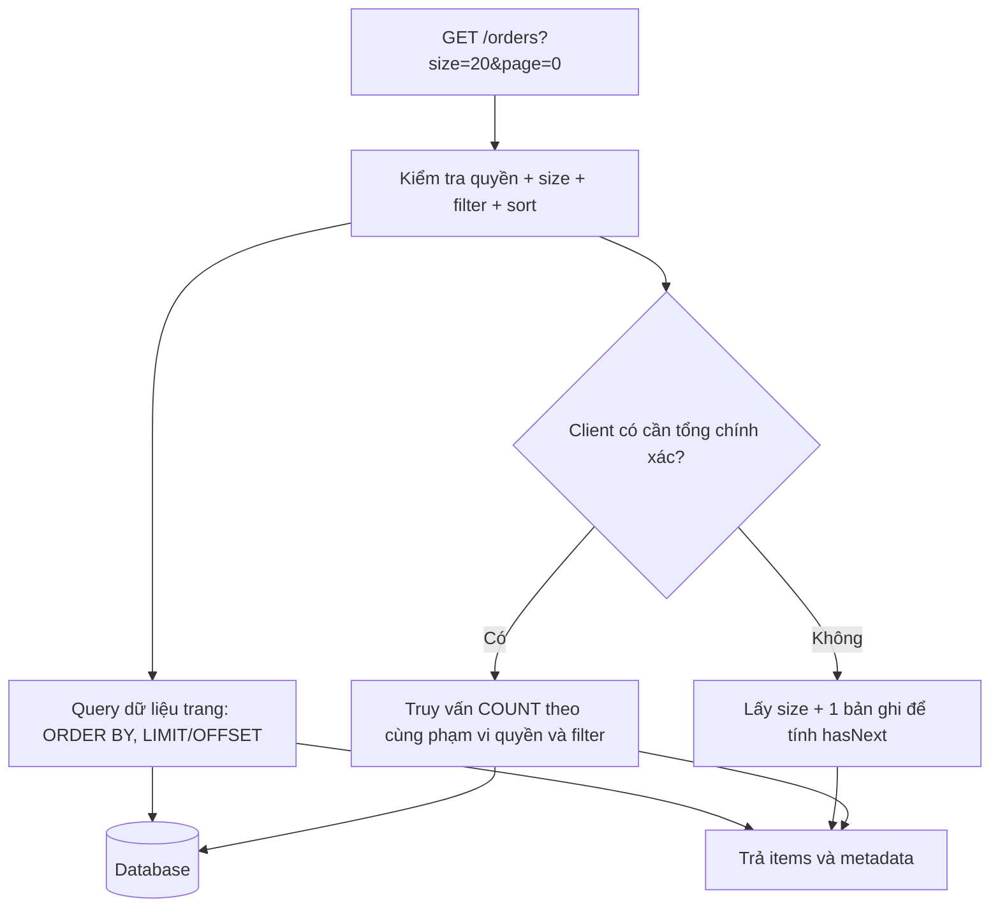

# Giới hạn page size và chi phí đếm tổng số phần tử

## 1. Vì sao phân trang không chỉ là thêm `page` và `size`?

REST API trả một tập hợp tài nguyên thường hỗ trợ lọc, sắp xếp và phân trang để client không phải tải toàn bộ dữ liệu trong một lần. Ví dụ, dịch vụ đơn hàng cung cấp:

```http
GET /orders?status=PAID&page=0&size=20 HTTP/1.1
Host: api.example.test
Accept: application/json
Authorization: Bearer <access-token>
```

Trong nhiều ứng dụng Java/Spring, việc triển khai có vẻ đơn giản: nhận `Pageable` và trả `Page<Order>`. Nhưng hai quyết định dễ bị bỏ qua có tác động lớn đến hệ thống:

1. **Một yêu cầu được phép lấy tối đa bao nhiêu phần tử?** Nếu client đặt `size=1000000`, server có thể tiêu thụ nhiều bộ nhớ, tài nguyên database, bandwidth và thời gian serialize.
2. **Có thật sự cần đếm tổng số phần tử không?** Trả `totalElements` và `totalPages` có thể kích hoạt một truy vấn `COUNT(*)` trên toàn bộ dữ liệu khớp điều kiện, dù client chỉ cần xem 20 phần tử đầu.

Tổ hợp truy vấn lấy trang và truy vấn đếm có thể làm API tăng độ trễ, tăng chi phí hạ tầng và giảm độ ổn định khi dữ liệu lớn. Thiết kế tốt phải cân bằng giữa **trải nghiệm phân trang**, **tính chính xác của thông tin tổng**, **phân quyền**, **chi phí database** và **khả năng mở rộng**.

Bài thuộc chương **Truy vấn tập hợp** của module **INTEGRATION_API_REST**. Kiến thức áp dụng trực tiếp khi thiết kế resource, URI và HTTP contract, bộ lọc/sắp xếp, caching, mã lỗi API, OpenAPI, xác thực, phân quyền và kiểm thử bằng Java/Spring hoặc công nghệ tương đương.

### Kết quả học tập

Sau khi học, bạn có thể:

- Định nghĩa `default page size`, `maximum page size` và chính sách xử lý giá trị không hợp lệ.
- Giải thích chi phí của `LIMIT/OFFSET`, truy vấn `COUNT(*)` và sắp xếp/lọc dữ liệu.
- Chọn giữa **Page**, **Slice/hasNext** và **cursor/keyset pagination** theo nhu cầu nghiệp vụ.
- Thiết kế hợp đồng API khi `totalItems` là bắt buộc, tùy chọn, xấp xỉ hoặc không có.
- Triển khai giới hạn và phân trang có thứ tự ổn định với Spring Data, bảo vệ quyền truy cập theo tenant.
- Đo hiệu năng, kiểm thử pagination boundary và nhận diện phản mẫu làm tăng tải hệ thống.

## 2. Mô hình tư duy: một truy vấn trang và một truy vấn tổng

Một màn hình đơn hàng chỉ hiển thị **20 dòng và nút “Tiếp theo”** thường cần trả lời hai câu hỏi:

1. Những đơn hàng nào thuộc trang đang xem?
2. Có ít nhất một phần tử khác nằm sau trang này không?

Nếu UI còn hiển thị “Tổng 2.483 đơn” và điều hướng tới trang cuối, API cần thêm thông tin thứ ba:

3. Có **chính xác bao nhiêu** phần tử khớp bộ lọc ở thời điểm có ý nghĩa?

Hai nhóm thông tin có thể tạo ra lượng công việc rất khác nhau.



*Sơ đồ mô tả các chiến lược thay thế, không phải ba truy vấn luôn được chạy cùng lúc. Với `Slice`, truy vấn trang có thể lấy `size + 1` bản ghi ngay trong một lần truy vấn.*

### Ví dụ SQL

Truy vấn lấy trang:

```sql
SELECT id, created_at, status, total_minor
FROM orders
WHERE tenant_id = :tenantId
  AND status = :status
ORDER BY created_at DESC, id DESC
LIMIT 20 OFFSET 0;
```

Nếu cần tổng:

```sql
SELECT COUNT(*)
FROM orders
WHERE tenant_id = :tenantId
  AND status = :status;
```

Truy vấn đầu chỉ cần **20 kết quả** sau khi áp bộ lọc và sắp xếp. Truy vấn thứ hai phải **xác định số lượng toàn bộ phần tử phù hợp**. Với index và kế hoạch tốt, database có thể tối ưu cả hai; tuy nhiên `COUNT(*)` thường phải duyệt nhiều bản ghi/chỉ mục phù hợp, nhất là khi điều kiện lọc phức tạp hoặc dữ liệu thay đổi thường xuyên.

**`LIMIT 20` không làm `COUNT(*)` tự giới hạn ở 20 phần tử.** Đây là khác biệt cốt lõi giữa “lấy một trang” và “đếm tất cả”.

## 3. Chọn page size: mặc định, tối thiểu và tối đa

Một hợp đồng phân trang nên công bố:

| Thuộc tính | Ý nghĩa | Ví dụ minh họa |
|---|---|---|
| `page` | Chỉ số trang; quy ước bắt đầu từ 0 hoặc 1 phải rõ | Bắt đầu từ 0 |
| `size` | Số phần tử tối đa client yêu cầu trong một trang | 20 |
| `defaultSize` | Số phần tử khi client bỏ qua `size` | 20 |
| `minSize` | Giá trị nhỏ nhất được chấp nhận | 1 |
| `maxSize` | Giới hạn cứng áp tại server | 100 |
| `maxPageIndex` hoặc giới hạn offset | Biện pháp tránh truy vấn offset cực sâu nếu cần | Tùy loại endpoint |
| `sort` | Thứ tự kết quả, cần whitelist và khóa phân biệt cuối | `createdAt,desc` rồi `id,desc` |

**Các số 20, 100 chỉ là ví dụ thiết kế**, không phải ngưỡng chung của REST. Page size phù hợp phụ thuộc kích thước bản ghi, độ phức tạp query, người dùng, SLO và chi phí.

### Vì sao cần giới hạn cứng?

Xét một endpoint trả bản ghi JSON trung bình 4 KB:

- Với `size=20`, lượng dữ liệu thô của danh sách khoảng 80 KB, chưa tính envelope và HTTP.
- Với `size=1000`, khoảng 4 MB.
- Với `size=100000`, khoảng 400 MB trước các overhead như object, collection, serialization và buffer.

Các con số trên chỉ là phép nhân minh họa, chưa phản ánh nén hoặc phân phối kích thước thực. Tuy nhiên, chúng cho thấy tại sao client không nên tự quyết `size` không giới hạn. Kích thước quá lớn còn gây lock contention, memory pressure, GC, timeouts và cản trở các tenant khác.

**Giới hạn phải được áp ở server** sau khi parse request và trước khi gọi repository/database. Chỉ đặt `maximum: 100` trong OpenAPI hoặc giới hạn dropdown trên giao diện không đủ bảo vệ API.

### Hai chính sách khi client yêu cầu quá giới hạn

| Chính sách | Hành vi khi `size=500` nhưng tối đa 100 | Ưu điểm | Đánh đổi |
|---|---|---|---|
| **Từ chối** | `400 Bad Request` với mã `INVALID_PAGE_SIZE` và `maxAllowedSize: 100` | Hợp đồng rõ, phát hiện client cấu hình sai | Client phải sửa request |
| **Giới hạn lại (clamp)** | Trả tối đa 100 item và ghi `effectiveSize: 100` | Tương thích với một số client cũ | Dễ gây hiểu sai nếu client tưởng đã nhận 500; cần công bố rõ |

Cả hai đều có thể hợp lý nếu được tài liệu hóa. Bài này dùng **chính sách từ chối**, vì client nhìn thấy rõ `size` không hợp lệ. Không nên âm thầm clamp trong khi response vẫn ghi `size: 500` hoặc sinh `nextPage` dựa trên 500; điều đó làm hỏng phân trang.

Ví dụ:

```http
GET /orders?size=500 HTTP/1.1
```

```http
HTTP/1.1 400 Bad Request
Content-Type: application/problem+json

{
  "type": "https://api.example.test/problems/invalid-page-size",
  "title": "Invalid page size",
  "status": 400,
  "code": "INVALID_PAGE_SIZE",
  "detail": "size phải nằm trong khoảng 1 đến 100.",
  "maxAllowedSize": 100
}
```

### Giá trị nào cần kiểm tra?

- `size` thiếu → dùng giá trị mặc định.
- `size=0` hoặc số âm → từ chối nếu hợp đồng quy định kích thước tối thiểu là 1.
- `size` vượt max → từ chối hoặc clamp theo chính sách công bố.
- `size=abc` hoặc số nguyên tràn kiểu → lỗi tham số, thường là `400`.
- `page < 0` → `400` nếu đánh số từ 0.
- `page` quá lớn → kiểm tra overflow `page × size` và giới hạn độ sâu; gợi ý cursor khi cần.
- `sort` không được hỗ trợ → `400` thay vì ghép tên cột do client nhập trực tiếp vào SQL.
- `size` dùng cùng `cursor` → định nghĩa hợp đồng nhất quán; một số API không cho thay kích thước khi dùng cùng cursor.

**Đừng dùng `429 Too Many Requests` để báo `size` vượt giới hạn.** `429` dành cho tình huống rate limiting; tham số request không hợp lệ phù hợp hơn với `400` trong hợp đồng ví dụ.

## 4. Giới hạn kích thước không thay thế giới hạn tài nguyên tổng thể

Một API có `maxSize=100` vẫn có thể quá tải nếu nhận hàng nghìn yêu cầu/giây, mỗi truy vấn join nhiều bảng. Do đó nên kết hợp:

1. **Rate limiting** theo principal/tenant/API với `429` và `Retry-After` khi thích hợp.
2. **Timeout/deadline** cho truy vấn và request, có xử lý hủy tác vụ đúng cách.
3. **Giới hạn đồng thời** truy vấn tốn tài nguyên; tránh một nhóm client chiếm toàn bộ connection pool.
4. **Hạn chế trường dữ liệu nặng** trong collection response; dùng projection/DTO nhẹ thay vì trả toàn bộ entity và liên kết.
5. **Index và query plan** thích hợp với filter và sort phổ biến.
6. **Giới hạn độ sâu** nếu dùng offset; chọn cursor cho luồng quét nhiều dữ liệu.
7. **Giám sát** latency, rows scanned/returned, DB CPU, IO, count query time và saturation.

Đừng biến mọi request list thành một tác vụ xuất dữ liệu khối lượng lớn. Khi thực sự cần tải hàng triệu bản ghi, nên cân nhắc **export job bất đồng bộ**, có phân quyền, quota, trạng thái và lifecycle riêng:

```text
POST /order-exports        -> 202 Accepted + Location: /order-exports/job-17
GET  /order-exports/job-17 -> 200 với trạng thái job
GET  /order-exports/job-17/download -> tải file khi sẵn sàng và được phép
```

## 5. Offset pagination: đơn giản nhưng cần biết chi phí trang sâu

Offset pagination thường dùng:

```text
GET /orders?page=0&size=20
GET /orders?page=1&size=20
GET /orders?page=2&size=20
```

Với page đánh số từ 0:

\[
\text{offset} = \text{page} \times \text{size}
\]

Ví dụ page 10.000 với size 100 có offset **1.000.000**. Database thường vẫn phải xác định/bỏ qua nhiều hàng đứng trước để tới trang sâu, tùy index, bộ lọc và query plan. `LIMIT 100` không tự khiến truy vấn offset một triệu luôn rẻ.

### Cần sắp xếp có tính xác định

Đoạn này chưa đủ:

```sql
SELECT id, created_at
FROM orders
WHERE tenant_id = :tenantId
ORDER BY created_at DESC
LIMIT 20 OFFSET 20;
```

Nhiều đơn có thể có cùng `created_at`. Nếu chỉ sort theo timestamp, thứ tự giữa chúng không xác định, dễ gây lặp hoặc thiếu khi qua trang ngay cả khi dữ liệu chưa thay đổi.

Nên bổ sung khóa phân biệt duy nhất:

```sql
SELECT id, created_at
FROM orders
WHERE tenant_id = :tenantId
ORDER BY created_at DESC, id DESC
LIMIT 20 OFFSET 20;
```

Việc có `id` làm tie-breaker tạo **thứ tự ổn định cho cùng một tập dữ liệu**. Tuy nhiên, nếu có đơn mới được chèn, đơn cũ bị xóa hoặc thuộc tính sort thay đổi giữa hai request, vị trí offset có thể dịch chuyển. Vì thế offset pagination vẫn có thể tạo trang trùng/thiếu dưới thay đổi đồng thời.

### Offset phù hợp khi nào?

- Dataset nhỏ hoặc độ sâu trang được giới hạn.
- Giao diện cần chọn trang số cụ thể, ít thay đổi dữ liệu.
- Dễ hỗ trợ đường dẫn và query string, điều hướng trực tiếp đến trang.
- Cần tính `totalPages` và đã chấp nhận/kiểm soát chi phí COUNT.
- Kết quả được truy vấn trong một snapshot nhất quán hoặc không yêu cầu duyệt chính xác mọi item qua nhiều request.

Đừng mặc định offset luôn là phương án tốt nhất cho activity feed, event log hoặc dữ liệu cập nhật liên tục.

## 6. Cursor/keyset pagination: lựa chọn phù hợp cho trang sâu

Cursor pagination dùng **vị trí của bản ghi cuối đã đọc**, thay vì yêu cầu database bỏ qua hàng triệu bản ghi.

Giả sử danh sách được sắp xếp theo `created_at DESC, id DESC`. Sau trang đầu, server phát hành cursor gắn với cặp giá trị của bản ghi cuối cùng. Truy vấn kế tiếp tìm những bản ghi **đứng sau cặp đó**:

```sql
SELECT id, created_at, status
FROM orders
WHERE tenant_id = :tenantId
  AND status = :status
  AND (
       created_at < :cursorCreatedAt
       OR (created_at = :cursorCreatedAt AND id < :cursorId)
  )
ORDER BY created_at DESC, id DESC
LIMIT :sizePlusOne;
```

Với index hỗ trợ điều kiện và thứ tự, keyset thường tránh được chi phí bỏ qua lượng lớn dòng như offset. Tuy nhiên tốc độ vẫn phụ thuộc selectivity, index, điều kiện lọc và plan thực tế.

### Hợp đồng cursor minh họa

```http
GET /orders?status=PAID&size=20 HTTP/1.1
```

```json
{
  "items": [
    {"id":"o-101","createdAt":"2026-11-18T09:10:00Z"},
    {"id":"o-100","createdAt":"2026-11-18T09:00:00Z"}
  ],
  "page": {
    "size": 20,
    "hasNext": true,
    "nextCursor": "opaque-token-from-server"
  }
}
```

`nextCursor` ở đây chỉ là placeholder minh họa. Cursor thực tế nên **opaque đối với client**, lưu hoặc mã hóa thông tin cần thiết theo quy tắc an toàn; không cho client sửa `tenantId`, sort, filter hay hướng phân trang.

Một cursor thường cần ràng buộc:

- **Bộ lọc và thứ tự** lúc tạo cursor.
- **Phạm vi quyền/tenant** đã được xác minh, hoặc khi dùng lại luôn kiểm tra lại quyền hiện hành.
- **Khóa vị trí** (ví dụ timestamp + ID), hướng duyệt.
- **Phiên bản token** và thời hạn nếu API áp dụng expiration.
- **Bảo vệ tính toàn vẹn** (ví dụ ký token) hoặc lưu token phía server, nếu token chứa thông tin có thể bị sửa.

Không được xem dữ liệu trong cursor do client gửi là nguồn cấp quyền. Server vẫn phải áp dụng authorization ở request hiện hành.

### Đánh đổi của cursor

| Điểm mạnh | Giới hạn |
|---|---|
| Phù hợp duyệt sâu với index đúng | Không tiện “nhảy ngay tới trang 500” |
| Ít phụ thuộc offset lớn | Cần định nghĩa cursor, vòng đời và kiểm tra bảo mật |
| Có thể giảm trùng/thiếu do chèn item mới ở đầu danh sách | Không tự bảo đảm snapshot giữa nhiều request; bản ghi có thể bị cập nhật/xóa |
| Thường không cần biết `totalPages` | UI phải dùng “Tiếp theo” hoặc infinite scrolling |

**Cursor/keyset không đồng nghĩa snapshot isolation**. Nếu cần bảo đảm xuất đúng toàn bộ dataset tại một mốc thời gian, có thể cần snapshot, watermark, export job hoặc cơ chế riêng phù hợp với yêu cầu nhất quán.

## 7. Chi phí của COUNT(*) đến từ đâu?

Nhiều developer nhìn thấy response:

```json
{
  "items": [{"id":"o-101"},{"id":"o-100"}],
  "page": 0,
  "size": 20,
  "totalElements": 2483754,
  "totalPages": 124188
}
```

và cho rằng `totalElements` là thông tin sẵn có. Thực tế, để tính tổng đúng theo filter và quyền, database có thể cần **truy vấn riêng**, đặc biệt khi dữ liệu lớn.

### Những yếu tố làm COUNT tốn kém

| Yếu tố | Tác động |
|---|---|
| **Số bản ghi khớp filter** | Đếm nhiều hàng/index entry làm tăng IO/CPU; `LIMIT` của trang không áp cho COUNT |
| **Điều kiện lọc phức tạp** | Biểu thức, join, subquery hoặc hàm có thể cản trở index |
| **JOIN quan hệ 1-n** | Một order xuất hiện nhiều dòng sau join; muốn đếm order có thể phải `COUNT(DISTINCT order.id)` |
| **Quyền truy cập theo tenant/user** | COUNT phải áp đúng policy, có thể thêm join/exists, không được đếm dữ liệu trái quyền |
| **Dữ liệu thay đổi thường xuyên** | DB cần xử lý visibility/MVCC và áp lực cập nhật index; cache tổng dễ cũ |
| **Concurrency** | Nhiều client đồng thời hỏi tổng có thể làm chi phí COUNT nhân lên |
| **Database engine và statistics** | Index-only scan, partition pruning, optimizer và isolation có thể thay đổi chi phí |
| **Sắp xếp không cần thiết** | Một count query không nên giữ `ORDER BY` vô ích; query builder cần tối ưu đúng |

Không chính xác khi nói `COUNT(*)` **luôn** quét toàn bộ bảng hoặc luôn có cùng độ phức tạp. Với dữ liệu nhỏ, index/partition phù hợp, bảng tổng hợp hoặc metadata được duy trì riêng, một số trường hợp đếm có thể rất rẻ. Nhưng **không nên mặc định rẻ** khi filter tùy ý và nhiều tenant.

### COUNT theo join cần hiểu đơn vị đang đếm

Sai nếu ý định là đếm số đơn hàng:

```sql
SELECT COUNT(*)
FROM orders o
JOIN order_items i ON i.order_id = o.id
WHERE o.tenant_id = :tenantId;
```

Một đơn có 4 item có thể bị tính 4 lần. Tùy điều kiện nghiệp vụ, cần:

```sql
SELECT COUNT(DISTINCT o.id)
FROM orders o
JOIN order_items i ON i.order_id = o.id
WHERE o.tenant_id = :tenantId;
```

Hoặc viết lại với `EXISTS`/query trên bảng orders để tránh nhân bản nếu chỉ cần biết đơn có item phù hợp. `COUNT(DISTINCT)` có thể tốn thêm CPU/memory, nên đánh giá query plan trên dữ liệu đại diện.

### Tổng chính xác không phải lúc nào cũng “bất biến”

Trong phân trang qua nhiều request:

1. Client nhận trang đầu với `totalItems = 2483754`.
2. Hệ thống có đơn mới, đơn bị xóa hoặc quyền truy cập thay đổi.
3. Client lấy trang tiếp theo; count mới có thể khác.

Thậm chí trong **cùng request**, nếu truy vấn lấy trang và truy vấn count chạy ở hai snapshot khác nhau theo isolation của database, `items` và `totalItems` có thể không hoàn toàn khớp. `@Transactional(readOnly = true)` **không tự bảo đảm một snapshot cố định** trên mọi database/isolation level. Nếu yêu cầu nhất quán chặt, cần xác định và trả giá của snapshot isolation hoặc thiết kế khác.

## 8. Chỉ cần “còn trang tiếp không”: kỹ thuật size + 1

Để biết còn ít nhất một item sau trang hiện tại, có thể yêu cầu database lấy **`size + 1` dòng** sau khi áp cùng quyền, filter và thứ tự:

```sql
SELECT id, created_at, status
FROM orders
WHERE tenant_id = :tenantId
  AND status = :status
ORDER BY created_at DESC, id DESC
LIMIT 21 OFFSET :offset;
```

Với `size=20`:

- Nếu trả về 21 bản ghi, response chỉ gửi **20** phần tử và `hasNext = true`.
- Nếu trả về không quá 20 bản ghi, `hasNext = false` trong phạm vi query đã chạy.
- Không cần đếm tổng toàn bộ dataset.

Bản ghi thứ 21 chỉ dùng để xác định có trang tiếp theo; không được đưa thêm vào content nếu hợp đồng hứa tối đa 20 item.

### So sánh Page và Slice

| Thuộc tính | `Page<T>` trong Spring Data | `Slice<T>` trong Spring Data |
|---|---|---|
| Content trang hiện tại | Có | Có |
| `hasNext()` | Có | Có |
| `getTotalElements()` | Có | Không |
| `getTotalPages()` | Có | Không |
| Query COUNT | Thường cần cho total; framework có thể tối ưu bỏ ở một số trường hợp | Thường tránh COUNT, lấy thêm phần tử để xác định next |
| Phù hợp | UI thực sự cần tổng và số trang | Infinite scrolling, next/previous, tập dữ liệu lớn |
| Đánh đổi | Truy vấn đếm có thể đắt | Không thể biết số trang cuối chính xác từ kết quả này |

`Slice` phù hợp khi client chỉ cần `hasNext`, không có yêu cầu hiển thị `totalItems`. Không cần tạo `Page` rồi xóa `totalElements` khỏi JSON: nếu repository đã thực hiện count, chi phí vẫn phát sinh.

### Không nhầm hasNext với tổng hoặc “còn một trang mãi mãi”

`hasNext=true` chỉ nói tại lúc truy vấn còn item phía sau theo filter/sort và quyền. Nó không bảo đảm item đó sẽ vẫn có mặt khi client gửi request tiếp theo. Dữ liệu mới/xóa/đổi trạng thái có thể ảnh hưởng kết quả.

## 9. Thiết kế hợp đồng response khi không có total

Ví dụ response `GET /orders?page=0&size=20`:

```http
HTTP/1.1 200 OK
Content-Type: application/json
Cache-Control: private, no-cache
```

```json
{
  "items": [
    {"id":"o-101","status":"PAID"},
    {"id":"o-100","status":"PAID"}
  ],
  "page": {
    "number": 0,
    "size": 20,
    "hasNext": true,
    "nextPage": 1
  }
}
```

Đây là **minh họa schema**, số item thực tế đã rút gọn; trong một response thật, `hasNext=true` chỉ được phát khi truy vấn xác định còn dữ liệu sau trang, không phải vì thấy hai phần tử.

Đối với collection hợp lệ nhưng không có kết quả:

```http
HTTP/1.1 200 OK
Content-Type: application/json

{"items":[],"page":{"number":0,"size":20,"hasNext":false}}
```

Trả `200` với collection rỗng là hợp lý; không nên dùng `404` chỉ vì filter không khớp item nào.

### Định nghĩa rõ hợp đồng điều hướng

Có thể chọn một trong những dạng:

- `page.number`, `page.size`, `page.hasNext` và `page.nextPage` khi dùng offset.
- `page.size`, `page.hasNext` và `page.nextCursor` khi dùng cursor.
- Liên kết chuẩn `Link: <...>; rel="next"` hoặc `links.next`, nếu API dùng HATEOAS hoặc muốn trả URL sẵn.

Chỉ trả `nextPage`/`nextCursor` khi có trang tiếp theo; nếu dùng `null` thay vì bỏ trường phải tài liệu hóa rõ. Các filter và sort phải được giữ nguyên trong URL trang sau. Không được để server sinh link làm rơi điều kiện tenant/authorization hoặc sửa bộ lọc khi chuyển trang.

## 10. Khi nào nên cung cấp total chính xác?

`totalItems` có ích cho:

- Một bảng nghiệp vụ cần hiển thị “Đang xem 1–20 trong 2.483 bản ghi”.
- Điều hướng tới trang cuối hoặc trang tùy ý.
- Báo cáo quản trị có quyền truy cập và tải truy vấn được kiểm soát.
- Tác vụ cần kiểm tra số lượng chính xác theo một snapshot được định nghĩa.

Nếu nghiệp vụ cần tổng chính xác, không nên đơn giản xóa field chỉ để query nhanh hơn. Hãy **định nghĩa yêu cầu và đo chi phí**:

1. Tổng chính xác phải phản ánh phạm vi filter và quyền nào?
2. Nó cần mới tới mức nào?
3. Có cần đồng nhất với `items` trong cùng snapshot không?
4. UI có thể đợi riêng giá trị total hay không?
5. Với hàng triệu hàng, tổng có thể được cache/duy trì trước theo dimension phù hợp không?
6. Có ngưỡng hoặc timeout mà request tổng phải từ chối không?

### Một tùy chọn: includeTotal theo yêu cầu

```text
GET /orders?status=PAID&size=20
GET /orders?status=PAID&size=20&includeTotal=true
```

Response mặc định:

```json
{
  "items": [{"id":"o-101"}],
  "page": {"size":20,"hasNext":true}
}
```

Khi yêu cầu total và được phép:

```json
{
  "items": [{"id":"o-101"}],
  "page": {
    "size":20,
    "hasNext":true,
    "totalItems":2483754,
    "totalAccuracy":"EXACT"
  }
}
```

Đây là **hợp đồng minh họa**, không phải format chuẩn của REST. Server cần công bố rằng mặc định **không chạy COUNT** và chỉ thực hiện khi `includeTotal=true`. Nếu total quá tốn kém cho một bộ lọc, có thể hạn chế khả năng này theo endpoint/quyền hoặc cung cấp cơ chế báo cáo riêng; không tự động trả một con số xấp xỉ rồi gắn nhãn `EXACT`.

### Khi nào nên dùng count riêng?

Một endpoint hoặc job chuyên trách tính tổng có thể hữu ích khi:

- COUNT có mức chi phí lớn hơn truy vấn trang rõ rệt.
- Total được tính bất đồng bộ và client chấp nhận kết quả đến sau.
- Cần cache theo filter/tenant/time window.
- Có chính sách phân quyền/quota riêng cho số liệu tổng hợp.

Nếu API cung cấp `GET /orders/count?status=PAID`, phải định nghĩa tính nhất quán, filter, auth và cache tương đương `GET /orders`; đây là **một phương án thiết kế**, không phải yêu cầu bắt buộc của REST.

## 11. Tổng xấp xỉ, tổng giới hạn dưới và metadata đếm

Không phải con số nào cũng là total chính xác. Các lựa chọn:

| Loại tổng | Nghĩa | Ví dụ UI | Điều phải công bố |
|---|---|---|---|
| **EXACT** | Đã đếm chính xác trên tập dữ liệu/snapshot được định nghĩa | “2.483 đơn” | Thời điểm/phạm vi và mức nhất quán |
| **APPROXIMATE** | Ước lượng từ thống kê, cache hoặc cấu trúc gần đúng | “Khoảng 2,5 nghìn đơn” | Nguồn ước lượng, thời điểm và sai số khi biết |
| **LOWER_BOUND** | Biết ít nhất N item tồn tại | “Ít nhất 1.000 kết quả” | Giải thích vì sao chỉ là cận dưới |
| **UNAVAILABLE** | Không tính hoặc không được phép tiết lộ total | Chỉ nút “Tiếp theo” | Không suy đoán thành 0 |

Ví dụ response chứa metadata rõ:

```json
{
  "items": [{"id":"o-101"}],
  "page": {"size":20,"hasNext":true},
  "total": {
    "value": 2500000,
    "accuracy": "APPROXIMATE",
    "computedAt": "2026-11-18T08:00:00Z"
  }
}
```

**Không hiển thị `2.500.000` như một con số tuyệt đối** nếu dữ liệu đến từ thống kê ước lượng. `computedAt` không biến tổng xấp xỉ thành chính xác. Một `total` vắng mặt khác `total.value = 0`: client cần phân biệt.

### Ước lượng cần đúng phạm vi

Một ước lượng tổng theo toàn bảng có thể vô nghĩa khi client lọc theo tenant, vai trò, khoảng thời gian hoặc điều kiện tìm kiếm. Không lấy thống kê global rồi trình bày như tổng của `tenantId=A AND status=PAID` nếu chưa có cơ chế ước lượng tương ứng và kiểm tra quyền.

Việc duy trì số đếm theo `tenant + status` qua event/materialized view có thể giảm chi phí đọc, nhưng chuyển chi phí sang **cập nhật, đối soát, xử lý event trùng/sai thứ tự và độ trễ**. Đây là đánh đổi về dữ liệu, không phải “đếm miễn phí”.

## 12. Truy vấn COUNT và chỉ mục trong database

Hiệu năng thực tế phải đo, không nên khẳng định một index bất kỳ sẽ làm cả list và count đều rẻ.

Ví dụ workload phổ biến:

```sql
SELECT id, created_at, status
FROM orders
WHERE tenant_id = :tenantId
  AND status = :status
ORDER BY created_at DESC, id DESC
LIMIT :size;
```

Một index cần cân nhắc:

```sql
CREATE INDEX idx_orders_tenant_status_created_id
ON orders (tenant_id, status, created_at DESC, id DESC);
```

Index này có thể hỗ trợ filter theo tenant/status và thứ tự theo thời gian. Nhưng:

- Nếu filter không có `status`, một index khác với tiền tố `tenant_id, created_at` có thể tốt hơn.
- Nếu cần trả nhiều cột không trong index, có thể phát sinh nhiều lần đọc bảng.
- Index bổ sung làm tăng chi phí ghi/update, dung lượng lưu và bảo trì.
- Với phân phối dữ liệu lệch, optimizer có thể chọn plan khác; cần đo bằng dữ liệu đại diện.
- Index hỗ trợ list không đồng nghĩa COUNT luôn rất nhanh, nhất là khi COUNT phải chạm nhiều entry, join hoặc áp row-level policy.

### Cách kiểm tra chi phí

Dùng công cụ truy vấn của database (ví dụ `EXPLAIN (ANALYZE, BUFFERS)` trên PostgreSQL hoặc kế hoạch tương đương) **trong môi trường kiểm thử có dữ liệu đại diện**. Kiểm tra:

1. Thời gian truy vấn trang đầu và trang sâu.
2. Thời gian của COUNT với cùng filter/auth.
3. Rows scanned vs rows returned, IO và tỷ lệ cache hit.
4. Bản ghi cùng timestamp, filter hiếm, filter phổ biến.
5. Tải đồng thời của nhiều user/tenant.
6. Tác động index lên tốc độ ghi và chi phí vận hành.

Không chạy load test nặng hay `EXPLAIN ANALYZE` gây IO lớn trực tiếp trên production khi chưa có kế hoạch vận hành thích hợp.

## 13. Đảm bảo filter, sort và phân quyền khớp nhau

Một API nhiều tenant không được trả số lượng tổng bao gồm dữ liệu mà người gọi không được quyền xem.

Sai:

```sql
-- Query trang đã lọc theo tenant
SELECT id FROM orders
WHERE tenant_id = :tenantId
ORDER BY created_at DESC, id DESC
LIMIT 20;

-- COUNT toàn bảng: rò rỉ quy mô dữ liệu tenant khác
SELECT COUNT(*) FROM orders;
```

Đúng về mặt phạm vi:

```sql
SELECT COUNT(*)
FROM orders
WHERE tenant_id = :tenantId
  AND status = :status;
```

Tuy nhiên, chỉ thêm `tenant_id` chưa đủ nếu quyền còn phụ thuộc người sở hữu đơn, vai trò, nhóm hoặc quy tắc RLS. **Query trang và query count phải áp cùng bộ lọc quyền truy cập và điều kiện nghiệp vụ**.

Ví dụ, user chỉ được thấy những đơn thuộc chi nhánh của mình: count phải dùng cùng ràng buộc chi nhánh, không chỉ tenant. Việc dùng row-level security ở database có thể giúp nhưng vẫn cần kiểm thử môi trường kết nối, chính sách, vai trò service account và behavior của count query.

### Bảo vệ từ đầu request

- Tenant phải được suy ra từ **danh tính đã xác thực và được kiểm chứng**, không tin tham số `tenantId` tự khai từ client khi không có quyền tương ứng.
- Whitelist trường sort/filter; tránh truyền tên cột SQL nguyên văn hoặc biểu thức tùy ý.
- Giới hạn số tiêu chí lọc, độ dài truy vấn tìm kiếm và những tổ hợp filter đắt.
- Chỉ trả `total` nếu chính sách cho phép tiết lộ số lượng tài nguyên.
- Ở endpoint có dữ liệu nhạy cảm, cân nhắc `Cache-Control: private`/`no-store` phù hợp và khóa cache bao gồm phạm vi quyền.
- Recheck authorization khi xử lý cursor, đặc biệt khi quyền đã bị thu hồi sau trang đầu.

## 14. Implement page size và Slice với Java/Spring

### 14.1 Controller kiểm tra đầu vào trước khi gọi service

Ví dụ Spring MVC/Spring Data minh họa. Các lớp `OrderQueryService`, `OrderView` và mapping xác thực được định nghĩa bởi ứng dụng:

```java
import java.util.List;
import org.springframework.data.domain.PageRequest;
import org.springframework.data.domain.Pageable;
import org.springframework.data.domain.Slice;
import org.springframework.data.domain.Sort;
import org.springframework.http.HttpStatus;
import org.springframework.security.core.Authentication;
import org.springframework.web.bind.annotation.GetMapping;
import org.springframework.web.bind.annotation.RequestMapping;
import org.springframework.web.bind.annotation.RequestParam;
import org.springframework.web.bind.annotation.RestController;
import org.springframework.web.server.ResponseStatusException;

record OrderSliceResponse(
    List<OrderView> items,
    int page,
    int size,
    boolean hasNext
) {}

@RestController
@RequestMapping("/orders")
class OrderQueryController {
    private static final int DEFAULT_SIZE = 20;
    private static final int MAX_SIZE = 100;
    private static final int MAX_PAGE_INDEX = 1000;

    private final OrderQueryService service;

    OrderQueryController(OrderQueryService service) {
        this.service = service;
    }

    @GetMapping
    OrderSliceResponse list(
            @RequestParam(defaultValue = "0") int page,
            @RequestParam(defaultValue = "20") int size,
            @RequestParam(required = false) String status,
            Authentication authentication) {

        if (size < 1 || size > MAX_SIZE) {
            throw new ResponseStatusException(
                HttpStatus.BAD_REQUEST,
                "size phải nằm trong khoảng 1 đến " + MAX_SIZE);
        }
        if (page < 0 || page > MAX_PAGE_INDEX) {
            throw new ResponseStatusException(
                HttpStatus.BAD_REQUEST, "page nằm ngoài phạm vi hỗ trợ");
        }

        Pageable pageable = PageRequest.of(page, size,
            Sort.by(Sort.Direction.DESC, "createdAt")
                .and(Sort.by(Sort.Direction.DESC, "id")));

        Slice<OrderView> result =
            service.findVisibleOrders(authentication, status, pageable);

        return new OrderSliceResponse(
            result.getContent(), page, size, result.hasNext());
    }
}
```

**Giải thích và giới hạn của mã:**

- `MAX_SIZE` và `MAX_PAGE_INDEX` là **giới hạn minh họa**, cần điều chỉnh theo SLO và dữ liệu.
- `DEFAULT_SIZE` trong ví dụ nêu giá trị mặc định; nếu khai báo bằng annotation `defaultValue="20"` thì tránh tạo hai nguồn cấu hình dễ lệch nhau trong triển khai thật.
- Spring tự trả lỗi cho một số tham số không parse được, nhưng hợp đồng Problem Details cần được thiết kế qua exception handling để nhất quán.
- `authentication` là danh tính do lớp security cung cấp; service phải **suy ra tenant/quyền có hiệu lực**, không dùng đầu vào không đáng tin.
- `Sort` giới hạn vào hai trường server cho phép; nếu client có `sort` thì cần whitelist và thêm `id` làm tie-breaker.
- `MAX_PAGE_INDEX` ngăn offset quá sâu trong ví dụ; khi cần quét sâu, cung cấp API cursor hoặc export.
- `Slice<OrderView>` không cần tổng và thường tránh COUNT; service/repository phải được triển khai sao cho thật sự lấy `Slice`, không chạy `Page` rồi bỏ metadata.

### 14.2 Repository trả Slice để tránh count không cần thiết

```java
import org.springframework.data.domain.Pageable;
import org.springframework.data.domain.Slice;
import org.springframework.data.jpa.repository.JpaRepository;

interface OrderRepository extends JpaRepository<OrderEntity, Long> {
    Slice<OrderEntity> findByTenantIdAndStatus(
        String tenantId, String status, Pageable pageable);
}
```

Service lấy tenant từ security context đã xác thực, áp bộ lọc được cho phép, gọi repository rồi ánh xạ `OrderEntity` thành DTO. Một ví dụ service logic:

```java
Slice<OrderView> findVisibleOrders(
        Authentication authentication, String status, Pageable pageable) {

    String tenantId = tenantResolver.requiredTenant(authentication);
    String effectiveStatus = status == null ? "PAID" : validateStatus(status);

    return repository.findByTenantIdAndStatus(
            tenantId, effectiveStatus, pageable)
        .map(orderMapper::toView);
}
```

Đây là **phác thảo service**, không phải file Java tự chạy; `tenantResolver`, `repository`, `orderMapper`, `validateStatus` phải được định nghĩa, và cách xử lý `status` mặc định phụ thuộc nghiệp vụ. Trong ví dụ, `status` rỗng được quy ước chỉ xem `PAID`; nếu API cần hỗ trợ **tất cả trạng thái**, phải dùng nhánh query phù hợp thay vì áp mặc định này âm thầm.

### 14.3 Khi thực sự cần Page

Nếu UI đã chốt yêu cầu tổng chính xác, có thể sử dụng:

```java
Page<OrderView> result =
    repository.findByTenantIdAndStatus(
        tenantId, status, pageable
    ).map(orderMapper::toView);

long totalItems = result.getTotalElements();
int totalPages = result.getTotalPages();
```

Đoạn này giả định repository có method tương ứng trả `Page<OrderEntity>`; **không thể** gán `Page` từ method chỉ khai báo trả `Slice` như ở ví dụ trước. Một ứng dụng thực tế sẽ định nghĩa method trả Page riêng hoặc chọn repository/query implementation phù hợp.

`Page` thường cần dữ liệu tổng và có thể kích hoạt COUNT query. Cần đo xem framework/database thực sự tạo bao nhiêu truy vấn, chi phí mỗi query và trường hợp nào count được tối ưu bỏ; không kết luận chỉ vì body có `totalElements` thì framework luôn chạy chính xác hai query.

## 15. Xử lý total tùy chọn mà không làm mọi request phải COUNT

Một cách thiết kế service khi UI có lúc cần total, có lúc không:

```text
GET /orders?size=20&includeTotal=false
    -> chạy query lấy trang + 1
    -> trả items, hasNext

GET /orders?size=20&includeTotal=true
    -> kiểm tra quyền dùng total nếu có
    -> query trang + truy vấn count phù hợp
    -> trả items, hasNext, totalItems và accuracy
```

Pseudo-code minh họa:

```text
function listOrders(auth, filters, page, size, includeTotal):
    validatePageAndSize(page, size)
    scope = authorizedScope(auth, filters)
    itemsPlusOne = queryPage(scope, offset=page*size, limit=size+1)
    hasNext = length(itemsPlusOne) > size
    items = first(itemsPlusOne, size)

    result = {items, page: {number: page, size, hasNext}}
    if includeTotal:
        assertCanRequestExactCount(auth, scope)
        total = countMatchingRows(scope)
        result.page.totalItems = total
        result.page.totalAccuracy = "EXACT"
    return result
```

Trong thực tế cần tránh **race condition về dữ liệu** giữa `queryPage` và `countMatchingRows` nếu hợp đồng yêu cầu snapshot thống nhất, đồng thời kiểm soát timeout, quota và hệ số tải. Nếu count thất bại, API phải định nghĩa phản hồi: trả lỗi toàn request, trả trang với total vắng mặt và cảnh báo, hoặc phục vụ total bất đồng bộ. Không âm thầm đặt `totalItems=0` khi không tính được.

## 16. Bảo đảm metadata nhất quán và dễ sử dụng

Có nhiều tên thông dụng: `totalElements`, `totalItems`, `totalCount`, `totalPages`. Chọn một bộ tên thống nhất và tài liệu hóa.

### Chỉ rõ ý nghĩa của từng trường

| Trường | Ý nghĩa | Điều cần tránh |
|---|---|---|
| `size` | Giới hạn tối đa item trong trang được trả theo hợp đồng | Nhầm với số item thực nhận |
| `returnedCount` | Số item thực sự trong trang (nếu cần) | Nhầm với tổng toàn bộ |
| `pageNumber` | Chỉ số trang nếu dùng offset | Không công bố 0-based hay 1-based |
| `hasNext` | Tại thời điểm truy vấn còn item sau trang | Xem như bảo đảm tuyệt đối cho tương lai |
| `nextCursor` | Token chuyển sang phần tiếp theo | Cho client tự sửa tenant/filter |
| `totalItems` | Số item phù hợp trong phạm vi/tại thời điểm đã định nghĩa | Dùng total global không cùng quyền/filter |
| `totalAccuracy` | EXACT/APPROXIMATE/LOWER_BOUND | Gắn EXACT cho estimate |
| `totalComputedAt` | Thời điểm tính hoặc chụp số liệu | Không nêu dữ liệu có thể cũ |

Ví dụ: `size=20` nhưng trang cuối chỉ có 7 item. `returnedCount=7` là số đã trả, còn `totalItems` có thể là 47 nếu được đếm chính xác. Việc đặt `size=7` trong response khi client yêu cầu 20 có thể gây hiểu nhầm là server đã thay page size.

Nếu count không được yêu cầu, **bỏ `totalItems`** hoặc dùng một cấu trúc phân biệt “unavailable”, tránh trả `0`. Số 0 có nghĩa dữ liệu thực sự rỗng.

## 17. OpenAPI công bố giới hạn và shape response

Một trích đoạn OpenAPI 3.1 minh họa:

```yaml
openapi: 3.1.0
info:
  title: Orders API
  version: 1.0.0
paths:
  /orders:
    get:
      summary: Liệt kê đơn hàng được phép truy cập
      parameters:
        - name: page
          in: query
          required: false
          schema:
            type: integer
            minimum: 0
            maximum: 1000
            default: 0
        - name: size
          in: query
          required: false
          schema:
            type: integer
            minimum: 1
            maximum: 100
            default: 20
        - name: status
          in: query
          required: false
          schema:
            type: string
        - name: includeTotal
          in: query
          required: false
          schema:
            type: boolean
            default: false
      responses:
        "200":
          description: Trang kết quả
          content:
            application/json:
              schema:
                $ref: "#/components/schemas/OrderList"
        "400":
          description: Tham số phân trang không hợp lệ
          content:
            application/problem+json:
              schema:
                $ref: "#/components/schemas/Problem"

components:
  schemas:
    OrderList:
      type: object
      required: [items, page]
      properties:
        items:
          type: array
          items:
            $ref: "#/components/schemas/Order"
        page:
          type: object
          required: [number, size, hasNext]
          properties:
            number:
              type: integer
            size:
              type: integer
            hasNext:
              type: boolean
            totalItems:
              type: integer
              format: int64
              minimum: 0
              description: Chỉ có nếu includeTotal=true và được phục vụ
            totalAccuracy:
              type: string
              enum: [EXACT, APPROXIMATE, LOWER_BOUND]
```

Đây là **trích đoạn**: cần định nghĩa `Order`, `Problem`, security schemes và các response liên quan trong OpenAPI đầy đủ. Đặc biệt, `maximum:100` trong schema chỉ giúp client/tooling biết giới hạn; controller/service **phải thực thi giới hạn đó**.

Khi dùng API cursor, nên mô tả tham số `cursor` và bỏ hoặc giới hạn `page` tùy hợp đồng, cùng response `nextCursor` có kiểu string. Không phát hành một OpenAPI ghi offset nhưng implementation lại chuyển sang cursor âm thầm.

## 18. Cache và chi phí đếm

Cache có thể giảm truy vấn list/count lặp lại, nhưng thay đổi cách hiểu về **độ mới và phạm vi dữ liệu**.

### Cache dữ liệu trang

Cache key cần xét ít nhất:

- URI/path, filter, sort, `page/size` hoặc cursor.
- Tenant/principal/quyền khi dữ liệu không công khai.
- Chính sách freshness và ETag nếu hỗ trợ conditional GET.
- Phiên bản dữ liệu hoặc invalidation khi cần.

Một response có thể dùng:

```http
HTTP/1.1 200 OK
Cache-Control: private, no-cache
ETag: "orders-tenantA-query-v12"
Content-Type: application/json
```

`private, no-cache` cho phép cache riêng lưu nhưng phải revalidate trước khi sử dụng lại; không phải “cấm lưu”. Nếu muốn **không lưu**, dùng `no-store` theo yêu cầu bảo mật. ETag của tập hợp phải được tạo từ logic phản ánh nội dung/phiên bản query đáng tin; không tự chế một chuỗi `v12` nếu nó không đổi khi danh sách thay đổi.

### Cache số đếm

Có thể cache total theo bộ lọc phổ biến với TTL ngắn hoặc invalidation theo sự kiện, nhưng:

- Total có thể **stale** so với dữ liệu trang.
- Một cache key không chứa tenant/quyền có thể rò rỉ số lượng.
- Số lượng các tổ hợp filter/sort có thể quá lớn, làm cache kém hiệu quả.
- Invalidation và đối soát số đếm trở thành một phần chi phí vận hành.

Nếu trả total từ cache, cần phân biệt có giữ cam kết **EXACT tại snapshot đã biết** hay chỉ là ước lượng/trễ. Không gắn nhãn total hiện thời chính xác nếu dữ liệu đã thay đổi và chưa đối soát.

## 19. Observability: đo riêng list query và count query

Một endpoint `GET /orders` có p95 900 ms chưa cho biết nguyên nhân nằm ở lấy trang, đếm tổng, map DTO hay serialization. Nên tách metric/tracing theo chặng.

| Chỉ số | Câu hỏi giải đáp |
|---|---|
| `http_server_requests_seconds` theo route | Người dùng đợi bao lâu? |
| `collection_page_query_duration` | Lấy item của trang tốn bao lâu? |
| `collection_count_query_duration` | COUNT thêm bao nhiêu độ trễ? |
| `count_requested_ratio` | Bao nhiêu request thật sự cần total? |
| `page_size_requested/effective` dạng histogram | Client thường đòi bao nhiêu item? |
| `offset_depth` hoặc cursor traversal depth | Có request trang sâu bất thường không? |
| DB scanned/returned rows, buffer hit | Query/index có hiệu quả không? |
| `429`, timeout, DB connection saturation | Có dấu hiệu quá tải hoặc lạm dụng không? |

**Đừng đưa user ID, order ID, raw filter/cursor hoặc tenant động vào nhãn metric có cardinality cao**. Dùng route template, phương án pagination, nhóm size/offset và loại lỗi đã chuẩn hóa; trace chi tiết cần có chính sách bảo mật.

### Thí nghiệm hiệu năng gợi ý

Dùng dữ liệu đại diện 1 triệu, 10 triệu bản ghi hoặc quy mô phù hợp sản phẩm; thử:

1. Trang đầu size 20/50/100, có và không có total.
2. Offset sâu với cùng filter.
3. Cursor trên cùng sort/index nếu hỗ trợ.
4. COUNT đơn giản và COUNT có join/permission filter.
5. Nhiều tenant cùng lúc, filter phổ biến/hiếm.
6. Tải đọc và ghi đồng thời để đánh giá tính nhất quán của total.

Các con số 1 triệu/10 triệu là **kích thước thử nghiệm minh họa**; không có ngưỡng mặc định cho mọi dự án.

## 20. Test contract phân trang bằng Java/Spring

### Ma trận kiểm thử

| Tình huống | Kỳ vọng |
|---|---|
| Bỏ `size` | Dùng default công bố |
| `size=1` và `size=100` | Được chấp nhận nếu trong phạm vi |
| `size=0`, `size=-1`, `size=101` | `400` theo chính sách từ chối của ví dụ |
| `size=abc` | `400` khi parse không được |
| `page=-1` hoặc quá `maxPageIndex` | `400` |
| Trang không có dữ liệu | `200` với `items=[]`, `hasNext=false` |
| Có đúng `size` bản ghi | `hasNext` phải dựa trên truy vấn thêm một item, không đoán từ số trả |
| Có `size+1` bản ghi | Trả đúng `size` item, `hasNext=true` |
| Hai bản ghi có cùng `createdAt` | Thứ tự vẫn xác định nhờ `id` |
| Không yêu cầu total | Không có `totalItems`; repository không chạy COUNT ngoài ý muốn |
| `includeTotal=true` | Total dùng cùng filter/quyền và được gắn accuracy đúng |
| Cross-tenant query | Không thấy item hoặc count của tenant khác |
| Cursor bị sửa/đổi bộ lọc | Bị từ chối hoặc xử lý an toàn theo contract |
| Ghi/xóa đồng thời | Không hứa tổng hoặc snapshot ổn định nếu contract không bảo đảm |

### Một số assertion với MockMvc

Các ví dụ giả định đã có `mockMvc`, bộ dữ liệu test và service được cấu hình:

```java
mockMvc.perform(get("/orders").param("size", "101"))
    .andExpect(status().isBadRequest());

mockMvc.perform(get("/orders")
        .param("page", "0")
        .param("size", "20"))
    .andExpect(status().isOk())
    .andExpect(jsonPath("$.page.size").value(20))
    .andExpect(jsonPath("$.page.hasNext").isBoolean())
    .andExpect(jsonPath("$.page.totalItems").doesNotExist());

mockMvc.perform(get("/orders")
        .param("page", "-1"))
    .andExpect(status().isBadRequest());
```

Cần bổ sung kiểm tra repository hoặc truy vấn thực để xác nhận:

- Không chạy COUNT trong luồng mặc định dùng `Slice`.
- Count dùng filter và authorization tương tự truy vấn item.
- Trang cuối xác định `hasNext` đúng khi số item bằng/nhỏ hơn size.
- Dữ liệu trả về không vượt max size ngay cả khi client sửa request.
- Thời gian xử lý không bị tăng đột biến ngoài SLO khi gửi nhiều yêu cầu gần giới hạn.

Nếu framework có interceptor, custom resolver hoặc gateway xử lý pagination, vẫn phải test **API qua HTTP thực**, không chỉ unit test một hàm validate tham số.

## 21. Những phản mẫu dễ gặp

| Phản mẫu | Hậu quả | Hướng sửa |
|---|---|---|
| Nhận `size` tùy ý từ client | OOM, timeout, DB quá tải | Default/min/max và validate ở server |
| Dùng `Page<T>` cho mọi endpoint | Có thể chạy COUNT không cần thiết | Dùng `Slice<T>` khi chỉ cần `hasNext` |
| Trả `totalItems=0` khi chưa đếm | Client tin tập rỗng | Bỏ field hoặc biểu diễn unavailable rõ ràng |
| Hiển thị count xấp xỉ như chính xác | UI quyết định sai | Gắn accuracy và timestamp/phạm vi |
| COUNT bỏ qua quyền/tenant | Lộ quy mô dữ liệu, sai số đếm | Dùng cùng authorization filter với list |
| `ORDER BY created_at` không có tie-breaker | Trùng/thiếu item giữa trang | Thêm khóa phân biệt duy nhất |
| Offset hàng triệu bản ghi | Scan/skip lớn, tăng latency | Giới hạn độ sâu hoặc chuyển cursor |
| Ghép sort field trực tiếp vào SQL | Injection/sort không hỗ trợ | Whitelist và map sang field được phép |
| Query count mang `ORDER BY` không cần thiết | Lãng phí tài nguyên | Tách, tối ưu query đếm |
| Query COUNT join 1-n không xét duplicate | Đếm sai | `COUNT(DISTINCT)` hoặc query phù hợp |
| Cache total global cho tenant | Sai dữ liệu, lộ thông tin | Key và policy theo scope/quyền |
| Im lặng clamp size mà không báo effective | Client tính trang sai | Từ chối hoặc công bố rõ kích thước thực |
| Chỉ đo latency trang đầu | Không phát hiện offset sâu và COUNT đắt | Benchmark theo page depth/filter/size |
| Dùng `429` cho size không hợp lệ | Sai ngữ nghĩa HTTP | `400` với Problem Details |
| Cho client sửa cursor để đổi tenant | Rò rỉ/chiếm quyền truy xuất | Token integrity + authorization mỗi request |

## 22. Bài tập thực hành: tối ưu REST API tìm kiếm đơn hàng

### Bối cảnh

Hệ thống có bảng `orders` chứa 8 triệu bản ghi thuộc nhiều tenant. Người dùng có thể lọc `status`, khoảng thời gian tạo và sắp xếp mới nhất. Client có hai loại màn hình:

- **Danh sách đơn trên ứng dụng di động**: xem 20 đơn một lần, chỉ cần nút “Xem thêm”.
- **Bảng điều khiển quản trị**: muốn lọc nâng cao, hiển thị tổng theo tenant và có thể chuyển tới trang số cụ thể.

Hiện backend:

```java
@GetMapping("/orders")
public Page<OrderEntity> list(Pageable pageable) {
    return orderRepository.findAll(pageable);
}
```

### Vấn đề cần nhận diện

1. `Pageable` có thể nhận page size lớn nếu chưa được kiểm soát ở biên.
2. `findAll` không áp filter theo tenant/người dùng, có thể gây lộ dữ liệu.
3. Trả entity trực tiếp có thể làm lộ trường nội bộ hoặc kích hoạt lazy load/N+1.
4. `Page` cung cấp total, có thể khiến database chạy COUNT không cần cho màn hình di động.
5. Nếu sort không xác định, pagination có thể trùng/thiếu item.
6. Offset sâu và filter phức tạp có thể vượt SLO.

### Phương án tham khảo

**Dành cho ứng dụng di động:** triển khai `GET /orders?size=20&cursor=...`, filter theo tenant và quyền, sort `createdAt DESC, id DESC`, trả DTO nhẹ, `hasNext` và `nextCursor`. Không trả total mặc định.

**Dành cho quản trị:** có thể dùng offset pagination với `size <= 100`, giới hạn độ sâu theo SLO, optional `includeTotal=true` khi người dùng có quyền. Đo riêng COUNT; với thống kê rộng/đắt, dùng job/report hoặc tổng được duy trì trước theo dimension nghiệp vụ và nêu độ mới.

**Chung:** schema OpenAPI rõ ràng, security ở service/repository, Problem Details cho pagination sai, query plan và index được đánh giá trên dữ liệu đại diện, cảnh báo khi chi phí COUNT vượt budget.

### Bài tập

1. Định nghĩa default/min/max page size cho mỗi loại giao diện, giải thích bằng dữ liệu/tải giả định.
2. Thiết kế hai response JSON cho ứng dụng di động có và không có trang tiếp.
3. Viết pseudo-SQL cho cursor sắp xếp theo `createdAt DESC, id DESC`, với filter tenant/status.
4. Viết COUNT query có cùng phạm vi filter và quyền; giải thích khi join 1-n cần `COUNT(DISTINCT)`.
5. Đề xuất policy cho `includeTotal=true` khi COUNT mất hơn 2 giây.
6. Viết MockMvc test cho `size=0`, `size>max`, collection rỗng, và cross-tenant count.
7. So sánh latency của Page, Slice và cursor ở trang đầu/trang sâu trên workload đại diện.

### Tiêu chí đánh giá lời giải

Một lời giải tốt cần thể hiện **server enforce giới hạn**; không dùng COUNT nếu UI không cần; total có semantics chính xác/xấp xỉ rõ; query count không rò rỉ quyền; thứ tự có tie-breaker; cursor không tin dữ liệu do client tự sửa; và luôn đo bằng dữ liệu thực tế trước khi kết luận phương án nào nhanh hơn.

## 23. Checklist chốt hợp đồng collection query

- [ ] `page` và `size` có quy ước, default, min/max và policy xử lý giá trị sai được công bố.
- [ ] Server xác thực page size trước khi truy vấn, không phụ thuộc vào UI/OpenAPI.
- [ ] Có giới hạn cho truy vấn offset sâu hoặc phương án cursor phù hợp.
- [ ] Sort có tie-breaker duy nhất, filter và sort thuộc danh sách được phép.
- [ ] Response giới hạn đúng số item; `hasNext` được xác định bằng cách phù hợp.
- [ ] Chỉ tính `totalItems` khi client/nghiệp vụ thực sự cần và được phép.
- [ ] Total có trạng thái EXACT/APPROXIMATE/LOWER_BOUND nếu hỗ trợ nhiều độ chính xác.
- [ ] Giá trị total không tính được được phân biệt với tổng bằng 0.
- [ ] Query list và query count áp cùng bộ lọc quyền, tenant, trạng thái và thời gian.
- [ ] Cache key và invalidation không chia sẻ dữ liệu/tổng giữa người dùng khác quyền.
- [ ] Cursor không cấp quyền, được bảo vệ toàn vẹn và ràng buộc với filter/sort.
- [ ] Index/query plan được đo với filter phổ biến, hiếm, trang đầu và trang sâu.
- [ ] Có metric riêng cho count query latency và tỷ lệ request đòi exact total.
- [ ] Java/Spring repository dùng `Slice` khi chỉ cần next, `Page` khi cần total theo hợp đồng.
- [ ] OpenAPI và kiểm thử phân biệt rõ trường có/không trong response, `400` cho pagination sai.
- [ ] Có phương án export/report riêng nếu nhu cầu thực tế là tải toàn bộ dữ liệu lớn.

## 24. Ghi nhớ cốt lõi

**Giới hạn page size là một phần của chính sách tài nguyên REST API.** Nó bảo vệ database, bộ nhớ, bandwidth và khả năng phục vụ công bằng giữa các client. Server phải thực thi giới hạn thật, công bố default/max, thứ tự sắp xếp và chính sách lỗi.

**Đếm tổng số phần tử là một quyết định kiến trúc có chi phí**, không phải metadata luôn miễn phí. Nếu màn hình chỉ cần “còn trang tiếp không”, thường có thể dùng `size + 1` hoặc `Slice` để tránh COUNT. Khi cần total chính xác, hãy đo query đếm, xác định snapshot/độ mới, áp quyền giống truy vấn trang và quản lý tải. Với dữ liệu lớn hoặc thay đổi liên tục, cursor/keyset và các hình thức tổng xấp xỉ hoặc bất đồng bộ có thể phù hợp hơn.

Một collection API tốt không chỉ trả trang đầu nhanh, mà còn giữ được **tính nhất quán của hợp đồng, bảo mật giữa tenant, khả năng mở rộng và chi phí có thể dự đoán** khi tập dữ liệu và số lượng người dùng tăng lên.

