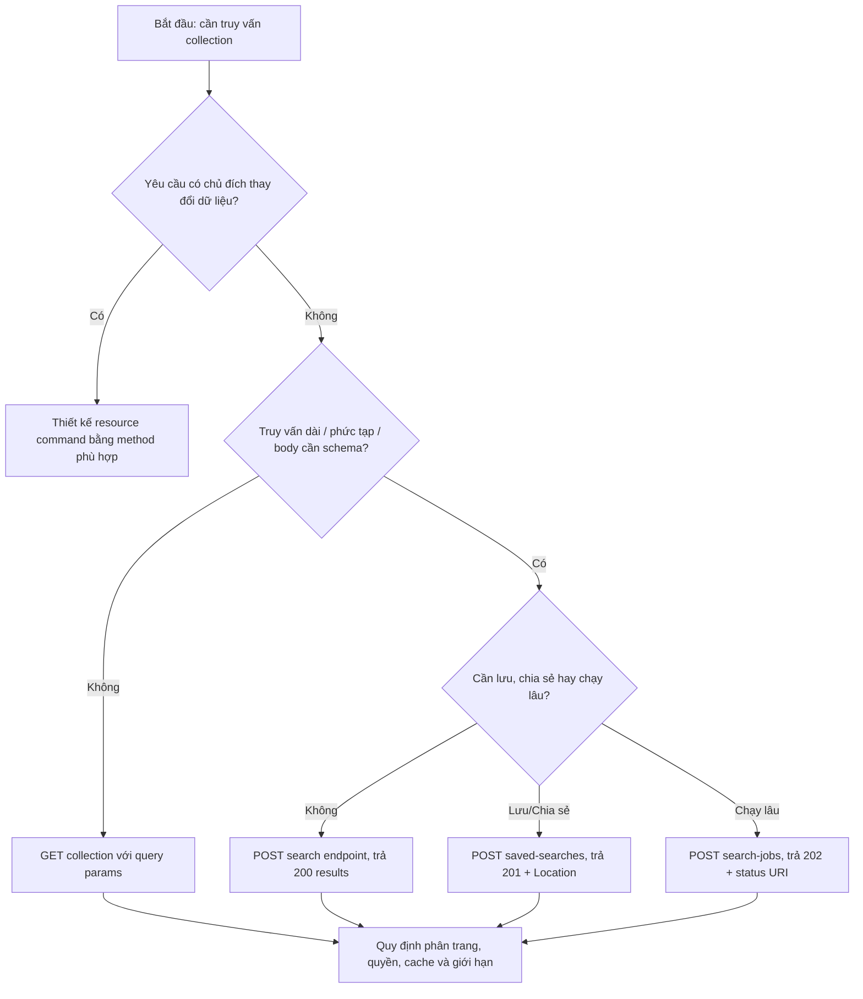
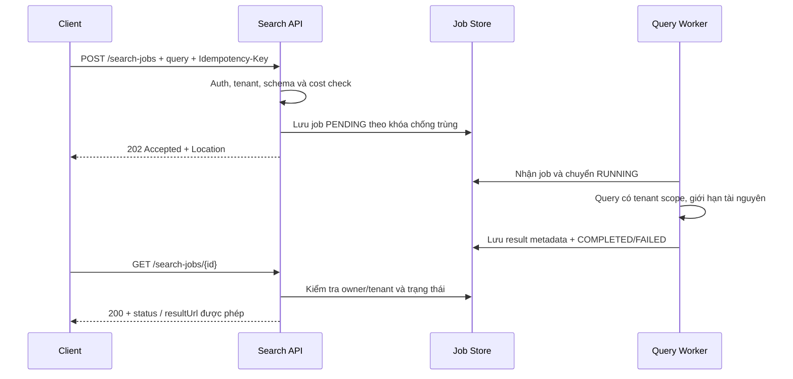

# Truy vấn phức tạp, tài nguyên tìm kiếm và lựa chọn GET hoặc POST

Một API thương mại điện tử bắt đầu bằng `GET /products?category=keyboard`. Sau vài phiên bản, người dùng cần kết hợp tìm theo tên, nhiều danh mục, khoảng giá, tồn kho, thương hiệu, điều kiện `AND/OR/NOT`, phân trang và sắp xếp theo mức độ liên quan. Nhóm phát triển phân vân: tiếp tục nhét mọi điều kiện vào URL, gửi JSON trong body của `GET`, hay đổi thành `POST /products/search`? Nếu truy vấn mất vài phút, kết quả có còn thuộc response của một request đồng bộ?

Đây là quyết định **thiết kế hợp đồng truy vấn tập hợp**, không đơn thuần là lựa chọn một phương thức HTTP cho tiện lập trình. API cần diễn đạt rõ tài nguyên nào đang được xem, ý nghĩa truy vấn, độ an toàn của thao tác, quy tắc cache, tính ổn định khi phân trang, giới hạn chi phí và quyền xem dữ liệu. Bài thuộc chương **Truy vấn tập hợp** của module **INTEGRATION_API_REST**, gắn với URI/resource, phương thức và mã HTTP, OpenAPI, xác thực, phân quyền, idempotency, kiểm thử Java/Spring.

## 1. Truy vấn tập hợp là một cách tạo biểu diễn tài nguyên

Trong REST API, tập hợp `/api/v1/products` đại diện cho một nhóm tài nguyên. Một request `GET` có thể yêu cầu **một biểu diễn của tập hợp sau lọc/sắp xếp/phân trang**, chẳng hạn:

```http
GET /api/v1/products?category=keyboard&minPrice=500000&maxPrice=2000000&sort=price_asc&limit=20 HTTP/1.1
Host: api.example.com
Accept: application/json
```

Response:

```http
HTTP/1.1 200 OK
Content-Type: application/json
Cache-Control: private, max-age=30

{
  "items": [
    { "id": "prod-101", "name": "Bàn phím A", "price": 650000 },
    { "id": "prod-102", "name": "Bàn phím B", "price": 880000 }
  ],
  "nextCursor": null,
  "limit": 20
}
```

Giá trị cache ở ví dụ chỉ minh họa **khi dữ liệu thực sự được phép cache riêng trong 30 giây**; với thông tin nhạy cảm hoặc biến động cần yêu cầu nhất quán mạnh, có thể phải dùng `private, no-store` hoặc chính sách khác.

Một truy vấn không trả kết quả vẫn là **yêu cầu thành công** nếu đã xử lý hợp lệ:

```http
HTTP/1.1 200 OK
Content-Type: application/json

{
  "items": [],
  "nextCursor": null,
  "limit": 20
}
```

**Không dùng `404 Not Found` chỉ vì tập kết quả rỗng.** `404` dành cho trường hợp tài nguyên đích không có biểu diễn hoặc bị che giấu theo hợp đồng, ví dụ truy cập một search job ID không tồn tại. Tập hợp vẫn tồn tại dù `items=[]`.

### 1.1. Phân biệt lọc, tìm kiếm, sắp xếp và phân trang

| Năng lực | Ví dụ | Câu hỏi hợp đồng cần trả lời |
|---|---|---|
| **Filtering** | `status=PAID`, `minPrice=100000` | So sánh chính xác hay gần đúng? Chuẩn hóa kiểu dữ liệu và múi giờ thế nào? |
| **Full-text search** | `q=ban%20phim` | Có tách từ, bỏ dấu, fuzzy matching, tìm các từ đồng nghĩa không? |
| **Sorting** | `sort=createdAt_desc` | Trường và hướng nào được phép? Có khóa phụ để kết quả ổn định không? |
| **Pagination** | `limit=20&cursor=...` | Cursor gắn với query/sort/tenant ra sao? Có snapshot ổn định không? |
| **Projection** | `fields=id,name,price` | Client được phép yêu cầu những trường nào? Có ảnh hưởng phân quyền không? |
| **Aggregation** | Đếm đơn theo trạng thái | Có dùng endpoint báo cáo riêng không? Count có phải chính xác tức thời không? |

Đặt tên tham số nhất quán quan trọng hơn chọn một cú pháp “chuẩn REST” không tồn tại cho mọi API. HTTP không áp đặt chung `sort`, `filter` hay `pageSize`; đó là **hợp đồng của sản phẩm**.

## 2. GET và POST khác nhau ở ngữ nghĩa HTTP

| Thuộc tính | `GET` | `POST` |
|---|---|---|
| Mục đích phương thức | Lấy biểu diễn hiện tại của tài nguyên đích. | Yêu cầu tài nguyên đích xử lý dữ liệu được gửi theo ngữ nghĩa riêng của tài nguyên. |
| **Safe** theo HTTP | Có: client không yêu cầu thay đổi trạng thái ứng dụng. | **Không được phân loại safe** theo semantics HTTP, dù server có thể triển khai một phép tìm kiếm không thay đổi dữ liệu nghiệp vụ. |
| **Idempotent** theo HTTP | Có. | Không mặc định. Cần thiết kế bảo đảm riêng nếu POST tạo job hoặc bản ghi. |
| Cache | Có cơ chế cache HTTP hỗ trợ phổ biến, tùy header/quyền. | Chỉ có thể cache trong điều kiện HTTP cụ thể; hỗ trợ thực tế ở cache/proxy thường hạn chế. |
| Truyền tiêu chí | Thường nằm trong URI query parameters. | Có thể gửi JSON trong request body. |
| Chia sẻ/bookmark | Có thể copy liên kết URL đã chứa tiêu chí. | Body không đi kèm URL, cần lưu tìm kiếm hoặc cung cấp URI riêng nếu muốn chia sẻ. |
| Rủi ro thông tin | Query string dễ xuất hiện trong history, access log, browser telemetry, Referer tùy chính sách. | Body cũng có thể bị log, lưu trong traces hoặc hệ thống phân tích nếu cấu hình sai; không tự động bí mật. |
| Retry tự động | Client/trung gian có thể xem GET là an toàn để retry theo chính sách. | Không tự retry vô điều kiện nếu có thể tạo tài nguyên/job hoặc gây side effect. |

Một `POST /products/search` trả kết quả tìm kiếm mà **không ghi dữ liệu nghiệp vụ** vẫn là cách triển khai hữu ích, nhưng các thành phần HTTP trung gian không thể tự suy ra nó safe/idempotent như `GET`. Hợp đồng phải nêu rõ liệu cùng yêu cầu có thể lặp lại an toàn hay không, nhất là khi việc tìm kiếm được ghi thành job hoặc tiêu tốn tài nguyên đáng kể.

### 2.1. Vì sao không nên dùng body của GET?

Một số HTTP client cho phép gửi body kèm GET, nhưng HTTP Semantics không định nghĩa **ngữ nghĩa chung** cho nội dung đó. Các proxy, cache, gateway và thư viện có thể bỏ qua hoặc từ chối; request body trên GET còn gây vấn đề tương thích và an toàn ở một số đường trung gian. Do đó:

```http
GET /api/v1/products HTTP/1.1
Content-Type: application/json

{"categories": ["keyboard"], "price": {"min": 500000}}
```

**Không nên chọn thiết kế này làm hợp đồng công khai.** Nếu tiêu chí đủ nhỏ, mã hóa qua query string GET; nếu cần JSON lồng nhau, chọn POST có hợp đồng rõ ràng hoặc biến một truy vấn đã lưu thành tài nguyên truy cập được bằng GET.

### 2.2. URL quá dài không có một ngưỡng phổ quát

Không có một giới hạn độ dài URL duy nhất áp dụng cho tất cả browser, reverse proxy, WAF, CDN, gateway và web server. Một truy vấn lớn với hàng trăm ID, biểu thức OR lồng nhau hoặc giá trị text dài có thể bị từ chối trước khi đến ứng dụng. `414 URI Too Long` có thể xuất hiện khi URI vượt giới hạn mà thành phần nhận chấp nhận.

Không thiết kế dựa trên giả định rằng mọi URI dài 8 KB, 16 KB hoặc 64 KB đều được hỗ trợ. Hãy **kiểm chứng đường đi thực tế**, đặt giới hạn được tài liệu hóa và dùng POST JSON khi biểu thức đủ phức tạp để URL mất tính dễ dùng.

## 3. Ma trận quyết định GET hay POST

| Nhu cầu | Phương án thường phù hợp | Lý do / điều kiện |
|---|---|---|
| Lọc vài trường, tìm theo từ khóa và phân trang thông thường | **`GET /products?...`** | URI dễ chia sẻ, cache và debug; GET an toàn/idempotent theo HTTP. |
| Các bộ lọc hữu hạn nhưng cần giá trị lặp | **GET với query parameter lặp** | Ví dụ `status=PAID&status=SHIPPED`; phải chọn quy tắc parse nhất quán. |
| Biểu thức `AND/OR/NOT` nhiều tầng, hàng trăm điều kiện, cấu trúc JSON lớn | **`POST /products/search`** hoặc search-request resource | Body có schema, validate và giới hạn dễ hơn một chuỗi URL khó đọc. |
| Điều kiện có thể chứa dữ liệu nhạy cảm | **Ưu tiên không đưa vào URL**; POST nếu hợp đồng cho phép | HTTPS bảo vệ truyền tải nhưng **body vẫn cần redaction**, quyền truy cập và retention. |
| Muốn chia sẻ hoặc lưu một truy vấn phức tạp để dùng lại | **`POST /saved-searches` → `201` + `Location`; sau đó GET theo ID** | Tìm kiếm được định danh thành tài nguyên có owner, tenant, vòng đời và permission. |
| Truy vấn mất thời gian dài hoặc cần file lớn | **POST tạo search job → `202` + URI theo dõi** | Tách việc tiếp nhận khỏi xử lý/nhận kết quả cuối; có timeout, TTL và trạng thái job. |
| Kết quả có thể cache công khai và URI đủ gọn | **GET** | Hệ sinh thái HTTP caching hỗ trợ tự nhiên hơn. |
| Muốn bắt đầu thao tác ghi hoặc cập nhật hàng loạt | **POST/PATCH/PUT/DELETE tùy tài nguyên** | Đây không còn là truy vấn đọc thông thường; không trá hình lệnh ghi trong GET. |

**Quy tắc thực hành:** bắt đầu bằng GET khi truy vấn ngắn, an toàn, có tính biểu diễn; chỉ dùng POST khi **biểu thức, dữ liệu truyền hoặc vòng đời tìm kiếm** đòi hỏi. Không có quy tắc rằng “mọi API tìm kiếm đều phải POST” hoặc “REST chỉ được tìm kiếm bằng GET”.



## 4. Thiết kế GET cho collection query

Ví dụ danh sách đơn hàng của người dùng:

```http
GET /api/v1/orders?status=PAID&status=SHIPPED&sort=createdAt_desc&limit=20 HTTP/1.1
Host: api.example.com
Authorization: Bearer <access_token>
Accept: application/json
```

Hợp đồng cần ghi rõ:

- `status` có thể xuất hiện nhiều lần: tập trạng thái được kết hợp theo OR, ví dụ `status IN (PAID, SHIPPED)`, chứ không tự hiểu thành AND.
- Các loại điều kiện khác, chẳng hạn `minTotal` và `maxTotal`, được kết hợp với trạng thái theo AND nếu đã công bố.
- `sort` là một tập giá trị được allowlist, ví dụ `createdAt_desc`, `createdAt_asc`, `total_desc`; không nhận trực tiếp tên cột SQL từ client.
- `limit` mặc định 20, lớn nhất 100; giá trị 0, âm hoặc quá mức phải trả lỗi đầu vào đã tài liệu hóa.
- Khi có `cursor`, client phải giữ nguyên điều kiện tìm, quyền truy cập và thứ tự sắp xếp theo chính sách cursor.
- Nếu không có kết quả thì `200` với mảng rỗng, không phải 404.

### 4.1. Quy ước encode query string

URL có các ký tự dành riêng; phải dùng percent-encoding phù hợp cho giá trị query. Ví dụ từ khóa chứa khoảng trắng có thể là `q=ban%20phim`; ký tự `&` trong giá trị cần encode để không bị hiểu thành dấu ngăn tham số.

Các thư viện HTTP thường có cơ chế tạo URI/query parameters an toàn; dùng chúng thay vì nối chuỗi. Không trộn `category=1,2`, `category[]=1&category[]=2` và `category=1&category=2` một cách ngẫu nhiên qua các endpoint; các cách trên có thể hợp lệ nhưng cần **chọn một cách parse rõ ràng**.

### 4.2. Projection và trường nhạy cảm

Nếu hỗ trợ `fields=id,total,status`, server vẫn phải **kiểm tra quyền đối với từng trường**. Việc client tự chọn `fields=internalNote,customerPhone` không thể vượt phân quyền. Với nhu cầu dữ liệu khác nhau theo client, cũng có thể thiết kế representation/BFF hoặc các schema cụ thể thay vì cho phép chọn mọi cột tùy ý.

## 5. Thiết kế POST search khi cần JSON phức tạp

Ví dụ giao diện lọc đơn hàng có nhiều nhóm điều kiện:

```http
POST /api/v1/orders/search HTTP/1.1
Host: api.example.com
Authorization: Bearer <access_token>
Content-Type: application/json
Accept: application/json

{
  "filter": {
    "all": [
      { "field": "createdAt", "operator": "gte", "value": "2026-11-01T00:00:00Z" },
      {
        "any": [
          { "field": "status", "operator": "in", "value": ["PAID", "SHIPPED"] },
          { "field": "totalAmount", "operator": "gte", "value": 2000000 }
        ]
      }
    ]
  },
  "sort": [
    { "field": "createdAt", "direction": "desc" },
    { "field": "id", "direction": "desc" }
  ],
  "page": { "limit": 20 }
}
```

Response với tìm kiếm đồng bộ, không tạo search resource được lưu:

```http
HTTP/1.1 200 OK
Content-Type: application/json
Cache-Control: private, no-store

{
  "items": [
    { "id": "ord-901", "status": "PAID", "totalAmount": 2500000 }
  ],
  "limit": 20,
  "nextCursor": null
}
```

Ở đây `/orders/search` là **điểm xử lý truy vấn của tập hợp đơn hàng**, và POST được chọn vì biểu thức có cấu trúc JSON. Nó không tự tạo một đơn hàng, không mở rộng quyền truy cập và không có tác dụng ghi nghiệp vụ. Vì HTTP coi POST là phương thức không safe/idempotent theo mặc định, client cần được hướng dẫn rõ về retry khi request/search job không nhận được phản hồi.

### 5.1. Định nghĩa một ngôn ngữ truy vấn có giới hạn

Không đưa trực tiếp câu SQL/JPQL, tên class, biểu thức script hay DSL không giới hạn từ client vào backend. Thay vào đó, xây **query schema hữu hạn**:

| Thành phần | Ví dụ được phép | Ràng buộc cần kiểm chứng |
|---|---|---|
| Trường | `status`, `createdAt`, `totalAmount` | Allowlist theo endpoint và quyền; không để client truy cập `tenant_id` nội bộ như một cách thay ngữ cảnh. |
| Toán tử | `eq`, `in`, `gte`, `lte`, `contains` | Chỉ cho phép toán tử phù hợp kiểu dữ liệu và chỉ mục. |
| Kết hợp logic | `all` (AND), `any` (OR) | Giới hạn độ sâu cây và số node. |
| Giá trị | Enum, số tiền, thời gian ISO 8601, text đã ràng buộc | Validate kiểu, độ dài, range và encoding; dùng bind parameters. |
| Sắp xếp | Các cặp field + asc/desc theo allowlist | Có khóa phụ duy nhất, đảm bảo phân trang dự đoán được. |
| Phân trang | `limit` + `cursor` | Giới hạn kích thước trang; cursor gắn query và tenant. |

Ví dụ chính sách kỹ thuật **minh họa**: tối đa 30 nút lọc, độ sâu 4, mỗi toán tử `in` chứa tối đa 50 giá trị, text tối đa 200 ký tự, `limit` tối đa 100. Thực tế cần đo theo dữ liệu/chỉ mục và yêu cầu sản phẩm trước khi chốt số.

### 5.2. Thứ tự xử lý một search request

1. Xác thực caller và xác định tenant/role hiện hành từ ngữ cảnh tin cậy.
2. Kiểm tra JSON/schema, kích thước, số node, độ sâu, trường và toán tử thuộc allowlist.
3. Tính cost/giới hạn quyền truy cập dữ liệu theo role; từ chối trường không được phép trước khi truy vấn nhạy cảm.
4. Chuyển biểu thức đã validate sang query builder/AST có tham số hóa.
5. Áp **tenant predicate và object-level authorization** tại data access layer; không lấy `tenantId` do client tự khai báo làm nguồn sự thật.
6. Thực thi với timeout/cost guardrails; log metrics theo template truy vấn đã chuẩn hóa mà không lưu raw text nhạy cảm.
7. Trả dữ liệu, pagination và error status đúng hợp đồng.

**Cảnh báo:** một `POST` “chỉ tìm kiếm” có thể gây chi phí CPU/DB rất lớn. Việc không ghi dữ liệu không đồng nghĩa mọi truy vấn đều an toàn cho vận hành. Rate limit và query budget là một phần hợp đồng chất lượng dịch vụ.

## 6. Khi chính truy vấn là một tài nguyên có định danh

Một API có thể biến tiêu chí tìm kiếm thành **saved search resource** để người dùng đặt tên, chia sẻ, chạy lại, quản lý hoặc xóa nó:

```http
POST /api/v1/saved-searches HTTP/1.1
Host: api.example.com
Authorization: Bearer <access_token>
Content-Type: application/json

{
  "name": "Đơn giá trị cao trong tháng",
  "filters": {
    "statuses": ["PAID", "SHIPPED"],
    "minTotal": 2000000
  },
  "sort": "createdAt_desc"
}
```

```http
HTTP/1.1 201 Created
Location: /api/v1/saved-searches/srch-42
Content-Type: application/json

{
  "id": "srch-42",
  "name": "Đơn giá trị cao trong tháng",
  "owner": "user-7",
  "status": "ACTIVE"
}
```

Từ lúc này, `GET /api/v1/saved-searches/srch-42` có thể đọc **định nghĩa truy vấn**, còn `GET /api/v1/saved-searches/srch-42/results?limit=20` có thể lấy kết quả hiện tại. Hai tài nguyên cần quyền riêng:

- **Định nghĩa truy vấn:** tên, tiêu chí, người sở hữu, cách chia sẻ và thời hạn lưu.
- **Kết quả truy vấn:** dữ liệu được tính theo quyền của **người gọi ở thời điểm thực thi**, không tự cấp quyền chỉ vì họ có liên kết saved search.

Một user được chia sẻ saved search của tenant A không mặc nhiên có quyền đọc các đơn hàng của A. Kết quả phải được giới hạn theo membership/role của người dùng và tenant đang truy cập. Nếu saved search chứa điều kiện nhạy cảm, quyền đọc định nghĩa cũng phải được kiểm tra.

### 6.1. Vì sao tạo saved search cần POST và 201?

Vì request **tạo một tài nguyên có vòng đời**, `POST /saved-searches` là lựa chọn tự nhiên. `201 Created` cùng `Location` cho client biết URI tài nguyên vừa tạo. Nếu client gửi lại POST sau timeout, có thể tạo **hai saved search**; cần cân nhắc `Idempotency-Key` hoặc unique client operation ID nếu thao tác này thường được retry.

Ngược lại, `POST /orders/search` chỉ tính kết quả đồng bộ thường trả `200`. Đừng trả `201` nếu không có tài nguyên mới nào được tạo theo hợp đồng.

## 7. Tìm kiếm lâu: thiết kế search job bất đồng bộ

Khi truy vấn duyệt hàng chục triệu bản ghi, tổng hợp báo cáo phức tạp hoặc xuất file lớn, bắt client giữ kết nối mở trong nhiều phút thường gây timeout và khó điều phối. Có thể tạo **search job**:

```http
POST /api/v1/search-jobs HTTP/1.1
Host: api.example.com
Authorization: Bearer <access_token>
Idempotency-Key: 7460b2d2-69cf-433f-b3a7-0c3d29e38276
Content-Type: application/json

{
  "resource": "orders",
  "filter": {
    "statuses": ["PAID", "SHIPPED"],
    "createdFrom": "2026-11-01T00:00:00Z"
  },
  "output": "CSV"
}
```

```http
HTTP/1.1 202 Accepted
Location: /api/v1/search-jobs/job-870
Content-Type: application/json
Cache-Control: no-store
Retry-After: 3

{
  "jobId": "job-870",
  "status": "PENDING",
  "statusUrl": "/api/v1/search-jobs/job-870"
}
```

`202 Accepted` có nghĩa **đã chấp nhận để xử lý**, chưa chắc hoàn tất hoặc thành công. `Location` và `Retry-After` trên ví dụ là **quy ước API chủ động cung cấp**, không phải HTTP tự tổ chức queue. `Retry-After: 3` chỉ nên xuất hiện khi nhà cung cấp có chính sách gợi ý kiểm tra lại sau 3 giây; client có thể dùng backoff/jitter và không polling vô hạn.

Kết quả theo dõi:

```http
GET /api/v1/search-jobs/job-870 HTTP/1.1
Host: api.example.com
Authorization: Bearer <access_token>
```

```http
HTTP/1.1 200 OK
Content-Type: application/json
Cache-Control: no-store

{
  "jobId": "job-870",
  "status": "COMPLETED",
  "resultUrl": "/api/v1/search-jobs/job-870/result",
  "expiresAt": "2026-11-19T09:00:00Z"
}
```



Job phải có **owner, tenant, TTL, quota, timeout, trạng thái FAILED/CANCELLED, quyền đọc kết quả và cơ chế xóa artifact**. Worker phải xử lý retry/idempotency, tránh hai job trùng khi client mất kết nối. Dữ liệu kết quả có thể nhạy cảm hơn query gốc: URL tải file không được có quyền vĩnh viễn và không thể suy đoán để vượt tenant.

## 8. Phân trang kết quả: offset và cursor

Truy vấn phức tạp thường trả rất nhiều bản ghi; không nên trả toàn bộ dữ liệu trong một response.

| Cách phân trang | Ví dụ | Ưu điểm | Đánh đổi |
|---|---|---|---|
| **Offset/limit** | `?offset=40&limit=20` | Đơn giản, dễ nhảy tới số trang. | Offset lớn có thể tốn tài nguyên; thêm/xóa dữ liệu giữa trang dễ gây trùng hoặc bỏ sót. |
| **Cursor/keyset** | `?limit=20&cursor=ey...` | Phù hợp dữ liệu lớn thay đổi nhanh và sắp xếp ổn định. | Khó nhảy tùy ý tới trang số N; cần schema cursor, bảo vệ và chính sách hết hạn. |
| **Snapshot/pit** | Cursor gắn với snapshot hoặc point-in-time của search index | Có thể giữ view ổn định trong một khoảng thời gian. | Tăng chi phí giữ snapshot, TTL và vận hành. |

### 8.1. SQL minh họa keyset pagination

Giả sử sử dụng PostgreSQL, phân trang theo `created_at DESC, id DESC` và chỉ cho phép xem đơn thuộc tenant đã xác minh:

```sql
-- Truy vấn minh họa bằng named parameters; adapter thực phải bind giá trị.
SELECT id, created_at, status, total_amount
FROM orders
WHERE tenant_id = :verified_tenant_id
  AND status = :verified_filter_status
  AND (created_at, id) < (:last_created_at, :last_id)
ORDER BY created_at DESC, id DESC
LIMIT :limit_plus_one;
```

Ở trang đầu, **bỏ** điều kiện cursor `(created_at, id) < (...)`; trang sau lấy cặp khóa của bản ghi cuối từ trang trước. Sử dụng `limit + 1` để biết còn trang tiếp. Mẫu này giả định `created_at` và `id` không NULL, cùng thứ tự so sánh phù hợp. Nếu sắp xếp khác, phải xây predicate tương ứng; nếu sort theo score tìm kiếm hoặc giá trị có thể thay đổi, cần cân nhắc tính ổn định hay snapshot.

Nếu query có nhiều status hoặc các nhóm OR, phải dùng query builder có tham số hóa và kiểm soát đúng ngoặc logic; không lấy raw SQL từ JSON.

### 8.2. Cursor phải gắn ngữ cảnh

Một cursor an toàn nên chứa hoặc ràng buộc:

- Vị trí tiếp theo: cặp khóa sort và các thông tin cần thiết để tiếp tục.
- **Fingerprint của query chuẩn hóa** và thứ tự sort, để không dùng cursor của tiêu chí khác.
- Tenant, actor hoặc phạm vi quyền theo chính sách, nhằm ngăn dùng cursor của tenant A cho tenant B.
- Phiên bản schema/thuật toán và thời hạn hết hiệu lực.
- Chữ ký/MAC hoặc định danh server-side để chống sửa; mã hóa nếu payload có dữ liệu không được phép lộ.

**Base64 không phải mã hóa bảo mật.** Không nhét raw query chứa PII/secret vào cursor rồi cho rằng client không đọc được. Có thể trả `400` với mã `INVALID_CURSOR` khi cursor sai/không hợp lệ; cursor hết hạn có mã riêng nếu hợp đồng cần; quyền không đủ phải bị từ chối độc lập.

Khi thực hiện cùng truy vấn nhiều lần, dữ liệu có thể thay đổi giữa các trang. **Keyset pagination tự nó không đảm bảo snapshot nhất quán**; API phải nói rõ kỳ vọng về kết quả mới, bản ghi bị sửa hoặc bị xóa trong quá trình duyệt.

## 9. Cache: lợi ích của GET và giới hạn của POST

Đối với GET, hệ sinh thái HTTP hỗ trợ cache có điều kiện:

```http
GET /api/v1/products?category=keyboard&sort=price_asc HTTP/1.1
Host: api.example.com
Accept: application/json
```

```http
HTTP/1.1 200 OK
Content-Type: application/json
Cache-Control: public, max-age=60
ETag: "products-keyboard-v37"

{"items": [{"id": "prod-101", "name": "Bàn phím A"}]}
```

Khi cache đã hết hạn và client có ETag:

```http
GET /api/v1/products?category=keyboard&sort=price_asc HTTP/1.1
Host: api.example.com
If-None-Match: "products-keyboard-v37"
```

Nếu biểu diễn không đổi theo điều kiện:

```http
HTTP/1.1 304 Not Modified
ETag: "products-keyboard-v37"
Cache-Control: public, max-age=60
```

`304` không chứa biểu diễn response body. ETag phải đại diện đúng **biểu diễn được chọn**, kể cả query, sort, quyền và dữ liệu liên quan. Ví dụ trên chỉ phù hợp **danh mục công khai giống nhau cho mọi người**; không đặt `Cache-Control: public` cho kết quả chứa dữ liệu cá nhân hoặc tenant riêng.

### 9.1. Caching cho truy vấn có xác thực

Với `GET /orders` của tenant, dùng `Cache-Control: private` nếu cho phép cache trên client theo chính sách, hoặc `Cache-Control: no-store` khi không cho lưu. `Vary` và cache key có thể phân biệt các biến thể được phép nhưng **không thay thế bảo vệ quyền**. Shared cache phải được cấu hình để không phát lại phản hồi cá nhân giữa các tài khoản; mặc định hãy ưu tiên an toàn.

### 9.2. POST search có cache được không?

HTTP có quy tắc cho phép cache một số response POST khi có thông tin freshness rõ và `Content-Location` phù hợp; tuy vậy, hỗ trợ của trình duyệt/cache/proxy cho việc tái sử dụng kết quả POST **không phổ biến như GET**. Đừng giả định thêm `Cache-Control: max-age=60` là đủ để CDN cache một request POST có JSON body.

Nếu muốn kết quả tìm kiếm phức tạp được bookmark và cache theo URI, có thể:

1. Lưu search definition hoặc tạo một search snapshot có ID qua POST.
2. Trả `201 Created` và `Location` chỉ tới tài nguyên đã tạo.
3. Cho client dùng GET để lấy search resource/result, có quyền và cache policy rõ.

Trong một số luồng, server có thể dùng `303 See Other` sau POST để hướng client tới GET URI thích hợp, nhưng phải thiết kế URL và quyền truy cập của tài nguyên đích; 303 không phải giải pháp chung cho mọi POST search.

## 10. Bảo mật và ranh giới tenant

Khi đưa truy vấn phức tạp cho client, nguy cơ lớn không chỉ là SQL injection mà còn là **bỏ sót phân quyền ở một nhánh lọc**:

| Nguy cơ | Ví dụ | Kiểm soát bắt buộc |
|---|---|---|
| Query injection | Client gửi `sort="id;DROP TABLE..."` hoặc expression script | Trường/toán tử được allowlist, bind parameter, không nối SQL/JPQL raw. |
| Cross-tenant access | User A gửi `tenantId=B` trong JSON body | Lấy tenant từ session/token đã được xác minh và membership, áp vào tất cả nhánh query. |
| Filter sai vị trí | `(tenant=A AND status=PAID) OR status=SHIPPED` | Bọc toàn bộ điều kiện người dùng trong `tenant=A AND ( ... )` để nhánh OR không vượt ranh giới. |
| Dò dữ liệu qua count/facets | Mảng kết quả đã lọc đúng nhưng `totalCount` chứa đơn của B | Áp cùng phân quyền cho dữ liệu, số lượng, gợi ý, facet và aggregation. |
| Sort trên trường bí mật | Sắp xếp theo riskScore nội bộ dù không trả trường | Chỉ cho phép sort/projection đối với trường được phê duyệt; tránh side channel. |
| Từ khóa nhạy cảm trong URL | Query chứa email, số điện thoại, ghi chú riêng | Không để dữ liệu nhạy cảm trong URL; hạn chế logging và retention kể cả với POST. |
| Cursor bị sửa hoặc tái sử dụng | Dùng cursor từ A cho B | Bind cursor với query, tenant, actor/scope và chữ ký/thời hạn. |
| Search job bị truy cập bằng ID đoán được | Người B gọi `/search-jobs/job-A` | Kiểm tra owner/tenant cho status/result/download; không chỉ bảo mật lúc tạo job. |
| Từ chối dịch vụ qua truy vấn | OR lồng nhau, join sâu, regex tốn CPU, wildcard search | Giới hạn độ sâu/số điều kiện, timeout, rate limit, query budget và index phù hợp. |

### 10.1. SQL tenant guard không thể chỉ dựa vào UI

Một lỗi thường gặp:

```sql
-- SAI: Nhánh OR cuối có thể trả dữ liệu ngoài tenant A.
WHERE tenant_id = :tenant_a AND status = 'PAID'
   OR status = 'SHIPPED';

-- ĐÚNG VỀ CẤU TRÚC: tenant bảo vệ cả nhóm điều kiện.
WHERE tenant_id = :verified_tenant_id
  AND (status = 'PAID' OR status = 'SHIPPED');
```

Ngoài tenant predicate, vẫn phải kiểm tra quyền đối tượng (ví dụ user chỉ xem đơn thuộc cửa hàng được phân công). Nếu sử dụng RLS trong database, nó là lớp phòng vệ bổ sung; không xóa quyền ở service và không cho role ứng dụng bypass toàn bộ RLS.

### 10.2. Quyền với dữ liệu vừa tạo từ truy vấn

Saved search, search job, báo cáo CSV, cache kết quả, snapshot và URL tải xuống là **tài nguyên mới có vòng đời riêng**. Chúng cần được phân loại theo độ nhạy, có owner/tenant, quyền đọc/xóa, TTL, audit và chính sách lưu trữ. Xóa một saved search không nhất thiết xóa dữ liệu gốc; xóa một kết quả tạm có thể cần dọn file, object versions và cache theo phạm vi đã công bố.

## 11. Chi phí thực thi: biểu thức hợp lệ vẫn có thể rất đắt

Một truy vấn đúng schema có thể tốn tài nguyên vì:

- `OR` nhiều nhánh khó tận dụng chỉ mục.
- Toán tử `contains` hoặc wildcard đầu chuỗi tạo full table scan.
- `OFFSET 500000` khiến database bỏ qua nhiều dòng.
- Sort theo cột không có index hoặc sort một tập rất lớn.
- `JOIN` nhiều bảng làm nhân số hàng và có thể trả kết quả trùng.
- `COUNT(*)` chính xác trên tập lớn phải quét đáng kể dữ liệu.
- Fuzzy/vector search và facets có chi phí khác hẳn lọc giá trị chính xác.

### 11.1. Dùng giới hạn theo nhiều lớp

| Lớp | Giới hạn cần thiết | Ví dụ kiểm tra |
|---|---|---|
| API Gateway | Request size, request rate, thời gian kết nối, authentication | Body quá lớn trả 413; vượt quota trả 429. |
| Validation | Số trường, độ sâu cây, toán tử, số giá trị IN, độ dài text | Phân loại `400`/`422` rõ ràng. |
| Query Planner | Allowlist index/path, hạn chế join/aggregation đắt | Từ chối hoặc đưa vào search job theo chi phí ước lượng. |
| Database/Search | Statement timeout, pool limit, memory quota, circuit breaker | Không để một truy vấn chiếm hết tài nguyên tenant khác. |
| Pagination | Page size, cursor TTL, hạn chế offset lớn | Chặn download toàn bộ ngoài hợp đồng. |
| Job Worker | Concurrency theo tenant, thời gian chạy, quotas, TTL artifact | Xếp hàng công bằng, hủy tác vụ và phát hiện job lỗi. |

Các chỉ số nên đo: P50/P95/P99 latency theo loại query, số dòng quét so với số trả, tỷ lệ timeout, cache hit, query fan-out, tài nguyên CPU/memory, thời gian queue, dữ liệu chuyển ra mạng và chi phí trên một tìm kiếm thành công. Không đưa nguyên query chứa PII vào nhãn metrics có cardinality cao.

### 11.2. Chọn dữ liệu gốc hay search index

Đơn hàng cần nhất quán mạnh cho cập nhật trạng thái có thể đọc từ cơ sở dữ liệu giao dịch; tìm kiếm văn bản/tổng hợp quy mô lớn có thể dùng một **search index** được cập nhật bất đồng bộ.

| Nguồn truy vấn | Lợi ích | Đánh đổi |
|---|---|---|
| Database giao dịch | Dữ liệu gần nguồn sự thật, thuận lợi cho filter theo chỉ mục chính xác | Search văn bản phức tạp và aggregation có thể ảnh hưởng workload ghi. |
| Search engine/index | Full-text, relevance, facets, tìm kiếm phức tạp và scale riêng | Eventual consistency, cần đồng bộ/rebuild, bảo vệ tenant và index permissions. |
| Data warehouse/analytics | Tổng hợp khối lượng rất lớn | Thường có độ trễ cập nhật và chi phí job, không phù hợp phản hồi nghiệp vụ thời gian thực. |

Nếu dùng index bất đồng bộ, công bố độ trễ cập nhật kỳ vọng và cách xử lý trường hợp tài nguyên mới xóa nhưng vẫn xuất hiện trong index. **Không để kết quả tìm kiếm cấp quyền đọc nội dung đã bị thu hồi**, dù index chưa đồng bộ.

## 12. Chọn mã trạng thái và lỗi cho API tìm kiếm

| Tình huống | Status thường phù hợp | Ghi chú |
|---|---|---|
| Search/GET hợp lệ, có hoặc không có hits | **`200 OK`** | Mảng `items` có thể rỗng. |
| Tạo saved search thành công | **`201 Created`** | Có `Location` trỏ tài nguyên được tạo. |
| Nhận search job chạy nền | **`202 Accepted`** | Có job URI/trạng thái; chưa chắc hoàn tất. |
| Sai cú pháp JSON, sai kiểu query param, cursor giả mạo | **`400 Bad Request`** | Có mã lỗi ứng dụng cụ thể, không lộ parser internals. |
| JSON hợp lệ nhưng điều kiện/tổ hợp không được hỗ trợ | **`422 Unprocessable Content`** nếu hợp đồng chọn | Có thể dùng 400 nhất quán; phân biệt từ đầu. |
| Thiếu token hoặc token không hợp lệ | **`401 Unauthorized`** | Có `WWW-Authenticate` phù hợp. |
| Token hợp lệ nhưng không có quyền search trường/tài nguyên | **`403 Forbidden`** | Không công bố danh sách trường bí mật hoặc tenant khác. |
| Saved search / job ID không tồn tại hoặc bị che giấu | **`404 Not Found`** | Khác trường hợp `items=[]`. |
| Thay đổi/xung đột trạng thái saved search hoặc job | **`409 Conflict`** | Ví dụ job đã hoàn tất không thể hủy theo policy. |
| Body quá lớn | **`413 Content Too Large`** | Giới hạn do thành phần nhận request áp dụng. |
| URI quá dài | **`414 URI Too Long`** | Có thể do gateway/proxy từ chối trước khi vào ứng dụng. |
| Vượt quota | **`429 Too Many Requests`** | Có thể kèm `Retry-After`. |
| Dịch vụ tìm kiếm tạm không sẵn sàng | **`503 Service Unavailable`** | Không giả vờ trả empty results khi index chết. |

Lỗi nên dùng **Problem Details** với `application/problem+json` (RFC 9457) và mã máy đọc được ổn định:

```http
HTTP/1.1 422 Unprocessable Content
Content-Type: application/problem+json
Cache-Control: no-store

{
  "type": "https://api.example.com/problems/unsupported-search",
  "title": "Unsupported search query",
  "status": 422,
  "detail": "One or more search conditions are not supported.",
  "code": "SEARCH_FILTER_NOT_SUPPORTED",
  "errors": [
    {
      "pointer": "/filter/all/1/any/0/operator",
      "code": "OPERATOR_NOT_ALLOWED",
      "message": "This operator is unavailable for the selected field."
    }
  ]
}
```

`code` và `errors` là **extension do API định nghĩa**, không phải field bắt buộc của RFC. Khi thiếu quyền, thông báo không được liệt kê tên cột nội bộ hay trường chỉ tenant khác được thấy. Với `429`, `503` và search job, client cần backoff phù hợp; không retry POST một cách vô hạn nếu có thể tạo job mới.

## 13. Ví dụ Java/Spring Boot cho GET và POST search

Ví dụ dùng **Spring Boot 3, Spring MVC, Jakarta Validation và Spring Security**. Đoạn mã tập trung vào hợp đồng HTTP; `OrderSearchService`, `SearchPage` và `OrderSummary` là abstraction ứng dụng cần hiện thực. Không coi chúng là chương trình hoàn chỉnh có thể biên dịch ngay nếu chưa có lớp hỗ trợ và security configuration.

### 13.1. DTO POST có validation

```java
import jakarta.validation.Valid;
import jakarta.validation.constraints.Max;
import jakarta.validation.constraints.Min;
import jakarta.validation.constraints.NotNull;
import jakarta.validation.constraints.Pattern;
import jakarta.validation.constraints.Size;
import java.time.Instant;
import java.util.List;

public record OrderSearchRequest(
    @NotNull @Valid OrderFilters filters,
    @Min(1) @Max(100) Integer limit,
    @Pattern(regexp = "createdAt_desc|createdAt_asc|total_desc|total_asc")
    String sort,
    String cursor
) {
    public record OrderFilters(
        @Size(max = 10)
        List<@Pattern(regexp = "PENDING|PAID|SHIPPED|CANCELLED") String> statuses,
        Instant createdFrom,
        Instant createdTo,
        Long minTotal,
        Long maxTotal
    ) {}
}
```

DTO trên hỗ trợ **một tập con có cấu trúc cố định** của biểu thức tìm kiếm phức tạp: danh sách trạng thái, khoảng thời gian và khoảng tổng tiền. Nó không tự hỗ trợ `all/any` lồng nhau ở mục 5; nếu cần bộ lọc đệ quy, phải thiết kế model AST với validator giới hạn độ sâu, whitelist field/operator và test riêng. Không dùng ánh xạ tùy ý từ JSON thành SQL.

`@Min`/`@Max` không tự kiểm tra quan hệ `minTotal <= maxTotal` hoặc `createdFrom <= createdTo`; service/validator nghiệp vụ cần kiểm tra chéo. Giá trị `limit`/`sort` bỏ trống có thể dùng default đã tài liệu hóa, ví dụ 20 và `createdAt_desc`.

### 13.2. Controller với hai entrypoint

```java
import jakarta.validation.Valid;
import jakarta.validation.constraints.Max;
import jakarta.validation.constraints.Min;
import jakarta.validation.constraints.Pattern;
import java.util.List;
import org.springframework.http.CacheControl;
import org.springframework.http.MediaType;
import org.springframework.http.ResponseEntity;
import org.springframework.security.core.Authentication;
import org.springframework.validation.annotation.Validated;
import org.springframework.web.bind.annotation.GetMapping;
import org.springframework.web.bind.annotation.PostMapping;
import org.springframework.web.bind.annotation.RequestBody;
import org.springframework.web.bind.annotation.RequestMapping;
import org.springframework.web.bind.annotation.RequestParam;
import org.springframework.web.bind.annotation.RestController;

@Validated
@RestController
@RequestMapping("/api/v1/orders")
public class OrderSearchController {
    private final OrderSearchService searchService;

    public OrderSearchController(OrderSearchService searchService) {
        this.searchService = searchService;
    }

    @GetMapping
    public ResponseEntity<SearchPage<OrderSummary>> list(
            @RequestParam(required = false)
            @Pattern(regexp = "PENDING|PAID|SHIPPED|CANCELLED") String status,
            @RequestParam(defaultValue = "20")
            @Min(1) @Max(100) int limit,
            @RequestParam(required = false) String cursor,
            Authentication authentication) {

        var filters = new OrderSearchRequest.OrderFilters(
            status == null ? List.of() : List.of(status),
            null, null, null, null);
        var query = new OrderSearchRequest(
            filters, limit, "createdAt_desc", cursor);
        return ResponseEntity.ok()
            .cacheControl(CacheControl.noStore())
            .body(searchService.search(authentication, query));
    }

    @PostMapping(path = "/search",
                 consumes = MediaType.APPLICATION_JSON_VALUE)
    public ResponseEntity<SearchPage<OrderSummary>> search(
            @Valid @RequestBody OrderSearchRequest query,
            Authentication authentication) {
        return ResponseEntity.ok()
            .cacheControl(CacheControl.noStore())
            .body(searchService.search(authentication, query));
    }
}
```

Đoạn code cố ý đặt `Cache-Control: no-store` cho dữ liệu đơn hàng của người dùng. Cả GET và POST đều gọi chung một service/policy nên kết quả có ý nghĩa nhất quán. Với API thật:

- Security filter phải xác minh token/phiên và scope cần thiết, ví dụ `SCOPE_orders:read`; lỗi `401/403` do security layer xử lý đúng.
- Search service **phải tự xác định tenant và quyền** từ `Authentication`; không tin vào tenant do body/query param gửi lên.
- Cursor cần validate chữ ký, TTL, query fingerprint; các danh sách, giới hạn và mốc thời gian cần kiểm tra tại service kể cả khi DTO có validation.
- Nên giới hạn thời gian, truy vấn và dung lượng kết quả; không cho người dùng truyền một `sort` bất kỳ để nội suy thành SQL.
- Cần mapping exception/validation sang Problem Details và test status thực tế. `@Validated` trên method parameter có hành vi phụ thuộc phiên bản/cấu hình Spring; không đoán mọi lỗi method validation đều mặc định trả 400 nếu chưa kiểm thử.

### 13.3. SQL/Query builder phía sau phải được giới hạn

Ví dụ dưới đây chỉ là biểu thức SQL có tham số sau khi service đã xác minh tenant, status và cursor:

```sql
SELECT id, created_at, status, total_amount
FROM orders
WHERE tenant_id = :verified_tenant_id
  AND status = :validated_status
  AND (created_at, id) < (:cursor_time, :cursor_id)
ORDER BY created_at DESC, id DESC
LIMIT :limit_plus_one;
```

Ở trang đầu bỏ điều kiện cursor. Query builder với nhiều bộ lọc sẽ thêm các clause tương ứng và bind tham số đúng kiểu; đây không phải query có thể dùng nguyên văn qua JDBC `PreparedStatement` mặc định (JDBC dùng placeholder `?`, còn ví dụ dùng named parameters). Với truy vấn phức tạp, có thể dùng JPA Criteria API, Specification, jOOQ, QueryDSL hoặc query builder tương đương; lựa chọn theo quy mô và giới hạn dự án, không nối chuỗi SQL từ `field/operator` client.

Tạo index theo truy vấn thực tế, ví dụ PostgreSQL có thể hưởng lợi từ index `(tenant_id, status, created_at DESC, id DESC)` cho dạng search tương ứng. Kiểm tra execution plan, selectivity và chi phí thực trước khi thêm hàng loạt index; index cũng làm tăng chi phí ghi và lưu trữ.

## 14. OpenAPI 3.1 cho GET list và POST search

Ví dụ schema rút gọn nhưng phân biệt rõ hai hợp đồng:

```yaml
openapi: 3.1.0
info:
  title: Orders Search API
  version: 1.0.0
paths:
  /api/v1/orders:
    get:
      summary: List visible orders with simple filters
      security:
        - bearerAuth: []
      parameters:
        - name: status
          in: query
          required: false
          schema:
            type: string
            enum: [PENDING, PAID, SHIPPED, CANCELLED]
        - name: limit
          in: query
          required: false
          schema:
            type: integer
            minimum: 1
            maximum: 100
            default: 20
        - name: cursor
          in: query
          required: false
          schema:
            type: string
      responses:
        "200":
          description: Page of orders visible to the caller, possibly empty
          content:
            application/json:
              schema:
                $ref: "#/components/schemas/OrderPage"
        "400":
          description: Invalid query parameters or cursor
          content:
            application/problem+json:
              schema:
                $ref: "#/components/schemas/ApiProblem"
        "401":
          description: Missing or invalid authentication
          headers:
            WWW-Authenticate:
              schema:
                type: string
        "403":
          description: Caller lacks permission
        "429":
          description: Search quota exceeded
  /api/v1/orders/search:
    post:
      summary: Search visible orders with structured filters
      description: Computes results synchronously without saving a search.
      security:
        - bearerAuth: []
      requestBody:
        required: true
        content:
          application/json:
            schema:
              $ref: "#/components/schemas/OrderSearchRequest"
      responses:
        "200":
          description: Search completed, possibly with zero matches
          content:
            application/json:
              schema:
                $ref: "#/components/schemas/OrderPage"
        "400":
          description: Invalid request shape or syntax
        "401":
          description: Missing or invalid authentication
          headers:
            WWW-Authenticate:
              schema:
                type: string
        "403":
          description: Insufficient permission
        "422":
          description: Unsupported search filter
          content:
            application/problem+json:
              schema:
                $ref: "#/components/schemas/ApiProblem"
        "429":
          description: Search quota exceeded
        "503":
          description: Search temporarily unavailable
components:
  securitySchemes:
    bearerAuth:
      type: http
      scheme: bearer
      bearerFormat: JWT
  schemas:
    OrderSearchRequest:
      type: object
      required: [filters]
      properties:
        filters:
          type: object
          properties:
            statuses:
              type: array
              maxItems: 10
              items:
                type: string
                enum: [PENDING, PAID, SHIPPED, CANCELLED]
            createdFrom:
              type: string
              format: date-time
            createdTo:
              type: string
              format: date-time
            minTotal:
              type: integer
            maxTotal:
              type: integer
        limit:
          type: integer
          minimum: 1
          maximum: 100
          default: 20
        sort:
          type: string
          enum: [createdAt_desc, createdAt_asc, total_desc, total_asc]
          default: createdAt_desc
        cursor:
          type: string
    OrderPage:
      type: object
      required: [items, limit]
      properties:
        items:
          type: array
          items:
            type: object
            required: [id, status, totalAmount]
            properties:
              id:
                type: string
              status:
                type: string
              totalAmount:
                type: integer
        limit:
          type: integer
        nextCursor:
          type:
            - string
            - "null"
    ApiProblem:
      type: object
      properties:
        type:
          type: string
        title:
          type: string
        status:
          type: integer
        detail:
          type: string
        code:
          type: string
```

OpenAPI trên mô tả `GET` có một `status` đơn và `POST` có mảng `statuses`. Vì vậy, nếu chọn cách GET nhận tham số lặp như mục 4, phải thay schema/parameter sang array với `style: form, explode: true`, đồng thời sửa controller và test tương ứng. **Tài liệu, mã xử lý và SDK phải dùng cùng một hợp đồng**, không dựa vào ví dụ minh họa trước đó để mặc định những khả năng chưa được triển khai.

Với saved search và search job, cần thêm các path POST/GET tương ứng, `201/202`, `Location`, trạng thái, retention và security của operation resource; phần OpenAPI rút gọn này tập trung so sánh hai lối tìm kiếm đồng bộ.

## 15. Kiểm thử contract, bảo mật và hiệu năng

### 15.1. Ma trận kiểm thử đề xuất

| Mã | Tình huống | Kết quả cần xác minh |
|---|---|---|
| GET-01 | Không có tham số | 200 với default sort/page, chỉ trả tài nguyên được phép. |
| GET-02 | Bộ lọc hợp lệ nhưng không có kết quả | 200 với `items=[]`; không dùng 404. |
| GET-03 | `limit=0` hoặc `limit=100000` | 400/422 theo hợp đồng; không chạy query mất kiểm soát. |
| GET-04 | URL vượt giới hạn gateway | 414 tại thành phần phù hợp; không trả 500 hoặc thông tin nội bộ. |
| GET-05 | Từ khóa có `&`, dấu tiếng Việt và ký tự encode | Parse chính xác; không tách sai tham số. |
| GET-06 | GET kèm body JSON | Không dựa vào body để lọc; có thể từ chối theo chính sách. |
| POST-01 | JSON filter phức tạp hợp lệ | 200, kết quả đúng logic AND/OR, sort ổn định. |
| POST-02 | Filter dùng tên trường/toán tử không được phép | 400/422 với mã ổn định, không lộ tên cột database. |
| POST-03 | Độ sâu hoặc số predicate vượt giới hạn | Từ chối theo schema/quota trước khi chạy query. |
| POST-04 | Body quá lớn | 413, không gây ngốn memory/CPU ngoài giới hạn. |
| POST-05 | Cùng search đọc đồng bộ gửi lại | Không tạo đơn hoặc search job ngoài hợp đồng; kết quả chỉ khác do dữ liệu thay đổi. |
| AUTH-01 | Không có token trên API bảo vệ | 401 với `WWW-Authenticate`. |
| AUTH-02 | Actor không có quyền đọc đơn | 403; không trả kết quả/facet/count nhạy cảm. |
| TEN-01 | Tenant A cố lọc `tenantId=B` hoặc OR có nhánh B | Không trả dữ liệu/count/preview B, không cho bypass tenant. |
| TEN-02 | Sort/projection theo trường bí mật | Bị từ chối hoặc loại theo policy, không lộ dữ liệu qua thứ tự. |
| PAGE-01 | Hai trang liên tiếp với sort `createdAt DESC, id DESC` | Không trùng bản ghi khi dữ liệu tĩnh, cursor đúng vị trí. |
| PAGE-02 | Dùng cursor của A cho B hoặc đổi filter/sort | Không chấp nhận cursor; không rò dữ liệu. |
| PAGE-03 | Dữ liệu thêm/xóa giữa các trang | Hành vi đúng cam kết consistency, không hứa snapshot khi chưa hỗ trợ. |
| SAVE-01 | Tạo saved search thành công | 201 + `Location`, có owner/tenant và quyền đọc riêng. |
| JOB-01 | Tạo search job rồi poll | 202 + URI, PENDING → COMPLETED/FAILED, quyền theo dõi đúng. |
| JOB-02 | POST tạo job bị retry với cùng idempotency key | Không tạo hai job; request khác payload được xử lý xung đột theo contract. |
| CACHE-01 | GET tài nguyên công khai với ETag | Trả 304 khi không đổi; không trả nội dung cho 304. |
| CACHE-02 | Truy vấn đơn riêng tư qua shared cache | Không rò dữ liệu giữa user/tenant. |
| PERF-01 | OR/IN lớn, offset cao, sort không index | Thời gian xử lý, query cost và quota trong giới hạn; có metrics/trace. |

Kiểm thử cần xem **dữ liệu thực tế, query plan, logs, response status/headers và trạng thái operation**, không chỉ nhìn body có đúng số trường. Test tenant phải có ít nhất hai tenant với dữ liệu có thể nhận diện và người dùng tham gia hai tenant bằng role khác nhau.

### 15.2. Ví dụ MockMvc cho GET và POST

Nếu dự án có `spring-security-test`, có thể test hai route dùng JWT giả lập và serializer:

```java
import static org.springframework.security.test.web.servlet.request.SecurityMockMvcRequestPostProcessors.jwt;
import static org.springframework.test.web.servlet.request.MockMvcRequestBuilders.get;
import static org.springframework.test.web.servlet.request.MockMvcRequestBuilders.post;
import static org.springframework.test.web.servlet.result.MockMvcResultMatchers.*;

import org.junit.jupiter.api.Test;
import org.springframework.beans.factory.annotation.Autowired;
import org.springframework.boot.test.autoconfigure.web.servlet.AutoConfigureMockMvc;
import org.springframework.boot.test.context.SpringBootTest;
import org.springframework.http.MediaType;
import org.springframework.security.core.authority.SimpleGrantedAuthority;
import org.springframework.test.web.servlet.MockMvc;

@SpringBootTest
@AutoConfigureMockMvc
class OrderSearchContractTest {
    @Autowired MockMvc mvc;

    @Test
    void simpleGetQueryIsAccepted() throws Exception {
        mvc.perform(get("/api/v1/orders")
                .param("status", "PAID")
                .param("limit", "20")
                .with(jwt().authorities(
                    new SimpleGrantedAuthority("SCOPE_orders:read"))))
            .andExpect(status().isOk())
            .andExpect(jsonPath("$.items").isArray());
    }

    @Test
    void structuredPostSearchReturnsResults() throws Exception {
        String json = """
            {
              "filters": {"statuses": ["PAID", "SHIPPED"]},
              "sort": "createdAt_desc",
              "limit": 20
            }
            """;
        mvc.perform(post("/api/v1/orders/search")
                .contentType(MediaType.APPLICATION_JSON)
                .content(json)
                .with(jwt().authorities(
                    new SimpleGrantedAuthority("SCOPE_orders:read"))))
            .andExpect(status().isOk())
            .andExpect(jsonPath("$.items").isArray());
    }
}
```

Các test này giả định search service và fixture dữ liệu đã được dựng; chúng minh họa contract, **chưa phải bộ kiểm thử hoàn chỉnh**. `jwt()` của test tạo security context giả lập, không chứng minh chữ ký, issuer/audience của token production được xác minh. Phải bổ sung test tích hợp với token không hợp lệ, kiểm thử tenant isolation ở repository, kiểm thử cursor bị sửa và tải truy vấn đắt.

## 16. Bài tập thiết kế: công cụ tìm kiếm đơn hàng SaaS

### Đề bài

Một nền tảng SaaS nhiều tenant quản lý 80 triệu đơn hàng. Người dùng cần:

- Lọc theo trạng thái, khoảng thời gian, khoảng giá trị và từ khóa.
- Nhập các nhóm điều kiện OR, ví dụ `(PAID OR SHIPPED) AND total >= 2.000.000`.
- Phân trang 50 dòng/lần, sắp xếp `createdAt DESC`, chia sẻ một số bộ lọc đã lưu.
- Một báo cáo lịch sử đầy đủ có thể chạy vài phút và xuất CSV.
- Tenant A tuyệt đối không thấy đơn, count hay báo cáo của tenant B.
- API có quota theo tenant, token OAuth 2.0 và nhật ký chẩn đoán không ghi dữ liệu nhạy cảm.

Hãy thiết kế ba luồng:

1. **Tra cứu nhanh:** URI/method cho bộ lọc đơn giản, phản hồi trang rỗng và giới hạn số hàng.
2. **Tra cứu nâng cao:** URI/method với schema JSON có `AND/OR`, allowlist field/operator và giới hạn độ sâu.
3. **Tìm kiếm lưu/chạy dài:** cách tạo saved search hoặc search job, `201/202`, `Location`, GET resource/result, TTL và quyền.

Sau đó:

- Lập ma trận HTTP status cho empty results, sai cursor, sai token, thiếu quyền, query quá lớn/đắt, lỗi index và job chưa hoàn tất.
- Chọn offset hay keyset; thiết kế sort key, cursor gắn query + tenant + expiry.
- Vẽ luồng bảo vệ tenant ở API, query builder, database/search index và cache.
- Tạo OpenAPI sơ bộ và ít nhất 10 testcase, gồm retry, concurrent data changes, cross-tenant, cache leak và throttling.
- Giải thích đánh đổi hiệu năng, chi phí, khả năng cache và vận hành giữa GET, POST search đồng bộ và async job.

### Gợi ý lời giải

Một phương án có cơ sở:

- **GET /orders** cho filter đơn giản, sort/limit/cursor có giới hạn; 200 ngay cả khi không có kết quả.
- **POST /orders/search** cho biểu thức JSON phức tạp; 200 nếu xử lý đồng bộ; không chấp nhận raw SQL và không bỏ qua quyền dữ liệu.
- **POST /saved-searches** trả 201 + Location khi tạo bộ lọc được lưu, quyền đọc định nghĩa khác quyền xem từng đơn trong kết quả.
- **POST /search-jobs** trả 202 + Location khi nhận job xuất báo cáo; GET status/result có kiểm tra owner/tenant; idempotency key tránh tạo trùng job.
- Sort `createdAt DESC, id DESC` và cursor chứa vị trí + fingerprint đã được bảo vệ; khi dữ liệu thay đổi, cam kết eventual consistency hoặc snapshot tùy nhu cầu.

Để kiểm chứng, cần benchmark với dữ liệu đại diện, phân tích query plan, mô phỏng lỗi search index và kiểm thử lộ dữ liệu qua facet/count, URL, cache, file CSV hoặc cursor. Không cho một tenant có nhiều query nặng làm hết connection pool của tenant khác.

## 17. Những phản mẫu thường gặp

1. **Nhét JSON lớn vào query string GET:** URL khó dùng, rủi ro vượt giới hạn proxy và bị log; nên giới hạn hoặc dùng POST có schema.
2. **Gửi body với GET để vượt giới hạn URL:** ngữ nghĩa không được định nghĩa chung và tương thích kém với trung gian.
3. **Mọi tìm kiếm đều POST dù chỉ có vài filter:** bỏ lợi ích bookmark/caching và semantics GET mà không có nhu cầu cụ thể.
4. **Dùng GET để tạo báo cáo/job có side effect nghiệp vụ:** vi phạm kỳ vọng safe; crawler/prefetch có thể vô tình kích hoạt thao tác.
5. **Cho phép client gửi tên cột SQL hay biểu thức tùy ý:** dẫn đến injection, lọc trường không được phép và truy vấn tốn kém.
6. **Áp tenant ở nhánh đầu nhưng quên nhánh OR:** trả dữ liệu tenant khác dù điều kiện nhìn qua có vẻ đúng.
7. **Chỉ lọc items, bỏ qua count/facets/aggregations:** rò thông tin qua metadata.
8. **Cursor chỉ base64 cặp ID:** dễ sửa, tái sử dụng cho tenant hoặc query khác; phải ràng buộc và bảo vệ.
9. **Sort không ổn định:** nhiều bản ghi cùng `createdAt` có thể trùng/thiếu khi phân trang.
10. **Cache public cho dữ liệu cá nhân hoặc tenant:** rò dữ liệu giữa người dùng; cần cache policy và key đúng.
11. **Trả 404 khi không có kết quả:** đánh đồng tài nguyên collection tồn tại với tập kết quả rỗng.
12. **Trả 201 cho POST search không tạo resource:** làm sai hợp đồng phương thức/kết quả.
13. **Trả 202 nhưng không có job tracking:** client không biết tiến độ, thời điểm thành công hoặc cách xử lý thất bại.
14. **Không bảo vệ URL tải kết quả search job:** lộ file nhạy cảm khi người khác biết đường dẫn.
15. **Coi POST là bí mật tuyệt đối:** body cũng có thể lộ qua tracing/logging; cần redaction và TLS.
16. **Không kiểm soát query budget:** request hợp lệ có thể đánh sập database/search cluster.

## 18. Checklist trước khi phát hành API truy vấn

- [ ] GET được dùng cho truy vấn đọc đơn giản, safe/idempotent, có giới hạn và quy tắc encode query parameters rõ ràng.
- [ ] POST search có schema JSON, chỉ dùng khi cần và phân biệt 200 đồng bộ, 201 tạo saved search, 202 chạy job.
- [ ] Không dựa vào body của GET; không nhúng thông tin nhạy cảm vào URL.
- [ ] Có allowlist field/operator/sort/projection và giới hạn số node, độ sâu, số giá trị, độ dài text, body size.
- [ ] Lọc tenant và quyền tài nguyên ở service/database/search; các nhánh OR, count, facet, cache đều được bảo vệ.
- [ ] Truy vấn được tham số hóa; không đưa raw SQL/JPQL/script từ input vào database.
- [ ] Pagination có giới hạn; sort có khóa phụ duy nhất; cursor được ràng buộc query, sort, tenant, quyền và thời hạn.
- [ ] Hợp đồng nêu rõ dữ liệu thay đổi giữa các trang, eventual consistency và snapshot nếu có.
- [ ] Caching của GET theo dữ liệu công khai/riêng tư, ETag/304 khi phù hợp; POST không được giả định cache tự nhiên.
- [ ] Saved search và search job có owner, tenant, TTL, status, quota, audit và quyền đọc kết quả.
- [ ] Có rate limit, timeout, query budget, index phù hợp và metrics/trace an toàn cho hệ thống vận hành.
- [ ] OpenAPI mô tả đúng query/body, 200/201/202/4xx/5xx, security, cursor và Problem Details.
- [ ] Test bao gồm empty results, invalid filters/cursor, auth, tenant isolation, URL/body limits, retry và hiệu năng.

## 19. Tài liệu tiêu chuẩn và công cụ để đối chiếu

- **RFC 9110 — HTTP Semantics:** GET, POST, safe/idempotent methods, 200/201/202, 413/414 và các status khác. https://www.rfc-editor.org/rfc/rfc9110.html
- **RFC 9111 — HTTP Caching:** freshness, validator và quyền dùng cache. https://www.rfc-editor.org/rfc/rfc9111.html
- **RFC 9457 — Problem Details for HTTP APIs:** response lỗi có cấu trúc với `application/problem+json`. https://www.rfc-editor.org/rfc/rfc9457.html
- **RFC 3986 — Uniform Resource Identifier (URI): Generic Syntax:** cú pháp URI và percent-encoding. https://www.rfc-editor.org/rfc/rfc3986.html
- **OpenAPI Specification 3.1:** mô tả GET query parameters, POST request body, security và response. https://spec.openapis.org/oas/v3.1.0
- **Spring MVC, Jakarta Validation và database query builder:** cách áp dụng `@RequestParam`/`@RequestBody`, validate DTO và bind parameters theo công nghệ dự án.

**Điểm cần nhớ:** `GET` là lựa chọn tự nhiên cho truy vấn tập hợp ngắn, an toàn và có URI chia sẻ/cache; `POST` hữu ích khi biểu thức tìm kiếm phức tạp, hoặc khi tạo tài nguyên tìm kiếm và job có vòng đời. Dù dùng phương thức nào, hợp đồng phải xác định đúng tài nguyên, điều kiện truy vấn, quyền/tenant, giới hạn tải, phân trang, cache, mã trạng thái và cách client sử dụng kết quả. API tìm kiếm đáng tin cậy là API **không trả dữ liệu vượt quyền và không cho phép một biểu thức hợp lệ tiêu tốn tài nguyên vô hạn**.
