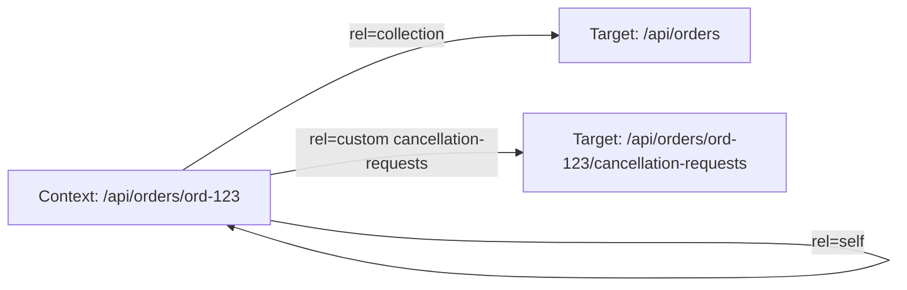
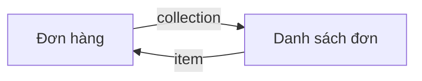
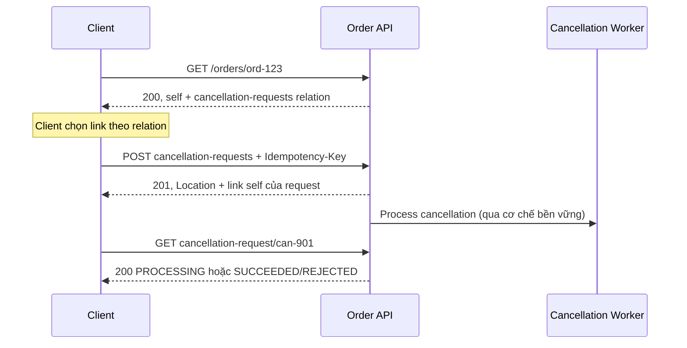

# Link relation, target URI và ngữ cảnh liên kết trong REST API

## 1. Vì sao hypermedia cần hơn một URL?

Một REST API thường trả dữ liệu JSON và buộc client tự ghép đường dẫn để thực hiện bước tiếp theo:

```json
{
  "id": "ord-123",
  "status": "PAYMENT_AUTHORIZED"
}
```

Sau khi đọc đơn hàng, client có thể muốn xem các mục hàng, quay lại danh sách, yêu cầu hủy hoặc theo dõi thanh toán. Nếu client phải biết sẵn các mẫu URL như `/api/orders/{id}/items` và `/api/orders/{id}/cancellation-requests`, kiến thức về cấu trúc URI bị phân tán giữa backend, frontend và SDK.

**Hypermedia** cho phép server đưa vào biểu diễn tài nguyên những liên kết có **ý nghĩa quan hệ** rõ ràng. Client đọc một liên kết theo ngữ nghĩa của nó rồi sử dụng đích mà server cung cấp:

```json
{
  "id": "ord-123",
  "status": "PAYMENT_AUTHORIZED",
  "_links": {
    "self": {
      "href": "/api/orders/ord-123"
    },
    "collection": {
      "href": "/api/orders"
    },
    "https://api.example.test/rels/cancellation-requests": {
      "href": "/api/orders/ord-123/cancellation-requests"
    }
  }
}
```

Ví dụ dùng cú pháp biểu diễn kiểu **HAL JSON** với `_links`. Tên quan hệ mở rộng ở dạng URI (`https://api.example.test/rels/cancellation-requests`) ở đây là **định danh ngữ nghĩa**, không phải mặc định là endpoint phải gọi để hủy. Đích thực sự của liên kết nằm trong `href`.

Trong module **INTEGRATION_API_REST**, bài này thuộc chương **Hypermedia**, tiếp nối việc chọn resource/URI, phương thức và mã trạng thái HTTP, hợp đồng dữ liệu, phân trang, cache, idempotency, OpenAPI, xác thực/phân quyền và kiểm thử bằng Java/Spring.

**Kết quả cần đạt:** Người học phân biệt được **link relation**, **target URI** và **link context**; biết khi nào dùng quan hệ chuẩn hay quan hệ mở rộng; đọc và tạo liên kết theo HTTP `Link` header hoặc biểu diễn JSON; thiết kế client đi theo liên kết an toàn mà không tự suy đoán path hay HTTP method.

## 2. Ba thành phần cốt lõi của một liên kết

Một liên kết hypermedia có thể mô hình hóa:

```text
Link = (context, relation, target, optional attributes)
```

| Thành phần | Câu hỏi trả lời | Ví dụ từ đơn `ord-123` |
| --- | --- | --- |
| **Link context** (ngữ cảnh / nguồn quan hệ) | Quan hệ này được khẳng định **từ tài nguyên hoặc biểu diễn nào**? | Biểu diễn của `/api/orders/ord-123` |
| **Link relation** (`rel`) | Đích có **quan hệ ngữ nghĩa gì** với context? | `self`, `collection`, quan hệ tạo yêu cầu hủy |
| **Target URI** (`href`/URI-reference) | Client có thể tìm **đích được chỉ tới** ở đâu? | `/api/orders`, `/api/orders/ord-123/cancellation-requests` |
| **Thuộc tính bổ sung** | Có metadata nào để diễn giải hay chọn biểu diễn? | `type`, `hreflang`, `title`, `templated` tùy định dạng |

Ví dụ:



**Ba điểm dễ nhầm:**

1. `rel` **không phải** URL đích. Quan hệ `collection` có thể xuất hiện ở hàng nghìn đơn và trỏ tới cùng hoặc các collection khác nhau.
2. `href` cho biết **nơi đi tới**, chưa tự nói việc đi tới sẽ tạo, xóa hay sửa resource.
3. Context không phải luôn là “trang web đang mở”. Với `Link` trong header, context thường là **URI hiệu lực của request** (trừ khi có quy tắc đổi context); với một liên kết trong JSON, context phụ thuộc vào **định dạng biểu diễn và vị trí chứa liên kết**.

### 2.1. Một URI có thể tham gia nhiều quan hệ

Giả sử order `ord-123` có:

```text
Context: /api/orders/ord-123
  rel=self       -> /api/orders/ord-123
  rel=collection -> /api/orders
  rel=describedby -> https://docs.example.test/schemas/order
```

Ba liên kết khác nhau bởi **ngữ nghĩa**, dù cùng xuất phát từ một context. Nếu client bỏ qua `rel` và chỉ quét chuỗi `href` để đoán theo phần cuối đường dẫn, client sẽ dễ hỏng khi server đổi cách tổ chức URI.

### 2.2. Quan hệ là lời khẳng định có hướng

`/api/orders/ord-123` có liên kết `collection` tới `/api/orders` **không** đồng nghĩa collection phải dùng `collection` để trỏ ngược lại order. Trong collection, mỗi đơn có thể được biểu diễn bởi quan hệ `item` (nếu media type và ngữ cảnh sử dụng phù hợp).



Một quan hệ có hướng **context → target**. Đừng coi quan hệ là cặp URI có thể tráo chiều tùy ý.

## 3. Link relation: ngữ nghĩa trước, đường dẫn sau

### 3.1. Quan hệ đã đăng ký

Trong cơ chế **Web Linking** (RFC 8288), link relation có thể là một **registered relation type** với tên ngắn được định nghĩa trong registry, hoặc một **extension relation type** là URI xác định ngữ nghĩa riêng. Một số quan hệ phổ biến:

| Quan hệ | Ý nghĩa điển hình | Ví dụ phù hợp |
| --- | --- | --- |
| `self` | Chỉ về chính resource/context được biểu diễn | Đơn hàng → URI của chính đơn |
| `collection` | Chỉ collection có chứa đối tượng trong context | Một đơn → danh sách đơn |
| `item` | Chỉ phần tử thuộc một collection trong context | Danh sách đơn → một đơn |
| `next` | Trang/bước tiếp theo trong một chuỗi phân trang | Danh sách trang 1 → trang 2 |
| `prev` | Trang/bước trước trong một chuỗi | Danh sách trang 2 → trang 1 |
| `first`, `last` | Đầu/cuối của chuỗi có thứ tự | Collection phân trang có thể xác định đầu/cuối |
| `alternate` | Biểu diễn thay thế phù hợp của nội dung | JSON → một biểu diễn khác được hỗ trợ |
| `describedby` | Tài nguyên mô tả resource hiện tại | URI tài liệu/schema về biểu diễn đơn |

Ý nghĩa cụ thể cần tuân theo **định nghĩa của relation type và media type** đang dùng. Không nên tự đổi nghĩa `next` thành “bước duyệt tiếp theo” trong khi client hiểu nó là trang kế tiếp. Nếu ý nghĩa khác, hãy chọn một relation phù hợp hoặc định nghĩa **extension relation**.

### 3.2. Quan hệ mở rộng và URI định danh

Khi nghiệp vụ có khái niệm riêng, ví dụ “collection tiếp nhận yêu cầu hủy đơn”, ta có thể định nghĩa:

```text
Relation type:
  https://api.example.test/rels/cancellation-requests

Định nghĩa:
  Từ một đơn hàng, liên kết chỉ tới collection chứa/tiếp nhận
  các yêu cầu hủy thuộc đơn đó; quyền và phương thức thao tác
  được mô tả ở hợp đồng API.

Target URI trong biểu diễn cụ thể:
  /api/orders/ord-123/cancellation-requests
```

URI của relation và URI của target có thể **hoàn toàn khác nhau**:

- URI relation nhận diện một **loại quan hệ**, dùng lại cho mọi đơn và có thể dẫn tới tài liệu giải nghĩa.
- Target URI nhận diện **đích cụ thể** trong ngữ cảnh một đơn hàng.
- Định nghĩa relation cần ổn định đủ lâu để client dựa vào; khi semantics thay đổi đáng kể, cân nhắc relation mới hoặc versioning rõ ràng.

Không nên tạo tùy tiện token ngắn như `cancel`, `approve`, `my-next` rồi mặc định chúng đã được IANA đăng ký. Với định dạng áp dụng quy tắc Web Linking, relation riêng nên dùng **URI tuyệt đối** hoặc cơ chế rút gọn có tài liệu của media type.

### 3.3. CURIE trong HAL

HAL có thể hỗ trợ **Compact URI (CURIE)** để tránh lặp URI relation dài:

```json
{
  "_links": {
    "self": { "href": "/api/orders/ord-123" },
    "curies": [{
      "name": "ops",
      "href": "https://api.example.test/rels/{rel}",
      "templated": true
    }],
    "ops:cancellation-requests": {
      "href": "/api/orders/ord-123/cancellation-requests"
    }
  }
}
```

Theo quy ước CURIE ở ví dụ này, `ops:cancellation-requests` mở rộng thành `https://api.example.test/rels/cancellation-requests`. Client muốn sử dụng CURIE phải hiểu **cú pháp và quy tắc của HAL**; không được tự suy từ dấu hai chấm ở bất kỳ JSON nào. Dùng URI relation đầy đủ nếu sự đơn giản và khả năng tương thích được ưu tiên hơn độ ngắn.

### 3.4. Relation là thành phần của hợp đồng công khai

Mỗi relation quan trọng nên có tài liệu ít nhất:

| Thuộc tính hợp đồng | Câu hỏi cần trả lời |
| --- | --- |
| Tên relation | Registered hay extension URI? Định danh bền vững không? |
| Context hợp lệ | Chỉ xuất hiện trong order, collection, item hay một operation resource? |
| Target | Loại resource nào? Một link hay danh sách link? |
| Ý nghĩa | Client có thể suy ra gì từ việc relation xuất hiện? |
| Điều kiện xuất hiện | Phụ thuộc trạng thái, quyền hoặc tính năng nào? |
| Cách truy cập | Theo định dạng hypermedia, OpenAPI và các method của target |
| Phiên bản | Cách thay đổi semantics mà không làm hỏng client cũ |

Tránh định nghĩa `rel` bằng cách mô tả “URL luôn chứa `/cancel`” vì như vậy client lại phụ thuộc vào chi tiết routing thay vì ngữ nghĩa.

## 4. Target URI: định vị đích mà không gắn cứng cấu trúc

### 4.1. Tuyệt đối, tương đối và URI template

Target trong nhiều biểu diễn được ghi bằng **URI-reference**:

```text
URI tuyệt đối: https://api.example.test/api/orders/ord-123
Đường dẫn tuyệt đối: /api/orders/ord-123
Đường dẫn tương đối: ../orders/ord-123
Query tương đối: ?cursor=eyJuZXh0Ijo1MH0
URI template: /api/orders{?cursor,limit}
```

Ba dạng đầu là tham chiếu URI có thể giải quyết theo quy tắc URI/base URI thích hợp; dạng có `{...}` là **template**, chưa phải URI đích hoàn chỉnh khi chưa mở rộng. Cần định nghĩa ngữ nghĩa template theo RFC 6570 hoặc quy ước mà media type sử dụng; không tự đặt nội dung placeholder bằng cách nối chuỗi thiếu escaping.

Với context response `https://api.example.test/api/orders?page=1`, liên kết:

```json
{"href": "/api/orders?page=2"}
```

có đích tuyệt đối sau khi resolve theo origin/base hợp lệ là `https://api.example.test/api/orders?page=2`. Nếu trả `href: "?page=2"`, nó tham chiếu đường dẫn hiện hành và thay query theo quy tắc URI.

**Điểm quan trọng:** **Context của quan hệ** và **base URI để resolve target tương đối** liên quan nhưng không phải khái niệm đồng nhất. Một media type có thể quy định context của link theo vị trí trong biểu diễn, còn cách resolve URI tương đối dựa trên URI biểu diễn/HTTP và quy tắc base của nó. Hãy đọc đúng hợp đồng định dạng thay vì lấy giá trị của `rel` làm base.

### 4.2. Đừng phân tích target để đoán nghiệp vụ

Client **không nên**:

```javascript
// Không nên: phụ thuộc path từ ID và suy đoán server layout.
const cancelUrl = "/api/orders/" + order.id + "/cancellation-requests";
```

Client **nên**:

```javascript
// Ví dụ khi đã thống nhất representation dùng HAL:
const rel = "https://api.example.test/rels/cancellation-requests";
const link = order._links?.[rel];
if (link) {
  const target = new URL(link.href, responseUrl);
  // Tiếp tục theo hợp đồng của target, xác thực và method phù hợp.
}
```

`responseUrl` là URI của biểu diễn nhận được trong trường hợp này. Client còn cần kiểm tra target origin, scheme và chính sách truy cập trước khi gửi credential hoặc thực hiện request.

Target URI nên được xem là **opaque identifier** trong phạm vi contract: đừng tách ID bằng cách lấy segment cuối, suy diễn tenant từ subdomain hay hardcode số trang vào query. Nếu cần ID để hiển thị/đối chiếu nghiệp vụ, server nên trả nó thành trường dữ liệu có schema riêng.

### 4.3. Target URI không tự nói HTTP method

Liên kết:

```json
{
  "_links": {
    "https://api.example.test/rels/cancellation-requests": {
      "href": "/api/orders/ord-123/cancellation-requests"
    }
  }
}
```

**Không tự động có nghĩa** client có thể gửi `POST`, `DELETE` hay `PATCH` đến đích. `href` chỉ định vị target; `rel` giải thích quan hệ. **Phương thức, media type, request body, điều kiện `If-Match`, idempotency và response status** phải đến từ hợp đồng API, media type cung cấp affordance/form hoặc mô tả operation được thống nhất. HAL link cơ bản **không mặc định chứa method và schema request**.

Để giảm phụ thuộc vào tài liệu ngoài, API có thể bổ sung affordance có cấu trúc theo media type phù hợp (ví dụ form/action controls) nhưng phải chọn định dạng có đặc tả và client hỗ trợ rõ ràng. Không tự thêm thuộc tính `method: "POST"` rồi gọi đó là ý nghĩa chuẩn của HAL.

### 4.4. An toàn khi resolve và theo target

- Dùng **URI resolver** đúng chuẩn, không nối `host + href` bằng chuỗi.
- Kiểm tra scheme (`https`) và danh sách origin cho phép trước khi gửi access token.
- Không tự động theo link tới host tùy ý từ dữ liệu chưa đáng tin, đặc biệt đối với backend HTTP client để tránh **SSRF**.
- Chỉ gửi credential khi target nằm trong phạm vi bảo mật được ủy quyền; link từ API khác origin không mặc nhiên được nhận token của API hiện tại.
- Nếu API trả URI tuyệt đối phía sau reverse proxy, cấu hình forwarded headers từ proxy **đáng tin cậy** để tránh Host header injection và link trỏ nhầm host nội bộ.
- Không xây URL chứa access token hoặc thông tin bí mật trong query; URL thường xuất hiện ở log, trình duyệt và referrer.

## 5. Link context: quan hệ này được khẳng định từ đâu?

### 5.1. Trong biểu diễn của một tài nguyên

Giả sử client `GET /api/orders/ord-123` và nhận biểu diễn HAL chứa:

```json
{
  "id": "ord-123",
  "_links": {
    "self": {"href": "/api/orders/ord-123"},
    "collection": {"href": "/api/orders"}
  }
}
```

`collection` ở đây có nghĩa từ **đơn hàng hiện tại** tới collection chứa đơn. Nếu cùng đoạn `_links` được đặt trong biểu diễn khác, context có thể khác, kéo theo ý nghĩa của việc liên kết là từ resource nào.

Một collection thường có các item:

```json
{
  "_links": {
    "self": {"href": "/api/orders?limit=2"}
  },
  "_embedded": {
    "orders": [
      {
        "id": "ord-123",
        "_links": {"self": {"href": "/api/orders/ord-123"}}
      },
      {
        "id": "ord-124",
        "_links": {"self": {"href": "/api/orders/ord-124"}}
      }
    ]
  }
}
```

Ở mức collection, `_links.self` mô tả collection đang được biểu diễn; trong mỗi embedded order, `_links.self` mô tả **chính order đó**. Việc đặt link ở đâu là một phần của semantics do media type quy định.

### 5.2. Trong HTTP `Link` header

Web Linking (RFC 8288) dùng header `Link`:

```http
GET /api/orders/ord-123 HTTP/1.1
Host: api.example.test
```

```http
HTTP/1.1 200 OK
Content-Type: application/json
Link: </api/orders/ord-123>; rel="self"
Link: </api/orders>; rel="collection"

{"id":"ord-123","status":"PAYMENT_AUTHORIZED"}
```

Mặc định, context của các link trong header gắn với **effective request URI**, trừ khi được thay đổi bởi tham số/đặc tả có áp dụng. Mỗi giá trị trong dấu `<...>` là **target URI-reference**, còn `rel="..."` mô tả quan hệ. Header có thể chứa nhiều link-value trong một field hoặc nhiều field `Link`, theo quy tắc HTTP field.

Quan hệ của một link trong **response header** không phải luôn giống quan hệ của mọi link nằm sâu trong **JSON body**. Khi đọc một media type cụ thể, hãy áp dụng quy tắc về context của chính media type đó.

### 5.3. Tham số `anchor` và việc đổi context

Trong Web Linking, tham số `anchor` có thể xác định context khác với URI request:

```http
HTTP/1.1 200 OK
Link: </api/customers/c-17>; rel="related"; anchor="/api/orders/ord-123"
```

Ví dụ này chỉ khẳng định quan hệ từ **order `ord-123`** tới **customer `c-17`**, dù header có thể đi kèm một response khác. `anchor` phải được xử lý theo ngữ nghĩa Web Linking; nó không phải header mặc định cho mọi media type. Nếu consumer không hỗ trợ đổi context đúng cách, không nên âm thầm hiểu link như quan hệ từ URI response ban đầu.

**Phân biệt:** `anchor` trong Web Linking mô tả **context của liên kết**, còn URL fragment `#section` trong target chỉ là **một phần của URI đích**.

### 5.4. Ngữ cảnh không đồng nghĩa phân quyền

Nếu order có liên kết tới customer hoặc payment, điều đó không cho người dùng quyền đọc customer/payment. Server nhận request tại target vẫn phải:

1. Xác thực caller.
2. Kiểm tra đúng tenant, quyền sở hữu và phạm vi quyền.
3. Áp dụng business rules.
4. Chỉ trả dữ liệu được phép, hoặc lỗi `401`/`403`/`404` theo hợp đồng và chính sách bảo mật.

Việc **ẩn một liên kết** với client chưa có quyền chỉ hỗ trợ trải nghiệm và giảm gợi ý thao tác sai; nó **không thay thế authorization ở endpoint đích**.

## 6. Các cách biểu diễn liên kết: Link header, HAL và JSON:API

### 6.1. HTTP `Link` header

Phù hợp khi cần công bố liên kết ở **mức response HTTP**, không buộc mọi response body phải dùng một media type hypermedia:

```http
HTTP/1.1 200 OK
Content-Type: application/json
Link: </api/orders?cursor=cursor-next>; rel="next"
Link: <https://docs.example.test/schemas/order-list>; rel="describedby"; type="application/schema+json"
```

`type` trong `Link` header là **hint về media type của target**; nó không thay thế header `Content-Type` của resource đích. Tương tự, `title` hoặc `hreflang` khi có là metadata bổ sung, không làm thay đổi nghĩa của `rel`.

### 6.2. HAL (`application/hal+json`)

HAL cung cấp hai cấu trúc quen thuộc:

- `_links`: các liên kết có tên relation.
- `_embedded`: tài nguyên được nhúng để giảm số request khi phù hợp.

```http
HTTP/1.1 200 OK
Content-Type: application/hal+json
Cache-Control: private, no-store

{
  "id": "ord-123",
  "status": "PAYMENT_AUTHORIZED",
  "_links": {
    "self": {"href": "/api/orders/ord-123"},
    "collection": {"href": "/api/orders"},
    "https://api.example.test/rels/cancellation-requests": {
      "href": "/api/orders/ord-123/cancellation-requests"
    }
  }
}
```

Ví dụ dùng `Cache-Control: private, no-store` vì biểu diễn order có thể khác nhau theo danh tính/ quyền của người gọi. Không phải mọi biểu diễn HAL đều phải `no-store`; chính sách cache phụ thuộc độ nhạy và khả năng cache an toàn.

### 6.3. JSON:API: link trong cấu trúc khác

JSON:API có cách biểu diễn khác, ví dụ:

```json
{
  "data": {
    "type": "orders",
    "id": "ord-123",
    "links": {
      "self": "/api/orders/ord-123"
    }
  },
  "links": {
    "self": "/api/orders?limit=1",
    "next": "/api/orders?cursor=next-cursor"
  }
}
```

Các thành viên `links` và vị trí của chúng có ý nghĩa theo **đặc tả JSON:API**. `self` bên trong `data` liên quan tới **order resource**, còn `self` ở top-level liên quan đến **response/document** chứa danh sách. Đừng dùng HAL `_links` và JSON:API `links` tùy ý trong cùng hợp đồng rồi hy vọng client suy được semantics.

### 6.4. Chọn định dạng nào?

| Cách thể hiện | Điểm mạnh | Đánh đổi |
| --- | --- | --- |
| HTTP `Link` | Độc lập phần lớn với JSON body, phù hợp phân trang và liên kết tài liệu | Client phải parse header và nắm context; không mô tả action schema |
| HAL | Cấu trúc `_links`, `_embedded` gọn, dễ mô hình hóa điều hướng resource | Cần thống nhất relation; link cơ bản không mô tả method/body |
| JSON:API | Quy tắc chuẩn hóa tài nguyên, quan hệ và phân trang rộng hơn | Hợp đồng chặt hơn và định dạng body khác; cần client thích ứng |
| Media type có affordance/form | Có thể mô tả action, method và trường nhập theo đặc tả phù hợp | Phức tạp hơn, cần client thực sự hiểu format |

Điều quan trọng là **hợp đồng rõ ràng và nhất quán**: chọn media type, quy ước relation và cách resolve target được hỗ trợ bởi cả server lẫn client.

## 7. Dùng relation để điều hướng vòng đời tài nguyên

Hypermedia hữu ích nhất khi liên kết phản ánh **khả năng và quan hệ hiện hành** của resource, thay vì chỉ sao chép một bảng route tĩnh.

### 7.1. Đơn hàng có và không có yêu cầu hủy

Khi một đơn vẫn có thể yêu cầu hủy:

```http
GET /api/orders/ord-123 HTTP/1.1
Authorization: Bearer <synthetic-token>
```

```http
HTTP/1.1 200 OK
Content-Type: application/hal+json
Cache-Control: private, no-store

{
  "id": "ord-123",
  "status": "PAYMENT_AUTHORIZED",
  "_links": {
    "self": {"href": "/api/orders/ord-123"},
    "collection": {"href": "/api/orders"},
    "https://api.example.test/rels/cancellation-requests": {
      "href": "/api/orders/ord-123/cancellation-requests"
    }
  }
}
```

Khi đơn đã `SHIPPED`, server có thể **không cung cấp** liên kết tạo yêu cầu hủy:

```json
{
  "id": "ord-123",
  "status": "SHIPPED",
  "_links": {
    "self": {"href": "/api/orders/ord-123"},
    "collection": {"href": "/api/orders"}
  }
}
```

Lưu ý phân biệt:

- Liên kết xuất hiện là **gợi ý khả năng ở thời điểm tạo biểu diễn**, không phải cam kết thao tác luôn thành công.
- Client không thấy liên kết thì nên không hiển thị hành động tương ứng trong luồng UI này; vẫn có thể tồn tại các quy trình khác hoặc phiên bản biểu diễn khác.
- Người dùng thiếu quyền không được thực hiện thao tác chỉ vì biết URI hoặc tự thêm `_links`.
- State có thể đổi sau khi GET, nên request tiếp theo vẫn phải kiểm tra **quyền, điều kiện nghiệp vụ và tính đồng thời**.

Không nên trả `href` đến một thao tác không tồn tại trong contract rồi mong client tự đoán cách gọi. Với quan hệ tới collection yêu cầu hủy, **method POST và schema request** được quy định ở hợp đồng hoặc affordance được chọn.

### 7.2. Theo liên kết để tạo một yêu cầu nghiệp vụ

Một client hiểu relation mở rộng và contract của collection có thể thực hiện:

```http
POST /api/orders/ord-123/cancellation-requests HTTP/1.1
Authorization: Bearer <synthetic-token>
Content-Type: application/json
Idempotency-Key: cancel-ord-123-operation-7

{"reasonCode":"CUSTOMER_REQUEST"}
```

Server có thể tạo một resource yêu cầu hủy riêng và trả:

```http
HTTP/1.1 201 Created
Location: /api/orders/ord-123/cancellation-requests/can-901
Content-Type: application/hal+json

{
  "id": "can-901",
  "status": "REQUESTED",
  "_links": {
    "self": {
      "href": "/api/orders/ord-123/cancellation-requests/can-901"
    },
    "https://api.example.test/rels/order": {
      "href": "/api/orders/ord-123"
    }
  }
}
```

**`201 Created` nói rằng resource yêu cầu hủy đã được tạo**, không đồng nghĩa đơn đã chuyển sang `CANCELLED`. Client có thể theo `self` của cancellation request bằng GET để đọc trạng thái cuối.

Nếu công việc mới chỉ được **tiếp nhận để xử lý** và chưa có resource kết quả được tạo, API có thể dùng `202 Accepted` cùng monitor URL. Quy tắc cụ thể phải được công bố; hypermedia không tự chọn status giúp ứng dụng.



### 7.3. Cập nhật trạng thái và lỗi vẫn phải đúng HTTP

| Tình huống khi client theo link | HTTP status thường phù hợp | Điều cần làm |
| --- | --- | --- |
| Resource có link, thao tác hợp lệ và tạo request | `201` hoặc `202` tùy hợp đồng | Trả URI để theo dõi |
| Trạng thái đơn đã đổi, không còn hủy được | `409 Conflict` | Trả public error code, cho client đọc lại order |
| Client thiếu xác thực | `401 Unauthorized` | Thực hiện flow xác thực hợp lệ |
| Client đã xác thực nhưng không được phép | `403 Forbidden` hoặc `404` theo chính sách | Không lộ thông tin thuộc quyền người khác |
| Gọi sai HTTP method trên target | `405 Method Not Allowed` | Response phải có `Allow` của target |
| Gửi request body sai media type | `415 Unsupported Media Type` | Sửa Content-Type theo contract |
| Retry POST sau timeout | Chưa thể suy ra thất bại | Dùng cùng idempotency key/tra cứu operation |

Một link không loại bỏ nhu cầu sử dụng **ETag/If-Match, optimistic locking, idempotency** và kiểm thử xử lý sự kiện đồng thời. Chú ý: nếu muốn bảo vệ ETag của **order cha** trên `POST` tới collection cancellation requests, không được tự gán `If-Match` của collection thành ETag của order; hãy xác định precondition đúng resource đích hoặc dùng điều kiện phiên bản nghiệp vụ riêng được mô tả rõ trong contract.

## 8. Phân trang bằng link relation

Phân trang là trường hợp hypermedia đặc biệt dễ áp dụng, vì client có thể đi theo `next` mà không cần tính số trang hoặc giải mã cursor.

### 8.1. Ví dụ theo cursor

```http
GET /api/orders?limit=2 HTTP/1.1
```

```http
HTTP/1.1 200 OK
Content-Type: application/hal+json

{
  "_embedded": {
    "orders": [
      {"id":"ord-123","_links":{"self":{"href":"/api/orders/ord-123"}}},
      {"id":"ord-124","_links":{"self":{"href":"/api/orders/ord-124"}}}
    ]
  },
  "_links": {
    "self": {"href": "/api/orders?limit=2"},
    "next": {
      "href": "/api/orders?limit=2&cursor=c-n2K3"
    }
  }
}
```

Khi trang cuối không còn dữ liệu tiếp theo, server có thể **bỏ relation `next`**. Client dừng khi không có `next`, không dựa vào việc số bản ghi ít hơn `limit` vì API có thể lọc hoặc thay đổi dữ liệu.

Đặc biệt khi cursor ký tên/mã hóa chứa trạng thái, **cursor là opaque token**: client không giải mã, tăng số hoặc tự ghép. Nếu link có thêm filter/sort, dùng nguyên target để không làm mất điều kiện truy vấn.

### 8.2. Dùng HTTP Link header

Nếu body JSON không theo HAL, server vẫn có thể trả link ở header:

```http
HTTP/1.1 200 OK
Content-Type: application/json
Link: </api/orders?limit=2&cursor=c-n2K3>; rel="next"

{"items":[{"id":"ord-123"},{"id":"ord-124"}]}
```

Client cần parse cú pháp `Link` header đúng quy tắc, không tách bằng dấu phẩy hoặc dấu chấm phẩy một cách ngây thơ vì dấu phân cách có thể xuất hiện trong giá trị được trích dẫn và tham số. Nếu dùng một thư viện HTTP/link parser, kiểm tra hỗ trợ nhiều field-value và nhiều `rel`.

### 8.3. Tính nhất quán của một chuỗi phân trang

Relation `next` chỉ mô tả **liên kết tới bước kế**, không tự bảo đảm snapshot cố định giữa các request. Khi đơn hàng mới xuất hiện hoặc dữ liệu bị xóa, kết quả có thể thay đổi tùy chiến lược cursor, thứ tự sort và mô hình nhất quán.

Để xử lý đúng:

- Xác định sort order ổn định; có tie-breaker khi nhiều bản ghi có cùng timestamp.
- Ghi rõ cursor có hiệu lực bao lâu và hành vi khi hết hạn, có thể là `400`, `410` hoặc mã đã quy định trong hợp đồng.
- Nếu cần snapshot nhất quán, thiết kế snapshot token hoặc cơ chế dữ liệu phù hợp; relation `next` một mình không đáp ứng yêu cầu này.
- Không hứa hẹn `last` khi API không thể tính trang cuối hiệu quả hoặc không có khái niệm cuối ổn định.
- Test dữ liệu thêm/xóa trong lúc phân trang để kiểm tra mất/trùng bản ghi ở mức mà nghiệp vụ chấp nhận.

## 9. Java/Spring Boot: tạo phản hồi hypermedia

Ví dụ dùng **Java 17+, Spring Boot 3 và Spring MVC**. Để tập trung vào ba thành phần link, controller sau tạo JSON theo hình dạng HAL bằng DTO và Jackson; trong dự án lớn có thể dùng **Spring HATEOAS** để tạo link/affordance theo abstraction của thư viện.

### 9.1. DTO và controller sinh link theo resource

```java
package example.orders.api;

import com.fasterxml.jackson.annotation.JsonProperty;
import java.security.Principal;
import java.util.LinkedHashMap;
import java.util.Map;
import org.springframework.http.CacheControl;
import org.springframework.http.ResponseEntity;
import org.springframework.web.bind.annotation.GetMapping;
import org.springframework.web.bind.annotation.PathVariable;
import org.springframework.web.bind.annotation.RequestMapping;
import org.springframework.web.bind.annotation.RestController;

@RestController
@RequestMapping("/api/orders")
public class OrderHypermediaController {

    private static final String CANCEL_REQUESTS_REL =
        "https://api.example.test/rels/cancellation-requests";

    private final OrderQueryService service;

    public OrderHypermediaController(OrderQueryService service) {
        this.service = service;
    }

    public record LinkTarget(String href) {}

    public record OrderResponse(
        String id,
        String status,
        @JsonProperty("_links") Map<String, LinkTarget> links
    ) {}

    @GetMapping(value = "/{id}", produces = "application/hal+json")
    public ResponseEntity<OrderResponse> getOrder(
            @PathVariable String id, Principal principal) {

        // Service phải kiểm tra quyền và trả canonical ID từ database.
        OrderSnapshot order = service.findVisibleTo(id, principal.getName());
        String orderUri = "/api/orders/" + order.id();

        Map<String, LinkTarget> links = new LinkedHashMap<>();
        links.put("self", new LinkTarget(orderUri));
        links.put("collection", new LinkTarget("/api/orders"));

        if (service.canRequestCancellation(order, principal.getName())) {
            links.put(CANCEL_REQUESTS_REL, new LinkTarget(
                    orderUri + "/cancellation-requests"));
        }

        return ResponseEntity.ok()
                .cacheControl(CacheControl.noStore())
                .body(new OrderResponse(
                        order.id(), order.status(), links));
    }
}

interface OrderQueryService {
    OrderSnapshot findVisibleTo(String id, String username);
    boolean canRequestCancellation(OrderSnapshot order, String username);
}

record OrderSnapshot(String id, String status) {}
```

Ví dụ tập trung vào contract; trong hệ thống thật phải bảo đảm:

1. Authentication đã được cấu hình để `principal` tồn tại trên route được bảo vệ.
2. `findVisibleTo` kiểm tra **quyền xem order/tenant**, không chỉ tra ID.
3. `id` từ persistence là canonical và an toàn để đưa vào đường dẫn; nếu ID có ký tự đặc biệt, mã hóa path segment hoặc dùng URI builder.
4. `canRequestCancellation` chỉ ảnh hưởng **link được đề xuất**, còn POST hủy phải thực hiện authorization và kiểm tra state lần nữa trong transaction.
5. Dữ liệu nhạy cảm/khác nhau theo user có cache policy phù hợp; ví dụ dùng `no-store`.

Đối với API xây dựng rộng trên Spring HATEOAS, có thể dùng `EntityModel`, `Link`, `linkTo` và `methodOn` để giảm mã ghép URI thủ công. Cần khai báo dependency tương ứng và kiểm thử encoding/forwarded headers; thư viện không tự thay thế domain authorization.

### 9.2. HTTP Link header trong Spring MVC

Nếu muốn giữ response body JSON thông thường, có thể tạo header `Link` theo RFC 8288:

```java
return ResponseEntity.ok()
    .header("Link", "</api/orders/ord-123>; rel=\"self\"")
    .header("Link", "</api/orders>; rel=\"collection\"")
    .body(orderDto);
```

Đây là snippet minh họa trong một handler có biến `orderDto`; với ứng dụng thật, URI phải được lấy từ resource đang xử lý. Sử dụng framework/library hỗ trợ quote và format link khi metadata phức tạp, thay vì tự ghép chuỗi từ input chưa xác thực.

### 9.3. Client Java resolve target an toàn

```java
import java.net.URI;

URI representationUri =
    URI.create("https://api.example.test/api/orders/ord-123");
String href = "../orders/ord-124";

URI target = representationUri.resolve(URI.create(href));
System.out.println(target);
// https://api.example.test/api/orders/ord-124
```

Mã trên minh họa cú pháp `URI.resolve` của Java cho một relative reference. Việc dùng đúng base còn phụ thuộc media type và vị trí của link; client thực tế phải dùng **base URI của response/representation** theo contract và kiểm tra **target được phép truy cập**. Đừng in access token hoặc URI có query nhạy cảm ra log.

## 10. OpenAPI, media type và hợp đồng link

OpenAPI có thể mô tả **shape của body**, media type, operation và các header. Ví dụ tối giản:

```yaml
openapi: 3.1.0
info:
  title: Orders Hypermedia API
  version: 1.0.0
paths:
  /api/orders/{id}:
    get:
      operationId: getOrder
      parameters:
        - name: id
          in: path
          required: true
          schema: { type: string }
      responses:
        '200':
          description: Order representation with links
          content:
            application/hal+json:
              schema:
                type: object
                required: [id, status, _links]
                properties:
                  id: { type: string }
                  status: { type: string }
                  _links:
                    type: object
                    properties:
                      self:
                        type: object
                        required: [href]
                        properties:
                          href: { type: string }
                    additionalProperties:
                      type: object
                      properties:
                        href: { type: string }
        '401': { description: Authentication required }
        '403': { description: Forbidden }
        '404': { description: Order not found or hidden }
```

Đây là schema cơ bản để minh họa; API production cần mô tả chính xác các relation bắt buộc/tùy trạng thái, link có thể là mảng hay một đối tượng theo HAL, URI template, error format và security schemes.

**Phân biệt quan trọng:** OpenAPI còn có một thành phần tên **Link Object** trong phần response để mô tả mối liên hệ giữa các operation. Nó **không tự động sinh `_links` trong payload HTTP**, và không phải cùng cấu trúc với `Link` header hoặc HAL relation. Muốn client thấy hypermedia khi chạy, server phải **thực sự trả các link ở runtime**.

Không cho rằng OpenAPI thay thế hoàn toàn tài liệu về **ngữ nghĩa relation**. Khi `rel` tùy chỉnh được dùng xuyên service, nên có trang tài liệu mô tả context, target type, cách sử dụng và chính sách thay đổi.

## 11. Bảo mật, cache và tính đúng đắn của liên kết

### 11.1. Liên kết không cấp quyền

Server có thể lược bỏ link hủy khỏi biểu diễn dành cho khách không đủ quyền, nhưng request `POST /cancellation-requests` phải tự kiểm tra actor, tenant, ownership, state và idempotency. Một hacker hoặc client lỗi vẫn có thể gửi request trực tiếp dù không có link.

Đặc biệt chú ý **IDOR/BOLA**: chỉ vì client biết `href` đến `/api/orders/ord-124` không có nghĩa nó được đọc hoặc sửa order đó. Kiểm tra quyền trên mỗi request theo ID/resource đã resolve.

### 11.2. Không để cache làm lộ hoặc “đóng băng” link

Nếu `_links` thay đổi theo user hoặc trạng thái, cache dùng chung có thể trả nhầm link của người này cho người khác hoặc giữ link đã hết hiệu lực. Các lựa chọn:

- Với dữ liệu nhạy cảm và link phụ thuộc danh tính, dùng `Cache-Control: private, no-store` khi phù hợp.
- Nếu cần cache, thiết kế cache key/Vary và phạm vi cache đúng quyền; không mặc định CDN tách response theo bearer token.
- Sử dụng `ETag`/conditional GET để giảm băng thông khi cần, nhưng phải hiểu version của **biểu diễn có cả link** và điều kiện kiểm tra quyền.
- Ngay cả response mới, trạng thái resource có thể đổi sau khi GET. Endpoint đích luôn phải kiểm tra lại điều kiện commit.

### 11.3. Link tới hệ thống bên ngoài

Một link đến URL khác origin có thể dẫn tới tài liệu công khai, hệ thống thanh toán hoặc bên thứ ba. Đối với:

- **Browser:** kiểm tra CORS, origin, redirect policy, content security policy khi áp dụng; không gửi bearer token tới origin mới chỉ vì nó nằm trong `href`.
- **Backend HTTP client:** kiểm tra allowlist scheme/host, DNS/IP resolution và redirect để chống SSRF; ngăn gọi tới địa chỉ loopback/private/metadata không được phép.
- **Audit:** log tên relation, loại target hoặc host được phép; không log query string chứa bí mật, token hoặc dữ liệu cá nhân.

`rel` và `target` là dữ liệu đầu vào của client. Hypermedia giúp tách cấu trúc, nhưng client vẫn phải có **trust policy** và kiểm soát tác dụng phụ khi theo liên kết.

### 11.4. Quan sát vận hành

Theo dõi các lỗi hợp đồng liên kết:

| Tín hiệu | Có thể chỉ ra vấn đề |
| --- | --- |
| Client gặp `404`/`405` sau khi theo relation | Link trỏ sai endpoint hoặc method contract không đồng bộ |
| Tăng `409` sau khi hành động theo link | Biểu diễn cache/stale hoặc cạnh tranh trạng thái |
| Target trỏ vào host private sau deploy | Sai reverse proxy/forwarded header hoặc URL builder |
| `next` dẫn về trang cũ hoặc lặp vô hạn | Cursor/target sai, thay đổi filter/sort |
| Một relation biến mất sau release | Đổi contract chưa có kế hoạch tương thích |
| Link đến host không được phép | Sai cấu hình hoặc nguy cơ liên kết độc hại |

Chỉ dùng route template/relation code được phép làm nhãn metric; không gắn raw URI chứa orderId hoặc query token thành label có cardinality vô hạn.

## 12. Kiểm thử hypermedia: kiểm tra ngữ nghĩa, không chỉ chuỗi URL

Một bộ contract test nên bảo vệ **relation**, **target**, **context**, **điều kiện xuất hiện** và khả năng client theo liên kết để thực hiện bước tiếp theo.

### 12.1. Ma trận kiểm thử

| Tình huống | Điều cần xác minh |
| --- | --- |
| GET một order hợp lệ | `_links.self` xác định order hiện tại; `collection` trỏ đúng collection |
| Order đang cho phép yêu cầu hủy | Có relation mở rộng `cancellation-requests` với target hợp lệ |
| Order đã giao hàng | Không quảng bá thao tác hủy trong biểu diễn của caller này |
| Caller thiếu quyền xem order | `401`/`403`/`404` theo policy; không lộ link của order |
| Gọi POST trực tiếp tới target dù không thấy link | Backend vẫn kiểm tra authorization, state và idempotency |
| Method không được hỗ trợ ở target | `405` kèm `Allow` đúng |
| Link có `href` tương đối | Client resolve theo base đúng, không tạo URL trùng path |
| Link có query string/cursor | Client giữ nguyên query và không suy đoán ý nghĩa cursor |
| Trang cuối | Không còn relation `next`; client có thể dừng |
| Multiple link-values trong `Link` header | Parser nhận đúng từng target, relation và thuộc tính |
| Response từ gateway/proxy | Target không chứa hostname nội bộ hoặc host do client giả mạo |
| Trạng thái đổi sau khi lấy link | Thao tác bị từ chối đúng `409`/`412` theo contract, không bypass guard |
| Đổi route/triển khai API version mới | Client vẫn tìm thấy relation với ngữ nghĩa cũ nếu API cam kết tương thích |
| Target khác origin | Client không phát tán token hoặc tự động gọi host ngoài allowlist |
| Biểu diễn theo user | Shared cache không rò link/dữ liệu của người khác |

### 12.2. Kiểm thử Spring MVC với MockMvc

Đoạn kiểm thử sau sử dụng controller `OrderHypermediaController` ở mục 9. Nó chủ động tạo service giả để kiểm tra **liên kết trong HTTP response** mà không cần database:

```java
package example.orders.api;

import static org.junit.jupiter.api.Assertions.assertFalse;
import static org.junit.jupiter.api.Assertions.assertTrue;
import static org.springframework.test.web.servlet.request.MockMvcRequestBuilders.get;
import static org.springframework.test.web.servlet.result.MockMvcResultMatchers.status;
import static org.springframework.test.web.servlet.result.MockMvcResultMatchers.content;

import com.fasterxml.jackson.databind.JsonNode;
import com.fasterxml.jackson.databind.ObjectMapper;
import org.junit.jupiter.api.Test;
import org.springframework.test.web.servlet.MockMvc;
import org.springframework.test.web.servlet.MvcResult;
import org.springframework.test.web.servlet.setup.MockMvcBuilders;

class OrderHypermediaControllerTest {

    private final ObjectMapper mapper = new ObjectMapper();
    private static final String CANCEL_REL =
        "https://api.example.test/rels/cancellation-requests";

    private MockMvc mvcWithState(String state) {
        OrderQueryService fake = new OrderQueryService() {
            @Override
            public OrderSnapshot findVisibleTo(String id, String username) {
                return new OrderSnapshot(id, state);
            }

            @Override
            public boolean canRequestCancellation(
                    OrderSnapshot order, String username) {
                return "PAYMENT_AUTHORIZED".equals(order.status());
            }
        };
        return MockMvcBuilders.standaloneSetup(
                new OrderHypermediaController(fake)).build();
    }

    @Test
    void includesSelfAndBusinessRelationWhenEligible() throws Exception {
        MvcResult result = mvcWithState("PAYMENT_AUTHORIZED")
            .perform(get("/api/orders/ord-123")
                    .principal(() -> "alice"))
            .andExpect(status().isOk())
            .andExpect(content().contentTypeCompatibleWith(
                    "application/hal+json"))
            .andReturn();

        JsonNode links = mapper.readTree(
                result.getResponse().getContentAsString()).path("_links");

        assertTrue(links.has("self"));
        assertTrue(links.has("collection"));
        assertTrue(links.has(CANCEL_REL));
    }

    @Test
    void omitsCancellationRelationAfterShipping() throws Exception {
        MvcResult result = mvcWithState("SHIPPED")
            .perform(get("/api/orders/ord-123")
                    .principal(() -> "alice"))
            .andExpect(status().isOk())
            .andReturn();

        JsonNode links = mapper.readTree(
                result.getResponse().getContentAsString()).path("_links");
        assertFalse(links.has(CANCEL_REL));
    }
}
```

Đây là **test riêng cho controller/representation**, nên fake service không thể chứng minh BOLA/authorization, race condition hay API gateway. Ứng dụng thật cần thêm integration tests với Spring Security và test end-to-end trên URL mà người dùng truy cập.

Khi kiểm tra link theo `rel`, **đừng assert mọi URL phải đúng từng ký tự mãi mãi** nếu mục tiêu của API là cho phép thay đổi route. Hãy kiểm tra URI hợp lệ, scheme/host được phép, target resource có thể truy cập theo contract và relation phù hợp. Trong test tích hợp có thể theo link được trả về, thay vì tự dựng path mới.

### 12.3. Một flow kiểm thử client

```text
1. GET entry point theo URL được cấu hình.
2. Đọc Content-Type để chọn parser phù hợp.
3. Tìm link bằng registered rel hoặc extension rel đã công bố.
4. Resolve target URI theo quy tắc định dạng/base URI.
5. Kiểm tra trust policy trước khi gửi credentials.
6. Thực hiện method và payload đã thỏa thuận trong API contract.
7. Đọc Location / self / operation-status relation của response mới.
8. Xử lý 401, 403, 404, 405, 409, 412, 429 và 5xx đúng ngữ nghĩa.
```

Nếu relation cần dùng bị thiếu, client phải xử lý **không có thao tác khả dụng** hoặc dùng lựa chọn thay thế được hợp đồng mô tả. Không đoán URI từ đường dẫn cũ và gọi thử liên tục để “khám phá” thao tác gây side effect.

## 13. Những lỗi thiết kế thường gặp

| Sai lầm | Hậu quả | Cách khắc phục |
| --- | --- | --- |
| Dùng tên relation để thay target URI | Client tìm `self` rồi cố gọi URL `/self` | Tách `rel` và `href` thành hai trường có nghĩa riêng |
| Dùng quan hệ tự đặt như `cancel` mà không định nghĩa | Client không biết semantics, có thể xung đột với registry | Dùng extension URI/CURIE theo media type, có tài liệu |
| Ghép URL từ ID thay vì theo `href` | Client dễ hỏng khi đổi routing, prefix hoặc phân vùng | Theo link server trả về, URI target được xem là opaque |
| Cho rằng link HAL ngầm quy định HTTP POST/DELETE | Client dùng sai method hoặc body | Mô tả operation bằng contract hoặc affordance/form được hỗ trợ |
| Dùng `next` cho trạng thái duyệt tiếp theo | Nhầm nghĩa phân trang/chuỗi với workflow | Định nghĩa relation nghiệp vụ riêng |
| Đặt link ở sai context | `self` trỏ đến parent khi đang ở embedded item | Kiểm tra semantics theo vị trí của media type |
| Nối URI tương đối bằng chuỗi | URI trùng `/api/api` hoặc sai query | Resolve với base hợp lệ |
| Bỏ `next` quá sớm hoặc trả link vòng lặp | Phân trang dừng sớm/lặp vô hạn | Test cursor, ordering và terminal page |
| Quảng bá link theo state cũ từ cache shared | Người dùng thấy thao tác sai, có thể lộ dữ liệu | Cache policy đúng identity và xác minh state khi commit |
| Xem việc ẩn link như authorization | Caller tự tạo request tới URL bị ẩn | Phân quyền ở endpoint đích, BOLA checks |
| Cho client theo mọi link tới internet với token hiện có | Lộ credential hoặc SSRF ở backend | Validate origin/scheme, chặn private target không được phép |
| Định nghĩa `rel` nhưng thay đổi semantics âm thầm | Client cũ hiểu sai tác động | Giữ semantics ổn định, version contract khi cần |
| Dùng OpenAPI Link Object nhưng không trả runtime links | Client hypermedia không có gì để khám phá | Trả `Link` header hoặc link trong media type thật |
| Chỉ test status `200` | Không thấy relation/target sai | Kiểm tra cấu trúc link và đi theo target trong integration test |

## 14. Bài thực hành: dẫn đường trong API đơn hàng

### 14.1. Đề bài

Hệ thống có các tài nguyên:

- Collection `GET /api/orders`, phân trang theo cursor.
- Đơn hàng `GET /api/orders/{id}`.
- Danh sách dòng hàng `GET /api/orders/{id}/items`.
- Collection yêu cầu hủy `POST /api/orders/{id}/cancellation-requests`.
- Yêu cầu hủy đã tạo `GET /api/orders/{id}/cancellation-requests/{requestId}`.

Các điều kiện:

- Chỉ người có quyền xem order mới được nhận biểu diễn có liên kết của order đó.
- Đơn ở `PAYMENT_AUTHORIZED` có thể tạo yêu cầu hủy theo quy tắc nghiệp vụ; đơn `SHIPPED` thì không.
- Client dùng `Idempotency-Key` khi POST yêu cầu hủy.
- API chọn HAL cho biểu diễn order và `Link` header cho phân trang của một endpoint JSON khác.

**Yêu cầu:**

1. Viết một biểu diễn order có `self`, `collection`, liên kết tới items và relation mở rộng tới cancellation requests.
2. Chỉ rõ **context, relation và target** của từng link; giải thích vì sao hai URI `https://api.example.test/rels/items` và `/api/orders/ord-123/items` có vai trò khác nhau.
3. Viết phản hồi cho đơn đã `SHIPPED` mà không quảng bá khả năng yêu cầu hủy.
4. Đề xuất phản hồi `201` khi tạo cancellation request với `Location` và `self` link của request mới.
5. Viết `Link` header `next` cho `GET /api/orders?limit=2`, dùng một cursor opaque.
6. Liệt kê test cho trường hợp order đổi state **sau khi** client đọc link, và trường hợp client biết URI nhưng không có quyền.
7. Trình bày cách client resolve `href` tương đối và chính sách khi target chuyển sang origin bên ngoài.

### 14.2. Gợi ý lời giải

Một biểu diễn order:

```json
{
  "id": "ord-123",
  "status": "PAYMENT_AUTHORIZED",
  "_links": {
    "self": {
      "href": "/api/orders/ord-123"
    },
    "collection": {
      "href": "/api/orders"
    },
    "https://api.example.test/rels/items": {
      "href": "/api/orders/ord-123/items"
    },
    "https://api.example.test/rels/cancellation-requests": {
      "href": "/api/orders/ord-123/cancellation-requests"
    }
  }
}
```

Với cả bốn link, **context** là order hiện tại. `self`, `collection` và hai URI mở rộng là các **relation**, còn từng `href` là **target URI-reference**. `https://api.example.test/rels/items` đặt tên/định nghĩa ý nghĩa quan hệ “các dòng hàng của đơn”; nó không phải URI chứa dữ liệu các dòng hàng của order `ord-123`. URI target tương ứng mới là `/api/orders/ord-123/items`.

Khi `SHIPPED`, giữ các link đọc thích hợp và **bỏ liên kết tạo yêu cầu hủy** cho caller này. Tuy nhiên, nếu client đã lưu link cũ rồi gửi POST, server vẫn phải **từ chối theo nghiệp vụ** (chẳng hạn `409` với mã lỗi ổn định), không dựa vào việc link có còn xuất hiện hay không.

Khi tạo cancellation request thành công:

```http
HTTP/1.1 201 Created
Location: /api/orders/ord-123/cancellation-requests/can-901
Content-Type: application/hal+json

{
  "id": "can-901",
  "status": "REQUESTED",
  "_links": {
    "self": {
      "href": "/api/orders/ord-123/cancellation-requests/can-901"
    }
  }
}
```

Ví dụ header phân trang:

```http
HTTP/1.1 200 OK
Link: </api/orders?limit=2&cursor=opaque-page-2>; rel="next"
```

Client theo đúng `href` và dừng nếu `next` không còn được cung cấp. Với đích chuyển origin, client phải kiểm tra **trust policy** và không gửi token/API key hiện tại nếu origin chưa được cho phép. Tình huống này là lý do hypermedia cần được thiết kế cùng với bảo mật, không chỉ với cấu trúc JSON.

### 14.3. Checklist đánh giá bài làm

- [ ] Mỗi link xác định rõ **relation** và **target**, không đánh đồng hai loại URI.
- [ ] `self`, `collection`, `next` có ngữ nghĩa đúng và context phù hợp.
- [ ] Quan hệ nghiệp vụ có extension URI hoặc CURIE được định nghĩa, không tạo tên mơ hồ.
- [ ] Target tương đối được resolve bằng URI/base thích hợp, không nối chuỗi tùy ý.
- [ ] Client không suy ra HTTP method/body chỉ từ `href`.
- [ ] Luồng tạo cancellation request có `201`/`202` đúng nghĩa và chỗ theo dõi trạng thái.
- [ ] Server luôn kiểm tra quyền và state ở target, không xem link là quyền truy cập.
- [ ] Phân trang theo opaque cursor, có cơ chế dừng và kiểm tra dữ liệu thay đổi.
- [ ] Link khác origin không làm lộ token và không cho backend gọi SSRF target.
- [ ] OpenAPI, HTTP Link/HAL representation và contract tests nhất quán.

## 15. Kết luận

Một liên kết REST hypermedia có ba câu hỏi cần trả lời riêng: **context** xác định “quan hệ được khẳng định từ đâu”, **link relation** xác định “đích có ý nghĩa gì đối với context”, và **target URI** xác định “đích được chỉ tới ở đâu”. Khi dùng đúng ba thành phần, client có thể điều hướng bằng ngữ nghĩa của tài nguyên thay vì tự ghép URL theo cấu trúc nội bộ của server.

Hypermedia vẫn cần **hợp đồng phương thức HTTP, trạng thái, idempotency, authorization, content negotiation, cache và kiểm thử**. Liên kết chỉ mô tả đường đi và quan hệ; nó không cấp quyền, không thay thế kiểm tra điều kiện nghiệp vụ và không bảo đảm kết quả của thao tác tiếp theo. Thiết kế tốt giữ relation ổn định, sinh target đáng tin cậy theo từng context và bảo vệ các bước chuyển trạng thái ngay tại endpoint đích.


