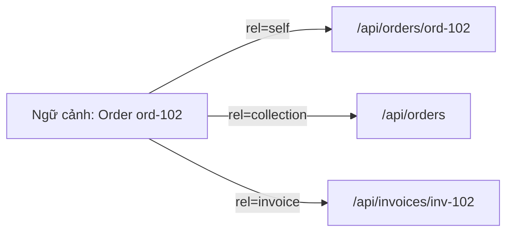
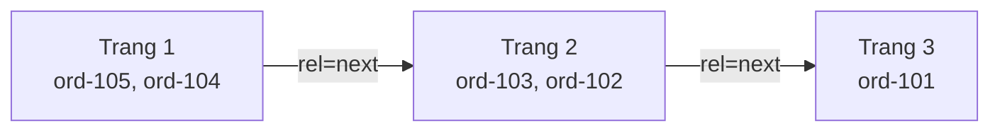
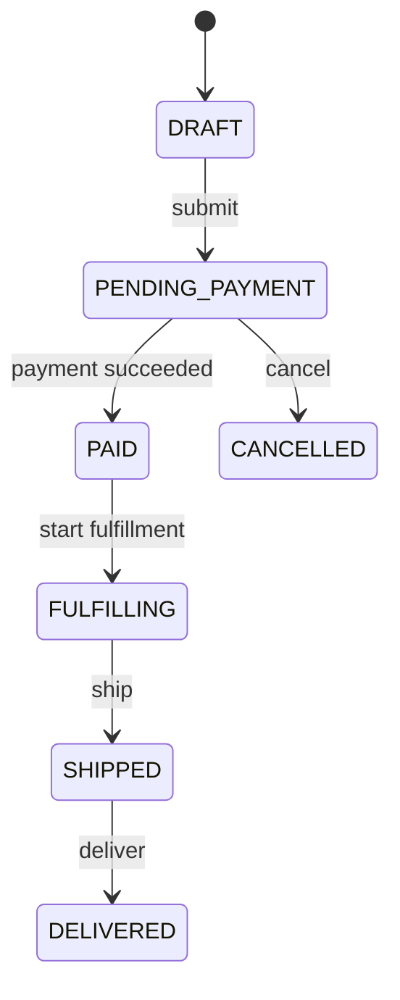
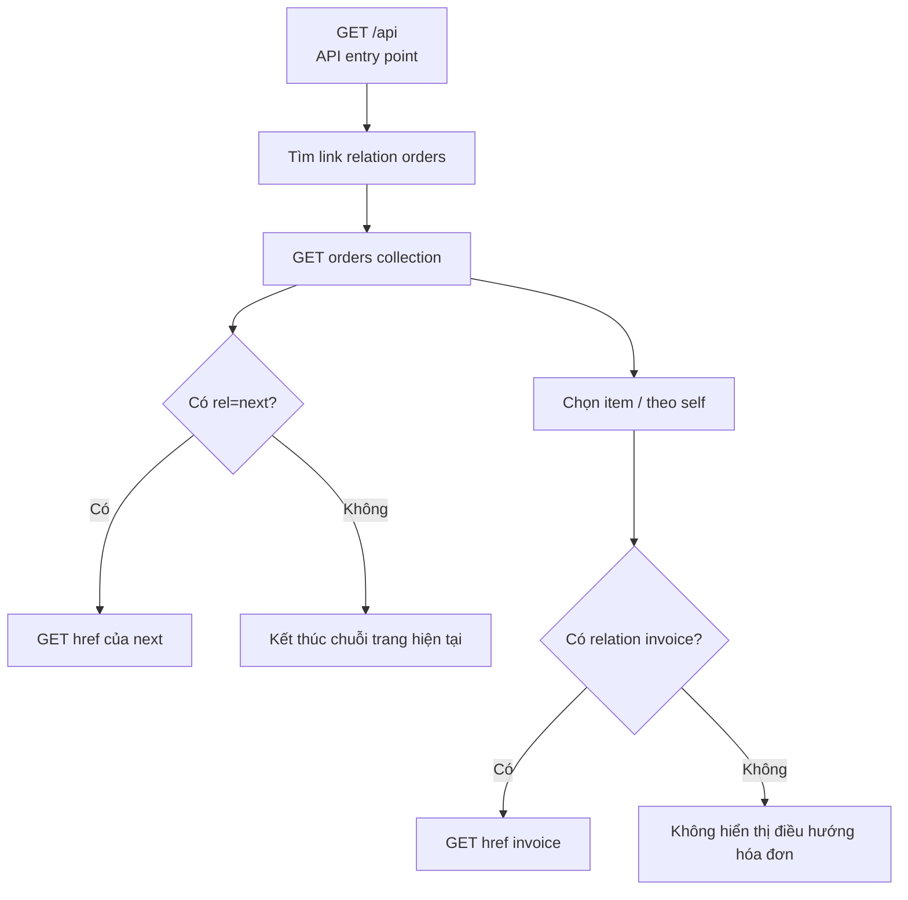

# Biểu diễn self, collection, next và các quan hệ nghiệp vụ

> **Module:** INTEGRATION_API_REST — thiết kế REST API dựa trên resource, URI, phương thức và mã trạng thái HTTP, với hợp đồng dữ liệu rõ ràng. Nội dung thực hành bao gồm phân trang, cache, idempotency, OpenAPI, xác thực, phân quyền, xử lý lỗi và kiểm thử API với Java/Spring hoặc công nghệ tương đương.  
> **Chương:** Hypermedia.  
> **Trọng tâm:** Biểu diễn các liên kết `self`, `collection`, `next` và các **quan hệ nghiệp vụ** trong REST API, giúp client khám phá tài nguyên và bước tiếp theo từ phản hồi thay vì phụ thuộc hoàn toàn vào URI tự ghép.

## 1. Bài toán: client biết bước tiếp theo bằng cách nào?

Một ứng dụng B2B cần hiển thị danh sách đơn hàng, mở chi tiết một đơn, xem hóa đơn và tải trang tiếp theo. Cách tích hợp thường gặp là frontend ghi cứng những URI:

```text
GET /api/orders?status=PAID&size=20&page=0
GET /api/orders/{id}
GET /api/invoices/{invoiceId}
GET /api/orders?status=PAID&size=20&page=1
```

Cách này có thể hoạt động. Nhưng khi backend chuyển sang cursor pagination, thay đường dẫn hóa đơn hoặc một loại đơn không được phép xem hóa đơn, client phải biết nhiều quy tắc URL và trạng thái được cài rải rác.

**Hypermedia** cho phép server trả dữ liệu **kèm những liên kết có ý nghĩa**:

- `self`: liên kết đến resource mà biểu diễn hiện tại nói tới.
- `collection`: từ một item liên kết đến tập hợp chứa item đó.
- `next`: từ một trang kết quả liên kết đến trang kế tiếp.
- **Quan hệ nghiệp vụ**: từ đơn hàng liên kết đến khách hàng, hóa đơn, vận đơn, chính sách hủy hoặc một resource liên quan được định nghĩa trong domain.

Ví dụ một trang kết quả:

```json
{
  "_links": {
    "self": {"href": "/api/orders?status=PAID&size=2"},
    "next": {"href": "/api/orders?status=PAID&size=2&cursor=eyJ..."}
  },
  "_embedded": {
    "orders": [
      {
        "id": "ord-102",
        "status": "PAID",
        "_links": {
          "self": {"href": "/api/orders/ord-102"},
          "collection": {"href": "/api/orders"},
          "https://api.example.com/rels/invoice": {
            "href": "/api/invoices/inv-102"
          }
        }
      }
    ]
  }
}
```

Đây là ví dụ theo quy ước **HAL** (Hypertext Application Language), với media type `application/hal+json`. Client có thể tìm `_links.next.href` để lấy trang tiếp theo mà không cần tự tăng `page` hoặc giải mã `cursor`.

**Kết quả học tập:** sau bài học, bạn có thể giải thích ngữ nghĩa từng quan hệ, tạo response HAL đúng phạm vi, thiết kế liên kết nghiệp vụ theo trạng thái và quyền, triển khai bằng Spring HATEOAS, đặc tả hợp đồng OpenAPI và viết kiểm thử hành vi khám phá.

## 2. Link relation là gì?

Một hyperlink trong HTTP không chỉ có URI đích. Nó còn có **quan hệ** (*link relation*), mô tả ý nghĩa kết nối từ **ngữ cảnh hiện tại** (*link context*) đến **tài nguyên đích** (*link target*).



Một liên kết có thể được mô hình hóa đơn giản:

```text
(context, relation, target, [các thuộc tính liên kết])
```

- **Context:** response/biểu diễn mà liên kết mô tả.
- **Relation:** ý nghĩa của kết nối, chẳng hạn `self` hoặc `next`.
- **Target:** đích `href`.
- **Thuộc tính khác:** tiêu đề hiển thị, loại media dự kiến, ngôn ngữ hoặc thông tin template tùy định dạng.

Theo mô hình Web Linking của **RFC 8288**, những tên quan hệ phổ biến có thể được đăng ký trong registry; những quan hệ mở rộng có thể được định danh bằng URI. Không nên tự phát minh nghĩa khác cho tên quan hệ đã chuẩn hóa.

### 2.1. Phân biệt URI với relation

```json
{
  "_links": {
    "self": {
      "href": "/api/orders/ord-102"
    }
  }
}
```

`self` là **relation**; `/api/orders/ord-102` là **đích**. Client quan tâm đến ý nghĩa “resource hiện tại” và sử dụng đích do server cấp.

Nếu server đổi đích thành `/v2/orders/ord-102`, client điều hướng theo link có thể vẫn hoạt động, với điều kiện phương thức/representation và các hợp đồng liên quan được duy trì. **Hypermedia không bảo đảm mọi thay đổi API đều tương thích ngược**: client vẫn phụ thuộc vào ý nghĩa quan hệ, kiểu dữ liệu, trạng thái và các phương thức được hỗ trợ.

### 2.2. Link không mặc nhiên là hành động

`href` trong một link HAL thường biểu thị **địa chỉ tài nguyên**, không tự chứa nghĩa rằng phải `POST`, `PUT` hay `DELETE`. Ví dụ:

```json
{
  "_links": {
    "https://api.example.com/rels/payment-options": {
      "href": "/api/orders/ord-102/payment-options"
    }
  }
}
```

Liên kết cho biết có một tài nguyên chứa các lựa chọn thanh toán. Nó **không đủ** để khẳng định gửi `POST` đến `href` sẽ thanh toán, body cần trường gì hoặc idempotency key ở đâu.

Để mô tả thao tác có phương thức và dữ liệu đầu vào, API có thể dùng **HAL-FORMS**, **Siren**, profile/metadata affordance hoặc một hợp đồng biểu mẫu khác. Những cấu trúc đó phải được tài liệu hóa theo đúng media type, không suy diễn từ riêng `rel`.

## 3. self: tài nguyên hoặc biểu diễn hiện tại

### 3.1. Ý nghĩa

`self` chỉ liên kết tới **resource được nhận diện là ngữ cảnh hiện tại** của biểu diễn. Trong response chi tiết đơn hàng:

```http
GET /api/orders/ord-102 HTTP/1.1
Host: api.example.com
Accept: application/hal+json
Authorization: Bearer <access-token>
```

```http
HTTP/1.1 200 OK
Content-Type: application/hal+json
Cache-Control: private, no-store

{
  "id": "ord-102",
  "status": "PAID",
  "totalAmount": 1250000,
  "_links": {
    "self": {"href": "/api/orders/ord-102"}
  }
}
```

Client có thể lưu và theo `self` để tải lại bản hiện tại. `self` không phải một phương thức “update”, cũng không tự nói rằng resource chỉ được đọc qua GET. Các HTTP method được phép và hợp đồng sửa đổi phải được mô tả riêng.

### 3.2. self trên một trang kết quả

Với tập hợp đã lọc/phân trang, ngữ cảnh là **trang kết quả cụ thể**, không nhất thiết là toàn bộ collection:

```json
{
  "_links": {
    "self": {
      "href": "/api/orders?status=PAID&size=20&cursor=abc123"
    }
  }
}
```

Nếu bỏ `cursor` hoặc `status` khỏi `self`, link đó có thể trỏ đến **trang đầu hoặc tập khác**, chứ không phải trang hiện tại. Do đó cần định nghĩa URI biểu diễn trang đúng với query đã chuẩn hóa, kể cả giới hạn kích thước và thứ tự.

Để client quay về toàn bộ collection, dùng liên kết khác có nghĩa thích hợp, chẳng hạn `collection` khi ngữ cảnh là một item, hoặc quan hệ nghiệp vụ riêng nếu mô hình yêu cầu.

### 3.3. self có phải canonical URL?

Không nhất thiết. Một hệ thống có nhiều URI/biểu diễn có thể quy định URI canonical riêng. Nếu cần liên kết canonical, dùng quan hệ và quy tắc phù hợp; **đừng mặc định `self` luôn đồng nghĩa với một link canonical duy nhất cho mọi hình thức biểu diễn**.

Điều quan trọng là `self` phải nhất quán với **ngữ cảnh representation** mà client đang nhận, không trỏ ngẫu nhiên tới endpoint khác chỉ vì cùng ID.

## 4. collection: item thuộc tập hợp nào?

Quan hệ `collection` thường dùng **từ một thành viên** đến tập hợp chứa thành viên đó.

Ví dụ GET chi tiết đơn hàng:

```json
{
  "id": "ord-102",
  "status": "PAID",
  "_links": {
    "self": {
      "href": "/api/orders/ord-102"
    },
    "collection": {
      "href": "/api/orders"
    }
  }
}
```

**Hành vi client:** khi người dùng đang xem chi tiết, có thể theo `collection` để trở lại danh sách đơn hàng theo ngữ cảnh phù hợp.

### 4.1. collection không có nghĩa “trang kế tiếp”

`collection` nói về **quan hệ thành viên và tập hợp**, không mô tả bước duyệt tiếp. Trang kế tiếp dùng `next`. Không thay `next` bằng `collection` rồi yêu cầu client tự đoán query `page+1`.

### 4.2. Một item có thể thuộc nhiều collection

Ví dụ sản phẩm `p-42` thuộc cả catalog chung và nhóm “sản phẩm ưu đãi”. Theo mô hình và định dạng hypermedia, một relation có thể có **nhiều link target**:

```json
{
  "id": "p-42",
  "_links": {
    "self": {
      "href": "/api/products/p-42"
    },
    "collection": [
      {"href": "/api/products", "title": "Toàn bộ sản phẩm"},
      {"href": "/api/promotions/summer/products", "title": "Sản phẩm ưu đãi"}
    ]
  }
}
```

Client không nên giả định `_links.collection` lúc nào cũng là một object đơn lẻ nếu contract cho phép cả array. Việc dùng nhiều target phải dựa vào **quan hệ thành viên thật** và mô hình quyền của API.

Nếu client cần trở lại **chính xác danh sách đã lọc mà người dùng vừa xem**, một link `collection` tới `/api/products` chưa chắc bảo toàn filter/sort ban đầu. Có thể cung cấp link với tập hợp đã lọc khi phù hợp hoặc để client lưu `self` của trang danh sách ban đầu. Không truyền toàn bộ trạng thái giao diện sang resource link chỉ để mô phỏng nút Back.

## 5. next: điều hướng sang trang kết quả kế tiếp

Trong **collection pagination**, `next` liên kết từ trang hiện tại sang trang tiếp theo theo **cùng quy tắc truy vấn**.



Một trang HAL minh họa:

```http
GET /api/orders?status=PAID&size=2 HTTP/1.1
Accept: application/hal+json
Authorization: Bearer <access-token>
```

```http
HTTP/1.1 200 OK
Content-Type: application/hal+json
Cache-Control: private, no-store

{
  "_links": {
    "self": {
      "href": "/api/orders?status=PAID&size=2"
    },
    "next": {
      "href": "/api/orders?status=PAID&size=2&cursor=c_v1_f3A"
    }
  },
  "_embedded": {
    "orders": [
      {
        "id": "ord-105",
        "status": "PAID",
        "_links": {
          "self": {"href": "/api/orders/ord-105"},
          "collection": {"href": "/api/orders"}
        }
      },
      {
        "id": "ord-104",
        "status": "PAID",
        "_links": {
          "self": {"href": "/api/orders/ord-104"},
          "collection": {"href": "/api/orders"}
        }
      }
    ]
  }
}
```

Token `c_v1_f3A` ở đây chỉ là **chuỗi rút gọn để minh họa**. Token thật cần do server phát hành, có kiểm soát scope và tính toàn vẹn nếu chứa tham số có thể ảnh hưởng truy vấn.

### 5.1. next phải giữ phạm vi truy vấn

Nếu trang đầu dùng:

```text
status=PAID
size=2
sort=createdAtDesc
tenant=theo principal đã xác thực
```

thì link `next` phải tiếp tục **cùng tập kết quả và cùng thứ tự**. Không để frontend gửi lại cursor của `PAID` với filter `CANCELLED` hoặc size mới mà backend vẫn chấp nhận mốc cũ.

Các nguyên tắc:

1. Server **tạo link next hoàn chỉnh** theo query chuẩn hóa và cursor được cấp.
2. Cursor là dữ liệu **mờ**, client không phân tích và tự sửa vị trí.
3. Server ràng buộc/kiểm tra cursor theo filter, sort, tenant và thời hạn, đồng thời **kiểm tra quyền trên mỗi request**.
4. Nếu đổi filter hoặc sort, client bắt đầu lại từ trang đầu thay vì tự tái sử dụng cursor cũ.
5. Nếu cursor hết hạn, trả lỗi theo hợp đồng (ví dụ `400` với Problem Details) và hướng client tải lại trang đầu.

### 5.2. Khi nào không có next?

Nếu server xác định tại thời điểm truy vấn không còn phần tử ở trang tiếp theo, có thể **bỏ hẳn `next`** trong `_links`:

```json
{
  "_links": {
    "self": {
      "href": "/api/orders?status=PAID&size=2&cursor=c_v1_end"
    }
  },
  "_embedded": {
    "orders": [
      {"id": "ord-101", "_links": {
        "self": {"href": "/api/orders/ord-101"}
      }}
    ]
  }
}
```

Không cần trả `"next": null` trong HAL nếu contract dùng **sự vắng mặt của relation** để thể hiện không có trang tiếp. Đối với response rỗng, phải duy trì shape đã công bố và xử lý tên `_embedded` nhất quán.

Không có `next` **không bảo đảm** sẽ không có dữ liệu mới vào tương lai. Nó chỉ mô tả tình trạng ở phạm vi và thời điểm truy vấn, theo semantics của server.

### 5.3. next không tự tạo snapshot bất biến

Nếu một đơn mới xuất hiện khi client đang duyệt, keyset pagination có thể giúp tránh lặp do lệch offset, nhưng việc xóa, cập nhật trường sort/filter hoặc dữ liệu đến muộn vẫn có thể gây khác biệt. Nếu nghiệp vụ yêu cầu duyệt đúng **một ảnh chụp cố định**, API cần cơ chế snapshot/watermark và thời hạn riêng.

Hypermedia giải quyết **cách khám phá đường đi tiếp theo**, không tự giải quyết toàn bộ các bài toán nhất quán của phân trang.

## 6. Các quan hệ nghiệp vụ trong domain

Ngoài `self`, `collection` và `next`, API còn cần cho client biết **mối liên hệ giữa các resource nghiệp vụ**:

- Đơn hàng có **khách hàng** đặt đơn.
- Đơn hàng có **hóa đơn** khi hóa đơn đã được phát hành.
- Đơn hàng có **vận đơn/tracking** khi được giao cho bên vận chuyển.
- Đơn hàng có **các lựa chọn thanh toán** khi chưa thanh toán.
- Đơn hàng có **quy tắc hủy** hoặc yêu cầu hủy trong một trạng thái nhất định.

Ví dụ đơn hàng đã thanh toán:

```json
{
  "id": "ord-102",
  "status": "PAID",
  "_links": {
    "self": {
      "href": "/api/orders/ord-102"
    },
    "collection": {
      "href": "/api/orders"
    },
    "https://api.example.com/rels/customer": {
      "href": "/api/customers/c-23"
    },
    "https://api.example.com/rels/invoice": {
      "href": "/api/invoices/inv-102"
    }
  }
}
```

Trong ví dụ, `customer` và `invoice` là các **relation của domain**, được định danh bằng URI riêng. Đích có thể thay đổi nhưng ý nghĩa quan hệ được duy trì.

### 6.1. Quan hệ chuẩn và quan hệ mở rộng

| Quan hệ | Mức độ | Ý nghĩa trong ví dụ | Client có thể làm gì? |
|---|---|---|---|
| `self` | Relation phổ biến/đăng ký | Resource hiện tại | Theo link để truy cập biểu diễn hiện tại |
| `collection` | Relation phổ biến/đăng ký | Tập hợp mà item là thành viên | Điều hướng đến danh sách liên quan |
| `next` | Relation phổ biến/đăng ký | Trang kế tiếp trong chuỗi | Tiếp tục phân trang |
| `prev` | Relation phổ biến/đăng ký | Trang trước trong chuỗi | Quay lại theo trang nếu API hỗ trợ |
| `https://api.example.com/rels/invoice` | Quan hệ mở rộng | Hóa đơn của đơn hàng | Mở hóa đơn theo quyền truy cập |
| `https://api.example.com/rels/customer` | Quan hệ mở rộng | Khách hàng của đơn | Mở resource khách hàng nếu được phép |
| `https://api.example.com/rels/payment-options` | Quan hệ mở rộng | Resource các lựa chọn thanh toán | Lấy lựa chọn và hành vi được mô tả thêm |
| `https://api.example.com/rels/tracking` | Quan hệ mở rộng | Thông tin vận chuyển/tracking | Xem trạng thái giao nhận |

Các URI `api.example.com` đều là **ví dụ giả định**; hệ thống thực phải dùng namespace mà mình sở hữu, công bố và duy trì. Không giả định mọi chuỗi như `"pay"` hay `"approve"` đều là quan hệ đã đăng ký.

### 6.2. Dùng CURIE để viết gọn relation mở rộng trong HAL

HAL hỗ trợ cách viết **CURIE** để rút gọn tên relation mở rộng. Ví dụ:

```json
{
  "id": "ord-102",
  "status": "PAID",
  "_links": {
    "self": {
      "href": "/api/orders/ord-102"
    },
    "collection": {
      "href": "/api/orders"
    },
    "curies": [
      {
        "name": "shop",
        "href": "https://api.example.com/rels/{rel}",
        "templated": true
      }
    ],
    "shop:invoice": {
      "href": "/api/invoices/inv-102"
    },
    "shop:customer": {
      "href": "/api/customers/c-23"
    }
  }
}
```

Theo khai báo trên, `shop:invoice` tham chiếu tới relation `https://api.example.com/rels/invoice`. Nó giúp JSON ngắn và rõ ngữ cảnh, nhưng client cần hiểu quy tắc CURIE của HAL hoặc được thư viện xử lý.

**Không hiểu nhầm `curies` là link trực tiếp đến một tài nguyên hóa đơn.** Nó là template giúp diễn giải tên quan hệ; các link `shop:invoice` và `shop:customer` mới có target điều hướng cụ thể.

### 6.3. Tránh dùng tên endpoint thay cho ý nghĩa nghiệp vụ

So sánh hai cách:

```json
{
  "_links": {
    "getInvoice": {
      "href": "/api/invoices/inv-102"
    }
  }
}
```

và:

```json
{
  "_links": {
    "https://api.example.com/rels/invoice": {
      "href": "/api/invoices/inv-102"
    }
  }
}
```

Tên `getInvoice` mô tả cách lập trình viên nghĩ về một lời gọi, còn `invoice` là **quan hệ domain** giữa đơn hàng và hóa đơn. Relation được thiết kế tốt nên biểu thị ý nghĩa ổn định, không phụ thuộc vào tên method trong source code hay endpoint controller.

Một số quan hệ thực sự mô tả thao tác, nhưng phải định nghĩa thêm cách thực thi hành động để tránh giả định “có liên kết là cứ POST vào đó”.

## 7. Liên kết phụ thuộc trạng thái và hành vi nghiệp vụ

Một điểm quan trọng của hypermedia là **liên kết xuất hiện phù hợp với trạng thái tài nguyên**. Ví dụ:



Các state transition trên chỉ mô tả nghiệp vụ giả định; mỗi hệ thống phải xác định rõ ai có quyền thay đổi, điều kiện, giao dịch và khả năng hoàn tác.

### 7.1. Ví dụ một đơn đang chờ thanh toán

```json
{
  "id": "ord-103",
  "status": "PENDING_PAYMENT",
  "_links": {
    "self": {"href": "/api/orders/ord-103"},
    "collection": {"href": "/api/orders"},
    "https://api.example.com/rels/payment-options": {
      "href": "/api/orders/ord-103/payment-options"
    },
    "https://api.example.com/rels/cancellation-policy": {
      "href": "/api/orders/ord-103/cancellation-policy"
    }
  }
}
```

Server chỉ trả link `payment-options` nếu người dùng có quyền **nhìn thấy thông tin lựa chọn thanh toán** trong trạng thái này. Đích là tài nguyên có thể đọc, chưa phải chỉ thị thực hiện giao dịch.

### 7.2. Ví dụ đơn đã thanh toán và có hóa đơn

```json
{
  "id": "ord-103",
  "status": "PAID",
  "_links": {
    "self": {"href": "/api/orders/ord-103"},
    "collection": {"href": "/api/orders"},
    "https://api.example.com/rels/invoice": {
      "href": "/api/invoices/inv-103"
    }
  }
}
```

Tại thời điểm này server không cung cấp `payment-options` nếu không còn ý nghĩa; thay vào đó có `invoice` nếu invoice đã tồn tại và người dùng có quyền truy cập.

**Quan trọng:** một quan hệ không xuất hiện **không luôn có nghĩa** hành vi đó vĩnh viễn bị cấm. Link có thể vắng do trạng thái hiện tại, quyền, representation rút gọn, tính năng chưa bật, resource chưa được tạo hoặc do lỗi tạm thời. Contract phải mô tả khi nào link được kỳ vọng; client xử lý sự vắng mặt an toàn.

### 7.3. Không dùng danh sách link để thay thế phân quyền

Ngay cả khi API đã ẩn link thanh toán cho người không được phép, một client vẫn có thể tự gọi URI đã biết hoặc giữ link cũ. Vì vậy:

- **Hiển thị link** chỉ là gợi ý điều hướng/khả năng có sẵn, không phải quyền đã được cấp.
- Mỗi request đến endpoint đích phải được **xác thực, phân quyền và kiểm tra trạng thái hiện tại**.
- Server phải chống race condition: link hủy đơn có thể được tạo khi đơn đang `PENDING_PAYMENT`, nhưng trước khi user click thì trạng thái đã chuyển `PAID`.
- Cần trả `403`, `404`, `409` hoặc `412` theo ngữ nghĩa cụ thể, không tin rằng client chắc chắn tuân theo luồng link.

## 8. Hypermedia và các hành động thay đổi trạng thái

Hypermedia không chỉ là danh sách link cho GET. Một client có thể cần biết **cách thực hiện hành động**: phương thức HTTP, URI đích, loại body, trường bắt buộc và điều kiện trước khi gửi.

### 8.1. Link navigation khác action affordance

| Thông tin | HAL link thông thường | Form/action có metadata |
|---|---|---|
| Quan hệ nghiệp vụ | Có `rel` | Có thể có relation/name |
| Địa chỉ đích | Có `href` | Có target/action URL |
| Phương thức HTTP | **Không nhất thiết có** | Có thể khai báo `POST`/`PATCH`/`DELETE` |
| Content-Type body | Không nhất thiết có | Có thể định nghĩa |
| Trường đầu vào bắt buộc | Không mô tả đầy đủ | Có thể mô tả |
| Điều kiện `If-Match` hoặc idempotency key | Cần contract riêng | Có thể được thể hiện hoặc dẫn chiếu |
| Quyền hợp lệ | **Luôn cần server kiểm tra** | **Vẫn luôn cần server kiểm tra** |

Không nên chỉ trả:

```json
{
  "_links": {
    "pay": {"href": "/api/orders/ord-103/pay"}
  }
}
```

rồi kỳ vọng client tự biết phải `POST` hay `GET`. Ngoài việc `pay` là quan hệ mở rộng cần định nghĩa, **GET tuyệt đối không nên được dùng như hành động thu tiền/thay đổi trạng thái**.

### 8.2. Ví dụ action được mô tả tường minh

Với **HAL-FORMS** (media type `application/prs.hal-forms+json`), có thể mô tả một template thao tác. Ví dụ **minh họa các trường cốt lõi**, không thay thế toàn bộ hợp đồng thanh toán:

```http
HTTP/1.1 200 OK
Content-Type: application/prs.hal-forms+json

{
  "id": "ord-103",
  "status": "PENDING_PAYMENT",
  "_links": {
    "self": {
      "href": "/api/orders/ord-103"
    }
  },
  "_templates": {
    "default": {
      "title": "Khởi tạo yêu cầu thanh toán",
      "method": "POST",
      "target": "/api/orders/ord-103/payment-attempts",
      "contentType": "application/json",
      "properties": [
        {
          "name": "paymentMethodId",
          "required": true
        }
      ]
    }
  }
}
```

Ở đây metadata cho biết **POST** và trường đầu vào. Endpoint thật cần thêm quy tắc xác thực, idempotency key, trạng thái `202/201/409`, thông tin lỗi và xử lý thanh toán bất đồng bộ nếu thích hợp. Không coi ví dụ này là thiết kế payment production đầy đủ.

**Lưu ý:** HAL thông thường có `_links`/`_embedded`; HAL-FORMS và Siren bổ sung cách mô tả hành động riêng. **Không trộn ngẫu nhiên các property của định dạng này vào media type khác** rồi gọi đó là tuân thủ một chuẩn.

### 8.3. Có cần hypermedia cho mọi API không?

Không phải mọi sản phẩm cần workflow điều hướng bằng hypermedia. Với tích hợp máy-máy có contract cố định, URI versioned và OpenAPI/SDK được quản lý, một API JSON thông thường có thể đủ. Hypermedia hữu ích khi:

- Client cần **khám phá resource liên quan**.
- Workflow có trạng thái và các bước tiếp theo thay đổi theo trạng thái.
- Server muốn kiểm soát link pagination thay vì client tự ghép URI.
- Hệ thống có nhiều loại resource hoặc nhiều client dài hạn.
- Cần giới thiệu khả năng mới theo cách tương thích với client hiểu relation.

Đổi lại, server phải quản lý relation/profile ổn định, sinh link đúng, kiểm thử theo trạng thái và duy trì thư viện client hiểu định dạng.

## 9. HAL: cách biểu diễn links và embedded resources

**HAL** thường dùng các thành viên đặc biệt:

- `_links`: ánh xạ tên relation sang một link object hoặc array link objects.
- `_embedded`: tài nguyên liên quan được nhúng vào response để giảm lượt gọi.
- `href`: target URI của link.
- `templated`: đánh dấu URI Template cần mở rộng trước khi dùng.
- `title`, `type` và các thuộc tính link khác: metadata tùy định dạng/nhu cầu.

Response minh họa:

```http
HTTP/1.1 200 OK
Content-Type: application/hal+json
Cache-Control: private, no-store

{
  "_links": {
    "self": {"href": "/api/orders?status=PAID&size=2"},
    "next": {"href": "/api/orders?status=PAID&size=2&cursor=c_v1_f3A"},
    "curies": [{
      "name": "shop",
      "href": "https://api.example.com/rels/{rel}",
      "templated": true
    }]
  },
  "_embedded": {
    "orders": [
      {
        "id": "ord-105",
        "status": "PAID",
        "_links": {
          "self": {"href": "/api/orders/ord-105"},
          "collection": {"href": "/api/orders"},
          "shop:invoice": {"href": "/api/invoices/inv-105"}
        }
      },
      {
        "id": "ord-104",
        "status": "PAID",
        "_links": {
          "self": {"href": "/api/orders/ord-104"},
          "collection": {"href": "/api/orders"}
        }
      }
    ]
  }
}
```

`shop:invoice` chỉ xuất hiện với đơn đã có invoice và caller được phép nhìn thấy quan hệ đó. Client không nên coi việc có `_embedded.orders` nghĩa là **mọi** trường đầy đủ của mỗi đơn đã được nạp; đây có thể là bản tóm tắt (projection). Khi cần dữ liệu hiện tại hoặc khả năng cụ thể hơn, theo `self` và hợp đồng resource.

### 9.1. Embedded resource không thay relation

Việc nhúng đơn hàng trong danh sách là một quyết định để tối ưu round-trip, nhưng item vẫn nên có `self` nếu client có thể mở chi tiết độc lập. `_embedded` không phải cách duy nhất định nghĩa quan hệ; `_links` mới cho biết target và ý nghĩa để client có thể điều hướng.

Quá nhiều resource nhúng có thể gây payload lớn, truy vấn N+1 hoặc lộ dữ liệu. Dùng phân trang, projection và chính sách truy cập phù hợp; không nhúng toàn bộ lịch sử thanh toán và thông tin khách hàng chỉ vì có quan hệ.

### 9.2. URI template

Một link có `templated: true` có thể chứa URI Template, chẳng hạn:

```json
{
  "_links": {
    "curies": [{
      "name": "shop",
      "href": "https://api.example.com/rels/{rel}",
      "templated": true
    }],
    "shop:search": {
      "href": "/api/orders{?status,size}",
      "templated": true
    }
  }
}
```

Client cần thư viện hiểu **URI Template theo RFC 6570** khi mở rộng `status` và `size`, rồi dùng đúng encoding. Không gửi nguyên chuỗi `/api/orders{?status,size}` như URI đã hoàn chỉnh.

Chỉ cho phép tham số được API chấp nhận, giới hạn giá trị và xác minh quyền trên server. Việc template liệt kê `status`, `size` không có nghĩa client có quyền truy cập mọi status của mọi tenant.

### 9.3. HAL và những định dạng hypermedia khác

| Định dạng/cơ chế | Đặc điểm | Lựa chọn khi nào? |
|---|---|---|
| **HAL JSON** (`application/hal+json`) | `_links` và `_embedded` đơn giản, thuận tiện điều hướng | Resource graph và pagination |
| **HTTP Link header** (RFC 8288) | Truyền quan hệ trong header mà không phụ thuộc JSON body | Liên kết metadata, response không dùng HAL, phân trang |
| **HAL-FORMS** | Thêm template mô tả thao tác và input | Workflow cần affordance có method/body |
| **Siren** | Biểu diễn entity, links, actions và sub-entities | Workflow/action giàu metadata |
| **JSON:API** | Quy tắc riêng về `links`, resource và relationships | API theo trọn bộ hợp đồng JSON:API |
| **JSON thông thường + link tùy chỉnh** | Tự định nghĩa `links` và semantics | Hệ thống có lý do rõ, sẵn sàng duy trì contract riêng |

Không gán media type `application/hal+json` cho payload không tuân theo cấu trúc HAL. Nếu chọn một định dạng khác, client và OpenAPI phải thống nhất cách phân tích link. Không nên triển khai nửa HAL, nửa JSON:API mà không công bố format mới.

## 10. Link HTTP header bên cạnh HAL

Hypermedia có thể được diễn tả ở HTTP headers. Ví dụ:

```http
HTTP/1.1 200 OK
Content-Type: application/json
Link: </api/orders/ord-102>; rel="self"
Link: </api/orders>; rel="collection"

{
  "id": "ord-102",
  "status": "PAID"
}
```

Với danh sách:

```http
HTTP/1.1 200 OK
Content-Type: application/json
Link: </api/orders?status=PAID&size=2>; rel="self"
Link: </api/orders?status=PAID&size=2&cursor=c_v1_f3A>; rel="next"

{"data":[{"id":"ord-105"},{"id":"ord-104"}]}
```

Header `Link` cho biết quan hệ, nhưng **không tự mô tả shape JSON hoặc toàn bộ hành động**. Có thể dùng cả header và body HAL khi phù hợp, nhưng phải bảo đảm chúng **không mâu thuẫn**. Nếu có proxy/gateway sinh link riêng, cần kiểm thử quan hệ và đích cuối cùng được client thấy.

RFC 8288 cho phép nhiều link-value trong một header theo cú pháp của giao thức. Ví dụ tách nhiều header ở đây để dễ đọc; runtime/gateway có thể gộp theo cách hợp lệ.

## 11. Client hypermedia nên điều hướng thế nào?

Một client tối thiểu có thể biết **entry point** của API và những relation nó quan tâm, rồi đi theo links:



### 11.1. Entry point có thể công bố collection

```http
GET /api HTTP/1.1
Accept: application/hal+json
```

```json
{
  "_links": {
    "self": {"href": "/api"},
    "curies": [{
      "name": "shop",
      "href": "https://api.example.com/rels/{rel}",
      "templated": true
    }],
    "shop:orders": {"href": "/api/orders"},
    "shop:catalog": {"href": "/api/products"}
  }
}
```

Client biết relation `shop:orders` và có thể theo URI server cung cấp. Nó không nhất thiết phải biết cấu trúc đường dẫn `/api/orders` ở cấp mã nguồn; vẫn cần biết **relation semantics và media type** để điều hướng hợp lệ.

### 11.2. Pseudocode cho client

```text
entry = http.get(apiEntryPoint, Accept="application/hal+json")
ordersUrl = requireLink(entry, "shop:orders").href

page = http.get(ordersUrl)
while true:
    render(page._embedded.orders)

    next = optionalLink(page, "next")
    if next is absent:
        break

    // Giữ nguyên href server cấp; xử lý URI relative đúng.
    page = http.get(resolveUri(page.requestUri, next.href))
```

Client **không** tự giải mã cursor, không tự tăng page, không giả định mọi trang đều có cùng lượng item, và không dùng link của người dùng A cho session người dùng B.

### 11.3. Xử lý URI tương đối và bảo mật điều hướng

Một `href` như `/api/orders/ord-102` là URI reference tương đối hợp lệ trong ngữ cảnh phù hợp. Client phải resolve nó với base URI của response theo chuẩn xử lý URI, không nối chuỗi tùy ý.

Bảo vệ client:

- Không tự động gửi Authorization header nhạy cảm tới một **host không tin cậy** chỉ vì link được trả về.
- Có quy tắc allowlist origin/scheme phù hợp với API và quá trình chuyển hướng.
- Dùng HTTPS cho traffic yêu cầu bảo mật; không chấp nhận target `javascript:` hoặc scheme không được phép trong trình duyệt.
- Xử lý link thiếu, bị thay đổi hoặc không hợp lệ bằng lỗi có thể theo dõi, không fallback sang URI cứng mà không có hợp đồng.
- Nếu cần SDK ổn định, kiểm thử tương thích với relation và representation thay vì so khớp chuỗi URL đầy đủ.

## 12. Spring Boot với Spring HATEOAS

Spring HATEOAS cung cấp `Link`, `EntityModel`, `CollectionModel`, `PagedModel` và tiện ích tạo link để xây hypermedia response. Trong Spring Boot, thông thường cần dependency `spring-boot-starter-hateoas` để hỗ trợ HAL serialization.

### 12.1. DTO và tên relation cho collection

```java
import org.springframework.hateoas.server.core.Relation;

@Relation(itemRelation = "order", collectionRelation = "orders")
public record OrderView(
        String id,
        String status,
        String invoiceId
) {}
```

Annotation `@Relation` chỉ định tên dùng khi framework xác định item/collection relation. Với `_embedded.orders`, cần kiểm thử serialization của phiên bản Spring HATEOAS thực tế, đặc biệt khi bọc DTO trong `EntityModel` hoặc danh sách có kiểu generic không được giữ đầy đủ.

### 12.2. Controller minh họa

```java
import java.security.Principal;
import java.util.List;
import org.springframework.hateoas.CollectionModel;
import org.springframework.hateoas.EntityModel;
import org.springframework.hateoas.IanaLinkRelations;
import org.springframework.hateoas.Link;
import org.springframework.hateoas.MediaTypes;
import org.springframework.http.CacheControl;
import org.springframework.http.ResponseEntity;
import org.springframework.web.bind.annotation.GetMapping;
import org.springframework.web.bind.annotation.RequestParam;
import org.springframework.web.bind.annotation.RestController;
import org.springframework.web.util.UriComponentsBuilder;

@RestController
public class OrderCollectionController {
    private final OrderQueryService service;

    public OrderCollectionController(OrderQueryService service) {
        this.service = service;
    }

    @GetMapping(
        path = "/api/orders",
        produces = MediaTypes.HAL_JSON_VALUE
    )
    public ResponseEntity<CollectionModel<EntityModel<OrderView>>> list(
            @RequestParam(defaultValue = "PAID") String status,
            @RequestParam(defaultValue = "20") int size,
            @RequestParam(required = false) String cursor,
            Principal principal) {

        // Service kiểm tra danh tính, tenant, quyền, filter,
        // giới hạn size và cursor trước khi truy vấn.
        OrderSlice slice = service.findVisible(principal, status, size, cursor);

        List<EntityModel<OrderView>> items = slice.items().stream()
                .map(this::toModel)
                .toList();

        CollectionModel<EntityModel<OrderView>> page =
                CollectionModel.of(items);

        page.add(Link.of(listHref(status, size, cursor)).withSelfRel());

        if (slice.nextCursor() != null) {
            page.add(Link.of(
                    listHref(status, size, slice.nextCursor())
                ).withRel(IanaLinkRelations.NEXT));
        }

        return ResponseEntity.ok()
                .cacheControl(CacheControl.noStore())
                .body(page);
    }

    private EntityModel<OrderView> toModel(OrderView order) {
        EntityModel<OrderView> model = EntityModel.of(order);

        model.add(Link.of(itemHref(order.id())).withSelfRel());
        model.add(Link.of("/api/orders")
                .withRel(IanaLinkRelations.COLLECTION));

        // Chỉ công bố relation khi hóa đơn tồn tại và người gọi
        // được phép nhìn thấy. Quyền thật phải được kiểm tra ở
        // cả endpoint hóa đơn.
        if (order.invoiceId() != null) {
            model.add(Link.of(invoiceHref(order.invoiceId()))
                .withRel("https://api.example.com/rels/invoice"));
        }
        return model;
    }

    private String listHref(String status, int size, String cursor) {
        UriComponentsBuilder builder =
                UriComponentsBuilder.fromPath("/api/orders")
                    .queryParam("status", status)
                    .queryParam("size", size);

        if (cursor != null) {
            builder.queryParam("cursor", cursor);
        }
        return builder.encode().build().toUriString();
    }

    private String itemHref(String id) {
        return UriComponentsBuilder.fromPath("/api/orders/{id}")
                .encode().buildAndExpand(id).toUriString();
    }

    private String invoiceHref(String id) {
        return UriComponentsBuilder.fromPath("/api/invoices/{id}")
                .encode().buildAndExpand(id).toUriString();
    }
}
```

`OrderQueryService`, `OrderSlice` và DTO thực tế là các kiểu do dự án định nghĩa. `OrderSlice` có thể chứa `List<OrderView> items` và `String nextCursor`. Các ví dụ này **chưa phải mã hoàn chỉnh có thể chạy riêng** và không thay thế cấu hình Spring Security, repository, xử lý lỗi hay test.

### 12.3. Những điểm cần hoàn thiện trước production

1. **Authorization:** `service.findVisible` bắt buộc xác định tenant từ principal đáng tin cậy và chỉ trả item/relation được phép nhìn thấy. Đừng lấy tenant tin cậy từ request query hoặc cursor.
2. **Page size:** giới hạn size ở server, ví dụ 1–100; xử lý sort/filter và cursor cũ theo hợp đồng.
3. **URI generation:** dùng base URI/host đã cấu hình tin cậy. Không tạo link đến tên miền bất kỳ từ header `Host` hoặc `Forwarded` chưa được kiểm soát khi chạy sau reverse proxy.
4. **Quan hệ nghiệp vụ:** link hóa đơn ở ví dụ chỉ nên được thêm khi đã xác minh người gọi có quyền khám phá thông tin; `invoiceId != null` **chưa đủ** cho hệ thống đa tenant.
5. **Sự nhất quán:** trả item và cursor từ cùng thứ tự và phạm vi. `nextCursor` cần được tính từ bản ghi cuối thực sự trả, không phải dòng dư dùng để kiểm tra `hasMore`.
6. **Empty collection:** Spring HATEOAS có thể cần chỉ định type/collection relation khi danh sách rỗng. Test shape của `_embedded` và quy tắc client với response rỗng.
7. **CURIE:** controller dùng URI relation đầy đủ để tránh phụ thuộc cấu hình CURIE. Nếu muốn xuất `shop:invoice` cùng `curies`, cấu hình `CurieProvider` phù hợp trong Spring HATEOAS và test JSON serialization.
8. **Cache:** đơn hàng riêng tư dùng `no-store` trong ví dụ; nếu cache private được phép, thiết kế `ETag`, `Cache-Control` và `Vary` đúng scope.
9. **Method semantics:** khi thêm link cho một thao tác ghi, phải có affordance/contract nêu phương thức và schema, và server kiểm tra state/authorization tại thời điểm thực thi.
10. **Error response:** cursor sai/hết hạn và quyền bị từ chối cần HTTP status đúng, có thể trả `application/problem+json` theo RFC 9457.

### 12.4. Cách tạo link tránh ghép URI thủ công

Spring HATEOAS hỗ trợ `linkTo`/`methodOn` để tạo link từ mapping controller và các công cụ như `WebMvcLinkBuilder`. Điều này có thể giảm phụ thuộc vào hard-coded path khi refactor endpoint. Tuy nhiên, việc tạo URI đúng còn phụ thuộc routing, reverse proxy, URI templates, query parameter và chính sách host đáng tin cậy.

Khi ứng dụng nhận request qua API Gateway, phải kiểm tra việc dùng forwarded headers chỉ từ **proxy được tin cậy**. Nếu tin `X-Forwarded-Host` do client bất kỳ gửi, response có thể chứa link trỏ đến host của kẻ tấn công. Các link được phát hành phải sử dụng scheme/host hợp lệ, nhất là với HTTPS và callback nghiệp vụ.

## 13. OpenAPI mô tả hypermedia thế nào?

OpenAPI mô tả các operation, request/response schema và media type. Để hỗ trợ hypermedia, cần khai báo **các link relation xuất hiện trong biểu diễn** cùng điều kiện và ý nghĩa của chúng.

Ví dụ giản lược:

```yaml
openapi: 3.0.3
info:
  title: Order API
  version: 1.0.0
paths:
  /api/orders:
    get:
      summary: Liệt kê đơn hàng bằng cursor
      description: >
        Response HAL có rel=self cho trang hiện tại và rel=next
        khi còn trang tiếp theo. Các item nhúng có self và collection.
        Next cursor không được tự phân tích hoặc sửa.
      parameters:
        - name: status
          in: query
          required: false
          schema:
            type: string
            enum: [PAID, PENDING_PAYMENT, SHIPPED]
            default: PAID
        - name: size
          in: query
          required: false
          schema:
            type: integer
            minimum: 1
            maximum: 100
            default: 20
        - name: cursor
          in: query
          required: false
          schema:
            type: string
          description: Opaque cursor do rel=next cung cấp
      responses:
        '200':
          description: >
            Trang đơn hàng. next có thể vắng mặt khi hết dữ liệu
            trong phạm vi của cursor.
          content:
            application/hal+json:
              schema:
                $ref: '#/components/schemas/OrderPage'
        '400':
          description: Cursor hoặc query không hợp lệ
          content:
            application/problem+json:
              schema:
                type: object
                properties:
                  type: {type: string}
                  title: {type: string}
                  status: {type: integer}
                  detail: {type: string}
        '401':
          description: Cần xác thực
        '403':
          description: Không đủ quyền
components:
  schemas:
    HalLink:
      type: object
      required: [href]
      properties:
        href:
          type: string
        templated:
          type: boolean
        title:
          type: string
    OrderSummary:
      type: object
      properties:
        id: {type: string}
        status: {type: string}
        _links:
          type: object
          description: >
            self, collection và các relation domain.
            Relation mở rộng được định nghĩa tại tài liệu rel URI.
          additionalProperties: true
    OrderPage:
      type: object
      required: [_links]
      properties:
        _links:
          type: object
          properties:
            self:
              $ref: '#/components/schemas/HalLink'
            next:
              $ref: '#/components/schemas/HalLink'
          additionalProperties: true
        _embedded:
          type: object
          properties:
            orders:
              type: array
              items:
                $ref: '#/components/schemas/OrderSummary'
```

**Giới hạn của OpenAPI:** schema có thể mô tả cấu trúc `_links`, nhưng không tự kiểm tra tất cả **chuyển trạng thái nghiệp vụ và quyền** khiến link xuất hiện hay biến mất. Cần ví dụ theo trạng thái, tài liệu từng relation, contract tests và kiểm thử đầu-cuối.

OpenAPI cũng có đối tượng **Link Object** để mô tả quan hệ giữa response và operation trong đặc tả. Nó hữu ích nhưng **không đồng nghĩa** với một liên kết `_links` nằm trong HAL runtime response. Hãy phân biệt tài liệu thiết kế với hypermedia mà client thực nhận.

## 14. Kiểm thử bằng MockMvc và contract tests

### 14.1. Những điều cần kiểm tra

| Test ID | Tình huống | Kết quả cần đạt |
|---|---|---|
| HYP-01 | GET trang đầu | 200 và `application/hal+json`, có `_links.self.href` |
| HYP-02 | Trang còn dữ liệu | Có `_links.next.href` với filter/size được giữ |
| HYP-03 | Trang cuối | Không có `_links.next` theo contract |
| HYP-04 | Item trong `_embedded` | Có `self` đúng ID, `collection` đúng tập hợp |
| HYP-05 | Đơn đã có hóa đơn | Có relation `invoice` phù hợp và target hợp lệ |
| HYP-06 | Đơn chưa có hóa đơn | Không tự bịa link `invoice` |
| HYP-07 | Đổi trạng thái đơn | Relation thay đổi theo state và khả năng nghiệp vụ |
| HYP-08 | Người dùng không đủ quyền | Không lộ link nhạy cảm; endpoint đích vẫn kiểm tra quyền |
| HYP-09 | Cursor sai scope/hết hạn | 4xx theo hợp đồng, không trả trang sai |
| HYP-10 | Link `next` được follow | Trả trang kế tiếp đúng, không lặp do cursor sai |
| HYP-11 | Trả danh sách rỗng | Shape response được client xử lý đúng |
| HYP-12 | URI chứa ký tự đặc biệt | Sinh link encode đúng, không lộ token qua query |
| HYP-13 | Proxy với Host giả mạo | Link không trỏ sang host không được tin cậy |
| HYP-14 | Có multiple relation targets | Client hỗ trợ object/array link theo contract |
| HYP-15 | HTTP Link header nếu được dùng | Relation và target nhất quán với body |
| HYP-16 | API đổi path nhưng giữ quan hệ | Client dựa theo rel/href vẫn điều hướng được |

### 14.2. Ví dụ MockMvc

Đoạn test minh họa giả định ứng dụng đã cấu hình `spring-boot-starter-hateoas`, bảo mật, tenant và fixture đơn hàng; **không phải kết quả test đã chạy**.

```java
import org.junit.jupiter.api.Test;
import org.springframework.beans.factory.annotation.Autowired;
import org.springframework.boot.test.autoconfigure.web.servlet.AutoConfigureMockMvc;
import org.springframework.boot.test.context.SpringBootTest;
import org.springframework.hateoas.MediaTypes;
import org.springframework.test.web.servlet.MockMvc;

import static org.springframework.test.web.servlet.request.MockMvcRequestBuilders.get;
import static org.springframework.test.web.servlet.result.MockMvcResultMatchers.*;

@SpringBootTest
@AutoConfigureMockMvc
class OrderHypermediaContractTest {

    @Autowired
    MockMvc mockMvc;

    @Test
    void firstPagePublishesSelfAndNext() throws Exception {
        // Giả định fixture tạo hơn 2 đơn PAID có quyền xem.
        mockMvc.perform(get("/api/orders")
                .param("status", "PAID")
                .param("size", "2"))
            .andExpect(status().isOk())
            .andExpect(content().contentTypeCompatibleWith(
                    MediaTypes.HAL_JSON))
            .andExpect(jsonPath("$._links.self.href").exists())
            .andExpect(jsonPath("$._links.next.href").exists())
            .andExpect(jsonPath(
                    "$._embedded.orders[0]._links.self.href").exists())
            .andExpect(jsonPath(
                    "$._embedded.orders[0]._links.collection.href")
                    .value("/api/orders"));
    }

    @Test
    void lastPageDoesNotInventNextLink() throws Exception {
        // Fixture chỉ có 1 đơn PAID trong phạm vi truy vấn.
        mockMvc.perform(get("/api/orders")
                .param("status", "PAID")
                .param("size", "20"))
            .andExpect(status().isOk())
            .andExpect(jsonPath("$._links.self.href").exists())
            .andExpect(jsonPath("$._links.next").doesNotExist());
    }
}
```

Test thực tế cần cô lập fixture cho từng phương thức, cấu hình principal/tenant phù hợp và xác nhận quan hệ `_embedded.orders` trong serializer hiện dùng. Ngoài xác nhận “link tồn tại”, nên **follow URI thực trả về** để kiểm tra nó truy cập được và giữ đúng filter, không chỉ assert một chuỗi cứng.

### 14.3. Test link theo trạng thái và quyền

Một test có ích là:

1. Chuẩn bị đơn `PENDING_PAYMENT` thuộc tenant A, chưa có hóa đơn.
2. GET chi tiết bằng user có quyền ở tenant A; xác nhận có quan hệ `payment-options` và không có `invoice`.
3. Chuyển đơn sang `PAID`, tạo invoice đúng quyền, GET lại; xác nhận `invoice` xuất hiện và `payment-options` không còn theo contract.
4. Dùng tài khoản tenant B; xác nhận không đọc được chi tiết hoặc link hóa đơn của A.
5. Dùng URI hóa đơn đã biết nhưng không có quyền; server đích vẫn từ chối, bất kể liên kết không xuất hiện.

**Điểm quan trọng:** test link không thay thế test authorization trên endpoint đích. Nếu client có thể tự đoán URL, backend vẫn phải bảo vệ resource bằng chính sách quyền.

### 14.4. Test client không phụ thuộc đường dẫn cứng

Trong integration test, mock server có thể đổi target của `shop:invoice` từ `/api/invoices/inv-102` sang `/api/billing/invoices/inv-102` nhưng giữ nguyên relation và representation của target. Client đúng thiết kế sẽ **follow href** và vẫn hoạt động.

Test này chứng minh mức giảm coupling **với URI**. Nó không đảm bảo client tương thích nếu bạn đổi ý nghĩa relation, body schema, auth scope hoặc HTTP method mà không có chiến lược migration.

## 15. Các phản mẫu thường gặp

### 15.1. self trỏ sang một resource khác

Một representation của `/api/orders/ord-102` trả `self: /api/orders`. Client tưởng link đó tải lại đơn nhưng thật ra dẫn về collection. Gắn `self` đúng ngữ cảnh; dùng `collection` khi muốn trỏ về tập chứa.

### 15.2. Dùng collection thay next

Frontend muốn trang sau nên tự ghép `page=2` từ link `collection`. Điều này mất ý nghĩa điều hướng server cấp và dễ sai với cursor. Phải theo `next` của trang hiện tại.

### 15.3. next bỏ filter hoặc sort

Trang đầu theo `status=PAID`, nhưng `next` trỏ tới `/api/orders?cursor=...` không nêu scope hoặc server không giữ scope trong cursor. Trang sau có thể trộn đơn trạng thái khác. Server cần cấp link và token đúng contract, đồng thời xác minh scope trên request tiếp.

### 15.4. Dùng link GET để thực hiện hành vi ghi

Client truy cập `GET /orders/42/cancel` và backend hủy đơn. GET phải an toàn theo HTTP; crawler/prefetch có thể kích hoạt thao tác ngoài ý muốn. Dùng phương thức thay đổi trạng thái phù hợp, có xác thực, chống CSRF khi cần và affordance/contract tường minh.

### 15.5. Link hiện diện được coi là cấp quyền

Backend trả link `invoice` và quên check authorization trên `GET /invoices/{id}`. Người dùng khác có thể đoán URL. Link là chỉ dẫn; resource đích phải tự bảo vệ.

### 15.6. Tên relation tùy tiện và không có tài liệu

Mỗi team dùng `invoice`, `getInvoice`, `bill`, `downloadBill` khác nhau. Client phải viết adapter theo endpoint. Định nghĩa từ vựng relation ổn định bằng URI/registry và tài liệu rõ nghĩa.

### 15.7. Gọi JSON bất kỳ là HAL

Response có `links: {"next":"..."}` nhưng ghi `Content-Type: application/hal+json`, khiến HAL client không tìm thấy `_links.next.href`. Media type và cấu trúc phải khớp.

### 15.8. Nhúng mọi resource để tránh mọi request

Một collection chứa hàng trăm đơn, mỗi đơn nhúng đầy đủ lịch sử thanh toán, khách hàng và vận chuyển, tăng latency, memory, dữ liệu nhạy cảm và nguy cơ N+1 query. Chọn projection và giới hạn nhúng hợp lý.

### 15.9. Chỉ kiểm thử ID và body, không kiểm thử link

API trả 200 cùng dữ liệu đúng nhưng `next` bị sai, `collection` không còn hoặc link hóa đơn lộ cho tenant khác. Test cả relation, target, conditional presence và authorization.

### 15.10. Sinh absolute links từ Host không được tin cậy

Nếu API dùng nguyên `Host`/`X-Forwarded-Host` do client gửi để tạo link, response có thể trỏ tới domain lạ. Cấu hình trusted proxy, allowlist host hoặc dùng base URL tin cậy.

### 15.11. Client giải mã cursor để tự tạo next

Client nhìn thấy Base64URL hoặc JSON payload, giải mã rồi sửa lastId để “tối ưu”. Cách này phá contract opaque cursor và có nguy cơ bảo mật. Client chỉ theo `next.href`, không giả định cấu trúc token.

### 15.12. Dùng thứ tự array thay vì relation

Frontend lấy `_links[2]` hoặc “link thứ ba là invoice”. HAL map được khóa theo relation; thứ tự serialization không phải hợp đồng để xác định ý nghĩa. Tìm link theo relation và xử lý array khi contract cho phép.

## 16. Caching, lỗi và khả năng vận hành

### 16.1. Hypermedia có thể được cache không?

Có, nhưng phải theo HTTP caching và tính chất dữ liệu:

- Với catalog công khai, có thể dùng `Cache-Control: public, max-age=...` và ETag/Last-Modified phù hợp.
- Với đơn hàng theo người dùng hoặc tenant, cần chính sách như `private` hay `no-store` tùy mức độ nhạy cảm.
- Quan hệ phụ thuộc trạng thái/quyền có thể thay đổi; bản cache cũ có thể giữ link không còn hợp lệ, nên **server đích luôn kiểm tra điều kiện hiện tại**.
- Nếu content negotiation tạo các variant (HAL/JSON, ngôn ngữ), cân nhắc `Vary` và ETag tương ứng với representation.

**304 Not Modified** có thể dùng cho conditional GET của một biểu diễn HAL khi validator còn phù hợp. Response 304 không có body, client/cache tái sử dụng representation HAL đã lưu. Không xem ETag/304 là quyền truy cập hoặc bảo đảm state workflow không thay đổi sau đó.

### 16.2. Trả lỗi khi đi theo một link đã hết hiệu lực

Ví dụ trang chi tiết có link invoice, sau đó invoice được thu hồi quyền hoặc resource bị xóa. Client follow link có thể nhận:

- `401` nếu chưa có xác thực hợp lệ.
- `403` nếu không đủ quyền.
- `404` nếu tài nguyên không tồn tại hoặc bị ẩn theo chính sách.
- `409` nếu thao tác nghiệp vụ xung đột trạng thái.
- `412` nếu `If-Match` ở thao tác ghi không còn khớp.
- `400` cho cursor sai/hết hạn theo hợp đồng.

Có thể dùng `application/problem+json` (RFC 9457) để mô tả lỗi rõ ràng. Client cần xử lý lỗi như các HTTP client khác, không giả định mọi link luôn hợp lệ mãi mãi.

### 16.3. Quan sát và kiểm toán link

Những metric/test hữu ích:

| Tín hiệu | Mục tiêu |
|---|---|
| Tỷ lệ request follow `next` thất bại 4xx/5xx | Phát hiện link/cursor lỗi hoặc quyền thay đổi |
| Tỷ lệ resource không có relation kỳ vọng theo state | Kiểm tra state mapping/authorization |
| Số link target trả 404 bất thường | Tìm lỗi data integrity hoặc URI generation |
| p95/p99 latency của collection với embedded items | Phát hiện N+1 hoặc payload quá lớn |
| Kích thước JSON và số embedded items | Kiểm soát bandwidth và client memory |
| Tỷ lệ cursor expired/scope mismatch | Điều chỉnh TTL và hướng dẫn SDK |
| Kiểm tra external host trong href | Phát hiện cấu hình reverse proxy/host injection |
| Contract test sau thay đổi route/controller | Đảm bảo relation vẫn điều hướng đúng |

Không ghi token bearer, URL có dữ liệu nhạy cảm hoặc toàn bộ cursor vào log chỉ để phân tích. Có thể log relation name, destination path đã sanitize, correlation ID và lỗi được chuẩn hóa theo chính sách dữ liệu.

## 17. Bài tập thực hành

### Bài A — Phân biệt self, collection và next

Một request trả:

```json
{
  "_links": {
    "self": {"href": "/api/orders?status=PAID&size=2"},
    "next": {"href": "/api/orders?status=PAID&size=2&cursor=c_v1_x"}
  },
  "_embedded": {
    "orders": [
      {
        "id": "ord-102",
        "_links": {
          "self": {"href": "/api/orders/ord-102"},
          "collection": {"href": "/api/orders"}
        }
      }
    ]
  }
}
```

Hãy trả lời:

1. `self` ở cấp trang và ở cấp item khác nhau thế nào?
2. `collection` có phải liên kết trang kế tiếp không?
3. Vì sao link `next` giữ `status=PAID` và `size=2`?
4. Nếu trang cuối không có `next`, client nên kết luận điều gì và **không nên** kết luận điều gì?
5. Nếu client đổi `status=CANCELLED`, có nên tái dùng `cursor=c_v1_x` không?

### Bài B — Quan hệ nghiệp vụ theo trạng thái

Đơn hàng có ba trạng thái: `PENDING_PAYMENT`, `PAID`, `SHIPPED`.

- Khi `PENDING_PAYMENT`, có resource lựa chọn thanh toán.
- Khi `PAID`, hóa đơn có thể đã được phát hành.
- Khi `SHIPPED`, có resource tracking.

Hãy thiết kế ba response HAL với `self` và `collection`; chọn ít nhất ba **URI relation của domain**. Trả lời tại sao một link không xuất hiện không đủ để khẳng định người dùng chắc chắn không có quyền hoặc nghiệp vụ vĩnh viễn cấm thao tác đó.

### Bài C — Link không phải lệnh POST

Một team thêm:

```json
{
  "_links": {
    "pay": {"href": "/api/orders/ord-103/pay"}
  }
}
```

Yêu cầu client dùng link này để trừ tiền. Hãy xác định thông tin còn thiếu: tên relation có namespace/tài liệu chưa, method, body, media type, idempotency key, trạng thái và quyền. Đề xuất chuyển sang một action affordance có metadata hoặc tài liệu contract phù hợp; giải thích vì sao **GET không được gây trừ tiền**.

### Bài D — Spring HATEOAS và contract test

Viết controller trả `CollectionModel<EntityModel<OrderView>>` với:

- `self` của collection giữ filter và size hiện tại.
- `next` lấy từ cursor server phát hành, chỉ xuất hiện khi còn trang.
- Mỗi item có `self` và `collection`.
- Item có invoice được phép xem thì có domain relation `invoice`.
- Tài nguyên của tenant khác không xuất hiện trong `_embedded` và không lộ link.
- Response dùng `application/hal+json`, HTTP status và cache policy phù hợp.

Viết tối thiểu sáu MockMvc tests, trong đó có test **follow next**, test trang cuối, test domain relation xuất hiện theo state, test không lộ relation ngoài quyền và test sinh URI sau reverse proxy cấu hình tin cậy.

### Bài E — Review một API đã có

API hiện tại trả:

```json
{
  "data": [{"id":"ord-102"}],
  "links": {
    "next": "/api/orders?page=2",
    "invoice": "/api/invoices/inv-102"
  }
}
```

Hãy đề xuất kế hoạch chuyển đổi sang HAL hoặc một hypermedia contract nhất quán mà không phá client cũ ngay lập tức. Cần nêu cách:

1. Định nghĩa relation và media type.
2. Giữ tương thích cho client cũ qua version/content negotiation hoặc giai đoạn chuyển tiếp.
3. Bổ sung `self`, `collection` ở đúng ngữ cảnh.
4. Chuyển `next` sang cursor mờ nếu nghiệp vụ cần.
5. Tài liệu hóa OpenAPI, test và kiểm soát quyền với invoice link.

## 18. Checklist review trước production

- [ ] `self` trỏ đúng resource/ngữ cảnh mà biểu diễn hiện tại mô tả.
- [ ] `collection` dùng đúng cho item thuộc tập hợp, không bị nhầm với `next`.
- [ ] `next` trỏ tới trang kế tiếp, giữ bộ lọc, thứ tự, page size và scope cursor.
- [ ] Không có `next` ở trang cuối theo contract; không hứa dữ liệu bất biến nếu không có snapshot.
- [ ] Relation nghiệp vụ có tên/URI ổn định, được tài liệu hóa và không lẫn tên method tùy tiện.
- [ ] Client có thể tìm links theo relation, xử lý URI tương đối và multi-target khi áp dụng.
- [ ] Link navigation không bị coi là mô tả đủ method/body cho thao tác ghi; action cần affordance/contract riêng.
- [ ] Hypermedia phản ánh state/khả năng hiện tại, nhưng endpoint đích luôn kiểm tra quyền và trạng thái.
- [ ] Liên kết của tenant khác, dữ liệu nhạy cảm và resource chưa được phép không bị lộ.
- [ ] Media type `application/hal+json` chỉ dùng khi thực sự trả cấu trúc HAL phù hợp.
- [ ] `_embedded` chỉ chứa projection cần thiết, không tạo N+1 hoặc payload quá lớn.
- [ ] URI template được đánh dấu và mở rộng/encode đúng, không dùng nguyên template như link đã hoàn tất.
- [ ] Không sinh host/scheme từ các forwarded headers không đáng tin cậy.
- [ ] Cache-Control, ETag, Vary và cơ chế lỗi hợp với representation và mức độ nhạy cảm.
- [ ] OpenAPI ghi rõ relation, điều kiện link xuất hiện, format, cursor và các status liên quan.
- [ ] Có tests xác minh relation, target, follow link, trang cuối, quyền, trạng thái và lỗi.
- [ ] Thay đường dẫn endpoint không phá client follow relation khi semantics vẫn giữ tương thích.

## 19. Ghi nhớ

Trong một REST API dùng hypermedia, **`self`** giúp client nhận biết resource hiện tại; **`collection`** nối item với tập hợp chứa nó; **`next`** dẫn tới trang tiếp theo theo đúng phạm vi phân trang; các **quan hệ nghiệp vụ** nối resource với khách hàng, hóa đơn, thanh toán, vận chuyển và những đối tượng có ý nghĩa trong domain.

Link relation cung cấp **ý nghĩa và đích điều hướng**, không tự chứng minh người dùng có quyền và không tự mô tả đầy đủ method/body cho thao tác ghi. Thiết kế tốt cần relation ổn định, media type rõ ràng, URI/next cursor chính xác, link phù hợp trạng thái, kiểm soát quyền ở mỗi request và kiểm thử có khả năng **follow link thực tế**. Hypermedia phát huy giá trị khi client có thể điều hướng theo hợp đồng quan hệ mà không buộc phải biết mọi cấu trúc URI nội bộ của server.
