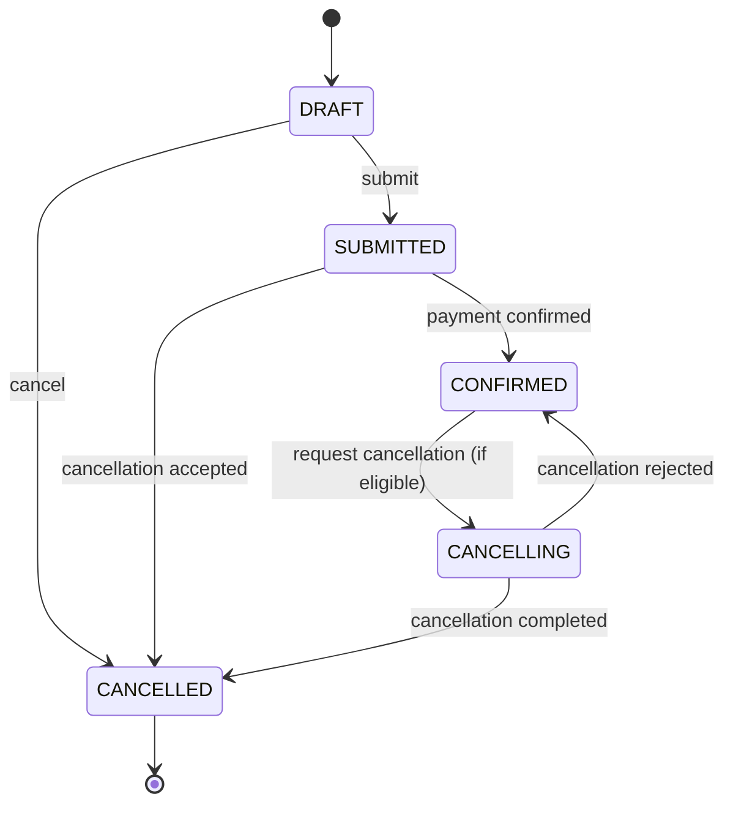
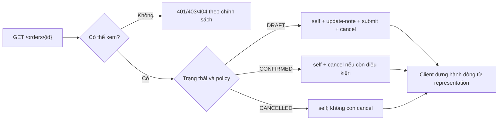

# Affordance và cách mô tả thao tác có thể thực hiện

## 1. Từ một liên kết đến một khả năng hành động

Trong REST API, client thường cần biết không chỉ **tài nguyên hiện có ở đâu**, mà còn **với trạng thái hiện tại, nó có thể làm gì tiếp theo**. Một đơn hàng đang ở trạng thái nháp có thể cho phép sửa ghi chú, gửi xác nhận hoặc hủy; đơn đã giao thì những hành động này có thể không còn hợp lệ.

Nếu client phải hard-code mọi URL và tự suy đoán hành động từ các chuỗi như `status = "DRAFT"`, giao diện dễ sai khi nghiệp vụ thay đổi. **Hypermedia** cung cấp một cách khác: response của server mang liên kết và mô tả thao tác liên quan để client có thể **khám phá bước tiếp theo từ biểu diễn hiện tại**.

**Affordance** trong ngữ cảnh API là thông tin cho biết một tương tác có thể được thực hiện với tài nguyên: gọi đến đâu, bằng phương thức HTTP nào, gửi nội dung gì, và trong tình huống nào hành động có ý nghĩa. Khái niệm xuất phát từ cách một đối tượng “gợi ra” những việc có thể thực hiện; áp dụng vào API, affordance giúp biến representation từ một gói dữ liệu thụ động thành một phần của **hợp đồng điều khiển tương tác**.

Bài học thuộc chương **Hypermedia** của học phần `INTEGRATION_API_REST`. Người học kết hợp thiết kế resource, URI, phương thức và mã trạng thái HTTP với hợp đồng dữ liệu, xác thực/phân quyền, idempotency, OpenAPI, xử lý lỗi và kiểm thử bằng Java/Spring hoặc công nghệ tương đương.

Sau bài này, bạn sẽ có thể:

1. Phân biệt **link**, **link relation**, **affordance**, **action/form** và **workflow/state transition**.
2. Thiết kế response cho biết thao tác hợp lệ theo **trạng thái tài nguyên và quyền của người gọi**.
3. Mô tả hành động bằng mục đích, URI, HTTP method, media type, trường nhập, điều kiện và cách xử lý response.
4. Biết khả năng và giới hạn của **HAL**, **Siren**, HTTP headers, OpenAPI và các profile/hợp đồng mở rộng.
5. Thiết kế client khám phá liên kết và hành động thay vì ghép URL hoặc parse câu chữ.
6. Hiểu vì sao affordance chỉ là **gợi ý theo thời điểm**, không thay thế kiểm tra quyền và trạng thái trên server.
7. Xây dựng, tài liệu hóa và kiểm thử ví dụ REST API có hypermedia bằng Java/Spring.

## 2. Affordance khác gì một URL thông thường?

Xét một API trả đơn hàng:

```json
{
  "id": "ord-42",
  "status": "DRAFT",
  "totalMinorUnits": 158000
}
```

Một client biết trước URL `PATCH /orders/ord-42` có thể thử thay đổi đơn. Nhưng nếu thao tác chỉ được chấp nhận khi trạng thái là `DRAFT`, client phải tự biết quy tắc và tự nối đường dẫn. Thêm một liên kết sẽ cải thiện khả năng tìm tài nguyên:

```json
{
  "id": "ord-42",
  "status": "DRAFT",
  "_links": {
    "self": {"href": "/orders/ord-42"},
    "collection": {"href": "/orders"}
  }
}
```

Đây là kiểu biểu diễn gần với **HAL**: có liên kết tới chính tài nguyên và collection. Tuy nhiên, chỉ nhìn `href`, client **chưa biết có thể gửi PATCH hay POST, payload theo media type nào và field nào được phép thay**. Một *action affordance* giàu thông tin hơn cần mô tả cả cách tương tác.

| Thành phần | Trả lời câu hỏi nào? | Ví dụ |
| --- | --- | --- |
| URI | Tài nguyên/đích tương tác được định vị ở đâu? | `/orders/ord-42` |
| Link | Từ tài nguyên này, có thể đi tới tài nguyên nào? | `self`, `collection`, `next` |
| Link relation (`rel`) | Quan hệ/ngữ nghĩa của liên kết là gì? | `self`, `next`, URI relation riêng cho “cancellation request” |
| Affordance | Có thể thực hiện kiểu tương tác nào? | Đổi ghi chú khi đơn đang nháp |
| Action/form | Gửi tương tác đó như thế nào? | `PATCH`, `application/merge-patch+json`, field `note` |
| State transition | Kết quả nghiệp vụ hợp lệ của hành động là gì? | `DRAFT → SUBMITTED` |
| HTTP precondition | Cần bảo vệ điều kiện phiên bản ra sao? | `If-Match` với ETag mạnh |

**Một liên kết đơn giản không tự động mô tả trọn vẹn một hành động.** Một số hypermedia format mô tả links nhưng không chuẩn hóa forms/actions; một số định dạng khác có cấu trúc riêng cho method, media type và fields.

## 3. Link relation là ngữ nghĩa, không phải tên biến tùy ý

Ví dụ:

```json
{
  "_links": {
    "self": {"href": "/orders/ord-42"},
    "next": {"href": "/orders?cursor=opaque"},
    "https://api.example.test/rels/request-cancellation": {
      "href": "/orders/ord-42/cancellation-requests"
    }
  }
}
```

Client không nên xử lý mọi liên kết theo vị trí thứ nhất/thứ hai trong object. Nó cần đọc **relation type**. Với các relation đã được đăng ký, có thể dùng tên ngắn như `self` hoặc `next`. Với quan hệ nghiệp vụ riêng, dùng một **URI relation ổn định** để tránh trùng nghĩa, ví dụ:

```text
https://api.example.test/rels/request-cancellation
```

URI relation trên chỉ là ví dụ do API định nghĩa; **không phải relation được IANA đăng ký**. Tài liệu liên kết nên giải thích nghĩa, trạng thái có thể xuất hiện, cách tương tác và những media type được hỗ trợ. Client hiểu relation do server công bố có thể thay đổi URI đích mà không cần thay logic.

### Điều không nên làm

```javascript
// Phản mẫu: client tự ghép URL từ ID và biết trước từng route.
const cancelUrl = "/orders/" + order.id + "/cancel";
await fetch(cancelUrl, {method: "POST"});
```

Cách này gắn client với cấu trúc đường dẫn cụ thể và dễ sai khi API đổi route, tách service hoặc thêm endpoint quy trình. Thay vào đó, client có thể dùng relation hoặc tên action có nghĩa để tìm `href`. **Không có nghĩa mọi API bắt buộc dùng hypermedia**; đây là lựa chọn kiến trúc cần được đưa vào hợp đồng và kiểm thử.

## 4. Affordance nên mô tả những gì?

Tùy định dạng, thông tin của một hành động có thể gồm:

| Thành phần | Mô tả | Ví dụ thao tác sửa ghi chú |
| --- | --- | --- |
| **Tên/mục đích** | Định danh ổn định để client nhận ra hành động | `update-note` |
| **Đích** | URL theo representation hiện tại | `/orders/ord-42` |
| **HTTP method** | Cách thực hiện theo hợp đồng HTTP | `PATCH` |
| **Request media type** | Cách serialize request body | `application/merge-patch+json` |
| **Input model / fields** | Các giá trị client được gửi, kiểu và ràng buộc | `note: string, maxLength: 200` |
| **Điều kiện** | Trạng thái, quyền, phiên bản hoặc yêu cầu khác | Đơn còn `DRAFT`; gửi `If-Match` |
| **Kết quả** | Status thành công, tài nguyên đích, quan hệ mới | `204`; GET lại `self` |
| **Lỗi dự kiến** | Conflict, validation, precondition, permission | `409`, `412`, `422`, `403` |

Không một thuộc tính riêng lẻ nào, kể cả `method`, đủ diễn tả hết. Ví dụ `POST /orders/ord-42/cancellation-requests` có thể là lệnh **tạo yêu cầu hủy** chứ không phải bảo đảm đơn đã được hủy ngay; status `202 Accepted` hoặc `201 Created` tùy mô hình, và client cần theo dõi resource yêu cầu hủy.

Các field “bắt buộc”, “độ dài”, “enum” có thể được mô tả bằng schema/metadata. Nhưng **quy tắc nghiệp vụ động** như “chỉ hủy được trong 15 phút sau khi xác nhận” thường không thể biểu đạt đầy đủ bằng một JSON Schema tĩnh. Lúc này representation giúp khám phá hành động, còn server vẫn thực thi điều kiện cuối cùng.

## 5. Ví dụ xuyên suốt: vòng đời một đơn hàng

Giả sử Order API có mô hình trạng thái đơn giản:



Sơ đồ là **giả định bài học**, không phải mô hình chuẩn của mọi đơn hàng. Thanh toán và hoàn tiền có thể cần các trạng thái khác, saga và quyền hủy cụ thể. Ở đây mục đích là quan sát cách **affordances thay đổi theo trạng thái**.

### Ma trận thao tác được công bố

| Trạng thái đơn | Người gọi có quyền | Hành động được quảng bá | Điều kiện bổ sung |
| --- | --- | --- | --- |
| `DRAFT` | Chủ đơn | `update-note`, `submit-order`, `request-cancellation` | Phiên bản hiện tại, validation |
| `SUBMITTED` | Chủ đơn | Xem trạng thái, có thể `request-cancellation` | Cửa sổ hủy còn mở, tác vụ chưa hoàn tất |
| `CONFIRMED` | Chủ đơn | Xem đơn; có thể yêu cầu hủy nếu chính sách cho phép | Thời gian, loại hàng, trạng thái giao/thu tiền |
| `CANCELLING` | Chủ đơn | Theo dõi yêu cầu hủy | Không hủy lặp |
| `CANCELLED` | Chủ đơn | Xem đơn, liên hệ hỗ trợ nếu cần | Không quảng bá hủy nữa |
| Bất kỳ | Người không có quyền xem | Không trả representation bí mật | Kiểm tra xác thực/phân quyền trước response |

Trong mô hình đơn giản, ta sẽ tập trung vào `DRAFT` và `CANCELLED`. Client **không cần tự tạo một bảng trạng thái đầy đủ** để quyết định có hiển thị nút “Hủy” hay không nếu nó có thể lấy affordance thực tế từ response.

### Client nhìn thấy gì ở mỗi trạng thái?



Sơ đồ gợi ý luồng ở tầng server. Trong thực tế, **một người có quyền đọc chưa chắc có quyền thao tác**. Chính sách có thể khác nhau giữa tài khoản cá nhân, quản trị viên, đại lý hoặc vai trò vận hành.

## 6. HAL: liên kết dễ dùng nhưng không tự mô tả form

**HAL** (*Hypertext Application Language*) biểu diễn tài nguyên và liên kết, thường với `application/hal+json`. Ví dụ đơn hàng ở trạng thái `DRAFT`:

```http
GET /orders/ord-42 HTTP/1.1
Host: api.example.test
Accept: application/hal+json

HTTP/1.1 200 OK
Content-Type: application/hal+json
ETag: "ord-42-v7"

{
  "id": "ord-42",
  "status": "DRAFT",
  "note": "Giao buổi sáng",
  "_links": {
    "self": {"href": "/orders/ord-42"},
    "collection": {"href": "/orders"},
    "https://api.example.test/rels/request-cancellation": {
      "href": "/orders/ord-42/cancellation-requests"
    }
  }
}
```

Ví dụ này cho phép client **tìm đích theo relation**. Tuy nhiên, cấu trúc HAL chuẩn **không có mô hình action/form tổng quát định nghĩa method, body type và input fields**. Liên kết `request-cancellation` không tự chứng minh client phải GET hay POST. Nếu client biết từ tài liệu relation rằng thao tác tương ứng với `POST`, đó là **quy ước/hợp đồng bên ngoài HAL**.

Các lựa chọn khi cần mô tả sâu hơn:

1. Dùng HAL cho navigation và **tài liệu relation/contract** (ví dụ OpenAPI) cho hành động.
2. Dùng một **hypermedia type có actions/forms**, chẳng hạn Siren, phù hợp client dự kiến.
3. Mở rộng representation bằng trường riêng `actions` theo profile được tài liệu hóa; lúc đó không coi cấu trúc mở rộng là tính năng mặc định của HAL.

Không gọi một response bất kỳ có trường `_links` là “đã hỗ trợ trọn vẹn HATEOAS”. Giá trị của hypermedia nằm ở **quan hệ và cách client điều hướng theo hợp đồng**.

## 7. Siren: mô tả links và actions trong cùng representation

**Siren** là một định dạng hypermedia dựa trên JSON, có media type thường gặp `application/vnd.siren+json`, dùng `entities`, `links`, `properties` và `actions`. Một action có thể mô tả `name`, `href`, `method`, `type` cùng các `fields` của biểu mẫu.

Ví dụ đơn hàng `DRAFT` với một hành động sửa ghi chú và một hành động gửi yêu cầu hủy:

```http
HTTP/1.1 200 OK
Content-Type: application/vnd.siren+json
ETag: "ord-42-v7"
Cache-Control: private, no-store

{
  "class": ["order"],
  "properties": {
    "id": "ord-42",
    "status": "DRAFT",
    "note": "Giao buổi sáng"
  },
  "links": [
    {"rel": ["self"], "href": "/orders/ord-42"},
    {"rel": ["collection"], "href": "/orders"}
  ],
  "actions": [
    {
      "name": "update-note",
      "title": "Sửa ghi chú",
      "method": "PATCH",
      "href": "/orders/ord-42",
      "type": "application/merge-patch+json",
      "fields": [
        {"name": "note", "type": "text", "value": "Giao buổi sáng"}
      ]
    },
    {
      "name": "request-cancellation",
      "title": "Yêu cầu hủy đơn",
      "method": "POST",
      "href": "/orders/ord-42/cancellation-requests",
      "type": "application/x-www-form-urlencoded",
      "fields": [
        {"name": "reason", "type": "text"}
      ]
    }
  ]
}
```

Trong ví dụ:

- `links` định vị tài nguyên liên quan; `actions` mô tả khả năng tương tác.
- `name` là khóa chương trình để nhận ra loại hành động; `title` là nhãn hiển thị có thể dịch.
- `method` và `type` cho biết phương thức và media type của request.
- `fields` gợi ý dữ liệu form. Với `application/x-www-form-urlencoded`, client có thể biểu diễn `reason=...`; với `application/merge-patch+json`, cách xây JSON object và ngữ nghĩa `null` phải theo hợp đồng media type/endpoint.
- Siren fields **không tự thay thế một JSON Schema hoàn chỉnh**, đặc biệt cho nested objects, ràng buộc chéo trường, preconditions hoặc định dạng payload phức tạp.

Các hành động được mô tả theo **khả năng tại thời điểm GET**, không phải một lời bảo đảm rằng POST/PATCH kế tiếp chắc chắn thành công. Trạng thái hoặc quyền có thể đổi sau khi response được gửi.

### Khi đơn đã hủy

Server có thể trả:

```json
{
  "class": ["order"],
  "properties": {
    "id": "ord-42",
    "status": "CANCELLED",
    "note": "Giao buổi sáng"
  },
  "links": [
    {"rel": ["self"], "href": "/orders/ord-42"},
    {"rel": ["collection"], "href": "/orders"}
  ],
  "actions": []
}
```

Client không hiển thị nút “Sửa ghi chú” hay “Yêu cầu hủy” vì không còn affordance tương ứng. Tuy vậy client vẫn cần biết cách xử lý khi server từ chối hành động đã từng được công bố, bởi response GET có thể cũ.

## 8. Link và form không thay thế HTTP semantics

Hypermedia giúp client **khám phá** khả năng, nhưng cách thực hiện vẫn phải tuân thủ HTTP:

| Hành động | HTTP method thường phù hợp | Status thành công ví dụ | Cần chú ý |
| --- | --- | --- | --- |
| Xem đơn hàng | `GET` | `200 OK` | GET an toàn về ngữ nghĩa; không tạo side effect nghiệp vụ |
| Xem trang tiếp | `GET` theo link `next` | `200 OK` | Cursor cần giữ filter/authorization |
| Sửa một số trường | `PATCH` | `200` hoặc `204` | Có media type patch, xử lý nguyên tử, ETag |
| Thay biểu diễn toàn bộ khi hợp đồng cho phép | `PUT` | `200` hoặc `204` | Tính idempotent của PUT và precondition |
| Tạo yêu cầu hủy như resource con | `POST` | `201` hoặc `202` tùy đã tạo hay đang xử lý | Chống gửi trùng và mô tả follow-up resource |
| Xóa resource khi thật sự là thao tác xóa | `DELETE` | `200` hoặc `204` | Không dùng DELETE nếu “hủy đơn” có vòng đời/đối soát riêng |

Với hành động yêu cầu hủy, thiết kế tài nguyên con `/orders/{id}/cancellation-requests` cho phép đặt trọng tâm vào **resource yêu cầu hủy** thay vì coi mọi thao tác nghiệp vụ là RPC. Không phải mọi nghiệp vụ đều cần URI dạng này: chọn mô hình phản ánh đúng vòng đời và hợp đồng.

### HTTP headers cũng cung cấp một phần thông tin khả năng

Ví dụ:

```http
HTTP/1.1 200 OK
Allow: GET, HEAD, OPTIONS, PATCH
Accept-Patch: application/merge-patch+json
ETag: "ord-42-v7"
Link: </orders>; rel="collection"
```

`Allow` thường xuất hiện trong response `405 Method Not Allowed` và cũng có thể được cung cấp trong các phản hồi khác; nó mô tả phương thức hỗ trợ với tài nguyên theo ngữ nghĩa HTTP. `Accept-Patch` công bố các patch-document media type được hỗ trợ. `Link` mang relation. **Những header này không mặc nhiên diễn đạt đầy đủ quy tắc quyền, trạng thái nghiệp vụ và schema biểu mẫu**.

Lưu ý `OPTIONS` không phải là “API liệt kê mọi action động theo người dùng” theo một chuẩn bắt buộc. Một API có thể trả thông tin bổ sung trong OPTIONS, nhưng client chỉ nên phụ thuộc vào điều đó khi hợp đồng quy định.

## 9. Affordance có điều kiện và trạng thái thay đổi theo thời gian

Giả sử client GET đơn ở thời điểm `T1` và nhận action `request-cancellation`. Đến thời điểm `T2`, kho đã bắt đầu giao hàng; theo quy tắc nghiệp vụ, đơn không còn đủ điều kiện hủy.

```mermaid
sequenceDiagram
    participant C as Client
    participant A as Order API
    participant D as Database
    C->>A: GET /orders/ord-42
    A->>D: Đọc trạng thái + quyền
    D-->>A: DRAFT, version=7
    A-->>C: 200 Siren; action cancel, ETag v7
    Note over A,D: Thao tác khác chuyển đơn thành SUBMITTED, version=8
    C->>A: POST cancellation-requests (tham chiếu bản cũ)
    A->>D: Kiểm tra quyền + trạng thái hiện tại
    D-->>A: Không còn điều kiện hủy
    A-->>C: 409 Conflict hoặc 412 nếu If-Match cũ
    C->>A: GET lại đơn
    A-->>C: Representation mới, action đã thay đổi
```

Đây là một dạng *time-of-check/time-of-use* (TOCTOU): quyền và điều kiện được đánh giá ở lần GET **không thay thế kiểm tra lúc ghi**.

Thiết kế cần hai lớp:

1. **Lớp trình bày affordance:** chỉ quảng bá những action dự kiến khả dụng tại thời điểm biểu diễn, giúp UX không đưa ra thao tác vô nghĩa.
2. **Lớp thực thi:** kiểm tra xác thực, phân quyền tài nguyên, chuyển trạng thái, đồng thời, invariant và input tại thời điểm xử lý thao tác.

Nếu có rủi ro mất cập nhật, client dùng ETag mạnh của representation trong `If-Match`, và server kiểm tra điều kiện tại điểm ghi. Khi `If-Match` không khớp, dùng **412 Precondition Failed**; xung đột với trạng thái nghiệp vụ không dựa trên precondition có thể dùng **409 Conflict**. Không dùng “action đã được hiển thị” làm lý do bỏ qua validation.

## 10. Affordance và xác thực/phân quyền

Affordance **không phải giấy phép bảo mật**. Một API không nên quảng bá chức năng nguy hiểm cho người không có quyền, nhưng dù một action bị ẩn, caller vẫn có thể tự gửi HTTP request đến URI. Server phải kiểm tra quyền ở **mọi request**.

| Tình huống | Representation nên làm gì? | Endpoint thực thi phải làm gì? |
| --- | --- | --- |
| Khách không được xem đơn | Không tiết lộ nội dung bí mật | Trả `401`, `403` hoặc `404` phù hợp chính sách |
| Chủ đơn xem DRAFT | Cho thấy action hợp lệ với chủ đơn | Kiểm tra quyền sửa, trạng thái và ETag khi PATCH |
| Nhân viên chỉ được xem | Không đưa action ghi trong biểu diễn dành cho vai trò đó | Từ chối PATCH/POST trái quyền |
| Quyền bị thu hồi sau GET | Action cũ có thể còn trong cache client | Phải từ chối ở lần ghi tiếp theo |
| Không có quyền biết thuộc tính nhạy cảm | Không quảng bá trường/field nhạy cảm | Không để validation/error message làm lộ dữ liệu |

Các yếu tố cần chú ý khi trả hypermedia:

- **Tenant isolation:** sinh action trên resource mà caller được phép truy cập và thực hiện.
- **CORS, CSRF và browser credentials:** hành động thay đổi trạng thái phải tuân thủ chính sách chống CSRF nếu dùng cookie-based session, không vì có hypermedia mà bỏ qua.
- **Cache:** representation chứa affordance theo quyền hoặc trạng thái riêng cần điều khiển cache thích hợp, tránh share giữa người dùng. `Cache-Control: private` hoặc `no-store` là lựa chọn cần cân nhắc theo loại dữ liệu.
- **SSRF/open redirect trong client:** nếu client máy chủ tự động theo liên kết do API khác cung cấp, cần ràng buộc nguồn đáng tin, scheme và host cho phép; không coi mọi `href` là an toàn.
- **Input validation:** action metadata là hướng dẫn, dữ liệu người dùng vẫn phải được validate ở server.

Một client thường chỉ cần hiển thị action được công bố nhưng phải chuẩn bị UX cho lỗi vì quyền/trạng thái đã thay đổi. Nút “Hủy” biến mất sau refresh là hành vi bình thường của hệ thống có trạng thái động.

## 11. Thiết kế client theo relation/action thay vì hard-code route

Một client hypermedia nên dùng **định danh ngữ nghĩa ổn định** để chọn hành động.

### Phản mẫu: suy diễn từ trạng thái rồi tự ghép URL

```typescript
// Dễ vỡ khi server đổi route hoặc thêm business rule mới.
if (order.status === "DRAFT") {
  await fetch("/orders/" + order.id + "/cancel", {
    method: "POST"
  });
}
```

### Cách tiếp cận theo action

```typescript
type SirenAction = {
  name: string;
  title?: string;
  method?: string;
  href: string;
  type?: string;
  fields?: Array<{name: string; type?: string; value?: unknown}>;
};

type SirenOrder = {
  properties?: {id?: string; status?: string};
  links?: Array<{rel: string[]; href: string}>;
  actions?: SirenAction[];
};

function findAction(
  representation: SirenOrder,
  name: string
): SirenAction | undefined {
  return (representation.actions ?? []).find(a => a.name === name);
}

const cancel = findAction(orderRepresentation, "request-cancellation");
if (cancel) {
  showCancelButton(async (reason: string) => {
    // Địa chỉ, method, content type đến từ affordance.
    // Chỉ theo href đáng tin cậy và phù hợp chính sách cùng nguồn.
    const target = new URL(cancel.href, apiBaseUrl);
    assertAllowedApiUrl(target);

    const form = new URLSearchParams({reason});
    const response = await fetch(target.toString(), {
      method: cancel.method ?? "GET",
      headers: {
        "Content-Type": cancel.type ?? "application/x-www-form-urlencoded"
      },
      body: form.toString(),
      credentials: "include"
    });
    await handleResponse(response);
  });
}
```

Đây là **pseudocode TypeScript** với `orderRepresentation`, `apiBaseUrl`, `showCancelButton`, `assertAllowedApiUrl` và `handleResponse` được định nghĩa bởi dự án. Ví dụ này chỉ hợp lệ cho action form-urlencoded của bài. Một client thực phải giới hạn HTTP method có thể thực thi, kiểm tra scheme/host, xử lý CSRF/token, timeout, lỗi HTTP, idempotency key và precondition header theo hợp đồng. **Không tự động gửi mọi action tìm được**: client cần một quyết định/ý định thực sự của người dùng hoặc workflow được ủy quyền.

Client có thể dựa vào:

- `rel` để điều hướng, ví dụ `self` hoặc `next`.
- `action.name` để nhận diện ý nghĩa thao tác theo format đã chọn.
- `method`, `href`, `type` để dựng request.
- Schema/profile đã công bố để validate input và dựng form.
- HTTP status, Problem Details và liên kết kết quả để quyết định bước tiếp theo.

Nếu action chưa biết xuất hiện, client không nên crash. Nếu action quen thuộc biến mất, client nên ẩn/vô hiệu nút và chấp nhận trạng thái hiện tại của server.

## 12. Media type, schema và ý nghĩa của dữ liệu nhập

Affordance có thể mô tả một trường `note` kiểu text, nhưng một API dùng JSON cần thêm hợp đồng:

```http
PATCH /orders/ord-42 HTTP/1.1
Content-Type: application/merge-patch+json
If-Match: "ord-42-v7"

{"note":"Giao sau 17 giờ"}
```

Ở đây `application/merge-patch+json` xác định **ngữ nghĩa của nội dung PATCH**: các member object được merge và `null` có thể có nghĩa xóa thuộc tính. Nếu client dùng `application/json` thuần hoặc gửi form-urlencoded do tự suy đoán, server có thể trả **415 Unsupported Media Type**.

Một mô tả action đủ dùng cho ứng dụng phức tạp thường cần:

1. **Media type chính xác**, không chỉ “JSON”.
2. **Schema của request** (JSON Schema/OpenAPI schema hoặc tài liệu profile) cho kiểu và giới hạn.
3. **Semantics của operation**: thay thế, thêm, xóa, gửi yêu cầu, xác nhận, v.v.
4. **HTTP conditions** như `If-Match`, `Idempotency-Key` nếu hợp đồng yêu cầu.
5. **Outcome**: 200/201/202/204, URL theo dõi, lỗi validation/conflict.

Một mô tả field form đơn giản không đủ cho nested objects hay mối quan hệ chéo trường. Có thể dùng link tới schema hoặc profile của media type. Nhưng **OpenAPI không tự đưa action vào mỗi response**; nó mô tả tập operations tiềm năng ở mức hợp đồng tĩnh.

## 13. OpenAPI và hypermedia bổ sung cho nhau

Một nhầm lẫn thường gặp: “Đã có OpenAPI liệt kê endpoints, nên hypermedia không còn giá trị” hoặc “Có hypermedia thì không cần tài liệu hợp đồng”.

| Khía cạnh | OpenAPI | Hypermedia trong response |
| --- | --- | --- |
| Mục đích chính | Hợp đồng API tĩnh: paths, methods, parameters, schemas, responses | Khám phá liên kết và hành động **trong ngữ cảnh tài nguyên hiện tại** |
| Tính động theo trạng thái/role | Có thể mô tả điều kiện bằng text/schema, nhưng không tự chọn action runtime | Server có thể chọn action được quảng bá theo trạng thái, role, chính sách |
| Định dạng input | Rất mạnh với schema, required fields, examples | Tùy định dạng; action fields có thể đơn giản, dùng thêm schema |
| Khởi tạo SDK | Thuận tiện cho code generation và kiểm thử hợp đồng | Client có thể học bước tiếp theo từ response |
| Khả năng đổi URI | Client thường được tạo theo paths nếu không có lớp discovery | Relation/action có thể giữ ổn định khi URI đích thay đổi |
| Kiểm soát quyền | Mô tả security schemes | Trình bày affordances theo quyền tại lúc GET; không thay enforcement |

Một hệ thống thực tế có thể dùng **cả hai**: OpenAPI để mô tả resource, method, schema và lỗi; hypermedia để chọn những hành động **đang hữu ích** ở trạng thái hiện tại.

### Đoạn OpenAPI minh họa

```yaml
openapi: 3.0.3
info:
  title: Orders API
  version: 1.0.0
paths:
  /orders/{id}:
    get:
      summary: Trả biểu diễn đơn có affordances
      parameters:
        - in: path
          name: id
          required: true
          schema: { type: string }
      responses:
        '200':
          description: Đơn và các hành động hiện có
          headers:
            ETag:
              description: Entity tag dùng cho cập nhật có điều kiện
              schema: { type: string }
          content:
            application/vnd.siren+json:
              schema:
                $ref: '#/components/schemas/SirenOrder'
  /orders/{id}/cancellation-requests:
    post:
      summary: Tạo yêu cầu hủy nếu vẫn đủ điều kiện
      parameters:
        - in: path
          name: id
          required: true
          schema: { type: string }
      requestBody:
        required: true
        content:
          application/x-www-form-urlencoded:
            schema:
              type: object
              required: [reason]
              properties:
                reason:
                  type: string
                  minLength: 1
                  maxLength: 200
      responses:
        '201': { description: Đã tạo resource yêu cầu hủy }
        '409': { description: Đơn không còn đủ điều kiện hủy }
        '403': { description: Không có quyền yêu cầu hủy }
components:
  schemas:
    SirenOrder:
      type: object
      description: Biểu diễn Siren rút gọn của Orders API
      properties:
        class:
          type: array
          items: { type: string }
        properties: { type: object }
        links:
          type: array
          items: { type: object }
        actions:
          type: array
          items: { type: object }
```

Đây là **schema rút gọn để làm rõ mối liên hệ**, không phải schema đầy đủ của Siren và chưa mô tả toàn bộ response/Problem Details. Trong sản phẩm thật phải định nghĩa schema chi tiết, auth, idempotency, yêu cầu phiên bản và các lỗi liên quan. `actions` là danh sách động, nên OpenAPI không cam kết action nào luôn xuất hiện trong response.

## 14. Thiết kế Java/Spring: sinh actions từ trạng thái và quyền

Một cách triển khai là dựng representation Siren ở tầng API dựa trên **snapshot nghiệp vụ và policy**. Không nên lấy logic “đơn nào có nút Hủy” làm điều kiện viết tay riêng trong mỗi client.

### 14.1. Model biểu diễn rút gọn

```java
// Spring Boot 3 / Java 17+, ví dụ rút gọn imports.
record SirenLink(List<String> rel, String href) {}

record SirenField(String name, String type, Object value) {}

record SirenAction(
    String name,
    String title,
    String method,
    String href,
    String type,
    List<SirenField> fields
) {}

record SirenOrder(
    @JsonProperty("class") List<String> classes,
    Map<String, Object> properties,
    List<SirenLink> links,
    List<SirenAction> actions
) {}

record OrderSnapshot(
    UUID id, String status, String note, long version
) {
    String etag() {
        return "\"order-" + id + "-v" + version + "\"";
    }
}
```

`SirenOrder` là subset của Siren dùng trong ví dụ. `@JsonProperty("class")` giúp phát ra tên thuộc tính Siren mong muốn thay vì `classes`. Trong API có nhiều entity, links và schemas, cần mô hình hóa đầy đủ theo định dạng đã chọn hoặc dùng thư viện được kiểm chứng.

### 14.2. Controller phát biểu diễn có action động

```java
@RestController
@RequestMapping("/orders")
class OrderRepresentationController {
    private final OrderQueryService orders;
    private final OrderPolicy policy;

    OrderRepresentationController(OrderQueryService orders,
                                  OrderPolicy policy) {
        this.orders = orders;
        this.policy = policy;
    }

    @GetMapping(path = "/{id}", produces = "application/vnd.siren+json")
    ResponseEntity<SirenOrder> get(
            @PathVariable UUID id, Authentication authentication) {
        // Query phải áp dụng quyền truy cập theo user + tenant.
        OrderSnapshot order = orders.findAuthorized(id, authentication);
        String base = "/orders/" + order.id();

        List<SirenAction> actions = new ArrayList<>();

        if ("DRAFT".equals(order.status())
                && policy.canEditNote(authentication, order)) {
            actions.add(new SirenAction(
                "update-note", "Sửa ghi chú", "PATCH",
                base, "application/merge-patch+json",
                List.of(new SirenField("note", "text", order.note()))
            ));
        }

        if (policy.canRequestCancellation(authentication, order)) {
            actions.add(new SirenAction(
                "request-cancellation", "Yêu cầu hủy đơn", "POST",
                base + "/cancellation-requests",
                "application/x-www-form-urlencoded",
                List.of(new SirenField("reason", "text", null))
            ));
        }

        SirenOrder body = new SirenOrder(
            List.of("order"),
            Map.of("id", order.id().toString(),
                   "status", order.status(),
                   "note", order.note() == null ? "" : order.note()),
            List.of(
                new SirenLink(List.of("self"), base),
                new SirenLink(List.of("collection"), "/orders")
            ),
            actions
        );
        return ResponseEntity.ok()
            .eTag(order.etag())
            .cacheControl(CacheControl.noStore())
            .body(body);
    }
}
```

Các kiểu `OrderQueryService` và `OrderPolicy` là abstraction của dự án. Controller **không tự suy quyền từ client** mà gọi service/policy. `OrderSnapshot.etag()` chỉ là mô hình ví dụ; production phải bảo đảm entity tag mạnh và version phản ánh mọi thay đổi của representation được bảo vệ. Nếu representation thay đổi theo quyền/locale mà vẫn phát cùng strong ETag, cần xem lại cách sinh validator cho từng variant.

### 14.3. Endpoint vẫn kiểm tra lại khi thực thi

```java
@RestController
@RequestMapping("/orders")
class OrderCommandController {
    private final OrderCommandService commands;

    OrderCommandController(OrderCommandService commands) {
        this.commands = commands;
    }

    @PatchMapping(
        path = "/{id}",
        consumes = "application/merge-patch+json"
    )
    ResponseEntity<Void> updateNote(
            @PathVariable UUID id,
            @RequestHeader("If-Match") String ifMatch,
            @RequestBody JsonNode patch,
            Authentication authentication) {
        // Kiểm tra schema, allowlist field, quyền, trạng thái,
        // version và transaction trong service.
        String newEtag = commands.updateNote(
            id, ifMatch, patch, authentication);
        return ResponseEntity.noContent().eTag(newEtag).build();
    }

    @PostMapping(
        path = "/{id}/cancellation-requests",
        consumes = MediaType.APPLICATION_FORM_URLENCODED_VALUE
    )
    ResponseEntity<Void> requestCancellation(
            @PathVariable UUID id,
            @RequestParam("reason") String reason,
            Authentication authentication) {
        URI createdUri = commands.requestCancellation(
            id, reason, authentication);
        return ResponseEntity.created(createdUri).build();
    }
}
```

Mã ví dụ minh họa **hợp đồng đường đi và cách phân tách trách nhiệm**, không phải ứng dụng độc lập đã biên dịch. Các method service, security, validation, authorization, transaction, policy, outbox, xử lý lỗi và idempotency cần triển khai thực tế. Nếu yêu cầu hủy được xử lý bất đồng bộ và chưa tạo xong resource theo hợp đồng, phản hồi có thể là `202 Accepted` với URL theo dõi thay vì tự động trả `201`.

Quan trọng: phần `get()` chỉ tạo hành động dự kiến có thể dùng; `updateNote()` và `requestCancellation()` vẫn phải **kiểm tra cùng các quy tắc tại thời điểm ghi**. Có một endpoint quảng bá action mà quên triển khai kiểm tra server là lỗ hổng thiết kế.

## 15. Thông báo lỗi, ETag, idempotency và kết quả tiếp theo

Một affordance hữu ích cần dẫn client tới **hành động có thể tiếp tục được sau lỗi**. Hãy mô tả các trường hợp sau:

| Tình huống | HTTP status thường phù hợp | Client nên làm gì? |
| --- | --- | --- |
| Media type action không được hỗ trợ | `415 Unsupported Media Type` | Dùng `type` được công bố theo hợp đồng |
| Body action sai cú pháp | `400 Bad Request` | Sửa biểu diễn request |
| Giá trị field không hợp lệ | `422 Unprocessable Content` theo chính sách | Hiển thị lỗi theo field, không đoán từ `detail` |
| Cập nhật với ETag cũ | `412 Precondition Failed` | GET lại và lấy affordance/ETag mới |
| Action hết hiệu lực vì trạng thái đã thay đổi | `409 Conflict` | GET lại resource, cập nhật giao diện |
| Người gọi thiếu quyền | `401` hoặc `403` theo nguyên nhân | Đăng nhập/hiển thị không có quyền |
| Tạo yêu cầu hủy thành công | `201 Created` | Theo `Location` tới cancellation request |
| Nhận tác vụ bất đồng bộ | `202 Accepted` | Theo link tới trạng thái xử lý |
| Lỗi hệ thống tạm thời | `503 Service Unavailable` khi phù hợp | Retry có giới hạn, tùy độ an toàn thao tác |

Một ví dụ Problem Details:

```http
HTTP/1.1 409 Conflict
Content-Type: application/problem+json
Cache-Control: no-store

{
  "type": "https://api.example.test/problems/order/cancellation-unavailable",
  "title": "Không thể yêu cầu hủy ở trạng thái hiện tại",
  "status": 409,
  "detail": "Đơn hàng đã chuyển trạng thái. Hãy tải lại trước khi tiếp tục.",
  "instance": "/orders/ord-42/cancellation-requests",
  "code": "order.cancellation_unavailable"
}
```

`code` là extension của API theo RFC 9457. Client nên phân nhánh theo `type` hoặc mã ổn định được công bố, không parse câu chữ. Trong trường hợp status thay đổi giữa GET và action, cách phục hồi bình thường là **GET lại resource để nhận affordances mới**, không phải gửi POST lặp vô hạn.

### Idempotency cho action không an toàn

HTTP `POST` tạo yêu cầu hủy hoặc `PATCH` có thể gây thay đổi trạng thái. Nếu client timeout sau khi gửi, nó **không biết chắc server đã commit chưa**. Với thao tác mà gửi lặp có thể tạo hai yêu cầu/thu phí hai lần, cân nhắc:

- `Idempotency-Key` có phạm vi theo caller, endpoint và payload theo hợp đồng.
- Ràng buộc duy nhất ở tầng dữ liệu, ví dụ chỉ một yêu cầu hủy đang hoạt động cho một đơn.
- Endpoint theo dõi trạng thái resource đã tạo.
- Retry có backoff và giới hạn; không tự gửi lại y hệt nếu chưa bảo đảm an toàn.

Việc action có mặt trong response **không tạo tính idempotent**. HTTP method, semantics của thao tác và cơ chế chống trùng vẫn phải được thiết kế riêng.

## 16. Affordance trên collection và phân trang

Hypermedia không chỉ áp dụng cho một resource. Một collection có thể công bố:

- `self`: URI của collection hiện tại.
- `next`, `prev`: tiếp tục đọc các trang khi còn kết quả.
- `item` hoặc entity links: đường đến phần tử cụ thể.
- `create-order`: hành động tạo resource mới khi caller đủ quyền.

Ví dụ HAL-like cho danh sách:

```json
{
  "items": [
    {"id": "ord-42", "status": "DRAFT"},
    {"id": "ord-41", "status": "SUBMITTED"}
  ],
  "_links": {
    "self": {"href": "/orders?limit=2"},
    "next": {"href": "/orders?limit=2&cursor=opaque"}
  }
}
```

Relation `next` cho phép client **theo đường dẫn do server trả**, không tự cộng `offset` hay cấu tạo cursor. `next` có thể biến mất khi hết trang. Một client không nên coi `next` tồn tại là bảo đảm số liệu đứng yên; nhất quán khi duyệt tập hợp là hợp đồng riêng (live, anchor, snapshot nếu được hỗ trợ).

Hành động tạo đơn thuộc **collection** có thể được biểu diễn bằng Siren action hoặc format khác. Trong HAL thuần, link tới collection chưa đủ để mô tả POST payload. Hãy đặt affordance ở đúng representation mà client đang tương tác thay vì nhét toàn bộ catalog hành động của hệ thống vào một object không liên quan.

## 17. Phát hiện và mô tả affordance khi API thay đổi phiên bản

Một lý do quan trọng để dùng hypermedia là giảm phụ thuộc vào đường dẫn cụ thể. Tuy nhiên, **định danh ngữ nghĩa** cũng là hợp đồng:

1. Giữ `rel` và `action.name` ổn định khi ý nghĩa thao tác không đổi.
2. Có thể đổi `href` bên dưới cùng một relation, miễn hành vi theo relation vẫn tương thích.
3. Nếu action không còn áp dụng, **không công bố** nó trong representation hiện tại; client cần fallback khi action vắng mặt.
4. Nếu thêm action mới, client cũ nên bỏ qua một cách an toàn khi không hiểu.
5. Nếu đổi media type, method, input semantics hoặc outcome, cần đánh giá đó có phải breaking change cho client theo affordance hay không.
6. Nếu thay đổi nghĩa của một action, cân nhắc relation/name mới hoặc phiên bản hợp đồng thay vì lặng lẽ tái sử dụng.
7. Định nghĩa **entry point** giúp client khám phá tài nguyên gốc; một client không thể tự phát hiện hệ thống từ hư vô nếu chưa biết cách bắt đầu.

Client hypermedia không đồng nghĩa “không cần viết code khi quy trình nghiệp vụ thay đổi”. Nó vẫn phải hiểu các relation/action và ý nghĩa thao tác. Giá trị là giảm coupling không cần thiết vào chi tiết URI và cách lựa chọn hành động theo trạng thái.

### Chọn định dạng theo nhu cầu

| Nhu cầu | Lựa chọn khả dĩ | Cần lưu ý |
| --- | --- | --- |
| Chủ yếu điều hướng resource, phân trang | HAL, JSON:API links hoặc HTTP Link | Links không tự chỉ phương thức và form |
| Cần actions/forms ngay trong representation | Siren hoặc một media type/profile có mô hình action | Client phải hiểu định dạng và action semantics |
| Mô tả schema, validation, SDK và mock | OpenAPI/JSON Schema | Bổ sung, không thay thế affordance runtime |
| Muốn dùng HTTP headers cho thao tác | `Allow`, `Accept-Patch`, `Link`, `ETag` | Không thể hiện đủ business policy động |
| Cần hành động phụ thuộc quyền và trạng thái | Server sinh affordance theo policy | Phải kiểm tra lại khi thực thi |

## 18. Kiểm thử để chứng minh affordance đáng tin cậy

Kiểm thử hypermedia **không chỉ assert có `_links` hoặc `actions`**. Cần kiểm tra sự tương ứng giữa metadata hành động, hợp đồng HTTP và hành vi server.

### Ma trận kiểm thử

| Tình huống | Representation mong đợi | Kiểm thử thực thi |
| --- | --- | --- |
| Đơn `DRAFT`, chủ đơn | `update-note` và `request-cancellation` có mặt | PATCH/POST hợp lệ thành công theo hợp đồng |
| Đơn `CANCELLED` | Không có action sửa/hủy | Gửi request thủ công vẫn bị từ chối |
| Người chỉ có quyền đọc | Có link xem; không có action ghi | PATCH/POST trái quyền trả 403/404 theo chính sách |
| Trạng thái đổi sau GET | Affordance cũ có thể đã stale | Action cũ bị 409/412; GET lại cập nhật action |
| ETag cũ | Representation vẫn có thể cache ở client | Server trả 412, không mất cập nhật |
| Content-Type sai | Action công bố media type hợp lệ | Request media type khác bị 415 |
| Form thiếu field hoặc giá trị sai | Có mô tả input | Server trả 400/422 phù hợp; không commit |
| Client gặp action mới chưa biết | Representation có action bổ sung | Client không crash, bỏ qua action lạ |
| URI action thay đổi nhưng tên/quan hệ không đổi | `href` mới trong response | Client vẫn gọi được qua affordance |
| Resource của tenant khác | Không có dữ liệu/affordance trái quyền | Không truy cập chéo tenant |
| GET trả body lỗi do gateway | Không có affordance hợp lệ | Client fallback theo HTTP status |

### Mẫu MockMvc test cho Siren

```java
// Phác thảo JUnit/MockMvc, fixture và security identity do dự án cấp.
@Test
void draftOrderAdvertisesUpdateAndCancelActions() throws Exception {
    UUID orderId = seedOrder("DRAFT");
    mockMvc.perform(get("/orders/{id}", orderId)
            .accept("application/vnd.siren+json")
            .with(user("owner")))
        .andExpect(status().isOk())
        .andExpect(content().contentTypeCompatibleWith(
            MediaType.parseMediaType("application/vnd.siren+json")))
        .andExpect(jsonPath("$.actions[?(@.name=='update-note')]")
            .isNotEmpty())
        .andExpect(jsonPath("$.actions[?(@.name=='request-cancellation')]")
            .isNotEmpty());
}

@Test
void cancelledOrderDoesNotAdvertiseCancellation() throws Exception {
    UUID orderId = seedOrder("CANCELLED");
    mockMvc.perform(get("/orders/{id}", orderId)
            .accept("application/vnd.siren+json")
            .with(user("owner")))
        .andExpect(status().isOk())
        .andExpect(jsonPath("$.actions").isEmpty());

    // Nhưng server vẫn phải từ chối POST thủ công:
    mockMvc.perform(post("/orders/{id}/cancellation-requests", orderId)
            .contentType(MediaType.APPLICATION_FORM_URLENCODED)
            .param("reason", "Đổi ý")
            .with(user("owner")))
        .andExpect(status().isConflict());
}
```

Ví dụ trên là **mã minh họa**, với `seedOrder`, security fixture và cấu hình MockMvc giả định. Tùy phiên bản JsonPath matcher, biểu thức filter có thể được thay bằng cách parse body rồi tìm action theo `name`. Điều quan trọng trong test là **kiểm tra cả presence/absence lẫn hành vi server**, không khóa cứng thứ tự phần tử trong mảng `actions`.

### Contract test cho method và media type

Với mỗi action được công bố, có thể kiểm tra:

1. `href` nằm trong phạm vi cho phép, được resolve hợp lệ.
2. `method` nằm trong tập được client hỗ trợ.
3. `type` phù hợp endpoint, đặc biệt khi sử dụng PATCH hoặc form.
4. `fields` phù hợp schema nhập, tên và kiểu không mâu thuẫn.
5. Gửi dữ liệu hợp lệ tới action với danh tính đủ quyền tạo outcome dự kiến.
6. Gửi dữ liệu sai và ETag cũ gây lỗi chính xác, không có side effect bất hợp lệ.

Một response có action “Hủy” trông đẹp nhưng POST luôn trả 405 là lỗi hợp đồng. Tương tự, nếu endpoint thực tế chỉ nhận JSON mà action ghi `application/x-www-form-urlencoded`, client khám phá được URI nhưng không thể sử dụng đúng.

## 19. Những phản mẫu thường gặp

1. **Coi mọi URL là affordance hoàn chỉnh:** thiếu method, relation hoặc schema cho thao tác.
2. **Dùng câu chữ làm định danh:** client tìm `title = "Hủy đơn"`; sẽ hỏng khi dịch ngôn ngữ. Hãy dùng `name`/`rel` ổn định.
3. **Hard-code URI bằng ID trong client:** không tận dụng link/action được server công bố.
4. **Quảng bá action không phù hợp với trạng thái:** client hiển thị hành động chắc chắn bị từ chối.
5. **Tin action trong GET là cấp quyền vĩnh viễn:** quên kiểm tra lại tại endpoint ghi.
6. **Nhúng toàn bộ business rule vào client:** khi server đổi chính sách, UI cũ hành động sai.
7. **Tạo một trường `actions` tùy ý nhưng gọi là Siren/HAL chuẩn:** đánh đồng extension riêng với định dạng đã công bố.
8. **Không mô tả input hoặc media type:** client biết có thể thao tác nhưng không biết gửi gì.
9. **Chỉ dùng OPTIONS để quyết định mọi action động:** `Allow` không thay authorization/policy theo trạng thái.
10. **Không xử lý stale representation:** client coi action cũ luôn thực hiện được; không biết nhận 409/412 rồi GET lại.
11. **Trả GET có action nhạy cảm vào shared cache:** người dùng khác có thể thấy giao diện hoặc dữ liệu không thuộc quyền.
12. **Tự động theo mọi link từ dữ liệu không tin cậy:** tạo nguy cơ SSRF, gửi credential sai nơi hoặc kích hoạt side effect không mong muốn.
13. **Cho rằng hypermedia thay OpenAPI:** bỏ hợp đồng schema, lỗi và điều kiện version.
14. **Chỉ kiểm thử mảng `actions` không rỗng:** bỏ sót lỗi method/type/permission thực tế.

## 20. Bài thực hành: thiết kế affordance cho dịch vụ quản lý đơn

Một công ty bán hàng có `GET /orders/{id}`, `PATCH /orders/{id}` và `POST /orders/{id}/cancellation-requests`. API phục vụ mobile, web và hệ thống hỗ trợ khách hàng. Mỗi client được biết URI gốc `/orders`, còn các đường đi tiếp theo cần được khám phá qua representation.

### Yêu cầu nghiệp vụ

- Đơn `DRAFT`: chủ đơn có thể sửa ghi chú và gửi yêu cầu hủy.
- Đơn `SUBMITTED`: chủ đơn chỉ có thể yêu cầu hủy nếu chưa được xử lý giao hàng.
- Đơn `CONFIRMED`: có thể gửi yêu cầu hủy nếu còn trong thời hạn cho phép.
- Đơn `CANCELLED`: không còn action sửa/hủy.
- Nhân viên chỉ có quyền đọc không được thấy action ghi, dù có thể xem đơn.
- Server kiểm tra quyền và trạng thái **một lần nữa** khi thực hiện action.
- Khi cập nhật có điều kiện, client gửi `If-Match` để phát hiện bản ghi đã đổi.

### Nhiệm vụ A — Thiết kế relation và action names

Lập một danh mục gồm các relation `self`, `collection`, `next`, `request-cancellation` và các action `update-note`, `request-cancellation`. Với relation nghiệp vụ riêng, sử dụng URI ổn định và ghi tài liệu. Không dùng nhãn tiếng Việt để client nhận diện.

### Nhiệm vụ B — Viết hai representation

Viết Siren cho:

1. Đơn `DRAFT` của chủ đơn: có link xem và hai actions.
2. Đơn `CANCELLED` của chủ đơn: có link xem, `actions` rỗng.

Mô tả `href`, `method`, `type`, các `fields` và ETag. Giải thích vì sao link `self` tồn tại cả hai trạng thái trong khi action thay đổi.

### Nhiệm vụ C — Chuyển từ HAL sang mô tả thao tác

Bạn đang có một HAL response chỉ có `_links.self` và `_links.collection`. Hãy đề xuất hai phương án: giữ HAL và bổ sung tài liệu relation/OpenAPI, hoặc chọn Siren để mô tả actions. Nêu chi phí phát triển, độ phức tạp SDK và lợi ích khám phá.

### Nhiệm vụ D — Tạo client không hard-code URL

Client phải:

- Tìm action theo `name`, không so khớp `title`.
- Dùng `href` được cung cấp, kiểm tra nguồn đáng tin.
- Dùng method và media type đã công bố.
- Khi không có action, ẩn/vô hiệu nút.
- Khi nhận `409`/`412`, GET lại và hiển thị action mới.
- Không tự động thực thi action khi mới nhận representation.

### Nhiệm vụ E — Triển khai và kiểm thử

Tạo Java/Spring controller sinh actions theo state/policy; endpoint thực thi vẫn kiểm tra quyền. Viết test kiểm tra action theo status, role, ETag cũ, media type sai, field sai, URI đổi nhưng `name` giữ ổn định và client vẫn hoạt động.

### Gợi ý đáp án thiết kế

| Trạng thái/role | Link nên có | Action nên có | Server phải kiểm tra khi thực thi |
| --- | --- | --- | --- |
| `DRAFT` / chủ đơn | `self`, `collection` | `update-note`, `request-cancellation` | Quyền, trạng thái, version, input |
| `SUBMITTED` / chủ đơn, còn hủy được | `self`, `collection` | `request-cancellation` | Trạng thái mới nhất, cửa sổ hủy |
| `CONFIRMED` / chủ đơn, hết hạn hủy | `self`, `collection` | Không có cancel | Trạng thái, deadline, quyền |
| `CANCELLED` / chủ đơn | `self`, `collection` | Không có | Từ chối mọi attempt hủy tiếp |
| Bất kỳ / nhân viên chỉ đọc | `self` nếu đủ quyền đọc | Không có action ghi | Kiểm tra quyền ghi độc lập |

### Thang đánh giá (100 điểm)

| Tiêu chí | Điểm |
| --- | ---: |
| Hiểu đúng affordance, rel, action và state | 20 |
| Thiết kế representation và media type hợp lệ | 20 |
| Khám phá thay cho hard-code, UX graceful fallback | 15 |
| Phân quyền, trạng thái và concurrency an toàn | 20 |
| Java/Spring, OpenAPI, kiểm thử hợp đồng | 15 |
| Bảo mật, versioning và đánh đổi | 10 |

## 21. Câu hỏi tự kiểm tra

1. Một response có `{"href":"/orders/42"}` đã đủ mô tả cách hủy đơn chưa? Vì sao?
2. `rel` giải thích điều gì khác với `href`?
3. Trong Siren, `action.name` và `action.title` nên được client sử dụng khác nhau như thế nào?
4. Vì sao HAL phù hợp để biểu diễn links nhưng không tự chứa form model đầy đủ?
5. Những thông tin nào phải có để client gửi một PATCH đúng media type và đúng phiên bản?
6. Nếu một action được công bố lúc GET nhưng biến mất do trạng thái đã đổi, endpoint nên xử lý thế nào?
7. Tại sao có action trong response không cho phép bỏ kiểm tra authorization ở POST/PATCH?
8. Lý do nào khiến server không nên quảng bá action ghi trong representation của người chỉ có quyền đọc?
9. Có thể thay URI của một action mà không thay `name`/relation không? Điều kiện nào làm việc đó tương thích?
10. Vì sao client cần hỗ trợ action mới chưa biết và action cũ bị loại bỏ?
11. `Allow`, `Accept-Patch` và `Link` header mô tả được gì, chưa mô tả được gì?
12. OpenAPI và hypermedia khác nhau ở mức tĩnh và động ra sao?
13. Nếu action trả `202 Accepted`, client phải tìm trạng thái của quy trình bằng cách nào?
14. Vì sao cache representation có affordance theo quyền cần được giới hạn?
15. Test nào chứng minh action `request-cancellation` vừa được mô tả đúng vừa không thể bị lợi dụng khi trạng thái đã hết điều kiện?

**Điểm cần ghi nhớ:** affordance biến hypermedia từ danh sách URL thành **hướng dẫn tương tác có ngữ nghĩa**. Server mô tả quan hệ, hành động, phương thức, media type và đầu vào phù hợp với trạng thái tài nguyên; client khám phá rồi thực hiện theo hợp đồng, thay vì đoán route hoặc phân tích câu chữ. Nhưng affordance chỉ phản ánh khả năng **ở thời điểm response được tạo**: endpoint vẫn phải kiểm tra quyền, trạng thái, phiên bản và bất biến nghiệp vụ tại thời điểm thực thi. Hypermedia và OpenAPI có thể bổ sung cho nhau để API vừa tự khám phá được, vừa có hợp đồng dữ liệu rõ ràng.
