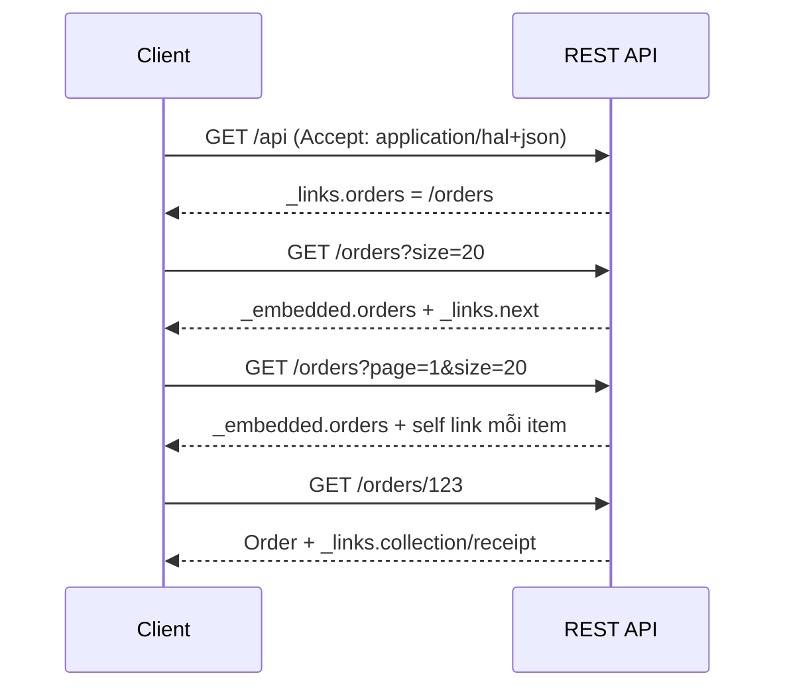
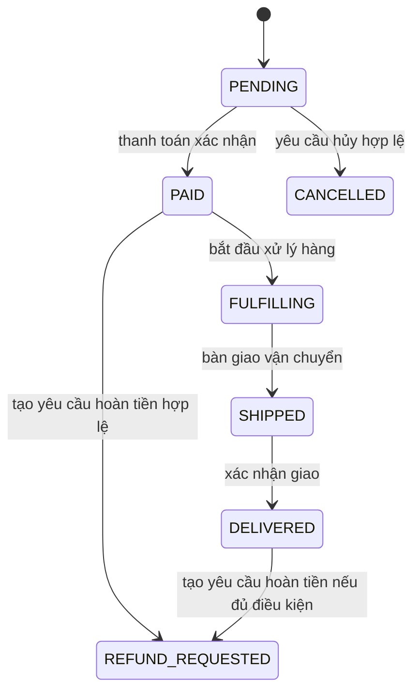
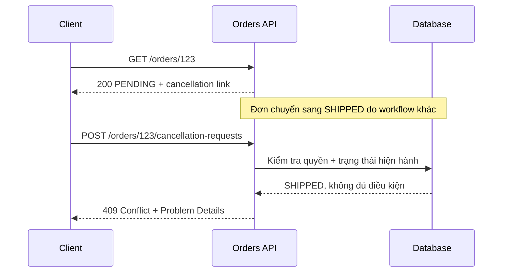

# HAL và Spring HATEOAS như một lựa chọn triển khai

## 1. Từ REST API có URL cố định đến điều hướng bằng hypermedia

Một REST API thường bắt đầu bằng những URI được công bố trong tài liệu:

```text
GET    /orders/123
GET    /orders/123/items
POST   /orders/123/cancellation-requests
GET    /cancellation-requests/cr-901
```

Client có thể hard-code tất cả các URL, hoặc tự nối chuỗi từ ID: `"/orders/" + orderId + "/items"`. Cách này dễ triển khai với API nhỏ nhưng tạo **sự phụ thuộc vào cấu trúc đường dẫn**; khi thiết kế resource hoặc workflow thay đổi, nhiều client cần nâng cấp.

**Hypermedia as the Engine of Application State (HATEOAS)** là ý tưởng client khám phá các resource và đường chuyển trạng thái tiếp theo thông qua **liên kết và siêu dữ liệu được server trả về trong representation**, thay vì biết trước mọi đường dẫn. Client thường vẫn phải biết entry point, media type, ý nghĩa của link relation và quy tắc thực hiện hành động.

**HAL (Hypertext Application Language)** là một cách biểu diễn hypermedia nhẹ dựa trên JSON hoặc XML; bài này tập trung vào **HAL JSON** với media type `application/hal+json`. Trong hệ Java/Spring, thư viện **Spring HATEOAS** hỗ trợ tạo representation model, link và một số định dạng hypermedia. Đây là **một lựa chọn triển khai**, không phải công nghệ duy nhất hay điều kiện bắt buộc để mọi REST API thực tế vận hành tốt.

Bài thuộc chương **Hypermedia** của module **INTEGRATION_API_REST**. Chủ đề liên hệ trực tiếp thiết kế resource, URI, HTTP methods/status, hợp đồng dữ liệu, phân trang, cache, idempotency, xác thực, phân quyền, xử lý lỗi, OpenAPI và kiểm thử bằng Java/Spring hoặc công nghệ tương đương.

### Kết quả học tập

Sau bài này, người học có thể:

1. Giải thích HAL, HATEOAS, link relation và các **affordance** trong mô hình REST.
2. Đọc/thiết kế một representation `application/hal+json` với `_links`, `_embedded`, `self` và liên kết phân trang.
3. Tạo link an toàn bằng `EntityModel`, `CollectionModel`, `WebMvcLinkBuilder` và các thành phần Spring HATEOAS.
4. Phân biệt **liên kết điều hướng** với **hợp đồng biểu diễn hành động** như HTTP method, request body và validation.
5. Thiết kế liên kết theo trạng thái và quyền nhưng vẫn thực thi authorization trên mọi request.
6. Đánh giá khi nào HAL đem lại giá trị so với JSON thuần hoặc các định dạng hypermedia khác; kiểm thử hợp đồng và kiểm soát caching/versioning.

## 2. Hypermedia giải quyết bài toán nào?

Giả sử client đọc một đơn hàng đang chờ thanh toán. Server có thể trả:

```http
GET /orders/123 HTTP/1.1
Host: api.example.test
Accept: application/hal+json
Authorization: Bearer <access-token>
```

```http
HTTP/1.1 200 OK
Content-Type: application/hal+json

{
  "id": "123",
  "status": "AWAITING_PAYMENT",
  "totalMinor": 850000,
  "currency": "VND",
  "_links": {
    "self": {"href": "/orders/123"},
    "collection": {"href": "/orders"},
    "payment": {"href": "/orders/123/payments"}
  }
}
```

Client có thể đi theo `_links.self.href` để tải lại đơn hoặc `_links.collection.href` để trở về danh sách. Một ứng dụng hiểu quan hệ `payment` có thể đưa người dùng tới resource liên quan đến thanh toán.

**Điểm quan trọng:** HAL liên kết `payment` **không tự cho biết phải gửi GET hay POST**. Quan hệ `payment` cũng cần được định nghĩa rõ trong hợp đồng/profile; nếu đó là loại relation tùy chỉnh, nên dùng URI định danh quan hệ thay vì giả định chuỗi `payment` có nghĩa phổ quát. Một client muốn thực hiện thao tác tạo thanh toán phải biết ngữ nghĩa, method, body, status, quyền và điều kiện idempotency từ hợp đồng hoặc một định dạng affordance phong phú hơn.

### Không có hypermedia thì sao?

Client có thể tự xây URL và vẫn sử dụng HTTP status/method đúng:

```javascript
const response = await fetch("/orders/123");
const order = await response.json();
const paymentUrl = "/orders/" + order.id + "/payments";
```

Nhược điểm là client gắn chặt với đường dẫn. HAL giúp server điều khiển **địa chỉ và sự hiện diện** của link, giảm một phần coupling. Nhưng nó **không xóa hết coupling**: client vẫn phải hiểu `payment` nghĩa là gì, và có thể vẫn cần contract cho hành động.

### HATEOAS không đồng nghĩa với “thêm _links cho có”

Chỉ thêm `_links.self` vào JSON là một cải tiến về khả năng tự mô tả, nhưng **chưa đủ chứng minh** client có thể điều hướng toàn bộ ứng dụng qua trạng thái/quan hệ. Giá trị thực tế phụ thuộc liệu client có **đọc và sử dụng link** thay vì tiếp tục tự ghép URL, và các relation có ổn định không.

## 3. Những khái niệm trọng tâm

| Thuật ngữ | Ý nghĩa | Ví dụ |
|---|---|---|
| **Resource** | Thực thể/khái niệm có danh tính trong API | Đơn hàng `/orders/123` |
| **Representation** | Cách biểu diễn trạng thái resource trong HTTP response | JSON chứa `id`, `status` |
| **Link** | Đích có thể đi tới, thường có `href` và relation | `self → /orders/123` |
| **Link relation (rel)** | Ý nghĩa của mối quan hệ từ resource hiện tại tới đích | `self`, `next`, `collection` |
| **Affordance** | Khả năng hành động mà client được mô tả/có thể thực hiện | Cập nhật thông tin, tạo yêu cầu hủy |
| **Entry point** | URL bắt đầu để khám phá API | `/api` |
| **HAL representation** | Biểu diễn có thuộc tính domain và cấu trúc HAL | `_links`, `_embedded` |
| **Embedded resource** | Representation liên quan được nhúng bên trong response hiện tại | Một trang chứa đơn hàng kèm link |
| **URI template** | URI có biến để client điền theo hợp đồng | `/orders{?status,page,size}` |
| **Profile** | Tài liệu/định nghĩa bổ sung ngữ nghĩa representation hoặc quan hệ | `profile` link đến tài liệu |

Phân biệt:

- **Link** cung cấp địa chỉ/quan hệ.
- **Relation** cung cấp ý nghĩa của link.
- **Affordance** có thể mô tả **phương thức, tham số, đầu vào**, không phải mọi representation HAL đều chứa đủ thông tin hành động.
- **Authorization** là quyết định phía server; sự tồn tại của link **không cấp quyền**.

## 4. Cấu trúc HAL JSON

HAL JSON có hai nhóm thuộc tính dành riêng:

- **`_links`**: đối tượng chứa các relation đến resource hoặc khả năng điều hướng.
- **`_embedded`**: đối tượng chứa những representation của resource liên quan được nhúng để giảm số lần round-trip.

Các thuộc tính domain như `id`, `status`, `name`, `totalMinor` nằm **cùng cấp** với `_links`, không bắt buộc nằm trong `data` hoặc `attributes`.

### 4.1 — Link đơn

```json
{
  "id": "123",
  "status": "PAID",
  "_links": {
    "self": {"href": "/orders/123"},
    "collection": {"href": "/orders"},
    "receipt": {"href": "/orders/123/receipt"}
  }
}
```

`self` thường trỏ đến resource đang biểu diễn. `collection` cho phép tìm tập resource liên quan. `receipt` trong ví dụ là tên relation ứng dụng tự đặt để dễ đọc; trong hợp đồng công khai nên xác định quan hệ rõ ràng, đặc biệt khi dùng tên tùy chỉnh có thể đụng quy ước thư viện.

### 4.2 — Nhiều link cùng relation

Một relation có thể chứa **một object link** hoặc **mảng object link**:

```json
{
  "id": "123",
  "_links": {
    "self": {"href": "/orders/123"},
    "related": [
      {"href": "/orders/123/invoice"},
      {"href": "/orders/123/shipment"}
    ]
  }
}
```

Client phải xử lý kiểu giá trị đúng theo hợp đồng HAL; không nên giả định tất cả relation luôn chứa object đơn, nhất là những quan hệ có nhiều đích. Ở ứng dụng tự thiết kế, có thể quy ước một relation luôn một link hoặc luôn mảng để hỗ trợ SDK đơn giản, miễn tương thích với định dạng và được công bố rõ.

### 4.3 — Metadata của link

Một HAL link có thể mang thông tin như `title`, `type`, `hreflang` hoặc `templated` theo định nghĩa của HAL:

```json
{
  "_links": {
    "receipt": {
      "href": "/orders/123/receipt",
      "type": "application/pdf",
      "title": "Biên nhận"
    },
    "search": {
      "href": "/orders{?status,page,size}",
      "templated": true
    }
  }
}
```

`type` ở đây nói về media type kỳ vọng của representation đích; **không phải HTTP method**. `templated: true` cho biết `href` là URI template cần mở rộng theo quy tắc. Nếu client chưa biết mở rộng template, cần có cách điều hướng đơn giản hơn hoặc tài liệu/SDK hỗ trợ.

### 4.4 — Nhúng resource qua _embedded

```json
{
  "_links": {
    "self": {"href": "/orders?page=0&size=2"},
    "next": {"href": "/orders?page=1&size=2"}
  },
  "_embedded": {
    "orders": [
      {
        "id": "123",
        "status": "PAID",
        "_links": {"self": {"href": "/orders/123"}}
      },
      {
        "id": "124",
        "status": "PENDING",
        "_links": {"self": {"href": "/orders/124"}}
      }
    ]
  }
}
```

`_embedded.orders` giúp client nhận luôn representation của những đơn nằm trong tập, thay vì nhận URL rồi phải gửi thêm một request cho mỗi đơn.

Tuy nhiên, **embed không miễn phí**: payload lớn hơn, chi phí truy vấn/serialization tăng, có nguy cơ N+1, và một resource được nhúng có thể lỗi thời trước khi người dùng mở chi tiết. Cần kiểm soát depth, fields, số lượng item và quyền truy cập.

### Mẫu cơ bản

```text
{
  "<domain properties>": "...",
  "_links": {
    "<relation>": {"href": "target-URI"}
  },
  "_embedded": {
    "<relation>": {"<resource fields>": "..."}
  }
}
```

Không phải representation nào cũng cần `_embedded`; một resource đơn có thể chỉ chứa `_links`. Với collection không có item, cần bảo đảm client vẫn nhận representation dễ hiểu, ví dụ hợp đồng định nghĩa `_embedded.orders: []` hoặc một collection rỗng nhất quán. Spring HATEOAS có thể cần khai báo quan hệ collection/metadata để biết tên relation khi collection rỗng.

## 5. Relation là hợp đồng, không phải nhãn UI ngẫu nhiên

Link relation trả lời câu hỏi **đích này quan hệ thế nào với representation hiện tại?** Client nên dựa vào relation, không dựa vào vị trí mảng link hoặc đoán ý nghĩa từ URL.

### Relation đã có quy ước và relation tùy chỉnh

Những relation thường gặp:

| Relation | Ý nghĩa điển hình | Tình huống |
|---|---|---|
| `self` | Representation hiện tại | Link về đơn hàng |
| `next` | Phần/trang tiếp theo trong chuỗi | Pagination |
| `prev` | Phần/trang trước | Pagination |
| `first`, `last` | Đầu/cuối một chuỗi nếu xác định được | Pagination có tổng |
| `collection` | Collection có liên quan đến resource | Đi từ đơn về danh sách |
| `item` | Một item trong collection khi hợp đồng sử dụng | Liên kết tới phần tử |
| `profile` | Mô tả bổ sung ngữ nghĩa/định dạng | Tài liệu profile cho API |
| **Custom relation URI** | Mối quan hệ do API định nghĩa | `https://api.example.test/rels/cancellation-requests` |

Không nên cho rằng mọi tên ngắn tùy ý đã là relation được đăng ký chung. Với relation ứng dụng, có thể dùng một **URI định danh đầy đủ**, ví dụ:

```json
{
  "id": "123",
  "_links": {
    "self": {"href": "/orders/123"},
    "https://api.example.test/rels/cancellation-requests": {
      "href": "/orders/123/cancellation-requests"
    }
  }
}
```

`href` là URI resource đích; **khóa relation** là URI mô tả loại quan hệ. Trong hợp đồng, nên nêu rõ cách client diễn giải relation này và tương tác với resource đích.

### CURIE giúp rút gọn relation URI

HAL hỗ trợ **Compact URI (CURIE)** để dùng tiền tố thay vì lặp cả URI relation:

```json
{
  "_links": {
    "self": {"href": "/orders/123"},
    "curies": [
      {
        "name": "shop",
        "href": "https://api.example.test/rels/{rel}",
        "templated": true
      }
    ],
    "shop:cancellation-requests": {
      "href": "/orders/123/cancellation-requests"
    }
  }
}
```

`shop:cancellation-requests` đại diện relation URI tương ứng từ CURIE template. Client phải hiểu CURIE nếu muốn dùng hình thức rút gọn này. Với API rất nhỏ, URI relation đầy đủ hoặc một danh sách relation đơn giản có hợp đồng riêng có thể dễ bảo trì hơn.

**Không cần tạo CURIE chỉ để chứng minh API có HATEOAS.** Chọn mức độ phức tạp phù hợp năng lực client và đội triển khai.

## 6. Entrypoint và điều hướng: client không cần biết trước mọi URL

Một entrypoint như `GET /api` có thể trả liên kết tới những collection người dùng được phép truy cập:

```http
GET /api HTTP/1.1
Accept: application/hal+json
```

```json
{
  "_links": {
    "self": {"href": "/api"},
    "orders": {"href": "/orders"},
    "products": {"href": "/products"},
    "profile": {"href": "/profiles/shop-api"}
  }
}
```

Client biết **một URL bắt đầu** và tập relation có ý nghĩa. Nếu sau này danh sách đơn di chuyển từ `/orders` sang `/sales/orders`, server có thể cập nhật `orders.href`; client **đang theo link** có khả năng không cần đổi đường dẫn hard-code.

Tuy nhiên, đổi **nghĩa relation**, shape resource hoặc method/action cần thiết vẫn có thể là breaking change. HATEOAS không loại bỏ quản lý phiên bản, tài liệu hóa và contract test.

### Luồng điều hướng mẫu



Trong một ứng dụng hypermedia lý tưởng, client dùng `href` của link thực nhận, không tự cấu tạo địa chỉ trang tiếp từ `page + 1`. Việc mô tả quan hệ đáng tin quan trọng hơn cú pháp URL minh họa.

## 7. HAL và chuyển trạng thái nghiệp vụ

Hệ thống đặt hàng có thể có các trạng thái:



Server có thể chỉ đưa link liên quan khi resource **đang ở trạng thái cho phép**. Ví dụ, một đơn ở `PENDING` có liên kết tới collection yêu cầu hủy; đơn đã `DELIVERED` không có liên kết đó:

```json
{
  "id": "123",
  "status": "PENDING",
  "_links": {
    "self": {"href": "/orders/123"},
    "collection": {"href": "/orders"},
    "https://api.example.test/rels/cancellation-requests": {
      "href": "/orders/123/cancellation-requests"
    }
  }
}
```

### Hai lớp cần tách biệt

1. **Discoverability**: client nhìn thấy link liên quan khi server cho rằng hành động có thể khả dụng.
2. **Authorization và validation thực thi**: khi client gửi request thực tế, server phải kiểm tra lại người gọi, trạng thái, version, số lượng và quy tắc nghiệp vụ.

Link có thể **biến mất hoặc xuất hiện** do quyền hoặc trạng thái thay đổi. Việc không có link không nhất thiết chứng minh resource không tồn tại; có thể user không có quyền, một tính năng tắt hoặc server không cung cấp relation theo profile hiện hành.

Ví dụ client đọc đơn ở thời điểm T1 khi còn `PENDING`, thấy link yêu cầu hủy. Ở T2 đơn đã `SHIPPED`. Khi client thực sự `POST` đến link, server vẫn có thể trả **409 Conflict** vì trạng thái mới không cho phép hủy. **Có link không phải lời bảo đảm hành động sẽ luôn thành công**.

### HAL chỉ mô tả link, không mô tả đầy đủ HTTP action

Ví dụ `href: "/orders/123/cancellation-requests"` chỉ cho biết địa chỉ. Nó **không mang một trường `method: "POST"` chuẩn của HAL link** và cũng không mô tả JSON schema request, header hay điều kiện idempotency theo chuẩn HAL thuần.

Có ba cách thực tế:

- Client biết **relation semantics** và hợp đồng HTTP từ tài liệu/OpenAPI.
- Cung cấp **profile/ALPS** hoặc tài liệu liên kết giải thích action.
- Dùng định dạng giàu affordance hơn, như **HAL-FORMS** hoặc **Siren**, nếu cần mô tả method/form ngay trong representation.

Không nên tự thêm `method` vào HAL link rồi tuyên bố tất cả HAL client đều hiểu; đó sẽ là **extension riêng** cần công bố và kiểm thử.

## 8. HAL-FORMS và những lựa chọn giàu affordance hơn

**HAL-FORMS** mở rộng ý tưởng HAL để mô tả **template hành động**, như HTTP method và properties cho request. Media type hay dùng là `application/prs.hal-forms+json`, không phải `application/hal+json` thông thường.

Ví dụ **minh họa ý tưởng**, cần đối chiếu profile và phiên bản triển khai nếu sử dụng trong hệ thống thực:

```json
{
  "id": "123",
  "status": "PENDING",
  "_links": {
    "self": {"href": "/orders/123"}
  },
  "_templates": {
    "default": {
      "title": "Tạo yêu cầu hủy",
      "method": "POST",
      "target": "/orders/123/cancellation-requests",
      "contentType": "application/json",
      "properties": [
        {"name": "reason", "required": true}
      ]
    }
  }
}
```

Sử dụng HAL-FORMS giúp client biết hơn về cách gửi request, nhưng không nên coi template là quyền thực hiện. Authorization, idempotency và validation vẫn phải nằm ở server.

### So sánh nhanh các lựa chọn

| Phương án | Mạnh ở đâu? | Hạn chế/cân nhắc |
|---|---|---|
| **JSON thuần + OpenAPI** | Dễ áp dụng, client/tooling quen thuộc, contract explicit | Client thường hard-code URL, link relation kém nổi bật |
| **HAL JSON** | Gọn, dễ thêm link/embedded và điều hướng theo relation | Không mô tả đủ biểu mẫu/action chỉ bằng link |
| **HAL-FORMS** | Có template method/properties, phù hợp affordance | Consumer cần hỗ trợ media type/format; phức tạp hơn |
| **Siren** | Biểu diễn entities, links và actions | Mô hình khác HAL, cần thống nhất SDK/tooling |
| **JSON:API** | Quy ước resource/relationship/include, pagination links | Contract và cấu trúc khác HAL; không đồng nghĩa có action metadata |
| **HTTP Link header** | Quan hệ link có thể tách khỏi JSON body, phù hợp HEAD/response tối giản | Không thay thế rich embedded data hoặc mô tả form |

Không phải mọi API nên kết hợp tất cả định dạng. Chọn một cách biểu diễn phù hợp consumer, giữ media type và semantics nhất quán.

## 9. Các thành phần Spring HATEOAS cần biết

Spring HATEOAS hỗ trợ mô hình hypermedia cho ứng dụng Spring. Các khái niệm thường gặp:

| Thành phần | Vai trò |
|---|---|
| `Link` | Chứa `href` và link relation; có thể thêm metadata |
| `EntityModel<T>` | Bao một object domain/DTO với các link |
| `CollectionModel<T>` | Bao collection và các link của collection |
| `PagedModel<T>` | Mô hình collection phân trang, có metadata và link |
| `RepresentationModel<T>` | Base type cho mô hình representation có link |
| `WebMvcLinkBuilder` | Tạo link dựa trên mapping Spring MVC |
| `methodOn(...)` | Tham chiếu mapping của method controller, giảm hard-code đường dẫn |
| `RepresentationModelAssembler` | Chuyển domain/DTO thành model hypermedia có link |
| `PagedResourcesAssembler` | Chuyển `Page<T>` của Spring Data thành `PagedModel` và link phân trang khi tích hợp phù hợp |
| `Affordances` | API hỗ trợ mô tả hành động cho những media type có khả năng biểu diễn |

**Model hypermedia không nên trực tiếp là JPA entity** trong phần lớn API công khai. DTO giúp kiểm soát trường xuất hiện, tránh lazy-loading/N+1 và giảm phụ thuộc khi thay đổi schema database.

## 10. Thiết lập Spring Boot và HAL

Với Spring Boot có dependency management tương ứng, có thể thêm starter:

```xml
<dependency>
    <groupId>org.springframework.boot</groupId>
    <artifactId>spring-boot-starter-hateoas</artifactId>
</dependency>
```

Hoặc với Gradle:

```groovy
dependencies {
    implementation("org.springframework.boot:spring-boot-starter-hateoas")
}
```

Ví dụ này không ghim một phiên bản cụ thể; dùng **phiên bản Spring Boot/Spring HATEOAS tương thích** được dự án quản lý. Nếu ứng dụng hiện tại đã có Spring MVC và Jackson, starter thường bổ sung khả năng chuyển `EntityModel`/`CollectionModel` sang HAL JSON.

**Đừng giả định chỉ thêm dependency là mọi response tự chuyển sang HAL**. Controller phải trả representation có link và content negotiation phải được thiết kế. Kiểm tra actual `Content-Type` và JSON qua integration test.

### Content negotiation

Client có thể gửi:

```http
GET /orders/123 HTTP/1.1
Accept: application/hal+json
```

Server trả:

```http
HTTP/1.1 200 OK
Content-Type: application/hal+json
Vary: Accept
```

`Vary: Accept` hữu ích khi URI có thể trả những representation khác nhau theo `Accept` và có cache phù hợp. Nếu server chỉ hỗ trợ HAL trên endpoint đó, `Vary` có thể không cần vì không có biến thể theo Accept; cần quyết định dựa trên thực tế content negotiation và cache.

Nếu client chỉ chấp nhận media type không được hỗ trợ, server có thể phản hồi **406 Not Acceptable** theo quy tắc negotiation; không nên trả một loại JSON bất kỳ nhưng tuyên bố đó là HAL.

## 11. Tạo link bằng EntityModel và WebMvcLinkBuilder

Ví dụ Java/Spring mô tả resource đơn hàng, service chỉ trả DTO mà người dùng được phép xem. Tên lớp/service là minh họa.

```java
import org.springframework.hateoas.server.core.Relation;

@Relation(itemRelation = "order", collectionRelation = "orders")
public record OrderView(
    String id,
    String status,
    long totalMinor,
    String currency
) {}
```

Controller:

```java
import java.util.List;
import org.springframework.hateoas.CollectionModel;
import org.springframework.hateoas.EntityModel;
import org.springframework.hateoas.MediaTypes;
import org.springframework.web.bind.annotation.*;
import static org.springframework.hateoas.server.mvc.WebMvcLinkBuilder.*;

@RestController
@RequestMapping("/orders")
public class OrdersController {

    private final OrderQueryService orders;

    public OrdersController(OrderQueryService orders) {
        this.orders = orders;
    }

    @GetMapping(value = "/{id}", produces = MediaTypes.HAL_JSON_VALUE)
    public EntityModel<OrderView> get(@PathVariable String id) {
        OrderView view = orders.getVisibleOrder(id);

        return EntityModel.of(
            view,
            linkTo(methodOn(OrdersController.class).get(id)).withSelfRel(),
            linkTo(methodOn(OrdersController.class).list()).withRel("collection")
        );
    }

    @GetMapping(produces = MediaTypes.HAL_JSON_VALUE)
    public CollectionModel<EntityModel<OrderView>> list() {
        List<EntityModel<OrderView>> content = orders.firstVisiblePage()
            .stream()
            .map(view -> EntityModel.of(
                view,
                linkTo(methodOn(OrdersController.class).get(view.id()))
                    .withSelfRel()))
            .toList();

        return CollectionModel.of(
            content,
            linkTo(methodOn(OrdersController.class).list()).withSelfRel()
        );
    }
}
```

### Giải thích

- `getVisibleOrder(id)` và `firstVisiblePage()` là service **minh họa**, phải kiểm tra authorization trong triển khai thật.
- `EntityModel.of(view, links...)` giữ dữ liệu domain và gắn link.
- `linkTo(methodOn(OrdersController.class).get(id))` lấy URI từ mapping controller; khi đổi prefix hoặc method mapping, link có khả năng được cập nhật mà không cần nối chuỗi thủ công.
- `@Relation` giúp xác định item/collection relation, hữu ích cho cách serialize `_embedded`; với collection rỗng có thể cần cấu hình metadata riêng tùy trường hợp.
- `CollectionModel` thích hợp cho tập hợp; ví dụ chỉ lấy trang đầu và **chưa triển khai next/prev**. Production phải bổ sung phân trang, default/max size và xử lý giới hạn.
- `produces = MediaTypes.HAL_JSON_VALUE` làm rõ media type cho response HAL; các ứng dụng có nhiều representation phải định nghĩa strategy negotiation.

**Đây là mã minh họa không độc lập chạy ngay**: còn thiếu `OrderQueryService`, xử lý lỗi, security, authorization, dữ liệu mẫu và tests. Không nên sao chép một controller đang trả JPA entity trực tiếp vào `EntityModel` mà chưa đánh giá JSON serialization, schema và bảo mật.

### Link builder và kiến trúc URL

So sánh:

```java
// Hard-code: dễ lệch khi thay route
Link selfA = Link.of("https://api.example.test/orders/" + id).withSelfRel();

// Dựa trên mapping Spring MVC
Link selfB =
    linkTo(methodOn(OrdersController.class).get(id)).withSelfRel();
```

`selfB` giảm trùng lặp chuỗi mapping, nhưng **không bảo đảm URL công khai luôn đúng** nếu ứng dụng nằm sau reverse proxy, API gateway hoặc context path đặc biệt. Phải cấu hình trusted forwarded headers, base URL, prefix và TLS đúng. Không tin tùy tiện `X-Forwarded-Host` từ client ngoài, vì có thể gây host-header/link poisoning.

## 12. Đưa logic tạo representation vào Assembler

Khi nhiều endpoint trả đơn hàng (GET theo ID, collection, tìm kiếm, job result), lặp logic tạo link trong controller dễ gây thiếu thống nhất. **RepresentationModelAssembler** giúp tách việc xây representation ra khỏi route/logic nghiệp vụ.

Ví dụ:

```java
import org.springframework.hateoas.EntityModel;
import org.springframework.hateoas.server.RepresentationModelAssembler;
import org.springframework.stereotype.Component;
import static org.springframework.hateoas.server.mvc.WebMvcLinkBuilder.*;

@Component
public class OrderModelAssembler
        implements RepresentationModelAssembler<OrderView, EntityModel<OrderView>> {

    @Override
    public EntityModel<OrderView> toModel(OrderView order) {
        return EntityModel.of(
            order,
            linkTo(methodOn(OrdersController.class).get(order.id()))
                .withSelfRel(),
            linkTo(methodOn(OrdersController.class).list())
                .withRel("collection")
        );
    }
}
```

Trong ứng dụng thực, controller có thể gọi `assembler.toModel(view)`. Nếu tạo relation phụ thuộc trạng thái/quyền, Assembler cần nhận **authorization context** hoặc một policy service đáng tin. Đừng đơn giản giấu `SecurityContextHolder` vào mọi lớp mô hình rồi coi đó là đủ; nên thiết kế trách nhiệm rõ, có test theo từng user/role.

### Tránh liên kết N+1

Assembler không nên gọi database riêng cho từng phần tử chỉ để tạo vài link. Nếu 100 order phải query 100 lần để biết có được hủy không, một response collection có thể phát sinh N+1 nghiêm trọng.

Phương án:

- Dùng DTO/projection có sẵn thông tin trạng thái cần thiết.
- Đọc quyền/transition theo lô hoặc precompute khi thích hợp.
- Áp dụng policy nhất quán, có cache an toàn theo quyền khi cần.
- Đo số query và thời gian serialize, không chỉ thời gian repository trả dữ liệu.

## 13. Link theo quyền và trạng thái nghiệp vụ

Ví dụ thêm link đến resource yêu cầu hủy khi user được phép và đơn ở `PENDING`:

```java
public EntityModel<OrderView> toModel(
        OrderView order, VerifiedPrincipal principal) {

    EntityModel<OrderView> model = EntityModel.of(
        order,
        linkTo(methodOn(OrdersController.class).get(order.id()))
            .withSelfRel()
    );

    if (policy.canRequestCancellation(principal, order)) {
        model.add(Link.of(
            "/orders/" + order.id() + "/cancellation-requests",
            "https://api.example.test/rels/cancellation-requests"
        ));
    }

    return model;
}
```

`policy` và `VerifiedPrincipal` là kiểu minh họa, cần được định nghĩa. Ví dụ sử dụng đường dẫn cứng để diễn đạt ý tưởng; trong code production có thể tạo link từ mapping controller chuyên quản lý cancellation requests để giảm coupling với route.

**Quan trọng:**

- Điều kiện hiển thị link giúp client khám phá hành động hợp lý, **không được xem như cấp quyền**.
- Khi client thực hiện `POST /orders/{id}/cancellation-requests`, server phải **xác thực và phân quyền lại**, kiểm tra trạng thái hiện tại và concurrency control.
- Link tùy theo người dùng làm representation **phụ thuộc authorization context**. Caching và ETag phải tính đến phạm vi này.
- Không công khai relation hoặc metadata hé lộ resource nhạy cảm nếu user không có quyền biết.

### Ví dụ race condition



Client nên xử lý `409` bằng cách làm mới resource, không tiếp tục tin vào link đã nhận ở thời điểm cũ.

## 14. Hypermedia và HTTP methods/status phối hợp thế nào?

HAL **không thay đổi** ngữ nghĩa HTTP. Những quy tắc REST quan trọng vẫn giữ nguyên:

| Hành vi | Method/status thường phù hợp | Hypermedia bổ sung |
|---|---|---|
| Đọc đơn hàng | `GET → 200` | `self`, `collection`, quan hệ liên quan |
| Liệt kê đơn | `GET → 200` | `_embedded.orders`, `next`/`prev` |
| Tạo đơn | `POST /orders → 201` | `Location` và response có `self` |
| Tạo job xử lý lâu | `POST → 202` | Link tới job để theo dõi |
| Sửa có điều kiện | `PATCH/PUT` với `If-Match` | Link đến resource hiện tại, profile/mẫu form |
| Tạo yêu cầu hủy | `POST /.../cancellation-requests` | Relation đến collection yêu cầu hủy |
| Xóa resource | `DELETE → 204` nếu hoàn tất | Client cần điều hướng tới collection/resource khác |
| Resource không tồn tại | `404` | Problem Details có thể kèm link hỗ trợ khi thích hợp |
| Conflict | `409` hoặc `412` theo điều kiện | Link đến resource để tải trạng thái mới |

### 201 Created và Location

Khi tạo resource, server nên giữ ý nghĩa của `201` và `Location`:

```http
POST /orders HTTP/1.1
Content-Type: application/json

{"items":[{"sku":"A1","quantity":1}]}
```

```http
HTTP/1.1 201 Created
Location: /orders/125
Content-Type: application/hal+json

{
  "id": "125",
  "status": "PENDING",
  "_links": {
    "self": {"href": "/orders/125"},
    "collection": {"href": "/orders"}
  }
}
```

Không bắt buộc trả body trong mọi `201`, nhưng nếu trả HAL, `_links.self` có thể giúp client tiếp tục đi theo resource mới. `Location` vẫn là header có ý nghĩa riêng, không nên xóa chỉ vì body có `self`.

### 202 Accepted và job monitoring

```http
HTTP/1.1 202 Accepted
Location: /report-jobs/j-22
Content-Type: application/hal+json

{
  "id": "j-22",
  "status": "QUEUED",
  "_links": {
    "self": {"href": "/report-jobs/j-22"}
  }
}
```

Khi job hoàn thành, `GET` của job có thể chứa một relation `result` tới file/report; client không nhất thiết phải hard-code đường dẫn download.

## 15. Phân trang HAL: next/prev và giới hạn số phần tử

Hypermedia đặc biệt hữu ích cho **collection pagination**. Client không cần tự tính `page + 1` hoặc xây cursor query; chỉ cần đi theo `_links.next.href`.

```json
{
  "_links": {
    "self": {"href": "/orders?status=PAID&page=1&size=2"},
    "first": {"href": "/orders?status=PAID&page=0&size=2"},
    "prev": {"href": "/orders?status=PAID&page=0&size=2"},
    "next": {"href": "/orders?status=PAID&page=2&size=2"}
  },
  "_embedded": {
    "orders": [
      {
        "id": "125",
        "status": "PAID",
        "_links": {"self": {"href": "/orders/125"}}
      },
      {
        "id": "124",
        "status": "PAID",
        "_links": {"self": {"href": "/orders/124"}}
      }
    ]
  }
}
```

Trong ví dụ, `next` chỉ nên có khi server xác định thực sự còn trang tiếp theo. Nếu filter hoặc sort đã được áp dụng, **link next phải giữ chúng**. Đừng trả `next` chung trỏ sang tập dữ liệu khác.

### Không bắt buộc có total

Một API chỉ cần `hasNext` có thể truy vấn `size + 1` item rồi phát link `next`, tránh chi phí `COUNT(*)`. HAL không ép server phải trả `totalItems` hay `totalPages`.

Nếu client cần tổng chính xác và chọn Spring Data `Page<T>` + `PagedResourcesAssembler`, hãy đo chi phí query COUNT; với tập dữ liệu lớn cần phân tích có thật sự cần total không. Khi dùng `Slice<T>` hoặc keyset/cursor, link `next` có thể được xây theo token hoặc điểm neo cuối cùng của page.

### URL cursor và bảo mật

```json
{
  "_links": {
    "next": {
      "href": "/orders?status=PAID&size=20&cursor=opaque-signed-token"
    }
  }
}
```

Client nên **dùng nguyên href** đã nhận và xử lý URL encoding thích hợp; không giải mã/sửa cursor để đổi tenant hoặc chuyển trang tùy ý. Server vẫn phải xác thực quyền ở request tiếp theo, ràng buộc token với filter/sort, kiểm soát tuổi thọ/token integrity, và xử lý stale cursor theo hợp đồng.

## 16. PagedModel và PagedResourcesAssembler trong Spring

Với Spring Data, một phương án thường gặp là repository/service trả `Page<OrderView>`, rồi chuyển sang model hypermedia phân trang.

Phác thảo:

```java
import org.springframework.data.domain.Page;
import org.springframework.hateoas.EntityModel;
import org.springframework.hateoas.PagedModel;
import org.springframework.data.web.PagedResourcesAssembler;

@GetMapping(value = "/paged", produces = MediaTypes.HAL_JSON_VALUE)
public PagedModel<EntityModel<OrderView>> paged(
        Pageable pageable,
        PagedResourcesAssembler<OrderView> pageAssembler) {

    Page<OrderView> page = orders.findVisiblePage(pageable);
    return pageAssembler.toModel(page, orderModelAssembler);
}
```

Đây là **đoạn phương pháp minh họa**, cần đặt trong controller có field `orders`, assembler được inject, endpoint có mapping thích hợp và cấu hình Spring Data Web/Spring HATEOAS tương thích. `orders.findVisiblePage` phải áp quyền/tenant và giới hạn page size. Kiểu `PagedResourcesAssembler` thuộc tích hợp Spring Data Web chứ không phải lớp được tự tạo từ HAL.

**Không nên mặc định cách này tối ưu về chi phí:** `Page<T>` mang total, nhiều repository sẽ cần truy vấn COUNT. Với UI chỉ cần “xem thêm”, có thể thiết kế `CollectionModel` với `next` dựa trên `Slice`/cursor thay vì chấp nhận chi phí count không cần thiết.

### Giới hạn trang vẫn là trách nhiệm server

- Công bố `defaultSize`, `maxSize`, sort/filter được phép.
- Validate ở biên API, không chỉ trong HAL links.
- Tránh offset sâu hoặc cung cấp cursor khi cần.
- Không nhúng hàng nghìn JPA entities vào `_embedded`.
- Kiểm thử link `next` vắng khi hết dữ liệu, link `prev`/`first` phản ánh đúng trang.

## 17. Quan hệ giữa HAL _embedded và hiệu năng

Nhúng giúp giảm network round trips, nhưng có thể tạo tải nặng bên server. Cần chọn **mức độ embedding hợp lý**.

### Hai chiến lược

**Chỉ link:**

```json
{
  "id":"123",
  "_links":{
    "self":{"href":"/orders/123"},
    "shipment":{"href":"/shipments/sh-7"}
  }
}
```

Client phải GET shipment nếu cần. Payload nhỏ, dữ liệu shipment có cache/ETag và authorization riêng.

**Nhúng shipment:**

```json
{
  "id":"123",
  "_links":{
    "self":{"href":"/orders/123"},
    "shipment":{"href":"/shipments/sh-7"}
  },
  "_embedded":{
    "shipment":{
      "id":"sh-7",
      "status":"IN_TRANSIT",
      "_links":{"self":{"href":"/shipments/sh-7"}}
    }
  }
}
```

Client có ngay trạng thái shipment nhưng response lớn hơn và có thể cần join/API call. **Không nhúng vô hạn** các quan hệ lồng nhau; điều đó có thể gây vòng phụ thuộc, payload bùng nổ và rò rỉ dữ liệu.

### Nguyên tắc thực dụng

- Embed resource nhỏ, thường xuyên cần hiển thị cùng trang và được phép xem.
- Link tới resource lớn, hiếm dùng hoặc có vòng đời/caching khác.
- Nếu hỗ trợ tùy chọn include/embed theo request, giới hạn depth và danh sách relation được phép.
- Dùng DTO/projection và query theo lô để tránh N+1.
- Đo payload bytes, database queries, p95 latency, CPU serialization và memory.

## 18. Link header và HAL có thể bổ trợ nhau

HTTP cung cấp `Link` response header để mô tả quan hệ tới resource khác, kể cả khi body không phải HAL.

```http
GET /orders?page=1&size=20 HTTP/1.1
```

```http
HTTP/1.1 200 OK
Content-Type: application/json
Link: </orders?page=2&size=20>; rel="next"
Link: </orders?page=0&size=20>; rel="prev"
```

Nếu API đã dùng HAL body, có thể chọn đặt link trong `_links` là nguồn điều hướng chính. Nếu dùng cả `Link` header và `_links`, hai nơi **không được mâu thuẫn**. Header đặc biệt hữu ích cho `HEAD` hoặc những response mà phần thân không thích hợp để chứa hypermedia.

Không dùng `Link` header để bỏ qua xác thực/phân quyền hay tiết lộ URL nhạy cảm. Client theo link vẫn phải được server kiểm tra quyền.

## 19. Caching, ETag và representation phụ thuộc user

Với HAL, response không chỉ chứa dữ liệu domain mà còn chứa **link phụ thuộc trạng thái, quyền, feature flag hoặc locale**. Vì vậy cache key/validator phải phản ánh đúng representation được trả.

Ví dụ:

```http
HTTP/1.1 200 OK
Content-Type: application/hal+json
ETag: "order-123-v8-policy-r3"
Cache-Control: private, no-cache
Vary: Accept

{
  "id": "123",
  "status": "PENDING",
  "_links": {
    "self": {"href": "/orders/123"},
    "https://api.example.test/rels/cancellation-requests": {
      "href": "/orders/123/cancellation-requests"
    }
  }
}
```

`ETag` trong ví dụ là validator minh họa, không phải quy tắc tạo hash/phiên bản cố định. Nếu link thay đổi do quyền người dùng hay trạng thái order nhưng ETag không đổi, cache có thể phục vụ representation cũ không còn phù hợp. Tương tự, shared cache được cấu hình sai có thể làm người dùng khác thấy link/thuộc tính mà mình không được phép xem.

Các điểm cần cân nhắc:

1. `Cache-Control: private` hạn chế shared cache; `no-cache` yêu cầu revalidate trước khi dùng lại. Với dữ liệu không được lưu, dùng `no-store` theo chính sách.
2. `Vary` phản ánh các request header thực sự tác động đến representation, như `Accept`; không được dùng để thay thế thiết kế phân quyền/cache theo user.
3. Validator `ETag` phải mô tả representation/biến thể phù hợp với điều kiện request; `If-None-Match` có thể dẫn tới `304 Not Modified` đúng quy tắc.
4. Link theo quyền là **gợi ý điều hướng**, không phải cơ chế bảo mật; sự khác biệt cache vẫn có thể là vấn đề riêng tư.
5. Tính mới của link không được đảm bảo sau response. Client phải xử lý lỗi `409`, `412`, `403` hoặc `404` khi follow link.

## 20. Authentication, authorization và giới hạn bảo mật

### Một link không phải capability token

```json
{
  "_links": {
    "admin": {"href": "/admin/orders"}
  }
}
```

Thấy đường dẫn không có nghĩa user được phép truy cập. Nếu server phát link cho user không có quyền, có thể là lỗi về UX hoặc **information disclosure**, nhưng ngay cả khi ẩn link, server vẫn phải bảo vệ endpoint.

### Những nguyên tắc bảo mật

- **Xác thực mọi request được bảo vệ**, kể cả khi client đi theo link từ resource đã xác thực.
- **Phân quyền theo resource và hành động** tại thời điểm thực thi.
- **Không tin URI/href do client tự xây hoặc sửa** như nguồn authority.
- **Giới hạn link đến resource nhạy cảm** nếu chính việc tiết lộ sự tồn tại/ID đã không được phép.
- **Không gắn access token hoặc secret vào URL**: URL dễ xuất hiện trong log, history, referrer và telemetry.
- **Kiểm soát đường đi tới external URL** nếu một client/agent tự động follow link; chống SSRF, chuyển hướng tới host không tin cậy và data exfiltration.
- **Tránh tạo absolute URL từ Host/X-Forwarded-* không tin cậy** khi nằm sau proxy.
- **Kiểm soát embedding**: một response chứa resource được phép xem không mặc định cho phép nhúng dữ liệu của tất cả resource liên quan.
- **Kiểm thử cross-tenant** trên cả content lẫn `_links` và `_embedded`.

### Cẩn trọng với client tự động làm theo link

Hypermedia navigation thường cho client lựa chọn link, nhưng một agent tự động theo link và gửi method gây thay đổi có thể tạo side effect. Trước khi POST/PATCH/DELETE, phải có logic nghiệp vụ, validation, idempotency key khi cần và xác nhận phù hợp. Không diễn giải mọi link là lệnh phải thực hiện.

## 21. Versioning: link giúp giảm coupling nhưng không xóa breaking change

Những thay đổi khác nhau có mức độ tác động khác nhau:

| Thay đổi | Khả năng tương thích | Điều kiện |
|---|---|---|
| Chuyển đường dẫn `/orders/123` sang `/sales/orders/123` nhưng giữ entrypoint/rel | Thường dễ tương thích hơn với client dùng link | Client thực sự follow `href`, không hard-code URL |
| Thêm relation mới vào `_links` | Thường là mở rộng | Client bỏ qua relation lạ |
| Đổi relation `self` thành `item` | Có thể breaking | Client phụ thuộc rel cũ |
| Đổi tên custom relation hoặc URI relation | Có thể breaking | Client biết và dùng relation cũ |
| Thay đổi shape `_embedded.orders` từ array sang object | Có nguy cơ breaking | Contract và parser cần tương thích |
| Thay đổi media type từ JSON thuần sang HAL | Có thể breaking | Client cũ không hiểu `_links`/`_embedded` |
| Bỏ link vì user không còn quyền/trạng thái đổi | Hành vi runtime bình thường nếu hợp đồng đã nêu | Client phải xử lý optional relation |
| Đổi method cần dùng cho action liên quan | Breaking với client hành động | Cần tài liệu/profile, migration và kiểm thử |
| Bổ sung `ETag` hoặc relation `profile` | Thường là mở rộng | Không phá representation cũ |

**Nên thiết kế consumer tolerant**: nhận diện relation theo ý nghĩa, bỏ qua relation không biết, xử lý link có thể vắng mặt và dùng HTTP status thực tế để quyết định bước tiếp.

Không nên nhét version vào mọi link một cách tùy tiện; quản lý version của **representation/profile, semantics của relation, endpoint contract và compatibility** theo chiến lược API đã được công bố.

## 22. Dùng OpenAPI song song với HAL

HAL tập trung vào **representation và liên kết điều hướng**. OpenAPI cung cấp **mô tả contract của endpoint**: path, method, query/body, security, status, content type và schemas.

Hai thứ bổ trợ nhau.

Ví dụ một trích đoạn OpenAPI 3.1:

```yaml
openapi: 3.1.0
info:
  title: Orders Hypermedia API
  version: 1.0.0
paths:
  /orders/{orderId}:
    get:
      summary: Lấy đơn hàng với hypermedia links
      parameters:
        - name: orderId
          in: path
          required: true
          schema:
            type: string
      responses:
        "200":
          description: Đơn hàng được phép truy cập
          content:
            application/hal+json:
              schema:
                $ref: "#/components/schemas/OrderHal"
        "404":
          description: Không có resource hiển thị
          content:
            application/problem+json:
              schema:
                $ref: "#/components/schemas/Problem"

components:
  schemas:
    HalLink:
      type: object
      required: [href]
      properties:
        href:
          type: string
          format: uri-reference
        templated:
          type: boolean
        type:
          type: string
        title:
          type: string
    OrderHal:
      type: object
      required: [id, status, _links]
      properties:
        id:
          type: string
        status:
          type: string
        _links:
          type: object
          properties:
            self:
              $ref: "#/components/schemas/HalLink"
          additionalProperties: true
```

Đây là **trích đoạn minh họa**, chưa định nghĩa `Problem` và security schemes. Với HAL thực tế, một relation có thể là **object hoặc mảng link**; nếu API cho phép cả hai, schema phải mô tả đúng bằng `oneOf` hoặc mô hình thích hợp. Nếu API công bố relation `self` là một link đơn, schema có thể đặt ràng buộc hẹp hơn.

### OpenAPI không tự nói client sẽ theo link thế nào

OpenAPI mô tả operation nhưng không biến client tự động hypermedia-driven. Cần thêm:

- Định nghĩa relation và entrypoint.
- Quy ước bắt buộc/tùy chọn của link theo trạng thái.
- Hợp đồng method/body cho những action.
- Quy tắc phân trang/URI template.
- Cách xử lý thiếu link, link biến mất, `403/409/412` và validation.
- Kiểm thử consumer sử dụng thực sự link relation.

## 23. Kiểm thử HAL với Spring MockMvc

### Các điều cần kiểm tra

| Tình huống | Assertion quan trọng |
|---|---|
| GET order hợp lệ | `200`, `Content-Type: application/hal+json` |
| Resource đơn | `_links.self.href` tồn tại, trỏ đúng resource |
| Collection | `_embedded.orders` chứa đúng item được phép xem |
| Phân trang còn item | `_links.next.href` có filter/sort/size thích hợp |
| Trang cuối | Không phát link `next` sai |
| Đơn đủ điều kiện hủy | Relation tạo yêu cầu hủy có mặt nếu user có quyền |
| Đơn không đủ điều kiện | Relation đó vắng mặt |
| User không có quyền | Không rò rỉ data, ID hoặc link; 403/404 theo chính sách |
| Follow link sau khi trạng thái đổi | POST/PATCH vẫn kiểm tra quyền và có thể trả 409/412 |
| Reverse proxy | Link có scheme/host/base path công khai đúng và an toàn |
| Media type không hỗ trợ | Negotiation theo hợp đồng, không trả JSON thuần giả HAL |
| Cache theo user | Không phát lại link riêng của người khác |
| Client version cũ | Bỏ qua link relation mới, vẫn hoạt động |

### Ví dụ với MockMvc

```java
import org.springframework.hateoas.MediaTypes;
import static org.springframework.test.web.servlet.request.MockMvcRequestBuilders.*;
import static org.springframework.test.web.servlet.result.MockMvcResultMatchers.*;

mockMvc.perform(get("/orders/{id}", "123")
        .accept(MediaTypes.HAL_JSON))
    .andExpect(status().isOk())
    .andExpect(content().contentTypeCompatibleWith(MediaTypes.HAL_JSON))
    .andExpect(jsonPath("$.id").value("123"))
    .andExpect(jsonPath("$._links.self.href").exists());

mockMvc.perform(get("/orders")
        .accept(MediaTypes.HAL_JSON))
    .andExpect(status().isOk())
    .andExpect(jsonPath("$._links.self.href").exists());
```

Bộ kiểm thử phải chạy với controller/service/security fixture thật hoặc mock phù hợp. Assertions trên chỉ kiểm tra một phần; cần kiểm tra `href` cụ thể (hoặc path/rel), cấu trúc `_embedded`, link thay đổi theo state, và việc client **theo link** chứ không tự xây URL.

### Test điều hướng theo relation

Pseudo-code kiểm thử consumer:

```text
entry = GET("/api", Accept="application/hal+json")
ordersHref = entry._links.orders.href

page = GET(ordersHref, Accept="application/hal+json")
assert page._links.self.href exists

if page._links.next exists:
    nextPage = GET(page._links.next.href)
    assert nextPage is a valid HAL collection

for each embeddedOrder in page._embedded.orders:
    detail = GET(embeddedOrder._links.self.href)
    assert detail.id == embeddedOrder.id
```

Điều đáng kiểm tra nhất: nếu server đổi đường dẫn nhưng giữ relation và nội dung hợp đồng, client theo link vẫn đi được.

## 24. Tránh làm lộ cấu trúc domain và chi phí khi sinh link

Một controller HAL có thể khiến người học lầm tưởng “chỉ cần bọc EntityModel”. Trước production, cần xem:

- **DTO**: chỉ chứa trường mà client được quyền xem; tránh trả entity JPA.
- **Lazy loading**: serializer/assembler có thể kích hoạt query thêm, tạo N+1.
- **Link generation**: tạo hàng nghìn URL tuyệt đối có thể tăng CPU và kích thước payload.
- **Mức lồng embedding**: tránh vòng tham chiếu giữa order → customer → orders.
- **Media type negotiation**: không để response không thống nhất giữa JSON thuần và HAL nếu client yêu cầu rõ.
- **Pagination size**: giới hạn collection trước khi xây `_embedded`.
- **Kết hợp cache**: link theo quyền và feature flag cần chính sách vô hiệu hóa/biến thể đúng.
- **Traceability**: khi client thấy link sai cần biết version của API/profile và request ID.
- **Resilience**: link tới resource phụ thuộc dịch vụ khác có thể dẫn tới 503; có fallback UX mà không tự đoán URL.

Đánh giá hiệu năng phải đo **query count, serialization time, response bytes, p95 latency và tỷ lệ follow link thành công**, không chỉ thời gian tạo `EntityModel`.

## 25. Khi nào nên chọn HAL và Spring HATEOAS?

### Những hoàn cảnh HAL đáng cân nhắc

1. **Client đi qua nhiều trạng thái nghiệp vụ** và cần khám phá quan hệ/action khả dụng theo trạng thái.
2. **Route có thể thay đổi** nhưng cần giảm coupling URL đối với nhiều consumer.
3. **Nhiều resource liên quan** và việc nhúng có kiểm soát giúp giảm round-trip.
4. Hệ sinh thái Spring đã dùng Spring MVC/Boot và muốn tái sử dụng `WebMvcLinkBuilder`, assembler và serializer HAL.
5. Client và đội API sẵn sàng đầu tư vào **link relation contracts**, profile và contract tests.
6. Một API công khai/đa kênh cần entrypoint và điều hướng theo relation trong những workflow có giá trị rõ.

### Những hoàn cảnh nên cân nhắc phương án đơn giản hơn

- API CRUD nhỏ, ít consumer, URI ổn định và không có workflow động.
- Client/code generator không hỗ trợ HAL tốt; thêm parser/relation layer chỉ tăng chi phí.
- Dữ liệu lớn, nhiều nested relationship hoặc yếu tố performance nghiêm ngặt khiến `_embedded` tăng tải.
- Backend đơn giản, thay route ít, OpenAPI + SDK typed đã đáp ứng mức coupling chấp nhận được.
- Nhu cầu chủ yếu là mô tả **form/action**, HAL thuần thiếu metadata; có thể cần HAL-FORMS hoặc một định dạng khác.
- Thiết kế thiếu owner cho relation semantics; thêm `_links` nhưng client vẫn hard-code URL sẽ không tạo ra giá trị.

### Bảng quyết định kiến trúc

| Tiêu chí | JSON + OpenAPI | HAL + Spring HATEOAS | HAL-FORMS/định dạng action |
|---|---|---|---|
| Độ phức tạp ban đầu | Thấp | Trung bình | Cao hơn |
| Điều hướng theo relation | Tùy thiết kế | Tự nhiên, rõ ràng | Rõ ràng |
| Embedded resources | Tự thiết kế | Có `_embedded` | Tùy định dạng |
| Mô tả method/body runtime | Chủ yếu qua OpenAPI | Không đủ chỉ bằng `_links` | Có thể mô tả trong template/action |
| Client tooling | Rộng rãi | Cần HAL-aware | Phụ thuộc hỗ trợ format |
| Khả năng giảm hard-coded URI | Thấp nếu không trả link | Tốt khi client follow link | Tốt khi client hiểu action |
| Chi phí payload/serialization | Tùy schema | Thêm links/embedded | Thêm metadata action |
| Độ khó quản trị contract | Path/schema | Path/schema + rel/profile | Thêm method/form/runtime affordances |

**Không có lựa chọn tốt nhất cho mọi ứng dụng.** Đánh đổi phụ thuộc vào trải nghiệm client, biến động workflow, kỹ năng đội ngũ, performance và mức độ cần runtime discoverability.

## 26. Kế hoạch đưa HAL vào API đang dùng JSON thuần

Một API hiện hành:

```json
{
  "id": "123",
  "status": "PAID",
  "totalMinor": 850000
}
```

Muốn bổ sung HAL, cần đặc biệt chú ý **content negotiation và tương thích**. Việc đột ngột chuyển `application/json` sang `application/hal+json` hoặc thay collection array bằng `_embedded.orders` có thể làm client cũ không parse được.

### Một lộ trình có kiểm soát

1. **Khảo sát client**: SDK nào, ứng dụng nào phụ thuộc shape cũ, Accept header và hành vi cache?
2. **Chốt mục tiêu**: cần theo link để đổi route, phân trang, relation theo trạng thái hay chỉ muốn gắn self link?
3. **Chọn profile/relation contract**: định nghĩa entrypoint, relation URI, trạng thái xuất hiện và quy tắc optional.
4. **Tạo representation model/assembler**: áp đúng quyền, DTO và kiểm soát N+1.
5. **Thử HAL song song** nếu hợp đồng cho phép: client gửi `Accept: application/hal+json` nhận HAL, client cũ nhận JSON thuần đúng `Content-Type`; hoặc dùng phiên bản endpoint/representation được phê duyệt.
6. **Cập nhật OpenAPI và SDK**: client phải xử lý link relation và errors, không tiếp tục tự ghép URL.
7. **Contract test hai biến thể**: thứ tự content negotiation, security, caching và proxy-generated links.
8. **Canary và theo dõi adoption**: đo client nào thực sự gửi Accept HAL và follow link.
9. **Rút hỗ trợ cũ có thời hạn** khi consumer nâng cấp, công bố migration và chính sách versioning.

### Ví dụ 2 representation cho cùng resource

```http
GET /orders/123
Accept: application/json

HTTP/1.1 200 OK
Content-Type: application/json

{"id":"123","status":"PAID","totalMinor":850000}
```

```http
GET /orders/123
Accept: application/hal+json

HTTP/1.1 200 OK
Content-Type: application/hal+json

{
  "id":"123",
  "status":"PAID",
  "totalMinor":850000,
  "_links":{"self":{"href":"/orders/123"}}
}
```

Đây là **một lựa chọn triển khai**, không phải cấu hình tự xuất hiện chỉ vì thêm Spring HATEOAS dependency. Cần có controller/message converter hoặc configuration hỗ trợ hai representation, và caching phù hợp `Vary: Accept`.

## 27. Case study: quy trình hoàn tiền theo trạng thái

### Bối cảnh

Một công ty có API thương mại điện tử. Quy trình hoàn tiền:

1. Client xem đơn hàng.
2. Nếu đơn đã thanh toán và thỏa điều kiện, client có thể gửi yêu cầu hoàn tiền.
3. Server tạo resource `refund-request` với ID, trạng thái và liên kết theo dõi.
4. Khi được xử lý, resource hoàn tiền có thể cung cấp link đến receipt hoặc giao dịch liên quan.

### Thiết kế HAL

Bước 1 — Xem đơn:

```http
GET /orders/123
Accept: application/hal+json
```

```json
{
  "id": "123",
  "status": "PAID",
  "_links": {
    "self": {"href": "/orders/123"},
    "https://api.example.test/rels/refund-requests": {
      "href": "/orders/123/refund-requests"
    }
  }
}
```

Bước 2 — Client biết từ contract/profile rằng việc **tạo yêu cầu hoàn tiền** là POST tới collection này; cần body, quyền và idempotency key theo hợp đồng:

```http
POST /orders/123/refund-requests
Content-Type: application/json
Idempotency-Key: refund-order-123-01

{"amountMinor":250000,"reason":"PARTIAL_RETURN"}
```

```http
HTTP/1.1 201 Created
Location: /refund-requests/rf-901
Content-Type: application/hal+json

{
  "id": "rf-901",
  "status": "PENDING_REVIEW",
  "amountMinor": 250000,
  "_links": {
    "self": {"href": "/refund-requests/rf-901"},
    "order": {"href": "/orders/123"}
  }
}
```

Bước 3 — Client theo `self` để biết tiến độ:

```json
{
  "id": "rf-901",
  "status": "APPROVED",
  "_links": {
    "self": {"href": "/refund-requests/rf-901"},
    "order": {"href": "/orders/123"},
    "receipt": {"href": "/refund-requests/rf-901/receipt"}
  }
}
```

Như vậy client điều hướng bằng link, nhưng **không được giả định** chỉ cần thấy link là có quyền hoàn tiền, không cần idempotency, hoặc thao tác sẽ luôn thành công. Server phải tái kiểm tra trạng thái và quyền, có thể trả `403/409/412` khi điều kiện thay đổi.

### Đánh đổi thiết kế

- **Ưu điểm**: client khám phá resource hoàn tiền/biên nhận qua relation; URL có thể thay đổi ít ảnh hưởng client theo link.
- **Nhược điểm**: cần catalog relation và hợp đồng action, serializer, khả năng tương thích SDK, quản lý cache và auth.
- **Giới hạn HAL**: method/body POST không nằm trong link HAL thuần; dùng OpenAPI/profile/HAL-FORMS nếu cần.
- **Tiêu chí chấp nhận**: client follow link đúng, quyền được áp tại POST, không tạo refund trùng do retry và response đúng status/Location.

## 28. Bài tập thực hành

### Bài A — Phân tích representation

Cho response:

```json
{
  "id": "p-44",
  "name": "USB-C Hub",
  "_links": {
    "self": {"href": "/products/p-44"},
    "category": {"href": "/categories/accessories"},
    "related": [
      {"href": "/products/p-45"},
      {"href": "/products/p-46"}
    ]
  }
}
```

Hãy trả lời:

1. Những trường nào là domain properties, những trường nào là hypermedia?
2. Vì sao `related` là mảng nhưng `self` là object?
3. Nếu `/products/p-44` chuyển thành `/catalog/products/p-44`, client theo `self.href` có thay đổi code không?
4. Client có được gửi `DELETE` tới `self.href` chỉ vì link tồn tại không?
5. Có nên nhúng hai sản phẩm related vào `_embedded` khi màn hình luôn hiển thị tên/giá? Khi nào không nên?

### Bài B — Cài đặt Spring HATEOAS

Viết một controller `GET /books/{id}` trả `EntityModel<BookView>` gồm:

- `self` trỏ resource hiện tại.
- `collection` trỏ `GET /books`.
- `author` trỏ `GET /authors/{authorId}` khi người gọi được phép xem tác giả.
- Nếu `status=AVAILABLE` và user được phép đặt giữ chỗ, thêm relation tới collection reservation requests.

Sau đó viết test xác nhận response media type HAL, self/collection link, relation đặt giữ chỗ xuất hiện/vắng theo trạng thái và quyền. **Không chỉ kiểm tra link rồi bỏ qua authorization ở POST tạo reservation.**

### Bài C — Chọn HAL hay JSON thuần

Một doanh nghiệp có ba nhóm client:

- Mobile app với SDK tự sinh từ OpenAPI, cần endpoint ổn định.
- Dashboard nội bộ có quy trình duyệt trạng thái, đường chuyển bước thường thay đổi.
- Hệ thống batch chỉ định kỳ lấy danh sách đơn hàng.

Hãy chọn cho mỗi nhóm dùng JSON thuần, HAL, hoặc một định dạng affordance phong phú hơn. Giải thích chi phí duy trì parser/relations, backward compatibility và lợi ích thực tế của hypermedia.

### Bài D — Cân nhắc phân trang và cache

Thiết kế `GET /orders?size=20&cursor=...` trả HAL:

1. `_embedded.orders` tối đa 20 phần tử và mỗi item có `self`.
2. `next` chỉ tồn tại khi còn trang.
3. Không cần `totalElements` nếu UI không dùng.
4. Cursor không cấp quyền và không được sửa để mở dữ liệu tenant khác.
5. Cache không làm lộ link tùy theo quyền user.
6. Kiểm thử trạng thái đơn thay đổi giữa lần GET và POST theo link được phát.

## 29. Những sai lầm phổ biến

| Sai lầm | Hệ quả | Cách xử lý |
|---|---|---|
| Gắn `_links.self` rồi tuyên bố đã đủ HATEOAS | Client vẫn hard-code mọi URL/action | Thiết kế entrypoint, relation và consumer theo link |
| Dùng relation tùy ý không tài liệu hóa | Client không biết ý nghĩa liên kết | Công bố relation URI/profile |
| Xem link HAL là mô tả HTTP method | POST/PATCH action không rõ cách gửi | OpenAPI, profile, HAL-FORMS hoặc action format |
| Xem link như quyền truy cập | Có thể truy cập trái phép khi route không kiểm tra lại | Enforce auth và business rules ở mỗi request |
| Sinh link bằng Host header không tin cậy | Link/redirect poisoning | Cấu hình trusted proxy/base URL |
| Embed toàn bộ quan hệ nhiều tầng | N+1, vòng tham chiếu, payload lớn | Chỉ nhúng theo nhu cầu, giới hạn depth |
| Phân trang bằng `Page` dù client chỉ cần next | COUNT có thể tốn thêm | Slice/size+1/cursor phù hợp |
| Link next làm mất filter hoặc tenant | Kết quả sai hoặc rò rỉ dữ liệu | Giữ query/scope, kiểm tra quyền |
| Cache response có link riêng của user ở shared cache | Lộ quyền/định danh | Private/no-store và cache key phù hợp |
| Client hard-code `href` sau lần đầu | Mất lợi ích hypermedia | Follow link mỗi lần cần, xử lý link vắng |
| Đổi media type đột ngột | Client cũ parse lỗi | Negotiation/migration/versioning |
| Không test `_links` và `_embedded` | Response có link sai không phát hiện | Contract test structure + navigation |
| Nhầm `application/hal+json` với JSON tùy ý có `links` | HAL client không hiểu đúng | Tuân cấu trúc HAL và content negotiation |
| Đưa token vào URI để “dễ follow link” | Rò rỉ token qua log/history/referrer | Credential trong cơ chế xác thực phù hợp |
| Bỏ qua HTTP status vì body có link | Client xử lý lỗi sai | Giữ 201/202/204/4xx/5xx đúng nghĩa |

## 30. Checklist trước khi phát hành API HAL

- [ ] Đã xác định lợi ích cụ thể của hypermedia so với JSON + OpenAPI.
- [ ] `Content-Type`/`Accept` đúng `application/hal+json` hoặc media type đã chọn.
- [ ] Resource HAL có `_links` phù hợp, relation đã định nghĩa và ổn định.
- [ ] `self` và relation khác trỏ đúng URI công khai, kể cả qua gateway/context path.
- [ ] Client có entrypoint và thật sự điều hướng theo relation.
- [ ] Link có thể vắng theo trạng thái/quyền; client có fallback.
- [ ] Mọi endpoint/action vẫn kiểm tra auth, business state và concurrency.
- [ ] Không tự diễn giải link HAL như lệnh POST; action contract có method/body rõ.
- [ ] Collection `_embedded` có giới hạn kích thước, DTO và quyền truy cập.
- [ ] `next/prev` đúng filter/sort/cursor; không cần count nếu UI không yêu cầu.
- [ ] ETag/cache phản ánh representation và link biến thiên theo quyền.
- [ ] Không sinh URL từ untrusted proxy headers hoặc nhúng token trong href.
- [ ] OpenAPI/profile mô tả status, method, request/response và các link relation.
- [ ] Spring HATEOAS serializer, assembler và relation metadata được kiểm thử.
- [ ] Test bao gồm HAL JSON, link navigation, auth, state race, pagination và proxy URL.
- [ ] Có lộ trình migration, không thay media type/schema làm hỏng consumer cũ.
- [ ] Đo payload size, query count, p95 latency và tỷ lệ client theo link.

## 31. Kết luận

**HAL là một định dạng biểu diễn hypermedia nhẹ; Spring HATEOAS là bộ công cụ giúp ứng dụng Spring tạo liên kết và representation model.** Cặp này có thể làm API dễ khám phá, giảm hard-coded URI và thể hiện mối quan hệ giữa resource, đặc biệt ở collection và workflow chuyển trạng thái.

Tuy nhiên, **HAL không tự mô tả đầy đủ mọi hành động, không tự cấp quyền, không thay thế HTTP method/status, OpenAPI hay kiểm soát concurrency**. Để mang lại giá trị, client phải sử dụng relation/href thật, team API phải quản trị relation ổn định, và server vẫn cần bảo mật, phân trang, caching và kiểm thử chặt chẽ.

Hãy chọn HAL/Spring HATEOAS khi những **liên kết điều hướng và affordance** thực sự giải quyết vấn đề của consumer. Nếu API nhỏ, URI ổn định và JSON + OpenAPI đã đủ, giải pháp đơn giản hơn có thể là quyết định kiến trúc tốt hơn.

