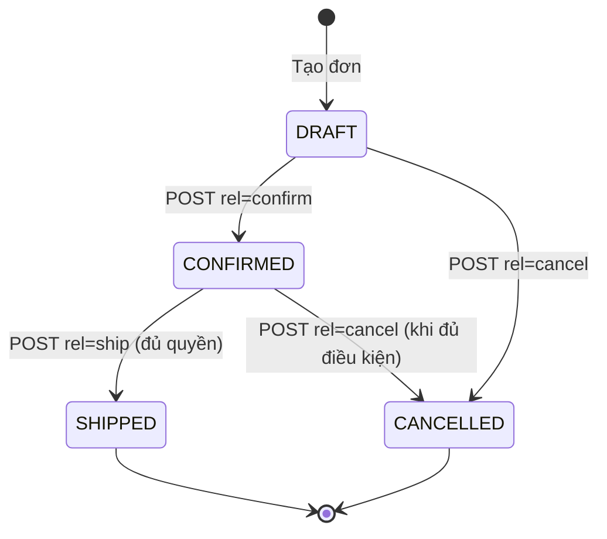
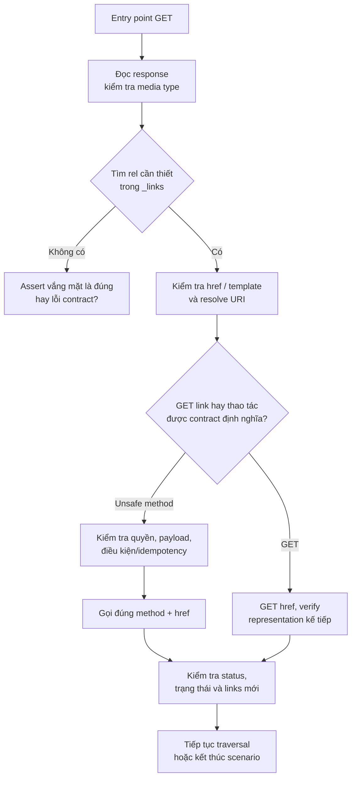
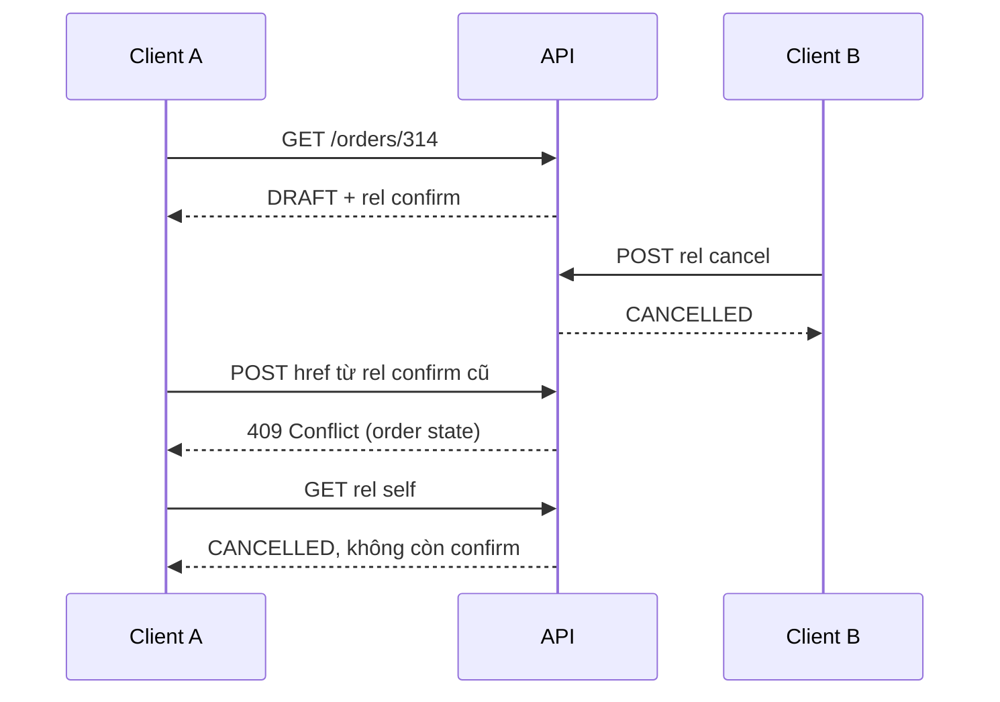

# Kiểm thử điều hướng và giới hạn của hypermedia trong công cụ phổ biến

> **Chương:** Hypermedia  
> **Module:** `INTEGRATION_API_REST` — học thiết kế REST API dựa trên resource, URI, phương thức và mã trạng thái HTTP cùng hợp đồng dữ liệu rõ ràng; thực hành phân trang, cache, idempotency, OpenAPI, xác thực, phân quyền, xử lý lỗi và kiểm thử bằng Java/Spring hoặc công nghệ tương đương.

Một REST API có thể cung cấp các endpoint hoạt động chính xác nhưng vẫn khiến client phải **tự ghép đường dẫn, ghi nhớ trạng thái và đoán hành động tiếp theo**. Hypermedia đề xuất cách khác: phản hồi không chỉ chứa dữ liệu mà còn chỉ dẫn những **liên kết (links)** và đôi khi cả **biểu mẫu/hành động (affordances)** có thể sử dụng từ trạng thái hiện tại.

Ví dụ, sau khi đọc đơn hàng ở trạng thái `DRAFT`, client có thể tìm quan hệ `confirm` để biết đường dẫn xác nhận đơn. Sau khi đơn chuyển sang `CONFIRMED`, quan hệ `confirm` không còn được cung cấp. Tuy nhiên, việc response có `_links` không tự khiến Postman, curl, Swagger UI hay trình duyệt biết **phương thức HTTP nào cần dùng và cách kiểm thử cả quy trình**.

Bài học này tập trung vào kỹ thuật **kiểm thử điều hướng dựa trên quan hệ liên kết** và các giới hạn thực tế của công cụ phổ biến. Ví dụ dùng biểu diễn **HAL** (`application/hal+json`), bên cạnh việc so sánh với các định dạng và công cụ khác. Mọi URI, tên quan hệ và luồng nghiệp vụ đều là **hợp đồng minh họa** của API; không phải một chuẩn bắt buộc cho mọi ứng dụng REST.

## Mục tiêu học tập

Sau bài học, bạn có thể:

1. Phân biệt **link**, **relation (rel)**, **URI template**, **affordance** và **state transition**.
2. Định nghĩa một kịch bản kiểm thử đi từ resource gốc, phát hiện rel và theo link mà không hard-code URL đích.
3. Kiểm thử phản hồi HAL, liên kết phân trang, liên kết phụ thuộc trạng thái và các trường hợp âm với curl/HTTPie/Postman.
4. Viết integration test Java bằng REST Assured và kiểm thử biểu diễn qua Spring MockMvc/Spring HATEOAS.
5. Chỉ ra ranh giới giữa **OpenAPI/Swagger UI** và điều hướng hypermedia lúc chạy.
6. Xác minh bảo mật, phân quyền, độ tươi của liên kết, lỗi khi trạng thái thay đổi và giới hạn cache/proxy.
7. Chọn mức độ hypermedia phù hợp với nhu cầu sản phẩm thay vì giả định mọi client đều tự điều hướng được.

## 1. Hypermedia thay đổi điều gì trong cách kiểm thử?

Với API chỉ mô tả các URL tĩnh, một client thường viết:

```text
1. GET  /api/orders/314
2. POST /api/orders/314/confirm
3. GET  /api/orders/314
```

Các đường dẫn và hành động được **lập trình sẵn**. Khi thay `/confirm` thành một URI khác, client có nguy cơ phải cập nhật.

Với một API định hướng hypermedia, bài test có thể viết:

```text
1. GET order resource.
2. Tìm link có rel = "confirm" trong response.
3. Xác minh contract của rel "confirm" quy định POST và payload nào.
4. POST tới href được trả về.
5. GET lại order bằng rel "self"; kiểm tra trạng thái và links mới.
```

Điểm khác biệt không phải rằng mọi ứng dụng sẽ hoàn toàn không biết gì trước về server. Client vẫn cần biết **entry point**, cách xác thực, media type, **ý nghĩa của rel**, những hành động được phép và dữ liệu đầu vào. Điều được giảm là sự phụ thuộc vào **việc client tự suy đoán URL tiếp theo**.

### Những khái niệm cơ bản

| Khái niệm | Ý nghĩa | Ví dụ |
| --- | --- | --- |
| **Entry point** | URI bắt đầu điều hướng đã biết trước. | `GET /api` hoặc `GET /api/orders/314` trong bài test có fixture. |
| **Link** | Từ biểu diễn hiện tại đến một tài nguyên hay điểm điều hướng. | `{"href":"/api/orders/314"}`. |
| **Link relation (`rel`)** | Mô tả **quan hệ/ngữ nghĩa** của link. | `self`, `next`, `confirm`. |
| **URI template** | Một mẫu URI có biến cần được mở rộng. | `/api/orders{?status,page,size}`. |
| **Affordance** | Thông tin về **hành động có thể thực hiện**, gồm phương thức/đầu vào khi định dạng hỗ trợ. | Hành động `confirm` là `POST` với body theo contract. |
| **State transition** | Tài nguyên/luồng nghiệp vụ thay đổi trạng thái. | `DRAFT → CONFIRMED`. |
| **Traversal** | Client chọn và theo rel/href để chuyển đến resource/hành động khác. | Theo `next` đến trang kết quả tiếp theo. |

**Quan trọng:** một link HAL chứa `rel` và `href` **không tự chỉ ra HTTP method hoặc body của thao tác thay đổi trạng thái**. Trong ví dụ này, phương thức `POST` của rel `confirm` được định nghĩa bởi hồ sơ quan hệ/tài liệu API. Nếu muốn mô tả thao tác tự thân trong representation, có thể xem xét **HAL-FORMS** hoặc **Siren**.

## 2. Hợp đồng ví dụ xuyên suốt: đơn hàng có nhiều trạng thái

Ta kiểm thử API quản lý đơn hàng với một số trạng thái:



Đây là state machine **minh họa**. Sản phẩm thực có thể có `PENDING_PAYMENT`, `PAID`, `RETURNED` hoặc những trạng thái khác; không áp dụng sơ đồ trên như quy tắc chung cho đơn hàng.

### Phản hồi khi đơn còn ở DRAFT

```http
GET /api/orders/314 HTTP/1.1
Accept: application/hal+json
Authorization: Bearer <token>
```

```http
HTTP/1.1 200 OK
Content-Type: application/hal+json
ETag: "order-314-v3"
Cache-Control: private, no-store

{
  "id": 314,
  "status": "DRAFT",
  "totalMinor": 250000,
  "_links": {
    "self":    { "href": "/api/orders/314" },
    "items":   { "href": "/api/orders/314/items" },
    "confirm": { "href": "/api/orders/314/confirm" },
    "cancel":  { "href": "/api/orders/314/cancel" }
  }
}
```

Trong hợp đồng bài học:

- `self` là quan hệ tự tham chiếu, client có thể dùng để đọc lại tài nguyên.
- `items` dẫn tới tập item của đơn.
- `confirm` được tài liệu hóa là **`POST` không yêu cầu body** cho người có quyền xác nhận.
- `cancel` được tài liệu hóa là **`POST` với lý do hủy theo schema riêng**.
- Nếu client không được phép thực hiện một hành động, server có thể ẩn link tương ứng theo chính sách trải nghiệm; **điều này không thay thế kiểm tra quyền tại endpoint đích**.

### Phản hồi sau thao tác xác nhận

```http
POST /api/orders/314/confirm HTTP/1.1
Accept: application/hal+json
Authorization: Bearer <token>
```

```http
HTTP/1.1 200 OK
Content-Type: application/hal+json
ETag: "order-314-v4"

{
  "id": 314,
  "status": "CONFIRMED",
  "_links": {
    "self":   { "href": "/api/orders/314" },
    "items":  { "href": "/api/orders/314/items" },
    "cancel": { "href": "/api/orders/314/cancel" }
  }
}
```

Link `confirm` đã biến mất vì hành động này không còn khả dụng theo trạng thái. Ví dụ không trả `ship` vì token đang dùng **không có vai trò kho**; người đủ quyền có thể nhìn thấy `ship` nếu nghiệp vụ cho phép.

Nếu gửi lại `POST /api/orders/314/confirm` khi trạng thái đã là `CONFIRMED`, hợp đồng ví dụ chọn **`409 Conflict`**, với body Problem Details mô tả xung đột trạng thái. Một API khác có thể quyết định làm thao tác xác nhận trở nên idempotent và trả thành công khi lặp lại; test phải tuân theo **hợp đồng đã công bố**, không tự suy từ `POST`.

### Ma trận liên kết cần kiểm thử

| Trạng thái / vai trò | `self` | `items` | `confirm` | `cancel` | `ship` |
| --- | --- | --- | --- | --- | --- |
| `DRAFT`, chủ đơn được phép sửa | Có | Có | Có | Có | Không |
| `CONFIRMED`, chủ đơn còn quyền hủy | Có | Có | Không | Có | Không |
| `CONFIRMED`, nhân viên kho đủ quyền | Có | Có | Không | Theo policy | Có |
| `SHIPPED`, người được phép đọc | Có | Có | Không | Không | Không |
| `CANCELLED`, người được phép đọc | Có | Có | Không | Không | Không |
| Không có quyền xem đơn | Không mặc định cho đọc | — | — | — | — |

Bảng trên là **oracle** của bài test. Chỉ kiểm tra số lượng link mà không gắn với trạng thái và quyền có thể bỏ sót sai lệch nghiêm trọng.

## 3. Điều cần kiểm thử: biểu diễn, điều hướng, hành động và kết quả

Một bộ test hypermedia tốt có ít nhất bốn lớp:

1. **Representation contract:** media type đúng; `_links` có cấu trúc hợp lệ; các rel bắt buộc tồn tại; `href` là URI/URI reference hợp lệ; dữ liệu body phù hợp schema.
2. **Navigation/traversal:** client đọc `href` từ rel, giải quyết URI tương đối, dùng nó để lấy resource kế tiếp; không ghép tay URL cứng.
3. **Affordance/action contract:** rel chỉ ra hành động nào, method/body lấy từ đâu; thao tác trả status phù hợp và cập nhật tài nguyên đúng.
4. **State/security correctness:** link thay đổi sau transition, không xuất hiện hành động không cho phép, đồng thời **đoán đúng URL đích vẫn không được vượt quyền**.



**Một test chỉ có `assertThat(body._links.self).exists()` chưa phải traversal test.** Nó chứng minh biểu diễn có một trường, chưa chứng minh link dùng được, đúng quyền, không dẫn đến sai resource hay phản ánh đúng state machine.

### Đừng đóng băng URL nếu mục tiêu là giảm coupling

Một assertion quá chặt:

```text
assert confirm.href == "/api/orders/314/confirm"
```

Có thể sai sau refactor hợp lệ đổi action URI mà vẫn giữ đúng relation contract. Một assertion bền hơn:

```text
assert order._links.confirm.href is a valid URI reference
follow rel "confirm" with documented POST
assert order becomes CONFIRMED and rel "confirm" disappears
```

Tuy nhiên, **không có nghĩa bỏ mọi kiểm tra URL**: vẫn phải kiểm tra scheme/host được phép, không lộ internal host, URI của link có thể truy cập, không dẫn tới tenant khác và không chứa thông tin bí mật.

## 4. Kiểm thử bằng curl: nhìn thấy link nhưng không tự theo rel

`curl` là công cụ HTTP tốt để quan sát status, headers và payload, nhưng **không tự hiểu `_links` hay chọn một rel**. Nó có thể theo HTTP redirect khi dùng `-L`; đó là **3xx redirect**, **không phải** traversal từ các relation trong JSON.

### Đọc response và kiểm tra media type

```bash
curl -i \
  -H 'Accept: application/hal+json' \
  -H "Authorization: Bearer $TOKEN" \
  'https://api.example.test/api/orders/314'
```

Nên kiểm tra:

- HTTP `200 OK`.
- `Content-Type: application/hal+json` (có thể kèm parameter hợp lệ).
- Body có `_links.self.href` và `_links.confirm.href` khi đơn ở `DRAFT`.
- Không có những rel chưa được phép, ví dụ `ship` đối với chủ đơn không có quyền kho.

### Trích link bằng jq

Nếu máy đã cài `jq`:

```bash
curl -fsS \
  -H 'Accept: application/hal+json' \
  -H "Authorization: Bearer $TOKEN" \
  'https://api.example.test/api/orders/314' \
  | jq -r '._links.confirm.href'
```

Lệnh trên **chỉ in đường dẫn**. Một lỗi trích link như `null` phải được xem là thất bại hoặc là trạng thái không cho phép action, không được gửi `POST null`. Với URI tương đối như `/api/orders/314/confirm`, client cần giải quyết nó dựa trên URI response, không giả định chuỗi luôn có thể nối thủ công.

### Theo hành động đã được tài liệu hóa

Trong hệ thống test **đã biết rel `confirm` dùng POST**:

```bash
curl -i -X POST \
  -H 'Accept: application/hal+json' \
  -H "Authorization: Bearer $TOKEN" \
  'https://api.example.test/api/orders/314/confirm'
```

Lệnh thứ hai ở đây được viết tường minh để minh họa method. Trong một script traversal thật, **URL đích phải đến từ `href` được trích ở bước trước**, đã kiểm tra an toàn và resolve URI phù hợp; không hard-code lại `/confirm`. Với hành động có side effect, chỉ chạy trên fixture/test environment hoặc khi đã được phép thao tác.

**Giới hạn của curl:** không có schema, không hiểu ý nghĩa rel, không quản lý state machine, không biết cần `POST`/`PATCH` hay payload, không tự biết cách xử lý `409`/`412`. Những điều này cần script hoặc test harness.

## 5. HTTPie và trình duyệt: tiện thử tay, không phải hypermedia agent

Một request tương tự trong HTTPie:

```bash
http GET 'https://api.example.test/api/orders/314' \
  Accept:application/hal+json \
  "Authorization:Bearer $TOKEN"
```

HTTPie hiển thị body/headers dễ đọc, nhưng cũng không tự chuyển một `rel=confirm` thành `POST` theo logic nghiệp vụ. Trình duyệt có thể hiển thị JSON hoặc hỗ trợ extension, nhưng nút link HTML thường gắn với **GET**; không nên đưa URL có side effect vào anchor để browser thực hiện GET.

So sánh ngắn:

| Công cụ | Làm tốt | Không tự đảm nhận |
| --- | --- | --- |
| **curl** | HTTP status/header/body, script shell, gọi URL cụ thể. | Parse rel HAL, hiểu action/transition. |
| **HTTPie** | Gửi request thủ công, xem JSON rõ. | Tự tạo luồng dựa trên rel. |
| **Browser** | Theo hyperlink HTML/GET, xem network, CORS và UI. | Thực thi các affordance JSON bằng method/body bất kỳ. |
| **Postman** | Collection, variables, assertions, chain requests. | Tự động khám phá và kiểm thử toàn bộ state graph từ HAL. |
| **Swagger UI** | Giao diện thao tác endpoint được mô tả trong OpenAPI. | Tự hiểu mọi `_links` lúc chạy và duyệt state machine. |
| **REST Assured / MockMvc** | Assertions, integration tests, flow tự lập trình. | Tự hiểu ý nghĩa domain rel nếu không có test code. |

Không có công cụ nào trong bảng bị coi là “sai” vì không tự duyệt hypermedia; chúng được thiết kế cho các mục đích khác nhau.

## 6. Postman: tách request khám phá và request thực thi

Postman phù hợp để **giữ trạng thái giữa nhiều request** bằng collection/environment variables. Một collection kiểm thử có thể gồm:

1. `GET order (discover)`: đọc đơn và ghi `confirmPath` từ `_links.confirm.href`.
2. `POST discovered confirm`: sử dụng biến `confirmPath` đã được lấy từ response, với method do contract chỉ định.
3. `GET order after confirmation`: xác minh trạng thái và các link sau transition.
4. `POST confirm again`: thử xung đột theo contract của bài.
5. Các case khác dành cho role, trạng thái và phân trang.

### 6.1 Post-response script của GET order

Trong tab **Scripts → Post-response** (tên tab có thể thay đổi theo phiên bản Postman), dùng JavaScript minh họa:

```javascript
const body = pm.response.json();

pm.test("Trả HAL và trạng thái DRAFT", () => {
  pm.response.to.have.status(200);
  pm.expect(pm.response.headers.get("Content-Type"))
    .to.include("application/hal+json");
  pm.expect(body.status).to.equal("DRAFT");
});

pm.test("Có rel self và confirm cho người được phép", () => {
  pm.expect(body._links).to.be.an("object");
  pm.expect(body._links.self.href).to.be.a("string").and.not.empty;
  pm.expect(body._links.confirm.href).to.be.a("string").and.not.empty;
});

const href = body._links && body._links.confirm
  ? body._links.confirm.href : null;

// Bài test này chỉ chấp nhận path cùng origin, không tự POST URL lạ.
if (typeof href === "string" && href.startsWith("/api/")) {
  pm.collectionVariables.set("confirmPath", href);
} else {
  pm.collectionVariables.unset("confirmPath");
}
```

Request tiếp theo có method **POST** và URL:

```text
{{baseUrl}}{{confirmPath}}
```

Ví dụ giả định `baseUrl=https://api.example.test` và `confirmPath=/api/orders/314/confirm`. **Không** nối theo cách này nếu link là absolute URL hoặc relative path không bắt đầu bằng `/`; với các dạng đó phải dùng URI resolution đúng quy tắc và kiểm tra origin. Script kiểm tra prefix là **cách giới hạn ví dụ**, không phải bộ phân tích URI tổng quát.

### 6.2 Test sau khi xác nhận

Sau `POST`, kiểm tra body và hành động không còn được cung cấp:

```javascript
const body = pm.response.json();

pm.test("Đơn chuyển sang CONFIRMED", () => {
  pm.response.to.have.status(200);
  pm.expect(body.status).to.equal("CONFIRMED");
});

pm.test("Link confirm không còn xuất hiện", () => {
  pm.expect(body._links.self.href).to.be.a("string");
  pm.expect(body._links.confirm).to.be.undefined;
});
```

Cần thiết lập **fixture trước mỗi lần chạy** (hoặc tạo đơn mới) vì request xác nhận làm thay đổi dữ liệu. Chạy lại collection với cùng đơn đã `CONFIRMED` sẽ khiến test “trạng thái DRAFT” thất bại một cách hợp lý.

### 6.3 Test đường dẫn và pagination

Với collection `GET /api/orders?page=1&size=2`, post-response script:

```javascript
const body = pm.response.json();

pm.test("Có link next nếu hasNext=true", () => {
  pm.expect(body._links.self.href).to.be.a("string");
  if (body.page && body.page.hasNext === true) {
    pm.expect(body._links.next.href).to.be.a("string").and.not.empty;
  }
});

const next = body._links && body._links.next
  ? body._links.next.href : null;

if (typeof next === "string" && next.startsWith("/api/")) {
  pm.collectionVariables.set("nextPath", next);
} else {
  pm.collectionVariables.unset("nextPath");
}
```

Đây là skeleton; metadata `page.hasNext` là **lựa chọn contract của ví dụ**, không phải thuộc tính HAL bắt buộc. Trước khi dùng URL từ response trong workflow thực, nên kiểm tra URL hợp lệ, origin, allowed path và quyền. Postman **không tự suy ra** có bao nhiêu trang, thứ tự dữ liệu hay ý nghĩa của `next` nếu test script không mô tả.

### Các giới hạn khi dùng Postman

- Collection Runner thực hiện **những request đã được định nghĩa**, không tự biến mọi rel phát hiện thành request tương ứng.
- Script cần biết mỗi rel dùng method, payload, quyền và kỳ vọng status nào.
- Variables có thể bị dùng lại giữa các lần chạy nếu không reset; **stale URL** làm test sai.
- Việc tự động gọi liên kết với method có side effect có thể thay đổi dữ liệu; không nên “follow tất cả link” một cách mù quáng.
- Link tuyệt đối, relative path, URI template, redirect và CORS cần xử lý riêng theo loại.

## 7. REST Assured: integration test điều hướng động trong Java

Khi muốn test chạy tự động trong CI, REST Assured giúp khởi tạo HTTP request, đọc JSON và assertion. Ví dụ sau dùng **JUnit 5 + Spring Boot test + REST Assured + AssertJ**, với server chạy trên random port.

Giả định test fixture có một đơn `DRAFT`, đã được tạo riêng cho từng test, và endpoint chấp nhận header xác thực test thích hợp (bỏ qua ở đoạn mã để tập trung vào traversal). Khi dùng ứng dụng thật, thêm auth và fixture setup/cleanup; không phụ thuộc ID 314 cố định giữa các test.

```java
import io.restassured.response.Response;
import org.junit.jupiter.api.Test;
import org.springframework.boot.test.context.SpringBootTest;
import org.springframework.boot.test.web.server.LocalServerPort;
import java.net.URI;

import static io.restassured.RestAssured.given;
import static org.assertj.core.api.Assertions.assertThat;

@SpringBootTest(webEnvironment = SpringBootTest.WebEnvironment.RANDOM_PORT)
class OrderHypermediaTraversalIT {
    @LocalServerPort int port;

    @Test
    void followConfirmLink_thenLinkDisappears() {
        long orderId = createDraftOrderFixture(); // do test setup
        URI base = URI.create("http://localhost:" + port + "/");

        Response initial = given()
            .accept("application/hal+json")
            .get(base.resolve("/api/orders/" + orderId))
            .then()
            .statusCode(200)
            .extract().response();

        assertThat(initial.contentType()).contains("application/hal+json");
        assertThat(initial.jsonPath().getString("status")).isEqualTo("DRAFT");

        String confirmHref =
            initial.jsonPath().getString("_links.confirm.href");
        assertThat(confirmHref).isNotBlank();

        URI action = base.resolve(confirmHref);
        assertThat(action.getScheme()).isEqualTo("http");
        assertThat(action.getHost()).isEqualTo("localhost");
        assertThat(action.getPort()).isEqualTo(port);

        // Method POST được biết từ contract của relation "confirm".
        given()
            .accept("application/hal+json")
            .post(action)
            .then()
            .statusCode(200);

        Response after = given()
            .accept("application/hal+json")
            .get(base.resolve("/api/orders/" + orderId))
            .then()
            .statusCode(200)
            .extract().response();

        assertThat(after.jsonPath().getString("status"))
            .isEqualTo("CONFIRMED");
        assertThat(after.jsonPath().getString("_links.confirm.href"))
            .isNull();
        assertThat(after.jsonPath().getString("_links.self.href"))
            .isNotBlank();
    }

    private long createDraftOrderFixture() {
        // Tạo order trong fixture hoặc qua API test; ví dụ không tự chạy
        // khi chưa nối với phần thiết lập dữ liệu riêng của dự án.
        throw new UnsupportedOperationException("Provide a test fixture");
    }
}
```

**Giá trị của test:** URL hành động không bị hard-code; nó được khám phá qua `rel=confirm`. Test vẫn biết **ngữ nghĩa POST** vì HAL không cung cấp method. Assert origin/port ở đây bảo vệ test khỏi việc tự gửi POST tới URL tùy ý; các môi trường khác cần allowlist phù hợp.

**Các giới hạn cần ghi nhớ:**

- Đây là mã **minh họa một integration-test pattern**, chưa chạy được nếu chưa có fixture, xác thực và thư viện trong project.
- Khi hệ thống sử dụng domain/port phía sau proxy, kiểm tra URI absolute/relative theo entry point thực; không giả định mọi href có host localhost.
- Nếu response không còn link `confirm` vì quyền của token hoặc state khác `DRAFT`, test phải giải thích ngữ cảnh thay vì luôn xem đó là lỗi server.
- Client nên lấy `self.href` của response để đọc lại thay vì tự tạo đường dẫn; đoạn mã rút gọn đã biết URI fixture vì bước khởi tạo cần truy cập đơn cụ thể.
- Link có thể lỗi thời sau khi client nhận nó: traversal test còn cần các tình huống cạnh tranh, `409`, `404` và điều kiện HTTP nếu API hỗ trợ.

### Test phân trang bằng rel thay vì tự tăng page

```java
Response first = given().accept("application/hal+json")
    .get(base.resolve("/api/orders?page=1&size=2"))
    .then().statusCode(200).extract().response();

String nextHref = first.jsonPath().getString("_links.next.href");
assertThat(nextHref).isNotBlank();

URI next = base.resolve(nextHref);
assertThat(next.getHost()).isEqualTo("localhost");

Response second = given().accept("application/hal+json")
    .get(next)
    .then().statusCode(200).extract().response();

assertThat(second.jsonPath().getList("_embedded.orders"))
    .isNotNull();
```

Test thật cần thêm fixture đủ dữ liệu, kiểm tra filter/sort được giữ, số đơn không trùng trong tập **tĩnh**, và xác định cách API xử lý trang cuối. `_embedded.orders` là cách biểu diễn HAL ví dụ, không phải tên field cố định của tất cả API.

## 8. Spring MockMvc/Spring HATEOAS: test từ phía server

Kiểm thử traversal qua HTTP thật kiểm tra nhiều lớp mạng hơn; **MockMvc** hữu ích để kiểm tra controller và JSON response mà không mở cổng TCP. Spring HATEOAS giúp tạo `EntityModel`, `CollectionModel`, `PagedModel` và relation links theo mô hình ứng dụng.

### Controller trả biểu diễn điều hướng

Đoạn mã rút gọn dưới đây biểu diễn ý tưởng (cần wiring Spring, imports, service/domain và cơ chế xác thực trong ứng dụng thật):

```java
import org.springframework.hateoas.EntityModel;
import org.springframework.hateoas.Link;
import org.springframework.web.bind.annotation.*;

import static org.springframework.hateoas.server.mvc.WebMvcLinkBuilder.*;

@RestController
@RequestMapping("/api/orders")
class OrderController {
    private final OrderService service;

    OrderController(OrderService service) {
        this.service = service;
    }

    @GetMapping("/{id}")
    EntityModel<OrderDto> get(@PathVariable long id) {
        OrderDto order = service.getForAuthorizedCaller(id);

        EntityModel<OrderDto> model = EntityModel.of(
            order,
            linkTo(methodOn(OrderController.class).get(id)).withSelfRel()
        );

        model.add(Link.of("/api/orders/" + id + "/items", "items"));

        if (order.status() == OrderStatus.DRAFT
                && service.currentCallerCanConfirm(order)) {
            model.add(
                Link.of("/api/orders/" + id + "/confirm", "confirm")
            );
        }

        if (service.currentCallerCanCancel(order)) {
            model.add(
                Link.of("/api/orders/" + id + "/cancel", "cancel")
            );
        }

        return model;
    }
}
```

Điều kiện cấp link chỉ giúp **thể hiện những lựa chọn có thể thực hiện** trong response. Endpoint `POST /api/orders/{id}/confirm` vẫn phải kiểm tra authorization và state **khi nhận request**, vì dữ liệu hoặc quyền có thể đổi sau lúc client đọc representation.

Khi server đứng sau proxy/load balancer, cần kiểm tra cấu hình tạo self link qua host/scheme/forwarded headers. Nếu sai, server có thể phát `http://internal-host:8080` thay vì URI bên ngoài, làm traversal hỏng hoặc làm lộ thông tin nội bộ. Không tin header `Forwarded`/`X-Forwarded-*` từ nguồn không được ủy quyền.

### MockMvc test điều kiện hiển thị rel

```java
import org.junit.jupiter.api.Test;
import org.springframework.beans.factory.annotation.Autowired;
import org.springframework.boot.test.autoconfigure.web.servlet.AutoConfigureMockMvc;
import org.springframework.boot.test.context.SpringBootTest;
import org.springframework.http.MediaType;
import org.springframework.test.web.servlet.MockMvc;

import static org.springframework.test.web.servlet.request.MockMvcRequestBuilders.get;
import static org.springframework.test.web.servlet.result.MockMvcResultMatchers.*;

@SpringBootTest
@AutoConfigureMockMvc
class OrderLinksMvcIT {
    @Autowired MockMvc mvc;

    @Test
    void draftOrderExposesConfirmLinkToAuthorizedCaller() throws Exception {
        long id = createAuthorizedDraftFixture();

        mvc.perform(get("/api/orders/{id}", id)
                .accept("application/hal+json"))
            .andExpect(status().isOk())
            .andExpect(content().contentTypeCompatibleWith(
                MediaType.parseMediaType("application/hal+json")))
            .andExpect(jsonPath("$._links.self.href").exists())
            .andExpect(jsonPath("$._links.confirm.href").exists());
    }

    @Test
    void shippedOrderDoesNotExposeCancel() throws Exception {
        long id = createAuthorizedShippedFixture();

        mvc.perform(get("/api/orders/{id}", id)
                .accept("application/hal+json"))
            .andExpect(status().isOk())
            .andExpect(jsonPath("$._links.cancel").doesNotExist());
    }

    private long createAuthorizedDraftFixture() {
        throw new UnsupportedOperationException("Connect test fixture");
    }

    private long createAuthorizedShippedFixture() {
        throw new UnsupportedOperationException("Connect test fixture");
    }
}
```

**Chú ý:** Đoạn code sử dụng `MediaType.parseMediaType("application/hal+json")` để kiểm tra media type theo kiểu dữ liệu mà MockMvc mong đợi. Test vẫn cần fixture và authentication setup phù hợp trước khi chạy.

MockMvc có thể chạy cùng Spring Security test để mô phỏng các vai trò khác nhau. Tuy nhiên, unit/controller test không tự chứng minh link hoạt động sau gateway/reverse proxy; vẫn cần ít nhất một **end-to-end traversal test** trong môi trường tương đương deployment.

## 9. URI tương đối, URI template và liên kết phân trang

Một test hypermedia dễ thất bại khi giả định mọi `href` là absolute URL. Trên thực tế có thể gặp:

| Dạng | Ví dụ | Cách hiểu |
| --- | --- | --- |
| Absolute URI | `https://api.example.test/api/orders/314` | Có scheme và authority rõ. |
| Origin-relative path | `/api/orders/314` | Resolve theo scheme/host của URI cơ sở. |
| Relative path | `../orders/314` | Resolve theo đường dẫn của URI biểu diễn hiện tại. |
| Query-relative reference | `?page=2&size=20` | Giữ đường dẫn và thay query của URI cơ sở theo quy tắc URI. |
| URI template | `/api/orders{?status,page,size}` | **Chưa phải URI sẵn sàng gọi**: cần mở rộng biến theo cú pháp template. |

Để xử lý đúng, client nên dùng URI resolver/template expander, không dùng phép nối chuỗi kiểu `baseUrl + href` cho mọi trường hợp. Đặc biệt, nếu response đến từ `https://api.example.test/api/orders?page=1`, href `?page=2` phải được resolve thành **cùng đường dẫn** với query mới, không thành `https://api.example.test?page=2`.

### HAL templated link

```json
{
  "_links": {
    "self": { "href": "/api/orders" },
    "search": {
      "href": "/api/orders{?status,page,size}",
      "templated": true
    }
  }
}
```

Client cần biết:

- `search` là quan hệ cung cấp khả năng tìm kiếm; ý nghĩa query params theo profile/contract.
- `templated: true` cho biết phải **mở rộng URI Template** trước khi gọi; không gửi nguyên văn dấu `{? ... }`.
- Những biến không được phép hoặc size vượt ngưỡng phải được server kiểm soát.
- Nếu filter/sort thay đổi, cursor/next link cũ có thể không còn tương ứng; test cần xác minh token/link theo đúng tập kết quả.

### Kiểm thử phân trang dựa trên rel next

Ví dụ response collection:

```http
GET /api/orders?status=CONFIRMED&page=1&size=2 HTTP/1.1
Accept: application/hal+json
```

```json
{
  "_embedded": {
    "orders": [
      {"id": 314, "status": "CONFIRMED"},
      {"id": 312, "status": "CONFIRMED"}
    ]
  },
  "_links": {
    "self": {
      "href": "/api/orders?status=CONFIRMED&page=1&size=2"
    },
    "next": {
      "href": "/api/orders?status=CONFIRMED&page=2&size=2"
    }
  },
  "page": {
    "size": 2,
    "number": 1,
    "hasNext": true
  }
}
```

Một test đúng cần:

1. Đọc `_links.next.href` từ response, **không tự cộng page** nếu đang kiểm thử navigation.
2. Resolve URI và gọi `GET` tới URL đó.
3. Xác nhận mọi item trên trang kế tiếp vẫn có `status=CONFIRMED` và thuộc đúng tenant.
4. Xác nhận link `next` không xuất hiện ở trang cuối, nếu contract dùng quy tắc này.
5. Trong bộ dữ liệu **không đổi**, kiểm tra không trùng item IDs, thứ tự ổn định và số phần tử không vượt `size`.
6. Trong bộ dữ liệu **đang thay đổi**, ghi nhận rằng offset/page-based pagination có thể trùng/bỏ sót dù có hypermedia link `next`; nếu yêu cầu duyệt nhất quán phải xem xét cursor/keyset hoặc snapshot.

Link `next` làm client không phải tự tạo URL, nhưng **không tự chữa những đánh đổi hiệu năng hoặc consistency** của cơ chế phân trang phía database.

## 10. OpenAPI và Swagger UI: đặc tả endpoint khác hypermedia runtime

OpenAPI mô tả routes, methods, parameters, request/response schemas và security. **Swagger UI** thường trình bày các thao tác đó để người dùng chạy thử từng endpoint. Hypermedia cung cấp **những link xuất hiện trong representation thực tế**, có thể thay đổi theo trạng thái và quyền.

Hai việc bổ sung cho nhau nhưng không thay thế nhau:

| Khía cạnh | OpenAPI / Swagger UI | Hypermedia runtime |
| --- | --- | --- |
| Danh sách endpoint, method, schema | Mạnh | Không nhất thiết chứa toàn bộ danh mục operation. |
| Khám phá link từ resource hiện tại | Có thể mô tả schema/link, nhưng UI phổ biến không tự duyệt toàn bộ graph. | Là mục tiêu chính của link relations. |
| Link hiện/ẩn theo trạng thái đơn | Có thể mô tả quy tắc và ví dụ. | Server phát link cụ thể theo trạng thái. |
| Kiểu request body và validation | Mô tả rõ bằng schema. | Chỉ khi format/affordance hỗ trợ hoặc có profile. |
| Tự động chạy flow nhiều bước | Cần collection/test harness hoặc công cụ bổ trợ. | Client vẫn cần logic traversal và contract của rel. |
| Versioning/client generation | Hỗ trợ theo spec. | Giảm coupling URL trong phạm vi đã thiết kế, không xóa mọi contract. |

### OpenAPI Links Object có phải `_links` không?

OpenAPI hỗ trợ **Links Object** để mô tả khả năng liên kết từ một response tới một operation, ví dụ dùng ID tạo đơn làm tham số cho operation đọc đơn. Đây là **mô tả ở tài liệu/contract**, không mặc nhiên là một trường `_links` trong JSON response, và không bảo đảm Swagger UI sẽ tự theo rel như một hypermedia agent.

Đoạn OpenAPI minh họa:

```yaml
paths:
  /api/orders:
    post:
      operationId: createOrder
      responses:
        '201':
          description: Order created
          links:
            GetCreatedOrder:
              operationId: getOrder
              parameters:
                id: '$response.body#/id'
  /api/orders/{id}:
    get:
      operationId: getOrder
      parameters:
        - in: path
          name: id
          required: true
          schema: { type: integer, format: int64 }
      responses:
        '200':
          description: Order representation
          content:
            application/hal+json:
              schema: { type: object }
```

Đây là mẫu rút gọn để minh họa mối quan hệ giữa operations; API production cần schema cụ thể, security, error responses và profile rel. Muốn client traversal thật, **response runtime** vẫn phải cung cấp link hoặc client cần một cơ chế khác biết URL đích.

**Không nên kiểm thử hypermedia chỉ bằng việc mở Swagger UI và nhấn “Try it out” trên endpoint đã biết.** Hành động đó chứng minh endpoint hoạt động, chưa chứng minh client có thể khám phá endpoint từ representation trước đó.

## 11. Không phải định dạng hypermedia nào cũng thể hiện hành động như nhau

### HAL

HAL dùng `_links` và `_embedded` để liên kết/nhúng resource. Ví dụ:

```json
{
  "status": "DRAFT",
  "_links": {
    "self": {"href": "/api/orders/314"},
    "confirm": {"href": "/api/orders/314/confirm"}
  }
}
```

HAL **không định nghĩa trực tiếp HTTP method hoặc request body cho `confirm`**. Client phải biết contract của rel hoặc dùng affordance khác. Đây là giới hạn cơ bản khi kiểm thử tự động: một tool không thể suy ra an toàn rằng link `confirm` phải được gọi bằng `POST` chỉ từ `href`.

### HAL-FORMS

HAL-FORMS mở rộng khái niệm biểu mẫu bằng templates mô tả method, target và các thuộc tính đầu vào. Biểu diễn rút gọn:

```json
{
  "_links": {
    "self": {"href": "/api/orders/314"}
  },
  "_templates": {
    "confirm": {
      "method": "POST",
      "target": "/api/orders/314/confirm"
    }
  }
}
```

Một client hiểu HAL-FORMS có nhiều thông tin hơn để xây request. Nhưng vẫn cần biết chính sách auth, ý nghĩa business action, validators, cách hiển thị lỗi, và không nên thực thi unsafe method chỉ vì template tồn tại.

### Siren

Siren định nghĩa `entities`, `links` và `actions`. Ví dụ tối giản:

```json
{
  "class": ["order"],
  "properties": {"id":314,"status":"DRAFT"},
  "links": [{"rel":["self"],"href":"/api/orders/314"}],
  "actions": [
    {
      "name":"confirm",
      "method":"POST",
      "href":"/api/orders/314/confirm"
    }
  ]
}
```

Siren biểu diễn method rõ hơn HAL đơn thuần. Test harness vẫn phải hiểu **Siren schema** và luật phân quyền/trạng thái.

### JSON:API và Link headers

JSON:API cung cấp `links`, quan hệ resource và cơ chế mô tả tài nguyên theo format riêng; **không nên mặc định** cấu trúc `_links` của HAL sẽ xuất hiện. HTTP có thể chứa Web Linking qua header:

```http
Link: </api/orders/314>; rel="self"
Link: </api/orders/314/items>; rel="items"
```

Link header và JSON body có thể cùng có hoặc không tùy contract. Test cần biết **nơi tìm rel và định dạng nguồn**.

| Định dạng | Chứa link? | Mô tả method/input trong representation? | Hệ quả kiểm thử |
| --- | --- | --- | --- |
| HAL | Có, qua `_links`. | Không phải khả năng cốt lõi của link HAL. | Cần contract/profile cho action. |
| HAL-FORMS | Có, kết hợp `_templates`. | Có thể mô tả action template. | Test method, target, fields/required. |
| Siren | Có `links` và `actions`. | Có action method, fields. | Test state-dependent actions. |
| JSON:API | Có `links` theo đặc tả riêng. | Không dùng cấu trúc action HAL-FORMS/Siren. | Test theo media type/schema JSON:API. |
| HTTP Link header | Có qua header. | Link relation không tự quy định method/body. | Parse headers và theo rel đúng ngữ nghĩa. |

**Không có một JSON property chung cho mọi “REST hypermedia”.** Mỗi client/test suite phải chọn format và version cụ thể.

## 12. Kiểm thử bảo mật: link không phải quyền truy cập

Ẩn rel `ship` khỏi người dùng bình thường giúp giao diện tránh gợi ý hành động không hợp lệ. Nhưng một người dùng có thể đoán hoặc lưu lại URL cũ. Vì vậy:

- **Authorization được thực thi ở request đích**; không dùng “không có link” như biện pháp bảo mật duy nhất.
- **Authentication/authorization vẫn áp cho mọi GET/POST/PATCH/DELETE** tương ứng, kể cả liên kết đã được công bố trước đó.
- Server không được phát absolute links trỏ tới domain nội bộ, vùng admin hoặc tài nguyên tenant khác ngoài policy.
- Khi client tự theo link từ nguồn không đáng tin, phải tránh **SSRF/open redirect/dẫn đến host độc hại**. Một test harness có khả năng gửi credentials/POST theo link phải giới hạn scheme và origin/allowlist.
- Không đưa access token, mật khẩu, secret hay thông tin nhạy cảm vào query string của href nếu có thể tránh.
- URI template expansion phải encode đúng và validate input; không chèn biến thô thành URL gây injection.
- Hệ thống chỉ nên dùng CORS theo chính sách trình duyệt thích hợp; **CORS không thay thế authorization**.

### Test bắt buộc: không có link, nhưng URL vẫn bị từ chối

```text
Given: người dùng thường được xem đơn CONFIRMED nhưng không được ship.
When:  GET order.
Then:  response không chứa rel "ship".

When:  người đó POST trực tiếp tới URI ship đã biết.
Then:  403 Forbidden (hoặc 404 theo chính sách che giấu).
       Đơn vẫn CONFIRMED, không xuất kho.
```

**Test thứ hai mới chứng minh kiểm soát quyền.** Chỉ test rel `ship` vắng mặt không đủ.

### Test link trỏ sai origin

```text
Given: response HAL có rel "confirm" -> "https://untrusted.test/action".
When:  client/harness xử lý href.
Then:  từ chối traversal unsafe action;
       không chuyển Authorization header/token tới origin ngoài allowlist.
```

Việc client cần theo external links là lựa chọn sản phẩm; có thể có các link sang tài liệu/đối tác hợp lệ. Nhưng **unsafe operations** và credentials cần chính sách nghiêm ngặt hơn link đọc công khai.

## 13. Liên kết cũ, concurrency và hành vi lỗi sau điều hướng

Một client có thể đọc đơn `DRAFT` lúc 10:00 và thấy `confirm`, nhưng đến 10:01 nhân viên khác đã hủy đơn. Link đã được phát **không đảm bảo hành động vẫn thực thi được** khi client gửi yêu cầu.



**Nguyên tắc:** server luôn kiểm tra lại state và quyền tại **thời điểm thao tác được xử lý**. Test phải xác minh trạng thái cuối và không có side effect sai.

Các trường hợp cần kiểm thử:

| Trường hợp | Kết quả dự kiến theo contract | Điểm xác minh |
| --- | --- | --- |
| Link bị mất sau state transition hợp lệ. | Representation mới không có rel hành động cũ. | Trạng thái và link graph đúng. |
| Client dùng link cũ khi resource đổi trạng thái. | `409` hoặc lỗi phù hợp với domain. | Không thực thi hành động không hợp lệ. |
| Client dùng `If-Match` và validator không còn khớp. | `412 Precondition Failed` khi HTTP precondition sai. | Không ghi đè thay đổi mới. |
| Endpoint yêu cầu `If-Match` nhưng client thiếu. | `428 Precondition Required` theo chính sách API. | Thông báo cách lấy validator. |
| Resource bị xóa sau khi link được phát. | `404`/`410` hoặc mã phù hợp với hợp đồng. | Client có đường refresh/khôi phục. |
| Người dùng bị thu hồi quyền sau khi nhận link. | `401`/`403` hoặc `404` theo security policy. | Không rò rỉ dữ liệu hoặc thực thi thao tác. |
| Action `POST` được retry sau timeout. | Theo hợp đồng idempotency; không lặp side effect. | Idempotency key/transaction boundary. |

Không đồng nhất **conditional HTTP** với “link hiện còn tồn tại”. Nếu action cần bảo vệ lost update bằng `If-Match`, nên thiết kế URI đích/validator và semantics đúng với HTTP request target; không đơn giản sao chép ETag của một representation khác vào một URL action rồi mặc định sẽ có tác dụng.

## 14. Content negotiation, cache và proxy có thể làm traversal hỏng

Hypermedia phụ thuộc vào **representation được trả**, vì vậy media type, gateway và cache ảnh hưởng trực tiếp đến link mà client nhìn thấy.

### Chọn media type

Nếu client muốn HAL:

```http
GET /api/orders/314 HTTP/1.1
Accept: application/hal+json
```

Server nên trả representation HAL với `Content-Type` phù hợp hoặc xử lý negotiation theo contract. Nếu server chỉ trả JSON phẳng cho `Accept: application/json` mà không có `_links`, một test traversal yêu cầu HAL phải gửi đúng `Accept` và không xem thiếu link ở representation khác là lỗi bất ngờ.

### Cache và thay đổi liên kết theo quyền/trạng thái

Một response `DRAFT` cache cũ vẫn có thể chứa `confirm` sau khi đơn bị hủy. Điều đó không thể được “chữa” chỉ bằng link relation; server đích phải kiểm tra state. Với dữ liệu riêng tư:

- Dùng `Cache-Control` phù hợp; `no-store` là lựa chọn thận trọng cho dữ liệu nhạy cảm/biến động trong ví dụ.
- Nếu cho cache, key và validator phải phản ánh scope người dùng/tenant, query, representation và thời điểm thay đổi.
- ETag/conditional GET hỗ trợ giảm bandwidth nhưng phải có validator đúng với representation được trả.
- Nếu link được tạo thành absolute URI, proxy cần biết host/scheme công khai đáng tin; không tin forwarding headers do client tùy ý giả mạo.

### Một bộ kiểm tra gateway

| Kiểm tra | Cách phát hiện |
| --- | --- |
| Gateway rewrite path khiến `href` trả sai. | So link theo external base URL và thực sự theo link trong staging. |
| Response sinh absolute URL với host nội bộ. | Assert scheme/host thuộc allowlist công khai; log cấu hình forwarded headers. |
| Proxy bỏ header `Link` hoặc `Location`. | So header trước/sau gateway ở môi trường kiểm soát. |
| Cache trả links của role/tenant khác. | Test nhiều principal và cache warm/cold, kiểm tra `Cache-Control`/`Vary` khi áp dụng. |
| `ETag` không cập nhật khi link theo trạng thái đổi. | Thử conditional GET và chuyển state. |
| CDN/proxy chuyển `Content-Type` sai. | Kiểm tra media type ở external endpoint, không chỉ MockMvc. |

**Hypermedia không thay thế monitoring hay service discovery nội bộ.** Nó mô tả các lựa chọn và tài nguyên ở ranh giới HTTP; các vấn đề truyền thông, bảo mật và nhất quán vẫn phải được thiết kế và kiểm thử.

## 15. Xây bộ test nhiều mức và chỉ số vận hành

Một chiến lược kiểm thử thực tế kết hợp nhiều tầng:

| Tầng test | Công cụ thường dùng | Nên tập trung |
| --- | --- | --- |
| Unit/assembler | JUnit, Spring HATEOAS models | Mapping state/role sang rel, URI template, rel naming. |
| MVC integration | Spring MockMvc/WebTestClient | Media type, JSON `_links`/`_templates`, status, auth, negative cases. |
| API integration | REST Assured/HTTP client | Theo rel thật, action semantics, data state, lỗi và pagination. |
| Collection/manual | Postman, curl, HTTPie | Điều tra contract và demonstration các liên kết trong môi trường test. |
| Contract/schema | OpenAPI validators, JSON Schema, custom rel assertions | Schema response, known relations, method/payload contract, backward compatibility. |
| E2E/staging | HTTP client qua gateway công khai | Proxy URL, auth, routing, cache, CORS nếu có web UI, rate limit. |

### Quy tắc chống flakiness

- Tạo fixture độc lập cho từng test; tránh một order cố định bị thay đổi bởi các test khác.
- Kiểm tra state trước khi yêu cầu một rel. Không kỳ vọng `confirm` tồn tại với mọi order.
- Trong test pagination, khóa dữ liệu/seed đủ ổn định; nếu cần tính đầy đủ, dùng snapshot hoặc fixture không có writer khác.
- Khi xác minh links, assert **ngữ nghĩa** (rel, target hợp lệ, follow thành công) thay vì phụ thuộc mọi byte của href, trừ những URL là contract công khai.
- Không tự động chạy unsafe action ngoài test/staging; yêu cầu môi trường được kiểm soát và dữ liệu có thể khôi phục.
- Tách kiểm thử link graph khỏi kiểm thử chi tiết validation để khi thất bại dễ tìm nguyên nhân.
- Có log/trace correlation qua các request của một traversal để truy vết thất bại ở bước nào.

### Chỉ số đáng theo dõi

- Tỷ lệ phản hồi thiếu rel bắt buộc theo status/state/role.
- Tỷ lệ link trả `404`, `405` hoặc sai origin sau khi được phát.
- Tỷ lệ action dựa trên link bị `409`/`412` do dữ liệu đổi — có thể là hành vi bình thường ở hệ thống nhiều writer nhưng tăng đột biến cần điều tra.
- Lỗi URI template expansion, invalid cursor, pagination traversal thất bại.
- p95 độ trễ chuỗi nhiều bước, không chỉ p95 từng endpoint.
- Sự cố authorization khi dùng link cũ hoặc link được chia sẻ.
- Số client đang dùng các relation versions khi thay đổi API.

Không gắn order ID hay user ID vào metric label; dùng log/traces có kiểm soát để theo dấu request cụ thể. Tránh coi mọi `4xx` trong workflow là lỗi server; phân biệt hành vi nghiệp vụ dự kiến và lỗi hợp đồng.

## 16. Giới hạn cốt lõi và quyết định thiết kế thực dụng

Hypermedia có giá trị khi client phải thích nghi với trạng thái, luồng nghiệp vụ phong phú và các URL có thể thay đổi. Nhưng có các giới hạn cần nêu thẳng:

1. **Không tự tạo sự hiểu biết về nghiệp vụ.** Client cần biết `confirm` có nghĩa gì và người dùng có muốn thực hiện hành động đó không.
2. **Link không nhất thiết mô tả method/body.** HAL không đủ để một client generic quyết định an toàn giữa `GET`, `POST`, `PATCH`, `DELETE`.
3. **Không phải công cụ nào cũng là hypermedia client.** Postman và REST Assured cần script/test code; Swagger UI tập trung vào OpenAPI operations; curl chỉ là HTTP client.
4. **Không thay thế schema, auth, versioning hoặc idempotency.** Một link có thể được theo nhưng vẫn bị từ chối đúng vì không đủ quyền hoặc state đã đổi.
5. **Không tự đảm bảo hiệu năng/nhất quán.** Traversal nhiều bước tăng round-trips; pagination và cache vẫn có hạn chế riêng.
6. **Không làm URI ổn định trở nên vô nghĩa.** Entry points, relation semantics, media type và contracts vẫn là những điểm phụ thuộc cần quản lý.
7. **Có chi phí triển khai.** Server phải tạo link theo state/role; client cần parser/traversal logic; test cần fixtures và negative scenarios.
8. **Không nên ép mọi endpoint phải hypermedia.** CRUD đơn giản hoặc client nội bộ kiểm soát toàn bộ phiên bản có thể sử dụng hợp đồng OpenAPI + URL ổn định hiệu quả hơn.
9. **Quan hệ link cần có hợp đồng bền vững.** Đổi tên rel `confirm` thành `approve` sẽ phá client theo rel dù URL không đổi.
10. **Không phải mọi link đều nên theo tự động.** Đặc biệt tránh tự gửi unsafe methods, credentials hoặc dữ liệu nhạy cảm tới href chưa xác minh.

### Nên áp dụng tới mức nào?

| Bối cảnh | Lựa chọn thực tế |
| --- | --- |
| CRUD ít trạng thái, một đội quản lý client và server. | OpenAPI + API contract rõ, có thể chỉ dùng `self`/pagination links khi hữu ích. |
| Workflow nhiều trạng thái, client đa nền tảng. | Link relations theo state, test traversal, hồ sơ relation và error contract. |
| Client muốn sinh form/hành động động. | Xem HAL-FORMS/Siren hoặc affordance format khác; đánh giá thư viện và hỗ trợ toolchain. |
| API công khai cần tiến hóa URI mà ít phá client. | Ưu tiên rel ổn định, entry point có khám phá, contract tests và phiên bản quan hệ khi cần. |
| Export/batch cần dữ liệu đầy đủ nhất quán. | Snapshot/export job; không cho rằng `next` link tự đủ để đảm bảo toàn vẹn. |

**Tiêu chí chọn không phải “càng nhiều `_links` càng RESTful”**. Thiết kế có ích khi liên kết giúp client thực hiện đúng hành trình, giảm hard-coded navigation và vẫn bảo vệ được state, security và tính đúng đắn nghiệp vụ.

## 17. Bài thực hành: kiểm thử một workflow hypermedia

Bạn được giao kiểm thử API quản lý yêu cầu hoàn tiền (`refund request`). Tài nguyên có trạng thái:

- `REQUESTED`: khách hàng có thể hủy; nhân viên kiểm duyệt có thể chấp nhận hoặc từ chối.
- `APPROVED`: hệ thống bắt đầu xử lý trả tiền; không cho khách hủy.
- `REJECTED`: không còn thao tác phê duyệt.
- `COMPLETED`: đã hoàn tiền; chỉ còn link đọc/truy vết.

Giả sử khi `GET /api/refunds/77` ở trạng thái `REQUESTED` với vai trò nhân viên kiểm duyệt:

```http
HTTP/1.1 200 OK
Content-Type: application/hal+json

{
  "id": 77,
  "status": "REQUESTED",
  "_links": {
    "self": {"href": "/api/refunds/77"},
    "approve": {"href": "/api/refunds/77/approve"},
    "reject": {"href": "/api/refunds/77/reject"}
  }
}
```

**Hợp đồng nghiệp vụ của bài tập:** `approve` và `reject` dùng `POST`, có authentication/authorization; sau `approve`, resource chuyển sang `APPROVED` và các rel `approve`/`reject` phải biến mất. Một người không có vai trò kiểm duyệt không được thực hiện các hành động này kể cả khi đoán được URI.

### Phần A — Thiết kế test cases

1. Viết bảng quan hệ link theo `REQUESTED`, `APPROVED`, `REJECTED`, `COMPLETED` và theo hai vai trò khách hàng/nhân viên kiểm duyệt.
2. Viết lệnh curl lấy representation; chỉ ra công cụ nào cần dùng thêm để trích `_links.approve.href`.
3. Viết Postman post-response script lưu `approvePath` và kiểm tra không gửi action tới host lạ.
4. Viết REST Assured test đọc rel `approve`, theo đúng `POST`, assert `APPROVED` và xác minh link biến mất.
5. Viết negative test dùng URL approve cũ sau khi đã chuyển state; dự kiến status nào và vì sao?
6. Viết negative test trực tiếp `POST` bởi token không có quyền; xác minh trạng thái không đổi.
7. Nếu `approve` chỉ là HAL link, làm sao client biết nó cần `POST`? Nêu hai giải pháp để diễn đạt action.
8. Một response API chứa rel `next` nhưng dữ liệu có thể được chèn liên tục: test gì để phân biệt traversal URL đúng với completeness của kết quả?

### Phần B — Thử thay định dạng

Đổi representation từ HAL sang Siren. Thêm một action:

```json
{
  "name": "approve",
  "method": "POST",
  "href": "/api/refunds/77/approve"
}
```

So sánh những assertion thay đổi: thay `_links.approve.href` bằng `actions[]` được lọc theo `name=approve`, đồng thời có thể kiểm tra `method=POST` trong body. Kiểm tra xem Postman hay Swagger UI **có tự động đi qua action này mà không cần script/logic bổ sung không**.

### Phần C — Kịch bản thực tế

Một nhân viên đọc refund đang `REQUESTED` và thấy link `approve`; sau đó người khác đã `reject`. Nhân viên đầu tiên bấm duyệt ở giao diện cũ. Hãy chọn phản hồi phù hợp, cách refresh resource, cơ chế ngăn thực thi hai lần và thông báo cho người dùng.

### Gợi ý đáp án và tiêu chí hoàn thành

| Câu | Gợi ý |
| --- | --- |
| Link theo trạng thái | `REQUESTED` có approve/reject cho reviewer; `APPROVED`/`REJECTED`/`COMPLETED` không còn hai rel đó theo contract; self vẫn có khi có quyền đọc. |
| curl | `curl -i` để xem response; `jq` hoặc parser khác để lấy `_links.approve.href`; không tự suy method. |
| Postman | Script trích `href`, kiểm tra prefix/scheme/origin, lưu biến; request POST riêng dùng biến đó. |
| REST Assured | GET → đọc rel → resolve URI → POST → GET self → assert state và absence của rel. |
| Link cũ | `409 Conflict` nếu state không cho approve nữa, hoặc `412` nếu có HTTP conditional header sai theo contract; không tạo hoàn tiền trái trạng thái. |
| Không đủ quyền | `403` hoặc `404` theo chính sách che giấu; không thực thi thay đổi. |
| Method | Document relation profile/OpenAPI contract, hoặc dùng affordances như HAL-FORMS/Siren. |
| Pagination | Test link `next` hoạt động khác với test không trùng/bỏ sót khi dữ liệu đang thay đổi; cần cursor/snapshot nếu có yêu cầu mạnh. |

Một bài làm **đạt** khi có ít nhất một traversal test **đi theo `href` động**, một state transition đúng, một negative case cho quyền và một negative case cho link stale. Bài làm **tốt** còn phân biệt được giới hạn của từng tool, kiểm tra origin, URI template, media type và làm rõ vì sao hiện diện/vắng mặt link không quyết định toàn bộ khả năng thực thi.

## 18. Checklist cuối bài

- [ ] Entry point, media type, rel và ngữ nghĩa action đã được công bố.
- [ ] Client biết khi nào một href là relative URI, absolute URI hay URI template.
- [ ] Test representation kiểm tra `_links`/`actions` đúng theo format, không nhầm HAL với Siren/JSON:API.
- [ ] Ít nhất một test **theo rel** tới resource/action tiếp theo, không hard-code toàn bộ URL đích.
- [ ] Action unsafe có method/body/idempotency/validator được định nghĩa; không tự POST mọi link.
- [ ] Test state transition xác minh các rel xuất hiện/biến mất theo trạng thái thực.
- [ ] Test security kiểm tra **endpoint đích** dù link đã ẩn; ngăn credential leak qua external href.
- [ ] Test xử lý link stale, xung đột trạng thái, quyền bị thu hồi và tài nguyên bị xóa.
- [ ] Pagination tests theo `next`, giữ filter/sort, đồng thời phân biệt link traversal với consistency.
- [ ] Test qua proxy/gateway xác minh host/scheme/headers/media type/cache đúng.
- [ ] OpenAPI/Swagger UI, Postman, curl và REST Assured được dùng đúng vai trò, không tuyên bố chúng tự khám phá graph.
- [ ] Có contract/CI tests, fixtures độc lập, negative cases và logging đủ truy vết lỗi.

**Kết luận:** Kiểm thử hypermedia không dừng ở việc kiểm tra response có `_links`. Giá trị thực sự xuất hiện khi client **khám phá quan hệ từ resource hiện tại, theo đúng link, thực thi đúng hành động, và chứng minh trạng thái/khả năng truy cập sau đó**. Những công cụ HTTP phổ biến hỗ trợ từng phần của quy trình; muốn có traversal tự động đáng tin cậy vẫn cần **hợp đồng rel, parser, test logic và các kiểm soát bảo mật/nghiệp vụ** phù hợp.
