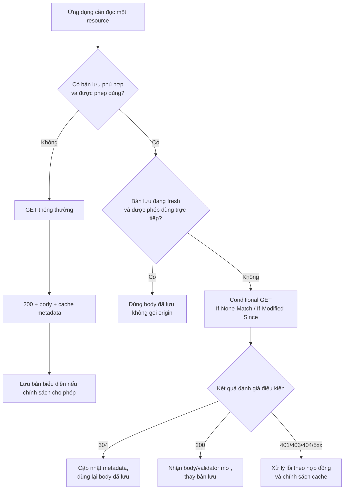
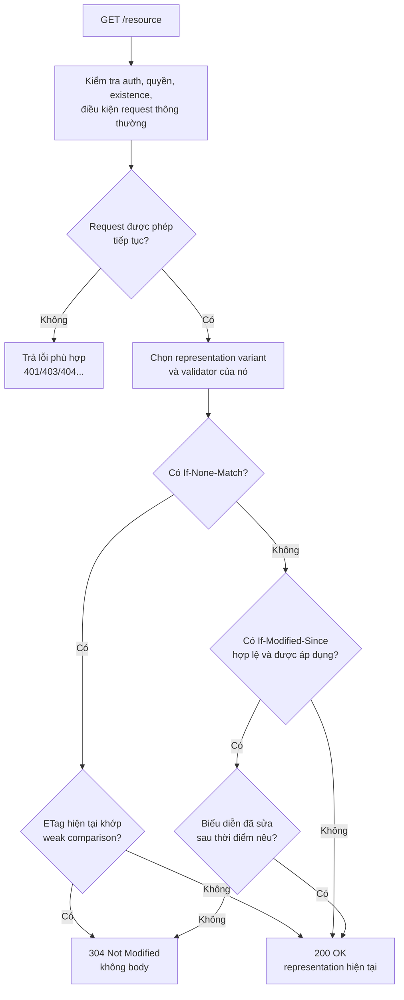
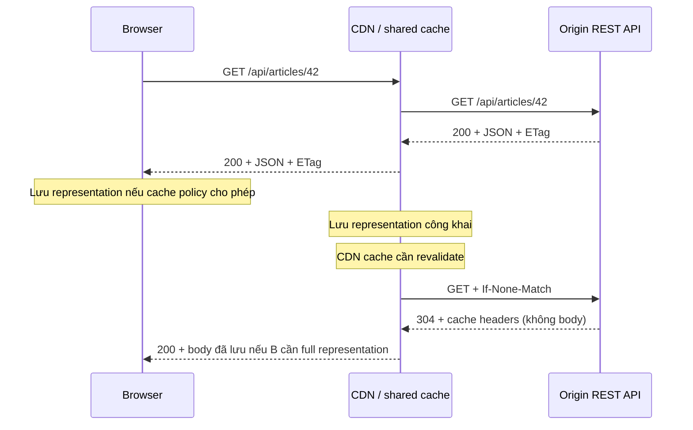

# If-None-Match, If-Modified-Since và phản hồi 304

> **Module:** INTEGRATION_API_REST — học thiết kế REST API dựa trên resource, URI, phương thức và mã trạng thái HTTP cùng hợp đồng dữ liệu rõ ràng. Người học thực hành phân trang, cache, idempotency, OpenAPI, xác thực, phân quyền, xử lý lỗi và kiểm thử API với Java/Spring hoặc công nghệ tương đương.  
> **Chương:** Bộ nhớ đệm.  
> **Mục tiêu bài học:** Hiểu và triển khai **cache revalidation** bằng `If-None-Match`, `If-Modified-Since` và `304 Not Modified`, từ vòng đời cache ở browser/CDN đến xử lý điều kiện trong REST API và kiểm thử hành vi khi dữ liệu đổi.

## 1. Bài toán: API bị gọi lặp lại dù dữ liệu ít thay đổi

Một ứng dụng tài liệu hiển thị thông tin bài viết:

```http
GET /api/articles/42 HTTP/1.1
Host: api.example.com
Accept: application/json
```

Lần đầu, API trả:

```http
HTTP/1.1 200 OK
Content-Type: application/json
Cache-Control: public, max-age=60, must-revalidate
ETag: W/"article-42-v7"
Last-Modified: Tue, 17 Nov 2026 08:00:00 GMT

{"id":42,"title":"Thiết kế REST API","version":7}
```

Nếu người dùng mở lại cùng bài viết trong vài phút, có ba khả năng:

1. **Bản lưu còn fresh:** cache có thể phục vụ trực tiếp nội dung đã lưu mà không cần liên hệ server.
2. **Bản lưu cần được xác thực lại, nội dung vẫn hợp lệ:** cache gửi một **conditional request**, server trả `304 Not Modified` không có body, cache tiếp tục dùng JSON cũ.
3. **Bản lưu không còn hợp lệ vì nội dung đổi:** server trả `200 OK` và biểu diễn mới; cache thay bản cũ.

Nếu bỏ cơ chế này, origin có thể lặp lại cùng công việc serialize và gửi payload lớn. Nếu triển khai sai, client có thể thấy nội dung đã lỗi thời, mất khả năng render vì 304 không mang body, hoặc tệ hơn là dùng chung dữ liệu giữa các tài khoản.

Bài học trả lời sáu câu hỏi:

- Khi nào client gửi `If-None-Match` hoặc `If-Modified-Since`?
- ETag khác gì Last-Modified, loại nào đáng tin cậy hơn trong từng tình huống?
- Nếu cả hai điều kiện xuất hiện thì điều kiện nào được ưu tiên?
- Phản hồi 304 có những header nào và cache dùng nó ra sao?
- Cần làm gì ở Spring MVC, reverse proxy, CDN và OpenAPI để hành vi thống nhất?
- Làm sao kiểm thử và quan sát mà không làm lộ dữ liệu riêng tư?

## 2. Hai khái niệm phải tách bạch: freshness và validation

### 2.1. Freshness: chưa cần gọi lại origin

Một phản hồi có thể được lưu cache và tái sử dụng trong thời gian phù hợp chính sách:

```http
Cache-Control: public, max-age=60
```

`max-age=60` cho biết thời gian được coi là **fresh** theo cơ chế tính tuổi cache của HTTP, không đơn thuần là “60 giây tính từ lúc JavaScript nhận body”. Cache tính tuổi từ metadata như `Date`, `Age` và các quy tắc lưu trữ.

Khi bản được phép lưu vẫn còn fresh, browser hoặc proxy có thể sử dụng ngay, **không có một GET mới đến origin**. Đây thường là cache hit có chi phí mạng thấp nhất.

### 2.2. Revalidation: hỏi xem bản cũ còn dùng được không

Khi bản lưu đã stale, hoặc chính sách yêu cầu kiểm tra trước mỗi lần tái sử dụng, cache gửi conditional request:

```http
GET /api/articles/42 HTTP/1.1
Host: api.example.com
If-None-Match: W/"article-42-v7"
```

Server so sánh validator với **biểu diễn hiện tại được chọn**:

- Nếu phù hợp với điều kiện `If-None-Match`, server trả **304**, không gửi lại JSON.
- Nếu không phù hợp, server trả **200** với JSON và validator hiện tại.

**304 tiết kiệm việc truyền body** nhưng vẫn thường tốn một lần round-trip HTTP và có thể cần xử lý server. Nó không tương đương với việc lấy bản fresh hoàn toàn tại browser.

### 2.3. Mô hình tổng quan



**Lưu ý:** sơ đồ mô tả trường hợp phổ biến. HTTP caching còn có các quy tắc về stale response, request directives, cache key, shared/private cache và các loại status khác; không phải mọi GET đều có thể lưu, cũng không phải mọi 304 đều áp dụng cho mọi bản cũ.

## 3. HTTP validator: cơ sở để xác thực lại

Một **validator** mô tả đặc điểm đủ để kiểm tra bản representation đang lưu có còn tương ứng với representation hiện tại không.

| Validator từ response | Điều kiện từ request | Ưu điểm | Giới hạn |
|---|---|---|---|
| `ETag` | `If-None-Match` | Nhận biết phiên bản/biểu diễn cụ thể; không phụ thuộc trực tiếp độ chính xác đồng hồ | Server phải sinh validator ổn định, nhất quán với body/variant |
| `Last-Modified` | `If-Modified-Since` | Dễ dùng khi dữ liệu có timestamp cập nhật đáng tin cậy | Thời điểm có độ chính xác giới hạn; cập nhật liên tiếp có thể trùng giây; clock skew |
| Cả hai | Client có thể gửi cả hai | Tương thích nhiều kiểu cache/client | **If-None-Match được ưu tiên** khi cùng hiện diện trong GET/HEAD |

Validator không phải “quyền truy cập”. ETag có chính xác cũng không cho phép người gọi vượt qua authentication, authorization hoặc chính sách lưu cache.

### 3.1. ETag: thẻ phiên bản của biểu diễn

Ví dụ:

```http
ETag: "article-42-v7"
```

Đây là chuỗi mờ đối với client. Server có thể dựa vào revision của record, fingerprint nội dung hoặc cách tạo khác. Với **strong ETag** không có tiền tố `W/`, những biểu diễn dùng cùng tag phải phù hợp quy tắc so sánh mạnh đối với bytes của representation được chọn.

Weak ETag có dạng:

```http
ETag: W/"article-42-v7"
```

Weak ETag nói rằng các biểu diễn có thể được coi là tương đương về **ngữ nghĩa**, dù bytes không nhất thiết trùng. Ví dụ server thay cách serialization nhưng nội dung có ý nghĩa cho client vẫn tương đương, tùy chính sách validator của API.

**Khi xác thực cache bằng `If-None-Match`**, HTTP sử dụng **weak comparison**. Vì vậy một validator trong request có thể phù hợp ngay cả khi là weak. Nhưng **`If-Match`** để bảo vệ cập nhật sử dụng strong comparison: không lấy weak ETag của một GET rồi giả định có thể dùng nó để kiểm soát mọi PUT/PATCH.

### 3.2. Những thay đổi nào cần cập nhật ETag?

Ví dụ cùng resource `/api/articles/42`:

| Thay đổi | Ảnh hưởng validator |
|---|---|
| Thay tiêu đề được trả trong JSON | Validator phải nhận diện biểu diễn mới |
| Thêm trường mới trong representation API | Phải xét tác động tới ETag và tương thích client |
| Chỉ cập nhật bản ghi nội bộ không ảnh hưởng representation | Weak validator có thể giữ nếu ngữ nghĩa không đổi |
| Thay ngôn ngữ `vi` sang `en` | Cần validator phù hợp từng variant và chính sách `Vary` |
| Server khác nhau trả biểu diễn có bytes khác nhau | Không tùy tiện gắn cùng một strong ETag |
| Response nén và không nén có bytes khác nhau | Strong ETag phải xử lý đúng khác biệt content coding |

Nếu ETag được tạo ngẫu nhiên ở mỗi request, revalidation hiếm khi cho 304. Nếu ETag chỉ lấy từ ID không đổi, server có thể trả 304 **sai** sau khi nội dung cập nhật. Hai lỗi này đều làm cơ chế cache thất bại theo cách khác nhau.

ETag **không nhất thiết** phải là hash mật mã, và client không có quyền suy ra trường dữ liệu nào trong token. Không đặt token truy cập, email hay dữ liệu nhạy cảm nguyên văn trong ETag.

### 3.3. Last-Modified: thời điểm chỉnh sửa cuối

Một response có thể chứa:

```http
Last-Modified: Tue, 17 Nov 2026 08:00:00 GMT
```

Khi cần revalidate mà không dùng ETag, client gửi:

```http
If-Modified-Since: Tue, 17 Nov 2026 08:00:00 GMT
```

Server xem biểu diễn có thay đổi sau mốc thời gian đó không. Nếu **không được sửa sau mốc**, đối với GET/HEAD phù hợp có thể trả `304`. Nếu có thay đổi mới hơn, trả representation mới.

HTTP date ở định dạng GMT có độ phân giải thường được biểu diễn đến **giây**. Nếu dữ liệu sửa hai lần trong cùng một giây, chỉ dùng Last-Modified có thể không phân biệt đủ. Cơ sở dữ liệu có timestamp nhiều chữ số thập phân nhưng HTTP date vẫn có giới hạn riêng.

Với nhiều node, đồng hồ lệch hoặc timestamp dựa trên giờ xử lý thay vì commit thực tế có thể khiến Last-Modified không đáng tin. Nếu resource thay đổi nhanh, **ưu tiên ETag được thiết kế đúng với representation**.

### 3.4. Có nên gửi cả ETag và Last-Modified?

Có thể. Ví dụ:

```http
HTTP/1.1 200 OK
Content-Type: application/json
Cache-Control: public, max-age=60, must-revalidate
ETag: W/"article-42-v7"
Last-Modified: Tue, 17 Nov 2026 08:00:00 GMT

{"id":42,"title":"Thiết kế REST API","version":7}
```

Client hiện đại thường dùng ETag, client khác có thể dùng Last-Modified. Server cần duy trì **cả hai cùng mô tả đúng một biểu diễn**. Nếu ETag nói version 8 trong khi Last-Modified vẫn phản ánh version 7 do cập nhật không chính xác, kết quả revalidation sẽ khó dự đoán và dễ gây lỗi dữ liệu cũ.

## 4. If-None-Match: kiểm tra biểu diễn có còn tương ứng không

### 4.1. Luồng GET có điều kiện

Sau khi nhận ETag `W/"article-42-v7"`, client gửi:

```http
GET /api/articles/42 HTTP/1.1
Host: api.example.com
Accept: application/json
If-None-Match: W/"article-42-v7"
```

Giả sử biểu diễn hiện tại vẫn tương ứng với revision 7:

```http
HTTP/1.1 304 Not Modified
Date: Wed, 18 Nov 2026 09:02:00 GMT
ETag: W/"article-42-v7"
Cache-Control: public, max-age=60, must-revalidate
```

**Không có body.** Client/cache đang có representation dùng body được lưu từ `200` trước đó và cập nhật metadata theo quy tắc HTTP caching.

Nếu hiện tại là revision 8, tag cũ không khớp:

```http
HTTP/1.1 200 OK
Date: Wed, 18 Nov 2026 09:05:00 GMT
Content-Type: application/json
Cache-Control: public, max-age=60, must-revalidate
ETag: W/"article-42-v8"
Last-Modified: Wed, 18 Nov 2026 09:04:00 GMT

{"id":42,"title":"Thiết kế REST API nâng cao","version":8}
```

Client lưu phiên bản mới. Lần sau sẽ sử dụng ETag `W/"article-42-v8"`.

### 4.2. Weak comparison của If-None-Match

Trên GET/HEAD, điều kiện `If-None-Match` sử dụng **so sánh yếu**. Nghĩa là phần định danh opaque tag có thể khớp khi một hoặc cả hai là weak, nếu quy tắc tương đương validator cho phép.

Ví dụ:

| ETag hiện tại | Header request | Có khớp cho If-None-Match GET? |
|---|---|---|
| `"v7"` | `If-None-Match: "v7"` | Có |
| `W/"v7"` | `If-None-Match: W/"v7"` | Có |
| `"v7"` | `If-None-Match: W/"v7"` | Có theo weak comparison |
| `W/"v7"` | `If-None-Match: "v7"` | Có theo weak comparison |
| `"v8"` | `If-None-Match: "v7"` | Không |

Một số client có nhiều representation đã lưu có thể gửi danh sách:

```http
If-None-Match: "v5", W/"v6", "v7"
```

Nếu **bất kỳ giá trị nào** khớp validator hiện tại theo quy tắc `If-None-Match`, precondition được xem là không đạt để truyền nội dung trên GET, và server có thể trả 304 theo các điều kiện còn lại.

### 4.3. If-None-Match: * có nghĩa gì?

Cú pháp:

```http
If-None-Match: *
```

kiểm tra **sự tồn tại của biểu diễn hiện tại**, không kiểm tra một revision cụ thể.

- Với GET/HEAD cho tài nguyên có biểu diễn hiện tại, điều kiện “none match” thất bại; nhánh kết quả thông thường là `304`.
- Với thao tác thay đổi trạng thái như PUT tạo ở URI biết trước, `If-None-Match: *` thường dùng để **chỉ tạo nếu chưa có biểu diễn hiện tại**; khi tài nguyên đã tồn tại, điều kiện thất bại thường dẫn tới **`412 Precondition Failed`**, không phải 304.

Cần đánh giá precondition theo ngữ nghĩa HTTP của **phương thức được gọi**. Không áp cùng quy tắc “khớp ETag thì trả 304” cho mọi method.

## 5. If-Modified-Since: xác thực dựa trên thời điểm

Ví dụ client đã lưu biểu diễn với:

```http
Last-Modified: Tue, 17 Nov 2026 08:00:00 GMT
```

Client gửi:

```http
GET /api/articles/42 HTTP/1.1
Host: api.example.com
If-Modified-Since: Tue, 17 Nov 2026 08:00:00 GMT
```

Nếu server đánh giá biểu diễn hiện tại không có thay đổi sau thời điểm đó, phản hồi thường là:

```http
HTTP/1.1 304 Not Modified
Date: Wed, 18 Nov 2026 09:07:00 GMT
Last-Modified: Tue, 17 Nov 2026 08:00:00 GMT
Cache-Control: public, max-age=60, must-revalidate
```

Nếu biểu diễn được sửa mới hơn:

```http
HTTP/1.1 200 OK
Content-Type: application/json
Last-Modified: Wed, 18 Nov 2026 09:06:00 GMT
Cache-Control: public, max-age=60, must-revalidate

{"id":42,"title":"Bài viết đã cập nhật"}
```

### 5.1. Những trường hợp cần thận trọng

- Nếu `If-Modified-Since` **không phải ngày HTTP hợp lệ**, server bỏ qua điều kiện đó thay vì đoán.
- Nếu cùng request có `If-None-Match`, server **bỏ qua `If-Modified-Since`** trong đánh giá GET/HEAD theo quy tắc ưu tiên.
- Nếu biểu diễn có thể cập nhật nhiều lần trong một giây, timestamp đơn thuần chưa đủ để tránh 304 sai.
- Nếu server không có `Last-Modified` đáng tin cậy hoặc không hỗ trợ cơ chế đó cho resource, đừng giả lập độ chính xác từ timestamp của cache hay từ giờ request.
- Mốc `Last-Modified` cần xuất phát từ dữ liệu hoặc phiên bản biểu diễn đã commit; không dùng thời điểm response được gửi như một “lần sửa” giả cho mọi request.

### 5.2. Không nhầm If-Modified-Since với If-Unmodified-Since

| Header | Ý định thường gặp | Phương thức điển hình | Khi điều kiện không đạt |
|---|---|---|---|
| `If-Modified-Since` | Tải lại nếu nội dung **đã đổi sau mốc** | GET/HEAD | `304` nếu chưa đổi và các điều kiện khác cho phép |
| `If-Unmodified-Since` | Chỉ thao tác nếu dữ liệu **chưa bị sửa sau mốc** | PUT/PATCH/DELETE hoặc request có điều kiện phù hợp | `412` nếu dữ liệu đã đổi |
| `If-None-Match` | Trên GET/HEAD: tái xác thực cache | GET/HEAD | `304` nếu tag khớp |
| `If-Match` | Bảo vệ cập nhật dựa vào strong validator | PUT/PATCH/DELETE | `412` nếu tag không khớp |

`If-Match` và `If-Unmodified-Since` liên quan optimistic concurrency; bài này tập trung revalidation nhưng cần phân biệt để không biến logic GET cache thành logic ghi dữ liệu.

## 6. Khi có cả If-None-Match và If-Modified-Since

Đây là quy tắc quan trọng cần ghi nhớ:

> Với GET/HEAD, **If-None-Match có ưu tiên cao hơn If-Modified-Since**. Khi request chứa If-None-Match, server bỏ qua If-Modified-Since trong việc quyết định có trả 304 hay không.

Ví dụ:

```http
GET /api/articles/42 HTTP/1.1
Host: api.example.com
If-None-Match: W/"article-42-v7"
If-Modified-Since: Wed, 18 Nov 2026 10:00:00 GMT
```

Giả sử biểu diễn hiện tại là revision 8, có Last-Modified 09:04 GMT. Theo timestamp, 09:04 không sau 10:00 và có thể khiến một logic tự viết kết luận nhầm “không thay đổi”. Nhưng **ETag v7 không khớp v8** nên server phải gửi **200 + biểu diễn v8** trong đường đi GET thông thường.

### 6.1. Bảng quyết định

Giả sử resource tồn tại, người gọi đủ quyền, không có precondition ưu tiên khác:

| `If-None-Match` | `If-Modified-Since` | Trạng thái hiện tại | Kết quả GET thường phù hợp |
|---|---|---|---|
| Không gửi | Không gửi | Có representation | `200 + body` |
| Khớp | Không gửi | ETag tương đương | `304` |
| Không khớp | Không gửi | ETag đã khác | `200 + body` |
| Không gửi | Hợp lệ, không có sửa mới hơn | Chưa đổi sau mốc | `304` |
| Không gửi | Hợp lệ, có sửa mới hơn | Đã đổi sau mốc | `200 + body` |
| Không khớp | Ngày cho kết quả “chưa sửa” | ETag không khớp | **`200 + body`** |
| Khớp | Ngày cho kết quả “đã sửa” | ETag khớp | **`304`** |
| Không gửi | Ngày sai định dạng | Bỏ qua điều kiện thời gian | `200 + body` |
| `*` | Bất kỳ | Có representation hiện tại | `304` cho GET/HEAD khi điều kiện áp dụng |

**Không so sánh chuỗi raw header theo kiểu `header.equals(etag)`.** Phải xét weak/strong comparison, danh sách tag, wildcard, thứ tự HTTP precondition và ngữ nghĩa của phương thức.

### 6.2. Sơ đồ luồng kiểm tra thường gặp



*Sơ đồ được giản lược cho conditional GET phổ biến. HTTP còn các precondition khác như If-Match/If-Unmodified-Since/If-Range, với thứ tự đánh giá tương ứng. Không dùng sơ đồ giản lược để thay thế toàn bộ thuật toán điều kiện của RFC 9110.*

## 7. 304 Not Modified thực sự có nghĩa gì?

`304 Not Modified` là một HTTP status thuộc nhóm 3xx, được dùng khi precondition trên GET/HEAD cho thấy **không cần chuyển lại representation** đối với client/cache đã có một bản phù hợp.

Các tính chất:

1. **304 không có message body.** Không thêm JSON `{"message":"unchanged"}` hay một body rỗng mang ý nghĩa nghiệp vụ khác.
2. **304 không phải redirect.** Nó không yêu cầu chuyển sang một URI đích như 301/302.
3. **304 không phải 204.** `204 No Content` nói thao tác hoàn tất nhưng response không mang nội dung; `304` nói về cơ chế điều kiện và tái sử dụng biểu diễn đã lưu.
4. **304 không thay quyền truy cập.** Kiểm tra quyền, trạng thái tài nguyên và điều kiện bảo mật vẫn phải đúng trước khi trả.
5. **304 không chứng minh nội dung không bao giờ đổi.** Nó chỉ cho biết validator phù hợp trong lần đánh giá hiện tại.
6. **304 không nhất thiết xuất hiện ở client cuối.** CDN có thể nhận 304 từ origin rồi trả 200 có body từ cache cho browser.

### 7.1. Các header cần bảo toàn trong 304

Server phải gửi những metadata cache phù hợp mà nó sẽ gửi khi trả 200 cho request tương đương, chẳng hạn khi áp dụng:

- `Date`
- `ETag`
- `Cache-Control`
- `Expires`
- `Vary`
- `Content-Location`

Các trường này giúp cache xác định **bản lưu nào** cần cập nhật và chính sách tái sử dụng tiếp theo. `304` không có content body, dù có thể có header mô tả metadata.

Ví dụ:

```http
HTTP/1.1 304 Not Modified
Date: Wed, 18 Nov 2026 09:10:00 GMT
Cache-Control: public, max-age=60, must-revalidate
ETag: W/"article-42-v7"
Vary: Accept-Language
```

Không dùng `Content-Type: application/json` để hợp thức hóa việc gửi JSON body trong phản hồi 304. Đối với 304, HTTP có những quy tắc riêng về content/framing; cách đơn giản và an toàn cho API là **không viết body**, để HTTP framework quản lý kết thúc response.

### 7.2. Cache nhận 304 rồi làm gì?

Giả sử cache có bản:

```text
Cache key: /api/articles/42 + variant theo Vary
Body:      {"id":42,"title":"Thiết kế REST API","version":7}
ETag:      W/"article-42-v7"
Age/state: cần revalidate
```

Khi nhận 304:

1. Cache tìm một hoặc nhiều **stored responses phù hợp** theo quy tắc validator và HTTP caching.
2. Cập nhật các header/metadata của bản lưu bằng thông tin hợp lệ từ 304.
3. Tiếp tục dùng **body đã lưu**, không yêu cầu 304 phải mang body.
4. Nếu sau cập nhật bản cache được phép sử dụng, có thể cung cấp representation cho consumer.

Nếu cache **không còn body thích hợp**, 304 không cung cấp đủ nội dung để render. Client cần lấy lại representation bằng GET không điều kiện hoặc dùng cơ chế cache hợp lệ khác.

### 7.3. 304 có giảm tải cho server không?

Thường **giảm bandwidth** do không gửi lại payload, nhưng không phải lúc nào cũng giảm CPU hoặc DB:

- Nếu server có ETag từ metadata nhẹ như revision, nó có thể tránh tải và serialize toàn bộ body.
- Nếu server phải chạy truy vấn phức tạp và serialize JSON để tính hash ETag, chi phí origin có thể gần bằng một request 200.
- Nếu CDN tự phục vụ bản fresh, origin không cần nhận request, lợi ích lớn hơn.
- Nếu client cứ gửi `Cache-Control: no-cache`, server sẽ nhận revalidation nhiều dù max-age dài.

Đo hiệu quả bằng **bytes transferred, origin request volume, latency và tài nguyên xử lý**, không chỉ bằng tỷ lệ response 304.

## 8. Vòng đời đầy đủ: 200 → fresh cache → 304 → 200 mới

Xét resource công khai `/api/articles/42`.

### Bước 1 — Lấy lần đầu

```http
GET /api/articles/42 HTTP/1.1
Host: api.example.com
Accept: application/json
```

```http
HTTP/1.1 200 OK
Date: Wed, 18 Nov 2026 09:00:00 GMT
Content-Type: application/json
Cache-Control: public, max-age=60, must-revalidate
ETag: "article-42-json-v7"
Last-Modified: Tue, 17 Nov 2026 08:00:00 GMT

{"id":42,"title":"REST caching","version":7}
```

Cache lưu body cùng validator và metadata nếu các điều kiện lưu trữ được thỏa mãn.

### Bước 2 — Cache vẫn fresh

Trong cửa sổ fresh, ứng dụng cần nội dung; cache có thể trả bản lưu **không tạo một request mới tới origin**. Trong developer tools có thể thấy một cache hit hoặc response được phục vụ từ cache tùy công cụ. Không có 304 ở origin vì không có revalidation xảy ra.

### Bước 3 — Cache cần revalidation

Khi stale hoặc chính sách yêu cầu xác thực lại:

```http
GET /api/articles/42 HTTP/1.1
Host: api.example.com
Accept: application/json
If-None-Match: "article-42-json-v7"
```

Response:

```http
HTTP/1.1 304 Not Modified
Date: Wed, 18 Nov 2026 09:02:00 GMT
Cache-Control: public, max-age=60, must-revalidate
ETag: "article-42-json-v7"
```

Cache cập nhật metadata và tái sử dụng JSON v7. Nếu ứng dụng dùng một HTTP cache tự động, nó có thể chỉ nhận **biểu diễn cuối cùng** thay vì phải tự ghép 304 với body.

### Bước 4 — Dữ liệu đã cập nhật

Tác giả sửa tiêu đề; representation trở thành v8. Client/cache gửi validator v7:

```http
GET /api/articles/42 HTTP/1.1
Host: api.example.com
If-None-Match: "article-42-json-v7"
```

Response:

```http
HTTP/1.1 200 OK
Content-Type: application/json
Cache-Control: public, max-age=60, must-revalidate
ETag: "article-42-json-v8"
Last-Modified: Wed, 18 Nov 2026 09:04:00 GMT

{"id":42,"title":"REST caching nâng cao","version":8}
```

Cache thay bản cũ bằng representation v8 theo chính sách. Nếu ứng dụng cần luôn thấy dữ liệu mới ngay khi cập nhật, thời gian fresh `max-age=60` có thể không phù hợp: cần chọn TTL và invalidation/revalidation theo yêu cầu nghiệp vụ, không mặc định rằng tồn tại ETag sẽ khiến bản đã được cache tự cập nhật ngay.

## 9. Cache-Control quyết định khi nào dùng validator

`Cache-Control` và validator làm việc cùng nhau nhưng giải quyết **hai câu hỏi khác nhau**:

- `Cache-Control`: có được lưu không, cache nào được phép lưu, khi nào có thể dùng mà không liên hệ origin?
- `ETag`/`Last-Modified`: khi cần hỏi lại, bản lưu có còn tương ứng với representation hiện tại không?

### 9.1. Chỉ thị thường gặp

| Chỉ thị | Ý nghĩa đối với cache | Quan hệ với 304 |
|---|---|---|
| `public` | Cho phép shared cache lưu nếu thỏa các điều kiện HTTP liên quan | Có thể revalidate qua CDN/origin |
| `private` | Không cho shared cache lưu, cache riêng có thể lưu | Browser có thể dùng validator để revalidate |
| `no-store` | Không được lưu request/response theo phạm vi áp dụng | Không thiết kế tái sử dụng body đã lưu qua cơ chế cache thông thường |
| `no-cache` | **Được phép lưu**, nhưng phải xác thực thành công với origin trước khi dùng lại | Hay dẫn tới conditional GET và 304 |
| `max-age=60` | Cho phép fresh trong khoảng theo tuổi cache tính từ metadata | Không cần revalidate nếu còn fresh và không có điều kiện khác |
| `s-maxage=300` | Freshness riêng cho shared cache | CDN có thể lưu lâu hơn browser nếu chính sách phù hợp |
| `must-revalidate` | Khi stale, cache không được dùng lại nếu chưa xác thực theo quy tắc | Cần kiểm tra với origin trước reuse |
| `immutable` | Response còn fresh được coi là không đổi | Giảm nhu cầu revalidate trong thời hạn fresh, hợp với asset có URL hash |
| `stale-while-revalidate=30` | Trong điều kiện được hỗ trợ, cho phép dùng bản stale trong khi revalidate bất đồng bộ | Đánh đổi độ mới để giảm latency; phải xét bảo mật và SLO |

**Hai nhầm lẫn cần loại bỏ:**

- `Cache-Control: no-cache` **không phải** “cấm lưu”. Nó yêu cầu revalidate trước reuse.
- `Cache-Control: no-store` **không đảm bảo xóa sạch** bản đã tồn tại hoặc ngăn mọi khả năng ghi ngoài HTTP cache; nhưng nó yêu cầu các cache tuân chuẩn không lưu đối tượng theo chỉ thị phù hợp. Với dữ liệu nhạy cảm, không dựa vào directive này như biện pháp bảo mật duy nhất.

### 9.2. Ví dụ chọn chính sách

| Endpoint | Chính sách minh họa | Lý do |
|---|---|---|
| `GET /api/articles/42` công khai | `public, max-age=60, must-revalidate` + ETag | Tin tức/bài viết đổi không quá thường xuyên |
| `GET /api/catalog` công khai | `public, max-age=30, s-maxage=120` + validator | Cho phép shared cache khác browser theo yêu cầu |
| `GET /api/me` cá nhân | `private, no-cache` + ETag nếu rủi ro phù hợp | Cache riêng vẫn có thể revalidate; không lưu shared |
| `GET /api/payment-methods` nhạy cảm | `no-store` | Tránh lưu thông tin tài chính |
| Asset có tên chứa content hash | `public, max-age=31536000, immutable` | URL đổi khi nội dung đổi, ít cần revalidation |

Đây là các **chính sách ví dụ**, không phải quy tắc bắt buộc cho mọi nghiệp vụ. Với API có cookie, `Authorization` header, dữ liệu tenant, thay đổi quyền hoặc nội dung theo phiên, phải kiểm tra chính xác điều kiện shared caching. **Không bật `public` cho dữ liệu người dùng chỉ để tăng hit rate.**

### 9.3. Client chủ động buộc xác thực

Một request có thể chứa chỉ thị:

```http
GET /api/articles/42 HTTP/1.1
Cache-Control: no-cache
```

Nó yêu cầu cache revalidate trước khi sử dụng bản lưu, tùy khả năng và chính sách cache. Trình duyệt hoặc proxy có thể thêm conditional headers nếu đang có validator.

Điều này khác với response `Cache-Control: no-cache` mà origin phát hành để nói bản lưu cần xác thực trước mọi lần dùng. Phân biệt rõ **request directive** với **response directive**.

## 10. Vary và nhiều representation của cùng resource

Một resource có thể trả nhiều representation phụ thuộc:

- `Accept: application/json` so với `Accept: application/xml`.
- `Accept-Language: vi` so với `Accept-Language: en`.
- `Accept-Encoding: gzip` so với biểu diễn không nén.
- Những header khác ảnh hưởng lựa chọn biểu diễn.

Nếu cache chỉ nhìn URI, nó có thể dùng nhầm bản ngôn ngữ, định dạng hoặc mức nén. `Vary` cho cache biết các header request liên quan đến việc chọn representation.

### 10.1. Ví dụ đa ngôn ngữ

Response cho tiếng Việt:

```http
HTTP/1.1 200 OK
Content-Type: application/json
Content-Language: vi
Vary: Accept-Language
ETag: W/"article-42-vi-v7"
Cache-Control: public, max-age=60

{"id":42,"title":"Thiết kế REST API"}
```

Response cho tiếng Anh:

```http
HTTP/1.1 200 OK
Content-Type: application/json
Content-Language: en
Vary: Accept-Language
ETag: W/"article-42-en-v7"
Cache-Control: public, max-age=60

{"id":42,"title":"REST API Design"}
```

Nếu tiếng Anh có ETag khác, client gửi ETag tiếng Việt trong request tiếng Anh sẽ **không được dùng sai representation** để tạo 304. Server phải chọn variant theo header trước khi so sánh validator.

### 10.2. Strong ETag và content coding

Khi server trả `Content-Encoding: gzip`, các bytes biểu diễn khác với bản không nén. Không được gắn cùng một **strong ETag** cho những biểu diễn có bytes khác nhau trong điều kiện mà HTTP yêu cầu so sánh mạnh. Có thể dùng validator riêng cho từng content coding hoặc weak ETag được thiết kế đúng semantics.

Cache và CDN còn cần biết `Vary: Accept-Encoding` hoặc các cơ chế quản lý biến thể liên quan. Trong thực tế framework/proxy có thể tự xử lý nén; việc gắn ETag ở ứng dụng trước khi response bị proxy chuyển mã cần được kiểm tra end-to-end.

### 10.3. Query string và cache key

`GET /api/articles?tag=java` và `GET /api/articles?tag=spring` là hai target URI khác nhau. Khi cache được phép lưu, query parameters ảnh hưởng representation phải được đưa vào cache key phù hợp.

Đặc biệt trong API phân trang:

```text
GET /api/orders?status=PAID&cursor=A
GET /api/orders?status=PAID&cursor=B
```

là hai trang khác nhau. Không dùng cùng một bản cache chỉ vì chúng có cùng path `/api/orders`. Với dữ liệu riêng theo tenant, còn phải hạn chế shared caching và xác thực quyền ở mỗi request, bất kể URI hay cursor.

## 11. Browser cache, CDN và origin: 304 có thể xuất hiện ở đâu?



Một trường hợp đáng chú ý:

- **Origin log:** `304` vì CDN revalidate và body không cần truyền lại từ origin.
- **CDN log:** origin 304, client 200.
- **Browser:** có thể nhận 200 với body từ CDN, không bao giờ thấy 304 origin.

Vì vậy phải chỉ rõ **tầng** khi báo cáo tỷ lệ 304. “Có nhiều 304 ở origin” chưa đủ kết luận browser tải ít dữ liệu hay trải nghiệm nhanh.

### 11.1. Điều gì xảy ra khi bản cache stale?

Nếu CDN không thể revalidate vì origin lỗi, việc dùng bản stale phụ thuộc chính sách và các điều kiện HTTP caching (`must-revalidate`, `stale-if-error` khi có hỗ trợ, v.v.). Không mặc định CDN luôn trả dữ liệu cũ khi origin `503`.

Với dữ liệu có yêu cầu nhất quán hoặc bảo mật nghiêm ngặt, serving stale có thể không được chấp nhận. Cần thỏa thuận thời gian dữ liệu cũ tối đa với product/security và kiểm thử các tình huống outage.

### 11.2. Khi cache nhận 304 nhưng không có body

Nếu CDN hoặc client mất stored response và chỉ còn một ETag ở một tầng khác, nó không thể tạo payload từ 304. Giải pháp là lấy representation đầy đủ bằng GET không có điều kiện tương ứng. Các cache tuân chuẩn phải ghép đúng response dựa trên validator và metadata, không trả một body rỗng như thành công dữ liệu.

### 11.3. Invalidations và thời gian hiển thị nội dung mới

Nếu server cập nhật article từ v7 sang v8 trong khi browser giữ bản `max-age=60` còn fresh, browser **có thể tiếp tục dùng v7** cho tới khi freshness hết hoặc có sự kiện buộc revalidation. ETag không tự chủ động thông báo mọi thay đổi.

Nếu nghiệp vụ cần cập nhật ngay, cân nhắc TTL ngắn, chủ động cache invalidation, push event hoặc mô hình dữ liệu real-time phù hợp. Mỗi cách có chi phí và độ phức tạp riêng.

## 12. Bảo mật: không dùng 304 để bỏ qua phân quyền

### 12.1. Conditional request vẫn là request cần auth

Giả sử client đã từng có quyền xem:

```http
GET /api/customers/17 HTTP/1.1
Authorization: Bearer <token-A>
If-None-Match: "customer-17-v5"
```

Sau đó quyền bị thu hồi. Server **không được trả 304** chỉ vì ETag khớp mà chưa kiểm tra danh tính và quyền hiện tại. Một luồng xử lý an toàn:

1. Kiểm tra authentication và resource scope/tenant.
2. Kiểm tra authorization với tài nguyên hiện tại.
3. Chọn representation mà caller được phép thấy.
4. Chỉ sau đó mới đánh giá validator cache.
5. Trả `401`, `403`, `404` hoặc `304/200` theo ngữ nghĩa và chính sách quyền.

Nếu cache đã lưu response riêng và người dùng đã mất quyền, việc invalidation ở client có thể là vấn đề riêng; **đừng dùng ETag như quyền truy cập**.

### 12.2. Phân biệt private cache và shared cache

`Cache-Control: private` giúp ngăn shared caches lưu response. `no-store` thắt chặt hơn khi không được lưu response. Chọn dựa vào mức độ nhạy cảm và UX.

Với response cho một request có `Authorization` header, HTTP caching có hạn chế đối với shared cache, trừ khi xuất hiện những directive phù hợp cho phép lưu trữ theo tiêu chuẩn. **Không giả định mọi response có Authorization đều tự động an toàn trong CDN**, đặc biệt khi cấu hình cache key khác nhau theo nhà cung cấp.

Các rủi ro phổ biến:

- CDN cache chung theo path nhưng response thay đổi theo cookie/session/tenant.
- `ETag` được tái sử dụng cho hai người dùng nhưng body khác nhau.
- `Vary` không bao phủ header thật sự ảnh hưởng representation.
- 304 được trả trước authorization hoặc dựa trên bản dữ liệu của tenant khác.
- Body được phục vụ từ cache ngoài chính sách phân quyền của hệ thống.

### 12.3. ETag, tracking và riêng tư

ETag có thể được lưu lâu và xuất hiện trong request lặp lại. Tránh sử dụng giá trị duy nhất cho từng người như một cơ chế theo dõi không phù hợp; tránh nhúng email, tenant identifier nhạy cảm hoặc token trực tiếp vào tag.

Logs và traces cũng cần redaction. Hệ thống có thể ghi nhận `304`, cache hit và latency mà không lưu toàn bộ `Authorization`, cookie hoặc dữ liệu trả về.

## 13. Triển khai conditional GET với Java/Spring MVC

Spring MVC có hỗ trợ đánh giá conditional request thông qua `WebRequest.checkNotModified(...)`. Ví dụ dưới đây sử dụng resource bài viết **công khai** để tập trung vào revalidation; không dùng như mẫu cho dữ liệu khách hàng riêng tư nếu chưa thay đổi cache policy và kiểm tra quyền.

### 13.1. Controller dùng ETag và Last-Modified

```java
import jakarta.servlet.http.HttpServletResponse;
import org.springframework.http.HttpHeaders;
import org.springframework.http.MediaType;
import org.springframework.http.ResponseEntity;
import org.springframework.web.bind.annotation.GetMapping;
import org.springframework.web.bind.annotation.PathVariable;
import org.springframework.web.bind.annotation.RestController;
import org.springframework.web.context.request.WebRequest;

@RestController
public class PublicArticleController {
    private final ArticleQueryService articles;

    public PublicArticleController(ArticleQueryService articles) {
        this.articles = articles;
    }

    @GetMapping(
        path = "/api/articles/{id}",
        produces = MediaType.APPLICATION_JSON_VALUE
    )
    public ResponseEntity<ArticleDto> getArticle(
            @PathVariable long id,
            WebRequest request,
            HttpServletResponse response) {

        // Bảo đảm bài đã công khai và tồn tại trước khi xét validator.
        // Nếu không có quyền/trạng thái hợp lệ, service xử lý lỗi riêng.
        ArticleSnapshot snapshot = articles.findPublished(id);

        // Ví dụ weak ETag: revision thay đổi khi representation đổi.
        String etag = "W/\"article-" + snapshot.id()
                + "-v" + snapshot.version() + "\"";
        long lastModified = snapshot.updatedAt().toEpochMilli();

        // Đặt metadata cache trước checkNotModified để
        // phản hồi 304 cũng có Cache-Control.
        response.setHeader(
                HttpHeaders.CACHE_CONTROL,
                "public, max-age=60, must-revalidate"
        );

        // Spring xử lý If-None-Match / If-Modified-Since,
        // bao gồm thứ tự ưu tiên và thiết lập status/validator.
        if (request.checkNotModified(etag, lastModified)) {
            return null; // Response đã được framework chuẩn bị; không body.
        }

        // Chỉ trả body khi cần representation mới.
        return ResponseEntity.ok()
                .eTag(etag)
                .lastModified(lastModified)
                .body(snapshot.view());
    }
}
```

**Các giả định:**

- `ArticleQueryService`, `ArticleSnapshot`, `ArticleDto` là kiểu do ứng dụng định nghĩa. `ArticleSnapshot` chứa ID, version, updatedAt và phương thức lấy DTO.
- `findPublished` trả tài nguyên có thể xem, nếu không thì phát sinh lỗi được ánh xạ thành HTTP status phù hợp, không trả một bản dữ liệu chưa công bố rồi mới xem ETag.
- `snapshot.version()` phản ánh mọi thay đổi có ảnh hưởng tới representation, kể cả các field sinh/derived được xuất ra.
- Dùng **weak** ETag vì ví dụ chỉ cam kết cùng revision tương ứng cùng ngữ nghĩa dữ liệu, không cam kết từng byte JSON và content coding không thay đổi.
- Đoạn code là minh họa Spring MVC, cần có lớp service/DTO/config/test phù hợp và test header/status ở version Spring được sử dụng.
- Với response có nhiều variant theo ngôn ngữ/media type, phải chọn variant trước, sinh ETag phù hợp và thêm `Vary` thích hợp.
- `return null` chỉ dùng sau khi `WebRequest.checkNotModified` đã thiết lập phản hồi phù hợp. **Không thay** bằng `ResponseEntity.ok().body(null)` vì có thể biến 304 thành 200 body rỗng.

### 13.2. Tối ưu không phải load toàn bộ body trước khi so sánh

Một implementation kém hiệu quả có thể:

1. Query hàng chục bảng.
2. Build DTO lớn.
3. Serialize JSON để hash.
4. Mới so sánh ETag và trả 304.

Nó giảm bandwidth nhưng có thể vẫn tiêu tốn database/CPU. Cách tối ưu khi mô hình cho phép:

```text
Request
  -> Auth/resource existence/variant
  -> Đọc metadata version/updatedAt nhẹ
  -> Tính ETag / đánh giá điều kiện
       Nếu 304: kết thúc không body
       Nếu 200: tải dữ liệu đầy đủ, build DTO, serialize JSON
```

**Rủi ro TOCTOU (time-of-check/time-of-use):** nếu version thay đổi giữa lúc đọc metadata và lúc dựng body, ETag trả về có thể mô tả v7 nhưng JSON là v8. Cần giải quyết bằng snapshot nhất quán, transaction/isolation phù hợp, cache object bất biến hoặc cách đọc version cùng dữ liệu. Một response 200 có ETag không tương ứng body là lỗi cache nghiêm trọng.

### 13.3. Có nên trả 304 cho HEAD?

`HEAD` sử dụng metadata tương ứng với GET nhưng không chuyển body. Khi GET route được framework hỗ trợ HEAD theo quy tắc MVC, conditional HEAD có thể dẫn đến `304` nếu validator khớp. Cần kiểm thử theo version framework thực tế; cả `200` của HEAD lẫn `304` đều không có body.

Đừng viết controller riêng cho HEAD chỉ để trả JSON null rồi bỏ qua ETag/Last-Modified nếu bạn muốn client dùng metadata để revalidate.

### 13.4. Nếu API dùng strong ETag

Nếu sinh ETag bằng hash trên bytes của representation, cần xem xét:

- Hash được tính ở bước nào, với encoding và nén nào?
- Content negotiation tạo những variant nào?
- Framework/proxy có thay đổi bytes sau khi ETag được sinh không?
- Có cùng kết quả giữa các instance không?
- Chi phí serialize/hash có khiến 304 mất lợi ích không?

Nếu không thể đảm bảo strong semantics, dùng weak ETag phù hợp cho cache revalidation có thể chính xác hơn việc gắn một tag “strong” trên một revision chưa tương ứng bytes.

## 14. Kiểm thử giao thức với curl

**Lưu ý:** `curl` không tự mặc định vận hành như một browser cache đầy đủ chỉ bằng các ví dụ dưới đây. Dùng nó để **chủ động gửi điều kiện và quan sát response HTTP**.

### 14.1. Lấy ETag và Last-Modified

```bash
curl -i "https://api.example.com/api/articles/42"
```

Giả sử nhận:

```http
HTTP/2 200
content-type: application/json
etag: W/"article-42-v7"
last-modified: Tue, 17 Nov 2026 08:00:00 GMT
cache-control: public, max-age=60, must-revalidate

{"id":42,"title":"Thiết kế REST API","version":7}
```

### 14.2. Gửi If-None-Match hiện tại

```bash
curl -i \
  -H 'If-None-Match: W/"article-42-v7"' \
  "https://api.example.com/api/articles/42"
```

Nếu resource chưa đổi:

```http
HTTP/2 304
etag: W/"article-42-v7"
cache-control: public, max-age=60, must-revalidate
```

Không có body. Nếu đã sang v8, nhận 200 với JSON mới.

### 14.3. Gửi If-Modified-Since

```bash
curl -i \
  -H 'If-Modified-Since: Tue, 17 Nov 2026 08:00:00 GMT' \
  "https://api.example.com/api/articles/42"
```

Kỳ vọng 304 nếu dữ liệu không được sửa sau mốc và không có điều kiện ưu tiên cao hơn; 200 nếu dữ liệu đã sửa.

### 14.4. Gửi cả hai để thử độ ưu tiên

```bash
curl -i \
  -H 'If-None-Match: W/"article-42-v6"' \
  -H 'If-Modified-Since: Wed, 18 Nov 2026 10:00:00 GMT' \
  "https://api.example.com/api/articles/42"
```

Nếu hiện tại là v7, **ETag v6 không khớp**, server phải trả **200** dù ngày gửi có thể gợi ý 304. Đây là test quan trọng để tìm implementation tự viết thứ tự sai.

### 14.5. Gửi HEAD có điều kiện

```bash
curl -I \
  -H 'If-None-Match: W/"article-42-v7"' \
  "https://api.example.com/api/articles/42"
```

Kiểm tra status và validator; không kỳ vọng body.

## 15. Kiểm thử với Spring MockMvc

### 15.1. Kiểm thử hợp đồng HTTP

Mẫu test dưới đây giả định ứng dụng có `PublicArticleController` và fixture bài 42 đang ở revision 7. **Không phải bằng chứng test đã chạy**; cần cung cấp database fixture, service, Spring security setup và cấu hình test phù hợp.

```java
import org.junit.jupiter.api.Test;
import org.springframework.beans.factory.annotation.Autowired;
import org.springframework.boot.test.autoconfigure.web.servlet.AutoConfigureMockMvc;
import org.springframework.boot.test.context.SpringBootTest;
import org.springframework.http.HttpHeaders;
import org.springframework.test.web.servlet.MockMvc;

import static org.springframework.test.web.servlet.request.MockMvcRequestBuilders.*;
import static org.springframework.test.web.servlet.result.MockMvcResultMatchers.*;

@SpringBootTest
@AutoConfigureMockMvc
class ArticleCacheContractTest {

    @Autowired
    MockMvc mvc;

    @Test
    void normalGetReturnsBodyAndValidators() throws Exception {
        mvc.perform(get("/api/articles/42"))
            .andExpect(status().isOk())
            .andExpect(header().exists(HttpHeaders.ETAG))
            .andExpect(header().exists(HttpHeaders.LAST_MODIFIED))
            .andExpect(header().exists(HttpHeaders.CACHE_CONTROL))
            .andExpect(jsonPath("$.id").value(42));
    }

    @Test
    void matchingEtagReturns304WithoutBody() throws Exception {
        mvc.perform(get("/api/articles/42")
                .header(HttpHeaders.IF_NONE_MATCH, "W/\"article-42-v7\""))
            .andExpect(status().isNotModified())
            .andExpect(header().string(
                    HttpHeaders.ETAG, "W/\"article-42-v7\""))
            .andExpect(content().string(""));
    }

    @Test
    void staleEtagReturns200WithNewRepresentation() throws Exception {
        mvc.perform(get("/api/articles/42")
                .header(HttpHeaders.IF_NONE_MATCH, "W/\"article-42-v6\""))
            .andExpect(status().isOk())
            .andExpect(header().string(
                    HttpHeaders.ETAG, "W/\"article-42-v7\""))
            .andExpect(jsonPath("$.version").value(7));
    }

    @Test
    void ifNoneMatchOverridesIfModifiedSince() throws Exception {
        mvc.perform(get("/api/articles/42")
                .header(HttpHeaders.IF_NONE_MATCH, "W/\"article-42-v6\"")
                .header(HttpHeaders.IF_MODIFIED_SINCE,
                        "Wed, 18 Nov 2026 10:00:00 GMT"))
            .andExpect(status().isOk())
            .andExpect(jsonPath("$.version").value(7));
    }

    @Test
    void conditionalHeadDoesNotReturnBody() throws Exception {
        mvc.perform(head("/api/articles/42")
                .header(HttpHeaders.IF_NONE_MATCH, "W/\"article-42-v7\""))
            .andExpect(status().isNotModified())
            .andExpect(content().string(""));
    }
}
```

Để xác minh Last-Modified, dùng fixture có thời điểm cập nhật xác định và kiểm tra cả nhánh `If-Modified-Since` trước/sau mốc. Với nhiều node hoặc các variant khác nhau, cần thêm integration tests vượt qua HTTP layer, proxy và CDN tương ứng.

### 15.2. Ma trận test nên có

| Test ID | Chuẩn bị và request | Kết quả kỳ vọng |
|---|---|---|
| CACHE-01 | GET lần đầu, không có điều kiện | 200, body, ETag/Last-Modified và chính sách cache |
| CACHE-02 | GET với `If-None-Match` hiện tại | 304, **không body** |
| CACHE-03 | GET với ETag đã cũ | 200 + body và validator mới |
| CACHE-04 | GET với `If-Modified-Since` hợp lệ, không sửa sau mốc | 304 nếu điều kiện áp dụng |
| CACHE-05 | GET với `If-Modified-Since` trước lần sửa mới | 200 + body |
| CACHE-06 | Có cả hai header, ETag cũ, ngày cho kết quả “chưa sửa” | 200 theo If-None-Match |
| CACHE-07 | Nhiều ETag trong `If-None-Match` | 304 nếu có một tag phù hợp |
| CACHE-08 | Weak/strong tag có cùng opaque value | Khớp cho If-None-Match GET theo weak comparison |
| CACHE-09 | ETag `*`, resource tồn tại | 304 cho GET theo điều kiện HTTP |
| CACHE-10 | Resource không tồn tại | 404 theo API, không trả 304 giả |
| CACHE-11 | Caller không có quyền nhưng biết ETag | Không trả 304 để bỏ qua auth/authorization |
| CACHE-12 | HEAD với ETag hợp lệ | Phản hồi điều kiện đúng, body rỗng |
| CACHE-13 | Sửa representation, không tăng ETag | Test phải phát hiện lỗi version/validator |
| CACHE-14 | Hai variant ngôn ngữ | `Vary` và ETag không làm dùng sai variant |
| CACHE-15 | Nén và không nén | Không tái sử dụng sai strong validator/representation |
| CACHE-16 | Cache không còn body nhưng vẫn còn ETag | Client lấy lại bản 200 đầy đủ |
| CACHE-17 | Response 304 từ origin qua CDN | CDN cập nhật metadata và phục vụ body đúng |
| CACHE-18 | Chính sách `no-store` | Không dùng lại body theo cơ chế cache thông thường |
| CACHE-19 | `Cache-Control: no-cache` | Cache được lưu nhưng phải revalidate trước reuse |
| CACHE-20 | Request có `If-Match`/PUT thất bại | `412`, không trả 304 và không ghi đè dữ liệu |

Một test `status().isNotModified()` chưa đủ nếu body vẫn được ghi hoặc cache metadata mất. Test phải kiểm tra status line, header và body cùng lúc.

## 16. OpenAPI: mô tả conditional GET và 304

Ví dụ tài liệu OpenAPI 3.0.3 cho resource article công khai:

```yaml
openapi: 3.0.3
info:
  title: Public Articles API
  version: 1.0.0
paths:
  /api/articles/{id}:
    get:
      summary: Lấy bài viết có hỗ trợ cache revalidation
      description: >
        Client có thể gửi If-None-Match hoặc If-Modified-Since
        khi có bản biểu diễn đã lưu. Khi validator phù hợp,
        server trả 304 không có body.
      parameters:
        - name: id
          in: path
          required: true
          schema:
            type: integer
            format: int64
        - name: If-None-Match
          in: header
          required: false
          description: Một hoặc nhiều entity tags đã lưu
          schema:
            type: string
        - name: If-Modified-Since
          in: header
          required: false
          description: Ngày sửa cuối của bản biểu diễn đã lưu
          schema:
            type: string
      responses:
        '200':
          description: Trả representation hiện tại
          headers:
            ETag:
              schema: {type: string}
            Last-Modified:
              schema: {type: string}
            Cache-Control:
              schema: {type: string}
          content:
            application/json:
              schema:
                type: object
                properties:
                  id:
                    type: integer
                  title:
                    type: string
                  version:
                    type: integer
        '304':
          description: >
            Biểu diễn chưa thay đổi theo validator;
            cache có thể dùng lại bản đã lưu; response không có body.
          headers:
            ETag:
              schema: {type: string}
            Cache-Control:
              schema: {type: string}
            Last-Modified:
              schema: {type: string}
        '404':
          description: Không tìm thấy resource
```

**Lưu ý:**

- `304` **không khai báo `content`**: không có body JSON để client parse.
- `200` và `304` dùng các header validator nhất quán với representation đã chọn.
- Một số SDK sinh từ OpenAPI có thể không tự quản lý HTTP cache hoặc ghép body cũ với 304. Client cần HTTP cache phù hợp hoặc logic riêng giữ body và validator.
- Nếu API có representation private, bổ sung security scheme và mô tả cache policy; không dùng template công khai `Cache-Control: public` cho dữ liệu cá nhân.

## 17. Những phản mẫu thường gặp

### 17.1. Trả 304 ngay khi request có If-None-Match

**Sai:** server thấy header `If-None-Match` và trả 304 mà không kiểm tra giá trị đối với representation hiện tại.

**Đúng:** chỉ trả 304 cho GET/HEAD khi precondition phù hợp sau khi xử lý auth, quyền và lựa chọn representation.

### 17.2. Trả body JSON trong 304

```http
HTTP/1.1 304 Not Modified
Content-Type: application/json

{"message":"Nothing changed"}
```

Sai ngữ nghĩa HTTP. `304` không mang body; client dùng body cũ đã lưu. Nếu cần thông điệp nghiệp vụ, chọn một response khác phù hợp.

### 17.3. Đánh đồng no-cache với no-store

`no-cache` vẫn cho phép lưu, nhưng cần revalidate; `no-store` yêu cầu không lưu theo phạm vi áp dụng. Nhầm hai chỉ thị dẫn đến giảm hiệu năng hoặc làm lộ dữ liệu.

### 17.4. Ưu tiên ngày thay vì ETag

Khi cả `If-None-Match` và `If-Modified-Since` hiện diện, server phải ưu tiên ETag. Trả 304 theo ngày dù ETag khác là lỗi nghiêm trọng có thể khiến client giữ body cũ.

### 17.5. ETag không đổi dù representation đổi

Server chỉ lấy `id` làm ETag hoặc quên tăng revision khi có dữ liệu derived thay đổi. Client giữ cache cũ ngay cả sau khi bài viết thay đổi.

### 17.6. ETag đổi ngẫu nhiên ở từng request

Mỗi lần GET lại sinh UUID mới. Tác động: client hầu như không bao giờ nhận 304 dù body không đổi. ETag phải ổn định theo representation.

### 17.7. Không xét variant khi cache

API trả tiếng Việt và tiếng Anh nhưng không có `Vary`, hoặc gắn cùng strong ETag cho bytes khác nhau. CDN/trình duyệt có thể dùng nhầm bản hoặc quyết định 304 sai.

### 17.8. Không kiểm tra authorization trước 304

Server so ETag trước khi kiểm tra quyền, làm lộ sự tồn tại hoặc trạng thái tài nguyên; client từng có quyền vẫn có thể được khuyến khích dùng bản đã lưu dù quyền bị thu hồi. Authorization luôn áp dụng theo request hiện tại.

### 17.9. Client có ETag nhưng không còn body

Ứng dụng lưu ETag ở storage khác và xóa JSON cũ, nhưng tiếp tục gửi `If-None-Match`. 304 không đủ nội dung để render. Phải GET lại không điều kiện khi không còn representation tương ứng.

### 17.10. Bỏ qua cache metadata trong 304

Origin trả `304` nhưng không giữ `ETag`, `Cache-Control` hoặc `Vary` cần thiết theo response tương đương, khiến cache cập nhật sai hoặc liên tục revalidate. Framework/proxy cần được test end-to-end.

### 17.11. Nghĩ rằng 304 tự sửa mọi vấn đề latency

Khi server vẫn phải query nặng hoặc băm payload lớn, 304 chủ yếu tiết kiệm bandwidth. Để giảm origin load, cần tối ưu validator, freshness và CDN hợp lý.

### 17.12. Đo cache hit rate mà không nói tầng

Origin nhìn thấy 304, browser nhìn thấy 200, CDN trả cache hit. Nếu dashboard không phân biệt những tầng này, nhóm có thể quyết định TTL/chi phí sai.

## 18. Quan sát và tối ưu hiệu quả cache

Các chỉ số hữu ích:

| Chỉ số | Câu hỏi |
|---|---|
| Browser memory/disk cache hit rate | Bao nhiêu lượt đọc được phục vụ mà không cần network? |
| CDN hit/miss/revalidation rate | Bao nhiêu request được phục vụ trước khi tới origin? |
| Tỷ lệ `304` ở origin | Bao nhiêu conditional request không cần gửi body mới? |
| Tổng bytes transferred của response | 304 có thực sự giảm bandwidth? |
| p50/p95/p99 của GET với và không với validator | Revalidation có giảm latency end-to-end không? |
| Thời gian tạo validator | Việc query/serialize để so sánh có đắt không? |
| Database queries/CPU theo endpoint | Cache tránh được xử lý origin hay chỉ giảm body? |
| Tỷ lệ stale content hoặc sự cố invalidation | TTL có phù hợp nghiệp vụ? |
| Tỷ lệ `304` sau khi dữ liệu được cập nhật | Có dấu hiệu validator không tăng khi body đổi? |
| Phân bố `401/403` trước conditional response | Authz có hoạt động nhất quán không? |

Đo bằng workload đại diện, có phân biệt client/browser, CDN và origin. Tránh lưu raw token, cookie, dữ liệu tenant hoặc nội dung nhạy cảm vào logs chỉ để tính hit rate.

### 18.1. Đánh đổi về độ mới và hiệu năng

Chính sách tối ưu không luôn là “TTL thật dài” hoặc “revalidate mọi request”.

- TTL dài: ít request origin, độ trễ thấp hơn, nhưng nội dung có thể cũ lâu hơn.
- `no-cache` với ETag: nội dung thường được xác thực trước reuse, tiết kiệm body khi không đổi, nhưng vẫn có round-trip.
- `max-age` ngắn + ETag: trung gian giữa hai lựa chọn.
- Cache invalidation chủ động: có thể cập nhật nhanh khi dữ liệu thay đổi, nhưng cần cơ chế phân phối invalidation đáng tin cậy.
- URL có content hash: lý tưởng cho asset versioned; ít thích hợp với URI tài nguyên luôn biểu diễn trạng thái mới nhất.

Chọn bằng **yêu cầu nghiệp vụ** về độ mới, rủi ro stale data, băng thông, chi phí và khả năng vận hành.

## 19. Bài thực hành và tự kiểm tra

### Bài A — Phân tích vòng đời cache

Một response:

```http
HTTP/1.1 200 OK
Cache-Control: public, max-age=120
ETag: W/"catalog-v4"
Last-Modified: Tue, 17 Nov 2026 08:00:00 GMT
Content-Type: application/json

{"products":[{"id":1,"name":"Bàn phím"}]}
```

Hãy trả lời:

1. Trong thời gian fresh, browser có nhất thiết gửi `If-None-Match` không?
2. Sau khi stale, khi không đổi, server trả gì? Client lấy JSON từ đâu?
3. Nếu server cập nhật catalog sang v5, kết quả conditional GET phải là gì?
4. Nếu client chỉ còn ETag mà không còn JSON, cần làm gì?
5. Nếu client gửi `Cache-Control: no-cache` trong request khi response còn fresh, điều gì có thể thay đổi?

### Bài B — If-None-Match và If-Modified-Since mâu thuẫn

Server đang có `ETag: "article-v9"`, `Last-Modified: Wed, 18 Nov 2026 09:00:00 GMT`.

Request:

```http
GET /api/articles/42 HTTP/1.1
If-None-Match: "article-v8"
If-Modified-Since: Wed, 18 Nov 2026 10:00:00 GMT
```

Hãy giải thích tại sao không được dùng thời điểm 10:00 để trả 304. Sau đó thay ETag request bằng `"article-v9"`, giữ nguyên header thời gian và dự đoán status.

### Bài C — Phân biệt chính sách cache

Một API có ba endpoint:

1. `GET /api/news` công khai, dữ liệu đổi vài phút một lần.
2. `GET /api/me` phụ thuộc tài khoản đang đăng nhập.
3. `GET /api/payment-methods` chứa thông tin rất nhạy cảm.

Chọn Cache-Control và validator phù hợp từng endpoint. Phân tích shared cache, cache key và cách quyền truy cập có thể thay đổi giữa các lần revalidation.

### Bài D — Kiểm thử Spring

Thiết kế `GET /api/products/{id}`:

- Response ban đầu có ETag và Last-Modified từ dữ liệu.
- GET với ETag hiện tại trả 304 không body.
- GET với ETag cũ trả 200 và body hiện tại.
- Khi cả hai conditional headers có mặt, ETag được ưu tiên.
- GET của người không có quyền không được trả 304.
- Có biến thể theo `Accept-Language` thì phải dùng `Vary` và validator đúng variant.

Viết controller và ít nhất sáu MockMvc tests; nêu cách kiểm tra case cùng giây, consistency giữa nhiều instance và khi dữ liệu đổi sau khi lấy metadata.

### Bài E — Giải thích log CDN và browser

Khi xem dashboard:

```text
Browser: 200, 25 KB
CDN → origin: 304, 0 KB body
Origin logs: conditional GET OK
```

Tại sao ba dòng trên không mâu thuẫn? Body 25 KB đến từ đâu? Cần xem metric nào để xác định có giảm chi phí/độ trễ thực sự? Nếu CDN cache nhầm dữ liệu tenant vì cấu hình bỏ Authorization/cookie, sửa bằng cách nào?

## 20. Checklist thiết kế conditional caching

- [ ] Resource nào được cache, cache riêng/chia sẻ nào có thể lưu đã được định nghĩa.
- [ ] `Cache-Control` phân biệt đúng freshness, `no-cache` và `no-store`.
- [ ] Response `200` có validator phù hợp với representation và phiên bản hiện tại.
- [ ] ETag ổn định giữa các request/node cho cùng representation; thay khi representation thay đổi.
- [ ] Nếu dùng Last-Modified, timestamp đủ đáng tin và hiểu giới hạn độ phân giải.
- [ ] Conditional GET với `If-None-Match` khớp trả `304` **không body**.
- [ ] Conditional GET với tag cũ trả `200` + body mới.
- [ ] `If-None-Match` được ưu tiên so với `If-Modified-Since` khi cả hai hiện diện.
- [ ] Xử lý danh sách ETag, weak comparison và wildcard theo HTTP.
- [ ] `304` mang cache metadata thích hợp như ETag/Cache-Control/Vary khi áp dụng.
- [ ] Không trả 304 cho thao tác PUT/PATCH thất bại precondition; dùng `412` phù hợp.
- [ ] AuthN/AuthZ và resource existence được kiểm tra trước khi cho phép 304.
- [ ] Dữ liệu user/tenant không bị đưa vào shared cache trái chính sách.
- [ ] `Vary` và cache key phản ánh các biến thể Accept/Language/Encoding/query.
- [ ] Client/cache không dùng 304 khi không có stored body phù hợp.
- [ ] Có kiểm thử nhiều lớp browser/CDN/origin và kiểm tra đồng nhất status, headers, body.
- [ ] Có metric cache hit/revalidation, bandwidth, p95 và cảnh báo dữ liệu stale/nhầm quyền.
- [ ] OpenAPI mô tả header conditional và 304 không có response content.

## 21. Ghi nhớ

- **Freshness** cho phép dùng lại bản cache mà không gọi origin; **revalidation** kiểm tra bản đã lưu có còn tương ứng với biểu diễn hiện tại không.
- **`If-None-Match`** gửi ETag, dùng weak comparison cho GET/HEAD và có ưu tiên hơn `If-Modified-Since` khi cùng xuất hiện.
- **`If-Modified-Since`** dùng thời điểm sửa cuối, đơn giản nhưng không đủ tin cậy cho mọi dữ liệu thay đổi nhanh hoặc hệ thống có đồng hồ lệch.
- **`304 Not Modified`** không có body; cache cập nhật metadata và **dùng lại body đã lưu**. Khi dữ liệu đổi, server trả `200` và representation mới.
- **Cache-Control, Vary, ETag và bảo mật** phải được thiết kế cùng nhau. Validator không thay thế authentication, authorization hoặc chính sách private/shared caching.

Một REST API triển khai tốt ba cơ chế này vừa **giảm truyền tải lặp lại**, vừa giữ **tính đúng dữ liệu, bảo mật và khả năng vận hành**. Giá trị của revalidation cần được chứng minh bằng test giao thức và số liệu từ đúng tầng cache, thay vì chỉ nhìn thấy response 304 rồi kết luận đã tối ưu.
