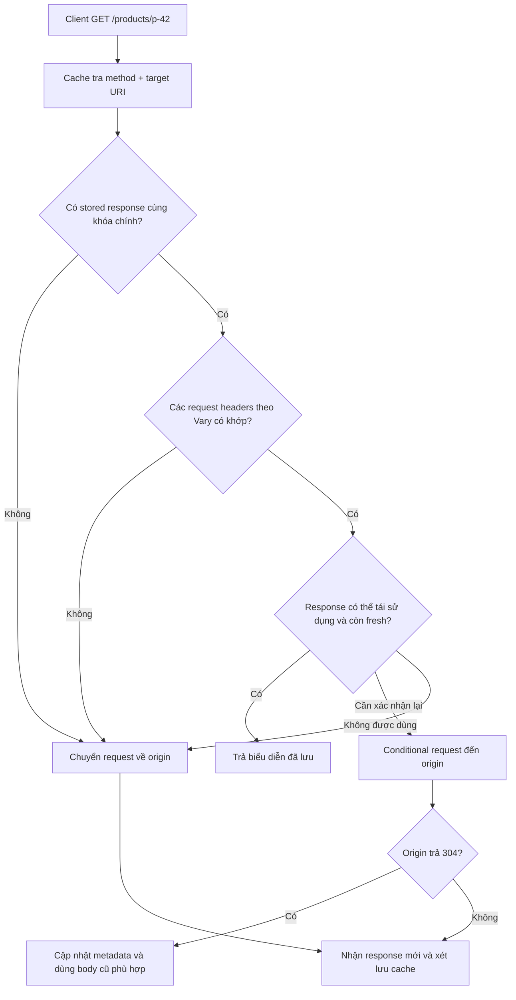
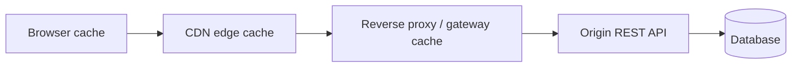

# Vary và khóa cache cho nhiều biểu diễn

## 1. Bài toán: cùng URI nhưng không phải lúc nào cũng cùng nội dung

Một REST API cung cấp tài nguyên sản phẩm tại `GET /products/p-42`. Tùy request, cùng URI này có thể trả:

- Dữ liệu JSON hoặc XML dựa trên `Accept`.
- Tên và mô tả sản phẩm bằng tiếng Việt hoặc tiếng Anh dựa trên `Accept-Language`.
- Nội dung được nén gzip, Brotli hoặc không nén dựa trên `Accept-Encoding`.
- Header CORS khác nhau tùy `Origin` được cho phép.

Nếu bộ nhớ đệm (*cache*) chỉ dùng URL để lưu response rồi trả lại cho mọi request cùng URL, người dùng yêu cầu tiếng Việt có thể nhận tiếng Anh; client chờ JSON có thể nhận XML; tệ hơn, một response được tạo riêng cho người dùng A có thể bị gửi nhầm cho người dùng B.

Trong HTTP caching, **`Vary` mô tả những trường của request đã ảnh hưởng tới việc chọn biểu diễn của response**. Cache dùng thông tin đó để quyết định một response đã lưu có thể được tái sử dụng cho request tiếp theo hay không. Nhưng `Vary` **không thay thế quy tắc cacheability, freshness và bảo mật**, cũng không bảo đảm mọi CDN sẽ tự động đưa mọi header vào cache key nếu nền tảng được cấu hình khác đi.

Bài này thuộc chương **Bộ nhớ đệm** của học phần `INTEGRATION_API_REST`: thiết kế REST API từ resource, URI, HTTP methods và status codes, kết hợp hợp đồng dữ liệu, phân trang, cache, idempotency, OpenAPI, xác thực/phân quyền, xử lý lỗi và kiểm thử với Java/Spring hoặc công nghệ tương đương.

### Kết quả học tập

Sau bài, bạn có thể:

1. Phân biệt **tài nguyên**, **biểu diễn** (*representation*), **khóa cache chính** và **lựa chọn biến thể** qua `Vary`.
2. Thiết kế `Vary` đúng cho `Accept`, `Accept-Language`, `Accept-Encoding` và `Origin`.
3. Giải thích vì sao `Vary` thiếu, `Vary: *` hoặc `Vary` trên header biến động lớn ảnh hưởng tính đúng đắn và hit rate.
4. Kết hợp `Vary` với `Cache-Control`, `ETag`, `If-None-Match` và `304 Not Modified`.
5. Tránh dùng cache chia sẻ cho response theo người dùng chỉ bằng cách thêm `Vary: Cookie` hoặc `Vary: Authorization`.
6. Thiết lập và kiểm thử các biến thể qua browser, reverse proxy, CDN và REST API Java/Spring.

## 2. Tài nguyên, biểu diễn và bộ chọn biểu diễn

**Tài nguyên** là khái niệm được định danh bởi URI, chẳng hạn sản phẩm `p-42`. **Biểu diễn** là dữ liệu/metadata mà server gửi để mô tả trạng thái của tài nguyên tại một thời điểm.

Hai response sau có thể biểu diễn cùng một tài nguyên:

```http
GET /products/p-42 HTTP/1.1
Host: api.example.test
Accept: application/json
Accept-Language: vi-VN

HTTP/1.1 200 OK
Content-Type: application/json
Content-Language: vi-VN
Vary: Accept, Accept-Language
Cache-Control: public, max-age=120

{"id":"p-42","name":"Bút máy"}
```

```http
GET /products/p-42 HTTP/1.1
Host: api.example.test
Accept: application/json
Accept-Language: en-US

HTTP/1.1 200 OK
Content-Type: application/json
Content-Language: en-US
Vary: Accept, Accept-Language
Cache-Control: public, max-age=120

{"id":"p-42","name":"Fountain pen"}
```

URI giống nhau nhưng chuỗi byte và ngôn ngữ khác nhau. Response cần cho cache biết **request headers nào tham gia vào việc lựa chọn này**. Nếu chỉ trả `Cache-Control: public, max-age=120` mà không có `Vary: Accept-Language`, cache có thể xem bản tiếng Việt là đủ để trả cho request tiếng Anh.

### Bốn khái niệm cần tách biệt

| Khái niệm | Chức năng | Ví dụ |
| --- | --- | --- |
| **Primary cache key** | Nhận diện request đích để tra response đã lưu; thông thường dựa trên HTTP method và target URI | `GET https://api.example.test/products/p-42` |
| **Biến thể / secondary matching** | Phân biệt những response cho cùng khóa chính nhưng được chọn bởi request header khác nhau | `Accept-Language: vi-VN` so với `en-US` |
| **Freshness** | Cho biết response đã lưu còn đủ mới để dùng không cần hỏi origin hay không | `Cache-Control: max-age=120`, `Age` |
| **Validation** | Kiểm tra response cũ còn hợp lệ khi hết hạn hoặc client muốn xác nhận lại | `ETag` / `If-None-Match`, `304` |

Một response phải **được phép lưu/tái sử dụng**, đồng thời **phù hợp biến thể** và **còn fresh hoặc được xác nhận lại**. Chỉ có một trong các điều kiện trên không đủ.

## 3. `Vary` hoạt động như thế nào?

HTTP `Vary` là trường **response header**, chứa danh sách tên request header mà server dùng để lựa chọn biểu diễn. Ví dụ:

```http
Vary: Accept, Accept-Language, Accept-Encoding
```

Theo mô hình HTTP caching (RFC 9111), cache sử dụng các trường được liệt kê để đánh giá xem một stored response có phù hợp với request mới hay không. Cache so sánh giá trị các request header liên quan với **request gốc tạo ra response được lưu**; cache có thể chuẩn hóa/so khớp theo ngữ nghĩa của từng trường khi thích hợp, không bắt buộc so khớp chuỗi byte một cách mù quáng.

### Trình tự xử lý cơ bản



Sơ đồ giản lược trường hợp cache hit/miss. Quy tắc thực còn phụ thuộc method, status, header phản hồi, freshness, stale controls, thông điệp có `Authorization`, cấu hình cache và các quy định khác.

### Ba ý nghĩa quan trọng

1. **`Vary` không phải danh sách response headers.** Các tên trong `Vary` là **request headers** ảnh hưởng tới lựa chọn response.
2. **`Vary` không tự tạo nhiều bản response.** Nó cung cấp điều kiện lựa chọn và tái sử dụng; cache có thể lưu nhiều biến thể hoặc quyết định không lưu tùy chính sách.
3. **`Vary` không buộc mọi nền tảng xây cache key cùng cách.** CDN có thể có cấu hình cache key riêng và giới hạn hỗ trợ `Vary`. Phải kiểm tra hành vi tại lớp cache thật.

## 4. Khóa cache thường chứa những gì?

Ở mức khái niệm:

```text
K0 = {HTTP method, target URI}

Stored response có Vary: H1, H2, ...
  => Chỉ dùng lại khi giá trị H1, H2, ... trên request mới
     phù hợp request ban đầu theo quy tắc matching của HTTP cache.
```

**Target URI** bao gồm scheme, authority/host, path và query string theo cách request được định danh. Hai URL sau thường không phải cùng một mục tiêu cache:

```http
GET /products?category=pen&page=1
GET /products?category=pen&page=2
```

Sự khác biệt của `page` thuộc **URI/query**, không phải trường phải thêm bằng `Vary`. Tương tự `/products/p-42` và `/products/p-43` đã khác nhau bởi path.

Hệ thống reverse proxy/CDN có thể tùy chỉnh cách chuẩn hóa query, loại bỏ tracking parameters hoặc tạo cache key theo header/cookie được chỉ định. **Chỉ chuẩn hóa hoặc bỏ query parameter khi chứng minh nó không ảnh hưởng representation**. Bỏ nhầm `tenantId`, `currency`, `sort` hay `filter` khỏi khóa sẽ gây trả sai nội dung.

### Bảng phân loại các nguồn biến thể

| Yếu tố thay đổi | Nằm ở đâu? | Thường giải quyết bằng gì? | Lưu ý |
| --- | --- | --- | --- |
| ID sản phẩm | Path `/products/{id}` | Target URI | Không cần `Vary` |
| Bộ lọc/trang | Query `?status=OPEN&cursor=...` | Target URI/query | Không tự bỏ query khỏi khóa |
| JSON so với XML | Header `Accept` | `Vary: Accept` | Cần đúng `Content-Type` |
| Tiếng Việt so với tiếng Anh | Header `Accept-Language` | `Vary: Accept-Language` | Canonicalization/fallback rõ ràng |
| gzip so với br/identity | Header `Accept-Encoding` | `Vary: Accept-Encoding` | Cần đúng `Content-Encoding` và validator |
| Header CORS phản chiếu origin | Header `Origin` | `Vary: Origin` khi phản hồi thay đổi theo Origin | Không đồng nghĩa response được phép cache công khai |
| Giá riêng theo khách | Identity/session, quyền, dữ liệu riêng | `private` hoặc `no-store` và thiết kế phạm vi cache | **Không chỉ dựa vào `Vary: Cookie`** |
| Trạng thái sản phẩm đổi theo thời gian | Origin data | TTL, invalidation, validator | `Vary` không giải quyết dữ liệu stale |

## 5. Thiếu `Vary`: hai kiểu lỗi phổ biến

### 5.1. Trả sai ngôn ngữ

1. Client A gọi `GET /products/p-42` với `Accept-Language: vi-VN`.
2. Origin trả sản phẩm tiếng Việt và `Cache-Control: public, max-age=600` nhưng **quên `Vary`**.
3. CDN lưu phản hồi theo URI.
4. Client B gọi cùng URI với `Accept-Language: en-US`.
5. CDN có thể trả ngay representation tiếng Việt còn fresh.

```mermaid
sequenceDiagram
    participant V as Client VI
    participant E as Client EN
    participant C as Shared cache
    participant O as Origin
    V->>C: GET /products/p-42, Accept-Language: vi
    C->>O: Cache miss
    O-->>C: 200, tiếng Việt; thiếu Vary
    C-->>V: Bút máy
    E->>C: GET cùng URI, Accept-Language: en
    C-->>E: Cache hit: Bút máy (sai biến thể)
```

Thêm `Vary: Accept-Language` giúp cache tuân thủ HTTP không tái sử dụng response tiếng Việt cho một request tiếng Anh không khớp biến thể. Nhưng cần xác minh edge thực sự hỗ trợ Vary trong tình huống đã cấu hình.

### 5.2. Trả sai định dạng

Nếu origin hỗ trợ JSON và XML trên cùng URI nhưng không trả `Vary: Accept`:

```http
GET /products/p-42 HTTP/1.1
Accept: application/xml
```

Cache có thể trả response `Content-Type: application/json` đã lưu từ một request khác. Client XML parser sẽ lỗi hoặc đọc sai. Đây là lỗi **content negotiation + cache** chứ không phải lỗi cú pháp XML của client.

## 6. `Vary: Accept` cho JSON, XML và media type phiên bản

Khi server chọn representation theo `Accept`:

```http
GET /products/p-42 HTTP/1.1
Accept: application/json

HTTP/1.1 200 OK
Content-Type: application/json
Vary: Accept
Cache-Control: public, max-age=180

{"id":"p-42","name":"Bút máy"}
```

Với một client khác:

```http
GET /products/p-42 HTTP/1.1
Accept: application/xml

HTTP/1.1 200 OK
Content-Type: application/xml
Vary: Accept
Cache-Control: public, max-age=180

<product><id>p-42</id><name>Bút máy</name></product>
```

`Accept` có thể chứa nhiều media ranges và chất lượng `q`:

```http
Accept: application/xml;q=0.5, application/json;q=0.9
```

Server có thể ưu tiên JSON khi các yếu tố khác bằng nhau; client/cache phải xử lý lựa chọn theo hợp đồng và semantics HTTP, không đơn giản tìm chuỗi con `json` trong header. Nếu không có representation đáp ứng một request yêu cầu thương lượng chặt, server có thể trả **406 Not Acceptable**; nó **khác 415 Unsupported Media Type**, vốn liên quan nội dung request gửi lên.

### Media type mang phiên bản

Nếu API dùng:

```http
Accept: application/vnd.example.product.v1+json
Accept: application/vnd.example.product.v2+json
```

Thì cấu trúc JSON có thể khác nhau dù URI giống nhau. `Vary: Accept` giúp tách các representation theo request header. Khi thay đổi ý nghĩa schema, hãy quản lý hợp đồng phiên bản và thời hạn cache; chỉ có `Vary` chưa bảo đảm client v1 tương thích với v2.

### Tránh tạo biến thể không cần thiết

Nếu endpoint **chỉ có một** representation JSON và bỏ qua `Accept` trong lựa chọn dữ liệu, không cần tự động thêm `Vary: Accept` chỉ vì client gửi header này. Liệt kê quá nhiều header không cần thiết có thể giảm khả năng cache hit và gây phức tạp cho CDN.

## 7. `Vary: Accept-Language` cho nhiều ngôn ngữ

Một URI có thể trả ngôn ngữ theo preference:

```http
GET /products/p-42 HTTP/1.1
Accept-Language: vi-VN,vi;q=0.9,en;q=0.6

HTTP/1.1 200 OK
Content-Type: application/json
Content-Language: vi-VN
Vary: Accept-Language
Cache-Control: public, max-age=120

{"id":"p-42","name":"Bút máy"}
```

Nếu client không gửi `Accept-Language`, server nên có **ngôn ngữ mặc định** và tài liệu hóa. `Content-Language` giúp mô tả ngôn ngữ representation thật sự được trả, không bắt buộc trùng nguyên văn chuỗi `Accept-Language` của client.

### Vấn đề phân mảnh cache

Hai request:

```http
Accept-Language: vi-VN,vi;q=0.9
Accept-Language: vi,en;q=0.5
```

có thể đều tạo cùng response tiếng Việt. Tuy nhiên cache mặc định có thể gặp nhiều giá trị request header khác nhau. Việc `Vary` khiến cache phải xét những khác biệt đó có thể làm **giảm hit rate** nếu có rất nhiều tổ hợp preference. Không được bỏ `Vary` chỉ để tăng hit rate khi origin vẫn chọn ngôn ngữ từ header.

Phương án tối ưu có kiểm soát:

1. Chỉ hỗ trợ tập ngôn ngữ hữu hạn, ví dụ `vi` và `en`.
2. Ở một lớp điều phối đáng tin cậy, chuẩn hóa yêu cầu ngôn ngữ thành một khóa lựa chọn hữu hạn **trước khi tra cache**.
3. Đảm bảo origin và cache **thống nhất cùng quy tắc chọn ngôn ngữ**; không thể dùng tên ngôn ngữ đã chuẩn hóa để trả sai khi client gửi yêu cầu chi tiết hơn.
4. Hoặc dùng URI rõ ràng như `/vi/products/p-42`, `/en/products/p-42` nếu kiến trúc sản phẩm chấp nhận biến thể nằm trong URI.

Đặt ngôn ngữ trong path/query là **lựa chọn API khác**: nó chuyển một phần khóa biến thể thành target URI. Không tự thay URL contract đã công bố chỉ vì muốn tối ưu cache.

## 8. `Vary: Accept-Encoding` cho nội dung nén

Cùng JSON representation về mặt ngữ nghĩa có thể được gửi thành các **content codings** khác nhau:

```http
GET /products/p-42 HTTP/1.1
Accept-Encoding: br, gzip

HTTP/1.1 200 OK
Content-Type: application/json
Content-Encoding: br
Vary: Accept-Encoding
```

Client chỉ chấp nhận gzip:

```http
GET /products/p-42 HTTP/1.1
Accept-Encoding: gzip

HTTP/1.1 200 OK
Content-Type: application/json
Content-Encoding: gzip
Vary: Accept-Encoding
```

Nếu một cache gửi bytes Brotli tới client chỉ hỗ trợ gzip/identity thì nội dung có thể không đọc được. `Vary: Accept-Encoding` giúp tách cách mã hóa nội dung khi response khác nhau theo request header. Nhiều CDN/reverse proxy xử lý compression đặc biệt, ví dụ lưu một dạng chuẩn rồi nén trên đường ra; phải xác minh header và body thực ở từng hop.

**Không nhầm lẫn:**

- `Accept-Encoding`: client chấp nhận những content codings nào.
- `Content-Encoding`: representation response đang được gửi với content coding nào.
- `Content-Type`: media type của nội dung, ví dụ `application/json`.
- `Transfer-Encoding`: cơ chế framing/truyền tải của thông điệp, không đồng nghĩa content coding.

### ETag mạnh và các dạng nén

Một **strong ETag** biểu diễn validator cho representation và cần phản ánh khác biệt nội dung ở cấp byte cần thiết cho so sánh mạnh. Nếu server/cache sinh **hai representation có content coding khác nhau**, không nên dùng cùng một strong ETag cho cả gzip và identity như thể bytes giống nhau. Một mẫu đơn giản:

```http
ETag: "product-p42-rev17-identity"

ETag: "product-p42-rev17-gzip"
```

Đây là **giá trị minh họa**, không phải cách đặt tên bắt buộc. Server cũng có thể dùng **weak ETag** theo semantics tương đương khi phù hợp, nhưng weak validator không thay thế strong validator cho những thao tác cần byte-range hoặc điều kiện so sánh mạnh. Nếu CDN tự nén hay giải nén, phải kiểm tra cách nó điều chỉnh validator để không phát tín hiệu sai.

## 9. `Vary: Origin` khi CORS phản hồi tùy nơi gọi

Nếu API cho phép hai web origins cụ thể và trả `Access-Control-Allow-Origin` bằng cách **phản chiếu origin đã được duyệt**:

```http
GET /catalog HTTP/1.1
Origin: https://shop.example.test

HTTP/1.1 200 OK
Access-Control-Allow-Origin: https://shop.example.test
Vary: Origin
Cache-Control: public, max-age=60
```

Khi request tới từ `https://partner.example.test`, server có thể trả một giá trị `Access-Control-Allow-Origin` khác. Nếu cache không phân biệt theo `Origin`, nó có thể trả header CORS của origin trước, khiến browser chặn response hợp lệ hoặc tạo hành vi sai.

**Nhớ rằng:**

- `Vary: Origin` cần thiết khi **response/header CORS khác nhau theo request `Origin`**, ngay cả khi phần body giống nhau.
- Nếu response thực sự dùng `Access-Control-Allow-Origin: *` cố định cho tài nguyên công khai và không dùng credentials, việc thêm `Vary: Origin` **chỉ vì CORS** thường không cần.
- Nếu có cookies/credentials và response chứa dữ liệu cá nhân, **không dùng shared cache công khai**; `Vary: Origin` không phân vùng theo danh tính và không thể đảm bảo riêng tư.
- Với phản hồi **preflight OPTIONS**, các request headers `Origin`, `Access-Control-Request-Method` và `Access-Control-Request-Headers` có thể ảnh hưởng chính sách trả về. Nếu một lớp cache HTTP cho phép lưu các phản hồi đó, phải xét các biến thể đúng; browser có cơ chế preflight cache riêng với điều kiện riêng.

CORS là cơ chế browser thực thi, không phải thay thế xác thực/phân quyền. Client ngoài browser vẫn có thể gọi endpoint; server phải kiểm tra quyền độc lập.

## 10. Các trường không nên đưa vào `Vary` một cách tùy tiện

| Request header | Có nên Vary? | Lý do |
| --- | --- | --- |
| `Accept` | Có, khi origin chọn media type theo header | Phân biệt JSON/XML/phiên bản |
| `Accept-Language` | Có, khi origin chọn ngôn ngữ từ header | Giữ nội dung/nhãn phù hợp |
| `Accept-Encoding` | Có, khi response content coding khác | Ngăn gửi bytes sai kiểu nén |
| `Origin` | Có, khi response/header CORS thay đổi theo Origin | Ngăn trả CORS policy của request trước |
| `User-Agent` | Chỉ khi thực sự cần và đã cân nhắc | Rất nhiều giá trị, dễ vỡ hit rate; không phải cách tốt để chia mobile/desktop |
| `Cookie` | Không dùng như giải pháp chính cho dữ liệu riêng | Cardinality lớn, cookie/session nhạy cảm, phụ thuộc cấu hình cache |
| `Authorization` | Không dùng để “hợp pháp hóa” shared cache cho dữ liệu riêng | Cần cache policy và phân quyền đúng, tránh lộ thông tin |
| `X-Request-Id` / `Traceparent` | Thường **không** | Giá trị gần như mỗi request khác nhau, làm mất khả năng cache hit |
| `Date` | Không, khi nói tới response timestamp | `Vary` nêu request headers, không phải response metadata |

Nếu response thay đổi dựa trên header tùy biến như `X-Currency`, có thể cần `Vary: X-Currency` **nếu thực sự dùng header đó để chọn representation**. Nhưng cần giới hạn giá trị được hỗ trợ và cấu hình CDN. Với tiền tệ, cũng có thể thiết kế `?currency=VND` để biến thể nằm trong URI; chọn cách nhất quán cho API.

### `Vary: *`

```http
Vary: *
```

Giá trị đặc biệt `*` báo rằng việc lựa chọn representation phụ thuộc những yếu tố không thể biểu diễn đầy đủ bằng tên request header đơn lẻ. Theo quy tắc cache HTTP, một stored response với `Vary: *` **không thể được dùng để thỏa request tiếp theo theo cơ chế matching thông thường**. Nó không đồng nghĩa “hãy cache theo tất cả các header”.

Nếu mục tiêu là không cho lưu dữ liệu, dùng directive phù hợp như `Cache-Control: no-store`, **không coi `Vary: *` là biện pháp riêng tư tương đương**.

## 11. `Cache-Control` quyết định điều gì khác `Vary`?

`Vary` trả lời **“response nào phù hợp với request này?”**. `Cache-Control` trả lời những điều như **“có được lưu không, ai có thể lưu, còn fresh bao lâu, có cần xác nhận lại không?”**

| Directive | Ý nghĩa cần hiểu | Trường hợp tiêu biểu |
| --- | --- | --- |
| `public` | Cho phép shared cache lưu response trong các trường hợp thông thường, bao gồm một số trường hợp mặc định có hạn chế | Catalog công khai |
| `private` | Shared cache không được lưu toàn bộ response; private cache có thể lưu nếu không bị cấm khác | Nội dung riêng theo người dùng |
| `no-store` | Cache không được lưu request/response theo quy tắc HTTP tương ứng | Dữ liệu nhạy cảm hoặc không muốn giữ |
| `no-cache` | Có thể lưu nhưng không được tái sử dụng nếu chưa xác nhận thành công với origin | Representation cần kiểm tra lại |
| `max-age=120` | Giới hạn thời gian freshness tính bằng giây cho cache theo semantics HTTP | Dữ liệu công khai cập nhật vừa phải |
| `s-maxage=300` | Freshness cho **shared caches**, có ưu tiên theo quy tắc riêng | CDN có TTL khác browser |
| `must-revalidate` | Khi stale, cache không được tái sử dụng khi chưa xác nhận thành công theo semantics của directive | Dữ liệu cần không phục vụ stale trái quy định |
| `stale-while-revalidate=30` | Cho phép phục vụ stale trong khoảng quy định khi đang xác nhận lại nếu cache hỗ trợ | Tăng độ ổn định với nội dung công khai |

Ví dụ:

```http
Cache-Control: public, max-age=60, s-maxage=300
Vary: Accept-Language
```

Browser/private cache có thể coi biểu diễn fresh trong khoảng 60 giây, còn shared cache có thể áp dụng giới hạn 300 giây khi đáp ứng các điều kiện khác. Hai loại cache vẫn phải **khớp biến thể ngôn ngữ** trước khi dùng lại.

### Không nhầm `no-cache` với `no-store`

`no-cache` **không có nghĩa cấm lưu**: cache có thể lưu nhưng phải xác nhận lại trước khi tái sử dụng. `no-store` cấm cache lưu theo semantics HTTP. Với dữ liệu đặc biệt nhạy cảm, cần xem cả thiết kế ứng dụng, log, browser history và quyền chứ không chỉ dựa vào một header cache.

## 12. Phản hồi cá nhân hóa: rủi ro lộ dữ liệu qua shared cache

Giả sử endpoint:

```http
GET /account/overview HTTP/1.1
Cookie: session=...
```

trả tên, số dư và giao dịch gần nhất. Hai người dùng gọi **cùng URI**; response khác theo session. Nếu cấu hình CDN cache công khai theo URI, đây là nguy cơ nghiêm trọng.

Phương án bảo thủ:

```http
HTTP/1.1 200 OK
Content-Type: application/json
Cache-Control: private, no-store

{"displayName":"Người dùng A","balanceMinorUnits":125000}
```

**Không cho rằng thêm `Vary: Cookie` hoặc `Vary: Authorization` là đủ**. Những header đó có thể có rất nhiều giá trị; nhiều CDN mặc định không đưa cookie/auth vào cache key theo cách mong muốn. Hơn nữa, shared-cache reuse của response cho request có `Authorization` chịu các hạn chế riêng của HTTP caching; chỉ thêm `Vary` không tự nới lỏng hay thay thế những hạn chế đó.

### Chính sách khuyến nghị theo loại dữ liệu

| Dữ liệu | Gợi ý chính sách | Có dùng shared CDN cache không? |
| --- | --- | --- |
| Catalog giá và mô tả **công khai, giống nhau cho mọi người** | `public` + TTL + `Vary` theo các yếu tố chọn biểu diễn | Có, nếu chính sách và config đúng |
| Nội dung quảng bá theo ngôn ngữ, không chứa người dùng | `public` + `Vary: Accept-Language` | Có thể |
| Giỏ hàng, hồ sơ, đơn riêng | `private` hoặc `no-store` theo độ nhạy | Tránh shared cache |
| Giá riêng theo thành viên, hạn mức tín dụng | `private, no-store` hoặc cache riêng có cơ chế cô lập nghiêm ngặt | Không dùng shared cache công khai |
| Kết quả tìm kiếm chỉ khác theo query và công khai | Query nằm trong URI, TTL ngắn nếu cần | Có thể |
| Kết quả tìm kiếm bị giới hạn theo role/tenant | Ưu tiên chính sách riêng hoặc key/cô lập được chứng minh | Không mặc định công khai |

**Không bao giờ thử nghiệm cache key chứa session token trên môi trường production rồi giả định an toàn** nếu chưa kiểm chứng đầy đủ việc xử lý header, CDN, proxy và mọi trường hợp purge/invalidation.

### Ví dụ sai dễ gặp

```http
Cache-Control: public, max-age=600
Vary: Cookie
```

Trên một response tài khoản, cấu hình này có thể khiến cache tích lũy rất nhiều biến thể theo cookie, rò rỉ thông tin qua sai cấu hình cache key và tăng chi phí. Mục tiêu không phải “nhiều biến thể hơn”, mà là **không cho lưu/tái sử dụng sai phạm vi**.

## 13. `ETag` và `304 Not Modified` trong hệ thống nhiều biến thể

Khi cache có response đã lưu nhưng nó đã stale, client/cache có thể gửi một **conditional request** với validator phù hợp:

```http
GET /products/p-42 HTTP/1.1
Accept-Language: vi-VN
Accept: application/json
If-None-Match: "p42-vi-json-rev7"
```

Nếu biểu diễn tiếng Việt/JSON được chọn vẫn chưa thay đổi, origin có thể trả:

```http
HTTP/1.1 304 Not Modified
ETag: "p42-vi-json-rev7"
Cache-Control: public, max-age=120
Vary: Accept, Accept-Language
```

`304` **không có response body**. Nó cho phép cache cập nhật metadata và dùng representation đã lưu phù hợp, theo các quy tắc của caching. Nếu cache đang lưu bản tiếng Anh mà request muốn tiếng Việt, không thể lấy `304` hoặc validator của tiếng Anh rồi suy ra dữ liệu tiếng Việt giống nhau.

### Validator theo representation

Nếu tiếng Việt và tiếng Anh khác nội dung:

```http
ETag: "p42-vi-json-rev7"
ETag: "p42-en-json-rev7"
```

Nên bảo đảm strong ETag phản ánh chính xác biểu diễn được chọn. Nếu payload đổi theo `Accept`, `Accept-Language` hoặc `Accept-Encoding`, kế hoạch validator phải xử lý các biến thể đó. Một ETag là giá trị opaque đối với client: **không yêu cầu dùng tên ngôn ngữ trong chuỗi ETag**, chỉ cần logic validator đúng.

### Tại sao 304 vẫn cần `Vary` nhất quán?

Trong response `304`, các metadata liên quan caching, bao gồm `Vary` khi phù hợp, cần nhất quán với biểu diễn được xác nhận. Nếu server phát `Vary: Accept-Language` ở 200 nhưng làm mất nó khi 304, cache hoặc lớp tích hợp có thể xử lý sai metadata hoặc khó duy trì behavior nhất quán. Test **đường 200 và 304** cho từng biến thể.

`If-None-Match` là điều kiện kiểm tra validator của biểu diễn hiện tại được chọn; nó không phải khóa cache độc lập thay cho `Vary`. Client không cần đoán ETag của ngôn ngữ khác để hỏi origin.

## 14. `Age`, thời gian freshness và thời điểm cần revalidate

Ví dụ origin trả:

```http
HTTP/1.1 200 OK
Date: Wed, 18 Nov 2026 11:00:00 GMT
Cache-Control: public, max-age=300
Vary: Accept-Language
```

Khi cache trả lại response sau đó, nó có thể kèm:

```http
Age: 120
```

Một phép ước lượng đơn giản là freshness còn khoảng `300 - 120 = 180` giây nếu không có yếu tố khác. Thực tế HTTP tính **current age** và freshness theo quy tắc gồm thời gian nhận/gửi, Date, Age, thời gian cư trú và các directive; không được lấy `Age` như toàn bộ thuật toán.

Nếu response hết freshness:

- Cache có thể **revalidate** bằng `If-None-Match` hoặc `If-Modified-Since` khi có validator thích hợp.
- Origin trả `304` nếu representation vẫn phù hợp; cache giữ body cũ và cập nhật metadata.
- Origin trả `200` với representation mới nếu đã thay đổi hoặc không thể xác nhận bằng 304.
- Chỉ phục vụ stale khi chính sách HTTP/cache cho phép, ví dụ một số directive có semantics stale và không bị các ràng buộc khác cấm.

Điểm quan trọng: trước khi đánh giá freshness, phải **chọn đúng biến thể theo `Vary`**. Một response tiếng Việt còn fresh không thể thay thế response tiếng Anh đang stale chỉ vì cùng URI.

## 15. Hệ thống thực: browser, reverse proxy, CDN và origin

Một request GET có thể đi qua nhiều lớp:



Mỗi lớp có cách cài đặt và khả năng cấu hình riêng. `Vary` là ngữ nghĩa HTTP, nhưng những hệ thống CDN thực tế có thể áp dụng cache key tùy biến, bỏ qua một số header hoặc tự xử lý biến thể nén. Vì vậy không thể chỉ nhìn response từ origin rồi kết luận toàn hệ thống cache đúng.

### Checklist từng hop

| Lớp | Cần kiểm chứng |
| --- | --- |
| Browser | DevTools cho biết response từ memory/disk cache hay network; language/Accept có được gửi như mong đợi? |
| CDN | Cache policy có tôn trọng `Vary` mong muốn không, header nào nằm trong cache key, có giới hạn whitelist? |
| Reverse proxy | Có normalize/remove `Accept-Language`, `Accept-Encoding` hoặc `Vary` không? Có cache theo Cookie/Authorization ngoài ý muốn? |
| Application | Có trả `Vary` trên mọi biến thể 200/304, `Content-Language` và `Content-Type` chính xác? |
| CDN compression | Có chỉnh `Content-Encoding`, `Content-Length`, ETag và các header liên quan khi biến đổi body không? |
| Security | Response có dữ liệu riêng tư bị đánh dấu `public` hoặc bị route qua shared cache không? |

### Không nhầm cache key tùy chỉnh với `Vary`

Một số CDN cho phép cấu hình:

```text
CDN custom cache key =
  scheme + host + path + query(normalized)
  + normalizedLanguage
  + compressionVariant
```

Đây là **cấu hình ứng dụng/nền tảng**, không phải cú pháp HTTP của `Vary`. Muốn tối ưu `Accept-Language` thành hai giá trị vi/en, lớp chuẩn hóa và origin phải thống nhất. Nếu cấu hình CDN chỉ đưa `Accept-Encoding` vào khóa và **không** đưa ngôn ngữ vào, việc origin vẫn gửi `Vary: Accept-Language` có thể **không đủ trong một CDN không áp dụng header này**; cần thử nghiệm và sửa cấu hình thực tế.

**Quy tắc vận hành:** cache key là một phần hợp đồng hiệu năng *và* bảo mật. Thay cấu hình key cũng có thể làm ảnh hưởng các response đang lưu, nên cần kế hoạch rollout, purge và kiểm thử.

## 16. Java/Spring: tạo biểu diễn theo ngôn ngữ và trả `Vary`

Giả sử Product API trả JSON, có mô tả công khai khác nhau theo ngôn ngữ. Một controller đơn giản:

```java
// Java 17+, Spring MVC 6+; ví dụ rút gọn imports và service.
record ProductView(String id, String name, String description) {}

@RestController
@RequestMapping("/products")
class ProductController {
    private final ProductService products;
    private final LanguagePolicy languagePolicy;

    ProductController(ProductService products,
                      LanguagePolicy languagePolicy) {
        this.products = products;
        this.languagePolicy = languagePolicy;
    }

    @GetMapping(path = "/{id}", produces = MediaType.APPLICATION_JSON_VALUE)
    ResponseEntity<ProductView> get(
            @PathVariable String id,
            @RequestHeader(value = HttpHeaders.ACCEPT_LANGUAGE,
                           required = false) String acceptLanguage) {
        Locale chosen = languagePolicy.chooseSupportedLocale(acceptLanguage);
        ProductView representation = products.toPublicView(id, chosen);

        // Mô hình hóa validator cho representation tiếng/ngôn ngữ đã chọn.
        // Production phải bảo đảm strong ETag phản ánh bytes thật, cả khi
        // lớp phía sau thay đổi content coding.
        String etag = products.strongEtagFor(id, chosen);

        return ResponseEntity.ok()
            .header(HttpHeaders.CONTENT_LANGUAGE, chosen.toLanguageTag())
            .varyBy(HttpHeaders.ACCEPT_LANGUAGE)
            .cacheControl(CacheControl.maxAge(Duration.ofSeconds(120))
                                      .cachePublic())
            .eTag(etag)
            .body(representation);
    }
}
```

Đây là **mẫu thiết kế**, không phải một ứng dụng chạy độc lập. `ProductService` và `LanguagePolicy` do dự án định nghĩa. Một số lưu ý quan trọng:

1. `chooseSupportedLocale` phải giải quyết trường hợp header vắng, quality values, ngôn ngữ không được hỗ trợ và fallback; đừng lấy nguyên chuỗi header làm locale.
2. `varyBy(HttpHeaders.ACCEPT_LANGUAGE)` làm rõ response thay đổi theo request language. Nếu cùng URL còn hỗ trợ XML và chọn dựa trên `Accept`, cần phát `Vary: Accept` phù hợp ở cả các handler.
3. Nếu lớp gzip/Brotli sau controller thêm `Content-Encoding`, lớp đó phải đảm bảo `Vary: Accept-Encoding` và ETag phù hợp.
4. `strongEtagFor` ở ví dụ được giả định đã phản ánh **representation cuối thực tế**. Trong triển khai có byte serialization và compression khác nhau, thường cần tính validator trên bytes tương ứng hoặc quản lý validator nhất quán tại lớp chuyển đổi. Chỉ nối version vào ETag mà bỏ qua ngôn ngữ/schema/nén có thể không đạt yêu cầu strong validator.
5. Không tự gắn `public` nếu response có giá theo tài khoản, phân quyền hoặc dữ liệu cá nhân.

### API riêng tư: khác chính sách ngay từ đầu

```java
@GetMapping(path = "/me/orders", produces = MediaType.APPLICATION_JSON_VALUE)
ResponseEntity<List<OrderDto>> myOrders(Authentication authentication) {
    List<OrderDto> result = orderService.findForUser(authentication);
    return ResponseEntity.ok()
        .cacheControl(CacheControl.noStore())
        .body(result);
}
```

Đoạn mã riêng tư minh họa việc **không cho HTTP cache lưu** thay vì kỳ vọng `Vary: Authorization` sẽ bảo vệ dữ liệu. Endpoint vẫn phải xác thực và kiểm tra quyền; `no-store` không thay cơ chế bảo mật.

## 17. Khi nào cần `Vary: Accept` trong Spring?

Spring MVC có thể chọn handler/converter dựa trên `produces` và `Accept`. Ví dụ:

```java
@GetMapping(path = "/reports/{id}", produces = MediaType.APPLICATION_JSON_VALUE)
ResponseEntity<ReportJsonView> json(@PathVariable String id) {
    return ResponseEntity.ok()
        .varyBy(HttpHeaders.ACCEPT)
        .cacheControl(CacheControl.maxAge(Duration.ofMinutes(2))
                                  .cachePublic())
        .body(reports.toJsonView(id));
}

@GetMapping(path = "/reports/{id}", produces = MediaType.APPLICATION_XML_VALUE)
ResponseEntity<String> xml(@PathVariable String id) {
    String xml = reports.toXml(id);
    return ResponseEntity.ok()
        .contentType(MediaType.APPLICATION_XML)
        .varyBy(HttpHeaders.ACCEPT)
        .cacheControl(CacheControl.maxAge(Duration.ofMinutes(2))
                                  .cachePublic())
        .body(xml);
}
```

Tài liệu trên phác thảo hai handler và dịch vụ giả định. Quan trọng là **cả hai response** đều có `Vary: Accept`, không chỉ nhánh JSON. Việc client gửi `Accept: application/xml` hay `application/json` phải chọn response phù hợp trước khi cache lưu.

Nếu framework, filter hoặc CDN tự thêm `Vary`, cần kiểm tra kết quả cuối thay vì append trùng lặp hoặc ghi đè:

```http
Vary: Accept
Vary: Accept-Encoding
```

HTTP cho phép field list được biểu diễn qua nhiều dòng hợp lệ theo quy tắc kết hợp header, nhưng để dễ vận hành thường kiểm tra **tập tên request header cuối cùng** và tránh sinh giá trị trùng/khác thứ tự khó theo dõi. Không parse `Vary` bằng một phép so sánh chuỗi duy nhất trong test.

## 18. Kiểm thử thực sự: so sánh các cache variants

Kiểm thử controller trả `Vary` là bước đầu; cần thêm kiểm thử **behavior của cache thật**. Có thể dùng môi trường staging với CDN/reverse proxy cấu hình giống production và nhiều request có cùng URI nhưng khác header.

### Ma trận kiểm thử

| Case | Request 1 | Request 2 | Điều phải chứng minh |
| --- | --- | --- | --- |
| Ngôn ngữ | `Accept-Language: vi` | `Accept-Language: en` | Không trả nhầm body/Content-Language |
| Media type | `Accept: application/json` | `Accept: application/xml` | Không tráo JSON/XML |
| Content coding | `Accept-Encoding: gzip` | `Accept-Encoding: identity` | Không gửi body nén sai coding |
| CORS origin | `Origin: https://shop.example.test` | `Origin: https://partner.example.test` | Không dùng header CORS của origin trước |
| Cùng biến thể | vi → vi | vi → vi | Có thể cache hit nếu response được phép lưu và fresh |
| Revalidation | vi + ETag cũ | vi + `If-None-Match` | 304 đúng biến thể; metadata `Vary` đúng |
| Cross-user | User A gọi `/me/orders` | User B gọi cùng URL | Không lộ body của A qua cache |
| Cookie | Hai session khác nhau | Hai session khác nhau | Endpoint riêng tư không đi qua shared cache |
| Query filter | `?status=OPEN` | `?status=CLOSED` | Key không bỏ nhầm query có nghĩa |
| Vary wildcard | Response `Vary: *` | Request sau giống hệt | Không được tái sử dụng response đã lưu theo matching |
| Ngôn ngữ fallback | `Accept-Language: xx` | `Accept-Language` vắng | Content-Language/fallback theo contract |

### Lệnh cURL minh họa

```bash
curl -si 'https://api.example.test/products/p-42' \
  -H 'Accept: application/json' \
  -H 'Accept-Language: vi-VN'

curl -si 'https://api.example.test/products/p-42' \
  -H 'Accept: application/json' \
  -H 'Accept-Language: en-US'

curl -si 'https://api.example.test/products/p-42' \
  -H 'Accept: application/xml'

curl -si 'https://api.example.test/products/p-42' \
  -H 'Accept-Encoding: gzip' --compressed
```

`--compressed` yêu cầu cURL thương lượng và giải mã các content codings mà bản cURL hỗ trợ; lệnh cuối đồng thời đặt header rõ ràng để minh họa. Khi cần **so sánh raw bytes** của gzip/br, đừng chỉ đọc output đã được giải nén; kiểm tra `Content-Encoding` và dữ liệu trên wire bằng công cụ phù hợp.

Quan sát `Content-Type`, `Content-Language`, `Content-Encoding`, `Vary`, `Cache-Control`, `Age`, `ETag` và header trạng thái cache nếu CDN công bố (tên khác nhau tùy nhà cung cấp). **Không coi việc thấy `Age` là chứng minh cache key chính xác**; phải gửi các biến thể xen kẽ và xác minh nội dung.

### Test MockMvc cho controller

```java
// Ví dụ JUnit/MockMvc, fixture products và security do test cung cấp.
@Test
void productVariesByLanguageAndKeepsStableMediaType() throws Exception {
    mockMvc.perform(get("/products/p-42")
            .header(HttpHeaders.ACCEPT_LANGUAGE, "vi-VN")
            .accept(MediaType.APPLICATION_JSON))
        .andExpect(status().isOk())
        .andExpect(header().string(HttpHeaders.CONTENT_LANGUAGE, "vi-VN"))
        .andExpect(header().string(HttpHeaders.VARY,
                                  containsString("Accept-Language")))
        .andExpect(jsonPath("$.name").value("Bút máy"));

    mockMvc.perform(get("/products/p-42")
            .header(HttpHeaders.ACCEPT_LANGUAGE, "en-US")
            .accept(MediaType.APPLICATION_JSON))
        .andExpect(status().isOk())
        .andExpect(header().string(HttpHeaders.CONTENT_LANGUAGE, "en-US"))
        .andExpect(jsonPath("$.name").value("Fountain pen"));
}
```

Test trên kiểm tra **origin response**, chưa chứng minh CDN sẽ tra hai cache keys khác nhau. Cần thêm integration test đi qua proxy/cache thật, kiểm tra miss/hit và negative test response A không bao giờ xuất hiện trên request B.

### Test 304 và ETag

1. GET bản tiếng Việt, lưu ETag và body.
2. GET lại **cùng biến thể** với `If-None-Match`; nếu chưa đổi, mong đợi 304 và metadata `Vary` đúng.
3. GET tiếng Anh với ETag của bản tiếng Việt: server phải đánh giá **representation tiếng Anh** được chọn; không trả 304 sai chỉ vì sản phẩm có cùng ID/revision.
4. Thử sau khi đổi tên sản phẩm: bản đã thay đổi không được 304 theo validator cũ.

Với ETag mạnh, việc kiểm chứng cần đặc biệt chú ý nếu proxy tự nén hoặc biến đổi body.

## 19. Giám sát cache hit rate mà không bỏ qua tính đúng đắn

Các metrics hữu ích:

- **Cache hit/miss/pass/bypass** theo route và chính sách, phân biệt browser/CDN/origin nếu có.
- **Hit rate theo biến thể được chuẩn hóa** như ngôn ngữ `vi`/`en`, media type, content coding; tránh label là nguyên chuỗi `Accept-Language` biến động.
- **Origin request rate**, bandwidth, latency p50/p95/p99, response size và egress.
- **304 rate**, tỷ lệ validation, độ tuổi `Age` và invalidation/purge events.
- **Error rate**, sai `Content-Type`, sai `Content-Language`, lỗi CORS, lỗi giải nén.
- **An toàn:** dấu hiệu shared cache phục vụ response cá nhân hóa, auth mix-up, tenant leak. Không ghi token/cookie làm metric label.

Một hit rate 99% **không có ý nghĩa tốt** nếu cache trả nhầm ngôn ngữ hay thông tin tài khoản. Tính đúng đắn và cô lập quyền là điều kiện trước khi tối ưu tỷ lệ hit.

### Kiểm soát phân mảnh biến thể

```text
2 ngôn ngữ × 2 media types × 3 content codings
= tối đa 12 tổ hợp biểu diễn theo mô hình đơn giản
```

Đây là số tổ hợp lý thuyết, không phải số object chắc chắn được lưu: mỗi lớp cache có thể chuẩn hóa, biến đổi, bỏ qua hoặc không lưu một số tổ hợp. Khi thêm `User-Agent` với hàng nghìn giá trị hoặc `Cookie` theo session, số nhóm có thể tăng mạnh, làm giảm hit rate và tăng bộ nhớ/chi phí. Hãy chọn biến thể có giá trị nghiệp vụ, chuẩn hóa an toàn và tránh biến thể không cần thiết.

## 20. Tài liệu hóa hành vi cache trong OpenAPI

OpenAPI có thể mô tả các request/response headers có liên quan nhưng **không tự kiểm tra được cache key của CDN**. Ví dụ rút gọn:

```yaml
openapi: 3.0.3
info:
  title: Product Catalog API
  version: 1.0.0
paths:
  /products/{id}:
    get:
      summary: Trả sản phẩm công khai theo ngôn ngữ và media type
      parameters:
        - name: id
          in: path
          required: true
          schema: { type: string }
        - name: Accept-Language
          in: header
          required: false
          description: Ngôn ngữ ưu tiên; hỗ trợ vi-VN và en-US, có fallback
          schema: { type: string }
      responses:
        '200':
          description: Biểu diễn sản phẩm
          headers:
            Vary:
              description: >
                Chứa Accept-Language và Accept nếu server chọn
                media type từ Accept; Accept-Encoding do tầng
                compression quyết định khi có biến thể nén.
              schema: { type: string }
            Cache-Control:
              schema: { type: string }
            Content-Language:
              schema: { type: string }
            ETag:
              schema: { type: string }
          content:
            application/json:
              schema:
                $ref: '#/components/schemas/Product'
            application/xml:
              schema:
                type: string
                description: Biểu diễn XML theo hợp đồng của API
        '304':
          description: Biểu diễn đã lưu còn phù hợp; không trả body
        '406':
          description: Không có media type response chấp nhận được
components:
  schemas:
    Product:
      type: object
      required: [id, name]
      properties:
        id: { type: string }
        name: { type: string }
        description: { type: string }
```

Đây là mẫu mô tả, chưa hoàn thiện schema XML, cơ chế Content Negotiation hay security. Với OpenAPI 3.0, không nên cố mô tả mọi phiên bản của header có cùng tên bằng các parameters khác nhau; làm rõ selection rule trong description và đưa ra ví dụ. Quan trọng là client hiểu **response có thể thay đổi khi request headers thay đổi**, còn kiểm thử tích hợp xác nhận điều đó.

## 21. Bài thực hành tổng hợp: catalog đa ngôn ngữ qua CDN

Bạn phụ trách `GET /catalog/items/{id}` của một trang bán hàng. API:

1. Trả `application/json` hoặc `application/xml` theo `Accept`.
2. Trả tên/mô tả sản phẩm bằng `vi-VN` hoặc `en-US` theo `Accept-Language`.
3. Có thể trả gzip, br hoặc identity theo `Accept-Encoding` tùy khả năng của client và edge.
4. Trả `Access-Control-Allow-Origin` theo danh sách origin cho phép khi request có `Origin`.
5. Dữ liệu catalog công khai; riêng endpoint `GET /me/prices` trả giá theo tài khoản và không được vào shared cache.
6. Catalog có thể thay đổi mỗi vài phút; CDN được phép cache ngắn hạn và revalidate.

### Nhiệm vụ A — Thiết kế response headers

Viết response 200 cho JSON tiếng Việt, XML tiếng Anh và JSON gzip. Giải thích:

| Trường | Mục đích |
| --- | --- |
| `Content-Type` | Media type của body thực |
| `Content-Language` | Ngôn ngữ representation thực |
| `Content-Encoding` | Content coding thực, nếu có |
| `Vary` | Những request headers ảnh hưởng lựa chọn representation |
| `Cache-Control` | Cacheability và freshness |
| `ETag` | Validator của representation |

Đảm bảo `Vary: Accept, Accept-Language` tại origin nếu cả hai yếu tố chọn nội dung; bổ sung `Accept-Encoding` ở lớp nén nếu có. Nếu CORS policy phản chiếu origin được cho phép, giải thích lý do `Vary: Origin`. Không phải mọi response luôn cần thêm mọi tên header: chọn theo hành vi thực.

### Nhiệm vụ B — Xây dựng bảng các cache variants

Với 2 ngôn ngữ, 2 media types và 3 content codings, tính số tổ hợp lý thuyết. Sau đó phân tích:

- Những variant nào có thể gom về một biểu diễn lưu trữ nếu edge tự nén?
- Những request values nào cần normalize để tránh quá nhiều cache entries mà vẫn giữ semantics?
- Nếu thêm `Vary: User-Agent`, điều gì xảy ra với hit rate?
- Vì sao không thể đem `Cookie` theo session làm cách chính để cache giá riêng?

### Nhiệm vụ C — Tìm lỗi cấu hình

Một CDN hiện chỉ đưa URI và `Accept-Encoding` vào cache key. Origin gửi:

```http
Cache-Control: public, max-age=600
Vary: Accept, Accept-Language, Accept-Encoding
```

Nêu chính xác **điều cần kiểm tra trên CDN**. Nếu nó không hỗ trợ áp dụng đủ `Vary`, phải chỉnh cache policy/key hoặc cách route; không được khẳng định rằng chỉ header response sẽ tự sửa mọi nền tảng.

### Nhiệm vụ D — ETag và revalidation

Giả sử JSON tiếng Việt có strong ETag `"p42-vi-json-r7"`; JSON tiếng Anh có `"p42-en-json-r7"`.

1. Viết conditional GET tiếng Việt và response 304 phù hợp.
2. Gửi request tiếng Anh nhưng mang ETag tiếng Việt; giải thích vì sao server phải so với **representation được chọn là tiếng Anh**, không được 304 do cùng resource ID.
3. Nếu một lớp proxy chuyển identity sang gzip, nêu yêu cầu với strong validator.
4. Giải thích vì sao `304` không thay thế `Vary`.

### Nhiệm vụ E — Bảo vệ dữ liệu riêng

Thiết kế response của `GET /me/prices` cho người dùng đã xác thực. Giải thích vì sao nên dùng chính sách riêng tư hoặc `no-store`, thực thi phân quyền và bỏ shared cache. Viết một negative test: người dùng B **không bao giờ** thấy body giá hoặc định danh của A dù cùng URI.

### Nhiệm vụ F — Kiểm thử xuyên các lớp

Viết ít nhất tám test: vi→en, JSON→XML, gzip→identity, Origin A→B, request cùng biến thể cho hit, conditional GET/304, query filter khác, user A→B. Kiểm tra HTTP status, body, `Content-*`, `Vary`, `Cache-Control`, response origin và kết quả CDN.

### Thang đánh giá (100 điểm)

| Nội dung | Điểm |
| --- | ---: |
| Phân biệt tài nguyên, representation, Vary và cache key | 20 |
| Chọn header và biến thể đúng (Accept/Language/Encoding/Origin) | 20 |
| Phân tích freshness, ETag, 304 và validator | 15 |
| Thiết kế an toàn cho tài khoản và dữ liệu nhạy cảm | 20 |
| Java/Spring, OpenAPI và kiểm thử qua CDN | 15 |
| Đánh đổi hiệu năng, chi phí và vận hành | 10 |

## 22. Những sai lầm thường gặp

1. **Chỉ cache theo URL khi origin chọn ngôn ngữ bằng request header:** có thể trả sai ngôn ngữ.
2. **Quên `Vary: Accept` khi trả XML và JSON từ cùng URI:** client nhận sai media type.
3. **Đưa response `Content-Type` vào `Vary` thay vì request `Accept`:** nhầm nguồn lựa chọn với kết quả.
4. **Không xét `Accept-Encoding` khi phân phối gzip/br:** client không giải mã được.
5. **Dùng cùng strong ETag cho bytes nén và không nén:** validator có thể không phản ánh representation khác nhau.
6. **Chỉ kiểm tra response 200, quên 304:** cache metadata và validator có thể không nhất quán.
7. **Cho rằng `Vary` tự làm response trở nên cacheable:** vẫn cần xét `Cache-Control`, status và các điều kiện khác.
8. **Cho rằng `Vary: Cookie` đủ bảo vệ response người dùng:** dễ sai cấu hình và phân mảnh cache.
9. **Không kiểm tra behavior CDN thực tế:** nhiều nền tảng có cache key policy riêng.
10. **Đưa `User-Agent` hoặc request ID vào `Vary` không cần thiết:** làm giảm hit rate mạnh.
11. **Dùng `Vary: *` với ý nghĩa “lưu mọi tổ hợp”:** thực tế không cho phép match để tái sử dụng.
12. **Bỏ query parameters ảnh hưởng nội dung khỏi cache key:** trả sai trang, filter hoặc dữ liệu tenant.
13. **Phản chiếu `Origin` nhưng quên `Vary: Origin`:** cache có thể dùng nhầm CORS header.
14. **Tính `Age` như thuật toán freshness duy nhất:** bỏ qua Date, TTL và các semantics khác.
15. **Đo hit rate mà không kiểm tra quyền và nội dung:** tối ưu hiệu năng trên một cache sai.

## 23. Câu hỏi tự kiểm tra

1. Vì sao hai GET cùng URI có thể cần hai cache entries khác nhau?
2. `Vary` nằm trong request hay response? Nó liệt kê tên request headers hay response headers?
3. `Cache-Control: max-age=120` giải quyết điều gì mà `Vary: Accept-Language` không giải quyết?
4. Khi nào cần `Vary: Accept` và khi nào thêm nó chỉ làm giảm hiệu quả?
5. Nếu một browser gửi `Accept-Language: vi-VN,vi;q=0.9`, server nên đặt `Content-Language` như thế nào?
6. Vì sao `Accept-Encoding` và `Content-Encoding` không giống nhau?
7. Nếu API chọn body theo `Origin` hoặc phản chiếu CORS policy theo origin, điều gì cần xét với `Vary`?
8. `Vary: *` có nghĩa cache phải lưu tất cả request headers không?
9. Vì sao chỉ thêm `Vary: Authorization` không đảm bảo response tài khoản có thể được shared cache an toàn?
10. Sự khác nhau giữa `Cache-Control: no-cache` và `no-store` là gì?
11. Nếu response tiếng Việt đã stale và có ETag, luồng `If-None-Match`/`304` diễn ra thế nào?
12. Có thể dùng một strong ETag giống nhau cho JSON tiếng Việt và XML tiếng Anh không? Vì sao?
13. Tại sao `GET /products?category=A` và `GET /products?category=B` thường không cần `Vary` để phân biệt?
14. CDN chỉ cache theo URI và `Accept-Encoding`: cần kiểm tra điều gì khi origin trả `Vary: Accept-Language`?
15. Khi nhiều giá trị `Accept-Language` đều dẫn tới tiếng Việt, bạn sẽ tối ưu cache hit mà vẫn giữ semantics đúng thế nào?
16. Test gì chứng minh browser/CDN không trả response tiếng Anh cho request tiếng Việt?
17. Vì sao response 304 cần duy trì metadata `Vary` thích hợp?
18. Với catalog công khai và hồ sơ cá nhân, bạn sẽ chọn cache policy khác nhau ra sao?

**Điểm cần ghi nhớ:** `Vary` giúp cache chọn đúng **biểu diễn** khi một URI có thể trả nhiều kết quả theo request headers; cache key chính, điều kiện matching, cacheability, freshness và validation là các lớp trách nhiệm khác nhau. Hãy dùng `Vary` đúng cho những request headers thực sự tham gia chọn nội dung hoặc metadata, kiểm soát số lượng biến thể, bảo vệ dữ liệu riêng bằng chính sách cache và phân quyền, đồng thời kiểm thử **qua lớp cache thực tế** chứ không chỉ nhìn vào response của origin.
