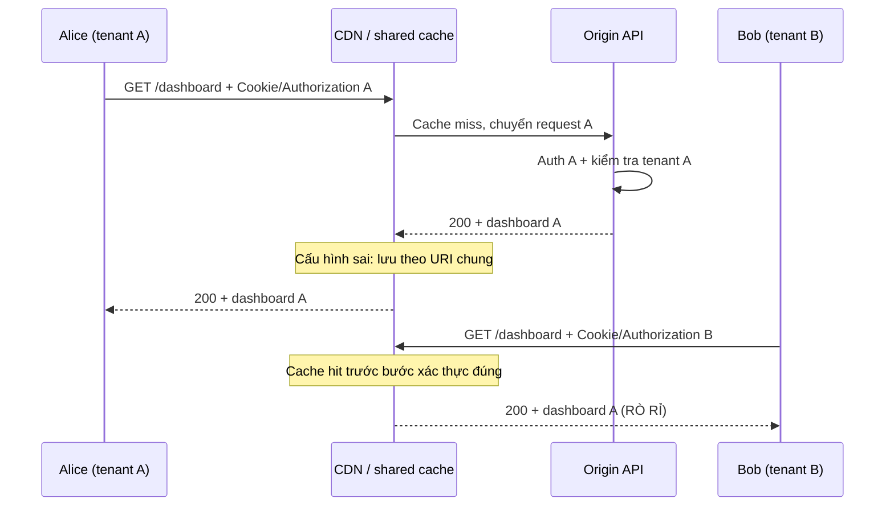
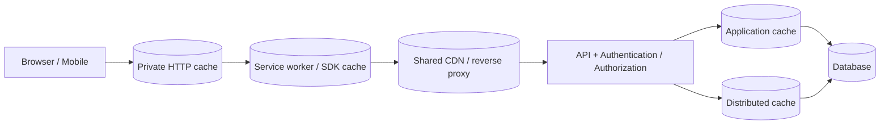

# Authorization, cookie và nguy cơ cache chéo người dùng

Một ứng dụng SaaS cung cấp `GET /api/v1/me` để lấy hồ sơ người dùng. Alice đăng nhập bằng cookie, nhận đúng tên và email. Một lát sau Bob đăng nhập trên thiết bị khác, gọi cùng URL nhưng lại thấy thông tin của Alice. API vẫn xác thực đúng ở origin server, nhưng **CDN đã trả một bản response có sẵn trước khi yêu cầu đến bước phân quyền**. Đây là kiểu sự cố **cache chéo người dùng**, có thể làm lộ dữ liệu cá nhân, quyền hạn hoặc dữ liệu giữa các tenant.

Vấn đề tương tự xuất hiện ở REST API dùng `Authorization: Bearer ...`, cookie phiên, proxy ngược, cache trong ứng dụng, Redis, browser cache, service worker và cache của SDK. HTTP có cơ chế cache rất hữu ích cho hiệu năng và chi phí, nhưng **không tự hiểu ngữ cảnh phân quyền của ứng dụng**. Người thiết kế phải biết response nào được chia sẻ, response nào chỉ có thể được lưu riêng và response nào tuyệt đối không được lưu; đồng thời kiểm soát cache key, thời gian sống, tái xác nhận và vô hiệu hóa khi quyền thay đổi.

Bài thuộc chương **Bộ nhớ đệm** của module **INTEGRATION_API_REST**. Người học vận dụng resource/URI, phương thức, status HTTP, hợp đồng dữ liệu, xác thực–phân quyền, OpenAPI và kiểm thử Java/Spring để thiết kế caching an toàn. Mục tiêu là **không đổi tính đúng đắn hoặc quyền truy cập lấy tốc độ**, kể cả khi API chạy qua CDN hoặc nhiều lớp cache.

## 1. Tình huống thực tế: CDN phục vụ nhầm response cá nhân

Giả sử hai khách hàng SaaS sử dụng cùng endpoint:

- Alice thuộc tenant A, gọi `GET https://api.example.com/api/v1/dashboard` với phiên hoặc token hợp lệ.
- Bob thuộc tenant B, gọi **cùng URI** với credential khác.
- Server trả dashboard theo người gọi, nhưng một quy tắc CDN tùy biến cache theo phương thức GET và đường dẫn, **không phân biệt danh tính**.
- Bản response của Alice bị lưu chung; khi Bob gọi, CDN cache hit và trả ngay bản đó.



**Lưu ý về nguyên nhân:** cache HTTP tuân thủ đúng tiêu chuẩn có quy tắc riêng đối với request chứa `Authorization` và chỉ được chia sẻ trong những điều kiện được cho phép. Kịch bản trên có thể phát sinh vì CDN bị cấu hình ép cache, bỏ qua header/ràng buộc tiêu chuẩn, hoặc vì ứng dụng dùng cookie nhưng không đặt chính sách cache phù hợp. Không được kết luận rằng mọi shared cache mặc định đều lưu và dùng lại response có Bearer token.

Khi sự cố xảy ra, dữ liệu còn có thể bị lưu tiếp ở trình duyệt Bob, cache ứng dụng, log, screenshot hoặc báo cáo. Vô hiệu một mục cache ở CDN không tự chứng minh đã xử lý hết hậu quả. Vì vậy caching cho dữ liệu cá nhân là **quyết định bảo mật**, không phải chỉ một tối ưu hiệu năng.

## 2. Những lớp cache có mặt trong đường đi REST API

| Lớp | Ai có thể dùng bản cache? | Ví dụ | Câu hỏi bảo mật |
|---|---|---|---|
| **Browser/private HTTP cache** | Thường trong phạm vi trình duyệt/hồ sơ người dùng | Cache GET hồ sơ để mở lại trang nhanh | Người dùng đổi tài khoản trên cùng trình duyệt thì bản cũ còn được dùng không? |
| **Service worker / offline store** | Theo phạm vi ứng dụng web và cơ chế lưu do code kiểm soát | Cache Storage, IndexedDB | Ứng dụng đã xóa/phân vùng cache khi logout/chuyển tenant chưa? |
| **CDN, reverse proxy, shared HTTP cache** | Có thể phục vụ **nhiều client** | CDN edge, proxy gateway | Cache key và chính sách HTTP có ngăn phát lại response riêng tư không? |
| **Application cache** | Phụ thuộc key và logic ứng dụng | Spring `@Cacheable`, in-memory map | Key có đủ tenant/actor/quyền và trạng thái cập nhật không? |
| **Distributed cache** | Nhiều instance dịch vụ dùng chung | Redis, Memcached | Một instance có thể lấy nhầm dữ liệu tenant khác qua key trùng không? |
| **Cache ở client SDK/mobile** | App tự quản lý, ngoài HTTP cache mặc định | Repository lưu “last profile” | Khi token/tenant thay đổi, dữ liệu cũ có bị hiển thị lại không? |

Một request đi qua nhiều cache không nhất thiết được bảo vệ bởi cùng chính sách. `Cache-Control` là tín hiệu cho **HTTP cache tuân thủ giao thức**, nhưng không tự áp dụng cho Redis, bảng trong ứng dụng, IndexedDB hay thuật toán do developer tự viết.



Sơ đồ mô tả các **lớp khả dĩ**, không phải mọi hệ thống đều có đủ hoặc buộc phải đi tuần tự qua tất cả. Để đánh giá, vẽ đúng đường request thực tế của sản phẩm và chỉ rõ lớp nào có thể trả response trước khi origin kiểm tra quyền.

## 3. Ngữ nghĩa Cache-Control: hiểu trước khi tối ưu

RFC 9111 xác định quy tắc lưu trữ và tái sử dụng response cho HTTP caches. Những directive quan trọng:

| Header response | Tác dụng chính | Có phù hợp cho dữ liệu cá nhân? |
|---|---|---|
| `Cache-Control: no-store` | Yêu cầu HTTP cache tuân thủ **không lưu** request/response để dùng sau. | **Lựa chọn mặc định thận trọng** cho response nhạy cảm. |
| `Cache-Control: private` | Response không được lưu trong shared cache; private cache có thể lưu nếu chính sách khác cho phép. | Có thể dùng nếu cho phép trình duyệt cache dữ liệu của chính người dùng. |
| `Cache-Control: private, max-age=60` | Cho phép private cache tái sử dụng trong tối đa 60 giây khi còn fresh. | Chỉ khi chấp nhận rủi ro đổi tài khoản/thu hồi quyền trong khoảng đó và có cơ chế tách biệt phù hợp. |
| `Cache-Control: no-cache` | **Có thể lưu**, nhưng phải xác thực lại thành công với origin trước khi tái sử dụng. | Không tương đương `no-store`; có thể vẫn lưu dữ liệu trên thiết bị. |
| `Cache-Control: public, max-age=300` | Cho phép chia sẻ cho HTTP cache khi đáp ứng điều kiện cache khác. | **Không** dùng cho response gắn danh tính/tenant riêng. |
| `Cache-Control: s-maxage=60` | Đặt thời gian freshness dành cho shared cache; trong các trường hợp phù hợp còn cho phép dùng response nhận qua request có Authorization. | Chỉ dùng khi đã chứng minh biểu diễn được phép chia sẻ. |
| `Cache-Control: must-revalidate` | Khi response stale, cache phải xác thực lại theo quy tắc, không tùy tiện dùng bản stale. | **Không** coi là cấm shared cache; cần kết hợp chính sách riêng tư phù hợp. |
| `Cache-Control: immutable` | Gợi ý response còn fresh không cần revalidation chỉ vì reload thông thường. | Chỉ dùng cho tài nguyên thực sự bất biến và không phụ thuộc quyền cá nhân. |

### 3.1. `no-cache` khác `no-store`

Đây là điểm dễ gây lỗi nhất:

```http
Cache-Control: no-cache
```

Nghĩa là cache **có thể lưu** response, nhưng không được tái dùng nếu chưa xác thực lại thành công. Nó **không có nghĩa** “đừng cache”. Nếu mục tiêu là không lưu response nhạy cảm trong HTTP cache tuân thủ chuẩn, dùng:

```http
Cache-Control: no-store
```

Tuy nhiên, `no-store` **không phải cơ chế xóa an toàn dữ liệu đã lưu ở mọi nơi**: nó không tự xóa một mục cũ trong cache ứng dụng, service worker, log, backup hay file người dùng tải xuống. Cần quản lý riêng từng nơi và không coi directive là thay thế kiểm soát truy cập.

### 3.2. `private` có nghĩa là gì?

`private` chỉ thị rằng **shared cache không được lưu response** (ngoại trừ cú pháp `private` có danh sách trường và những quy tắc chi tiết khác). Nó **không** buộc browser xóa response. Đây là lựa chọn cho dữ liệu được phép cache cục bộ nhưng không được phát cho người khác:

```http
HTTP/1.1 200 OK
Cache-Control: private, max-age=30
Content-Type: application/json

{"displayName":"Alice"}
```

Nếu cùng browser chuyển từ Alice sang Bob, ứng dụng phải bảo đảm dữ liệu Alice không còn được phục vụ cho Bob. Việc chỉ đặt `private` không tự chia cache theo tài khoản trong mọi lớp và không xử lý dữ liệu đã giữ trong state của SPA.

### 3.3. Heuristic caching và vì sao cần khai báo chính sách

Một số response GET có thể được HTTP cache lưu/tái sử dụng khi không có directive rõ ràng, tùy quy tắc cacheability và heuristic freshness. Không giả định rằng “không đặt Cache-Control” đồng nghĩa không cache.

**Chính sách an toàn:** mọi endpoint trả dữ liệu theo danh tính, role hoặc tenant nên có header cache rõ ràng; mọi quy tắc CDN “cache everything” phải được rà soát theo đường dữ liệu thật.

## 4. Authorization header: bảo vệ có điều kiện, không phải phép màu

Khi request có:

```http
Authorization: Bearer <access_token>
```

RFC 9111 đặt ràng buộc quan trọng: **shared cache không được dùng một cached response của request có Authorization để thỏa mãn request sau**, trừ khi response có directive cho phép cụ thể, chẳng hạn `public`, `s-maxage` hoặc `must-revalidate`, và vẫn phải tuân thủ các điều kiện cache khác.

Điều này có hai hệ quả:

1. **Bearer token tự nó không phải cache key bảo mật.** Khi origin chủ động cho phép chia sẻ response hoặc CDN được cấu hình cưỡng bức cache, phải đánh giá khả năng phát lại response cá nhân.
2. **Không coi sự hiện diện của Authorization là đủ để khỏi đặt Cache-Control.** Một proxy tùy biến, gateway hoặc cache trong ứng dụng có thể không thực thi logic HTTP này. Chính sách ứng dụng phải tường minh.

### 4.1. Những directive có thể vô tình mở cache chia sẻ

Ví dụ nguy hiểm nếu response gắn người dùng:

```http
GET /api/v1/me HTTP/1.1
Authorization: Bearer <token_A>
```

```http
HTTP/1.1 200 OK
Cache-Control: public, max-age=300
Content-Type: application/json

{"userId":"alice","email":"alice@example.invalid"}
```

Một shared cache có thể được phép lưu và tái dùng response theo những điều kiện HTTP tương ứng; nếu không có biến thể khác trong cache key, response có thể bị phục vụ cho request không phù hợp. Vì vậy **không đặt `public`, `s-maxage` hoặc các directive cho phép shared reuse trên response cá nhân chỉ để tăng cache hit**.

`must-revalidate` là một directive có mục đích khác: bắt buộc revalidation khi stale, **không phải lời hứa rằng cache riêng tư**. Với request có Authorization, nó còn có ý nghĩa trong các ngoại lệ cho shared cache được phép dùng response theo quy tắc chuẩn; vì thế cũng không dùng nó làm biện pháp cô lập danh tính.

### 4.2. Phản hồi chuẩn cho endpoint `/me`

```http
GET /api/v1/me HTTP/1.1
Host: api.example.com
Authorization: Bearer <access_token>
Accept: application/json
```

```http
HTTP/1.1 200 OK
Content-Type: application/json
Cache-Control: no-store

{
  "id": "user-42",
  "displayName": "Alice",
  "tenantId": "tenant-A",
  "roles": ["viewer"]
}
```

API cần kiểm tra token, quyền và tenant **mỗi khi xử lý request mới** ở lớp thực thi có trách nhiệm. Header không thay thế xác thực hoặc phân quyền.

### 4.3. Khi nào response từ request có Authorization vẫn có thể cache chung?

Ví dụ API trả **danh mục công khai giống hệt cho mọi người** dù client có gửi Authorization do HTTP library gắn token mặc định. Nếu dữ liệu thật sự không phụ thuộc credential, được phép công khai, có chiến lược invalidation và response được tạo bởi nhánh public, hệ thống **có thể** thiết kế caching chung:

```http
HTTP/1.1 200 OK
Cache-Control: public, max-age=120
Content-Type: application/json

{"categories":[{"id":"keyboard"},{"id":"mouse"}]}
```

Chỉ dùng khi đã xác minh không có field gắn người dùng như `isFavorite`, `discountForYou`, `availableToTenant` và không có kết quả khác biệt theo role/quyền, Accept-Language hoặc biến thể liên quan. Nếu endpoint thay đổi ngữ nghĩa tùy credential, không sử dụng policy public đó.

## 5. Cookie và Set-Cookie: rủi ro dễ bỏ sót

Khác `Authorization`, sự hiện diện của header:

```http
Cookie: SESSION=<session_id>
```

**không tự động cấm shared HTTP cache lưu/tái dùng response** theo cùng cách bảo vệ đặc thù cho Authorization. Trình duyệt có thể gửi cookie cho request GET; origin trả nội dung theo phiên, nhưng CDN không biết response riêng tư nếu không có chính sách đúng.

Ví dụ phản mẫu:

```http
GET /api/v1/dashboard HTTP/1.1
Host: api.example.com
Cookie: SESSION=<session_A>
```

```http
HTTP/1.1 200 OK
Content-Type: text/html
Cache-Control: public, max-age=600

<h1>Xin chào Alice</h1>
```

Nếu shared cache coi cùng URI là cùng representation, Bob có thể thấy nội dung Alice. Đường API/HTML cá nhân nên đặt `Cache-Control: no-store` hoặc một policy riêng tư có kiểm chứng, không quảng bá `public`.

### 5.1. Có Set-Cookie thì chắc chắn không cache?

**Không.** `Set-Cookie` trong response cũng **không tự động làm mọi HTTP cache bị cấm lưu** theo tiêu chuẩn. Một số CDN có mặc định riêng khi thấy Set-Cookie, nhưng đó là hành vi nhà cung cấp hoặc cấu hình, không phải bất biến được phép dựa vào.

Do đó:

- Không bảo vệ trang tài khoản bằng giả định “response có Set-Cookie nên CDN chắc bỏ qua”.
- Không kết luận response có cookie là luôn riêng tư: static assets hoặc danh mục công khai vẫn có thể giống nhau cho mọi người; thiết kế policy theo **nội dung response**, không chỉ theo header có mặt.
- Cookie phiên nên có `Secure`, `HttpOnly`, `SameSite` phù hợp với kiến trúc; đây là kiểm soát **phiên/CSRF**, không thay thế cache partitioning.
- Không đưa session ID, access token hoặc refresh token vào URI, ETag, log hoặc cache key dạng công khai.

### 5.2. `Vary: Cookie` có đủ không?

`Vary` giúp cache biết những request headers nào ảnh hưởng tới biểu diễn:

```http
Vary: Accept-Language
```

hoặc:

```http
Vary: Cookie
```

Nhưng `Vary: Cookie` **không nên là biện pháp bảo vệ duy nhất cho nội dung riêng tư**:

1. Cookie thường chứa nhiều giá trị biến động, khiến cache key có cardinality cao và cache hit thấp.
2. CDN có thể loại bỏ/chuẩn hóa Cookie hoặc bỏ qua Vary theo cấu hình; phải kiểm chứng thực tế.
3. Cookie được đổi, xóa hoặc tái sử dụng theo phiên; nếu lớp ứng dụng có cache khác, Vary không tác động tới nó.
4. Một shared cache vẫn giữ bản sao dữ liệu nhạy cảm, làm tăng bề mặt sự cố và quyền truy cập tới nội dung.

Với dữ liệu của người dùng, **`Cache-Control: no-store` là mặc định dễ kiểm chứng hơn**. Chỉ chọn caching riêng phức tạp khi lợi ích được đo và có threat model/test chứng minh tính cô lập.

## 6. Cache key và Vary: ranh giới phân vùng dữ liệu

Cache key là thông tin dùng để phân biệt các representation. Một HTTP cache thông thường phân biệt URI và phương thức theo quy tắc; các biến thể có thể chịu ảnh hưởng của `Vary`. CDN và application cache còn có cơ chế key do hệ thống cấu hình.

Với dữ liệu nhiều tenant, một cache key kiểu:

```text
GET:/api/v1/orders?status=PAID
```

là **không đủ** nếu response được phân quyền theo tenant A/B. Cache ứng dụng cần tách theo ngữ cảnh đã xác minh, ví dụ một key nội bộ:

```text
orders:v3:tenant-A:actor-42:permission-set-hash:status-PAID:cursor-first:limit-20
```

Đây là **minh họa key nội bộ**, không phải đề nghị đưa raw user ID/permission/token ra URL hoặc log. Key phải được tạo từ **tenant/actor/rights đã xác minh** ở backend, không tin vào `tenantId` do client nhập. Nhưng ngay cả key tách actor cũng chưa đủ nếu quyền thay đổi giữa các lần gọi: cần invalidation, TTL thấp, policy version hoặc kiểm tra quyền tại thời điểm dùng.

### 6.1. Những thành phần thường bị quên trong key

| Thông tin ảnh hưởng representation | Ví dụ | Nếu bỏ qua sẽ có gì? |
|---|---|---|
| Tenant và phạm vi dữ liệu | Tenant A khác tenant B | Rò đơn hàng giữa khách hàng. |
| Danh tính hoặc tập quyền | Admin thấy nhiều field hơn Viewer | Viewer nhận kết quả có field của Admin. |
| Query/filter/sort | `status=PAID` vs `status=CANCELLED` | Trả nhầm tập kết quả. |
| Pagination/cursor | Trang đầu vs trang tiếp theo | Bị lặp/bỏ sót bản ghi. |
| Projection | `fields=id,total` vs có `customerEmail` | Rò trường chỉ được cấp cho vai trò đặc biệt. |
| Ngôn ngữ/định dạng | `Accept-Language`, `Accept` | Trả sai representation hoặc ảnh hưởng cache validation. |
| Phiên bản schema/logic | API v1 và v2 | Client nhận format sai hoặc policy cũ. |
| Quyền thay đổi | User rời tenant hoặc bị thu hồi quyền | Bản cache còn fresh nhưng không còn được phép xem. |

Trong nhiều hệ thống, cố gắng đưa tất cả yếu tố này vào shared CDN key quá khó và dễ sai. **Giải pháp đơn giản, an toàn hơn là bypass shared cache cho dữ liệu riêng tư**, và nếu thật sự cần application cache thì thiết kế/kiểm thử riêng ở backend.

### 6.2. `Vary: Authorization` có phải lá chắn?

Thêm `Vary: Authorization` có thể tạo điều kiện phân biệt request theo header khi cache hỗ trợ đúng chuẩn, nhưng:

- Nó không thay thế quy tắc **không được chia sẻ response cá nhân**; không dùng để hợp thức hóa `Cache-Control: public` trên `/me`.
- Nhiều CDN có cấu hình cache key riêng; cần hiểu cache có lưu/tái dùng theo Authorization hay không.
- Token thường có entropy lớn và thay đổi theo thời gian, làm giảm hiệu quả caching; tuyệt đối không log hoặc công bố giá trị token để debug key.
- Không giải quyết cookie, quyền thay đổi, tenant switching hoặc cache ứng dụng.

Do đó, đừng chọn “`public + Vary: Authorization`” như công thức bảo mật chung.

## 7. Chọn chính sách cache theo loại resource

| Endpoint | Dữ liệu | Chính sách khởi đầu gợi ý | Lý do |
|---|---|---|---|
| `GET /public/categories` | Danh mục thực sự công khai | `public, max-age=120` hoặc policy CDN tương đương | Có thể phục vụ chung khi representation giống nhau. |
| `GET /assets/app.8f3c2.js` | File tĩnh có tên chứa hash nội dung | `public, max-age=31536000, immutable` | URL mới khi nội dung đổi; nên có cơ chế rollout phù hợp. |
| `GET /api/v1/me` | Hồ sơ người dùng | **`no-store`** | Chứa danh tính và quyền riêng. |
| `GET /api/v1/orders` | Danh sách đơn theo user/tenant | **`no-store`** mặc định | Dữ liệu và permission có thể đổi, pagination/cursor nhạy cảm. |
| `GET /api/v1/invoices/{id}` | Hóa đơn cá nhân | **`no-store`** | Không lưu ở HTTP cache chia sẻ và hạn chế lưu cục bộ. |
| `GET /api/v1/user-preferences` | Tùy chọn cá nhân không quá nhạy cảm | `private, max-age=30` **nếu** đã đánh giá | Cho phép private cache ngắn hạn; cần xử lý đổi tài khoản/thu hồi. |
| `GET /api/v1/tenant-pricing` | Giá theo hợp đồng tenant | **`no-store`** mặc định | Nguy cơ rò giá/thỏa thuận giữa tenant; chưa chắc được phép chia sẻ. |
| `POST /api/v1/orders` | Tạo đơn | Không dùng shared response cache để thay idempotency | Phản hồi gắn giao dịch; retry dùng Idempotency-Key khi thích hợp. |
| `GET /api/v1/auth/session` | Trạng thái phiên | **`no-store`** | Thay đổi nhanh khi login/logout/refresh. |
| `401/403` của API có xác thực | Lỗi chứa trạng thái danh tính/quyền | **`no-store`** | Tránh sử dụng lại sai hoặc tiết lộ lý do quyền cho request khác. |

Các thời lượng trong bảng là **giả định để học thiết kế**, không phải cấu hình mặc định cho mọi dịch vụ. Quyết định cần xét độ nhạy, khả năng thay đổi, thời gian chấp nhận stale, quyền, CDN và yêu cầu tuân thủ.

### 7.1. Khi nào nên dùng ETag/304 cho dữ liệu riêng tư?

ETag giúp client kiểm tra một biểu diễn có thay đổi hay chưa. Nhưng **HTTP conditional request không tự kiểm tra quyền**. Nếu muốn dùng revalidation cho dữ liệu cá nhân được phép lưu trong private cache, server phải xác thực/ủy quyền request hiện tại và chọn biểu diễn đúng ngữ cảnh **trước khi** cân nhắc `If-None-Match`.

Ví dụ một **private cache** được phép giữ dữ liệu không quá nhạy cảm:

```http
HTTP/1.1 200 OK
Cache-Control: private, no-cache
ETag: "prefs-u42-v8"
Vary: Accept-Language
Content-Type: application/json

{"theme":"dark"}
```

Sau đó client revalidate:

```http
GET /api/v1/user-preferences HTTP/1.1
Host: api.example.com
Authorization: Bearer <access_token>
If-None-Match: "prefs-u42-v8"
```

Nếu **chính actor hiện tại** còn quyền và biểu diễn tương ứng không đổi, server có thể trả:

```http
HTTP/1.1 304 Not Modified
Cache-Control: private, no-cache
ETag: "prefs-u42-v8"
Vary: Accept-Language
```

`304` **không chứa body biểu diễn**. Nếu Bob dùng ETag của Alice, origin không được xác nhận representation của Alice cho Bob. Cần kiểm tra actor và version theo đúng tài nguyên; đừng dùng ETag chung cho `/me` của mọi người khi body khác nhau.

Nếu response thực sự nhạy cảm, **no-store** có thể là lựa chọn tốt hơn ngay cả khi ETag giúp tiết kiệm băng thông.

## 8. Cache chéo tenant trong Redis và Spring `@Cacheable`

HTTP cache chỉ là một phần. Một bug phổ biến xảy ra ở tầng Java:

```java
// PHẢN MẪU: orderId có thể không là khóa toàn cục;
// quyền của mỗi actor cũng không được kiểm tra khi cache hit.
@Cacheable(cacheNames = "orders", key = "#orderId")
public OrderDto findOrder(String orderId) {
    return repository.findById(orderId).orElseThrow();
}
```

Giả sử order ID do từng tenant cấp và cả tenant A, B cùng có `ORD-100`. User A gọi trước làm cache lưu bản A. User B gọi sau nhận nhầm bản A vì key chỉ có `orderId`. Ngay cả khi ID là UUID toàn cục, cache hit vẫn có thể **bỏ qua kiểm tra quyền theo tài nguyên** nếu lối đi tới dữ liệu chính bị cache cắt ngắn.

### 8.1. Tách việc xác minh quyền khỏi phần có thể cache

Thiết kế an toàn hơn:

1. Xác thực actor và tenant bằng ngữ cảnh backend đã xác minh.
2. Kiểm tra quyền đối với resource/tenant mỗi lần gọi ở ranh giới phù hợp.
3. Chỉ cache dữ liệu có **phạm vi đã xác định rõ** và key gồm tenant + resource + phiên bản quan trọng.
4. Giới hạn TTL và vô hiệu cache khi dữ liệu/quyền thay đổi.
5. Không cache DTO đặc quyền rồi trả thẳng cho actor ít quyền; có thể cache dữ liệu nội bộ được kiểm soát và xây representation được lọc quyền sau.

Mẫu tách lớp minh họa:

```java
import java.util.UUID;
import org.springframework.stereotype.Service;

@Service
public class OrderQueryService {
    private final OrderAuthorization authorization;
    private final OrderDataCache dataCache;
    private final TenantContext tenantContext;

    public OrderQueryService(
            OrderAuthorization authorization,
            OrderDataCache dataCache,
            TenantContext tenantContext) {
        this.authorization = authorization;
        this.dataCache = dataCache;
        this.tenantContext = tenantContext;
    }

    public OrderDto getOrder(UUID orderId) {
        UUID tenantId = tenantContext.requireVerifiedTenantId();
        // Kiểm tra quyền trước khi lấy/cung cấp biểu diễn dữ liệu.
        authorization.requireReadAccess(tenantId, orderId);
        OrderRecord record = dataCache.findTenantOrder(tenantId, orderId);
        return OrderDto.fromAuthorizedRecord(record);
    }
}
```

Các kiểu `OrderAuthorization`, `OrderDataCache`, `TenantContext`, `OrderDto` và `OrderRecord` là **abstraction ứng dụng** cần hiện thực, không phải lớp Spring dựng sẵn. Phải đảm bảo `requireReadAccess` dùng dữ liệu quyền đủ mới; nếu check quyền cũng dùng cache, cần chính sách thu hồi và thử nghiệm hiệu lực permission.

Ở tầng lưu:

```java
import java.util.UUID;
import org.springframework.cache.annotation.Cacheable;
import org.springframework.stereotype.Component;

@Component
public class OrderDataCache {
    private final OrderRepository repository;

    public OrderDataCache(OrderRepository repository) {
        this.repository = repository;
    }

    @Cacheable(cacheNames = "tenant-order-data",
               key = "#tenantId.toString() + ':' + #orderId.toString()")
    public OrderRecord findTenantOrder(UUID tenantId, UUID orderId) {
        return repository.findByTenantIdAndId(tenantId, orderId)
            .orElseThrow(OrderNotFoundException::new);
    }
}
```

**Quan trọng:** ví dụ trên không đủ nếu `OrderRecord` chứa thông tin mà một người trong tenant không được thấy. Khi đó nên cache dữ liệu trung tính bên trong ranh giới đáng tin cậy rồi **lọc fields và kiểm tra quyền trên từng actor** trước khi trả, hoặc không dùng cache. Không tạo key từ tenant do client tự gửi.

### 8.2. Spring Cache không phải HTTP Cache-Control

`@Cacheable` điều khiển một cache trong ứng dụng (tùy CacheManager), **không tự đặt HTTP response header**. Ngược lại, `Cache-Control: no-store` trên controller không tự xóa hoặc ngăn `@Cacheable`, Redis, in-memory cache và các bản dữ liệu đã giữ.

Hai cơ chế phải có chính sách riêng. Đặc biệt khi chuyển tenant, thu hồi membership hoặc thay đổi role, có thể phải vô hiệu **permission cache**, **data cache**, **session store** và **response HTTP cache** tại những nơi có liên quan.

## 9. Spring Boot: trả Cache-Control đúng ở controller

Với REST API dùng Spring Boot 3/Spring MVC, có thể đặt `Cache-Control: no-store` rõ ràng cho response riêng tư:

```java
import org.springframework.http.CacheControl;
import org.springframework.http.ResponseEntity;
import org.springframework.security.core.Authentication;
import org.springframework.web.bind.annotation.GetMapping;
import org.springframework.web.bind.annotation.RequestMapping;
import org.springframework.web.bind.annotation.RestController;

@RestController
@RequestMapping("/api/v1")
public class ProfileController {
    private final ProfileService profiles;

    public ProfileController(ProfileService profiles) {
        this.profiles = profiles;
    }

    @GetMapping("/me")
    public ResponseEntity<ProfileDto> me(Authentication authentication) {
        // Authentication phải được filter bảo mật xác minh.
        ProfileDto profile = profiles.findForAuthenticatedUser(authentication);
        return ResponseEntity.ok()
            .cacheControl(CacheControl.noStore())
            .body(profile);
    }
}
```

Spring Security có một số header mặc định tùy cấu hình/version, nhưng **không nên dựa vào mặc định mà không kiểm thử**. Bảo đảm endpoint `/me` chỉ cho actor hợp lệ, `ProfileService` kiểm tra quyền tài nguyên, và response thật ở gateway/CDN còn `no-store`.

### 9.1. Dữ liệu công khai có thể cache ngắn hạn

```java
import java.util.concurrent.TimeUnit;
import org.springframework.http.CacheControl;
import org.springframework.http.ResponseEntity;
import org.springframework.web.bind.annotation.GetMapping;
import org.springframework.web.bind.annotation.RestController;

@RestController
public class PublicCatalogController {
    private final CatalogService catalog;

    public PublicCatalogController(CatalogService catalog) {
        this.catalog = catalog;
    }

    @GetMapping("/api/v1/public/categories")
    public ResponseEntity<CategoriesDto> categories() {
        return ResponseEntity.ok()
            .cacheControl(CacheControl.maxAge(120, TimeUnit.SECONDS).cachePublic())
            .body(catalog.publicCategories());
    }
}
```

Chỉ áp dụng nếu dữ liệu **thật sự công khai và giống nhau cho mọi người**. Nếu code thêm field `discountForCurrentUser` vào DTO ở bản phát hành sau, phải đổi chính sách cache, cập nhật test và cấu hình CDN ngay, không chỉ sửa controller.

### 9.2. Xử lý 401/403 và lỗi một cách nhất quán

Khi một session/token không hợp lệ, API bảo vệ thường trả `401 Unauthorized` kèm `WWW-Authenticate` phù hợp; token hợp lệ nhưng thiếu quyền thường trả `403 Forbidden`. Với phản hồi liên quan danh tính/quyền, cân nhắc `Cache-Control: no-store`:

```http
HTTP/1.1 401 Unauthorized
WWW-Authenticate: Bearer realm="api", error="invalid_token"
Cache-Control: no-store
Content-Type: application/problem+json

{
  "type": "https://api.example.com/problems/authentication",
  "title": "Authentication required",
  "status": 401
}
```

Một bộ `@RestControllerAdvice` thường không tự xử lý mọi lỗi trong Spring Security filter chain. Cấu hình `AuthenticationEntryPoint` và `AccessDeniedHandler` thích hợp khi muốn kiểm soát header/error body; không bỏ mất Bearer challenge chỉ vì tùy biến Problem Details.

### 9.3. BFF dùng cookie và CSRF

Nếu ứng dụng web dùng Backend-for-Frontend quản lý cookie session, cần:

- Cookie phiên có `Secure`, `HttpOnly`, `SameSite` phù hợp; đánh giá cookie scope/path/domain.
- Bảo vệ CSRF khi cookie tự động được trình duyệt đính kèm vào các request có tác dụng ghi.
- Response chứa hồ sơ, giỏ hàng hoặc danh tính phải có chính sách cache riêng tư, thường là `no-store`.
- CORS và `Access-Control-Allow-Credentials` phải được cấu hình cho origin đáng tin khi cần; CORS không thay thế auth.
- Khi logout/chuyển tenant, vô hiệu session/refresh token theo chính sách và dọn các state/cache ứng dụng có thể hiện dữ liệu cũ.

**Cookie flags, CSRF, CORS và caching là những cơ chế khác nhau**. Một ứng dụng có cookie HttpOnly vẫn có thể rò nội dung qua shared cache nếu response cache sai.

## 10. CDN và reverse proxy: kiểm chứng cấu hình thực tế

Ở lớp CDN, cần trả lời cụ thể:

1. **Route nào được cache?** Chỉ static/public GET hay một quy tắc chung cho `/api/*`?
2. **CDN có tôn trọng Cache-Control origin không?** Có cấu hình “cache everything”, “ignore origin header” hoặc TTL cưỡng bức không?
3. **Cookie được chuyển tới origin hay bị loại bỏ?** Nếu bị strip, server có thể nhận request vô danh; nếu CDN cache response được tạo trước đó, có thể lộ dữ liệu.
4. **Authorization được xử lý như thế nào?** Có chuyển token tới origin? Có bypass cache cho request có credential không?
5. **Cache key gồm những gì?** Method, URI, query parameters, headers, content negotiation; có bỏ bớt query khiến các response khác nhau bị gộp không?
6. **Response có chứa Set-Cookie?** CDN có lưu/phát lại header đó không; cấu hình riêng có thể khác mặc định.
7. **Có stale serving không?** `stale-while-revalidate`, `stale-if-error` hoặc stale theo vendor có thể phù hợp nội dung public, nhưng phải thận trọng với dữ liệu phụ thuộc quyền.
8. **Purge/invalidation ra sao?** Sau sửa/xóa dữ liệu, có thể vô hiệu đúng các biến thể cần thiết không?

### 10.1. Mẫu chính sách “deny by default” cho API riêng tư

| Nhóm path | Chính sách gợi ý tại CDN |
|---|---|
| `/assets/*` có tên file chứa content hash | Cache dài hạn, immutable khi phù hợp. |
| `/api/v1/public/*` được kiểm duyệt nội dung công khai | Cho phép cache có TTL, Vary và invalidation đã kiểm tra. |
| `/api/v1/me`, `/api/v1/orders/*`, `/api/v1/tenants/*` | **Bypass shared cache**; origin trả `no-store`. |
| `/auth/*`, `/login`, `/logout`, `/callback` | Không cache phản hồi riêng tư; không ghi token/authorization code vào log không cần thiết. |
| Route chưa phân loại | Không ép cache; phải review trước khi bật shared caching. |

Chính sách trong bảng là **mẫu logic**, không phải cú pháp config cho một nhà cung cấp cụ thể. CDN mỗi hãng có precedence khác nhau giữa cache rule, origin headers và security rule; phải **kiểm thử HTTP thực tế qua đúng CDN**.

### 10.2. Không chỉ kiểm tra header; phải kiểm tra cache HIT

Một response có `Cache-Control: no-store` từ origin vẫn không đủ nếu edge bị cấu hình sai và thay header khi gửi đi. Bài test cần:

- Gọi A qua CDN, sau đó B cùng URL và kiểm tra body.
- Quan sát header chẩn đoán như `Age` hoặc tín hiệu HIT/MISS vendor nếu có; không tự suy diễn giá trị.
- Kiểm tra response headers ở cả origin và edge, nhất là khi qua proxy rewrite.
- Thử URL với query khác nhau, cookie khác nhau, token khác nhau, logout/relogin và thay role.
- Thử CDN đã có cache cũ trước khi áp dụng bản sửa để chắc chắn đã purge/expire đúng.

Không công bố token hoặc cookie thật trong log/traces hay bản chụp bằng chứng kiểm thử.

## 11. Đổi người dùng, logout và thu hồi quyền

Giả sử Alice truy cập trang và cache lưu biểu diễn `/api/v1/me`. Alice logout; Bob login **trên cùng browser profile**. Ngay cả khi CDN không bị lỗi, ứng dụng vẫn có thể hiển thị dữ liệu Alice từ:

- State của SPA không được reset.
- Local storage/IndexedDB hoặc service worker Cache Storage.
- Browser private HTTP cache được phép lưu theo policy.
- Client SDK/in-memory cache dùng key cố định như `profile`.

Vì thế luồng chuyển tài khoản cần **xóa hoặc phân vùng toàn bộ state theo danh tính**, không chỉ gửi request logout. Đối với private HTTP cache có lưu response, cần xem xét revalidation đúng auth, TTL và tính năng dọn dữ liệu phù hợp trình duyệt. Một số môi trường có cơ chế như `Clear-Site-Data`, nhưng hỗ trợ/ảnh hưởng tùy trình duyệt và phạm vi; không coi đó là giải pháp duy nhất.

### 11.1. Quyền thay đổi khi response còn fresh

Ví dụ user bị rút quyền đọc báo cáo lúc 10:00 nhưng private cache giữ `max-age=600` từ 09:59. Đến 10:05, browser có thể dùng bản fresh mà không liên hệ origin, **trong khi token hoặc membership đã bị thu hồi**. Nếu nghiệp vụ yêu cầu quyền bị thu hồi phải có hiệu lực ngay đối với dữ liệu không được lưu nữa, không chọn policy có thể tái dùng offline như vậy.

Phân biệt ba mục tiêu:

- **Ngăn truy cập mới từ server:** origin kiểm tra quyền mới.
- **Ngăn dùng lại cached response:** policy/TTL/invalidation/partition thích hợp.
- **Xử lý bản dữ liệu đã được nhận trước khi thu hồi:** không có HTTP header nào có thể xóa chắc chắn mọi bản sao đã được người dùng tải hoặc chụp.

Cần nêu giới hạn và SLO thu hồi quyền thực tế thay vì hứa “logout xóa toàn bộ dữ liệu đã thấy”.

## 12. ETag, 304 và hiệu ứng của proxy trung gian

ETag là validator của một representation, không phải proof of authorization. Các lỗi thường gặp:

- ETag được tính chỉ từ version chung, trong khi response của Admin và Viewer có field khác nhau.
- Server kiểm tra `If-None-Match` trước khi xác thực; actor mới nhận `304` dựa trên bản cũ của actor khác.
- Shared cache phục vụ response theo ETag từ credential khác vì cấu hình key sai.
- Response `304` thiếu header cache policy phù hợp, dẫn đến metadata cache cũ vẫn tạo sai hành vi.
- CDN làm thay đổi nội dung response nhưng giữ ETag không tương ứng với representation đã gửi.

### 12.1. Chuỗi sai và chuỗi đúng

**Sai về kiến trúc:**

```text
GET /me + If-None-Match
  → so ETag chung "profile-v8" trước khi xác thực
  → 304 hoặc cache HIT
  → browser dùng representation của actor trước
```

**Đúng theo mục tiêu:**

```text
GET /me + credential hiện tại
  → xác thực credential
  → kiểm tra quyền/tenant hiện hành
  → xác định representation được phép cho actor
  → kiểm tra validator cho đúng representation đó (nếu cho cache)
  → trả 304 hoặc 200 theo điều kiện, không rò dữ liệu
```

`304 Not Modified` không có body và thường được cache dùng để cập nhật metadata cho response đã lưu. Với dữ liệu nhạy cảm, tránh conditional caching nếu không có lợi ích rõ ràng và bằng chứng kiểm thử quyền.

## 13. Bảo vệ collection, pagination và negative caching

Cache chéo không chỉ xảy ra ở `/me`; collection là nơi dễ rò dữ liệu với số lượng lớn.

Ví dụ:

```http
GET /api/v1/orders?status=PAID&cursor=abc&limit=20 HTTP/1.1
Authorization: Bearer <token_A>
```

Response của A có thể khác B dù cùng URI. Nếu application cache theo `status` mà không có tenant/query context, một trang kết quả hoặc `nextCursor` có thể bị trộn. Cursor cũng cần gắn với tenant, quyền, query fingerprint và sort, không cho B dùng cursor của A.

**Negative caching** cũng cần đánh giá: `404 Not Found` là một trong các status có thể được cache theo những điều kiện HTTP, đôi khi với heuristic freshness. Nếu A không được xem tài nguyên B và nhận 404 “che giấu”, còn B được phép xem, cache chung sai có thể khiến B nhận 404 của A. Lỗi này không lộ dữ liệu nhưng phá chức năng, và cache key/status có thể tạo side channel về tồn tại tài nguyên.

Đối với `401/403/404` liên quan quyền, thường ưu tiên `no-store`; đừng coi response “chỉ là lỗi” nên có thể phát chung. Kiểm thử cả **positive case** (B xem được tài nguyên B) và **negative case** (A không xem được), theo thứ tự A→B lẫn B→A.

### 13.1. Phân trang thay đổi liên tục

Ngay cả khi key tách tenant đúng, danh sách có thể thay đổi do đơn mới, cập nhật trạng thái, xóa mềm hoặc thay quyền:

- Cache trang đầu nhưng không invalidation khi có đơn mới có thể làm thiếu bản ghi.
- Cache `totalCount` theo filter chung nhưng items theo tenant có thể làm lộ quy mô dữ liệu của tenant khác.
- Dùng cursor dựa trên kết quả cũ khi quyền thay đổi có thể trả item không còn thuộc quyền.
- Cần công bố tính nhất quán: snapshot, eventual consistency hay theo thời điểm mỗi request.

Đừng đưa dữ liệu tổng hợp nhạy cảm như count/facet vào cache public dù items đã được lọc.

## 14. Lựa chọn cân bằng bảo mật, hiệu năng và vận hành

Mục tiêu caching là giảm độ trễ, tải backend và chi phí, nhưng rò dữ liệu khiến lợi ích đó không còn ý nghĩa. Có thể xếp chiến lược theo rủi ro:

| Lựa chọn | Lợi ích | Rủi ro / chi phí |
|---|---|---|
| Không cache HTTP dữ liệu riêng tư (`no-store`) | Dễ giải thích, giảm khả năng phát lại response qua HTTP cache | Tăng request về origin; vẫn cần tối ưu database và kiểm tra app cache. |
| Cache private ngắn hạn | Giảm round trip ở browser trong phiên | Phải quản lý đổi người dùng, quyền thu hồi, TTL và xử lý offline. |
| Cache dữ liệu trung tính trong backend, lọc quyền sau | Giảm tải đọc từ DB mà giữ authorizer làm chốt | Cần thiết kế invalidation, bảo vệ key và tránh cached sensitive fields sai scope. |
| Cache kết quả theo tenant/actor/scope | Có thể tăng hit ratio cho workload lặp | Key lớn/cardinality, invalidation và policy drift phức tạp. |
| Cache public qua CDN | Hiệu quả mạnh cho nội dung chung | Chỉ an toàn khi response không phụ thuộc user/tenant và cấu hình CDN đúng. |

Một cách tiếp cận thực tế: **cache công khai ở edge, kiểm soát chặt riêng tư ở origin**, và tối ưu performance cho đường dữ liệu riêng qua index/query, batching, read replica có chính sách quyền, hoặc application cache được review riêng. Không bật CDN cache trên toàn bộ `GET /api/*` chỉ vì tỷ lệ cache hit đẹp.

### 14.1. Những chỉ số nên quan sát

- Cache hit/miss theo loại route công khai/riêng tư, không ghi token vào metric labels.
- Tần suất response riêng tư bị CDN cache HIT (mục tiêu thường là **0** theo chính sách bypass).
- Cache evictions và invalidation sau đổi quyền hoặc cập nhật tài nguyên.
- P95 latency của GET và tải origin trước/sau áp dụng caching.
- Số sự cố authorization denial bất thường sau cache hit.
- Tuổi cache entry, stale response, lỗi revalidation.
- Tỷ lệ read amplification/DB load do bỏ shared cache và hiệu quả của lớp cache nội bộ an toàn.

Không đưa user ID, session ID, access token hoặc raw query chứa PII vào metric tags có cardinality cao. Chỉ giữ logs đã được làm sạch và có quyền xem.

## 15. OpenAPI: ghi hợp đồng cache thay vì để client đoán

OpenAPI 3.1 không tự biến mọi mô tả Cache-Control thành chính sách chạy được, nhưng có thể ghi response headers và mô tả ngữ nghĩa.

```yaml
openapi: 3.1.0
info:
  title: Safe Caching API
  version: 1.0.0
paths:
  /api/v1/me:
    get:
      summary: Read the authenticated user's profile
      description: |
        Response depends on the current authenticated principal.
        The server disallows HTTP caching with Cache-Control: no-store.
      security:
        - bearerAuth: []
      responses:
        "200":
          description: Private profile
          headers:
            Cache-Control:
              description: Always no-store for this response
              schema:
                type: string
              example: no-store
          content:
            application/json:
              schema:
                $ref: "#/components/schemas/Profile"
        "401":
          description: Missing or invalid access token
          headers:
            WWW-Authenticate:
              schema:
                type: string
            Cache-Control:
              schema:
                type: string
              example: no-store
        "403":
          description: Access denied
          headers:
            Cache-Control:
              schema:
                type: string
              example: no-store
  /api/v1/public/categories:
    get:
      summary: Read a public, user-independent category list
      responses:
        "200":
          description: Cacheable public category representation
          headers:
            Cache-Control:
              schema:
                type: string
              example: "public, max-age=120"
          content:
            application/json:
              schema:
                type: object
components:
  securitySchemes:
    bearerAuth:
      type: http
      scheme: bearer
      bearerFormat: JWT
  schemas:
    Profile:
      type: object
      properties:
        id:
          type: string
        displayName:
          type: string
        tenantId:
          type: string
```

Đặc tả chỉ là **hợp đồng**, cần kiểm chứng response thật từ Spring và qua CDN. Nếu dùng cookie session thay Bearer, security scheme và các endpoint/auth flows phải được mô tả tương ứng. Chú ý phản hồi `304`, ETag và Vary nếu API thực sự hỗ trợ conditional GET, tránh quảng bá khả năng không triển khai.

## 16. Ma trận kiểm thử rò dữ liệu chéo người dùng và tenant

### 16.1. Chuẩn bị môi trường test

Tạo hai tenant **A**, **B** và hai actor **Alice** (A), **Bob** (B). Có thể thêm **Carol** thuộc A nhưng chỉ là Viewer, còn Alice là Admin, nhằm thử rò field theo role trong cùng tenant. Fixture phải có dữ liệu phân biệt rõ:

- Hồ sơ Alice/Bob khác tên, email và tenant.
- Danh sách đơn, count và report thuộc mỗi tenant khác nhau.
- Một tài liệu được Admin thấy trường nhạy cảm, Viewer không được thấy.
- Một scenario đổi tenant hoặc thu hồi quyền trong cùng phiên.
- CDN/reverse proxy được bật trên đường test như production; đồng thời có thể so sánh đường gọi origin trực tiếp.

Trước khi test, đảm bảo test chỉ chạy với tài khoản/dữ liệu thử nghiệm và có quyền, tránh sử dụng dữ liệu khách hàng thật. Khi lưu bằng chứng, che cookie/token và dữ liệu cá nhân.

### 16.2. Test matrix

| Mã | Tình huống | Kết quả đạt |
|---|---|---|
| **PRIV-01** | Alice gọi `GET /me` hai lần | Đúng hồ sơ Alice; header `no-store`; shared cache không phục vụ entry của riêng Alice. |
| **PRIV-02** | Alice gọi `/me`, ngay sau đó Bob gọi **cùng URI** | Bob chỉ thấy Bob, không thấy field/ETag của Alice. |
| **PRIV-03** | Bob gọi trước, Alice gọi sau | Alice chỉ thấy Alice; test cả hai thứ tự cache warm-up. |
| **PRIV-04** | Alice logout rồi Bob login trên cùng browser | UI, SDK cache, service worker và private HTTP cache không hiển thị dữ liệu Alice cho Bob. |
| **PRIV-05** | User bị thu hồi membership/role | Không tái sử dụng response hoặc field mà user không còn được phép; đúng SLO thu hồi quyền. |
| **COOKIE-01** | Hai session cookies khác nhau gọi cùng `/dashboard` | Không phục vụ sai bản HTML/JSON từ CDN. |
| **COOKIE-02** | Response có `Set-Cookie` và nội dung cá nhân | Không được shared-cache chỉ vì vô tình có freshness hoặc vendor rule. |
| **AUTH-01** | Hai Bearer tokens khác nhau gọi `/orders` | Không chia sẻ body, pagination, count hoặc cache validator xuyên user. |
| **AUTH-02** | Token không hợp lệ gọi endpoint bảo vệ sau một cache HIT public | 401 + Bearer challenge; không bypass authentication nhờ cache sai. |
| **TEN-01** | Tenant A, B cùng path/query `/orders?status=PAID` | Không lẫn items, count, cursor; origin và cache đều đúng phạm vi. |
| **ROLE-01** | Admin và Viewer cùng tenant gọi GET có trường nhạy cảm | Viewer không nhận cached body của Admin. |
| **NEG-01** | A nhận 404 khi đọc tài nguyên B, B đọc chính URI đó | B đọc được nếu đủ quyền; cache 404 của A không gây sai. |
| **ETAG-01** | Dùng `If-None-Match` của Alice cho Bob | Không trả 304 xác nhận representation riêng của Alice. |
| **ETAG-02** | User bị thu hồi quyền rồi dùng ETag cũ | Từ chối quyền hoặc kết quả phù hợp policy; không xác nhận 304 dựa trên bản chưa còn được phép. |
| **PUBLIC-01** | `/public/categories` với và không có token | Response thực sự giống nhau, cache public không rò personalization. |
| **PUBLIC-02** | Public categories thay đổi | TTL/ETag/invalidation khiến dữ liệu cập nhật đúng hợp đồng. |
| **CDN-01** | Origin trả `no-store`, request đi qua CDN | Edge không ép cache; header và HIT/MISS phù hợp cấu hình. |
| **CDN-02** | Thay đổi cache rule và purge entry cũ | Không còn phát response cá nhân đã lưu sai trước khi sửa. |
| **APP-01** | Redis cache đọc order ID giống nhau ở hai tenant | Key phân vùng hoặc policy ngăn rò dữ liệu A/B. |
| **APP-02** | Dùng Spring `@Cacheable` sau thay đổi role | Không bypass authorization; quyền được kiểm tra đủ mới. |
| **PAGE-01** | Hai actor request cùng cursor sai phạm vi | Cursor bị từ chối, không rò kết quả trang khác tenant. |
| **ERR-01** | 401/403/404 khác actor | Response không tiết lộ dữ liệu hoặc cache nhầm lỗi quyền. |

Đừng chỉ assert status `200`. Cần so nội dung theo fixture, quyền, các response headers, CDN cache status **nếu có bằng chứng từ nhà cung cấp**, và state ứng dụng sau logout. Một `Age: 0` hoặc header `X-Cache` không phải bằng chứng đầy đủ rằng chính sách cache không rò nếu thiếu test chéo actor.

### 16.3. MockMvc: kiểm tra response header từ origin

Nếu có `spring-security-test`, test một controller dạng `/me`:

```java
import static org.hamcrest.Matchers.containsString;
import static org.springframework.security.test.web.servlet.request.SecurityMockMvcRequestPostProcessors.jwt;
import static org.springframework.test.web.servlet.request.MockMvcRequestBuilders.get;
import static org.springframework.test.web.servlet.result.MockMvcResultMatchers.*;

import org.junit.jupiter.api.Test;
import org.springframework.beans.factory.annotation.Autowired;
import org.springframework.boot.test.autoconfigure.web.servlet.AutoConfigureMockMvc;
import org.springframework.boot.test.context.SpringBootTest;
import org.springframework.http.HttpHeaders;
import org.springframework.security.core.authority.SimpleGrantedAuthority;
import org.springframework.test.web.servlet.MockMvc;

@SpringBootTest
@AutoConfigureMockMvc
class ProfileCachingContractTest {
    @Autowired MockMvc mvc;

    @Test
    void authenticatedProfileIsNotHttpCacheable() throws Exception {
        mvc.perform(get("/api/v1/me")
                .with(jwt().jwt(jwt -> jwt.subject("alice"))
                    .authorities(new SimpleGrantedAuthority("SCOPE_profile:read"))))
            .andExpect(status().isOk())
            .andExpect(header().string(
                HttpHeaders.CACHE_CONTROL, containsString("no-store")));
    }

    @Test
    void unauthenticatedProfileRequestIsRejected() throws Exception {
        mvc.perform(get("/api/v1/me"))
            .andExpect(status().isUnauthorized())
            .andExpect(header().string(
                HttpHeaders.WWW_AUTHENTICATE, containsString("Bearer")));
    }
}
```

Mẫu này giả định security filter yêu cầu quyền `SCOPE_profile:read` cho route và `ProfileService` hỗ trợ user fixture. `jwt()` trong MockMvc **không xác thực chữ ký JWT production**; phải bổ sung test với decoder/token thật, quyền theo tenant và đường CDN. Test header tại origin **không thay thế** test edge cache thực tế.

### 16.4. Thử bằng curl và hai phiên khác nhau

```bash
# Ví dụ minh họa: dùng hai token thử nghiệm đã cấp hợp lệ.
curl -i -H "Authorization: Bearer <token_alice>" \
  https://api.example.com/api/v1/me

curl -i -H "Authorization: Bearer <token_bob>" \
  https://api.example.com/api/v1/me

# Đường public có thể trả ETag hoặc Cache-Control public.
curl -i https://api.example.com/api/v1/public/categories
```

**Không** paste token thật vào tài liệu, terminal history, issue tracker hoặc log công khai. Khi dùng script tự động, quản lý token thử nghiệm trong secret store và redaction.

## 17. Bài tập thiết kế: kiểm soát caching cho REST API SaaS

### Đề bài

Một hệ thống quản lý bán hàng đa tenant dùng Spring Boot, Redis và CDN. Endpoint:

1. `GET /api/v1/public/categories` trả danh mục công khai.
2. `GET /api/v1/me` trả id, email, avatar và quyền.
3. `GET /api/v1/orders?status=PAID` trả đơn hàng theo tenant, dùng Bearer token.
4. `GET /app/dashboard` dùng session cookie và trả HTML có tên người dùng.
5. `GET /api/v1/reports/{id}` trả báo cáo được phân quyền theo owner.

Cấu hình hiện tại:

- CDN cache mọi request GET trong 5 phút, cache key gồm path và query, bỏ Cookie khỏi cache key.
- Spring controller đặt `Cache-Control: public, max-age=300` cho tất cả GET.
- Redis lưu order theo key `order:{orderId}`.
- Endpoint `/me` trả `ETag: "profile-v1"` giống nhau cho mọi người.
- Khi logout, SPA chỉ xóa access token, không xóa Cache Storage hoặc dữ liệu trong state.

**Yêu cầu thực hành:**

1. Chỉ ra các đường có khả năng rò dữ liệu xuyên actor/tenant, kể cả trường hợp có Authorization và session cookie.
2. Lập bảng policy theo endpoint: shared cache, private cache hay no-store; giải thích `public`, `private`, `no-cache`, `no-store`.
3. Thiết kế lại CDN cache rules, xử lý Cookie/Authorization và chính sách không cache route chưa phân loại.
4. Thiết kế key Redis hoặc thay đổi lớp cache để không bỏ qua kiểm tra quyền trên order.
5. Đề xuất quy trình logout/chuyển tenant, revoke quyền và invalidation khi tài liệu bị sửa/xóa.
6. Thiết kế test matrix A→B, B→A, Admin→Viewer, cookie khác nhau, ETag/304, negative caching và CDN HIT.
7. Mô tả OpenAPI headers và viết một test MockMvc xác minh `Cache-Control: no-store`.

### Hướng dẫn phân tích

Một phương án hợp lý:

- Cache chung **chỉ** danh mục công khai đã xác minh không cá nhân hóa, có TTL và invalidation.
- `/me`, `/orders`, `/dashboard`, `/reports` đều **bypass shared cache**, origin trả `Cache-Control: no-store` cho response riêng tư.
- Redis dùng tenant/resource key đáng tin cậy và kiểm tra phân quyền độc lập trước khi trả; không dựa vào raw orderId để phục vụ mọi actor.
- ETag phải đặc trưng cho biểu diễn được phép, và xử lý `If-None-Match` **sau xác thực/phân quyền**; có thể bỏ ETag ở `/me` nếu chọn no-store.
- Logout/chuyển tenant cần dọn state/Cache Storage/SDK cache và thu hồi session theo hợp đồng.
- Test phải chạy qua CDN thật hoặc môi trường tương đương, không chỉ qua MockMvc.

Đánh đổi: phương án bypass shared cache tăng tải origin, nhưng giảm nguy cơ rò tenant. Có thể bù bằng index, read path tối ưu và application cache nội bộ được thiết kế có ranh giới quyền; không đổi sự an toàn lấy cache hit ratio.

## 18. Phản mẫu và checklist trước khi phát hành

### 18.1. Phản mẫu cần tránh

1. **Mặc định mọi GET đều public-cache:** GET chỉ là phương thức đọc, không chứng minh dữ liệu giống nhau cho mọi caller.
2. **Nghĩ Authorization luôn cấm cache:** HTTP có các ngoại lệ và CDN/app cache có thể được cấu hình khác.
3. **Nghĩ có Cookie/Set-Cookie là không bao giờ cache:** thiếu policy response có thể dẫn tới chia sẻ sai.
4. **Dùng `no-cache` như `no-store`:** cache vẫn được phép lưu và revalidate.
5. **Dùng `Vary: Cookie` hay `Vary: Authorization` làm biện pháp bảo mật duy nhất:** bỏ qua CDN key override, đổi quyền và các cache không phải HTTP.
6. **Chỉ thêm tenant vào Redis key rồi bỏ qua authorizer:** user cùng tenant nhưng khác quyền vẫn có thể thấy dữ liệu vượt vai trò.
7. **Trả 304 trước khi kiểm tra quyền:** một validator chung có thể xác nhận sai representation đã cache.
8. **Chỉ xóa access token khi logout:** state, service worker và SDK cache có thể còn dữ liệu của user trước.
9. **Cache công khai các lỗi 404 che giấu tài nguyên:** khiến người được phép nhận lỗi của người không có quyền.
10. **Bỏ qua phân trang/count/fields:** dữ liệu metadata hoặc cached cursor có thể làm lộ thông tin tenant khác.
11. **Chỉ kiểm tra header ở origin:** CDN vẫn có thể cưỡng bức cache/ghi đè header.
12. **Coi `no-store` là xóa dữ liệu an toàn trên mọi nơi:** không dọn cache ứng dụng, file, log, backup hoặc dữ liệu đã tải.

### 18.2. Checklist kỹ thuật

- [ ] Có phân loại **public / private / sensitive** cho từng response và đường đi thực tế của mọi cache.
- [ ] Endpoint cá nhân/tenant quan trọng trả `Cache-Control: no-store` và được cấu hình bypass shared CDN cache.
- [ ] Chỉ dùng `public` hoặc `s-maxage` khi biểu diễn thực sự được phép chia sẻ; đặc biệt rà soát request có Authorization.
- [ ] Không giả định Cookie hoặc Set-Cookie tự làm response không cacheable.
- [ ] `private`, `no-cache`, `no-store` được hiểu đúng và test theo trường hợp sử dụng.
- [ ] Cache key ở backend có ngữ cảnh tenant/actor/permission/query khi cần, **không lấy từ đầu vào client chưa xác minh**.
- [ ] Kiểm tra quyền trước trả dữ liệu từ app cache; thu hồi membership/role có chiến lược invalidation và SLO rõ.
- [ ] ETag/304, Vary và conditional requests chỉ áp dụng cho biểu diễn đã qua xác thực/phân quyền.
- [ ] Logout/chuyển user/tenant dọn state và cache client có liên quan; không hứa xóa mọi bản dữ liệu đã tải.
- [ ] CDN cache rule, header forwarding, cache key, TTL, stale behavior và purge đã được kiểm tra qua edge.
- [ ] Collection, pagination, count/facet, 401/403/404 và các tệp báo cáo được thử chống cache chéo.
- [ ] OpenAPI mô tả headers, security và cache policy tương ứng với triển khai thực.
- [ ] Test A→B, B→A, Admin→Viewer, cookie/Bearer, đổi quyền, ETag, cache HIT/MISS; bằng chứng không chứa secret.
- [ ] Metrics và logs theo route/case có quyền và không ghi raw token/session/PII vào cache key hoặc nhãn đo.

## 19. Tiêu chuẩn và tài liệu tham chiếu

- **RFC 9111 — HTTP Caching:** `Cache-Control`, cách shared cache xử lý request có `Authorization`, quy tắc `private`/`no-store`/`no-cache`/`public`, Vary, heuristic freshness và validation. https://www.rfc-editor.org/rfc/rfc9111.html
- **RFC 9110 — HTTP Semantics:** GET/HEAD, response status, `ETag`, `If-None-Match` và `304 Not Modified`. https://www.rfc-editor.org/rfc/rfc9110.html
- **RFC 6265 / RFC 6265bis (tùy phiên bản triển khai):** HTTP cookies, session và thuộc tính cookie; phải kiểm tra tài liệu nhà cung cấp/browser hiện dùng. https://www.rfc-editor.org/rfc/rfc6265.html
- **RFC 6750 — OAuth 2.0 Bearer Token Usage:** cách dùng `Authorization: Bearer` và challenge lỗi. https://www.rfc-editor.org/rfc/rfc6750.html
- **RFC 9457 — Problem Details for HTTP APIs:** hợp đồng lỗi `application/problem+json`. https://www.rfc-editor.org/rfc/rfc9457.html
- **OpenAPI Specification 3.1:** mô tả security, response headers và các representation. https://spec.openapis.org/oas/v3.1.0
- **Spring Framework / Spring Security / Spring Cache:** phân biệt HTTP Cache-Control, security filter và application cache khi triển khai Java.

**Điểm cần nhớ:** HTTP cache không tự hiểu người dùng hoặc tenant. `Authorization` có bảo vệ đặc thù trong chuẩn cache nhưng vẫn có các ngoại lệ; cookie và `Set-Cookie` không tự ngăn cache chia sẻ. `no-cache` không đồng nghĩa `no-store`, còn `private` chỉ cấm shared cache lưu, không cấm lưu ở browser. Đối với dữ liệu riêng tư, hãy **đặt chính sách tường minh, kiểm tra quyền ở đúng ranh giới, bypass shared cache, tách cache ứng dụng theo ngữ cảnh đáng tin cậy và thử tình huống A→B/B→A qua CDN thật**.
