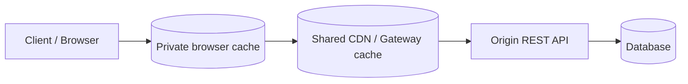
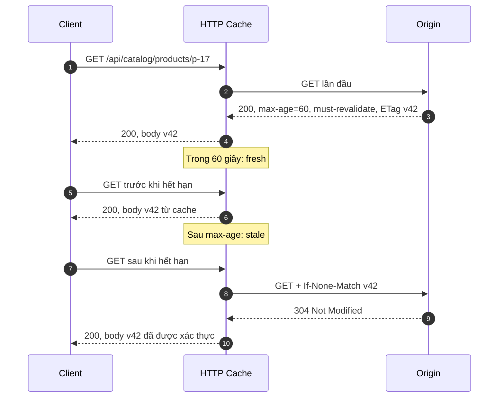
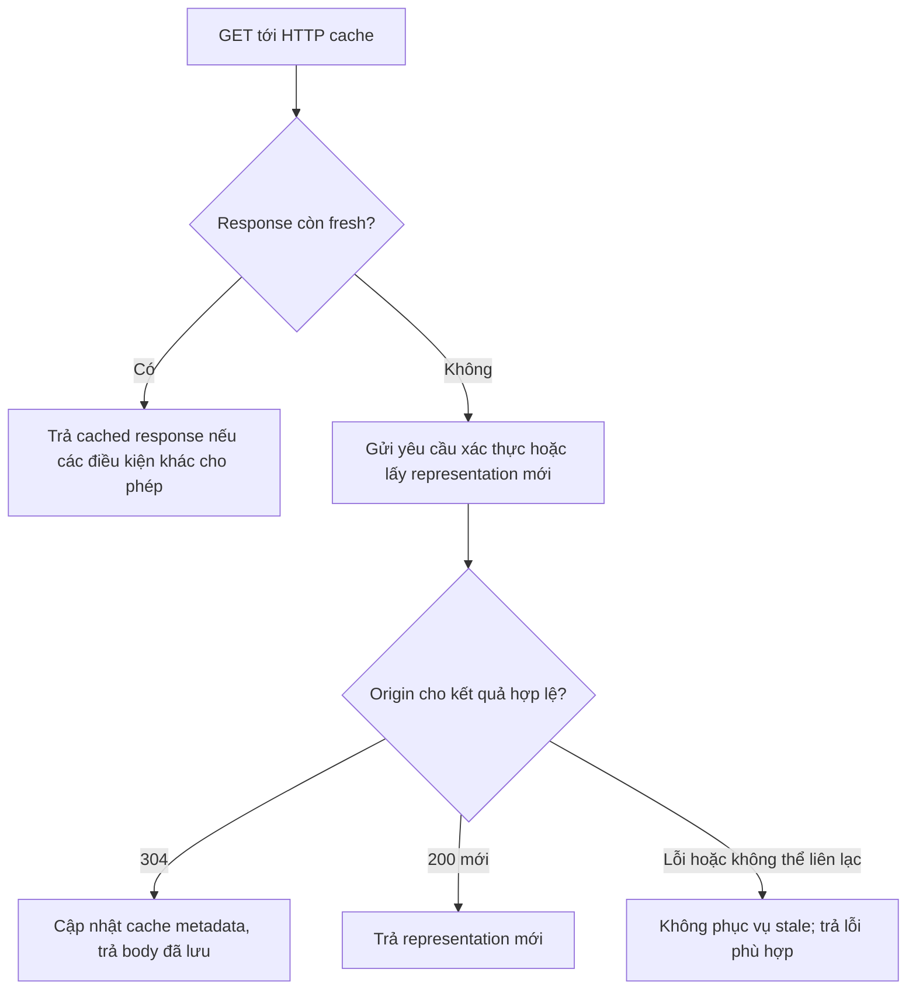
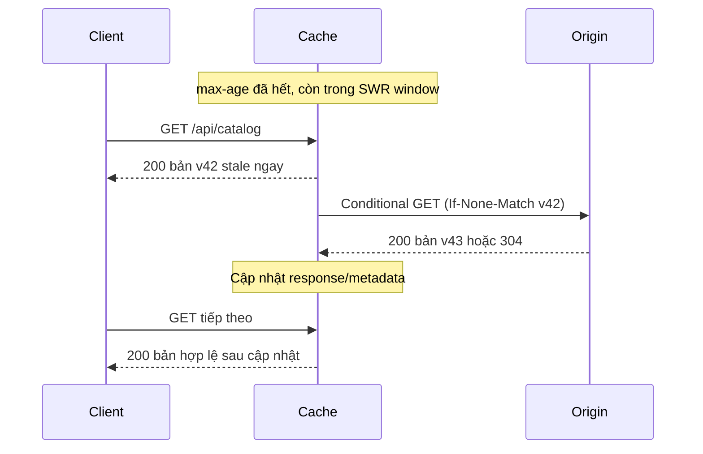

# Must-revalidate và các chính sách phục vụ dữ liệu cũ trong REST API

## 1. Bối cảnh: nhanh hơn nhờ cache, nhưng dữ liệu cũ có thể nguy hiểm

Một REST API trả về danh mục sản phẩm, giá bán, trạng thái tồn kho hay hồ sơ cá nhân thường phải cân bằng **độ trễ**, **khả năng chịu tải** và **tính mới của dữ liệu**. Cache trong trình duyệt, reverse proxy, CDN hoặc gateway giúp tránh gọi về origin mỗi lần, nhưng một bản sao lưu lâu quá có thể không còn đúng.

Giả sử client đọc:

```http
GET /api/catalog/products/p-17 HTTP/1.1
Host: api.example.test
```

và origin trả:

```http
HTTP/1.1 200 OK
Content-Type: application/json
Cache-Control: public, max-age=60
ETag: "product-p17-v42"

{"id":"p-17","name":"Bình giữ nhiệt","displayPrice":250000}
```

Trong 60 giây theo **tuổi bản sao** mà cache tính toán, một cache đáp ứng điều kiện có thể dùng lại response mà không gọi origin. Khi bản sao trở nên **stale** (không còn fresh), cache phải quyết định:

- **Xác thực lại** với origin trước khi dùng tiếp?
- **Trả dữ liệu cũ ngay**, đồng thời làm mới bất đồng bộ?
- **Trả dữ liệu cũ khi origin bị lỗi**, nhưng chỉ trong một khoảng giới hạn?
- Hay **không được phục vụ dữ liệu cũ**, kể cả lúc origin không thể truy cập?

Quyết định được định hướng bởi HTTP caching directives như `must-revalidate`, `proxy-revalidate`, `stale-while-revalidate`, `stale-if-error`, `max-age`, `s-maxage`, `no-cache`, `no-store` và chính sách bảo mật của ứng dụng.

Bài này thuộc chương **Bộ nhớ đệm** của module **INTEGRATION_API_REST**: học thiết kế REST API dựa trên resource, URI, HTTP methods, status codes và hợp đồng dữ liệu; đồng thời kết hợp cache, idempotency, OpenAPI, xác thực, phân quyền, xử lý lỗi và kiểm thử Java/Spring.

### Kết quả học tập

Sau bài học, bạn có thể:

1. Phân biệt **fresh**, **stale**, **validation** và **revalidation** trong HTTP cache.
2. Giải thích chính xác khi nào `must-revalidate` cấm tái sử dụng response stale.
3. So sánh chính sách **phải xác thực lại** với **phục vụ stale trong khi làm mới** và **phục vụ stale khi origin lỗi**.
4. Thiết kế header cache phù hợp dữ liệu công khai, dữ liệu riêng tư và dữ liệu nghiệp vụ cần tính mới.
5. Kết hợp `ETag`/`If-None-Match`/`304 Not Modified`, CDN/gateway và Java/Spring.
6. Kiểm thử trạng thái fresh/stale, mất kết nối, thay đổi tài nguyên và các ràng buộc bảo mật.

## 2. Mô hình HTTP cache: freshness khác với revalidation

### 2.1. Những thuật ngữ cần dùng đúng

| Thuật ngữ | Diễn giải | Ví dụ |
| --- | --- | --- |
| **Origin server** | Server có thẩm quyền sinh representation cho resource | Order API hoặc Catalog API |
| **Cache** | Thành phần lưu response để dùng lại | Browser, CDN, gateway, reverse proxy |
| **Fresh response** | Bản sao còn trong khoảng freshness lifetime phù hợp | `max-age=60`, tuổi cache hiện là 25 giây |
| **Stale response** | Bản sao không còn fresh | `max-age=60`, tuổi cache hiện là 75 giây |
| **Validator** | Thông tin để kiểm tra representation có đổi hay chưa | `ETag`, `Last-Modified` |
| **Revalidation** | Cache hỏi origin bằng conditional request để xác nhận hoặc nhận nội dung mới | `If-None-Match` dẫn tới `304` hoặc `200` |
| **Shared cache** | Cache có khả năng phục vụ nhiều người dùng | CDN, reverse proxy dùng chung |
| **Private cache** | Cache dành cho một user agent/người dùng cụ thể | Cache trình duyệt trong mô hình thông thường |
| **Stale serving** | Dùng response đã quá thời gian fresh mà chưa xác thực lại thành công tại thời điểm phục vụ | CDN trả bản cũ trong khi đang làm mới |

**Freshness** trả lời “có thể dùng bản sao mà không liên hệ origin không?”. **Revalidation** trả lời “nếu cần hỏi origin, bản đang lưu còn đúng không?”. Một response có thể được lưu nhưng không được dùng lại ngay nếu policy yêu cầu validate.

### 2.2. Tính tuổi bản sao

Theo HTTP caching, cache dựa vào các thông tin như `Date`, `Age`, thời điểm nhận và thời gian lưu để xác định **current age**. Công thức chuẩn có xét cả network delay và thời gian từ khi response được tạo. Trong ví dụ học tập đơn giản, có thể lấy `Age` như xấp xỉ tuổi:

```http
HTTP/1.1 200 OK
Cache-Control: public, max-age=60
Age: 25
```

Với giả định không có ràng buộc khác, bản sao này còn **fresh** trong khoảng 35 giây. Khi tuổi chạm hoặc vượt 60 giây, nó trở thành **stale**.

```text
freshness_lifetime = 60 giây
current_age = 25 giây   -> còn fresh
current_age = 60 giây   -> stale
current_age = 75 giây   -> stale 15 giây
```

Lưu ý: `Age` có thể do cache trung gian tạo/cập nhật; nó không đơn giản là số giây từ lúc client gửi GET. Phân tích chính xác phải áp dụng quy tắc tuổi hiện tại của HTTP, không chỉ so giờ hệ thống với `Date`.

### 2.3. Request, response và cache policy là những lớp khác nhau

Một response có `Cache-Control: max-age=60` đặt freshness lifetime. Client có thể gửi các request directives như `Cache-Control: no-cache` để yêu cầu validation, hoặc `max-age=0` để giới hạn tuổi response. Nhưng **request không thể tùy tiện nới lỏng hạn chế bắt buộc của response**.

Ví dụ response được đánh dấu `must-revalidate` không được dùng stale chỉ vì client yêu cầu `max-stale`. Tương tự, cấu hình CDN hoặc application cache phải được đánh giá cùng semantics của header HTTP, không mặc định mọi cache đều cùng chính sách.

### 2.4. Đường đi cache trong REST API



Một request có thể đi qua **nhiều lớp cache**. Mỗi lớp có tuổi lưu, key, validator, quyền lưu và cách xử lý lỗi riêng. Một CDN có thể trả bản mới đối với chính nó nhưng browser lại đang giữ bản khác; hoặc gateway tái xác thực với origin trong khi browser không hề gửi request.

Do đó, kết luận về stale phải nêu rõ **cache nào** đang xét, **resource nào** và **policy nào** áp dụng.

## 3. `must-revalidate`: bắt buộc xác thực trước khi dùng bản stale

### 3.1. Ý nghĩa chính xác

Ví dụ:

```http
HTTP/1.1 200 OK
Content-Type: application/json
Cache-Control: public, max-age=60, must-revalidate
ETag: "catalog-v42"

{"items":[{"id":"p-17","name":"Bình giữ nhiệt"}]}
```

`must-revalidate` là **response directive**. Sau khi response trở thành stale, cache **không được sử dụng lại bản sao** cho request tiếp theo cho đến khi đã **xác thực thành công** với origin theo ngữ nghĩa HTTP. Đây là điểm cốt lõi theo HTTP caching (RFC 9111).

Nó **không** có nghĩa “bỏ qua cache” hoặc “luôn gửi request về origin”. Khi response vẫn fresh và không có quy tắc khác yêu cầu validation, cache có thể dùng lại như bình thường.

| Thời điểm giả định | Tình trạng | Hành vi với `max-age=60, must-revalidate` |
| --- | --- | --- |
| T + 20 giây | Fresh | Có thể trả bản sao từ cache |
| T + 59 giây | Fresh | Có thể trả bản sao từ cache |
| T + 60 giây | Stale | Phải validate thành công trước khi tái sử dụng |
| T + 80 giây, origin trả `304` | Stale trước khi kiểm tra | Cập nhật metadata cache, sau đó dùng lại body đã lưu |
| T + 80 giây, origin trả `200` mới | Stale trước khi kiểm tra | Dùng representation mới phù hợp và cập nhật cache |
| T + 80 giây, origin không thể xác thực | Stale và không validate được | **Không được phát bản stale** chỉ để duy trì HTTP 200 |

Khi một cache không thể dùng bản stale theo chỉ thị này và không thể liên hệ origin, nó cần phản hồi lỗi thay vì giả vờ dữ liệu vẫn mới; một shared cache có thể trả `504 Gateway Timeout` cho tình huống không truy cập được origin.

### 3.2. Luồng yêu cầu có ETag



Trong sơ đồ, cache nhận `304` từ origin nhưng **client bình thường có thể nhận `200`** với body lưu sẵn vì cache đã tái xác thực representation. Nếu chính client gửi conditional request, response nhìn thấy có thể là `304`; không đánh đồng hai trường hợp.

### 3.3. Khi origin bị lỗi: không phục vụ bản cũ



`must-revalidate` đặc biệt có ý nghĩa cho dữ liệu mà **đúng thời gian còn quan trọng hơn việc luôn có câu trả lời**. Tuy nhiên, một API yêu cầu tính mới tuyệt đối hoặc bảo mật nghiêm ngặt có thể cần `no-store`, `no-cache` hay không cho cache tùy dữ liệu; `must-revalidate` không thể thay cho kiểm soát nghiệp vụ.

### 3.4. `must-revalidate` không tự bảo vệ dữ liệu riêng tư

Một nhầm lẫn quan trọng: `must-revalidate` không có nghĩa “chỉ browser của người này được lưu”. Trong HTTP caching, một số chỉ thị—bao gồm `must-revalidate`—còn có thể ảnh hưởng điều kiện cho phép **shared cache** sử dụng response của request có `Authorization` theo quy tắc chuẩn, nếu các điều kiện còn lại đáp ứng.

Do đó **không dùng riêng `must-revalidate` như một cơ chế bảo mật** cho thông tin người dùng. Với đơn hàng cá nhân, số dư, mã xác thực hay phản hồi có dữ liệu nhạy cảm, cần phân loại để chọn `private` hoặc `no-store` và thực thi authorization ở origin.

## 4. Phân biệt với những chỉ thị thường bị nhầm

| Directive trên response | Ý nghĩa chính | Khi response stale |
| --- | --- | --- |
| `max-age=60` | Freshness lifetime theo giây | Cần xem quy tắc cache và khả năng phục vụ stale; không tự bảo đảm buộc revalidation trong mọi tình huống |
| `must-revalidate` | Không tái sử dụng stale nếu chưa validate thành công | **Bắt buộc validate**; lỗi origin không cho phép tự phát stale |
| `proxy-revalidate` | Tương tự `must-revalidate` nhưng dành cho **shared cache** | Shared cache phải validate; private cache không bị ràng buộc bởi directive này |
| `s-maxage=30` | Freshness lifetime riêng cho **shared cache**, ưu tiên so với `max-age` tại shared cache | Shared cache phải tuân theo điều kiện revalidation tương ứng; cũng hàm ý ràng buộc kiểu `proxy-revalidate` |
| `no-cache` | Có thể lưu response, nhưng **phải validate trước mỗi lần sử dụng lại** | Không dùng lại mà chưa validate, kể cả lúc bản sao về tuổi vẫn fresh |
| `no-store` | Không được lưu trữ response/request trong cache theo yêu cầu của directive | Không có bản sao hợp lệ để tái sử dụng từ cache tuân thủ |
| `private` | Shared cache không được lưu response thuộc phạm vi private; private cache có thể lưu nếu không bị cấm khác | Private cache xét các quy tắc freshness/revalidation còn lại |
| `stale-while-revalidate=30` | Cho phép phục vụ stale trong một cửa sổ khi bắt đầu xác thực lại ở nền | Có thể trả stale trong thời gian cho phép, nếu không có directive khác cấm |
| `stale-if-error=300` | Có thể phục vụ stale có giới hạn khi gặp lỗi phù hợp từ origin/đường kết nối | Chỉ trong cửa sổ và điều kiện lỗi; không phải cho phép stale mãi |

**Lưu ý:** `no-cache` nghe giống “không lưu” nhưng thực chất là **được lưu, phải xác thực trước khi tái sử dụng**. Còn `no-store` mới là chỉ thị ngăn cache lưu trữ theo giao thức. Không coi `no-store` là bảo đảm tuyệt đối dữ liệu không thể tồn tại ở browser history, log hoặc hệ thống ngoài phạm vi HTTP cache.

### 4.1. `must-revalidate` so với `no-cache`

```http
Cache-Control: public, max-age=60, must-revalidate
```

Cho phép cache trả bản sao khi còn **fresh**. Chỉ buộc revalidation khi bản trở thành **stale**.

```http
Cache-Control: private, no-cache
```

Với response được phép lưu ở private cache, phải xác thực trước **mỗi lần dùng lại**, kể cả vừa mới được cache. `no-cache` vẫn có thể giúp tiết kiệm băng thông khi origin trả `304` thay vì full body.

### 4.2. `proxy-revalidate` và `s-maxage`

Giả sử:

```http
Cache-Control: public, max-age=120, s-maxage=30
```

Shared cache tính freshness theo `s-maxage=30`, trong khi private cache có thể dùng `max-age=120` nếu không có ràng buộc khác. Theo ngữ nghĩa HTTP, `s-maxage` cũng ràng buộc shared cache không dùng stale sau khi hết giới hạn khi chưa validate thành công.

Nếu mục tiêu là bảo vệ **chỉ tại CDN/gateway**, cần hiểu sự khác nhau giữa shared và private caches. Nếu mục tiêu là tất cả cache không được dùng stale thì `must-revalidate` là directive rộng hơn. Nếu cần cấm shared cache lưu dữ liệu cá nhân, `private` hoặc `no-store` mới là thành phần phù hợp.

### 4.3. `max-stale` từ request không phá được `must-revalidate`

Một client có thể yêu cầu:

```http
GET /api/catalog/products/p-17 HTTP/1.1
Cache-Control: max-stale=120
```

Request directive này thể hiện client sẵn lòng nhận response stale trong một giới hạn. Nhưng khi **response gốc** có `must-revalidate`, cache phải tuân thủ hạn chế của response: không được tái sử dụng stale khi chưa validate thành công.

Tương tự, việc đặt cấu hình CDN ở UI kiểu “serve stale on error” có thể tạo hành vi khác chuẩn HTTP nếu bỏ qua hạn chế response. Nếu cần cố ý ưu tiên availability, hãy **thiết kế response policy tương thích** và kiểm tra hành vi sản phẩm/cache cụ thể.

## 5. Những chính sách chủ động cho phép phục vụ dữ liệu cũ

Các HTTP cache extensions `stale-while-revalidate` và `stale-if-error` được mô tả trong **RFC 5861**. Đây là hai tình huống khác nhau:

- **Stale-while-revalidate (SWR):** Tăng tốc request trong khoảng stale được cho phép bằng cách **trả bản lưu ngay và làm mới ở nền**.
- **Stale-if-error (SIE):** Ưu tiên khả dụng khi origin gặp lỗi bằng cách **dùng bản lưu cũ có giới hạn**, thay vì trả lỗi.

Các cơ chế này không được xem là cách “vượt” chỉ thị cấm stale như `must-revalidate`. **Tránh kết hợp chúng trong cùng một response khi yêu cầu mâu thuẫn.** Một cache tuân thủ ràng buộc `must-revalidate` sẽ không tự ý phát stale chỉ vì có extension stale; nếu có hành vi riêng ở CDN, phải kiểm chứng rõ thay vì xem đó là bảo đảm giao thức.

### 5.1. `stale-while-revalidate`: trả ngay, làm mới ở nền

Ví dụ một danh mục được phép trễ ngắn:

```http
HTTP/1.1 200 OK
Content-Type: application/json
Cache-Control: public, max-age=60, stale-while-revalidate=30
ETag: "catalog-v42"

{"items":[{"id":"p-17","name":"Bình giữ nhiệt"}]}
```

Trong điều kiện cache hỗ trợ extension và không có ràng buộc khác:

| Tuổi cache (giả định) | Trạng thái | Có thể phục vụ cho client? |
| --- | --- | --- |
| 20 giây | Fresh | Trả bản cache ngay |
| 75 giây | Stale 15 giây | Có thể trả bản v42 ngay, đồng thời kích hoạt revalidation ở nền |
| 89 giây | Stale 29 giây | Vẫn trong cửa sổ SWR |
| 95 giây | Stale 35 giây | **Ngoài cửa sổ SWR**; phải xử lý theo các quy tắc còn lại |

SWR **không hứa mọi cache bắt buộc phục vụ stale**: nó cho phép hành vi đó, còn cache phải hỗ trợ extension, có thể có concurrency/traffic và policy triển khai riêng. Khi không có request nào tới cache trong cửa sổ stale, việc làm mới nền có thể không được khởi động.



SWR hữu ích cho danh mục hoặc nội dung đọc nhiều, nơi độ trễ ngắn quan trọng và nghiệp vụ chấp nhận một khoảng dữ liệu cũ có giới hạn. Không dùng SWR để quyết định **số dư có thể chi**, **quyền truy cập hiện hành** hoặc **xác nhận hàng cuối cùng**.

### 5.2. `stale-if-error`: fallback khi lỗi origin

Ví dụ:

```http
HTTP/1.1 200 OK
Content-Type: application/json
Cache-Control: public, max-age=60, stale-if-error=300
ETag: "catalog-v42"

{"items":[{"id":"p-17","name":"Bình giữ nhiệt"}]}
```

Sau khi bản sao stale, cache có thể thử đến origin. Nếu gặp lỗi phù hợp như lỗi kết nối hoặc status 500/502/503/504, cache **có thể** phục vụ bản stale trong giới hạn được phép. Với ví dụ này, tổng giới hạn tuổi minh họa là khoảng **60 + 300 = 360 giây**, không phải “cache vô thời hạn trong 300 giây sau mỗi lần lỗi”.

**Không** hiểu `stale-if-error=300` là:

- Cho phép cache trả stale nếu origin trả `200` có nội dung mới.
- Cho phép dùng stale sau khi đã vượt mọi giới hạn.
- Cho phép vô hiệu hóa `must-revalidate`, `no-cache` hoặc chính sách bảo mật có hiệu lực.
- Bảo đảm cache luôn có bản sao sẵn sàng (cache cold thì không có bản để fallback).
- Chứng minh kết quả cũ vẫn an toàn cho một hành động nghiệp vụ có side effect.

Ví dụ dòng thời gian:

```text
T0:   200 từ origin, cache giữ v42, max-age=60
T40:  GET -> bản v42 fresh
T80:  GET -> origin lỗi 503, cache có thể trả v42 stale (nếu hỗ trợ SIE)
T200: GET -> origin tiếp tục lỗi, vẫn trong cửa sổ SIE
T400: GET -> đã quá cửa sổ cho phép; không dùng v42 chỉ vì SIE
```

Một số cache đánh dấu việc phục vụ stale bằng header/metric thích hợp; cần xem triển khai thực tế. Không dựa vào `Warning: 110` như một bảo đảm xuyên mọi hệ thống HTTP hiện đại; nếu cần nhận biết stale, dùng quan sát ở cache/CDN, `Age` và metadata do nền tảng hỗ trợ.

### 5.3. Kết hợp SWR và SIE khi nghiệp vụ chấp nhận

Với nội dung công khai ít nhạy cảm, có thể chọn:

```http
Cache-Control: public, max-age=60, stale-while-revalidate=30, stale-if-error=300
```

Nghĩa là:

1. Trong 60 giây: bản sao có thể được dùng như fresh.
2. Trong 30 giây sau đó: nếu cache hỗ trợ SWR, nó có thể trả stale và làm mới bất đồng bộ.
3. Trong cửa sổ cho phép bởi SIE: nếu origin gặp lỗi phù hợp, cache có thể dùng bản stale thay vì trả lỗi.
4. Ngoài các cửa sổ trên, hoặc khi không thỏa điều kiện, không được suy ra có thể phục vụ stale.

**Điều kiện tiên quyết:** API phải chấp nhận sự chậm trễ; thời gian `max-age + stale-window` phải nằm trong giới hạn stale tối đa của nghiệp vụ. Không được chuyển chính sách này sang dữ liệu cá nhân chỉ vì nó giúp giảm lỗi 503.

## 6. Revalidation với ETag, If-None-Match và 304

### 6.1. Validator giúp tiết kiệm băng thông

`must-revalidate` chỉ nêu **nghĩa vụ xác thực trước khi dùng stale**; nó không yêu cầu cache phải tải full body ở mỗi lần xác thực. HTTP validators hỗ trợ kiểm tra nhanh:

| Thành phần | Vai trò |
| --- | --- |
| `ETag` | Validator của biểu diễn tài nguyên; có thể strong hoặc weak |
| `If-None-Match` | Client/cache hỏi “biểu diễn có còn khớp ETag này không?” |
| `304 Not Modified` | Server xác nhận điều kiện của conditional GET/HEAD, không truyền body representation |
| `Last-Modified` | Dấu mốc thời gian thay đổi gần nhất, độ chính xác có giới hạn |
| `If-Modified-Since` | Conditional GET/HEAD theo thời gian thay đổi khi phù hợp |
| `Date`, `Cache-Control`, `Expires`, `Vary` | Metadata cần được diễn giải/cập nhật đúng khi làm mới cache |

Một request tới origin:

```http
GET /api/catalog/products/p-17 HTTP/1.1
Host: api.example.test
If-None-Match: "product-p17-v42"
```

Nếu biểu diễn vẫn khớp:

```http
HTTP/1.1 304 Not Modified
Date: Wed, 18 Nov 2026 10:00:00 GMT
ETag: "product-p17-v42"
Cache-Control: public, max-age=60, must-revalidate
```

**304 không chứa response body.** Cache kết hợp metadata phù hợp từ 304 với representation 200 đang lưu, rồi có thể đáp ứng request thông thường bằng body đã được xác thực. Khi validator không khớp, origin có thể trả `200` với body/ETag mới.

### 6.2. Thứ tự ưu tiên và rủi ro validator không đúng

Khi request có cả `If-None-Match` và `If-Modified-Since`, HTTP quy định ưu tiên `If-None-Match` khi áp dụng. Đừng tự triển khai rule dựa trên việc so thời gian theo mili giây vì `Last-Modified` có thể không đủ độ phân giải để phân biệt hai bản cập nhật nhanh.

**Strong ETag** phù hợp khi cần phân biệt biểu diễn theo ngữ nghĩa byte-for-byte; **weak ETag** có thể phù hợp cho cache validation khi những khác biệt nhỏ về biểu diễn không quan trọng. Tuy nhiên, `If-Match` để bảo vệ ghi dùng **strong comparison**; không sử dụng validator yếu như một khóa optimistic locking bảo đảm cho thao tác cập nhật quan trọng.

ETag phải đổi khi biểu diễn có thay đổi đáng kể đối với validator đã công bố. Ví dụ danh mục phụ thuộc giá và trạng thái khuyến mại: nếu version ETag chỉ dựa trên bảng tên sản phẩm, cache có thể nhận `304` sai dù giá đã đổi. Cần kiểm tra tất cả dependency làm thay đổi representation.

### 6.3. Trường hợp không có validator

Khi response stale nhưng không có `ETag` hoặc `Last-Modified`, cache vẫn có thể liên hệ origin bằng **GET thông thường** và nhận `200` mới. `must-revalidate` không bắt buộc ETag, nhưng thiếu validator thường khiến việc làm mới tốn băng thông và CPU hơn.

Đối với dữ liệu thay đổi thường xuyên, chi phí tạo validator cũng cần cân nhắc: nếu phải truy vấn toàn bộ và băm JSON rất lớn để sinh ETag, lợi ích có thể nhỏ. Có thể lấy version/updatedAt tin cậy từ dữ liệu có thẩm quyền nếu nó đại diện đầy đủ cho nội dung được cache.

## 7. Lựa chọn policy theo loại dữ liệu và tác động nghiệp vụ

Không có một header Cache-Control tối ưu cho mọi resource. Trước khi chọn, hãy xác định:

1. **Ai có thể đọc nội dung?** Công khai, theo tenant hay theo từng cá nhân?
2. **Dữ liệu cũ bao lâu vẫn có ý nghĩa?** 5 giây, 5 phút hoặc không được dùng stale?
3. **Tác động nếu trả sai?** Hiển thị sai nội dung hay ra quyết định tài chính/quyền truy cập sai?
4. **Origin có downtime không?** Khi lỗi, muốn trả lỗi hay trả dữ liệu cũ có thông báo?
5. **Các lớp cache có hỗ trợ policy không?** Browser, CDN, proxy, app cache?
6. **Khả năng invalidation?** Có thể purge chủ động sau thay đổi giá/chính sách?

### 7.1. Ma trận ví dụ

| Dữ liệu hoặc API | Policy HTTP khởi đầu để xem xét | Đánh đổi cần xác nhận |
| --- | --- | --- |
| Ảnh, nội dung tĩnh có URL version/hash | `public, max-age=31536000, immutable` | Chỉ phù hợp khi URL thay đổi theo nội dung; cần chiến lược versioning |
| Danh mục công khai, mô tả sản phẩm | `public, max-age=60, stale-while-revalidate=30, stale-if-error=300` | Chấp nhận giá/nội dung trễ trong thời gian giới hạn và kiểm soát chỗ dùng dữ liệu |
| Bảng cấu hình công khai nhưng phải xác thực khi cũ | `public, max-age=60, must-revalidate` | Hết hạn mà origin lỗi → trả lỗi thay vì bản stale |
| Dữ liệu riêng của user, cần cache trình duyệt có điều kiện | `private, no-cache` | Có thể lưu ở private cache; mỗi lần dùng lại cần revalidation, phải đánh giá PII |
| Dữ liệu rất nhạy cảm như token, mã OTP, số dư có yêu cầu bảo vệ cao | `no-store` | Không lưu trong HTTP cache tuân thủ; vẫn cần bảo vệ dữ liệu ở log/client |
| Kết quả tìm kiếm gắn phiên người dùng | Thường `private, no-store` hoặc policy có phân tách rõ | Không rò response giữa người dùng khi dùng shared cache |
| HTTP 401/403 chứa thông tin về phiên/quyền | Thường `no-store` | Tránh cache gây lỗi cấp quyền hoặc phát thông tin nhạy cảm |
| Nội dung tin tức công khai không yêu cầu tức thời | `public, max-age=30, stale-while-revalidate=60` | Có thể hy sinh tính mới để giảm độ trễ |

Đây là **ví dụ ra quyết định**, không phải bộ header bắt buộc. Chẳng hạn giá sản phẩm có thể được cache để hiển thị nhưng **giá cuối cùng tại checkout phải được kiểm chứng từ nguồn có thẩm quyền**. Không dùng cache công khai như nguồn quyết định thanh toán hoặc tồn kho cuối cùng.

### 7.2. Chọn `must-revalidate` khi nào?

Thích hợp khi:

- Dữ liệu có thể được lưu và dùng khi fresh, nhưng **sau TTL thì không được chấp nhận thông tin chưa được xác thực**.
- Một câu trả lời lỗi sau khi TTL hết được xem là an toàn hơn thông tin cũ.
- Origin có validator hoặc cách lấy biểu diễn mới tương đối hiệu quả.
- SLO đã tính đến việc cache không thể cứu request trong lúc origin lỗi.

Ví dụ một cấu hình thuế công khai chỉ được dùng trong 30 giây và **sau đó phải hỏi lại** vì thay đổi chính sách có thể ảnh hưởng hóa đơn:

```http
Cache-Control: public, max-age=30, must-revalidate
ETag: "tax-rules-v9"
```

Nếu nội dung phụ thuộc danh tính hoặc có quy định không cho shared cache, phải bổ sung `private` hoặc `no-store` tương ứng. `must-revalidate` không tự thực hiện việc đó.

### 7.3. Chọn cho phép stale khi nào?

Thích hợp khi:

- Nội dung công khai, read-heavy, không dùng để xác nhận quyền hoặc side effect.
- Có giới hạn **maximum staleness** do nghiệp vụ chấp nhận.
- Cache hỗ trợ SWR/SIE, có observability cho cache age, hit rate và origin errors.
- Đội vận hành có kế hoạch purge khi có thay đổi khẩn cấp.

Ví dụ danh mục vẫn nên được xem trong 5 phút gián đoạn origin, nhưng không dùng giá từ đó để chốt giao dịch:

```http
Cache-Control: public, max-age=60, stale-if-error=240
```

Nếu origin lỗi sau TTL, cache **có thể** giữ khả năng xem danh mục trong khoảng cho phép. Khi checkout, server vẫn cần tính lại giá và tồn kho bằng transaction nghiệp vụ phù hợp.

### 7.4. Có nên dùng `max-age=0, must-revalidate`?

Mẫu này khiến response gần như stale ngay, từ đó cache phải revalidate khi muốn dùng lại. Nó có nét tương đồng với việc buộc validation ở mỗi lượt sử dụng, nhưng **không đồng nghĩa hoàn toàn với mọi semantics của `no-cache`** và có thể ảnh hưởng các cache khác nhau. Nếu chủ đích rõ ràng là “lưu được nhưng phải xác thực trước mỗi lần dùng”, `no-cache` thường trực tiếp hơn.

Không chọn `max-age=0` chỉ vì nghĩ nó làm cache không lưu dữ liệu. Muốn cấm lưu thì dùng `no-store`.

## 8. An toàn dữ liệu cá nhân và shared cache

### 8.1. Response phụ thuộc Authorization và cookie

Giả sử:

```http
GET /api/orders/ord-123 HTTP/1.1
Authorization: Bearer <synthetic-token>
```

Origin trả số tiền, địa chỉ giao hàng và tên khách. Nếu một shared cache lưu response dưới key chỉ có URL mà bỏ qua identity/authorization, nó có nguy cơ trả dữ liệu của người này cho người khác.

**Không coi `must-revalidate` là công tắc tắt shared cache.** Cơ chế HTTP dành cho response có `Authorization` có những quy tắc đặc biệt; `public`, `s-maxage` hoặc `must-revalidate` có thể làm thay đổi khả năng shared cache được phép tái sử dụng response trong các điều kiện chuẩn. Cần xem toàn bộ hợp đồng caching và cấu hình CDN.

Với dữ liệu riêng tư, lựa chọn an toàn thường là:

```http
Cache-Control: private, no-store
```

hoặc:

```http
Cache-Control: no-store
```

Việc dùng cả `private` và `no-store` thường chỉ nhấn mạnh ý định; `no-store` mới là chỉ thị ngăn lưu trong cache tuân thủ. Nếu muốn browser cache một số dữ liệu cá nhân, cần đánh giá rủi ro và có thể chọn `private, no-cache` thay vì cấm lưu toàn bộ.

### 8.2. `Vary` không tự giải quyết authorization

`Vary` thông báo những request header nào ảnh hưởng tới representation:

```http
Vary: Accept-Language, Accept-Encoding
```

Cache phải phân biệt các biến thể được chọn khi dùng lại response. Tuy nhiên, không dùng `Vary: Authorization` như giải pháp duy nhất cho bảo mật dữ liệu cá nhân: điều kiện lưu shared cache, hành vi CDN, quản lý token, cache key, tenant isolation và quyền truy cập vẫn phải được thiết kế/kiểm thử.

Khi representation thay đổi theo cookie, role hoặc tenant, một sai sót cache key có thể làm lộ dữ liệu ngay cả khi response vẫn **fresh**. `must-revalidate` chỉ kiểm soát tái sử dụng stale, không bảo đảm phân tách user.

### 8.3. Lỗi HTTP cũng có thể cache được

Không chỉ `200` mới có thể được cache. Một số response như `404`, `405`, `410` có thể được cache theo ngữ nghĩa HTTP và điều kiện cho phép; các response khác có thể cache khi có chỉ dẫn rõ. Một lỗi `404` bị cache quá lâu sau khi tài nguyên được tạo sẽ khiến client tiếp tục không nhìn thấy dữ liệu mới.

Với lỗi có thể chứa thông tin nhạy cảm hoặc phụ thuộc identity, nên cân nhắc:

```http
Cache-Control: no-store
Content-Type: application/problem+json
```

Không áp dụng chính sách “stale on error” tùy tiện cho lỗi xác thực/phân quyền; rủi ro sai quyền nghiêm trọng hơn lợi ích duy trì một biểu diễn cũ.

## 9. CDN, reverse proxy và các lớp cache thực tế

### 9.1. Cache policy từ origin chưa chắc là policy cuối

HTTP cache tuân thủ chuẩn là một điểm xuất phát, nhưng CDN và reverse proxy có thể có:

- Cache rules riêng theo URL, status, cookie, hostname, method hoặc path.
- TTL override, forced caching, origin shield, request coalescing.
- Cấu hình riêng về serving stale on origin error, mất kết nối hoặc deploy.
- API purge/invalidation, surrogate keys và policy nội bộ cho cache phân tán.
- Khả năng bỏ qua một số extension `Cache-Control` không hỗ trợ.

Điều đó có nghĩa **không thể chỉ nhìn response của origin rồi khẳng định dữ liệu cũ được/không được phục vụ tại CDN**. Phải kiểm tra cả cấu hình CDN, headers quan sát ở edge và thử nghiệm khi origin xuống.

### 9.2. Điều tra một cache hit

Ví dụ từ cache trung gian:

```http
HTTP/1.1 200 OK
Content-Type: application/json
Cache-Control: public, max-age=60, must-revalidate
Age: 17
ETag: "catalog-v42"
```

`Age` gợi ý thời gian tồn tại tính theo chuẩn HTTP, nhưng không cho biết chính xác cache nào phát response. Một số CDN bổ sung header chẩn đoán riêng hoặc log về HIT/MISS/BYPASS/STALE; những header này **không phải một tập chuẩn duy nhất**.

Khi đánh giá, lưu:

1. URL, method, response `Cache-Control`, `ETag`, `Date`, `Age`, `Vary`.
2. Phương thức xác thực request và cookie (ghi trạng thái có/không, **không ghi giá trị token**).
3. Các cache đang có mặt trên đường đi.
4. Hit/miss/stale/revalidation trên dashboard và access logs của cache.
5. Hành vi khi origin trả 304, 200 mới, 503 hoặc mất kết nối.

### 9.3. Invalidation và đổi nội dung khẩn cấp

Một `max-age` dài làm giảm tải origin nhưng khiến các thay đổi gấp về giá, pháp lý hoặc nội dung không còn phù hợp có thể tiếp tục hiển thị. Nếu ứng dụng cần cập nhật tức thời, cân nhắc:

- URL có version/hash cho tài nguyên immutable.
- Purge theo URL hoặc surrogate key khi CDN hỗ trợ.
- TTL ngắn hơn cho dữ liệu quan trọng.
- Validator chính xác và conditional requests.
- Chỉ dùng cache ở bước hiển thị, xác nhận lại nghiệp vụ ở bước commit.

**Purge không phải một transaction nguyên tử trên mọi edge.** Cần đo thời gian lan truyền invalidation, các client offline và browser caches còn giữ representation. Nếu mức stale tối đa là yêu cầu pháp lý/nghiệp vụ, không thể chỉ dựa vào purge “thường rất nhanh”.

### 9.4. Tránh cache stampede khi TTL hết

Nếu hàng nghìn request đồng thời gặp response stale với `must-revalidate`, cache có thể tạo tải lớn lên origin nếu không gộp các revalidation. Kỹ thuật giảm tải:

- Request collapsing / single-flight tại cache nếu nền tảng hỗ trợ.
- Chọn TTL phù hợp, tránh mọi key hết hạn cùng lúc.
- Revalidation hiệu quả bằng ETag, trả 304.
- Tối ưu origin và khả năng chịu tải trước các đợt revalidation.
- Với dữ liệu được phép stale, dùng SWR để giảm độ trễ và áp lực origin.

Không đổi sang SWR chỉ để che lỗi quá tải nếu bất biến nghiệp vụ cấm dùng stale. Khi đó cần cải thiện cache key, coalescing, capacity và hiệu suất revalidation thay vì vi phạm yêu cầu nhất quán.

## 10. Java/Spring MVC: trả Cache-Control và ETag chính xác

Ví dụ sau dùng **Java 17+, Spring Boot 3 / Spring MVC 6** để trả một sản phẩm catalog công khai. Mục tiêu là minh họa **`must-revalidate` + ETag + 304**, không phải xây toàn bộ project chạy độc lập.

### 10.1. Controller có conditional GET

```java
package example.catalog.api;

import org.springframework.http.HttpHeaders;
import org.springframework.http.HttpStatus;
import org.springframework.http.MediaType;
import org.springframework.http.ResponseEntity;
import org.springframework.web.bind.annotation.GetMapping;
import org.springframework.web.bind.annotation.PathVariable;
import org.springframework.web.bind.annotation.RequestMapping;
import org.springframework.web.bind.annotation.RestController;
import org.springframework.web.context.request.WebRequest;

@RestController
@RequestMapping("/api/catalog/products")
public class CatalogController {

    private static final String CACHE_POLICY =
        "public, max-age=60, must-revalidate";

    private final CatalogQueryService service;

    public CatalogController(CatalogQueryService service) {
        this.service = service;
    }

    public record ProductView(
        String id, String name, long displayPrice, long version
    ) {}

    @GetMapping(value = "/{id}", produces = MediaType.APPLICATION_JSON_VALUE)
    public ResponseEntity<ProductView> get(
            @PathVariable("id") String id,
            WebRequest request) {

        ProductView product = service.findPublicProduct(id);

        // Version phải được sinh từ nguồn có thẩm quyền và đổi khi
        // những dữ liệu ảnh hưởng representation thực sự thay đổi.
        String etag = "\"product-" + product.id()
                + "-v" + product.version() + "\"";

        if (request.checkNotModified(etag)) {
            return ResponseEntity
                    .status(HttpStatus.NOT_MODIFIED)
                    .header(HttpHeaders.CACHE_CONTROL, CACHE_POLICY)
                    .eTag(etag)
                    .build();
        }

        return ResponseEntity.ok()
                .header(HttpHeaders.CACHE_CONTROL, CACHE_POLICY)
                .eTag(etag)
                .body(product);
    }
}

interface CatalogQueryService {
    CatalogController.ProductView findPublicProduct(String id);
}
```

`WebRequest.checkNotModified(etag)` cho phép Spring xử lý các điều kiện GET/HEAD liên quan validator. Khi không đổi, controller trả `304` **không có body**; khi đổi, trả `200` với dữ liệu hiện hành.

**Giới hạn ví dụ:**

- Service cần bảo đảm chỉ cung cấp dữ liệu **công khai**; response phụ thuộc user không được gắn `public` một cách máy móc.
- `product.id()` và `version` phải đáng tin cậy để tạo ETag an toàn; nếu ID chứa ký tự lạ hoặc có nhiều biến thể (`Accept-Language`, định dạng), cần chiến lược validator tương ứng.
- Response 404, validation/security errors cần policy riêng, không kế thừa bừa bãi cache policy `public`.
- `checkNotModified` không biến dữ liệu trong DB thành snapshot nhất quán; cần kiểm soát tính nguyên tử của version và representation.
- Code chỉ mô tả origin HTTP; việc một CDN thực sự lưu/trả stale phải kiểm thử ở tầng cache.

### 10.2. Policy cho phép stale là hợp đồng khác

Với một endpoint danh mục công khai **đã được nghiệp vụ chấp nhận stale**, có thể dùng:

```java
private static final String CATALOG_STALE_POLICY =
    "public, max-age=60, stale-while-revalidate=30, stale-if-error=300";
```

Gắn chuỗi này vào `Cache-Control` của **đúng endpoint**; không thay cho `CACHE_POLICY` có `must-revalidate` nếu yêu cầu không cho dùng stale. Các cache extension phải được hỗ trợ và kiểm thử bởi CDN/browser/proxy mục tiêu.

Nếu Spring version đang dùng có builder hỗ trợ những directives này, có thể sử dụng builder theo tài liệu phiên bản. Khi cần biểu đạt một extension cache mà API builder không hỗ trợ, header chuẩn là cách minh họa rõ ràng, nhưng chuỗi phải được rà soát và quản lý tập trung để tránh mỗi controller viết khác nhau.

### 10.3. Chính sách cho endpoint riêng tư

Với API đọc order cá nhân:

```java
return ResponseEntity.ok()
    .header(HttpHeaders.CACHE_CONTROL, "private, no-store")
    .body(orderView);
```

Điều này **không thay cho xác thực/phân quyền**. Đối với endpoint cần dùng ETag và private cache, có thể cân nhắc `private, no-cache` với đánh giá quyền riêng tư rõ ràng; không bắt chước policy catalog `public`.

## 11. Thực hành bằng curl: xác thực conditional GET

Giả sử origin hoặc một môi trường test chạy API catalog tại `http://localhost:8080`. Đoạn controller ở mục 10 trả version 42.

### 11.1. Request đầu tiên

```bash
curl -i http://localhost:8080/api/catalog/products/p-17
```

Kỳ vọng:

```http
HTTP/1.1 200 OK
Cache-Control: public, max-age=60, must-revalidate
ETag: "product-p-17-v42"
Content-Type: application/json

{"id":"p-17","name":"Bình giữ nhiệt","displayPrice":250000,"version":42}
```

Response mẫu có thể khác về thứ tự header, tên charset hoặc format JSON tùy runtime. Điều cần xác nhận là **HTTP status, Cache-Control và validator** đúng contract.

### 11.2. Tái xác thực bằng If-None-Match

```bash
curl -i http://localhost:8080/api/catalog/products/p-17 \
  -H 'If-None-Match: "product-p-17-v42"'
```

Nếu representation chưa đổi, origin nên trả `304 Not Modified` mà không có body. Khi version đổi sang 43, request trên có thể nhận `200` và ETag mới:

```http
HTTP/1.1 200 OK
Cache-Control: public, max-age=60, must-revalidate
ETag: "product-p-17-v43"
Content-Type: application/json

{"id":"p-17","name":"Bình giữ nhiệt","displayPrice":260000,"version":43}
```

**Quan trọng:** `curl` gọi trực tiếp vào origin **không chứng minh cache có được sử dụng**, càng không thể đo SWR/SIE. Cần test riêng qua CDN/gateway có caching thực sự, xem `Age`/cache metrics và kiểm soát clock/origin failure.

### 11.3. Request buộc xác thực lại

```bash
curl -i http://localhost:8080/api/catalog/products/p-17 \
  -H 'Cache-Control: no-cache'
```

Đây là cách client yêu cầu cache trung gian validate thay vì tự dùng bản cache cũ. Nếu chạy trực tiếp vào origin, header request này không tạo ra một phép thử đầy đủ về shared cache.

### 11.4. Kiểm tra header qua nhiều tầng

```bash
curl -i https://api.example.test/api/catalog/products/p-17
```

Địa chỉ `api.example.test` chỉ là ví dụ; trong kiểm thử thật phải thay bằng URL môi trường được cấp phép. So sánh phản hồi **qua CDN** với origin: `Cache-Control`, `ETag`, `Age`, `Vary`, status và các header chẩn đoán cache mà nền tảng công bố. Đừng gửi credential thật tới host ví dụ hoặc dịch vụ không do mình kiểm soát.

## 12. Kiểm thử Spring và kiểm thử cache theo thời gian

### 12.1. Unit/integration test tại origin

Ví dụ JUnit 5 và Spring MVC Test với một `CatalogQueryService` giả lập. Đoạn này sử dụng controller ở mục 10:

```java
package example.catalog.api;

import static org.springframework.test.web.servlet.request.MockMvcRequestBuilders.get;
import static org.springframework.test.web.servlet.result.MockMvcResultMatchers.content;
import static org.springframework.test.web.servlet.result.MockMvcResultMatchers.header;
import static org.springframework.test.web.servlet.result.MockMvcResultMatchers.status;

import org.junit.jupiter.api.Test;
import org.springframework.http.HttpHeaders;
import org.springframework.test.web.servlet.MockMvc;
import org.springframework.test.web.servlet.setup.MockMvcBuilders;

class CatalogCacheContractTest {

    private final CatalogQueryService fake = id ->
        new CatalogController.ProductView(
                "p-17", "Bình giữ nhiệt", 250000, 42);

    private final MockMvc mvc = MockMvcBuilders
        .standaloneSetup(new CatalogController(fake))
        .build();

    @Test
    void freshRepresentationHasCachePolicyAndValidator() throws Exception {
        mvc.perform(get("/api/catalog/products/p-17"))
            .andExpect(status().isOk())
            .andExpect(header().string(
                HttpHeaders.CACHE_CONTROL,
                "public, max-age=60, must-revalidate"))
            .andExpect(header().string(
                HttpHeaders.ETAG,
                "\"product-p-17-v42\""));
    }

    @Test
    void matchingETagReturns304WithoutBody() throws Exception {
        mvc.perform(get("/api/catalog/products/p-17")
                .header(HttpHeaders.IF_NONE_MATCH, "\"product-p-17-v42\""))
            .andExpect(status().isNotModified())
            .andExpect(header().string(
                HttpHeaders.CACHE_CONTROL,
                "public, max-age=60, must-revalidate"))
            .andExpect(content().string(""));
    }
}
```

Test trên kiểm tra **origin contract**: controller sinh đúng validator, header và mã 304. Nó **không chứng minh** CDN đã lưu response, cache đã tôn trọng `must-revalidate` lúc origin chết, hoặc SWR/SIE hoạt động đúng. Những hành vi này thuộc kiểm thử tích hợp cache.

### 12.2. Ma trận kiểm thử cho cache có đồng hồ điều khiển

Sử dụng một cache test/proxy cho phép điều khiển clock hoặc TTL, một origin giả lập có thể trả 200/304/503 và một client kiểm tra response. Nên chọn **một resource, một cache key, một bộ dữ liệu giả** để tránh nhiễu:

| Test | Response policy ban đầu | Thời điểm và origin | Kết quả cần kiểm chứng |
| --- | --- | --- | --- |
| Fresh hit | `max-age=60, must-revalidate` | Age 20, origin không cần gọi | Body cache có thể được dùng, số request origin không tăng |
| Revalidation 304 | `max-age=60, must-revalidate` | Age 70, origin trả 304 | Cache validate rồi có thể trả body đã lưu; metadata được cập nhật |
| Revalidation 200 | `max-age=60, must-revalidate` | Age 70, origin trả 200 v43 | Client nhận v43, cache không tiếp tục dùng v42 |
| Origin unavailable | `max-age=60, must-revalidate` | Age 70, origin mất kết nối | **Không trả v42 stale**; xuất lỗi phù hợp |
| SWR còn hiệu lực | `max-age=60, stale-while-revalidate=30` | Age 75, origin phản hồi chậm | Nếu hỗ trợ SWR, có thể trả v42 ngay và bắt đầu làm mới |
| SWR hết hiệu lực | Cùng policy | Age 95 | Không dùng SWR làm lý do phát v42 ngay |
| SIE còn hiệu lực | `max-age=60, stale-if-error=300` | Age 200, origin trả 503 | Cache có thể phục vụ v42 theo policy đã kiểm tra |
| SIE hết hiệu lực | Cùng policy | Age 400, origin trả 503 | Không được dùng SIE để phát v42 |
| `no-cache` | `private, no-cache` | Request lặp khi bản mới lưu | Cache phải validate trước khi dùng lại |
| `no-store` | `no-store` | Request lặp | Cache tuân thủ không lưu/tái sử dụng response |
| Không có bản sao | `stale-if-error=300` nhưng cache cold | Origin lỗi | Không có stale body để fallback |
| Cache key theo ngôn ngữ | `Vary: Accept-Language` | Hai giá trị Accept-Language | Không dùng nhầm nội dung giữa hai biến thể |
| Authorization | Dữ liệu riêng từng user | Hai user truy cập cùng URL | Shared cache không rò response user A sang B |

Trong các dòng “**có thể** phục vụ stale”, test phải xác định cache thực sự hỗ trợ extension và đã bật policy tương ứng. Việc cache **không** dùng stale dù header cho phép chưa đủ để kết luận sai chuẩn; còn việc phục vụ stale **trái với `must-revalidate`** là tình huống nghiêm trọng cần điều tra.

### 12.3. Test kết hợp chỉ thị mâu thuẫn

Để phát hiện cấu hình không chủ đích, thêm test cho:

```http
Cache-Control: public, max-age=60, must-revalidate, stale-if-error=300
```

Không dùng bộ header này làm contract production. Trong môi trường test, kiểm tra cache **không vi phạm ràng buộc `must-revalidate`**; nếu nền tảng có chính sách stale riêng khiến nó phát v42, phải sửa hoặc thiết kế lại cache policy cho rõ ý định.

Một hệ thống nên có **một chính sách nhất quán cho một loại resource**, thay vì dùng nhiều extension mâu thuẫn rồi trông chờ mọi browser/CDN hiểu giống nhau.

## 13. Vận hành và quan sát hiệu quả cache

### 13.1. Đo hit rate cùng chất lượng dữ liệu

Chỉ số cache hit cao không đủ đánh giá thành công. Cần quan sát cả chất lượng:

| Nhóm metric | Ý nghĩa | Cảnh báo điển hình |
| --- | --- | --- |
| Cache HIT/MISS/BYPASS | Bao nhiêu request được phục vụ tại cache | Hit giảm làm origin quá tải |
| Revalidation count/rate | Bao nhiêu conditional requests tới origin | Tăng đột biến khi TTL hết đồng loạt |
| 304 ratio | Tỷ lệ origin xác nhận representation chưa đổi | Quá thấp có thể cho thấy validator/version không phù hợp |
| Origin latency, p95/p99 | Tác động khi cache bắt buộc revalidate | Revalidation làm tăng latency sau TTL |
| Age at response | Bản cache có tuổi bao nhiêu | Tuổi vượt freshness hoặc stale window dự kiến |
| Stale served count | Bao nhiêu request nhận stale theo SWR/SIE | Trở nên thường xuyên, che downtime origin |
| Origin 5xx/network errors | Lỗi upstream thực tế | SIE có thể che lỗi khỏi metric HTTP 5xx của client |
| Purge propagation | Thời gian mất hiệu lực toàn edge | Nội dung phải gỡ vẫn xuất hiện |
| Cross-user cache anomaly | Dấu hiệu nhầm cache key giữa identity | Nguy cơ lộ dữ liệu |

**Đặc biệt với SIE**, API client có thể vẫn nhận `200` trong khi origin đang lỗi. Nếu chỉ theo dõi 5xx từ góc nhìn client, hệ thống sẽ **bỏ sót suy giảm của origin**. Phải giữ metric và alert ở cả cache lẫn origin.

### 13.2. SLO phải phản ánh nghiệp vụ

Một API catalog có thể đặt mục tiêu:

- Độ trễ p95 khi cache hit.
- Tỷ lệ response có stale age **không vượt ngưỡng được phê duyệt**.
- Thời gian origin phục hồi sau sự cố.
- Tỷ lệ sai lệch giá hiển thị nếu có, nhưng **không dùng cache để xác nhận giá thanh toán**.

Một API số dư hoặc quyền truy cập có thể có ràng buộc mạnh hơn:

- Không phục vụ dữ liệu stale chưa xác thực.
- Khi nguồn có thẩm quyền không sẵn sàng, trả lỗi/degraded mode chứ không trả giá trị cũ như thật.
- Tất cả thao tác ghi vẫn được kiểm tra tại transaction boundary.

Đây là quyết định nghiệp vụ và kiến trúc, không thể suy ra chỉ từ tên directive.

### 13.3. Runbook khi cache trả dữ liệu lỗi thời

1. Xác định URL/resource, cache key, user segment, TTL, thời điểm thay đổi dữ liệu.
2. Thu thập response headers `Cache-Control`, `Age`, `ETag`, `Date`, `Vary`; bỏ giá trị credential khi lưu log.
3. Kiểm tra origin representation/ETag và đối chiếu version ở cache.
4. Xem CDN cache rule, TTL override, purge status và chế độ stale-on-error.
5. Nếu có rò dữ liệu hoặc lỗi nghiệp vụ nghiêm trọng, thực hiện giảm thiểu có kiểm soát: tắt caching cho route, purge, rollback cấu hình và xác minh.
6. Thêm integration test tái hiện lỗi với clock/origin giả lập, cập nhật tài liệu policy.

Không kết luận cache “bị bug” chỉ vì thấy một bản cũ. Trước hết xác định policy có **cho phép stale** hay không và tình huống đang nằm trong cửa sổ nào.

## 14. Những phản mẫu cần tránh

| Phản mẫu | Hậu quả | Cách thiết kế lại |
| --- | --- | --- |
| Dùng `must-revalidate` như synonym của `no-store` | Dữ liệu vẫn có thể được lưu/phục vụ khi fresh | Chọn `no-store` nếu mục tiêu thật sự là cấm lưu |
| Dùng `no-cache` để bảo đảm không lưu PII | Cache có thể giữ bản sao để validate | Đánh giá `private`/`no-store` và chính sách riêng tư |
| Kết hợp `must-revalidate` với `stale-while-revalidate`/`stale-if-error` vô điều kiện | Policy mâu thuẫn, hành vi tùy cache | Chọn ưu tiên freshness hoặc availability rõ ràng |
| Cho stale-if-error vô thời hạn | Trả dữ liệu rất cũ trong sự cố kéo dài | Giới hạn stale window và đo `Age` |
| Chọn max-age dài cho giá chốt đơn | Thanh toán theo giá cũ | Cache giá hiển thị; xác nhận giá tại bước commit |
| Dùng stale cho kết quả authorization | Duy trì quyền đã bị thu hồi | Không phục vụ stale cho quyết định nhạy cảm |
| Cache public response phụ thuộc user | Rò dữ liệu giữa tài khoản | `private`/`no-store`, đúng cache key và auth |
| ETag chỉ dựa trên một cột không đại diện đủ body | Origin trả 304 sai | Validator bao trùm mọi thay đổi representation |
| Không kiểm thử lúc origin lỗi | SIE không hoạt động hoặc làm trái must-revalidate | Fault injection và kiểm thử end-to-end |
| Chỉ kiểm tra cache hit rate | Origin lỗi vẫn bị che bởi stale 200 | Đo cache status, origin 5xx, stale served |
| Đặt chính sách khác nhau ở origin và CDN mà không có ADR | Không biết hành vi cuối cùng | Ghi policy theo route, kiểm tra override |
| Client suy ra POST chưa commit sau 504 | Retry gây tạo đơn/thu tiền trùng | Idempotency key, trạng thái operation và đối soát |
| Purge được xem như tức thời toàn cầu | Một edge vẫn trả bản cũ | Kiểm tra propagation và có fallback cho nghiệp vụ nhạy cảm |

## 15. Bài thực hành: thiết kế cache cho API thương mại điện tử

### 15.1. Đề bài

Một hệ thống REST API có bốn endpoint:

1. `GET /api/catalog/products/{id}`: mô tả và hình ảnh public, có thể chậm cập nhật tối đa vài phút.
2. `GET /api/catalog/pricing-rules`: quy tắc giá/thuế công khai nhưng **sau 30 giây phải xác nhận mới**.
3. `GET /api/orders/{id}`: dữ liệu cá nhân người mua, gồm địa chỉ và chi tiết đơn hàng.
4. `POST /api/orders`: tạo đơn và đặt giữ hàng, có thể bị timeout khi backend bận.

Hệ thống dùng CDN trước origin. Origin đôi lúc trả 503 trong khoảng 2 phút. Người dùng vẫn nên xem được mô tả catalog cũ trong giới hạn đã chấp thuận, nhưng không được xác nhận giá/thuế hoặc số lượng tồn kho từ một bản stale.

**Hãy thực hiện:**

1. Chọn `Cache-Control` cho ba endpoint GET và giải thích từng directive.
2. Viết request/reply đầu tiên cho pricing rules có `ETag`, sau đó conditional GET trả `304`.
3. Mô tả điều gì xảy ra khi pricing rules stale và origin 503. Vì sao không nên trả bản cũ?
4. Mô tả điều gì xảy ra khi catalog stale và origin 503, khi có `stale-if-error` phù hợp.
5. Nêu hai phép thử để chứng minh private order response không bị CDN phục vụ nhầm user.
6. Xác định điều kiện cho phép retry POST sau khi nhận 504, tránh tạo hai đơn.
7. Lập một dashboard gồm các metric cho hit rate, revalidation, stale served và origin errors.

### 15.2. Gợi ý lời giải

**Catalog công khai** (ví dụ cho phép hiển thị cũ trong vài phút):

```http
Cache-Control: public, max-age=60, stale-while-revalidate=30, stale-if-error=180
ETag: "catalog-p17-v42"
```

Giới hạn SIE minh họa là khoảng 60 + 180 = 240 giây kể từ độ tuổi tính toán của cache. Không được dùng bản này để thực hiện quyết định bán hàng cuối cùng.

**Pricing rules công khai** nhưng yêu cầu hết hạn phải tái xác thực:

```http
Cache-Control: public, max-age=30, must-revalidate
ETag: "pricing-rules-v9"
```

Ở tuổi 40 giây, cache gửi `If-None-Match: "pricing-rules-v9"`. Origin trả 304 thì cache dùng lại body đã lưu và cập nhật metadata; nếu origin không thể validate vì 503, cache **không được trả bản stale** theo `must-revalidate`, mà phải trả lỗi phù hợp.

**Đơn hàng cá nhân:**

```http
Cache-Control: private, no-store
```

Endpoint vẫn phải xác thực/phân quyền từng người và kiểm tra tenant/ownership; không dựa vào cache header để bảo vệ dữ liệu.

**Tạo đơn qua POST:** Không dùng cache GET để xác định transaction. Sau timeout/504, client có thể gửi lại **cùng `Idempotency-Key` và cùng payload** theo contract hoặc tra cứu kết quả; origin phải lưu bằng chứng xử lý bền vững để không lặp thanh toán/giữ hàng.

**Test riêng tư:** (a) user A và user B gọi cùng URI qua CDN, B không bao giờ nhận body của A; (b) user không có quyền gọi URL đã được A truy cập, origin vẫn từ chối và cache không trả body đã lưu. Test thêm các trường hợp token thay đổi, logout và CDN rule override.

### 15.3. Checklist tự đánh giá

- [ ] Phân biệt đúng fresh/stale, `Age`, freshness lifetime và revalidation.
- [ ] `must-revalidate` không bị mô tả nhầm thành “bỏ qua cache”.
- [ ] `no-cache`, `no-store`, `private`, `proxy-revalidate`, `s-maxage` có vai trò khác nhau.
- [ ] SWR chỉ phục vụ stale trong cửa sổ cho phép khi cache hỗ trợ; SIE chỉ fallback khi có lỗi phù hợp.
- [ ] Không thiết kế policy cố ý mâu thuẫn giữa `must-revalidate` và các chỉ thị cho phép stale.
- [ ] ETag/304 có contract chính xác; validator thay đổi khi representation đổi.
- [ ] Dữ liệu cá nhân và authorization được bảo vệ ở cả HTTP cache lẫn origin.
- [ ] Cache CDN được kiểm thử qua đường đi thật, gồm trường hợp origin mất kết nối.
- [ ] Có đo stale age, cache HIT/MISS, 304, 5xx origin và kết quả purge.
- [ ] POST có side effect được bảo vệ bằng idempotency, không retry ngây thơ sau 504.

## 16. Kết luận

`must-revalidate` có một cam kết cụ thể: **cache được dùng response khi còn fresh, nhưng không được tái sử dụng bản đã stale nếu chưa xác thực thành công với origin**. Nhờ đó, dữ liệu quá hạn không âm thầm trở thành câu trả lời có vẻ hợp lệ khi origin gặp sự cố. Ngược lại, `stale-while-revalidate` và `stale-if-error` cho phép **ưu tiên độ trễ hoặc khả năng xem nội dung trong một khoảng stale có giới hạn** khi nghiệp vụ chấp nhận.

Thiết kế REST API nên quyết định từ **ngưỡng cũ tối đa của dữ liệu, quyền truy cập, tác động nghiệp vụ và khả năng hỗ trợ của cache**; sau đó mới chọn `Cache-Control`, `ETag`, `Vary`, CDN rules và test strategy. Dữ liệu công khai có thể ưu tiên availability; dữ liệu quyền, tài chính và giao dịch phải được xác minh tại nơi có thẩm quyền. **Cache tăng hiệu năng và giảm tải, nhưng không được thay thế kiểm tra quyền và tính đúng đắn của nghiệp vụ.**

### Đặc tả nên đọc thêm

- [RFC 9111 — HTTP Caching](https://www.rfc-editor.org/rfc/rfc9111): freshness, Age, Cache-Control, revalidation và stale.
- [RFC 9110 — HTTP Semantics](https://www.rfc-editor.org/rfc/rfc9110): conditional requests, validators và 304.
- [RFC 5861 — HTTP Cache-Control Extensions for Stale Content](https://www.rfc-editor.org/rfc/rfc5861): `stale-while-revalidate` và `stale-if-error`.


