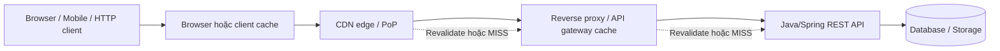
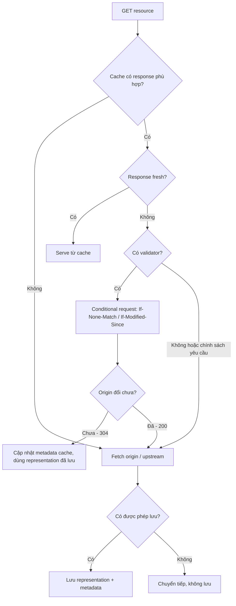
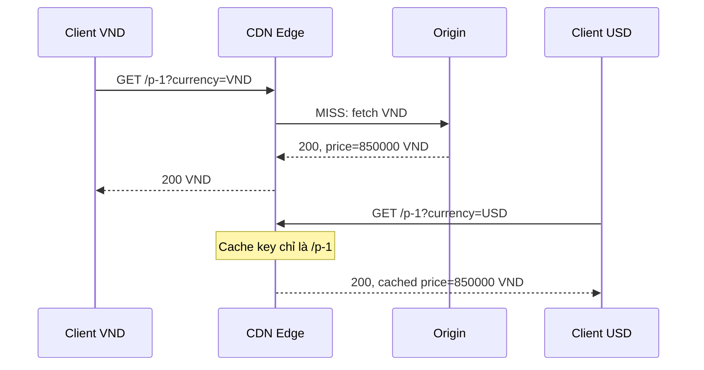

# CDN, reverse proxy và kiểm chứng header thực tế

## 1. Vì sao cấu hình cache đúng trên giấy vẫn có thể chạy sai?

Một REST API có thể trả dữ liệu được nhiều người đọc, như danh mục sản phẩm, tài liệu công khai hay tập cấu hình ít thay đổi. Khi mọi yêu cầu đều tới ứng dụng và database, cùng một nội dung có thể bị tính toán và truyền tải lặp lại hàng nghìn lần. **CDN (Content Delivery Network)** và **reverse proxy cache** giúp trả một số phản hồi từ vị trí gần người dùng hoặc tầng trung gian, giảm tải và độ trễ.

Nhưng chỉ thêm một dòng cấu hình `Cache-Control: public, max-age=600` chưa bảo đảm hệ thống đã hoạt động như mong muốn. Có thể CDN vẫn trả `MISS` vì quy tắc route, proxy bỏ qua cache do cookie, hoặc response đang chứa dữ liệu riêng của user nhưng lại bị lưu ở bộ đệm dùng chung.

Một thiết kế cache cần chứng minh được bốn điều:

1. **Dữ liệu nào được phép lưu, ở tầng nào và trong bao lâu?**
2. **Các request nào được xem là cùng một cache key?**
3. **Khi dữ liệu đổi, cache revalidate, hết hạn hoặc purge như thế nào?**
4. **Client thực sự nhận những header và nội dung gì trên đường HTTP?**

Chủ đề này thuộc chương **Bộ nhớ đệm** của module **INTEGRATION_API_REST**, kết nối thiết kế resource/URI, phương thức và status HTTP, phân trang, phân quyền, idempotency, OpenAPI, xử lý lỗi và kiểm thử API bằng Java/Spring hoặc công nghệ tương đương.

### Mục tiêu học tập

Sau bài này, bạn cần có thể:

- Phân biệt **browser cache**, **reverse proxy**, **CDN edge** và origin/application cache.
- Đọc và vận dụng các chỉ thị `Cache-Control`, `ETag`, `Last-Modified`, `Vary`, `Age` và những status như `200`, `304`, `206`.
- Thiết kế cache key theo URI, query string, content negotiation và phạm vi quyền.
- Kiểm chứng **HIT, MISS, revalidation và bypass** bằng HTTP request thực tế.
- Tạo response cacheable an toàn với Spring Boot và cấu hình reverse proxy minh họa.
- Nhận diện nguy cơ **cache poisoning**, **cache deception**, rò rỉ dữ liệu đa tenant và lỗi vô hiệu hóa cache.
- Xây dựng kiểm thử, metric và kế hoạch rollout/purge cho dữ liệu công khai và dữ liệu riêng tư.

## 2. Bản đồ các tầng cache trên đường request



Không phải hệ thống nào cũng có đủ các tầng trong sơ đồ. Có thể chỉ có browser và origin, hoặc CDN trực tiếp gọi Spring, hoặc nhiều tầng reverse proxy và service mesh.

| Tầng | Vị trí và quyền kiểm soát | Thường tối ưu gì? | Rủi ro chính |
|---|---|---|---|
| **Client/browser cache** | Thiết bị người dùng; HTTP cache riêng (private) | Giảm network request/bytes | Dữ liệu cũ trên client, khó kiểm soát xóa bản lưu |
| **CDN edge** | Nhiều điểm hiện diện gần người dùng; thường là cache dùng chung | Latency toàn cầu, băng thông và tải origin | Key sai, dữ liệu cá nhân bị lưu chung, nhiều PoP không đồng bộ |
| **Reverse proxy cache** | Trước origin, thường trong một region/hạ tầng tổ chức | Offload ứng dụng, giảm tải upstream | Bypass sai, cấu hình route/header, phối hợp cache tầng khác |
| **Application cache** | Trong ứng dụng hoặc cache dữ liệu phân tán | Kết quả tính toán/truy vấn | Invalidating dữ liệu domain, khóa tenant/user, consistency |
| **Database buffer cache** | Trong database engine | Giảm IO đĩa | Không thay thế HTTP response caching |

**HTTP cache** lưu biểu diễn response và áp dụng quy tắc HTTP; **application cache** có thể lưu object hoặc dữ liệu nghiệp vụ, không tự tuân `Cache-Control`. Hai cơ chế khác nhau, có thể kết hợp nhưng cần đo tác động độc lập.

### CDN khác reverse proxy ở đâu?

- **Reverse proxy** là vai trò thành phần nhận yêu cầu trước server và có thể proxy, load-balance, TLS terminate, rate-limit hoặc cache. Không phải reverse proxy nào cũng bật cache.
- **CDN** là một dịch vụ/hệ thống phân phối nội dung qua nhiều vị trí địa lý, thường cung cấp edge caching, chính sách cache key và purge. Một CDN về kỹ thuật cũng có thể đóng vai trò reverse proxy tại edge.
- **Origin** là nguồn nội dung cuối khi những tầng trước không có representation dùng được, ví dụ Java/Spring API hoặc storage.

Tên gọi **không bảo đảm cache đang bật**. Phải kiểm chứng đường request và hành vi thực tế.

## 3. HTTP cache có thể dùng lại response khi nào?

Một cache cần xác định:

1. **Có được lưu response không?** Phụ thuộc method, status, `Cache-Control`, xác thực và chính sách tầng cache.
2. **Request mới có khớp cache key và các header trong `Vary` không?**
3. **Representation đang fresh hay stale?** Dựa vào lifetime và age theo quy tắc HTTP.
4. **Nếu stale, có thể revalidate hoặc phục vụ stale theo chính sách không?**
5. **Có ràng buộc quyền, cookie, tenant hoặc private content nào cấm tái sử dụng không?**



*Sơ đồ giản lược để học; nhiều CDN hỗ trợ stale serving, request collapsing và chính sách khác nhau. Không được suy luận cache đang hoạt động chỉ từ sơ đồ hoặc header gắn trong Spring.*

### Tính chất của phương thức và status

`GET` và `HEAD` là các phương thức điển hình cho cache response. `POST` có khả năng cache theo những điều kiện HTTP cụ thể, nhưng cơ sở hạ tầng phổ biến thường không mặc định lưu mọi response POST. `PUT` và `DELETE` mang ngữ nghĩa thay đổi resource và có quy tắc làm mất hiệu lực response cache liên quan, không phải lựa chọn để “cache kết quả ghi” như một GET thông thường.

Một số status của GET có khả năng được cache theo quy tắc HTTP, kể cả **200** và trong điều kiện phù hợp **404/410**. Điều này cho thấy **không phải chỉ 200 mới có thể bị lưu**. API cần thiết kế cache policy cho lỗi và dữ liệu nhạy cảm, không phó mặc vào default của CDN.

## 4. Cache-Control: chỉ thị quan trọng nhất

`Cache-Control` cho phép origin và client mô tả quy tắc lưu/trả lại response. Phải phân biệt **cache dùng chung (shared)** với **cache riêng (private)**.

| Chỉ thị response | Ý nghĩa thiết kế | Nhận xét thực hành |
|---|---|---|
| `public` | Response có thể được lưu ở cache dùng chung nếu các điều kiện HTTP khác cho phép | Chỉ dùng khi dữ liệu thực sự được phép chia sẻ |
| `private` | Cache dùng chung không được lưu response; cache riêng có thể lưu nếu không bị chỉ thị khác cấm | Phù hợp với nhiều response theo user |
| `no-store` | Cache không được lưu request/response theo phạm vi chỉ thị | Dùng cho thông tin nhạy cảm theo yêu cầu |
| `no-cache` | Cache có thể lưu nhưng **phải revalidate** trước khi dùng lại để đáp ứng request | Không đồng nghĩa “cấm lưu” |
| `max-age=60` | Freshness lifetime tối đa 60 giây cho response theo quy tắc | Cache riêng và dùng chung có thể áp dụng, trừ khi chỉ thị khác ưu tiên |
| `s-maxage=600` | Freshness lifetime cho **shared caches**, có ưu tiên hơn `max-age`/Expires theo quy tắc | Hữu ích khi CDN cần TTL khác browser |
| `must-revalidate` | Khi stale, cache không được tùy ý tái sử dụng mà không revalidate thành công theo quy tắc | Hữu ích khi stale không chấp nhận được |
| `proxy-revalidate` | Tương tự yêu cầu revalidation nhưng dành cho shared cache | Phạm vi hẹp hơn must-revalidate |
| `stale-while-revalidate=30` | Cho phép phục vụ stale trong cửa sổ và revalidate nền khi được hỗ trợ | Đánh đổi freshness lấy latency/availability |
| `stale-if-error=120` | Cho phép dùng stale trong giới hạn khi gặp một số lỗi theo quy tắc | Cần xét rủi ro dữ liệu lỗi thời |

### Bốn ví dụ cần hiểu đúng

**Ví dụ A — Nội dung công khai, có thể lưu ở browser và CDN:**

```http
HTTP/1.1 200 OK
Content-Type: application/json
Cache-Control: public, max-age=60, s-maxage=600
```

Browser có thể xem representation fresh khoảng 60 giây; cache dùng chung có lifetime theo `s-maxage=600` (còn phụ thuộc response age và các điều kiện khác). Đây là **chính sách có chủ đích**, không phải cấu hình phù hợp cho profile riêng của người dùng.

**Ví dụ B — Có thể lưu nhưng phải kiểm tra lại mỗi lần dùng:**

```http
Cache-Control: private, no-cache
ETag: "profile-user42-v9"
```

Một cache riêng có thể lưu, nhưng phải revalidate trước khi tái sử dụng. `private` ngăn cache dùng chung lưu nội dung profile. Điều kiện GET có thể giúp tiết kiệm body nếu origin trả `304`.

**Ví dụ C — Không lưu thông tin nhạy cảm:**

```http
Cache-Control: no-store
```

Phù hợp khi yêu cầu bảo mật không cho phép HTTP cache lưu response. Cần lưu ý việc này **không xóa dữ liệu đã lưu trước đó** ở những cache cũ và không thay thế chính sách log, client storage hoặc quyền truy cập.

**Ví dụ D — Cho phép stale trong khoảng ngắn:**

```http
Cache-Control: public, max-age=30, s-maxage=300, stale-while-revalidate=30
```

Phù hợp với dữ liệu công khai có thể chấp nhận cũ ngắn hạn. Không áp dụng máy móc cho giá thanh toán theo người dùng, tồn kho cần chính xác tức thời, thông tin quyền truy cập hoặc dữ liệu bảo mật.

### Các nhầm lẫn phổ biến

- **`no-cache` không có nghĩa `no-store`**.
- **`max-age=0` không cấm lưu**; representation có thể lập tức stale và cần kiểm tra lại.
- **`public` không phải chỉ thị cho mọi API GET**; response có session/cookie/authorization vẫn cần xem xét chính sách và dữ liệu.
- **`s-maxage` không bảo đảm CDN sẽ cache** nếu CDN route bị bypass, status không cho phép, body quá lớn hoặc cấu hình khác can thiệp.
- **Cache-Control header có thể bị chỉnh ở proxy/CDN**. Phải xem header **client nhận thực tế**.

## 5. Phân biệt browser TTL và shared-cache TTL

Một trang danh mục có thể đổi khoảng vài phút một lần. Ta muốn:

- Browser revalidate sau 30 giây để người dùng ít nhận nội dung cũ lâu.
- CDN edge phục vụ cùng biểu diễn công khai trong 5 phút để giảm tải origin.

Một response minh họa:

```http
HTTP/1.1 200 OK
Cache-Control: public, max-age=30, s-maxage=300
ETag: "catalog-v27"
Vary: Accept-Encoding
Content-Type: application/json
```

Giả sử response vừa được tạo và không có ràng buộc khác, cache riêng áp `max-age=30` và shared cache có thể áp `s-maxage=300`. **Age của response** có thể làm giảm freshness còn lại.

Không nên giải thích `s-maxage=300` là “CDN chắc chắn lưu đúng 5 phút”: nhiều nhà cung cấp có quy tắc cache policy, Edge TTL, bypass, custom cache key hoặc tối ưu riêng. Thực tế cần xác minh tại đường request.

### Vậy CDN-Cache-Control hay Surrogate-Control là gì?

Một số CDN hỗ trợ **header hoặc cấu hình riêng** để điều khiển edge cache, chẳng hạn `CDN-Cache-Control` hoặc `Surrogate-Control` ở những môi trường phù hợp. Mức hỗ trợ và thứ tự ưu tiên khác nhau theo sản phẩm/phiên bản.

Không tự cho rằng mọi reverse proxy hiểu các header đó. Nếu dùng, phải có **ma trận chính sách cụ thể của nhà cung cấp**, kiểm thử đường đi thực và xác nhận header có được chuyển tiếp tới browser hay không. Khi không có yêu cầu đặc biệt, ưu tiên giải thích đúng HTTP `Cache-Control` trước.

## 6. ETag, Last-Modified và conditional GET

TTL giúp tránh request trong thời gian fresh. Khi stale, **revalidation** có thể giảm băng thông bằng cách không chuyển lại body nếu nội dung chưa thay đổi.

### ETag

Origin trả:

```http
HTTP/1.1 200 OK
Content-Type: application/json
ETag: "catalog-v27"
Cache-Control: public, max-age=30, s-maxage=300

{"version":27,"items":[{"id":"p-1","name":"USB-C Hub"}]}
```

Client/cache gửi:

```http
GET /public/catalog HTTP/1.1
If-None-Match: "catalog-v27"
```

Nếu validator vẫn khớp theo ngữ nghĩa conditional GET:

```http
HTTP/1.1 304 Not Modified
ETag: "catalog-v27"
Cache-Control: public, max-age=30, s-maxage=300
```

**304 không có response body**. Cache dùng representation đã lưu và cập nhật metadata theo quy tắc. Một CDN sau khi revalidate có thể trả **200 kèm body từ cache** cho downstream, dù upstream vừa trả 304; vì vậy không nên mặc định client luôn nhìn thấy 304.

### ETag mạnh và yếu

- **Strong ETag** ví dụ `"catalog-v27"`: validator mạnh phải phản ánh sự tương đương byte-level thích hợp của representation.
- **Weak ETag** ví dụ `W/"catalog-v27"`: biểu thị tương đương về mặt ngữ nghĩa nhưng không cam kết byte-for-byte.

Với conditional `GET` bằng `If-None-Match`, phép so sánh ETag yếu có thể phù hợp. Với cập nhật đồng thời `PUT/PATCH + If-Match`, HTTP dùng **strong comparison**, nên không dùng weak ETag làm cơ chế tránh lost update. Một chuỗi version tự chế chưa chắc là strong validator đúng nếu payload thay đổi mà version không đổi.

### Last-Modified và If-Modified-Since

```http
HTTP/1.1 200 OK
Last-Modified: Tue, 17 Nov 2026 09:00:00 GMT
Cache-Control: public, max-age=60
```

Request sau:

```http
GET /public/catalog HTTP/1.1
If-Modified-Since: Tue, 17 Nov 2026 09:00:00 GMT
```

Nếu representation không mới hơn thời điểm áp dụng, server có thể trả 304. Tuy nhiên độ phân giải thời gian, thay đổi nhiều lần trong một giây và clock skew có thể khiến timestamp không đủ mạnh. ETag thường phù hợp hơn với representation có version/hash đáng tin.

Khi `If-None-Match` và `If-Modified-Since` cùng xuất hiện, quy tắc HTTP ưu tiên **`If-None-Match`** khi áp dụng; không nên viết controller kiểm tra cả hai độc lập rồi trả 304 không nhất quán.

## 7. Vary: những request khác nhau có thực sự cùng representation?

`Vary` mô tả **request header** ảnh hưởng tới việc chọn representation. Một cache có response trước đó chỉ được tái sử dụng khi các điều kiện matching liên quan được đáp ứng.

Ví dụ cùng URI nhưng ngôn ngữ khác:

```http
GET /public/help HTTP/1.1
Accept-Language: vi
```

```http
HTTP/1.1 200 OK
Content-Language: vi
Vary: Accept-Language
Cache-Control: public, max-age=300
```

Khi client khác gửi `Accept-Language: en`, cache cần chọn representation thích hợp, không phát nội dung tiếng Việt từ biến thể trước nếu không khớp.

| Header trong Vary | Khi nào cần xét | Đánh đổi |
|---|---|---|
| `Accept-Encoding` | Nội dung được nén gzip/br hoặc không nén | Các biến thể nén khác nhau |
| `Accept-Language` | Nội dung dịch theo ngôn ngữ request | Tăng số biến thể và giảm hit ratio |
| `Accept` | JSON, HAL, XML hoặc media type được hỗ trợ | Tránh phát sai loại representation |
| `Origin` | Response CORS thay đổi theo Origin | Tránh sai Access-Control-Allow-Origin khi cache |
| `Cookie` | Representation phụ thuộc cookie | Dễ làm key phình to; thường nên tránh cache chung dữ liệu cá nhân |
| `Authorization` | Dữ liệu thay đổi theo credential | **Không nên coi Vary là giải pháp an toàn đủ để cache dữ liệu riêng trên CDN** |

Đặc biệt, **`Vary: Authorization` không tự làm response có Authorization được phép lưu ở shared cache**. HTTP có quy tắc riêng cho response của request mang Authorization, và cache vendor có thể xử lý khác nhau. Với dữ liệu private, dùng chính sách `private`/`no-store` hoặc bypass rõ ràng, không chỉ thêm Vary.

`Vary: *` nói representation phụ thuộc yếu tố mà cache không thể so khớp bằng header thông thường, hạn chế khả năng tái sử dụng; không nên dùng làm “cách tắt cache” thay cho `no-store`.

### Query string không nằm trong Vary

`Vary` nói về **request headers**, không phải query parameter. URI gồm query string thường là một phần của cache key mặc định, nhưng CDN có thể cấu hình bỏ qua, sắp xếp hoặc chỉ chọn một số query parameter. Vì vậy `GET /products?currency=VND` và `?currency=USD` có nguy cơ nhận sai dữ liệu nếu edge **bỏ qua `currency` trong key**, dù `Vary` có đầy đủ.

## 8. Cache key: định nghĩa cái gì được coi là “cùng request”

Cache key thường dựa trên phương thức và URI hiệu lực (scheme/host/path/query), kèm logic lựa chọn representation theo `Vary`. Nhưng các CDN/reverse proxy cung cấp tùy chọn **cache key riêng** nên không được đoán.

Các yếu tố có thể làm thay đổi kết quả:

- Hostname: `api.example.test` khác `static.example.test`.
- Path và trailing slash: `/catalog` vs `/catalog/`.
- Query filter/sort/page/currency/locale: `?category=books`, `?page=2`.
- Header `Accept`, `Accept-Language`, `Accept-Encoding`.
- Quy tắc versioning: URI file có hash hay version trong path.
- Cookies/Authorization: thường phải bypass cho response riêng người dùng.
- Header tùy biến như `X-Tenant-ID` nếu thực sự được dùng để chọn dữ liệu; cần trust boundary và không dựa riêng vào một header do client tự khai.

Ví dụ **sai nghiêm trọng**:

```text
Request A:
GET /orders?tenant=A
Authorization: Bearer token-A

Request B:
GET /orders?tenant=B
Authorization: Bearer token-B

CDN cache key bị cấu hình chỉ gồm "/orders"
=> Response của tenant A có thể bị phát cho tenant B.
```

Đây là lỗi bảo mật do cache key/scope, **không phải chỉ lỗi hiệu năng**.

### Quy tắc an toàn

1. Ưu tiên CDN cache cho **tài nguyên công khai, không phụ thuộc danh tính**.
2. Với response theo user/tenant, mặc định **không lưu ở shared cache** trừ khi có thiết kế quyền và isolation được thẩm định riêng.
3. Không tin query parameter `tenantId` như nguồn phân quyền; server phải xác định quyền từ danh tính đã xác thực.
4. Nếu response khác nhau theo header, xác minh `Vary` và cấu hình cache key của từng tầng.
5. Không đưa token, mật khẩu hoặc bí mật vào URL/query string để “cache dễ hơn”.
6. Kiểm thử URL encoding, case, query reorder và các biến thể được CDN canonicalize.
7. Khi cache key bị đổi, đánh giá dữ liệu cũ và kế hoạch purge để tránh tái sử dụng sai.

## 9. Authorization và cookie: ranh giới bảo mật cache

Response cho `GET /me` hoặc `GET /orders` sau xác thực có thể chứa dữ liệu cá nhân. **Không cấu hình shared cache mặc định** chỉ vì request là GET.

```http
HTTP/1.1 200 OK
Content-Type: application/json
Cache-Control: private, no-store
Vary: Accept

{"id":"u-42","email":"person@example.test"}
```

`private, no-store` ở đây thể hiện chính sách thận trọng. `no-store` đã ngăn lưu ở cache theo quy tắc; `private` nhấn mạnh không được sử dụng shared cache. Với dữ liệu ít nhạy cảm, có thể chọn `private, no-cache` để cache riêng revalidate; lựa chọn phụ thuộc yêu cầu bảo mật.

### Request có Authorization có thể được shared cache lưu không?

Theo HTTP caching, response của request mang `Authorization` thông thường **không được shared cache tái sử dụng** trừ khi có các chỉ thị response phù hợp cho phép, ví dụ `public`, `s-maxage` hoặc `must-revalidate` trong những điều kiện được quy định. Đây là **khả năng của giao thức**, không phải khuyến nghị đem dữ liệu user riêng vào CDN.

Cách an toàn cho bài toán REST thông thường:

- Dữ liệu **công khai thật sự**: cung cấp endpoint công khai riêng không cần token/cookie khi có thể.
- Dữ liệu **cá nhân hoặc tenant-specific**: trả `private`/`no-store` hoặc cấu hình CDN bypass rõ ràng.
- Nếu buộc dùng shared cache theo tenant: thiết kế cách xác định tenant ở trusted edge, khóa cache và policy, cách revoke quyền, key rotation, purge, audit; kiểm thử cross-tenant trước khi dùng production.

### Set-Cookie

Một số proxy/CDN mặc định **không cache** response có `Set-Cookie`, hoặc xử lý theo quy tắc riêng. Không được giả định mọi vendor đều giống nhau. Bật “cache everything” cho HTML/API có session cookie có thể gây rò rỉ dù ứng dụng trả `200` hợp lệ.

**Không dùng `Vary: Cookie` như cách sửa chung**: cookie có thể chứa nhiều giá trị, tạo vô số biến thể và vẫn có rủi ro nếu CDN bỏ qua/chuẩn hóa sai. Với user-private responses, ưu tiên bypass.

## 10. CDN: edge POP, origin và các trạng thái cache

Một CDN có thể hoạt động theo các bước:

1. Client DNS/TLS kết nối tới edge gần hoặc phù hợp chính sách điều hướng.
2. Edge kiểm tra quy tắc route: request này có được cache không?
3. Tạo cache key từ URL, header và rule.
4. Nếu **HIT**, trả representation còn fresh (hoặc stale nếu chính sách cho phép).
5. Nếu **MISS**, fetch origin/upper tier, kiểm tra cacheability rồi lưu nếu hợp lệ.
6. Nếu stale, CDN có thể revalidate với ETag/Last-Modified hoặc fetch mới.
7. Nếu bị **BYPASS**, request đi qua mà không sử dụng/lưu cache theo quy tắc cụ thể.

### Các thuật ngữ khi chẩn đoán

| Thuật ngữ | Ý nghĩa phổ biến | Cần kiểm tra thêm |
|---|---|---|
| **HIT** | Một tầng cache đã phục vụ response lưu sẵn | Tầng nào? Response có đúng quyền/filter/freshness không? |
| **MISS** | Không có entry dùng được tại tầng báo trạng thái | Có thể upper tier vẫn HIT; query key có khớp không? |
| **BYPASS** | Rule chủ động bỏ qua cache | Do cookie, auth, path, request header hay policy? |
| **EXPIRED** | Entry hết freshness; cần fetch/revalidate | Có được phục vụ stale không? |
| **REVALIDATED** | Cache kiểm tra lại với upstream/origin | Origin có thể trả 304; client không nhất thiết thấy 304 |
| **STALE** | Dữ liệu lưu cũ được phục vụ theo cơ chế cho phép | Có hợp quy tắc freshness/an toàn không? |
| **DYNAMIC** hoặc tương tự | Nhà cung cấp coi response là không cache theo rule | Không phải tên trạng thái chuẩn HTTP |

**Các tên HIT/MISS/... thường xuất hiện trong header do nhà cung cấp tự định nghĩa**, không phải một bộ giá trị chuẩn mà mọi CDN bắt buộc dùng.

### Phân biệt POP và multi-tier

Yêu cầu đầu tại edge A có thể MISS, nhưng cache của tier trung gian HIT; request từ địa điểm khác tới edge B lại MISS. Không nên đánh giá cache hit ratio toàn hệ thống bằng hai request từ một máy. Cần số liệu theo POP, cache tier, URL class, status và thời gian, kèm hiểu biết về cơ chế định tuyến.

## 11. Reverse proxy cache: ví dụ với NGINX

Reverse proxy có thể đứng trước Java/Spring origin để giảm tải API đọc công khai. Ví dụ NGINX **mang tính minh họa**, chỉ áp dụng cho một đường dẫn **được chứng minh là public**:

```nginx
http {
    proxy_cache_path /var/cache/nginx/public-api
        levels=1:2
        keys_zone=public_api:10m
        max_size=1g
        inactive=10m
        use_temp_path=off;

    upstream catalog_origin {
        server catalog-app:8080;
    }

    server {
        listen 8080;

        location = /public/catalog {
            proxy_pass http://catalog_origin;

            proxy_cache public_api;
            proxy_cache_methods GET HEAD;
            proxy_cache_key "$scheme$request_method$host$request_uri";

            # Không dùng cache khi request mang credential/cookie.
            proxy_cache_bypass $http_authorization $http_cookie;
            proxy_no_cache     $http_authorization $http_cookie;

            # Hỗ trợ giảm request đồng thời cho cùng cache key.
            proxy_cache_lock on;

            # Chỉ là header chẩn đoán của tầng NGINX này.
            add_header X-Proxy-Cache $upstream_cache_status always;
        }
    }
}
```

**Cần hiểu giới hạn của đoạn cấu hình:**

- Đây không phải bản cấu hình có thể đưa thẳng vào production. Cần đầy đủ TLS, trusted proxy, Host validation, logging, upstream health checks, route rules, kiểm soát access và quy định dữ liệu.
- `location = /public/catalog` chỉ áp cho URI path chính xác này (query string không làm đổi cách match location); các subresource phải được review và cấu hình riêng, không tự mở rộng cache theo prefix.
- Không dùng `proxy_ignore_headers Cache-Control` để ép cache bất chấp `private`/`no-store`. NGINX thông thường còn xét header response như `Set-Cookie` và quy tắc khác.
- Đoạn ví dụ không định nghĩa TTL cưỡng bức bằng `proxy_cache_valid`: origin cần trả các header caching phù hợp. Chính sách TTL tại proxy phải được thiết kế rõ, nhất quán với origin và yêu cầu dữ liệu.
- `proxy_cache_key` và `proxy_cache_bypass`/`proxy_no_cache` phải được thử với query/filter khác nhau. Không coi config là bằng chứng đã an toàn.
- `X-Proxy-Cache` phản ánh **tầng NGINX này**, không phải CDN phía trước; client có thể không nhìn thấy nếu proxy/CDN gỡ header.
- Không mở đường dẫn cache chỉ dựa trên prefix nếu vẫn có tài nguyên riêng tư dưới cùng namespace.

### `proxy_cache_bypass` và `proxy_no_cache` khác nhau

Với NGINX:

- `proxy_cache_bypass` kiểm soát **không sử dụng entry có sẵn để trả request** trong điều kiện đã nêu.
- `proxy_no_cache` kiểm soát **không lưu response** trong cache ở điều kiện đã nêu.

Khi mục tiêu là bỏ qua cache cho request có credential/cookie, nên xem xét **cả hai chiều** đọc và ghi, đồng thời kiểm tra response policy. Chỉ bypass mà vẫn lưu response có thể gây hậu quả ngoài ý muốn trong một số cấu hình.

## 12. Spring Boot: trả header từ controller đúng hợp đồng

Một endpoint public catalog có thể do Spring sinh metadata cache:

```java
import java.time.Duration;
import org.springframework.http.CacheControl;
import org.springframework.http.ResponseEntity;
import org.springframework.web.bind.annotation.GetMapping;
import org.springframework.web.bind.annotation.RequestMapping;
import org.springframework.web.bind.annotation.RestController;
import org.springframework.web.context.request.WebRequest;

@RestController
@RequestMapping("/public/catalog")
public class PublicCatalogController {

    private final CatalogService catalog;

    public PublicCatalogController(CatalogService catalog) {
        this.catalog = catalog;
    }

    @GetMapping
    public ResponseEntity<CatalogView> getCatalog(WebRequest request) {
        CatalogView view = catalog.currentPublicView();

        // Phải đổi mỗi khi representation công khai thay đổi.
        String etag = "\"" + view.representationVersion() + "\"";

        CacheControl policy = CacheControl
                .maxAge(Duration.ofSeconds(60))
                .sMaxAge(Duration.ofMinutes(5))
                .cachePublic();

        if (request.checkNotModified(etag)) {
            return ResponseEntity.status(304)
                    .eTag(etag)
                    .cacheControl(policy)
                    .build();
        }

        return ResponseEntity.ok()
                .cacheControl(policy)
                .eTag(etag)
                .body(view);
    }
}
```

**Lưu ý kỹ thuật:**

1. `CatalogService` và `CatalogView` là các kiểu ứng dụng minh họa; cần định nghĩa riêng.
2. `view.representationVersion()` phải phản ánh **đúng representation** của resource ở URI đó: dữ liệu, projection, giá/thuộc tính công khai, biến thể locale và những thông tin có thể làm body thay đổi.
3. `WebRequest.checkNotModified(etag)` sử dụng conditional request. Kiểm tra hành vi cuối ở phiên bản Spring đang chạy; không tự thực hiện so sánh chuỗi ETag thủ công nếu có hỗ trợ framework đúng.
4. Việc tạo `CatalogView` trước khi kiểm tra ETag có thể vẫn tốn DB/CPU. Một tối ưu là lấy version/metadata rẻ trước rồi chỉ tạo body khi cần, với đảm bảo version đúng.
5. `sMaxAge`/`cachePublic` là API của Spring `CacheControl`; kiểm tra dependency/phiên bản tương thích và HTTP header được sinh ra thay vì suy từ code.
6. Không áp chính sách này cho dữ liệu theo người dùng hoặc tenant. Nếu request có Authorization nhưng representation là public, phải hiểu thêm quy tắc shared cache/edge để không phát sai dữ liệu.
7. Lớp security/filter, gateway, reverse proxy và CDN vẫn có thể bổ sung hoặc thay đổi cache header.

### Tránh ETag dựa trên một trường chưa đủ

Nếu representation gồm `name` và `price`, ETag chỉ tăng khi `name` đổi sẽ làm client nhận 304 khi `price` đã thay đổi. Với catalog nhiều phần tử, version cần đại diện cho tất cả dữ liệu ảnh hưởng tới response, hoặc dùng fingerprint/hashing của representation có kiểm soát.

Nếu response thay đổi theo `Accept-Language` hoặc `Accept`, cần có biến thể validator và `Vary` phù hợp, hoặc tách URI resource rõ ràng.

### Spring Security có thể bổ sung Cache-Control

Các cấu hình Spring Security có thể mặc định đặt header chống cache cho một số response, hoặc filter/proxy thay đổi header. **Luôn kiểm tra actual HTTP response** sau khi security filters, servlet container, gateway và CDN. Đừng chỉ assert object `CacheControl` được xây trong unit test rồi kết luận CDN nhận đúng chỉ thị.

## 13. Spring Boot: dữ liệu user-private phải khác public catalog

Một resource `/me` có dữ liệu cá nhân:

```java
import org.springframework.http.CacheControl;
import org.springframework.http.ResponseEntity;
import org.springframework.web.bind.annotation.GetMapping;

@GetMapping("/me")
public ResponseEntity<ProfileView> getMyProfile(
        AuthenticatedPrincipal principal) {

    ProfileView profile = profileService.visibleProfile(principal);

    return ResponseEntity.ok()
            .cacheControl(CacheControl.noStore())
            .body(profile);
}
```

Kiểu `AuthenticatedPrincipal`, `ProfileView` và `profileService` là minh họa; áp đúng cơ chế authentication và authorization của ứng dụng.

**Mục tiêu của `no-store`** là không cho HTTP cache lưu nội dung nhạy cảm. Quy tắc này không thay thế hạn chế log, protection ở browser storage và bảo mật connection. Một API khác có thể chọn `private, no-cache` nếu lưu trong browser cache riêng được phép theo yêu cầu nghiệp vụ; phải quyết định rõ thay vì sao chép một header cho mọi endpoint.

### Khuyến nghị phân loại endpoint

| Resource | Chính sách gợi ý | Lý do |
|---|---|---|
| `GET /public/catalog` | `public, max-age=60, s-maxage=300` | Nội dung công khai, dùng chung được |
| `GET /public/docs/{version}` | TTL dài nếu URI versioned/immutable | Có cơ chế đổi URL khi nội dung đổi |
| `GET /me` | `no-store` hoặc private theo chính sách | Dữ liệu user |
| `GET /orders` | `private`/`no-store`, CDN bypass theo auth | Dữ liệu theo quyền/tenant |
| `GET /public/search?query=...` | TTL ngắn, key theo query; giới hạn cardinality | Query nhiều biến thể và tính mới |
| `GET /public/products/{id}` | TTL hợp lý + ETag + purge khi cập nhật | Có sự thay đổi sản phẩm |
| `POST /payments` | Không thiết kế cache response như GET công khai | Side effect/idempotency quan trọng |

Các con số TTL chỉ là ví dụ; cần đo yêu cầu freshness, tần suất cập nhật và khả năng purge của từng hệ thống.

## 14. Kiểm chứng header thực tế bằng curl.exe

**Nguồn chân lý là HTTP response thực tế trên đường client đang dùng**, không phải annotation, cấu hình CDN trong UI hay tài liệu tuyên bố.

Trên **Windows PowerShell 5.1**, `curl` có thể là alias của `Invoke-WebRequest`. Để dùng cú pháp curl phổ biến, nên gọi rõ **`curl.exe`**. Các lệnh dưới dùng miền ví dụ `api.example.test`, không phải dịch vụ thật; cần thay bằng URL môi trường kiểm thử được phép.

### Bước 1 — Gọi cùng URL hai lần, không ép revalidation

```powershell
curl.exe -sS -D - -o NUL -H "Accept: application/json" "https://api.example.test/public/catalog?category=books"

curl.exe -sS -D - -o NUL -H "Accept: application/json" "https://api.example.test/public/catalog?category=books"
```

- `-D -`: in header response ra stdout.
- `-o NUL`: trên Windows bỏ phần body để dễ quan sát header; **yêu cầu vẫn là GET**, không phải HEAD.
- `-sS`: không in progress bar nhưng vẫn hiện lỗi kết nối.
- Hai lần phải giữ **cùng scheme, host, path, query và các header liên quan**. Nếu thay `Accept` hoặc địa điểm/edge, kết quả có thể khác.

Đây là cách tốt hơn việc dùng ngay `curl.exe -I` khi mục tiêu là xác minh GET caching: `-I` gửi **HEAD**, có thể đi qua cache rule và upstream behavior khác.

### Bước 2 — Quan sát header quan trọng

Ví dụ minh họa lần đầu:

```http
HTTP/1.1 200 OK
Date: Wed, 18 Nov 2026 11:00:00 GMT
Cache-Control: public, max-age=60, s-maxage=300
ETag: "catalog-v27"
Vary: Accept-Encoding
Age: 0
X-Cache: MISS
Content-Type: application/json
```

Lần thứ hai, cùng đường edge và cùng cache key:

```http
HTTP/1.1 200 OK
Date: Wed, 18 Nov 2026 11:00:00 GMT
Cache-Control: public, max-age=60, s-maxage=300
ETag: "catalog-v27"
Vary: Accept-Encoding
Age: 4
X-Cache: HIT
Content-Type: application/json
```

**Đây là output giả định để giải thích**, không phải kết quả chạy thực tế. `X-Cache` do proxy/CDN định nghĩa; không phải header chuẩn cho mọi nền tảng. `Age` thường biểu thị tuổi ước tính của response khi được truyền qua cache dùng chung.

Không phải lúc nào HIT cũng làm `Age` tăng theo từng giây một cách đơn giản: khác PoP/tier, revalidation, clock, vendor implementation và response được tạo lại có thể dẫn tới sự khác biệt.

### Bước 3 — Ghi lại đủ các trường

| Header/quan sát | Nó giúp kiểm chứng gì? | Giới hạn suy luận |
|---|---|---|
| `Cache-Control` | Origin/intermediary đang công bố chính sách lưu/revalidation nào | Không chứng minh cache đã thực hiện |
| `Age` | Ước lượng tuổi response qua shared cache | Vắng mặt hoặc bằng 0 không tự chứng minh MISS |
| `ETag` | Validator cho representation | Không chứng minh ETag phản ánh đầy đủ nội dung |
| `Last-Modified` | Validator thời gian khi được dùng | Có giới hạn độ phân giải/tính chính xác |
| `Vary` | Các request header ảnh hưởng cache matching | Không thể hiện mọi custom CDN cache key |
| `Date` | Thời điểm tạo response theo HTTP | Không thể dùng một mình để suy TTL |
| `Via` | Có thể cho biết hop trung gian | Nhiều hạ tầng ẩn/bỏ hoặc tùy biến |
| `X-Cache`/`CF-Cache-Status` | Trạng thái ở tầng/vendor cụ thể nếu có | Không chuẩn hóa; có thể phản ánh một tầng |
| `Server`/`X-Served-By` | Gợi ý đường đi khi hạ tầng phát header | Có thể ẩn vì bảo mật; không đủ xác định cache |
| Body hash/`ETag` trước–sau | Dữ liệu thực sự thay đổi hay không | Phải so cùng URI/headers và quyền |
| Latency | HIT thường giảm thời gian, tùy mạng | Thời gian thấp **không chứng minh** HIT |

### Bước 4 — Đọc body khi cần

Khi kiểm tra rò rỉ dữ liệu, variant hoặc độ mới, **không chỉ xem header**:

```powershell
curl.exe -sS -i -H "Accept: application/json" "https://api.example.test/public/catalog?category=books"
```

`-i` in header kèm body. Với dữ liệu nhạy cảm, chỉ thực hiện trong môi trường/test account được phép và tránh lưu token/body vào log chia sẻ.

## 15. Kiểm tra revalidation bằng If-None-Match

Nếu lần GET đầu trả:

```http
ETag: "catalog-v27"
Cache-Control: public, max-age=60
```

Gửi conditional GET:

```powershell
curl.exe -sS -D - -o NUL -H 'If-None-Match: "catalog-v27"' "https://api.example.test/public/catalog"
```

Với ETag vẫn khớp, client có thể thấy:

```http
HTTP/1.1 304 Not Modified
ETag: "catalog-v27"
Cache-Control: public, max-age=60
```

Tuy nhiên, một CDN có thể dùng cache của chính nó rồi phản hồi khác tùy đường revalidation, và các header được middleware chỉnh sửa. Không dùng một request duy nhất để chứng minh chính sách toàn hệ thống.

### Có nên gửi request `Cache-Control: no-cache` khi test HIT?

Một request có:

```powershell
curl.exe -sS -D - -o NUL -H "Cache-Control: no-cache" "https://api.example.test/public/catalog"
```

có thể **ép cache thực hiện revalidation** hoặc đi qua cách xử lý khác, tùy tầng. Do đó nếu bạn muốn quan sát **HIT bình thường**, đừng gửi request header no-cache ngay từ đầu. Dùng nó trong **bước kiểm tra revalidation có chủ đích**, và ghi rõ kết quả phụ thuộc CDN/proxy implementation.

Tương tự, thêm query ngẫu nhiên `?cacheBust=123` sẽ làm đổi cache key ở nhiều cấu hình, biến test thành kiểm tra MISS cho key mới; không dùng random query trong test HIT trừ khi đó là mục tiêu thí nghiệm.

## 16. Kiểm thử Vary và cache key qua hai biến thể

### Nội dung nhiều ngôn ngữ

```powershell
curl.exe -sS -i -H "Accept-Language: vi" "https://api.example.test/public/help"
curl.exe -sS -i -H "Accept-Language: en" "https://api.example.test/public/help"
```

Kiểm tra:

- `Vary: Accept-Language` nếu representation phụ thuộc header.
- `Content-Language` phù hợp khi được sử dụng.
- Body tiếng Việt không bị phát cho request tiếng Anh.
- Không có cache hit sai ở các request xen kẽ vi/en/vi.

### Nhiều kiểu biểu diễn

```powershell
curl.exe -sS -i -H "Accept: application/json" "https://api.example.test/public/catalog"
curl.exe -sS -i -H "Accept: application/hal+json" "https://api.example.test/public/catalog"
```

Nếu endpoint hỗ trợ hai representation, cần `Content-Type` và `Vary: Accept` hoặc cơ chế key tương đương đúng quy tắc. Không được phát JSON thuần với header `application/hal+json` chỉ vì CDN đang giữ một variant cũ.

### Query parameter

```powershell
curl.exe -sS -i "https://api.example.test/public/products?currency=VND"
curl.exe -sS -i "https://api.example.test/public/products?currency=USD"
```

So sánh giá/trường tiền tệ, không chỉ `HIT/MISS`. Nếu edge cache key vô tình bỏ qua `currency`, một response HIT có thể **nhanh nhưng sai**.

## 17. Kiểm chứng dữ liệu private không bị chia sẻ

Kiểm thử caching chỉ thật sự an toàn khi có tình huống **hai người dùng/tenant có quyền và dữ liệu khác nhau**.

### Kịch bản kiểm thử A/B

1. Tạo hai tài khoản test `userA` và `userB` trong môi trường được phép; bảo đảm dữ liệu profile/đơn hàng khác nhau.
2. User A gọi `GET /me` hoặc `GET /orders` qua đường CDN/gateway thật, ghi status, header và dữ liệu thuộc A.
3. User B gọi **cùng URI** với credential khác; tuyệt đối không được nhận dữ liệu hoặc các trường quyền của A.
4. Gọi lặp để phát hiện behavior sau một lần response đã có trong cache.
5. Lặp qua các query/filter/Accept/locale, và sau khi đổi quyền truy cập để kiểm tra cache invalidation.
6. Quan sát CDN rule/bypass hoặc privacy headers; đánh giá cả body và `_links` nếu dùng hypermedia.

Ví dụ hai request với token thử nghiệm:

```powershell
curl.exe -sS -i -H "Authorization: Bearer TOKEN_TEST_USER_A" "https://api.example.test/me"
curl.exe -sS -i -H "Authorization: Bearer TOKEN_TEST_USER_B" "https://api.example.test/me"
```

**Không dùng token thật trong ví dụ, screenshot, log chat hoặc script chia sẻ.** Trong hệ thống thực, tránh để credential xuất hiện trong lịch sử shell nếu chính sách yêu cầu; dùng biến môi trường/test harness bảo mật tương ứng.

### Điều kiện chấp nhận

- B không nhận dữ liệu riêng A, kể cả khi response A được cache tại bất kỳ tầng nào.
- `Cache-Control` cho resource private đúng chính sách, và CDN bypass/không lưu trong thực tế.
- Trạng thái không bị chia sẻ sai ngay cả khi A/B cùng `Accept`/query path.
- Nếu quyền bị thu hồi, response không tiếp tục cho phép xem dữ liệu qua cache ngoài cửa sổ chấp nhận.
- Không dựa vào `X-Cache: MISS` một lần để kết luận an toàn: cần kiểm thử lặp, nội dung và cache key.

## 18. Cache poisoning, cache deception và những cách tự làm sai

### Cache poisoning

Kẻ tấn công cố khiến shared cache lưu một response độc hại hoặc không đúng, rồi phát cho người dùng khác.

Ví dụ, origin có thể dùng header `X-Forwarded-Host` không tin cậy để tạo absolute URL trong body, nhưng CDN không đưa header này vào key. Kẻ tấn công làm origin tạo link sai và cache lưu representation đó dưới key chung.

**Phòng tránh:** chỉ tin forwarded headers từ proxy được cấu hình, canonicalize host, kiểm soát những request header ảnh hưởng response, thiết kế `Vary`/cache key phù hợp và không cache response sinh từ dữ liệu không tin cậy khi chưa được kiểm soát.

### Cache deception

Một route có dữ liệu user riêng như `/account/statement.pdf` bị CDN coi là static/public chỉ vì extension `.pdf` hoặc path rule quá rộng. Nếu response lưu dưới shared key, người khác có thể truy xuất nhầm dữ liệu.

**Phòng tránh:** cache theo danh mục resource đã review, không chỉ theo đuôi file; bắt buộc response policy cho private content, CDN bypass theo route/credential và test cross-user.

### Vary và encoding mismatch

Một tầng phục vụ `Content-Encoding: br` cho client không chấp nhận Brotli hoặc trả `Content-Type: application/json` cho HAL body. Đây là vấn đề key/representation negotiation và có thể phá client dù status là 200.

### URL và query canonicalization

Hai URL có cùng ý nghĩa logic có thể được cache riêng, làm giảm HIT; nguy hiểm hơn, hai URL **khác ý nghĩa** bị chuẩn hóa thành cùng key có thể phát sai dữ liệu. Cần kiểm tra cách CDN xử lý:

- Query parameter order và duplicate keys.
- URL-encoded path/query.
- Chữ hoa/thường của path khi origin phân biệt.
- Query filter, currency, locale, phân trang.
- Headers quyết định representation.

**Hiệu năng cache không thể đánh đổi lấy tính đúng đắn và bảo mật.**

## 19. Cache invalidation: TTL, purge và URL có version

Khi dữ liệu nguồn thay đổi, cache entry có thể vẫn còn fresh. Có ba chiến lược lớn:

| Cách làm | Ý tưởng | Đánh đổi |
|---|---|---|
| **TTL** | Chờ representation hết freshness rồi lấy mới/revalidate | Đơn giản nhưng dữ liệu cũ trong cửa sổ TTL |
| **Purge/invalidate** | Chủ động xóa/đánh dấu cache entry khi có thay đổi | Cần mapping key/URL/tag và độ trễ propagate |
| **Versioned/immutable URL** | Nội dung đổi thì URI đổi, ví dụ `/assets/app.9b61.js` | Phù hợp tài nguyên bất biến; phải quản lý tham chiếu/version |

### Asset có hash

```http
GET /assets/app.9b61.js HTTP/1.1
```

```http
HTTP/1.1 200 OK
Cache-Control: public, max-age=31536000, immutable
Content-Type: text/javascript
```

Có thể dùng TTL dài nếu **nội dung tại URI này thực sự bất biến**. Khi build mới, tạo file có tên hash mới thay vì ghi đè `app.9b61.js`. `immutable` khuyên client tránh conditional request không cần thiết khi fresh; không có tác dụng thay thế quy tắc bảo mật hoặc bắt cache phải lưu.

Ngược lại, **`index.html`** của SPA cần policy cập nhật phù hợp; không nên cho `index.html` TTL một năm nếu nội dung đổi mỗi deploy và không có versioned URL.

### Dữ liệu REST thường thay đổi

Với `/public/products/p-1`, có thể dùng TTL ngắn + ETag + purge sau cập nhật. Nếu sản phẩm có nhiều biến thể cache theo currency/locale/filter, **purge phải bao quát các biến thể liên quan**, không chỉ một URL gốc.

### Purge không phải lời hứa tức thời toàn cầu

Một CDN có nhiều PoP, tier và cơ chế propagation. Sau purge:

- Một số vị trí có thể cập nhật nhanh hơn vị trí khác.
- Client browser có thể vẫn có bản fresh theo `max-age`, không nghe lệnh purge CDN.
- Một proxy trung gian khác có thể giữ entry cũ.
- Hạ tầng hỗ trợ stale serving có thể có policy riêng khi origin lỗi.

Nếu nghiệp vụ yêu cầu thay đổi quyền, thu hồi dữ liệu hoặc sửa giá tức thì, chỉ dựa vào purge + TTL không đủ; cần thiết kế cơ chế nhất quán và bảo mật tại request.

## 20. Cache stampede và stale strategies

Khi một entry phổ biến cùng lúc hết hạn, hàng nghìn client có thể yêu cầu origin tạo lại nội dung (cache stampede).

Các kỹ thuật:

1. **Request collapsing/cache lock**: cho một request fetch/revalidate, các request cùng key chờ hoặc nhận kết quả phù hợp.
2. **TTL jitter**: làm lệch thời điểm hết hạn của nhiều key để tránh cùng lúc dồn tải.
3. **Stale-while-revalidate**: phục vụ representation cũ trong một cửa sổ được phép, revalidate nền.
4. **Stale-if-error**: dùng bản cũ một thời gian khi origin có lỗi được phép, thay vì làm mọi client lỗi.
5. **Prewarm**: làm nóng trước những key cực phổ biến sau deploy/purge, có kiểm soát chi phí.
6. **Rate limiting/circuit breaker**: bảo vệ origin, không biến retry thành cơn bão.

Ví dụ:

```http
Cache-Control: public, max-age=60, s-maxage=300, stale-while-revalidate=30, stale-if-error=120
```

Đây là lựa chọn cho **resource công khai chấp nhận stale**. Không nên dùng cho số dư ví, quyền truy cập, thông tin riêng hoặc quy trình yêu cầu dữ liệu chính xác. Cần ghi rõ mức stale tối đa thực tế và các trường hợp cần trả lỗi thay vì phát nội dung cũ.

## 21. Negative caching: lưu phản hồi không tìm thấy

Một resource không tồn tại có thể bị crawler hoặc bot hỏi nhiều lần. Lưu phản hồi `404` trong thời gian ngắn có thể giảm tải.

```http
HTTP/1.1 404 Not Found
Cache-Control: public, max-age=10
Content-Type: application/problem+json

{"type":"about:blank","title":"Not Found","status":404}
```

Nhưng hãy xem:

- Resource có thể được tạo ngay sau đó; cache 404 khiến client còn thấy “không tồn tại” tới lúc hết hạn hoặc purge.
- `404` đôi khi được dùng để **che giấu resource không được quyền xem**; response đó không được lưu chung theo cách làm lộ hoặc từ chối sai giữa các user.
- Lỗi 404 có body chứa request ID hoặc metadata riêng cũng không phù hợp cache công khai.
- Một số status có thể được cache heuristically; đừng coi không đặt `Cache-Control` là đảm bảo 404 không được lưu.

Với API public dynamic, nên có **chính sách rõ cho 404/410/redirect**, thay vì chỉ tối ưu 200.

## 22. Phân trang, tìm kiếm và tỷ lệ cache hit

Một collection API có nhiều biến thể:

```text
GET /public/products?category=books&page=0&size=20
GET /public/products?category=books&page=1&size=20
GET /public/products?category=books&page=0&size=50
GET /public/products?category=books&page=0&size=20&sort=price,asc
GET /public/products?query=usb-c&page=0&size=20
```

Nếu mỗi filter/query/sort/page tạo key khác, hit ratio của từng key có thể thấp, cache chiếm nhiều bộ nhớ và purge phức tạp.

### Cách giảm số biến thể

- Giới hạn `size`, whitelist sort/filter.
- Chuẩn hóa cách serialize query/URL nếu origin/CDN có cùng quy tắc và bảo toàn ngữ nghĩa.
- Dùng TTL thích hợp với từng endpoint; không cache tìm kiếm động có biến thể vô hạn nếu không hiệu quả.
- Cân nhắc cache trang đầu/popular filters, bỏ cache các truy vấn hiếm.
- Có cơ chế loại bỏ key ít sử dụng và quota theo route/tenant.
- Đo hit ratio theo **resource class**, không chỉ con số tổng toàn CDN.

**Không xóa filter khỏi cache key chỉ để tăng hit ratio.** Điều đó khiến dữ liệu trả về không đúng yêu cầu. Với truy vấn private hoặc tenant-based, dùng server-side authorization và bypass/cách cache an toàn đã được thẩm định.

## 23. HTTP status và response body: điều cache cần hiểu

| Trường hợp | Status/Header đúng nghĩa | Lưu ý cache |
|---|---|---|
| GET representation public | `200` + `Cache-Control`/`ETag` | Có thể lưu và tái sử dụng theo quy tắc |
| GET không đổi theo validator | `304 Not Modified` | Không body, dùng bản đã lưu hợp lệ |
| Tải một đoạn file | `206 Partial Content` | Có quy tắc range/validator riêng; không trộn partial response sai |
| GET private profile | `200` + `private` hoặc `no-store` | Không lưu trên shared cache |
| GET collection rỗng | `200` với danh sách rỗng | Cacheability phụ thuộc policy, không phải “rỗng nghĩa là lỗi” |
| GET không tồn tại | `404` | Có thể bị cache, cần TTL/negative caching phù hợp |
| POST tạo mới | `201 Created` + `Location` | Cần xét invalidation các GET collection liên quan |
| PUT/PATCH cập nhật | `200/204` hoặc lỗi phù hợp | Cần vô hiệu hóa cache liên quan tới representation cũ |
| Rate limit | `429` và `Retry-After` khi áp dụng | Không cache bừa các response theo client/quota |
| Origin tạm unavailable | `503` và `Retry-After` khi phù hợp | Stale-if-error chỉ dùng khi được phép |
| Gateway timeout | `504` | Retry phải xét side effect, không mặc định lặp POST |

**Trả tất cả lỗi thành HTTP 200** có thể làm trung gian lưu một body lỗi như representation thành công khi cache key/TTL cho phép. Hãy trả status đúng và cấu hình cache cho cả response lỗi.

## 24. Môi trường và công cụ xác minh thực tế

Có nhiều nơi có thể thay đổi header ngoài mã nguồn:

1. **Spring application**: `ResponseEntity`, servlet filter, Spring Security.
2. **Ingress/reverse proxy**: bổ sung hoặc ghi đè `Cache-Control`, ETag, `Vary`.
3. **CDN edge rules**: Cache Everything, Edge TTL, query key, bypass, origin override.
4. **Load balancer/gateway**: path rewrite, content encoding, auth.
5. **Browser/client**: request cache mode, devtools, service worker và local cache.

Vì vậy nên kiểm tra **ít nhất hai điểm** khi được phép:

- Trực tiếp qua đường nội bộ/tầng origin do đội vận hành kiểm soát để biết app thực sự trả gì.
- Qua **URL công khai đúng đường người dùng** để biết edge/proxy trả gì.

Nếu có nhiều reverse proxy, cần xác định từng điểm chẩn đoán. Không bypass firewall/bảo mật để gọi origin trực tiếp; chỉ dùng đường test được cấp quyền.

### DevTools có giá trị nhưng cần hiểu giới hạn

Trong trình duyệt, tab Network có thể cho biết `from memory cache`, `from disk cache`, request/response headers, transferred size và status. Tuy nhiên:

- Tùy chọn **Disable cache** có thể làm test không phản ánh người dùng bình thường.
- Service worker có thể chặn request trước khi tới network.
- Một số response đã bị browser cache phục vụ nên không tới CDN; CDN header bạn thấy có thể là header đã lưu.
- Tab Network không thay thế đo đạc ở edge/CDN và origin.

Để kiểm chứng **CDN HIT/MISS**, nên dùng client HTTP kiểm soát request cache, quan sát header thực tế và đối chiếu metric của hạ tầng.

## 25. Quy trình kiểm chứng end-to-end có thể lặp lại

Một kế hoạch thực hành nên có **điều kiện đầu vào**, **cách thực hiện**, **quan sát kỳ vọng** và **kết luận có giới hạn**.

### Giai đoạn A — Lập hợp đồng cache

Chọn 3 resource đại diện:

| Resource | Loại dữ liệu | Kỳ vọng |
|---|---|---|
| `GET /public/catalog` | Public, thay đổi mỗi vài phút | CDN có thể HIT; TTL ngắn + ETag |
| `GET /me` | User-private | CDN không lưu; không lộ dữ liệu A/B |
| `GET /public/help` | Public, nhiều ngôn ngữ | Cache theo variant ngôn ngữ, không trộn |

Ghi trước: status mong muốn, `Cache-Control`, `Vary`, ETag, TTL, cookie/auth policy, cách purge và cách đo.

### Giai đoạn B — Kiểm tra response từ origin

- Xác nhận Spring tạo đúng header và payload.
- Kiểm tra response 200, 304, 404 và lỗi khác.
- Kiểm tra validator thay đổi khi nội dung thay đổi.
- Xác nhận private endpoint không bị cấu hình public.

### Giai đoạn C — Kiểm tra qua CDN/reverse proxy

- Gửi hai GET giống nhau; quan sát trạng thái vendor, `Age` và body.
- Thử variant query, `Accept`, `Accept-Language`.
- Thử request có cookie/Authorization theo chính sách.
- Dùng conditional GET và đánh giá 304/revalidation.
- Với dữ liệu public có thể cập nhật, thay đổi version hoặc purge theo kế hoạch rồi kiểm tra nội dung mới.

### Giai đoạn D — Kiểm tra an toàn đa tenant

- Dùng hai user test A/B với dữ liệu phân biệt rõ.
- Yêu cầu cùng URI sau nhiều lần GET, kiểm tra không lẫn dữ liệu.
- Kiểm tra cache key khi filter/sort/tenant/locale khác.
- Xác nhận CDN không lưu response private ngay cả sau một lượt request cacheable trước đó.

### Giai đoạn E — Đo tải và quan sát

- Cache hit ratio theo route/POP.
- p50/p95 latency edge và origin.
- Origin request rate, DB QPS/CPU/IO.
- Bandwidth egress, response bytes, cache storage.
- Revalidation ratio, purge propagation và stale-serving count khi có.
- Error rate/timeout, đặc biệt khi cache MISS đồng thời sau purge.

### Giai đoạn F — Lưu kết quả làm bằng chứng

Mỗi test case cần giữ: môi trường, thời điểm, URL đã ẩn secret, request headers liên quan, status, response headers, loại body (hash hoặc dữ liệu test), POP/tier khi có, quyết định PASS/FAIL và giới hạn phép đo.

Không cần chụp token hoặc payload cá nhân để chứng minh cache; sử dụng tài khoản test và hash/marker an toàn.

## 26. Test tự động bằng Spring MockMvc và integration HTTP

### Unit/MockMvc: kiểm tra hợp đồng header tại ứng dụng

```java
import static org.springframework.test.web.servlet.request.MockMvcRequestBuilders.*;
import static org.springframework.test.web.servlet.result.MockMvcResultMatchers.*;

mockMvc.perform(get("/public/catalog"))
    .andExpect(status().isOk())
    .andExpect(header().exists("Cache-Control"))
    .andExpect(header().exists("ETag"));

mockMvc.perform(get("/me"))
    .andExpect(status().isOk())
    .andExpect(header().string("Cache-Control",
        org.hamcrest.Matchers.containsString("no-store")));
```

Test trên cần security fixture hợp lệ cho `/me`, application context và dữ liệu mock phù hợp. Phải thêm assertion chính xác cho public TTL, conditional GET và content type; chỉ kiểm tra header tồn tại là chưa đủ.

### Kiểm tra conditional GET

```java
mockMvc.perform(get("/public/catalog")
        .header("If-None-Match", "\"catalog-v27\""))
    .andExpect(status().isNotModified())
    .andExpect(content().string(""));
```

Ví dụ này giả định fixture trả `ETag: "catalog-v27"`; trong test thật nên **lấy ETag từ response đầu**, rồi gửi lại thay vì hard-code một version có thể thay đổi.

### Integration test: cần đường proxy/CDN thật

MockMvc không đi qua CDN, vì vậy **không thể kiểm chứng HIT/MISS, Age, purge hoặc cache key vendor** bằng MockMvc. Cần test môi trường tích hợp/staging với URL đi qua proxy và các tài khoản/dữ liệu được phép.

Một cách test tự động:

```text
1. GET public catalog; lưu status, body hash, Cache-Control, ETag, Age, vendor cache header.
2. GET cùng URL và headers; so sánh body hash, freshness và cache status.
3. GET khác query/locale; xác minh variant không bị trộn.
4. Conditional GET với ETag; chấp nhận 304 đúng hoặc hành vi cache layer đã định nghĩa.
5. GET private profile user A, sau đó user B; kiểm tra response không bị chia sẻ.
6. Thay đổi catalog trong staging hoặc purge có kiểm soát; xác minh bản mới đến trong SLO freshness.
7. Ghi metric origin request rate và cache hit ratio để xác nhận lợi ích.
```

Không nên viết test chỉ assert `X-Cache: HIT` ngay ở request thứ hai và fail trong mọi hoàn cảnh: routing tới POP khác, cache rule, warm-up hoặc TTL có thể làm kết quả khác. **Kiểm thử tính đúng đắn và riêng tư là hard requirement**; đo hit ratio cần phạm vi/thời gian thống kê hợp lý.

## 27. Tối ưu hiệu năng phải tính cả consistency và chi phí

Cache có thể cải thiện p95 latency nhưng cũng tạo giá phải trả:

| Mục tiêu | Lợi ích tiềm năng | Rủi ro/chi phí |
|---|---|---|
| Latency thấp | Response từ edge nhanh hơn origin xa | Stale content nếu TTL/purge sai |
| Giảm DB QPS | Nhiều GET không tới ứng dụng | MISS sau purge có thể gây đột biến |
| Giảm egress origin | CDN phục vụ nội dung phổ biến | Có phí CDN/requests/storage/egress |
| Khả dụng khi origin lỗi | Stale-if-error cho public content | Hiển thị nội dung lỗi thời, khó debug |
| Nhiều ngôn ngữ/currency | Trả variant gần người dùng | Key explosion, hit ratio giảm |
| Dữ liệu theo quyền | Có thể tối ưu nếu được thiết kế riêng | Rủi ro rò rỉ tenant/user nghiêm trọng |
| Asset bất biến | TTL dài, rất ít origin traffic | Cần versioned URLs và quản lý deploy |
| API search động | Cache cho truy vấn phổ biến | Cardinality cao và invalidation khó |

Một kiến trúc có **cache hit ratio cao nhưng dữ liệu sai** không phải tối ưu thành công. KPI phải gồm tính đúng đắn/riêng tư, SLO freshness, error budget và tổng chi phí sở hữu (TCO).

## 28. Case study: CDN trả nhầm giá sản phẩm theo tiền tệ

### Bối cảnh

Một API công khai:

```text
GET /public/products/p-1?currency=VND
GET /public/products/p-1?currency=USD
```

Origin Spring trả body khác nhau theo `currency`. Để tăng hit ratio, CDN được cấu hình cache key **chỉ theo path** và bỏ qua query string.

### Hành vi lỗi



CDN có thể báo `HIT` và latency tốt, nhưng nội dung sai vì hai request khác ngữ nghĩa bị coi như cùng cache key.

### Cách khắc phục

1. Xác định tất cả query parameters ảnh hưởng representation: `currency`, locale, price list, query, filter, sort.
2. Cấu hình cache key giữ các tham số đó hoặc tách URI rõ ràng (ví dụ `/public/prices/VND/products/p-1`).
3. Test xen kẽ VND/USD/VND và so sánh **body + Content-Type + currency**.
4. Purge những entry sai từ cấu hình cũ, xác nhận quy tắc đã có hiệu lực ở tất cả edge liên quan.
5. Nếu giá khác theo **khách hàng/khuyến mại cá nhân**, không cache chung chỉ theo currency. Có thể tách giá công khai và giá theo người dùng thành resource/chính sách cache khác.
6. Viết contract/integration test để ngăn cấu hình edge bỏ qua `currency` khi deploy mới.

### Bài học

**Cache key là một phần của correctness contract.** Thay đổi cache key cần được review như thay đổi code xử lý dữ liệu, không chỉ như chỉnh hiệu năng.

## 29. Case study: Spring trả ETag đúng nhưng CDN vẫn MISS

### Hiện tượng

Đội phát triển thấy:

```http
Cache-Control: public, max-age=60, s-maxage=600
ETag: "catalog-v27"
```

trong unit test Spring. Tuy nhiên ngoài internet, mọi request đều đi tới origin và header chẩn đoán cho thấy `BYPASS` hoặc `MISS` liên tục.

### Các giả thuyết cần kiểm chứng

| Giả thuyết | Cách xác minh |
|---|---|
| CDN không bật caching cho route `/api/*` | Kiểm tra edge route rule và request class |
| Request mang session cookie hoặc Authorization | Đọc request headers an toàn, đối chiếu bypass rules |
| Origin phát `Set-Cookie` khiến CDN không cache | Kiểm tra actual response qua đường CDN |
| Response status/content-type/body size không được CDN cache | So với policy của CDN đang dùng |
| Cache key thay đổi ở mỗi request do query/header động | Ghi key dimensions (đã ẩn sensitive values) |
| Client gửi `Cache-Control: no-cache` hoặc query cache-bust | So request thường và request debug |
| Hai lần test tới POP/tier khác nhau | Đối chiếu header POP và CDN analytics nếu có |
| Proxy trung gian ghi đè `Cache-Control` thành `private` | So header ở origin và public endpoint |
| TTL bị override thành 0 ở edge | Kiểm tra precedence config và kết quả thực tế |
| Cache vừa bị purge/invalidation liên tục | Kiểm tra lịch sử purge và event deploy |

**Không sửa bừa origin code khi chưa biết tầng nào gây MISS.** Thiết lập quan sát từng lớp để khoanh vùng nguyên nhân.

### Tiêu chí hoàn thành

- Header ở đường public phản ánh chính sách dự kiến.
- Request giống nhau đến đúng lớp cache có thể tạo HIT trong điều kiện phù hợp.
- Origin request rate giảm như kỳ vọng trên workload representative.
- Query/locale variants không bị trộn.
- Private data không được shared cache lưu hay phục vụ.
- TTL/purge hoạt động trong cửa sổ freshness đã duyệt.

## 30. Bài thực hành: thiết kế và kiểm chứng chiến lược caching

### Đề bài

Một hệ thống bán hàng có các endpoint:

```text
GET  /public/products
GET  /public/products/{id}
GET  /public/help?lang=vi
GET  /me
GET  /orders?status=PAID
POST /orders
GET  /public/assets/app.ab12cd.js
```

Nhu cầu:

- 80% lượt đọc danh mục thuộc vài nhóm sản phẩm phổ biến.
- Catalog thay đổi khoảng 5 phút/lần, mức cũ tối đa chấp nhận 2 phút cho trang chính.
- Profile và order là dữ liệu theo danh tính/tenant.
- SPA asset chứa hash nội dung và không thay đổi sau deploy.
- Ứng dụng phục vụ nhiều quốc gia với ngôn ngữ/tiền tệ khác nhau.
- Hạ tầng có CDN, NGINX reverse proxy và Spring Boot origin.

Những con số là **giả định để luyện tập**, không phải khuyến nghị TTL mặc định.

### Nhiệm vụ

1. Phân loại endpoint nào được shared cache, private cache hoặc no-store.
2. Đề xuất `Cache-Control` cho từng nhóm, giải thích freshness và mức độ chấp nhận stale.
3. Định nghĩa cache key cho `GET /public/products` theo filter, page, locale/currency và `Accept` khi cần.
4. Thiết kế `ETag` đúng cho sản phẩm và conditional GET; giải thích thời điểm `304` xuất hiện.
5. Viết request `curl.exe` kiểm tra hai GET giống nhau, hai variant ngôn ngữ và response riêng user A/B.
6. Đề xuất kế hoạch purge khi giá sản phẩm đổi, phân biệt browser cache và CDN cache.
7. Thiết kế NGINX/CDN bypass cho `/me` và `/orders`, không tin mỗi `Vary: Authorization`.
8. Viết MockMvc test cho `Cache-Control`/`ETag` và integration test qua edge.
9. Đo cache hit ratio, DB QPS, origin bandwidth, p95 latency và tỷ lệ dữ liệu cũ.
10. Xử lý tình huống CDN HIT nhưng trả sai tiền tệ; nêu root cause và điều kiện PASS sau sửa.

### Gợi ý thiết kế

| Resource | Chính sách mẫu | Kiểm chứng chính |
|---|---|---|
| Public catalog | `public, max-age=30, s-maxage=120` + ETag | Hit sau warm-up, freshness tối đa theo mục tiêu |
| Public product detail | TTL vừa phải + ETag + purge theo ID | Đổi giá đến client trong cửa sổ chấp nhận |
| Public help theo ngôn ngữ | `Vary: Accept-Language` nếu language chọn qua header; hoặc key theo query `lang` | Không trộn vi/en |
| Profile `/me` | `no-store` theo chính sách | Hai tài khoản không nhìn dữ liệu nhau |
| Orders theo tenant | CDN bypass; private/no-store theo chính sách | Query/list/count không lẫn tenant |
| POST tạo đơn | Không cache response như GET public | Status đúng, idempotency xử lý riêng |
| Hashed JS asset | `public, max-age=31536000, immutable` | URI không ghi đè nội dung cũ |

TTL ở bảng chỉ là minh họa; phải xét cả policy của CDN và browser. Với yêu cầu catalog không được cũ hơn 2 phút, cần cộng cả thời gian cache nhiều tầng, stale serving, propagation và invalidation; không chỉ nhìn `s-maxage=120` rồi khẳng định SLO đã được bảo đảm.

## 31. Những phản mẫu thường gặp

| Phản mẫu | Hệ quả | Hướng sửa |
|---|---|---|
| Chỉ thấy `Cache-Control` trong Spring rồi kết luận CDN HIT | Không biết edge rule/proxy override | Test actual HTTP qua public URL |
| Dùng `no-cache` để cấm lưu dữ liệu nhạy cảm | Response vẫn có thể lưu rồi revalidate | Dùng `no-store` nếu không được phép lưu |
| Cho mọi GET `public, max-age=3600` | Rò rỉ user/tenant hoặc dữ liệu cũ | Phân loại public/private/no-store |
| Bỏ query string khỏi cache key để tăng HIT | Trộn currency/filter/page | Giữ mọi dimension ảnh hưởng representation |
| Chỉ cấu hình `Vary: Authorization` | Không tự bảo đảm shared cache an toàn | Bypass/private/no-store và test A/B |
| Test HIT bằng `curl -I` và suy sang GET | HEAD có rule khác GET | Kiểm tra GET bằng `curl.exe -D - -o NUL` |
| Gửi `Cache-Control: no-cache` khi đo hit ratio bình thường | Có thể ép revalidation | Tách test HIT và revalidation |
| Kết luận `Age: 0` là MISS | Age và POP/tier có nhiều khả năng | Đọc vendor diagnostics và số liệu |
| Kết luận `X-Cache: HIT` là dữ liệu đúng | Cache key sai vẫn HIT | Test body/variant/authorization |
| ETag không đổi khi giá đổi | Client nhận 304 với dữ liệu cũ | Validator phản ánh representation |
| Purge một URL rồi nghĩ browser cache cũng bị xóa | Người dùng vẫn dùng bản cũ | TTL/browser/versioning |
| Cache 404 quá lâu | Resource mới vẫn bị coi là không tồn tại | Negative TTL ngắn, purge khi cần |
| Cache trang riêng chỉ vì extension .pdf | Lộ dữ liệu | Kiểm soát route/auth, tránh cache deception |
| Nhúng token vào URL và cache chung | Token bị log/lộ | Credential trong header/cơ chế riêng |
| Không đo count/query/DB sau bật CDN | Khó xác minh lợi ích | Quan sát origin QPS, p95 và cost |
| Dùng stale-if-error cho số dư/quyền truy cập | Sai nghiệp vụ và an toàn | Chỉ stale khi yêu cầu cho phép |
| Bỏ qua Spring Security/filter proxy headers | Cache-Control thực tế khác code | Kiểm tra sau toàn bộ middleware |

## 32. Checklist triển khai và kiểm chứng production

- [ ] Đã phân loại resource theo **public, private, sensitive** và mô hình shared cache.
- [ ] Cache key bao gồm đầy đủ URL/query/variant cần thiết và không dựa vào input tenant không tin cậy.
- [ ] `Cache-Control` đúng: `max-age`/`s-maxage`/`no-cache`/`no-store`/`private` được hiểu đúng.
- [ ] `Vary` phản ánh header ảnh hưởng representation; CDN key config khớp với logic origin.
- [ ] Response có Authorization/cookie được xử lý theo privacy policy, không cache chung tùy tiện.
- [ ] `ETag`/`Last-Modified` phản ánh nội dung thực; conditional GET và 304 đúng.
- [ ] Không có body cho `304`/`204`; status/body/error policy nhất quán.
- [ ] Đã test hai GET giống nhau qua đúng public path, không ép revalidation nhầm.
- [ ] Đã test query/locale/Accept/encoding để không trộn variant.
- [ ] Đã test hai user/tenant A/B nhiều lần, không rò rỉ dữ liệu hoặc link riêng.
- [ ] Đã xác minh response header ở origin, proxy và CDN khi được phép.
- [ ] HIT/MISS/BYPASS được diễn giải theo tầng và nhà cung cấp; không suy từ một header duy nhất.
- [ ] TTL và stale policy khớp yêu cầu độ mới, có kế hoạch purge/invalidation.
- [ ] Asset immutable có URL version/hash; tài nguyên mutable có cơ chế cập nhật.
- [ ] Lỗi 404, 429, 503 và redirect có chính sách cache rõ, không bị cache sai.
- [ ] Đã kiểm tra host/forwarded headers, cache poisoning, deception và URL normalization.
- [ ] NGINX/CDN config được kiểm thử khi deployment, không chỉ review code Spring.
- [ ] Có metric hit ratio, revalidation, origin QPS, DB load, latency, egress và stale serving.
- [ ] Rollout có canary, rollback cấu hình, purge hoặc versioned key khi thay rule.
- [ ] Kết quả test được lưu với status/headers/body marker, scope và thời điểm cụ thể.

## 33. Ghi nhớ cốt lõi

**CDN và reverse proxy tối ưu việc phục vụ REST API bằng cách tái sử dụng response khi được phép, nhưng chỉ an toàn nếu cache key, quyền truy cập và chính sách freshness chính xác.** `Cache-Control` mô tả quy tắc lưu, `ETag`/`Last-Modified` hỗ trợ revalidation, `Vary` nói về những request headers ảnh hưởng tới representation, `Age` và vendor headers giúp chẩn đoán những gì cache có thể đã thực hiện.

Điểm quan trọng nhất là **kiểm chứng header và nội dung trên đường HTTP thật**: request qua browser, CDN, reverse proxy, security filters và Spring origin có thể khác nhau. Một response báo HIT không chứng minh dữ liệu đúng; một header `public` trong controller không chứng minh CDN cache; một ETag không đổi không chứng minh representation không đổi.

Hãy bắt đầu với những resource **thật sự công khai**, TTL và validator có thể giải thích, kiểm thử query/locale/auth của từng cache key, rồi quan sát latency, hit ratio, tải origin và freshness sau cập nhật. Chỉ mở rộng caching khi có bằng chứng rằng hệ thống **nhanh hơn mà vẫn đúng và không rò rỉ dữ liệu**.

