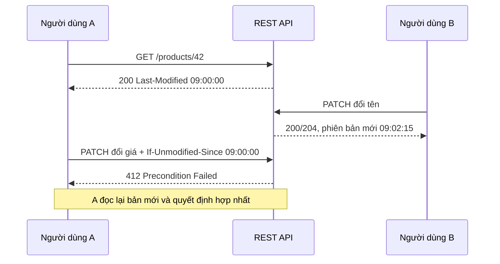
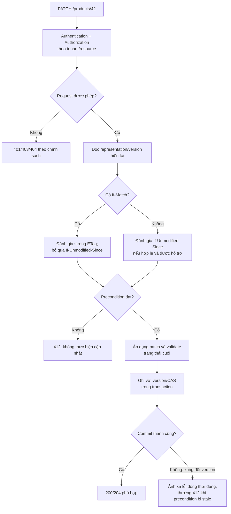

# If-Unmodified-Since và giới hạn độ chính xác thời gian

> **Module:** INTEGRATION_API_REST — học thiết kế REST API dựa trên resource, URI, phương thức và mã trạng thái HTTP cùng hợp đồng dữ liệu rõ ràng; thực hành phân trang, cache, idempotency, OpenAPI, xác thực, phân quyền, xử lý lỗi và kiểm thử API bằng Java/Spring hoặc công nghệ tương đương.  
> **Chương:** Điều kiện và đồng thời.  
> **Trọng tâm:** Dùng `If-Unmodified-Since` để đặt điều kiện **tài nguyên chưa thay đổi kể từ một mốc thời gian**, hiểu giới hạn độ chính xác giây của ngày HTTP và chọn `If-Match` với strong ETag khi cần chống *lost update* đáng tin cậy.

## 1. Bài toán: hai người cập nhật cùng một tài nguyên

Một REST API quản lý nội dung sản phẩm. Hai nhân viên cùng mở chi tiết sản phẩm:

```http
GET /api/products/42 HTTP/1.1
Host: api.example.com
Accept: application/json
```

Server trả:

```http
HTTP/1.1 200 OK
Content-Type: application/json
Last-Modified: Wed, 18 Nov 2026 09:00:00 GMT
ETag: "product-42-v7"
Cache-Control: private, no-cache

{
  "id": 42,
  "name": "Bàn phím",
  "price": 1200000,
  "description": "Phiên bản tiêu chuẩn"
}
```

Người A đổi tên. Người B đổi giá trên form vẫn giữ thông tin cũ. Nếu cả hai gửi PUT với **toàn bộ dữ liệu** mà server ghi đè vô điều kiện, request đến sau có thể làm mất thay đổi của request trước. Đây là lỗi **lost update**.

Một cách giảm nguy cơ là client nói:

> “Chỉ áp dụng thay đổi này nếu tài nguyên **chưa bị sửa sau thời điểm tôi đã nhìn thấy**.”

Header HTTP phục vụ ý định đó là **`If-Unmodified-Since`**.

```http
PATCH /api/products/42 HTTP/1.1
Host: api.example.com
Content-Type: application/merge-patch+json
If-Unmodified-Since: Wed, 18 Nov 2026 09:00:00 GMT

{"price":1150000}
```

Nếu server biết biểu diễn hiện tại đã được sửa sau 09:00:00, nó không thực thi phép cập nhật và trả **`412 Precondition Failed`**. Tuy nhiên, nếu nhiều cập nhật xảy ra trong **cùng một giây**, header ngày có thể không đủ phân biệt phiên bản.

Sau bài học, bạn có thể:

1. Giải thích cú pháp, điều kiện và phản hồi của `If-Unmodified-Since` theo HTTP.
2. Đọc các ví dụ thành công và thất bại cho PUT/PATCH/DELETE.
3. Phân biệt `If-Unmodified-Since` với `If-Modified-Since`, `If-Match` và `If-None-Match`.
4. Phân tích lỗi *lost update* do HTTP-date chỉ thể hiện độ chính xác tới giây.
5. Hiểu **vì sao strong ETag + If-Match thích hợp hơn** cho kiểm soát đồng thời chặt.
6. Biết cách đặt kiểm tra precondition sát thao tác ghi, gắn với transaction/version của database.
7. Thiết kế mã trạng thái, Problem Details, OpenAPI và bài kiểm thử bằng Java/Spring.

## 2. Ngữ nghĩa của If-Unmodified-Since

### 2.1. Cú pháp

Header request có dạng:

```http
If-Unmodified-Since: Wed, 18 Nov 2026 09:00:00 GMT
```

Giá trị là một **HTTP-date**, thông thường thể hiện dưới dạng IMF-fixdate và múi giờ GMT. Nó nói rằng client muốn thao tác chỉ tiến hành nếu biểu diễn được chọn của tài nguyên **không có lần sửa sau mốc đã nêu**.

Với một request được phép xử lý bình thường, nếu biểu diễn được chọn có `Last-Modified` **muộn hơn** ngày trong `If-Unmodified-Since`, precondition được xem là **false**. Server không thực hiện phương thức được yêu cầu và thông thường trả **`412 Precondition Failed`**.

Ngược lại, nếu ngày sửa cuối **không muộn hơn** mốc client đưa ra, điều kiện thời gian là true. Server có thể tiếp tục xử lý request, nhưng vẫn phải kiểm tra xác thực, phân quyền, validation và các điều kiện nghiệp vụ khác.

### 2.2. Điều kiện không đồng nghĩa thành công

Ngay cả khi `If-Unmodified-Since` đúng, request PATCH vẫn có thể thất bại:

- `401`: thiếu hoặc sai thông tin xác thực.
- `403`: người dùng không có quyền sửa resource.
- `404`: resource không tồn tại trong phạm vi hiển thị.
- `400`/`415`: request sai cú pháp hoặc media type không được hỗ trợ.
- `409`: xung đột trạng thái nghiệp vụ.
- `422`: nội dung được hiểu nhưng không thể xử lý theo ràng buộc đã công bố.
- `5xx`: lỗi máy chủ hay dependency.

**Precondition là một cổng kiểm tra bổ sung, không phải lệnh bỏ qua các quy tắc khác.** Không được hiểu rằng client có một timestamp cũ thì được phép sửa tài nguyên.

### 2.3. Một request có điều kiện dùng ở đâu?

`If-Unmodified-Since` đặc biệt hữu ích khi client **ghi dữ liệu**: PUT, PATCH, DELETE. Nó cũng là một HTTP precondition có thể gặp ở những request khác, nhưng dùng cho GET/HEAD không phải cơ chế tái xác thực cache thường dùng.

Hãy phân biệt:

- `If-Modified-Since`: “Nếu đã sửa **sau** mốc này, hãy gửi nội dung mới”; thường dùng GET/HEAD và có thể dẫn đến **304**.
- `If-Unmodified-Since`: “Chỉ tiếp tục nếu **không sửa sau** mốc này”; khi không đạt, thường **412**.
- `If-Match`: “Chỉ tiếp tục nếu validator hiện tại **khớp strong ETag**”; thường dùng chống ghi đè phiên bản.
- `If-None-Match`: “Chỉ tiếp tục nếu không có validator khớp”; với GET/HEAD có thể dẫn đến **304**, còn với thao tác ghi thất bại thường dẫn đến **412**.

## 3. Ví dụ PATCH: từ Last-Modified đến phản hồi 412

### Bước 1 — Client đọc một phiên bản

```http
GET /api/products/42 HTTP/1.1
Host: api.example.com
Authorization: Bearer <access-token>
```

```http
HTTP/1.1 200 OK
Content-Type: application/json
Last-Modified: Wed, 18 Nov 2026 09:00:00 GMT
ETag: "product-42-v7"

{"id":42,"name":"Bàn phím","price":1200000}
```

Client lưu `Last-Modified` **nguyên dạng header** để dùng khi cập nhật. Không cần đổi thành giờ địa phương hay chuyển sang chuỗi ngày riêng của frontend.

### Bước 2 — Người khác cập nhật trước

Admin B sửa tên sản phẩm vào 09:02:15 UTC. Server commit phiên bản mới và biểu diễn hiện tại có:

```http
Last-Modified: Wed, 18 Nov 2026 09:02:15 GMT
ETag: "product-42-v8"
```

### Bước 3 — Client A gửi thay đổi dựa trên bản cũ

```http
PATCH /api/products/42 HTTP/1.1
Host: api.example.com
Content-Type: application/merge-patch+json
If-Unmodified-Since: Wed, 18 Nov 2026 09:00:00 GMT
Authorization: Bearer <access-token>

{"price":1150000}
```

Server so sánh mốc sửa của biểu diễn hiện tại: 09:02:15 **sau** 09:00:00. Precondition không đạt; server **không thay đổi giá**.

```http
HTTP/1.1 412 Precondition Failed
Content-Type: application/problem+json
Cache-Control: no-store

{
  "type": "https://api.example.com/problems/resource-precondition-failed",
  "title": "Điều kiện cập nhật không còn hợp lệ",
  "status": 412,
  "detail": "Tài nguyên đã thay đổi. Hãy tải lại và xem xét trước khi lưu."
}
```

`type` là ví dụ Problem Type của API; `application/problem+json` theo RFC 9457 có thể dùng để mô tả lỗi rõ ràng. Không bắt buộc trả toàn bộ nội dung hiện tại trong lỗi 412, nhất là khi chứa dữ liệu không nên tiết lộ.

### Bước 4 — Client giải quyết xung đột

Client nên:

1. Tải lại tài nguyên bằng GET để có phiên bản mới nhất và validator mới.
2. So sánh thay đổi người dùng đang định thực hiện với thay đổi đã commit.
3. Cho phép người dùng xác nhận hợp nhất hoặc sửa lại nếu cần.
4. Gửi request mới với precondition của bản vừa được đọc.

**Không tự đổi header sang timestamp mới rồi replay nguyên payload** nếu payload có thể ghi đè thay đổi của người khác. Điều kiện đồng thời có giá trị vì nó làm lộ ra một tình huống cần quyết định hợp nhất, không phải vì nó “tạo thêm công việc” cho frontend.

### 3.1. Sơ đồ luồng



## 4. Last-Modified và độ chính xác của ngày HTTP

### 4.1. HTTP-date biểu diễn mốc đến giây

Định dạng ngày thường thấy:

```http
Last-Modified: Wed, 18 Nov 2026 10:00:00 GMT
If-Unmodified-Since: Wed, 18 Nov 2026 10:00:00 GMT
```

Không có phần mili giây hoặc micro giây. Trong khi đó, database hoặc runtime có thể lưu:

```text
2026-11-18T10:00:00.100Z
2026-11-18T10:00:00.875Z
```

Khi biểu diễn dưới dạng HTTP-date với độ chính xác tới giây, cả hai thời điểm này có thể xuất hiện là **10:00:00 GMT**. Sự khác biệt 775 ms bị mất khi client chỉ giữ header.

### 4.2. Lost update trong cùng một giây

Giả sử:

| Thời điểm thực | Sự kiện | Phiên bản trong DB | Last-Modified HTTP |
|---|---|---:|---|
| 10:00:00.100 | Client A GET | v7 | 10:00:00 GMT |
| 10:00:00.500 | Client B PATCH và commit | v8 | 10:00:00 GMT |
| 10:00:00.900 | Client A gửi PUT với thời gian cũ | v8 trước khi xét điều kiện | `If-Unmodified-Since: 10:00:00 GMT` |

Ở bước cuối, nếu server cũng đánh giá mốc sửa ở độ phân giải giây, biểu diễn v8 có thời gian sửa **không sau 10:00:00 theo HTTP-date**. Precondition có thể được coi là đạt dù v8 **đã khác v7**.

Client A gửi toàn bộ trạng thái dựa trên v7; server có thể thay thế dữ liệu v8 và **làm mất thay đổi của B**.

```mermaid
sequenceDiagram
    participant A as Client A
    participant S as API + DB
    participant B as Client B
    A->>S: 10:00:00.100 GET
    S-->>A: v7, Last-Modified 10:00:00
    B->>S: 10:00:00.500 PATCH
    S-->>B: v8, Last-Modified 10:00:00
    A->>S: 10:00:00.900 PUT + If-Unmodified-Since 10:00:00
    Note over S: So sánh theo giây: ngày vẫn bằng nhau
    S-->>A: Có thể 2xx; ghi đè v8
    Note over A,S: Lost update nếu thiếu kiểm soát phiên bản khác
```

Đây là **giới hạn cốt lõi** của timestamp làm concurrency validator. HTTP-date không phân biệt các cập nhật gần nhau hơn một giây. Không nên tuyên bố `If-Unmodified-Since` tự bảo đảm không có lost update ở hệ thống ghi nhanh.

### 4.3. Vì sao không chỉ so sánh mili giây trong database?

Một ý tưởng là kiểm tra:

```text
db.updatedAt (10:00:00.500) > If-Unmodified-Since (10:00:00.000)
=> 412
```

Cách so sánh raw này tạo **false conflict** ngay cả khi resource chưa sửa kể từ lần client GET ở 10:00:00.100: dữ liệu lúc client đọc đã có timestamp 10:00:00.100, lớn hơn giá trị header được làm tròn xuống 10:00:00.000.

HTTP-date không cho biết client đã đọc mốc 10:00:00.100 hay 10:00:00.900. So sánh mili giây với một timestamp đã bị rút độ chính xác không tự khôi phục phần thông tin mất. Nếu muốn hỗ trợ time-based precondition, phải lựa chọn semantics và làm tròn nhất quán với validator đã phát; nếu cần bảo đảm chính xác hơn, **dùng strong ETag/If-Match**.

### 4.4. Một giây không phải khoảng cách an toàn tuyệt đối

Ngay cả khi phần lớn cập nhật cách nhau hơn một giây, hệ thống vẫn có rủi ro:

- Nhiều request song song trong peak traffic có thể commit trong cùng giây.
- Background job hoặc event consumer có thể sửa cùng tài nguyên.
- Một transaction được retry và commit ngay sau một transaction khác.
- Đồng hồ nhiều node lệch nhau nếu `updatedAt` do từng application instance sinh.
- Dữ liệu được import/backfill với timestamp không theo thời điểm commit.
- Có update biểu diễn nhưng trường `updatedAt` không được tăng do lỗi mapping.

Không thể đánh giá rủi ro chỉ bằng “người dùng ít khi bấm lưu hai lần”. Cần xem **toàn bộ nguồn ghi**, gồm admin UI, webhook, background worker và integration service.

## 5. Strong ETag và If-Match: giải pháp ưu tiên khi phải chống lost update

### 5.1. Cơ chế

Nếu GET trả strong ETag cho representation:

```http
HTTP/1.1 200 OK
Content-Type: application/json
ETag: "product-42-v7"
Last-Modified: Wed, 18 Nov 2026 10:00:00 GMT

{"id":42,"name":"Bàn phím","price":1200000}
```

Client gửi:

```http
PATCH /api/products/42 HTTP/1.1
Content-Type: application/merge-patch+json
If-Match: "product-42-v7"

{"price":1150000}
```

Nếu server đã chuyển sang v8 — **dù chỉ vài mili giây sau** — `If-Match: "product-42-v7"` không khớp strong validator hiện tại; precondition thất bại và server trả **412** trước khi ghi.

### 5.2. Strong và weak ETag không thể tùy tiện hoán đổi

| Validator | Cú pháp | Dùng với If-Match để chống ghi đè? |
|---|---|---|
| Strong ETag | `ETag: "product-42-v7"` | Có, **nếu** validator đủ mạnh và được quản lý đúng |
| Weak ETag | `ETag: W/"product-42-v7"` | **Không** khớp theo strong comparison của If-Match |
| Last-Modified | `Last-Modified: ... GMT` | Có thể dùng với If-Unmodified-Since nhưng có giới hạn giây |
| Version nội bộ trong database | `version = 7` | Hữu ích cho atomic compare-and-swap; cần gắn đúng với HTTP validator |

**Strong ETag** có yêu cầu ngữ nghĩa liên quan đến biểu diễn ở mức bytes, không chỉ là việc bỏ tiền tố `W/`. Nếu server nén, đổi serialization, chọn variant ngôn ngữ, thêm field hoặc đổi dữ liệu nhưng không cập nhật tag phù hợp, nhãn “strong” không còn đáng tin.

Một revision đơn điệu và nhất quán với **mọi thay đổi liên quan đến representation** có thể là cơ sở tốt để sinh validator. Cần xét variant và cách bytes được tạo. Đối với cập nhật đồng thời giữa nhiều instance, phiên bản trong DB phải được thay đổi nguyên tử khi ghi.

### 5.3. Khi request chứa cả If-Match và If-Unmodified-Since

Ví dụ:

```http
PATCH /api/products/42 HTTP/1.1
If-Match: "product-42-v8"
If-Unmodified-Since: Wed, 18 Nov 2026 09:00:00 GMT
Content-Type: application/merge-patch+json

{"price":1150000}
```

Theo ngữ nghĩa HTTP, khi có **`If-Match`**, server **bỏ qua `If-Unmodified-Since`** trong đánh giá precondition. `If-Match` được ưu tiên vì là lựa chọn chính xác hơn. Việc cả hai cùng có mặt chủ yếu nhằm tương thích với các thành phần cũ không hiểu `If-Match`.

Điều này có nghĩa: nếu ETag hiện tại v8 khớp, header ngày cũ **không làm request tự động nhận 412**. Không viết logic theo kiểu “phải đồng thời đúng cả ETag và thời gian” nếu nó trái thứ tự ưu tiên HTTP.

### 5.4. If-Match: * và sự tồn tại

`If-Match: *` yêu cầu resource có biểu diễn hiện tại trước khi thao tác được thực hiện. Nó **không** đảm bảo một phiên bản cụ thể. Với bài toán lost update, client nên dùng **strong ETag xác định** thay vì wildcard.

`If-None-Match: *` thường phục vụ ý định ngược lại: chỉ tạo ở URI nếu chưa có biểu diễn hiện tại. Khi điều kiện thất bại ở PUT, phản hồi thường là `412`. Không nhầm hai wildcard với nhau.

## 6. Bảng so sánh các precondition thường gặp

| Header | Ý định | Phương thức thường gặp | Khi điều kiện không đạt |
|---|---|---|---|
| `If-Unmodified-Since` | Chỉ xử lý nếu chưa sửa sau ngày đã biết | PUT/PATCH/DELETE | `412 Precondition Failed` |
| `If-Match` | Chỉ xử lý nếu strong validator hiện tại khớp | PUT/PATCH/DELETE | `412 Precondition Failed` |
| `If-Modified-Since` | Chỉ tải lại nếu đã sửa sau ngày đã biết | GET/HEAD | `304 Not Modified` khi không thay đổi |
| `If-None-Match` | GET/HEAD: revalidate; ghi: bảo vệ “không khớp” | GET/HEAD hoặc PUT | GET/HEAD: `304` nếu khớp; method khác: `412` nếu khớp |
| `If-Range` | Tùy điều kiện mà lấy một phần hay toàn bộ biểu diễn | GET có Range | Nếu validator không đạt, xử lý Range như GET toàn bộ thích hợp |

**Chốt vấn đề:** `304` có nghĩa client/cache có thể dùng bản đã lưu cho conditional GET/HEAD phù hợp. `412` có nghĩa một precondition không đạt, và thao tác được yêu cầu **không được thực hiện** theo đường đi thất bại thông thường. Đừng trả 304 cho PUT/PATCH chỉ vì timestamp chưa đổi.

### 6.1. Quy tắc ưu tiên cần ghi nhớ

Một số nguyên tắc quan trọng từ thứ tự đánh giá HTTP preconditions:

1. Server chỉ đánh giá các điều kiện phù hợp sau các kiểm tra cơ bản của request, bao gồm xác thực, quyền và khả năng xử lý resource.
2. **If-Match có ưu tiên hơn If-Unmodified-Since**; nếu có If-Match, bỏ qua điều kiện thời gian này.
3. Trong conditional GET/HEAD, **If-None-Match ưu tiên hơn If-Modified-Since**.
4. Nếu precondition liên quan đến thao tác thay đổi trạng thái thất bại, server thông thường trả **412** và không thực hiện thay đổi.
5. Nếu cú pháp ngày `If-Unmodified-Since` không hợp lệ, recipient phải **bỏ qua trường ngày sai**; không diễn giải nó thành “ngày 0” hoặc một mốc tùy ý.
6. Không sử dụng một validator của variant sai (ví dụ JSON tiếng Anh) để quyết định trạng thái variant khác.

Một service có thể cần nhiều loại điều kiện ở cùng request. Nếu tự viết toàn bộ thuật toán precondition, phải đối chiếu đúng RFC 9110 thay vì áp vài lệnh `if` không xét thứ tự.

## 7. Ngày HTTP không hợp lệ, tương lai và đồng hồ lệch

### 7.1. Ngày không hợp lệ

Ví dụ:

```http
If-Unmodified-Since: yesterday-at-noon
```

Đây không phải HTTP-date hợp lệ. Theo HTTP, server phải **bỏ qua precondition ngày không hợp lệ**, không tự đoán nó là ngày hôm qua theo múi giờ của server.

Nếu API có chính sách **bắt buộc một precondition hợp lệ**, sau khi bỏ qua ngày sai có thể từ chối thao tác theo chính sách đó, ví dụ `428 Precondition Required` nếu không còn điều kiện dùng được. Cần công bố rõ hợp đồng và không giả vờ một header invalid đã được đánh giá thành công.

### 7.2. Ngày trong tương lai

Client có thể gửi một mốc quá xa về tương lai:

```http
If-Unmodified-Since: Thu, 31 Dec 2099 00:00:00 GMT
```

Nếu hiện tại trước năm 2099, tài nguyên hầu như chắc chắn **không sửa sau mốc này**, nên điều kiện có thể được xem là đạt ngay cả khi client chưa từng đọc bản hiện tại. Điều này cho thấy:

**If-Unmodified-Since không phải chứng nhận rằng client thật sự có dữ liệu mới nhất.** Server không thể suy ra ý định đọc trước chỉ từ một chuỗi timestamp do client gửi. Nếu ứng dụng cần bắt buộc chống lost update, nên yêu cầu **strong ETag + If-Match**, không xem `If-Unmodified-Since` là đủ mạnh cho mọi ràng buộc nghiệp vụ.

Bảo mật vẫn phải dựa vào authorization và kiểm soát dữ liệu, không dựa vào ngày do client khai báo.

### 7.3. Nhiều node và clock skew

Giả sử application A và B có clock chênh nhau 500 ms; cả hai dùng `Instant.now()` để điền `updatedAt`. Dữ liệu commit thực tế sau có thể mang timestamp **sớm hơn** lần trước nếu ghi từ node có clock chậm. Một thuật toán “so sánh updatedAt mới hơn” không còn đáng tin.

Giải pháp:

- Ưu tiên version đơn điệu, khóa cập nhật nguyên tử ở DB khi cần concurrency mạnh.
- Với timestamp dùng làm metadata, lấy từ nguồn đáng tin và nhất quán, thường gần thời điểm ghi/commit ở database.
- Đồng bộ đồng hồ hệ thống nhưng **không coi NTP là bảo đảm không có clock skew**.
- Dùng ETag được tính nhất quán từ trạng thái/phiên bản và response variant.
- Kiểm tra độ chính xác cột DB, conversion UTC, serialization HTTP-date và time zone trong test.
- Đánh giá import dữ liệu, migration, background job và các cập nhật không đi qua cùng service.

### 7.4. Timestamp từ DB vẫn không sửa được giới hạn HTTP-date

DB có thể lưu đến micro giây, nhưng khi phát `Last-Modified` qua HTTP-date, thông tin dưới giây vẫn bị rút gọn. Dùng database chính xác cao giúp truy vết và sắp xếp log tốt hơn; nó **không** khiến `If-Unmodified-Since` truyền được micro giây.

Nếu cần client gửi lại một validator phân biệt mọi revision, sử dụng **ETag** hoặc hợp đồng version có cơ chế kiểm tra tương đương, thay vì tìm cách nhét mili giây vào giá trị HTTP-date không chuẩn.

## 8. Thứ tự xử lý: bảo mật, precondition, validation và ghi nguyên tử

Một pipeline hợp lý cho PATCH:



Sơ đồ trên giản lược phần parse HTTP và lỗi không thuộc precondition. Một ứng dụng thực tế phải xác minh method, content type, JSON, quyền, trạng thái domain và các điều kiện tiên quyết theo logic phù hợp của framework.

### 8.1. Tránh kiểm tra rồi ghi ở hai bước không nguyên tử

**Dễ sai:**

```text
resource = repository.findById(id)
if (resource.lastModified <= requestDate):
    repository.save(patch(resource))
```

Giữa câu đọc và câu ghi, transaction khác có thể commit. Hai request song song có thể cùng thấy điều kiện đúng rồi ghi đè nhau.

**Cần có một lớp bảo vệ nguyên tử**, ví dụ:

- `@Version` của JPA/Hibernate để phát hiện hai transaction cùng sửa phiên bản cũ.
- `UPDATE ... WHERE id = ? AND version = ?` trong database và kiểm tra số dòng được cập nhật.
- Khóa pessimistic/serializable transaction nếu phù hợp workload và rủi ro.
- Mô hình command có kiểm soát phiên bản và invariant, nhất quán với transaction boundary.

**Nhưng lưu ý:** optimistic locking chỉ bắt các transaction **cùng dựa trên một phiên bản nội bộ đã đọc**. Nếu request A đã commit xong trước khi request B bắt đầu, và B có `If-Unmodified-Since` cũ nhưng trùng giây nên vẫn khớp, B đọc **phiên bản mới** từ DB và có thể ghi thành công. `@Version` không tự phát hiện B đang dùng dữ liệu giao diện cũ khi timestamp không phân biệt được hai revision. Vì vậy để ngăn lost update giữa các lần đọc–ghi kéo dài qua nhiều request, **strong ETag/If-Match mới là cơ chế đúng hơn**.

### 8.2. PUT, PATCH và DELETE đều cần xét tính đúng

- PUT thường yêu cầu thay thế trạng thái resource; nếu dùng payload cũ, nguy cơ ghi đè cao.
- PATCH chỉ gửi thay đổi từng trường, nhưng vẫn có xung đột ở cùng trường hoặc invariant giữa nhiều trường.
- DELETE của client cũ có thể xóa resource mà người khác vừa cập nhật; `If-Match`/`If-Unmodified-Since` giúp client thể hiện điều kiện dự kiến.
- Với thao tác có side effect bên ngoài như thanh toán, email, event, điều kiện phải được đánh giá **trước khi tạo side effect**, hoặc cần idempotency/outbox/transactional design để tránh thao tác một nửa.

## 9. If-Unmodified-Since có idempotent không?

**Idempotency là thuộc tính của phương thức/tác động dự kiến**, không phải chỉ từ header thời gian.

- PUT có ngữ nghĩa idempotent của HTTP. Gửi cùng PUT nhiều lần không được yêu cầu tạo tác động nghiệp vụ mới ở trạng thái đích.
- PATCH không mặc định idempotent; định dạng patch và operation quyết định tác động lặp.
- DELETE có ngữ nghĩa idempotent theo tài nguyên, nhưng response khi gọi lại có thể khác.
- `If-Unmodified-Since` chỉ đặt điều kiện thời gian cho request; nó **không** biến một PATCH cộng thêm số lượng thành idempotent.
- Idempotency key giúp server nhận ra **cùng một ý định thử lại**, còn ETag/If-Unmodified-Since kiểm soát **phiên bản điều kiện**. Hai cơ chế bổ sung nhau.

Ví dụ PATCH không idempotent:

```http
PATCH /api/inventory/42 HTTP/1.1
Content-Type: application/json
If-Unmodified-Since: Wed, 18 Nov 2026 09:00:00 GMT

{"operation":"increment","quantity":1}
```

Nếu timestamp không đổi giữa các lần gọi trong một giây, hai PATCH có thể cùng được chấp nhận và tăng `quantity` hai lần. Muốn chống tác động lặp do retry, cần hợp đồng idempotency và cơ chế lưu kết quả/định danh request riêng, không chỉ dựa vào `If-Unmodified-Since`.

## 10. Thiết kế response status cho precondition

| Tình huống | HTTP status thường phù hợp | Ghi chú |
|---|---|---|
| PATCH/PUT thành công, trả representation mới | `200 OK` | Response body theo hợp đồng |
| PATCH/PUT thành công, không trả body | `204 No Content` | Không có body |
| PUT tạo mới ở URI client chỉ định khi được phép | `201 Created` | Chỉ nếu thực sự tạo resource |
| `If-Unmodified-Since` không đạt | `412 Precondition Failed` | Không thực hiện thao tác ghi |
| `If-Match` không đạt | `412 Precondition Failed` | Tránh ghi đè trên bản cũ |
| API bắt buộc precondition nhưng client không cung cấp điều kiện sử dụng được | `428 Precondition Required` | Chính sách của origin; khuyến nghị `If-Match` |
| Resource không tồn tại hoặc bị ẩn theo chính sách | `404 Not Found` | Không “đoán” ngày sửa của resource không có |
| Caller không đủ quyền | `401/403` hoặc `404` theo policy | Không tiết lộ validator ngoài quyền |
| Business state không cho phép thao tác | `409 Conflict` | Khác với thất bại điều kiện HTTP |
| Body hợp cú pháp nhưng vi phạm dữ liệu nghiệp vụ | `422 Unprocessable Content` (hoặc 400 theo hợp đồng) | Cần chính sách lỗi nhất quán |
| Content-Type không được hỗ trợ | `415 Unsupported Media Type` | Đặc biệt quan trọng với PATCH |
| Lỗi máy chủ không mong đợi | `500/503` theo nguyên nhân | Không biến thành 412 giả |

`412` là tình huống **điều kiện HTTP không đạt**; `409` là xung đột trạng thái nghiệp vụ khác. Không gộp mọi lỗi “không cập nhật được” vào cùng 409.

### 10.1. 412 với Problem Details

```http
HTTP/1.1 412 Precondition Failed
Content-Type: application/problem+json
Cache-Control: no-store

{
  "type": "https://api.example.com/problems/precondition-failed",
  "title": "Điều kiện cập nhật không hợp lệ",
  "status": 412,
  "detail": "Tài nguyên đã được chỉnh sửa sau mốc thời gian yêu cầu."
}
```

Đừng trả raw giá trị database timestamp, quyền người dùng khác hoặc thông tin nội bộ nếu caller không được phép biết. Nếu client cần xung đột chi tiết, có thể cho tải lại resource bằng GET sau khi phân quyền.

### 10.2. 428 khi bắt buộc kiểm soát phiên bản

Ví dụ một API yêu cầu strong ETag:

```http
PATCH /api/products/42 HTTP/1.1
Content-Type: application/merge-patch+json

{"price":1150000}
```

Nếu thiếu `If-Match` mà API quyết định không cho phép ghi vô điều kiện:

```http
HTTP/1.1 428 Precondition Required
Content-Type: application/problem+json

{
  "type": "https://api.example.com/problems/strong-validator-required",
  "title": "Yêu cầu điều kiện phiên bản",
  "status": 428,
  "detail": "Hãy lấy phiên bản hiện tại và gửi lại với If-Match."
}
```

Đây là lựa chọn quan trọng: nếu ứng dụng cần bảo đảm không ghi đè bản cũ, **không nên chấp nhận If-Unmodified-Since như tương đương strong ETag chỉ vì client không có If-Match**. Có thể hỗ trợ fallback ngày cho client cũ, nhưng phải công bố nó là bảo vệ yếu hơn và đánh giá rủi ro riêng.

### 10.3. Trả ETag sau PUT cần lưu ý chuẩn HTTP

RFC 9110 có ràng buộc riêng đối với validator trong **phản hồi PUT thành công**: origin không gửi validator field như ETag hoặc Last-Modified nếu dữ liệu representation trong PUT đã được biến đổi trước khi lưu, thay vì được lưu mà không có transformation và validator phản ánh representation mới theo quy tắc đó.

Ví dụ API nhận input rút gọn rồi bổ sung/tính toán các trường do server quản lý; không nên tùy tiện gắn ETag của biểu diễn GET mới vào `204` sau PUT khi request body đã được biến đổi. Client có thể **GET lại** để nhận representation và validator mới.

Với PATCH, API có thể trả validator cho representation mới nếu đúng và nhất quán theo semantics của PATCH, nhưng vẫn cần test body/ETag và lưu ý response khác biệt với PUT. Đừng mặc định mọi response 2xx cho write có thể phát ETag bất chấp nội dung đã biến đổi.

## 11. Thiết kế API cho Java/Spring: đưa thời gian vào đâu?

### 11.1. Entity dùng version và timestamp

Ví dụ mô hình JPA:

```java
import jakarta.persistence.*;
import java.time.Instant;

@Entity
@Table(name = "products")
public class ProductEntity {

    @Id
    private Long id;

    @Version
    private long lockVersion;

    @Column(nullable = false)
    private Instant updatedAt;

    @Column(nullable = false)
    private String name;

    @Column(nullable = false)
    private long priceInMinorUnits;

    // Getter/setter và logic nghiệp vụ được lược bớt.
}
```

`@Version` dùng để phát hiện ghi cạnh tranh giữa transaction JPA. `updatedAt` dùng cho metadata thời gian. Hai giá trị giải quyết các nhu cầu có liên quan nhưng **không giống nhau**:

- `lockVersion`: counter nội bộ hỗ trợ optimistic locking.
- `updatedAt`: timestamp có thể biểu diễn thành `Last-Modified` sau khi đưa về HTTP-date.
- `ETag`: validator của **biểu diễn HTTP**, có thể dựa trên revision nếu mọi thay đổi liên quan đến biểu diễn đều được phản ánh đúng.

Không được giả định `@Version` luôn bảo vệ dữ liệu nếu có job khác ghi trực tiếp bằng SQL mà không cập nhật version.

### 11.2. GET cung cấp Last-Modified và ETag

```java
import org.springframework.http.ResponseEntity;
import org.springframework.web.bind.annotation.*;

@RestController
@RequestMapping("/api/products")
public class ProductReadController {

    private final ProductQueryService service;

    public ProductReadController(ProductQueryService service) {
        this.service = service;
    }

    @GetMapping("/{id}")
    public ResponseEntity<ProductView> get(@PathVariable long id) {
        // Service thực tế phải kiểm tra auth/tenant/authorization.
        ProductSnapshot item = service.findVisible(id);

        return ResponseEntity.ok()
                .eTag(item.strongEtag())
                .lastModified(item.updatedAt().toEpochMilli())
                .body(item.view());
    }
}
```

`ProductQueryService`, `ProductSnapshot` và `ProductView` là các kiểu được giả định đã có. `strongEtag()` phải sinh validator mạnh đúng biểu diễn, không phải chỉ thêm dấu ngoặc kép vào một version không được cập nhật đầy đủ.

### 11.3. Controller PATCH nhận các header có điều kiện

```java
import com.fasterxml.jackson.databind.JsonNode;
import org.springframework.http.HttpHeaders;
import org.springframework.http.MediaType;
import org.springframework.http.ResponseEntity;
import org.springframework.web.bind.annotation.*;

@RestController
@RequestMapping("/api/products")
public class ProductWriteController {

    private final ProductCommandService service;

    public ProductWriteController(ProductCommandService service) {
        this.service = service;
    }

    @PatchMapping(
        path = "/{id}",
        consumes = "application/merge-patch+json"
    )
    public ResponseEntity<Void> patch(
            @PathVariable long id,
            @RequestHeader(
                name = HttpHeaders.IF_MATCH,
                required = false
            ) String ifMatch,
            @RequestHeader(
                name = HttpHeaders.IF_UNMODIFIED_SINCE,
                required = false
            ) String ifUnmodifiedSince,
            @RequestBody JsonNode mergePatch) {

        // Service đánh giá HTTP precondition và áp dụng patch
        // cùng cơ chế transaction + optimistic locking.
        UpdatedProduct updated = service.patch(
                id, ifMatch, ifUnmodifiedSince, mergePatch);

        return ResponseEntity.noContent()
                .eTag(updated.strongEtag())
                .lastModified(updated.updatedAt().toEpochMilli())
                .build();
    }
}
```

Ví dụ sử dụng **PATCH** để minh họa response mới có validator. Nếu dùng PUT, phải xét thêm ràng buộc validator sau successful PUT ở mục 10.3. Controller chưa xử lý body JSON Merge Patch theo RFC 7396; phần đó thuộc `ProductCommandService` hoặc thư viện JSON Merge Patch đã được kiểm chứng.

### 11.4. Service: ưu tiên If-Match và so sánh thời gian khi fallback

Pseudocode độc lập với persistence framework:

```text
function updateProduct(request, authenticatedUser):
    assertAuthenticated(authenticatedUser)
    assertCanModifyProduct(authenticatedUser, request.productId)

    transaction:
        current = loadCurrentProductWithVersion(request.productId)
        if not found:
            return 404 (hoặc 404 che resource theo chính sách)

        if request.If-Match is present:
            // Bỏ qua If-Unmodified-Since khi đã có If-Match.
            if not strongEtagMatches(request.If-Match, current):
                return 412

        else if request.If-Unmodified-Since is valid HTTP-date:
            currentHttpDate = truncateLastModifiedToSeconds(current.updatedAt)
            if currentHttpDate > request.If-Unmodified-Since:
                return 412

        else:
            // API này yêu cầu một điều kiện; date sai bị bỏ qua.
            return 428

        result = applyMergePatch(current, request.body)
        validateResultAndPermissions(result)
        persistUsingOptimisticLockOrCAS(current.version, result)

    return 204 with consistent metadata
```

**Chỉ là thuật toán minh họa**, không phải toàn bộ thứ tự xử lý precondition của RFC 9110. Với request có `If-None-Match` hoặc điều kiện khác, hoặc với định dạng JSON Patch khác, phải xét quy tắc tương ứng. Điều kiện thời gian cần nhất quán với `Last-Modified` mà server đã phát.

### 11.5. Phân tích lỗ hổng còn lại của fallback thời gian

Khi một client chỉ gửi `If-Unmodified-Since`, service so sánh mốc HTTP-date theo giây nên vẫn tồn tại lỗ hổng:

```text
GET v7   lúc 10:00:00.100 -> Last-Modified 10:00:00
PATCH B  lúc 10:00:00.700 -> v8, Last-Modified 10:00:00
PATCH A  lúc 10:00:00.900 -> If-Unmodified-Since 10:00:00
-> Điều kiện ngày có thể đạt dù A dùng v7
```

`@Version` ở database bảo vệ khỏi hai transaction ghi đồng thời lên cùng một version **trong thời gian transaction chồng lấn**. Nếu transaction B đã commit trước khi A bắt đầu, A sẽ đọc version v8 và có thể cập nhật v9 vì timestamp theo giây vẫn cho điều kiện đúng. **Vì vậy fallback này không thay thế được If-Match với strong ETag của bản client thực sự đọc.**

### 11.6. Parse HTTP-date: đừng tự xử lý tùy tiện

Ví dụ parse **định dạng IMF-fixdate phổ biến** trong Java:

```java
import java.time.Instant;
import java.time.ZonedDateTime;
import java.time.format.DateTimeFormatter;
import java.time.format.DateTimeParseException;
import java.util.Optional;

public final class HttpDateParsing {

    private HttpDateParsing() {}

    public static Optional<Instant> parseImfFixdate(String value) {
        if (value == null || value.isBlank()) {
            return Optional.empty();
        }
        try {
            return Optional.of(
                ZonedDateTime.parse(
                    value, DateTimeFormatter.RFC_1123_DATE_TIME
                ).toInstant()
            );
        } catch (DateTimeParseException ex) {
            return Optional.empty();
        }
    }
}
```

**Lưu ý kỹ thuật:** đây là ví dụ đơn giản về một định dạng ngày phổ biến. HTTP nhận diện thêm một số cú pháp ngày lỗi thời vì tương thích; parser production nên sử dụng implementation HTTP-date của framework/thư viện phù hợp RFC 9110 và phải kiểm thử hành vi trên các dạng được hỗ trợ. Nếu header sai, quy tắc HTTP là **bỏ qua precondition ngày sai**, không tự quy về epoch hoặc chuyển timezone tùy ý.

Không dùng `LocalDateTime.now()` của máy ứng dụng làm giá trị so sánh mà bỏ múi giờ. `Instant` hoặc mốc UTC rõ ràng phù hợp hơn, nhưng độ chính xác khi chuyển sang HTTP-date vẫn chỉ tới giây.

## 12. Database và đồng thời: tránh check-then-write race

### 12.1. Optimistic locking với version

Nếu client A và B đều đọc version 7 ở **bên trong các transaction ghi**, cả hai cùng muốn UPDATE:

```sql
UPDATE products
SET name = :name,
    price_minor = :priceMinor,
    lock_version = lock_version + 1
WHERE id = :id
  AND lock_version = :expectedVersion;
```

Chỉ một transaction có thể cập nhật thành công version 7 nếu database bảo đảm atomic update. Transaction còn lại thấy số dòng ảnh hưởng 0 và phải xử lý xung đột có kiểm soát.

Tuy nhiên, nếu request stale được chấp nhận vì **ngày bị rút xuống giây** và service đọc version mới sau khi transaction khác đã commit, version check bên trong transaction không phát hiện client dựa trên bản cũ. Không được lấy optimistic locking ở DB làm bằng chứng rằng time-based HTTP precondition là chính xác.

### 12.2. Bảo vệ dữ liệu xuyên nhiều bảng

Một PATCH có thể thay đổi:

- Thông tin sản phẩm.
- Bản ghi lịch sử giá.
- Trạng thái kiểm duyệt.
- Sự kiện gửi tới queue.

Nếu precondition thất bại, **không được** ghi bất kỳ side effect nghiệp vụ nào. Nếu thành công, thay đổi liên quan cần transaction hoặc cơ chế nhất quán phù hợp. Với outbox, ghi trạng thái và outbox trong cùng transaction để không mất sự kiện cần phát; consumer vẫn cần xử lý trùng.

Với thanh toán hay side effect ở hệ thống ngoài, phải bổ sung idempotency, đối soát, xử lý timeout và recovery. **If-Unmodified-Since không phải giao dịch phân tán.**

### 12.3. Timestamp được cập nhật ở đâu?

Nếu `updatedAt` được ghi từ Java:

```text
entity.updatedAt = Instant.now()
```

cần xét:

- Mọi đường ghi đều cập nhật timestamp chưa?
- Nó được tạo trước commit bao lâu?
- DB trigger hoặc batch import có thể ghi trễ/ngược không?
- Nhiều node có đồng hồ lệch không?
- Khi transaction rollback, timestamp có bị coi nhầm là đã commit?
- Serialization ra HTTP-date có cùng cách làm tròn ở mọi node không?

Khi muốn timestamp cho HTTP Last-Modified, cần dựa trên thay đổi đã **commit** của biểu diễn, không dùng thời điểm response được render để tạo ra “lần sửa” mới mỗi GET.

## 13. OpenAPI: công bố precondition và giới hạn

Một contract cần cho client biết endpoint hỗ trợ header nào và chính sách **bắt buộc hay tùy chọn**.

Ví dụ OpenAPI 3.0.3 cho PATCH chấp nhận `If-Match`, hỗ trợ `If-Unmodified-Since` để tương thích client cũ; trong một hệ thống yêu cầu concurrency chặt, có thể **bắt buộc If-Match** và không dùng fallback ngày.

```yaml
openapi: 3.0.3
info:
  title: Product API
  version: 1.0.0
paths:
  /api/products/{id}:
    patch:
      summary: Cập nhật một phần sản phẩm có điều kiện
      description: >
        Ưu tiên If-Match với strong ETag. If-Unmodified-Since
        là cơ chế tương thích, chỉ có độ phân giải theo giây
        và không bảo đảm loại bỏ mọi lost update.
        Khi cả hai có mặt, If-Unmodified-Since bị bỏ qua.
      parameters:
        - name: id
          in: path
          required: true
          schema:
            type: integer
            format: int64
        - name: If-Match
          in: header
          required: false
          description: Strong ETag lấy từ GET gần nhất
          schema:
            type: string
        - name: If-Unmodified-Since
          in: header
          required: false
          description: >
            HTTP-date từ Last-Modified của bản đã đọc.
            Chỉ dùng khi API cho phép fallback theo thời gian.
          schema:
            type: string
      requestBody:
        required: true
        content:
          application/merge-patch+json:
            schema:
              type: object
              description: JSON Merge Patch theo RFC 7396
              additionalProperties: true
      responses:
        '204':
          description: Đã cập nhật, không có response body
          headers:
            ETag:
              schema:
                type: string
            Last-Modified:
              schema:
                type: string
        '400':
          description: Request có cú pháp không hợp lệ
        '401':
          description: Chưa xác thực
        '403':
          description: Không đủ quyền
        '404':
          description: Tài nguyên không tồn tại hoặc bị ẩn
        '409':
          description: Xung đột trạng thái nghiệp vụ
        '412':
          description: If-Match hoặc If-Unmodified-Since không đạt
          content:
            application/problem+json:
              schema:
                type: object
                properties:
                  type: {type: string}
                  title: {type: string}
                  status: {type: integer}
                  detail: {type: string}
        '415':
          description: Media type không hỗ trợ
        '422':
          description: Trạng thái sau patch không hợp lệ
        '428':
          description: Thiếu precondition mà API bắt buộc
```

**Lưu ý hợp đồng:**

- Nếu API có chính sách “không chấp nhận cập nhật thiếu strong ETag”, khai báo và tài liệu hóa `If-Match` **bắt buộc**, và có thể **không** hỗ trợ fallback ngày.
- Nếu cho phép một trong hai header, OpenAPI 3.0 có hạn chế thể hiện ràng buộc **ít nhất một trong hai** ở cấp parameter; mô tả bằng prose và bổ sung contract tests.
- JSON Merge Patch dùng `application/merge-patch+json`, không được xử lý như một JSON object tùy ý nếu đã công bố chuẩn.
- `412` không nhất thiết kèm Problem Details theo RFC; đó là lựa chọn error contract của API.
- 204 không có body. Response validator sau PATCH phải phản ánh đúng representation mới nếu server phát hành.

## 14. Kiểm thử giao thức bằng curl

### 14.1. Lấy validator

```bash
curl -i \
  -H 'Accept: application/json' \
  'https://api.example.com/api/products/42'
```

Giả sử response:

```http
HTTP/2 200
etag: "product-42-v7"
last-modified: Wed, 18 Nov 2026 09:00:00 GMT
content-type: application/json

{"id":42,"name":"Bàn phím","price":1200000}
```

### 14.2. PATCH với If-Unmodified-Since

```bash
curl -i -X PATCH \
  -H 'Content-Type: application/merge-patch+json' \
  -H 'If-Unmodified-Since: Wed, 18 Nov 2026 09:00:00 GMT' \
  --data '{"price":1150000}' \
  'https://api.example.com/api/products/42'
```

Nếu chưa có thay đổi mới hơn mốc, request có thể thành công (ví dụ 204). Nếu tài nguyên đã sửa sau mốc, kỳ vọng 412 và **không ghi**.

### 14.3. PATCH với strong ETag

```bash
curl -i -X PATCH \
  -H 'Content-Type: application/merge-patch+json' \
  -H 'If-Match: "product-42-v7"' \
  --data '{"price":1150000}' \
  'https://api.example.com/api/products/42'
```

Nếu ETag hiện tại là v8, request phải thất bại điều kiện 412. Sau đó client có thể GET để xem bản mới.

### 14.4. Cả hai header, ETag thắng

```bash
curl -i -X PATCH \
  -H 'Content-Type: application/merge-patch+json' \
  -H 'If-Match: "product-42-v8"' \
  -H 'If-Unmodified-Since: Wed, 18 Nov 2026 09:00:00 GMT' \
  --data '{"price":1150000}' \
  'https://api.example.com/api/products/42'
```

Nếu ETag hiện tại v8 và các điều kiện nghiệp vụ khác đạt, server **không được dùng ngày cũ để từ chối** sau khi đã nhận If-Match. Nếu ETag không khớp, trả 412 dù ngày gửi có vẻ phù hợp.

Không coi `curl` là cache HTTP tự động: ví dụ gửi header thủ công để quan sát giao thức. Dữ liệu, quyền và URL đều là minh họa, cần môi trường kiểm thử và token phù hợp khi dùng thật.

## 15. Kiểm thử đồng thời và giới hạn thời gian

### 15.1. Ma trận contract tests

| Test ID | Tình huống | Kết quả phải kiểm tra |
|---|---|---|
| COND-01 | GET resource hiện tại | Có Last-Modified, strong ETag đúng biểu diễn |
| COND-02 | PATCH với IUS cũ hơn thời điểm sửa | 412, **DB không đổi** |
| COND-03 | PATCH với IUS bằng Last-Modified hiện tại | Được đánh giá là đạt điều kiện ngày; kết quả còn phụ thuộc validation/quyền |
| COND-04 | PATCH có If-Match khớp | Ghi thành công theo điều kiện và transaction |
| COND-05 | PATCH có If-Match cũ | 412, không ghi |
| COND-06 | Cả hai header: If-Match đúng, IUS cũ | IUS bị bỏ qua; không nhận 412 chỉ vì ngày |
| COND-07 | Cả hai header: If-Match sai, IUS mới | 412 do If-Match |
| COND-08 | IUS sai định dạng, không có điều kiện khác | Bỏ qua ngày; 428 nếu API bắt buộc precondition hợp lệ |
| COND-09 | IUS ở tương lai | Ghi nhận giới hạn: ngày này không chứng minh client đã đọc bản mới |
| COND-10 | Hai commit trong một giây | Test cho thấy IUS có thể không phân biệt revision, strong ETag thì phân biệt |
| COND-11 | Hai transaction cùng dựa version DB | Optimistic lock/CAS không cho ghi đè im lặng |
| COND-12 | Client dùng weak ETag với If-Match | Không khớp theo strong comparison |
| COND-13 | PUT/PATCH/DELETE precondition không đạt | Không thay đổi dữ liệu, audit nghiệp vụ, outbox/side effects |
| COND-14 | User không có quyền nhưng biết validator | Không vượt quyền, không lộ metadata nhạy cảm |
| COND-15 | Resource bị xóa trước khi PATCH | Status theo policy, không hồi sinh ngoài hợp đồng |
| COND-16 | Last-Modified được phát ở các node khác nhau | Cùng thời điểm/representation theo chính sách, không bị clock skew gây sai |
| COND-17 | Giá trị ngày với timezone/cú pháp cũ | Parser xử lý theo chính sách HTTP-date đã công bố |
| COND-18 | Response 204 | Không có body, validator đúng nếu có |
| COND-19 | Request đồng thời thay đổi nhiều field | Không có partial commit hoặc lost update ngoài chính sách |
| COND-20 | Update dữ liệu derived hoặc qua background job | Validator phải phản ánh thay đổi của representation |

### 15.2. Test cùng giây: không thể chỉ giả lập nhiều ngày khác nhau

Để minh họa giới hạn timestamp, fixture cần kiểm soát thời gian **dưới giây**:

```text
v7.updatedAt = 2026-11-18T10:00:00.100Z
GET -> "Wed, 18 Nov 2026 10:00:00 GMT"

v8.updatedAt = 2026-11-18T10:00:00.800Z
GET -> "Wed, 18 Nov 2026 10:00:00 GMT"

Client A gửi:
If-Unmodified-Since: Wed, 18 Nov 2026 10:00:00 GMT

Vì mốc HTTP-date của v7 và v8 giống nhau,
IUS không nhận diện được A đang dựa trên v7.
```

Cần test riêng `If-Match: "product-42-v7"` khi DB đã v8, và xác nhận **412**. Đó là cách cho thấy giới hạn không do viết code dở mà do dữ liệu phiên bản bị rút xuống độ chính xác giây.

### 15.3. MockMvc: kiểm tra mã trạng thái, body và side effect

Mẫu test dưới đây giả định controller/service đã được tạo, dữ liệu fixture ổn định và security context hợp lệ. **Đây không phải kết quả test đã chạy.**

```java
import org.junit.jupiter.api.Test;
import org.springframework.beans.factory.annotation.Autowired;
import org.springframework.boot.test.autoconfigure.web.servlet.AutoConfigureMockMvc;
import org.springframework.boot.test.context.SpringBootTest;
import org.springframework.http.HttpHeaders;
import org.springframework.test.web.servlet.MockMvc;

import static org.springframework.test.web.servlet.request.MockMvcRequestBuilders.*;
import static org.springframework.test.web.servlet.result.MockMvcResultMatchers.*;

@SpringBootTest
@AutoConfigureMockMvc
class ProductConditionalWriteTest {

    @Autowired
    MockMvc mvc;

    @Test
    void outdatedIfUnmodifiedSinceReturns412() throws Exception {
        // Fixture: sản phẩm có Last-Modified 09:02:15 GMT.
        mvc.perform(patch("/api/products/42")
                .contentType("application/merge-patch+json")
                .header(HttpHeaders.IF_UNMODIFIED_SINCE,
                        "Wed, 18 Nov 2026 09:00:00 GMT")
                .content("{\"price\":1150000}"))
            .andExpect(status().isPreconditionFailed());
        // Integration test cần kiểm tra giá trong DB vẫn như cũ.
    }

    @Test
    void oldIfMatchWinsOverNewerDate() throws Exception {
        // Fixture: strong ETag hiện tại là product-42-v8.
        mvc.perform(patch("/api/products/42")
                .contentType("application/merge-patch+json")
                .header(HttpHeaders.IF_MATCH, "\"product-42-v7\"")
                .header(HttpHeaders.IF_UNMODIFIED_SINCE,
                        "Thu, 31 Dec 2099 00:00:00 GMT")
                .content("{\"price\":1150000}"))
            .andExpect(status().isPreconditionFailed());
    }

    @Test
    void absentPreconditionCanRequire428() throws Exception {
        // Chỉ đúng nếu API đặt chính sách luôn yêu cầu precondition.
        mvc.perform(patch("/api/products/42")
                .contentType("application/merge-patch+json")
                .content("{\"price\":1150000}"))
            .andExpect(status().isPreconditionRequired());
    }
}
```

Để chứng minh đúng tuyệt đối các điều kiện, test nên assert cả **DB state, audit event, outbox event và phiên bản sau thất bại**. Mã trạng thái 412 không đủ nếu một trigger hoặc service khác vẫn đã thực hiện side effect.

### 15.4. Kiểm thử transaction thực

Ngoài MockMvc, tạo integration test nhiều transaction độc lập hoặc Testcontainers với DB thật:

1. Cùng một version ban đầu, chạy hai cập nhật cạnh tranh, đồng bộ thời điểm bằng barrier.
2. Xác nhận cơ chế optimistic locking chỉ cho một cập nhật trên cùng version khi ghi chồng lấn.
3. Chạy tình huống **tuần tự nhưng cùng giây**: B commit trước, A bắt đầu sau trên dữ liệu giao diện cũ.
4. Xác nhận `If-Unmodified-Since` không thể phân biệt v7/v8 cùng giây theo điều kiện mô tả.
5. Dùng `If-Match` để xác nhận stale version bị từ chối.
6. Kiểm tra khi transaction rollback, không có event/email/side effect từ request bị từ chối.

Không tạo test “cùng giây” bằng cách `Thread.sleep(1000)` rồi hy vọng thời gian rơi đúng mốc. Dùng **clock kiểm soát được**, timestamp fixture và các transaction barrier để test lặp lại ổn định.

## 16. Security và observability của conditional updates

### 16.1. Không tiết lộ phiên bản của tenant khác

Ngay cả khi client biết ID hoặc ETag của sản phẩm thuộc tenant khác, server phải kiểm tra quyền theo principal hiện tại và chính sách resource trước khi tiết lộ trạng thái phiên bản. Một response 412 hoặc message quá chi tiết có thể trở thành oracle cho sự tồn tại/cập nhật của dữ liệu không thuộc quyền.

Quy tắc:

- Lấy tenant từ danh tính đã xác thực, không từ header ngày.
- Không dùng If-Unmodified-Since hoặc ETag như authorization token.
- Giữ nguyên chính sách 401/403/404 để tránh rò thông tin.
- Giới hạn `detail` của Problem Details theo quyền người nhận.
- Không ghi bearer token, request body nhạy cảm hoặc ETag có thông tin cá nhân vào log.

### 16.2. Các chỉ số nên theo dõi

| Chỉ số | Tác dụng |
|---|---|
| Tỷ lệ `412` theo endpoint và client version | Phát hiện xung đột, stale UI hoặc retry không đúng |
| Tỷ lệ `428` | Client nào không gửi validator bắt buộc? |
| Tỷ lệ dùng If-Match so với If-Unmodified-Since | Theo dõi tiến độ chuyển client sang concurrency mạnh |
| Số cập nhật dưới một giây vào cùng resource | Đánh giá mức rủi ro của timestamp |
| Optimistic lock conflicts ở DB | Phát hiện write contention và áp lực transaction |
| Thời gian từ GET đến PATCH | Cửa sổ stale-read kéo dài bao lâu? |
| Các lần update không tăng version/updatedAt | Tìm đường ghi đi vòng ngoài service |
| Tỷ lệ retry sau 412 | Client có đang tự ghi đè sau khi lỗi? |
| Số báo cáo lost update hoặc state mismatch | Đối chiếu cơ chế HTTP với tính đúng nghiệp vụ |

Không nhìn thấy 412 **không chứng minh không có lost update**. Nếu mọi stale request trong cùng giây được chấp nhận, số 412 có thể thấp trong khi dữ liệu vẫn bị ghi đè. Cần test đúng loại race và đo invariant nghiệp vụ.

## 17. Phản mẫu thường gặp

### 17.1. Xem Last-Modified là phiên bản duy nhất có thể phân biệt mọi update

Timestamp giây không thể phân biệt hai lần commit gần nhau. Nếu cần correctness cao, dùng strong ETag/If-Match và kiểm tra version nguyên tử tại DB.

### 17.2. So sánh millisecond với header đã bị làm tròn xuống giây

So sánh raw khiến ngay bản vừa đọc cũng có thể bị coi “đã sửa sau mốc”. Không thể khôi phục mili giây đã mất. Phải áp dụng đúng semantics của validator; chọn ETag nếu cần độ chính xác cao.

### 17.3. Xử lý If-Unmodified-Since trước If-Match

Request có cả hai phải ưu tiên If-Match; nếu code trả 412 vì IUS cũ dù ETag đúng, nó không tuân theo thứ tự precondition HTTP.

### 17.4. Trả 304 cho PATCH

`304` dùng cho conditional GET/HEAD, không thay thế `412` khi thao tác ghi thất bại điều kiện. Không gửi JSON lỗi trong 304.

### 17.5. Chỉ kiểm tra điều kiện, không bảo vệ lần ghi

Hai request có thể cùng vượt check rồi ghi chồng lấn. Cần transaction/CAS/JPA version — và vẫn hiểu rằng cơ chế version không cứu được stale client nếu IUS trùng giây.

### 17.6. Dùng timestamp trong tương lai để né điều kiện

Một client có thể cung cấp ngày xa tương lai, làm điều kiện thời gian trở nên quá dễ đạt. Nếu hợp đồng yêu cầu chống lost update, bắt buộc strong If-Match thay vì tin vào ngày client.

### 17.7. Cho phép background job bỏ qua cập nhật version

Service REST kiểm tra ETag nhưng job SQL thay dữ liệu không tăng version, khiến ETag v7 vẫn được dùng sau khi representation đổi. Mọi đường ghi phải tuân chiến lược version.

### 17.8. Dùng weak ETag với If-Match

`If-Match` sử dụng strong comparison. `W/"v7"` không trở thành strong chỉ vì server loại tiền tố trong so sánh chuỗi thủ công.

### 17.9. Retry PATCH không idempotent sau timeout

Client tăng tồn kho hai lần do không biết request đầu có commit chưa. If-Unmodified-Since chỉ là điều kiện thời gian; cần cơ chế idempotency và trạng thái giao dịch phù hợp.

### 17.10. Lộ dữ liệu qua 412

Response ghi “Tài nguyên tenant B đã cập nhật lúc 10:35 bởi user X” cho người không có quyền. Phải xác thực, phân quyền và hạn chế thông tin trước khi xử lý điều kiện.

### 17.11. Tin clock từng pod là nguồn chân lý chung

Clock lệch có thể đảo thứ tự timestamp. Nên dùng version ở DB/commit logic và đồng bộ nguồn thời gian, không coi NTP là bảo đảm chính xác tuyệt đối.

### 17.12. Tuyên bố “không còn lost update” chỉ từ một bài test sequential

Một test v7 cũ hơn v8 vài phút nhận 412 là cần thiết nhưng chưa đủ. Phải kiểm thử hai commit trong cùng giây, request đồng thời, update qua job ngoài luồng và các method PUT/PATCH/DELETE.

## 18. Bài tập thực hành

### Bài A — Tính kết quả điều kiện ngày

GET trả:

```http
Last-Modified: Wed, 18 Nov 2026 09:00:00 GMT
ETag: "order-42-v7"
```

Hãy chọn kết quả precondition thời gian cho từng request (giả sử caller đủ quyền, ngày hợp lệ, không có điều kiện khác):

1. `If-Unmodified-Since: Wed, 18 Nov 2026 08:59:59 GMT`.
2. `If-Unmodified-Since: Wed, 18 Nov 2026 09:00:00 GMT`.
3. `If-Unmodified-Since: Wed, 18 Nov 2026 09:00:01 GMT`.
4. `If-Unmodified-Since: some-date-string`.
5. Cùng `If-Unmodified-Since` cũ nhưng thêm `If-Match: "order-42-v7"`.

Giải thích vì sao những trường hợp có ngày lớn hơn Last-Modified **không chứng minh client biết trạng thái mới nhất**.

### Bài B — Phân tích lost update dưới một giây

Một tài nguyên có:

```text
v7 commit: 10:00:00.100
v8 commit: 10:00:00.750
HTTP Last-Modified cho cả hai: 10:00:00 GMT
```

Client A GET v7, client B commit v8, sau đó A gửi PUT với `If-Unmodified-Since: 10:00:00 GMT`.

1. Vì sao IUS không phân biệt được v7 với v8?
2. Điều gì có thể xảy ra với thay đổi của B nếu A PUT full representation cũ?
3. Vì sao chỉ tăng độ chính xác `updatedAt` trong database không tự giải quyết?
4. Nếu GET trả `ETag: "v7"` và server hiện là `"v8"`, `If-Match` sẽ cho kết quả nào?
5. `@Version` trong JPA phát hiện những cuộc đua nào và không giải quyết trực tiếp vấn đề nào?

### Bài C — Thiết kế API có chính sách strong validator

Đối với `PATCH /api/products/{id}`:

- GET trả strong ETag và Last-Modified.
- Chỉ cho phép cập nhật nếu gửi `If-Match`.
- Nếu thiếu header thì trả 428.
- Nếu strong ETag bị cũ, trả 412.
- Khi body JSON Merge Patch sai nghiệp vụ, trả 422.
- Người dùng không đủ quyền không được biết version hiện tại.

Hãy viết controller/service, OpenAPI và ít nhất sáu tests. Giải thích tại sao API vẫn có thể gửi `Last-Modified` để hỗ trợ caching nhưng **không dùng IUS làm điều kiện ghi thay thế**.

### Bài D — Xử lý chuyển đổi client cũ

Một ứng dụng di động cũ chỉ hiểu `Last-Modified`/`If-Unmodified-Since`. Web client mới dùng `ETag`/`If-Match`.

Hãy đề xuất lộ trình chuyển đổi:

1. Kiểm kê endpoint ghi và các client version.
2. Đo rủi ro nhiều cập nhật trong một giây.
3. Phát strong ETag đúng representation.
4. Ghi nhận metrics 412/428 và loại validator được gửi.
5. Thông báo SDK/client mới dùng If-Match.
6. Quyết định khi nào ngừng fallback ngày hoặc hạn chế nó cho resource ít rủi ro.
7. Dự phòng cách người dùng xử lý bản cập nhật xung đột.

### Bài E — Review đoạn code có race

```java
Product product = repository.findById(id).orElseThrow();
if (!product.getUpdatedAt().isAfter(ifUnmodifiedSince)) {
    product.setPrice(request.price());
    repository.save(product);
}
```

Hãy chỉ ra:

- Có bị sai vì timestamp precision không?
- Phần `if` có atomic với `save` không?
- Điều gì xảy ra khi request cùng giây?
- Nếu user không đủ quyền thì khi nào được kiểm tra?
- Nếu `If-Match` cũng có mặt thì thứ tự kiểm tra phải ra sao?
- Phải thêm gì ở database và hợp đồng HTTP để giảm nguy cơ lost update?

## 19. Checklist review trước production

- [ ] API giải thích rõ `If-Unmodified-Since` là precondition theo thời gian, không phải bảo đảm tuyệt đối chống lost update.
- [ ] HTTP-date được phát/parse theo chuẩn; không dùng timestamp custom thay cho header HTTP-date.
- [ ] Biết độ chính xác tới giây và đã xét hai thay đổi trong cùng giây.
- [ ] Nếu cần concurrency mạnh, API ưu tiên strong ETag + `If-Match`.
- [ ] Weak ETag không được coi là strong cho If-Match.
- [ ] Khi cùng có If-Match và If-Unmodified-Since, bỏ qua điều kiện thời gian.
- [ ] Ngày IUS invalid được bỏ qua theo ngữ nghĩa HTTP; chính sách precondition bắt buộc được công bố.
- [ ] Nếu precondition ghi thất bại, trả 412 và không thực hiện thay đổi/side effects.
- [ ] Nếu API yêu cầu precondition và thiếu, trả 428 theo contract.
- [ ] Phân biệt lỗi 409 nghiệp vụ, 412 precondition, 428 thiếu điều kiện và 401/403/404 quyền/tồn tại.
- [ ] Authentication/authorization được kiểm tra trước khi để lộ version hoặc tiến hành ghi.
- [ ] Có transaction/version/CAS bảo vệ update cạnh tranh và kiểm tra hậu quả rollback.
- [ ] Tất cả đường ghi (UI, job, webhook, SQL migration) duy trì version/updatedAt đúng.
- [ ] Last-Modified phản ánh biểu diễn đã sửa và cách chuyển UTC/giây nhất quán qua instance.
- [ ] ETag mạnh phản ánh đúng representation và các variant; không chỉ bỏ `W/` tùy tiện.
- [ ] Tính idempotent của PUT/PATCH và retry/side effect được xử lý theo hợp đồng.
- [ ] OpenAPI ghi header, điều kiện ưu tiên, các mã phản hồi và giới hạn timestamp.
- [ ] Có test cùng giây, concurrent transaction, stale ETag, invalid/future date và quyền truy cập.
- [ ] Có dashboard 412/428, rate của fallback IUS và sự cố lost update.
- [ ] Với PUT thành công, validator response tuân ràng buộc chuẩn nếu server biến đổi request representation.

## 20. Ghi nhớ

**`If-Unmodified-Since`** cho phép client đặt điều kiện: chỉ xử lý request nếu biểu diễn được chọn **không bị sửa sau thời điểm đã biết**. Điều kiện không đạt thường dẫn đến **`412 Precondition Failed`**, và thay đổi không được thực hiện. Khi request có cả `If-Match` và `If-Unmodified-Since`, **If-Match được ưu tiên** và điều kiện thời gian bị bỏ qua.

**Giới hạn quan trọng nhất:** `Last-Modified`/`If-Unmodified-Since` dùng HTTP-date với độ chính xác tới **giây**. Hai lần commit trong cùng giây có thể có cùng header ngày, làm stale client không bị phát hiện. Độ chính xác cao trong database không tự sửa thông tin đã mất ở HTTP-date; optimistic locking trong transaction cũng không tự giải quyết stale-read tuần tự khi precondition ngày vẫn khớp.

Với tài nguyên có yêu cầu **chống lost update nghiêm ngặt**, hãy dùng **strong ETag + If-Match**, kết hợp transaction/CAS/`@Version`, xác thực/phân quyền, xử lý lỗi 412/428 rõ ràng và test những trường hợp ghi đồng thời. Đó là cách xây dựng REST API có hợp đồng cập nhật nhất quán, tin cậy và dễ vận hành.
