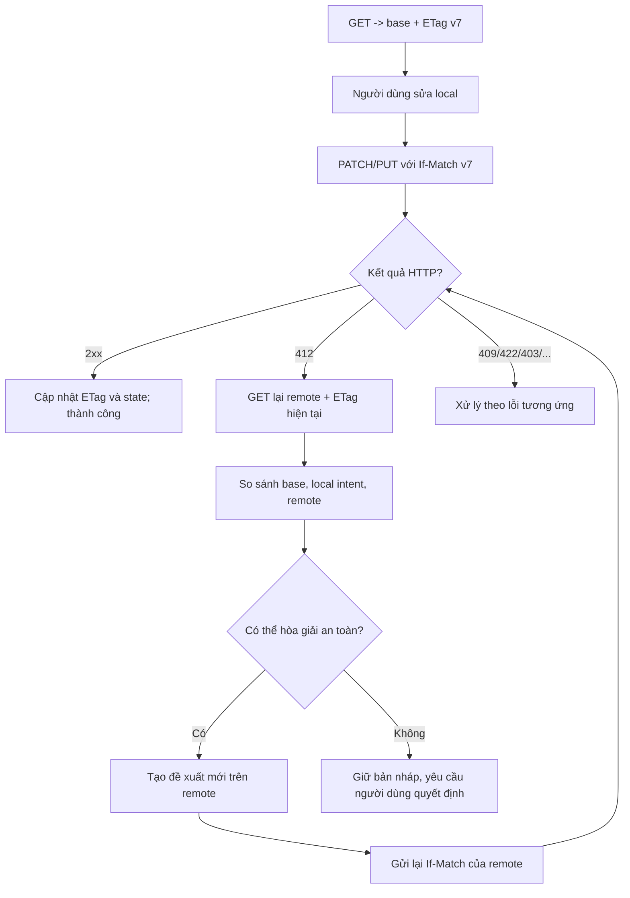

# 412 Precondition Failed và luồng đọc lại, hòa giải thay đổi

## 1. Vì sao chỉ gửi PUT/PATCH chưa đủ để cập nhật an toàn?

REST API thường cho nhiều ứng dụng và người dùng cùng xem, sửa một tài nguyên. Ví dụ hai nhân viên mở cùng đơn hàng `ord-42`. Người A đổi địa chỉ giao; người B đổi ghi chú. Cả hai đều bắt đầu từ bản đơn hàng cũ. Nếu ứng dụng gửi lại toàn bộ biểu diễn và server ghi đè mà **không kiểm tra phiên bản**, yêu cầu đến sau có thể xóa mất thay đổi của yêu cầu đến trước.

Hiện tượng đó gọi là **lost update**: hai thao tác đều được thông báo thành công, nhưng kết quả cuối chỉ giữ một phần ý định của người dùng. Dùng transaction để mỗi lần UPDATE nguyên tử **chưa đủ** ngăn lost update; mỗi transaction vẫn có thể ghi đè dữ liệu mà transaction khác vừa commit.

HTTP cung cấp **conditional requests**: client gửi một điều kiện dựa trên trạng thái tài nguyên đã biết, server chỉ thực hiện yêu cầu khi điều kiện vẫn đúng. Với cập nhật tài nguyên, cặp được dùng phổ biến là:

- `ETag` trong response GET: định danh/validator của **biểu diễn** vừa được trả.
- `If-Match` trong request PUT/PATCH/DELETE: yêu cầu server chỉ áp dụng thay đổi nếu biểu diễn được chọn vẫn khớp validator client gửi.

Khi điều kiện không còn đúng, server thường trả **412 Precondition Failed**. Đây không đơn giản là “thao tác thất bại”: nó là tín hiệu cho client **không được ghi đè một cách mù quáng**, mà cần đọc lại trạng thái và quyết định cách hòa giải.

Bài này thuộc chương **Điều kiện và đồng thời** của học phần `INTEGRATION_API_REST`. Nội dung kết nối thiết kế resource, URI, HTTP methods, status codes và hợp đồng dữ liệu với optimistic concurrency, phân trang/cache, idempotency, OpenAPI, xác thực/phân quyền, xử lý lỗi và kiểm thử bằng Java/Spring hoặc công nghệ tương đương.

### Mục tiêu học tập

Sau bài, bạn có thể:

1. Diễn giải đúng `412 Precondition Failed` và phân biệt với `409`, `428`, `304` và lỗi validation.
2. Sử dụng **strong ETag** cùng `If-Match` để ngăn lost update qua nhiều request HTTP.
3. Thiết kế luồng **GET → chỉnh sửa → conditional PUT/PATCH → 412 → GET lại → hòa giải → gửi lại**.
4. Thực hiện **three-way merge** dựa trên bản gốc, thay đổi cục bộ và phiên bản mới nhất; nhận biết trường hợp phải hỏi người dùng.
5. Bảo đảm kiểm tra điều kiện và ghi dữ liệu **nguyên tử tại database**, không chỉ kiểm tra ở controller.
6. Mô tả lỗi có cấu trúc bằng Problem Details, công bố hợp đồng OpenAPI và kiểm thử cập nhật đồng thời.
7. Nhận diện vấn đề với cache, trạng thái ngoại tuyến, quyền truy cập và các tác dụng phụ của việc retry.

## 2. Ví dụ xuyên suốt: hai client cùng sửa một đơn hàng

Giả sử `GET /orders/ord-42` trả trạng thái ban đầu:

```http
GET /orders/ord-42 HTTP/1.1
Host: api.example.test
Accept: application/json

HTTP/1.1 200 OK
Content-Type: application/json
ETag: "order-42-v7"
Cache-Control: private, no-cache

{
  "id": "ord-42",
  "status": "DRAFT",
  "shippingCity": "Hà Nội",
  "note": "Giao buổi sáng"
}
```

Trong ví dụ, `"order-42-v7"` là một **strong entity tag giả định hợp lệ**. Hệ thống thật phải bảo đảm cách sinh ETag đáp ứng semantics strong validator cho biểu diễn được chọn; không mặc nhiên đúng chỉ vì nối version vào chuỗi.

Hai client A và B cùng đọc được ETag v7. B gửi thay đổi ghi chú:

```http
PATCH /orders/ord-42 HTTP/1.1
Host: api.example.test
Content-Type: application/merge-patch+json
If-Match: "order-42-v7"

{"note":"Giao sau 17 giờ"}
```

Server kiểm tra phiên bản v7 còn đúng, áp dụng patch, commit và trả ETag mới:

```http
HTTP/1.1 204 No Content
ETag: "order-42-v8"
```

Lúc này A vẫn dùng v7 để sửa thành phố:

```http
PATCH /orders/ord-42 HTTP/1.1
Host: api.example.test
Content-Type: application/merge-patch+json
If-Match: "order-42-v7"

{"shippingCity":"Đà Nẵng"}
```

Response:

```http
HTTP/1.1 412 Precondition Failed
Content-Type: application/problem+json
Cache-Control: no-store

{
  "type": "https://api.example.test/problems/resource/version-mismatch",
  "title": "Tài nguyên đã thay đổi",
  "status": 412,
  "detail": "Đơn hàng đã được cập nhật kể từ lần đọc trước. Hãy tải lại và kiểm tra các thay đổi.",
  "instance": "/orders/ord-42",
  "code": "resource.version_mismatch"
}
```

**Quan sát quan trọng:** yêu cầu của A **không được commit** chỉ vì nó đến muộn. Dữ liệu trên server vẫn giữ địa chỉ “Hà Nội”, ghi chú “Giao sau 17 giờ” và phiên bản v8. Client A cần quyết định có thể áp dụng ý định sửa thành phố lên v8 hay không.

## 3. Hiểu chính xác `412 Precondition Failed`

Theo HTTP Semantics (RFC 9110), `412` cho biết một hoặc nhiều điều kiện trong **các request header precondition** được đánh giá là sai tại server. Header precondition phổ biến:

| Header | Công dụng điển hình | Cơ chế so sánh / lưu ý |
| --- | --- | --- |
| `If-Match` | Chỉ ghi nếu biểu diễn còn khớp một ETag đã biết | Dùng **strong comparison** |
| `If-None-Match` | GET cache validation; hoặc tránh ghi đè khi tạo resource | Dùng **weak comparison**; GET/HEAD match thường trả 304, method khác match thường trả 412 |
| `If-Unmodified-Since` | Chỉ thực hiện nếu tài nguyên chưa đổi kể từ HTTP-date được cung cấp | Điều kiện dựa trên thời gian; thường kém chính xác hơn ETag |
| `If-Modified-Since` | Kiểm tra GET/HEAD có cần tải lại representation không | Nếu không đổi, thường trả 304 |
| `If-Range` | Chỉ áp dụng phạm vi byte nếu validator phù hợp | Dùng với range requests; không phải công cụ chính chống lost update |

**412 không đồng nghĩa mọi xung đột của nghiệp vụ.** Nó gắn với sự thất bại của **điều kiện HTTP** trong request. Nếu không có precondition nhưng đơn đã `SHIPPED` nên không thể hủy, `409 Conflict` có thể mô tả đúng hơn. Nếu server yêu cầu `If-Match` nhưng client không gửi, có thể trả `428 Precondition Required` theo chính sách.

### Đừng nhầm `If-Match` với `If-None-Match`

```http
If-Match: "order-42-v7"
```

nghĩa là “chỉ thực hiện yêu cầu khi validator hiện tại khớp v7”. Ngược lại:

```http
If-None-Match: "order-42-v7"
```

nghĩa là “chỉ thực hiện khi validator hiện tại **không** khớp v7” theo quy tắc liên quan. Trong GET, `If-None-Match` được dùng rộng rãi để nhận `304 Not Modified` khi nội dung chưa đổi. **Không thay `If-Match` bằng `If-None-Match` để chống lost update**, vì ý nghĩa điều kiện bị đảo ngược.

### `If-Match: *` có tác dụng gì?

```http
If-Match: *
```

Yêu cầu chỉ được thực hiện khi **có một current representation** của tài nguyên đích. Nó hữu ích để tránh cập nhật tài nguyên không tồn tại nhưng **không bảo đảm phiên bản chưa thay đổi**, nên không đủ để ngăn lost update. Một server có thể yêu cầu ETag cụ thể thay vì cho phép `*` đối với các thao tác cần chống ghi đè.

Ngược lại, `If-None-Match: *` thường được dùng với `PUT` có semantics tạo tài nguyên theo URI đã biết để tránh ghi đè một resource đã tồn tại; nếu đã tồn tại, điều kiện không thỏa và có thể nhận `412`. Không tự dùng cách này cho mọi `POST` mà không xét cách endpoint được thiết kế.

## 4. ETag mạnh, ETag yếu và dấu ngoặc kép

ETag là entity tag (validator) do server phát hành cho **selected representation**. Nó là một token opaque đối với client: client nên lưu **nguyên giá trị**, không giải mã tên bản ghi hoặc tự tăng version.

```http
ETag: "order-42-v7"
```

Là ví dụ một strong entity tag. ETag yếu có tiền tố `W/`:

```http
ETag: W/"order-42-v7"
```

**`If-Match` sử dụng strong comparison**; weak entity tag không được coi là khớp strong validator khi đánh giá điều kiện. Do đó một client cần bảo vệ cập nhật không nên lấy weak ETag rồi kỳ vọng `If-Match` sẽ thành công.

### Khi nào một ETag là “mạnh” thật?

Gọi một chuỗi là strong ETag không đủ. Server phải sinh validator phù hợp với từng selected representation:

- Nếu bytes của biểu diễn thay đổi, một strong validator không được tiếp tục dùng như thể biểu diễn còn giống hệt.
- API có nhiều media type, ngôn ngữ, dạng nén hoặc biến thể theo quyền phải xem xét ETag của từng representation và `Vary` thích hợp.
- Nếu ETag được tính từ version CSDL, phải bảo đảm mọi thay đổi ảnh hưởng biểu diễn đều cập nhật version/validator đúng lúc; không bỏ quên field tính toán, schema, file liên quan hoặc biến thể đã chọn.
- Nếu proxy/CDN biến đổi content coding, nó cũng cần xử lý validators đúng với representation thực được gửi.

Hàm băm nội dung representation có thể cung cấp strong validator khi được tính đúng. Version CSDL cũng có thể được sử dụng khi ánh xạ được bảo đảm đúng semantics. Không có quy tắc bắt buộc ETag phải là hash, ID hoặc số version.

### Trình tự kiểm tra precondition

Server cần áp dụng các quy tắc và thứ tự ưu tiên của HTTP conditional request khi nhiều header xuất hiện. Ví dụ `If-Match` được ưu tiên hơn `If-Unmodified-Since` trong trường hợp tương ứng. **Không tự kết hợp headers bằng boolean tùy ý**, và không tạo response `412` sau khi một lỗi định tuyến/xác thực quan trọng hơn đã khiến request không thể thực hiện. Theo HTTP, precondition thường được đánh giá khi request sẽ dẫn đến một response thành công nếu không có điều kiện.

## 5. Lost update qua một sơ đồ trình tự

```mermaid
sequenceDiagram
    participant A as Client A
    participant B as Client B
    participant API as Orders API
    participant DB as PostgreSQL
    A->>API: GET /orders/ord-42
    API->>DB: Đọc phiên bản 7
    API-->>A: 200 + ETag "v7"
    B->>API: GET /orders/ord-42
    API-->>B: 200 + ETag "v7"
    B->>API: PATCH note, If-Match "v7"
    API->>DB: Kiểm tra v7 + ghi note + tăng version
    DB-->>API: Commit v8
    API-->>B: 204 + ETag "v8"
    A->>API: PATCH city, If-Match "v7"
    API->>DB: Kiểm tra precondition hiện tại
    DB-->>API: Current version v8
    API-->>A: 412 Precondition Failed; không ghi
    A->>API: GET /orders/ord-42
    API-->>A: 200 + state mới + ETag "v8"
    Note over A,API: A so sánh base/local/remote, quyết định merge
    A->>API: PATCH city, If-Match "v8"
    API->>DB: Kiểm tra v8 + commit v9
    API-->>A: 204 + ETag "v9"
```

Sơ đồ giả định việc sửa ghi chú của B và sửa thành phố của A **không xung đột về ngữ nghĩa**, server cho phép cả hai. Nếu trạng thái đơn đã thay đổi sang trạng thái cấm sửa địa chỉ, client A không được tự “merge” chỉ vì field khác nhau; server cần kiểm tra lại business invariant.

### Hai cấp độ đúng đắn

1. **Đúng ở tầng HTTP:** server trả 412 khi ETag client mang đã cũ; không áp dụng request vi phạm precondition.
2. **Đúng ở tầng lưu trữ:** kiểm tra phiên bản và commit phải nguyên tử; hai server instance không thể cùng đọc v7 rồi cùng ghi và đều thành công.

Một controller chỉ so sánh `If-Match` với version đọc trước, rồi ghi sau bằng UPDATE không có điều kiện vẫn có thể mắc race condition trong khoảng giữa kiểm tra và ghi.

## 6. Các mã 304, 409, 412, 422 và 428 dùng khi nào?

| Tình huống | Status thường phù hợp | Giải thích |
| --- | --- | --- |
| `GET` với `If-None-Match` khớp selected representation | **304 Not Modified** | Không cần chuyển lại body, client/cache đã có bản tương ứng |
| `PATCH` với `If-Match` không khớp current strong ETag | **412 Precondition Failed** | Điều kiện HTTP thất bại |
| `PUT` với `If-Match` không khớp | **412** | Không được ghi đè phiên bản mới |
| `PUT` có `If-None-Match: *` nhưng URI đã có representation | **412** | Điều kiện chỉ tạo mới không thỏa |
| API yêu cầu precondition nhưng request sửa/xóa thiếu header | **428 Precondition Required** nếu chính sách đó được áp dụng | Yêu cầu client dùng điều kiện |
| Request có phiên bản phù hợp nhưng chuyển trạng thái nghiệp vụ trái quy tắc | **409 Conflict** | Xung đột trạng thái tài nguyên |
| Body JSON hợp lệ, dữ liệu không đạt validation | **422 Unprocessable Content** theo hợp đồng | Không thể xử lý nội dung |
| Body JSON sai cú pháp | **400 Bad Request** | Không parse request hợp lệ |
| Request gửi sai media type | **415 Unsupported Media Type** | Định dạng body không hỗ trợ |
| Không xác thực/không có quyền | **401/403** theo điều kiện | Không thay bằng 412 |
| Resource không tồn tại hoặc được che giấu theo chính sách | **404 Not Found** nếu phù hợp | Không phải lỗi phiên bản đơn thuần |
| CSDL thất bại khi ghi | **5xx** thích hợp | Lỗi server, không phải ETag cũ |

**Nuance của HTTP:** với precondition không thỏa, RFC 9110 có những trường hợp server có thể trả response thành công khi xác định chắc chắn thay đổi mà client yêu cầu **đã được áp dụng trước đó**. Đây là một ngoại lệ có điều kiện chặt, không phải giấy phép âm thầm bỏ qua `If-Match`. Thiết kế bài học lấy chính sách thông thường: ETag cũ và chưa có bằng chứng yêu cầu đã được áp dụng → **412**.

### Không trộn `412` với lỗi field validation

Request:

```http
PATCH /orders/ord-42 HTTP/1.1
Content-Type: application/merge-patch+json
If-Match: "order-42-v8"

{"shippingCity":""}
```

Nếu v8 là phiên bản hiện tại nhưng `shippingCity` không được rỗng, status phù hợp là **422** theo chính sách validation. Nếu v8 đã cũ, server đánh giá `If-Match` và **412** trước khi áp dụng thay đổi; không nên thay status 412 bằng 422 chỉ vì body cũng có một trường sai.

## 7. Luồng chuẩn khi nhận 412: dừng ghi, đọc lại rồi hòa giải

Mục tiêu của client không phải cố gắng khiến PATCH được chấp nhận bằng mọi giá. Client phải **giữ ý định của người dùng** đồng thời **không phá thay đổi hợp lệ của người khác**.

Một luồng hợp lý:

1. **Lưu trạng thái gốc:** tại lúc GET, giữ bản `base` và ETag đi kèm.
2. **Ghi nhận thay đổi cục bộ:** người dùng sửa các field, lưu `local intent` thay vì chỉ giữ biểu diễn đã sửa hoàn chỉnh.
3. **Gửi cập nhật có điều kiện:** `If-Match: <ETag của base>`.
4. **Nhận 412:** không cập nhật UI như thể đã lưu thành công; không tự đổi ETag thành giá trị mới bằng cách đoán.
5. **GET lại tài nguyên:** đọc bản `remote/current` và ETag mới; nếu cần tránh cache trả body cũ, yêu cầu revalidation bằng cơ chế HTTP thích hợp.
6. **Hòa giải:** so sánh `base`, `local` và `remote` theo field và quy tắc nghiệp vụ.
7. **Nếu có thể hợp nhất an toàn:** tạo thay đổi mới trên bản mới nhất, gửi lại với **ETag mới**.
8. **Nếu xung đột:** hiển thị lựa chọn cho người dùng hoặc workflow chuyên biệt, giữ bản nháp cục bộ; không ghi đè tự động.
9. **Nếu gặp thêm 412:** tiếp tục theo chính sách giới hạn vòng lặp, không retry vô hạn.



### Chú ý về GET sau 412 và cache

Một client có thể gửi:

```http
GET /orders/ord-42 HTTP/1.1
Cache-Control: no-cache
Accept: application/json
```

để yêu cầu cache xác nhận lại trước khi tái sử dụng response. Nếu cần phản hồi đầy đủ cho việc hòa giải, hãy bảo đảm client nhận **body hiện tại**, không vô tình sử dụng cached state từ lần trước. `If-None-Match` cũ cũng có thể được dùng để revalidate GET; khi representation đã thay đổi, origin trả 200 với body mới, còn 304 không mang body nếu validator vẫn khớp. Trong hệ thống có nhiều biến thể, `Accept`/`Vary` và ETag của selected representation phải nhất quán.

Không dùng `Cache-Control: no-store` như giải pháp thay thế cho kiểm soát đồng thời. Cache có đúng cũng không ngăn hai transaction cùng sửa một resource.

## 8. Three-way merge: base – local – remote

**Hòa giải ba chiều** (*three-way merge*) so sánh:

- **Base (B):** nội dung client đã đọc trước khi bắt đầu sửa.
- **Local (L):** nội dung hoặc ý định thay đổi người dùng muốn áp dụng so với B.
- **Remote (R):** nội dung mới nhất server trả về sau 412.

Mục đích là chỉ tự động áp dụng thay đổi của client trên R khi **không có xung đột thực sự**. Bắt buộc phải giữ B hoặc một change set đủ chi tiết; chỉ biết L và R thường không thể phân biệt giá trị nào do ai sửa.

### Ví dụ hai field độc lập

| Field | Base B, v7 | Local L của A | Remote R, v8 do B sửa | Quyết định |
| --- | --- | --- | --- | --- |
| `shippingCity` | Hà Nội | Đà Nẵng | Hà Nội | A thay đổi; R không đổi → lấy Đà Nẵng |
| `note` | Giao buổi sáng | Giao buổi sáng | Giao sau 17 giờ | A không sửa; R thay đổi → giữ note mới |
| `status` | DRAFT | DRAFT | DRAFT | Không đổi; kiểm tra rule trước khi ghi |

Đề xuất hợp nhất:

```json
{
  "shippingCity": "Đà Nẵng",
  "note": "Giao sau 17 giờ",
  "status": "DRAFT"
}
```

Không nhất thiết phải PUT toàn bộ object. Nếu API hỗ trợ Merge Patch cho `shippingCity`, client A chỉ cần gửi thay đổi của mình lên v8:

```http
PATCH /orders/ord-42 HTTP/1.1
Content-Type: application/merge-patch+json
If-Match: "order-42-v8"

{"shippingCity":"Đà Nẵng"}
```

Như vậy ghi chú mới của B được giữ nguyên. Server vẫn phải kiểm tra quyền, trạng thái đơn và tính hợp lệ ở thời điểm commit.

### Ví dụ xung đột trên cùng một field

| Field | Base B | Local L | Remote R | Nhận xét |
| --- | --- | --- | --- | --- |
| `shippingCity` | Hà Nội | Đà Nẵng | Hải Phòng | Cả A và B đều sửa khác B |

Không có cách hợp nhất tự động luôn đúng. Client có thể hiển thị:

> Địa chỉ giao hàng đã được thay đổi thành Hải Phòng trong lúc bạn chỉnh sửa. Bạn muốn giữ địa chỉ mới nhất hay áp dụng Đà Nẵng?

Đây là **mẫu UI minh họa**, không phải quy định HTTP. Trong luồng quan trọng như thanh toán, số lượng, hạn mức, trạng thái giao hoặc dữ liệu pháp lý, có thể cần xác nhận lại, kiểm tra quyền hoặc một quy trình nghiệp vụ chuyên biệt thay vì cho người dùng “chọn ghi đè” ngay.

### Quy tắc so sánh ở mức field

| B so với L | B so với R | Hướng xử lý gợi ý |
| --- | --- | --- |
| Không đổi | Không đổi | Giữ B |
| Không đổi | R đổi | Giữ R |
| L đổi | Không đổi | Có thể áp dụng L trên R sau validation |
| L đổi | R đổi cùng giá trị | Thường coi ý định đã hội tụ; vẫn xác nhận invariants |
| L đổi | R đổi khác giá trị | **Xung đột cần giải quyết** |

Quy tắc này chỉ là mức cơ bản. Với nested object, mảng, số đếm, chuyển trạng thái và invariants chéo field, xung đột có thể xảy ra **dù các field khác nhau**.

## 9. Khi nào không được tự động hợp nhất?

Không phải mọi cập nhật độc lập theo field đều độc lập về nghiệp vụ:

1. **Giá/chiết khấu:** A thay số lượng, B thay mức giảm giá. Hai field riêng nhưng tổng tiền cần tính lại.
2. **Đơn hàng và thanh toán:** A sửa địa chỉ, B xác nhận giao; địa chỉ có thể không còn được phép thay sau một mốc.
3. **Tài khoản và phân quyền:** A đổi role, B đổi phạm vi truy cập; ghép máy móc có thể cấp quyền vượt dự kiến.
4. **Mảng:** hai người xóa/chèn item ở vị trí khác nhau. Index cũ của JSON Patch có thể không còn chỉ tới đúng phần tử.
5. **Văn bản dài:** hai thay đổi trên cùng trường có thể cần diff/merge dựa trên vùng văn bản, không phải “field bằng/khác”.
6. **Tồn kho:** tăng/giảm số lượng là thao tác miền với invariant; không nên đơn giản gửi lại “giá trị tuyệt đối” trên bản mới.
7. **Dữ liệu cần phê duyệt:** cập nhật gần nhất có thể đã được ký hoặc phê duyệt; client cũ không được ghi đè.

**Hướng dẫn thực tế:** phân loại field thành `mergeable`, `merge-with-confirmation` và `never-auto-merge`. Quy tắc này thuộc domain, cần được định nghĩa ở server và/hoặc UI, không chỉ do thư viện diff generic quyết định.

### Vì sao “last write wins” nguy hiểm?

Nếu client nhận 412 rồi lập tức GET bản mới nhất và **PUT lại toàn bộ bản local cũ với ETag mới**, request sẽ có thể thành công nhưng xóa mất thay đổi của người khác. Việc đổi ETag cho đúng header mà không hòa giải thật sự chỉ **dời lost update sang tầng client**.

Chỉ chọn last-write-wins khi hợp đồng chủ động thiết kế như vậy và tác động được chấp nhận (ví dụ một preference ít quan trọng), không dùng làm hành vi mặc định cho đơn hàng, tài chính và tài nguyên hợp tác.

## 10. PUT, PATCH, JSON Patch và ý định của người dùng

Khi hòa giải, điều quan trọng là phân biệt **biểu diễn mong muốn** với **tập thay đổi có chủ đích**.

| Phương pháp | Client gửi gì? | Nguy cơ sau 412 | Chiến lược |
| --- | --- | --- | --- |
| `PUT` | Biểu diễn tài nguyên theo hợp đồng thay thế | Bản local cũ có thể ghi đè field khác của remote nếu áp dụng lại thô | Hòa giải B/L/R, dựng toàn bộ representation mới, gửi If-Match mới |
| JSON Merge Patch | Object mô tả các field cần merge; `null` trong object thường biểu thị xóa member | Có thể vô ý xóa field hoặc dùng giá trị stale | Tạo patch mới từ **ý định cục bộ**, kiểm tra field cho phép và semantics null |
| JSON Patch | Mảng op `test/add/remove/replace/move/copy` theo đường dẫn | Path/index/điều kiện cũ có thể không còn đúng | Dựng lại ops theo remote, kết hợp `test` và If-Match |
| Domain action (POST command resource) | Ý định nghiệp vụ, ví dụ “yêu cầu hủy” | Điều kiện nghiệp vụ có thể thay đổi sau lần đọc | Tạo yêu cầu riêng có idempotency và state check |

**HTTP PATCH là nguyên tử ở mức áp dụng tập thay đổi** (RFC 5789): hoặc mọi thao tác của patch thành công, hoặc không thay đổi nào được áp dụng. Nhưng tính nguyên tử của một request PATCH **không tự bảo đảm** nhiều client không ghi đè nhau. `If-Match`/version kiểm soát việc đọc–ghi giữa các request.

### Ví dụ JSON Patch dùng `test`

```http
PATCH /orders/ord-42 HTTP/1.1
Content-Type: application/json-patch+json
If-Match: "order-42-v8"

[
  {"op":"test","path":"/status","value":"DRAFT"},
  {"op":"replace","path":"/shippingCity","value":"Đà Nẵng"}
]
```

`test` diễn đạt một kỳ vọng tại đường dẫn tài liệu. `If-Match` diễn đạt điều kiện trên selected representation. Hai cơ chế có thể bổ sung cho nhau nhưng không thay thế transaction và bảo vệ phiên bản tại điểm commit. Lỗi của `test` có thể ánh xạ `409` hoặc mã khác theo hợp đồng; nếu chính `If-Match` không khớp, phân loại là **412**.

## 11. Client state machine: giữ bản nháp trong quá trình hòa giải

Ứng dụng web/mobile nên có các trạng thái đủ rõ:

```text
CLEAN
  Đã có base + ETag, chưa có thay đổi cục bộ
DIRTY
  Người dùng đang sửa; lưu local changes
SAVING
  Gửi conditional PATCH/PUT
SAVED
  2xx thành công; thay base bằng bản mới, cập nhật ETag
CONFLICT
  412; giữ local draft, GET lại và so sánh B/L/R
MERGE_READY
  Đã tạo proposed changes; chờ xác nhận nếu cần
ERROR
  401/403/409/422/5xx; xử lý theo từng loại
```

Không xóa bản nháp chỉ vì server trả 412. Một client có thể lưu thông tin:

```json
{
  "resourceUri": "/orders/ord-42",
  "baseEtag": "\"order-42-v7\"",
  "base": {
    "shippingCity": "Hà Nội",
    "note": "Giao buổi sáng"
  },
  "localChanges": {
    "shippingCity": "Đà Nẵng"
  }
}
```

Đây là cấu trúc state minh họa. Khi giữ dữ liệu ngoại tuyến hoặc trong local storage, cần bảo vệ thông tin nhạy cảm và vòng đời bản nháp; không lưu token xác thực vào dữ liệu này. ETag trong `baseEtag` phải lưu với cú pháp nguyên bản, gồm dấu ngoặc kép. Không coi ETag là một số có thể tăng từ v7 sang v8 ở client.

### Giới hạn số lần hòa giải tự động

Nếu nhiều client liên tục ghi cùng tài nguyên, client A có thể liên tục gặp 412 ngay sau khi merge. Thay vì vòng lặp vô hạn:

- Cho phép số lần thử có giới hạn cho những merge thực sự an toàn.
- Hiển thị xung đột và yêu cầu xác nhận với dữ liệu có tác động cao.
- Áp dụng delay/backoff hợp lý khi cạnh tranh nhiều, nhưng **backoff không thay bảo vệ phiên bản**.
- Tách lỗi mạng và 5xx khỏi 412; không tự coi tất cả đều là xung đột phiên bản.
- Theo dõi tỷ lệ 412 để nhận ra UX hoặc luồng đồng bộ có vấn đề.

## 12. Kiểm tra và ghi phải nguyên tử ở tầng persistence

Đây là khía cạnh dễ bị bỏ qua nhất. Ví dụ logic nguy hiểm:

```text
current = SELECT order WHERE id = ...
if current.version != expected:
    return 412

// Giữa hai dòng này, request khác có thể ghi version mới!

UPDATE orders SET ... WHERE id = ...
return 204
```

Nếu nhiều instance API chạy song song, một lock ở bộ nhớ ứng dụng cũng không bảo vệ tất cả request. Cần dùng khả năng đồng thời của storage:

1. **Optimistic concurrency** bằng UPDATE có điều kiện trên version/validator.
2. **Transaction + row lock** để kiểm tra và sửa trong cùng ranh giới.
3. Hoặc cơ chế transaction/compare-and-swap tương đương do DB cung cấp.

### 12.1. SQL compare-and-swap

Giả sử bảng có `version` tăng với mọi thay đổi được bảo vệ:

```sql
CREATE TABLE orders (
    id UUID PRIMARY KEY,
    tenant_id UUID NOT NULL,
    shipping_city VARCHAR(200) NOT NULL,
    note VARCHAR(400),
    status VARCHAR(30) NOT NULL,
    version BIGINT NOT NULL
);
```

Với một patch chỉ sửa `shipping_city`:

```sql
UPDATE orders
SET shipping_city = :new_city,
    version = version + 1
WHERE id = :order_id
  AND tenant_id = :tenant_id
  AND version = :expected_version
  AND status = 'DRAFT'
RETURNING version;
```

Nếu trả đúng một dòng, update đã thắng điều kiện version và domain tại thời điểm thực thi statement. Nếu không có dòng trả về, có thể vì:

- Resource không tồn tại hoặc không thuộc tenant được cấp quyền.
- Version đã thay đổi (liên quan `412`).
- Status không còn `DRAFT` (xung đột nghiệp vụ, có thể `409`).

Do đó **không tự ánh xạ mọi zero-row result thành 412**. Cần phân loại theo chính sách bảo mật/transaction, kiểm tra trạng thái thích hợp mà không làm lộ thông tin của tenant khác. Nếu có nhiều bảng hoặc invariants chéo, bọc thao tác trong một transaction và kiểm tra các ràng buộc liên quan.

### 12.2. Pessimistic lock

```sql
BEGIN;

SELECT id, status, version, shipping_city, note
FROM orders
WHERE id = :order_id AND tenant_id = :tenant_id
FOR UPDATE;

-- So sánh If-Match với version/ETag hiện tại.
-- Nếu không khớp: ROLLBACK và trả 412.
-- Nếu domain invariant sai: ROLLBACK và trả 409/422 phù hợp.

UPDATE orders
SET shipping_city = :new_city, version = version + 1
WHERE id = :order_id AND tenant_id = :tenant_id;

COMMIT;
```

Row lock bảo vệ việc ghi bởi các transaction tuân thủ cùng cơ chế. Chú ý deadlock, lock timeout, isolation level, query khác không dùng lock và xử lý lỗi khi transaction commit. Server không nên giữ transaction mở trong lúc chờ người dùng quyết định cách merge; hòa giải là một vòng HTTP riêng.

### 12.3. Phiên bản ở nhiều bảng và nguồn dữ liệu

Nếu representation của Order tổng hợp `orders`, `order_items` và `shipping_address`, ETag phải bảo vệ các thành phần ảnh hưởng biểu diễn. Chỉ tăng `orders.version` khi sửa một row, nhưng không tăng khi `order_items` đổi, có thể khiến client gửi ETag “vẫn đúng” dù nội dung đã khác.

Có thể sử dụng version tổng hợp cho aggregate và cập nhật cùng transaction; hoặc validator từ representation thực tế nếu có thiết kế phù hợp. Nếu tài nguyên tổng hợp dữ liệu từ nhiều service, không có transaction nguyên tử chung tự động: phải định nghĩa rõ consistency boundary thay vì hứa `If-Match` bảo vệ mọi thành phần từ xa.

## 13. Thực hành Java/Spring: conditional PATCH với transaction

Các ví dụ dùng Java 17+, Spring MVC/Spring Boot 3 và JPA. Đây là **phác thảo kiến trúc có chọn lọc**, không phải mã hoàn chỉnh có thể biên dịch độc lập: helper, imports, entity mapping, repository, authorization và message conversion cần được triển khai theo dự án.

### 13.1. GET phát ETag

```java
record OrderView(
    UUID id,
    String status,
    String shippingCity,
    String note
) {}

record VersionedOrder(OrderView view, String strongEtag) {}

@RestController
@RequestMapping("/orders")
class OrderController {
    private final OrderService orders;

    OrderController(OrderService orders) {
        this.orders = orders;
    }

    @GetMapping("/{id}")
    ResponseEntity<OrderView> get(
        @PathVariable UUID id,
        Authentication principal
    ) {
        VersionedOrder current = orders.getAuthorized(id, principal);
        return ResponseEntity.ok()
            .eTag(current.strongEtag())
            .cacheControl(CacheControl.noCache().cachePrivate())
            .body(current.view());
    }

    @PatchMapping(
        path = "/{id}",
        consumes = "application/merge-patch+json"
    )
    ResponseEntity<OrderView> patch(
        @PathVariable UUID id,
        @RequestHeader(HttpHeaders.IF_MATCH) String ifMatch,
        @RequestBody JsonNode patch,
        Authentication principal
    ) {
        VersionedOrder updated =
            orders.patchAuthorized(id, principal, ifMatch, patch);
        return ResponseEntity.ok()
            .eTag(updated.strongEtag())
            .body(updated.view());
    }
}
```

`@RequestHeader` ở đây yêu cầu `If-Match`. **Spring có thể trả 400 khi header bắt buộc bị thiếu**, trong khi API muốn `428` cần advice/validation riêng. Phương thức `ResponseEntity.eTag(...)` xử lý dạng entity tag; hàm service phải tạo validator hợp lệ và tránh thêm dấu ngoặc kép hai lần.

### 13.2. Service thực hiện kiểm tra trong transaction

```java
@Service
class OrderService {
    private final OrderRepository repository;
    private final OrderPolicy policy;
    private final OrderMapper mapper;
    private final EtagPolicy etags;
    private final MergePatchEngine mergePatches;

    // Constructor injection lược bỏ.

    @Transactional
    public VersionedOrder patchAuthorized(
        UUID id,
        Authentication principal,
        String ifMatch,
        JsonNode patch
    ) {
        // Parse và kiểm tra JSON Merge Patch; allowlist field writable.
        mergePatches.validateWritableFields(
            patch, Set.of("shippingCity", "note")
        );

        OrderEntity entity = repository.findAuthorizedForUpdate(
                id, principal)
            .orElseThrow(OrderNotFoundException::new);

        OrderView oldView = mapper.toView(entity);
        String currentStrongEtag = etags.forRepresentation(oldView);

        // parse If-Match đúng semantics strong match, hỗ trợ danh sách
        // entity tags và chính sách đối với "*" nếu được phép.
        if (!etags.ifMatchSatisfied(ifMatch, currentStrongEtag)) {
            throw new PreconditionFailedException();
        }

        if (!policy.canEdit(principal, entity)) {
            throw new OrderPermissionException();
        }
        if (!"DRAFT".equals(entity.getStatus())) {
            throw new OrderStateConflictException();
        }

        JsonNode candidate = mergePatches.applyToCopy(
            mapper.toWritableJson(entity), patch
        );
        OrderChanges changes = mapper.validateAndConvert(candidate);
        policy.validateFinalState(entity, changes);

        entity.applyAllowedChanges(changes);
        repository.flush(); // đảm bảo phát hiện lỗi DB trước response
        OrderView updated = mapper.toView(entity);

        // Với ETag dựa version, flush phải cập nhật version phù hợp.
        // Nếu ETag dựa vào bytes representation, tính trên biểu diễn
        // cuối thực sự được chọn/serialize một cách nhất quán.
        return new VersionedOrder(
            updated,
            etags.forRepresentation(updated)
        );
    }
}
```

Hàm `findAuthorizedForUpdate` giả định lấy entity bằng lock hoặc cơ chế đồng thời tương đương trong cùng transaction. Nếu dùng JPA `@Version` và optimistic locking, `flush()` phải làm rõ version đã được cập nhật, đồng thời ánh xạ lỗi version về kết quả HTTP theo chính sách. **Không nên ánh xạ bừa mọi `OptimisticLockException` thành 412** nếu request không hề mang precondition HTTP; trong trường hợp có `If-Match`, service cần xác định precondition đã bị mất hiệu lực hoặc trả lỗi phù hợp.

`MergePatchEngine` phải tuân theo `application/merge-patch+json`: member JSON có giá trị `null` thường có nghĩa xóa member, không mặc định là “đặt property thành null”; validate field cho phép, kiểu dữ liệu và bất biến. Làm việc trên bản sao giúp tránh sửa entity từng phần khi patch thất bại; transaction bảo vệ persisted state.

### 13.3. Tạo response 412 theo RFC 9457

```java
@RestControllerAdvice
class OrderProblemAdvice {
    @ExceptionHandler(PreconditionFailedException.class)
    ResponseEntity<ProblemDetail> stale() {
        ProblemDetail body = ProblemDetail.forStatusAndDetail(
            HttpStatus.PRECONDITION_FAILED,
            "Tài nguyên đã thay đổi. Hãy tải lại và hòa giải cập nhật."
        );
        body.setType(URI.create(
            "https://api.example.test/problems/resource/version-mismatch"
        ));
        body.setTitle("Phiên bản không còn phù hợp");
        body.setProperty("code", "resource.version_mismatch");

        return ResponseEntity
            .status(HttpStatus.PRECONDITION_FAILED)
            .contentType(MediaType.parseMediaType("application/problem+json"))
            .cacheControl(CacheControl.noStore())
            .body(body);
    }
}
```

Trong triển khai thật phải có handler cho `428`, `409`, `400`, `415`, `422` và lỗi 5xx; tích hợp security trước khi xem resource và tránh lộ thông tin phiên bản của resource không có quyền đọc. `code` là extension riêng của API, còn `type`, `title`, `status`, `detail` thuộc Problem Details RFC 9457.

### 13.4. Những điểm cần xác minh khi dùng Spring

| Điểm | Nguy cơ nếu bỏ qua | Cách kiểm tra |
| --- | --- | --- |
| `If-Match` có nhiều ETag hoặc `*` | Tự so chuỗi header có thể sai semantics HTTP | Dùng parser/test strong matching đúng chuẩn |
| ETag trả bởi GET | Version không phản ánh mọi thay đổi của biểu diễn | Test mọi thao tác làm đổi resource/variant |
| Transaction rollback | Bắt checked exception rồi commit nửa chừng | Test lỗi giữa patch, cấu hình rollback phù hợp |
| Race giữa check và update | Hai request cùng qua điều kiện cũ | Pessimistic lock hoặc optimistic compare-and-swap |
| `@Version` và flush | ETag sau response chưa tương ứng version mới | Đọc lại entity trong transaction hoặc tính validator đúng |
| Authorization | Có thể dò version của tài nguyên người khác | Kiểm tra quyền trước khi tiết lộ dữ liệu |
| Body merge patch | `null` xóa field, không phải gán null thông thường | Contract test cho null, nested object, mảng |
| Cache | Client GET lại nhưng nhận bản cũ từ một cache không đúng | Test conditional GET, Cache-Control, ETag, Vary |

## 14. Pseudocode client thực hiện read–reconcile–retry

Client không nên chỉ viết `while (response.status === 412) retry()`. Một quy trình rõ ràng cần giữ bản gốc, patch dự kiến và chính sách merge.

```typescript
type Order = {
  id: string;
  status: string;
  shippingCity: string;
  note: string;
};

type Versioned<T> = {body: T; etag: string};
type LocalIntent = Partial<Pick<Order, "shippingCity" | "note">>;

async function fetchCurrentOrder(id: string): Promise<Versioned<Order>> {
  const response = await fetch("/orders/" + encodeURIComponent(id), {
    headers: {"Cache-Control": "no-cache"},
    cache: "no-cache"
  });
  if (!response.ok) throw new Error("Không đọc được tài nguyên");
  const etag = response.headers.get("ETag");
  if (!etag) throw new Error("API thiếu ETag theo hợp đồng");
  return {body: await response.json() as Order, etag};
}

async function conditionalPatch(
  id: string,
  etag: string,
  intent: LocalIntent
): Promise<Response> {
  return fetch("/orders/" + encodeURIComponent(id), {
    method: "PATCH",
    headers: {
      "Content-Type": "application/merge-patch+json",
      "If-Match": etag
    },
    body: JSON.stringify(intent)
  });
}

function reconcile(
  base: Order,
  local: LocalIntent,
  remote: Order
): {merged?: LocalIntent; conflicts: string[]} {
  const merged: LocalIntent = {};
  const conflicts: string[] = [];
  const fields: Array<keyof LocalIntent> = [
    "shippingCity", "note"
  ];

  for (const field of fields) {
    if (!Object.prototype.hasOwnProperty.call(local, field)) continue;
    const wanted = local[field];
    const remoteChanged = remote[field] !== base[field];
    if (remoteChanged && remote[field] !== wanted) {
      conflicts.push(field);
    } else if (remote[field] !== wanted) {
      // Chỉ đưa field thuộc ý định người dùng vào patch mới.
      // Trong ví dụ field luôn là string; không dùng thuật toán
      // này cho số tiền, trạng thái, mảng hoặc nested objects.
      merged[field] = wanted;
    }
  }
  return {merged, conflicts};
}

async function saveWithReconciliation(
  original: Versioned<Order>,
  intent: LocalIntent
): Promise<void> {
  const first = await conditionalPatch(original.body.id,
                                       original.etag, intent);
  if (first.ok) return;
  if (first.status !== 412) throw new Error("Xử lý lỗi khác theo status");

  const remote = await fetchCurrentOrder(original.body.id);
  const result = reconcile(original.body, intent, remote.body);
  if (result.conflicts.length) {
    showConflictUi(original.body, intent, remote.body, result.conflicts);
    return;
  }

  if (!result.merged || Object.keys(result.merged).length === 0) {
    // Ý định đã được đáp ứng trong remote; không cần PATCH trùng.
    return;
  }
  const second = await conditionalPatch(original.body.id,
                                        remote.etag, result.merged);
  if (second.status === 412) {
    showRetryConflictUi(); // Không lặp vô hạn.
  } else if (!second.ok) {
    throw new Error("Xử lý lỗi khác theo status");
  }
}
```

Đây là **mã TypeScript minh họa**, `showConflictUi` và `showRetryConflictUi` do ứng dụng cung cấp. Không dùng thuật toán này cho những field cần hợp nhất nghiệp vụ phức tạp hoặc có thể xóa bằng `null`: giá trị `undefined` trong JSON serialization, sự khác nhau giữa “vắng mặt” và “xóa”, mảng và nested object cần chính sách riêng. Với JSON Merge Patch, chỉ gửi các field thật sự được sửa để giảm rủi ro ghi đè.

**Giới hạn quan trọng:** nếu remote bị sửa **sau khi client GET lại nhưng trước conditionalPatch lần hai**, server sẽ trả 412 lần nữa. Đây là hành vi bảo vệ đúng. Client cần tái đánh giá hoặc yêu cầu người dùng thay vì tự bỏ If-Match để “ép thành công”.

## 15. Xử lý dữ liệu ngoại tuyến và những lần gửi lại không chắc kết quả

Mobile có thể lưu bản đơn hàng để chỉnh sửa khi mất mạng. Khi kết nối lại:

- Bản gốc và ETag có thể cũ nhiều giờ/ngày.
- Người dùng khác đã chỉnh nhiều field hoặc chuyển trạng thái.
- Quyền truy cập, chính sách và schema có thể đã thay đổi.
- Một PATCH trước đó có thể đã được server commit nhưng client bị timeout trước khi nhận response.

Do đó quy trình đồng bộ cần **lưu base + local intent + ETag**, đọc lại remote và giải quyết xung đột dựa trên domain. Không cho rằng chỉ có số version là đủ để tạo lại ý định của người dùng.

### Timeout sau khi gửi request không giống nhận 412

Khi client nhận **412**, nó biết precondition đã không thỏa theo response đó và yêu cầu không nên được áp dụng như đã gửi. Nhưng khi client bị **timeout**, không có phản hồi đáng tin cậy để xác định server đã commit hay chưa.

Với request có side effects, cần:

1. GET lại resource hoặc truy vấn trạng thái thao tác để xác định kết quả.
2. Sử dụng idempotency key nếu hợp đồng yêu cầu cho thao tác không an toàn hoặc tạo resource phụ.
3. Không gửi lại POST thanh toán hoặc tạo đơn vô hạn chỉ vì chưa thấy 2xx.
4. Phân biệt retry do network, do 412, do 429/503 và lỗi validation.

Một retry sau 412 với ETag mới **không tự là idempotency**. Nó là một yêu cầu cập nhật mới trên phiên bản khác; hệ thống vẫn phải quản lý tác dụng phụ và chống trùng khi cần.

## 16. Luồng phản hồi lỗi có cấu trúc và UX

Một API tốt trả mã HTTP để xử lý ở mức giao thức và Problem Details để nhận diện loại lỗi:

```http
HTTP/1.1 412 Precondition Failed
Content-Type: application/problem+json
Cache-Control: no-store

{
  "type": "https://api.example.test/problems/resource/version-mismatch",
  "title": "Tài nguyên đã được cập nhật",
  "status": 412,
  "detail": "Dữ liệu trên server mới hơn bản bạn đã mở.",
  "instance": "/orders/ord-42",
  "code": "resource.version_mismatch",
  "traceId": "req-47ac"
}
```

`code`, `traceId` là extension riêng, **không phải field bắt buộc của RFC 9457**. Client nên phân nhánh theo status và `type`/mã ổn định, **không so sánh `title` hay `detail`** vì text có thể được dịch. Không trả toàn bộ biểu diễn mới trong lỗi 412 cho caller không có quyền; thiết kế GET lại giúp thực thi xác thực/phân quyền và content negotiation tại một endpoint rõ ràng.

### UI gợi ý khi có xung đột

| Kết quả hòa giải | Hành vi UX phù hợp |
| --- | --- |
| Remote chỉ đổi field khác và domain cho phép merge | Thông báo đã nhận dữ liệu mới, có thể tự gửi patch mới với ETag mới |
| Remote sửa cùng field khác giá trị | Hiển thị bản local và server; yêu cầu người dùng chọn hoặc sửa |
| Remote chuyển trạng thái cấm sửa | Giải thích không thể lưu vì hành động không còn hợp lệ; giữ bản nháp nếu hữu ích |
| Resource bị xóa | Thông báo và đưa về danh sách; không tự tạo lại resource |
| Người dùng mất quyền | Dừng thao tác, không hiển thị dữ liệu không còn được phép xem |
| Nhiều vòng 412 liên tục | Dừng retry tự động, hướng dẫn làm mới và xử lý thủ công |

Không tạo nút “Ghi đè tất cả” cho dữ liệu quan trọng khi chưa có chính sách quyền và audit; một quyết định “overwrite remote” có thể cần yêu cầu người dùng xác nhận rõ với state mới, hoặc một endpoint command riêng.

## 17. OpenAPI: công bố precondition và 412 rõ ràng

Ví dụ OpenAPI 3.0.3 cho GET và PATCH:

```yaml
openapi: 3.0.3
info:
  title: Orders API
  version: 1.0.0
paths:
  /orders/{id}:
    get:
      summary: Lấy phiên bản hiện tại của đơn
      parameters:
        - name: id
          in: path
          required: true
          schema: { type: string }
      responses:
        '200':
          description: Đơn hàng và strong ETag
          headers:
            ETag:
              schema: { type: string }
              description: Entity tag cần giữ nguyên để gửi If-Match
          content:
            application/json:
              schema:
                $ref: '#/components/schemas/Order'
        '304':
          description: Không thay đổi theo conditional GET
        '404':
          description: Resource không tồn tại hoặc không được tiết lộ
    patch:
      summary: Cập nhật một phần đơn có điều kiện phiên bản
      description: >
        Client gửi strong ETag từ GET trong If-Match.
        Nếu phiên bản đã thay đổi, server không ghi và trả 412.
        Client cần GET lại, hòa giải thay đổi rồi gửi request mới.
      parameters:
        - name: id
          in: path
          required: true
          schema: { type: string }
        - name: If-Match
          in: header
          required: true
          schema: { type: string }
          description: Strong entity tag của biểu diễn client đã đọc
      requestBody:
        required: true
        content:
          application/merge-patch+json:
            schema:
              type: object
              additionalProperties: false
              properties:
                shippingCity: { type: string, minLength: 1 }
                note: { type: string, maxLength: 400 }
      responses:
        '200':
          description: Đã cập nhật, trả biểu diễn mới
          headers:
            ETag:
              schema: { type: string }
              description: Strong ETag mới
          content:
            application/json:
              schema:
                $ref: '#/components/schemas/Order'
        '400': { description: Request body sai cú pháp }
        '401': { description: Thiếu xác thực hợp lệ }
        '403': { description: Không đủ quyền cập nhật }
        '404': { description: Resource không tồn tại }
        '409': { description: Xung đột trạng thái nghiệp vụ }
        '412':
          description: If-Match không khớp; phải đọc lại và hòa giải
          content:
            application/problem+json:
              schema:
                $ref: '#/components/schemas/Problem'
        '415': { description: Content-Type không hỗ trợ }
        '422': { description: Nội dung không thỏa validation }
        '428':
          description: Server yêu cầu precondition nhưng client chưa gửi
components:
  schemas:
    Order:
      type: object
      required: [id, status, shippingCity]
      properties:
        id: { type: string }
        status: { type: string }
        shippingCity: { type: string }
        note: { type: string }
    Problem:
      type: object
      properties:
        type: { type: string, format: uri-reference }
        title: { type: string }
        status: { type: integer }
        detail: { type: string }
        instance: { type: string, format: uri-reference }
        code: { type: string }
        traceId: { type: string }
```

Đây là **OpenAPI minh họa**. Với JSON Merge Patch, `null` có nghĩa xóa một member trong object theo RFC 7396; nếu API không hỗ trợ xóa `shippingCity` hoặc `note`, phải từ chối theo quy tắc. Schema trên chỉ trình bày shape phổ biến, chưa mô tả đầy đủ semantic null, conditional request precedence, security schemes và mọi response. Tài liệu cần nói rõ khả năng của `If-Match: *`, hạn chế weak ETag, các mã lỗi và giới hạn retry.

## 18. Bộ kiểm thử cần có cho optimistic concurrency

Chỉ test “GET trả ETag” và “PATCH trả 204” chưa chứng minh hệ thống chống lost update. Kiểm thử phải dùng **nhiều request/transaction** và xác minh dữ liệu sau cùng.

| Ca | Bước thực hiện | Status kỳ vọng | Bằng chứng |
| --- | --- | --- | --- |
| Cập nhật đúng phiên bản | GET v7; PATCH If-Match v7 | 200/204 | Dữ liệu đổi, ETag thành v8 |
| ETag cũ | GET v7; client khác update v8; PATCH v7 | **412** | Không commit payload cũ |
| Hai client cạnh tranh cùng ETag | Hai PATCH đồng thời trên v7 | Một thành công, bên kia thường **412** theo hợp đồng | Không lost update; version tăng phù hợp |
| Thiếu If-Match bắt buộc | PATCH không header | 428 nếu chính sách | Không commit |
| Weak ETag | PATCH `If-Match: W/"v7"` | 412 hoặc lỗi header hợp lệ theo hợp đồng nếu không khớp strong | Không chấp nhận như strong match |
| Cùng lúc sửa hai field độc lập | A sửa city, B sửa note | Bên thứ hai 412 rồi có thể merge | Cả hai ý định được giữ sau retry an toàn |
| Cùng lúc sửa cùng một field | A và B đưa giá trị khác nhau | Một nhận 412 | UI phải xử lý xung đột, không tự ghi đè |
| Status đổi cấm thao tác | A đọc DRAFT; B submit; A sửa | 412 với ETag cũ; sau refresh có thể 409 | Business rule không bị vượt |
| JSON body sai | PATCH lỗi cú pháp | 400 | Không commit |
| JSON hợp lệ nhưng validation sai | PATCH với ETag hiện tại, field sai | 422 theo hợp đồng | Không commit |
| Xung đột domain sau ETag hiện tại | Đơn SHIPPED và client dùng ETag mới | 409 | Không commit |
| Resource không tồn tại/khác tenant | GET/PATCH với ID không có quyền | 403/404 theo chính sách | Không lộ ETag hoặc dữ liệu |
| Timeout sau commit | Client không nhận response | Không suy status từ timeout | GET lại để xác minh trước retry |
| Cập nhật vùng dữ liệu ngoài bản chính | Sửa item làm thay đổi representation | ETag phải đổi | Validator thực sự bảo vệ resource |
| GET với If-None-Match | Request khớp selected representation | 304 | Không body, metadata đúng |

### 18.1. Integration test hai request cạnh tranh

```java
@Test
void twoConcurrentPatchesWithSameEtagCannotBothCommit() {
    UUID id = seedDraftOrder("Hà Nội", "Giao buổi sáng");
    String oldEtag = getOrder(id).etag();

    // startGate bảo đảm hai request bắt đầu thử gần cùng lúc.
    // runParallel sử dụng hai transaction/HTTP requests độc lập.
    List<HttpResult> results = runParallel(
        () -> patch(id, oldEtag, "{\"shippingCity\":\"Đà Nẵng\"}"),
        () -> patch(id, oldEtag, "{\"note\":\"Giao sau 17 giờ\"}")
    );

    assertEquals(1, countStatus(results, 200));
    assertEquals(1, countStatus(results, 412));

    OrderSnapshot current = getOrder(id);
    assertEquals(8, current.version()); // v7 -> một lần commit
    assertExactlyOneChangeFromBase(current);
}
```

Đây là **pseudocode JUnit**, vì `seedDraftOrder`, `runParallel`, `countStatus` và helpers là các cấu phần riêng của dự án. Ví dụ giả định PATCH thành công trả `200` và phiên bản tăng đúng một lần. Trong môi trường lock timeout, một request có thể nhận lỗi hạ tầng thay vì 412; cần phân biệt lỗi đồng thời ở tầng DB và behavior HTTP được cam kết. Test nên dùng barrier/latch, không dựa vào `Thread.sleep` hoặc thứ tự mạng.

### 18.2. Test hòa giải thực tế

```text
1. Seed v7: city=Hà Nội, note=Giao buổi sáng.
2. Client A GET v7; giữ base.
3. Client B PATCH note=Giao sau 17 giờ với v7 -> 2xx, v8.
4. Client A PATCH city=Đà Nẵng với v7 -> 412.
5. Client A GET -> city=Hà Nội, note=Giao sau 17 giờ, ETag v8.
6. Client A hòa giải: chỉ city do A sửa, note giữ từ remote.
7. Client A PATCH city với v8 -> 2xx, v9.
8. GET cuối -> city=Đà Nẵng, note=Giao sau 17 giờ.
9. Kiểm tra audit log/outbox chỉ phản ánh các commit thật.
```

Thử thêm trường hợp **cùng sửa city** để UI không áp dụng tự động; thử remote đổi `status` thành SHIPPED để client không bỏ qua rule. Nếu tích hợp event/outbox, chỉ phát sự kiện trong transaction đã commit. Một response 412 không nên tạo sự kiện cập nhật đơn.

### 18.3. Test ở tầng cache và proxy

- GET qua cache trả ETag chính xác cho biểu diễn và quyền hiện tại.
- Dùng `If-None-Match` kiểm chứng 304 trên GET, không nhầm với 412 của PATCH.
- Nếu resource đổi, GET lại sau 412 không bị phục vụ một bản stale trái chính sách.
- Client gửi `If-Match` với đúng dấu ngoặc kép, có thể chứa nhiều entity tags theo RFC; không dựa vào định dạng số version nội bộ.
- Các reverse proxy và gateway không được loại bỏ `If-Match` hoặc biến đổi validator sai.

## 19. Bảo mật, kiểm soát quyền và khả năng quan sát

**Precondition là cơ chế chống ghi đè, không phải cơ chế cấp quyền.** Một người biết ETag của tài nguyên không được mặc nhiên có quyền sửa nó.

### Bảo mật

1. Xác thực người gọi và phân quyền theo **resource, tenant và action** trước khi tiết lộ nội dung/ETag.
2. Không để các phản hồi 412/404/403 vô tình làm lộ sự tồn tại hoặc phiên bản của tài nguyên nhạy cảm.
3. Kiểm tra field allowlist và mass assignment; chỉ những thuộc tính được phép sửa mới được đưa vào patch.
4. Nếu client lưu base/local/remote ở browser hoặc offline store, bảo vệ dữ liệu cá nhân và vòng đời bản nháp.
5. Không đưa payload, token, SQL, stack trace hoặc ETag của tài nguyên khác vào Problem Details/log công khai.
6. Với workflow “force overwrite”, kiểm soát quyền, xác nhận, audit và ảnh hưởng đến dữ liệu đã phê duyệt.

### Observability

| Metric/log | Mục đích |
| --- | --- |
| `http_requests_total{method="PATCH",status="412"}` | Theo dõi tần suất precondition conflict |
| `precondition_failed_reason` | Phân loại mismatch/thiếu validator/invalid header khi an toàn |
| `resource_update_conflict_rate` | Phát hiện tài nguyên được sửa cùng lúc quá nhiều |
| `db_optimistic_lock_failures` | Nhận diện cạnh tranh ở storage layer |
| `merge_confirmation_rate` | Đánh giá UX cần hòa giải thủ công |
| `merge_retry_attempts` | Phát hiện vòng lặp retry tốn tài nguyên |
| `traceId / requestId` trong log | Nối request API, DB và outbox để điều tra |

Đừng dùng ID đơn hàng, người dùng, ETag từng resource hoặc câu `detail` tự do làm nhãn metrics: cardinality sẽ rất lớn và có nguy cơ lộ dữ liệu. Có thể ghi thông tin chi tiết vào log truy cập giới hạn, được che dữ liệu theo chính sách. Không mặc định mọi 412 là lỗi server: nhiều 412 là tín hiệu bảo vệ concurrency **đúng thiết kế**; tỷ lệ cao bất thường mới cần phân tích UX/độ dài phiên chỉnh sửa.

## 20. Bài thực hành tổng hợp: hòa giải hai nhân viên sửa cùng hồ sơ

Một ứng dụng quản lý khách hàng cung cấp:

- `GET /customers/{id}` trả JSON và strong ETag.
- `PATCH /customers/{id}` chỉ nhận `application/merge-patch+json`, **bắt buộc `If-Match`**.
- Client có thể sửa `displayName`, `shippingCity` và `contactNote`; không được sửa `id`, `creditLimit`, `verified`.
- Mỗi lần commit làm đổi validator được trả về.
- Server từ chối trạng thái final vi phạm quy tắc nghiệp vụ.

Ban đầu:

```http
HTTP/1.1 200 OK
ETag: "customer-17-v12"
Content-Type: application/json

{
  "id": "cus-17",
  "displayName": "An",
  "shippingCity": "Hà Nội",
  "contactNote": "Gọi buổi sáng",
  "verified": true
}
```

Nhân viên A đổi `shippingCity` thành “Đà Nẵng”. Nhân viên B đổi `contactNote` thành “Gọi sau 16 giờ” và commit trước với ETag v12, tạo v13. A gửi PATCH v12 và nhận 412.

### Nhiệm vụ A — Dự đoán HTTP

1. Viết PATCH của B với `If-Match: "customer-17-v12"` và response 204 + ETag v13.
2. Viết PATCH của A với ETag v12 và Problem Details 412.
3. Viết GET lại của A và representation v13.
4. Viết PATCH mới của A với ETag v13; bảo đảm ghi chú của B không bị ghi đè.
5. So sánh với tình huống A và B cùng sửa `shippingCity` khác nhau: khi nào cần hỏi người dùng?

### Nhiệm vụ B — Three-way merge

Tạo bảng:

| Field | Base | Local A | Remote B | Quyết định |
| --- | --- | --- | --- | --- |
| `displayName` | An | An | An | Giữ nguyên |
| `shippingCity` | Hà Nội | Đà Nẵng | Hà Nội | Áp dụng Local trên v13 |
| `contactNote` | Gọi buổi sáng | Gọi buổi sáng | Gọi sau 16 giờ | Giữ Remote |

Giải thích vì sao PUT toàn bộ bản local v12 với ETag v13 mà không hòa giải có thể mất ghi chú của B.

### Nhiệm vụ C — Thiết kế server

Tạo logic Java/Spring hoặc tương đương:

1. GET trả strong ETag cho representation hiện tại.
2. PATCH nhận và phân tích `If-Match`, kiểm tra strong comparison.
3. Kiểm tra điều kiện và ghi trong **một transaction/compare-and-swap**.
4. Khi mismatch, trả 412 và không ghi DB/outbox.
5. Khi body sai cú pháp/media type/validation, trả 400/415/422 phù hợp.
6. Khi thiếu precondition được yêu cầu, trả 428 theo hợp đồng.
7. Không cho ghi field nhạy cảm chỉ vì client có ETag hợp lệ.

### Nhiệm vụ D — Client workflow

Thiết kế UI có các trạng thái `CLEAN`, `DIRTY`, `SAVING`, `CONFLICT`, `SAVED`. Khi 412, giữ draft, GET lại, so sánh ba chiều, chỉ tự merge các field được cho phép và dùng **ETag của remote** khi gửi lại. Trường hợp hai người cùng sửa một field khác nhau phải có luồng giải quyết.

### Nhiệm vụ E — Kiểm thử

Viết ít nhất tám test: ETag hiện tại, ETag cũ, thiếu If-Match, weak ETag, hai PATCH đồng thời, hai field độc lập, cùng field xung đột, status domain thay đổi, field không được phép sửa, timeout sau commit. Khẳng định không có lost update và audit/outbox chỉ phản ánh transaction đã commit.

### Tiêu chí đánh giá (100 điểm)

| Hạng mục | Điểm |
| --- | ---: |
| Hiểu đúng 412, If-Match, strong ETag và các status liên quan | 20 |
| Trình bày luồng GET–edit–412–re-read–reconcile–retry | 20 |
| Hòa giải ba chiều và phát hiện xung đột nghiệp vụ | 20 |
| Tính nguyên tử của kiểm tra phiên bản và ghi DB | 20 |
| Hợp đồng OpenAPI, Problem Details và kiểm thử concurrency | 15 |
| Bảo mật, UX fallback và observability | 5 |

## 21. Những sai lầm thường gặp

1. **Ghi đè bằng PUT/PATCH mà không gửi precondition:** dễ lost update trên resource được sửa đồng thời.
2. **Cho rằng transaction UPDATE tự ngăn lost update:** mỗi transaction có thể nguyên tử nhưng vẫn dựa trên bản cũ.
3. **Dùng weak ETag với If-Match:** strong comparison không xem weak validator là khớp.
4. **Tự tăng ETag trong client:** ETag là opaque validator do server cấp, không phải counter client được sửa.
5. **Kiểm tra If-Match ở controller rồi UPDATE không điều kiện:** tạo race giữa check và write.
6. **Trả 409 cho mọi If-Match mismatch:** bỏ qua ý nghĩa HTTP chuyên biệt của 412.
7. **Trả 412 cho mọi lỗi domain:** status đơn đã giao hoặc hết hàng có thể là 409/422 khi precondition vẫn thỏa.
8. **Nhận 412 rồi đổi ETag mới và gửi lại toàn bộ local cũ:** mất thay đổi remote; không phải hòa giải.
9. **Chỉ lưu local, không lưu base:** không phân biệt field nào người dùng thực sự sửa.
10. **Tự merge các field nhạy cảm/array phức tạp bằng so sánh đơn giản:** có thể sai invariants hoặc quyền.
11. **Xóa draft khi 412:** làm người dùng mất công chỉnh sửa.
12. **Retry vô hạn khi nhiều client cùng cập nhật:** tăng tải mà không giải quyết conflict.
13. **Lấy cached GET cũ sau 412:** không nhận được phiên bản để hòa giải.
14. **Cho rằng ETag bảo đảm quyền truy cập:** biết validator không cấp quyền ghi.
15. **Không kiểm thử hai HTTP requests đồng thời:** race có thể chỉ xuất hiện trong production.
16. **Dùng Last-Modified quá thô mà không kiểm tra granularity:** thay đổi cùng một giây có thể khó phát hiện; ưu tiên strong ETag khi cần.

## 22. Câu hỏi tự kiểm tra

1. Lost update là gì? Hai PATCH đều nguyên tử có đủ để ngăn lost update không?
2. `If-Match` yêu cầu server kiểm tra điều gì trước khi PUT/PATCH?
3. Vì sao `If-Match: *` không bảo vệ phiên bản cũ?
4. Strong ETag khác weak ETag ở điểm nào khi dùng `If-Match`?
5. Khi `If-None-Match` khớp trên GET, vì sao thường nhận 304 thay vì 412?
6. Trường hợp nào nên trả 428 thay vì 412?
7. Một đơn đã SHIPPED và client có ETag mới nhất nhưng vẫn yêu cầu sửa địa chỉ: 409 hay 412 hợp lý hơn?
8. Sau 412, vì sao không nên gửi lại PUT toàn bộ bản local với ETag mới nhất?
9. Ba thành phần base, local, remote trong three-way merge là gì?
10. Khi A chỉ sửa city còn B chỉ sửa note, có thể hòa giải thế nào?
11. Nếu A và B cùng sửa city thành hai giá trị khác nhau, client nên xử lý ra sao?
12. Một bản ghi đổi status trong lúc người dùng đang sửa field khác có phải xung đột nghiệp vụ tiềm ẩn không?
13. Vì sao server phải kiểm tra version tại thời điểm UPDATE hoặc dùng transaction có lock?
14. `If-Match` có thể được dùng làm bằng chứng người gọi có quyền sửa không?
15. Khi timeout sau PATCH, client có thể khẳng định server chưa commit không?
16. Client cần làm gì nếu gặp thêm 412 sau khi đã GET lại và tự merge?
17. ETag sinh từ version một bảng có bảo vệ được representation tổng hợp từ nhiều bảng không?
18. Bạn sẽ viết những integration tests nào để chứng minh DB và outbox không thay đổi khi precondition không thỏa?

**Điểm cần ghi nhớ:** **412 Precondition Failed** là cơ chế giao thức giúp client biết phiên bản đã đọc không còn đáp ứng điều kiện của thao tác. Hãy sử dụng **strong ETag + If-Match** và bảo đảm việc kiểm tra phiên bản–ghi dữ liệu là nguyên tử. Khi nhận 412, client phải **giữ ý định cục bộ, GET lại trạng thái hiện tại, so sánh base/local/remote và hòa giải** thay vì tự ghi đè dữ liệu mới. Một hợp đồng REST đáng tin cậy cần kết hợp HTTP status chính xác, quy tắc nghiệp vụ, transaction, kiểm thử cạnh tranh và UX xử lý xung đột rõ ràng.
