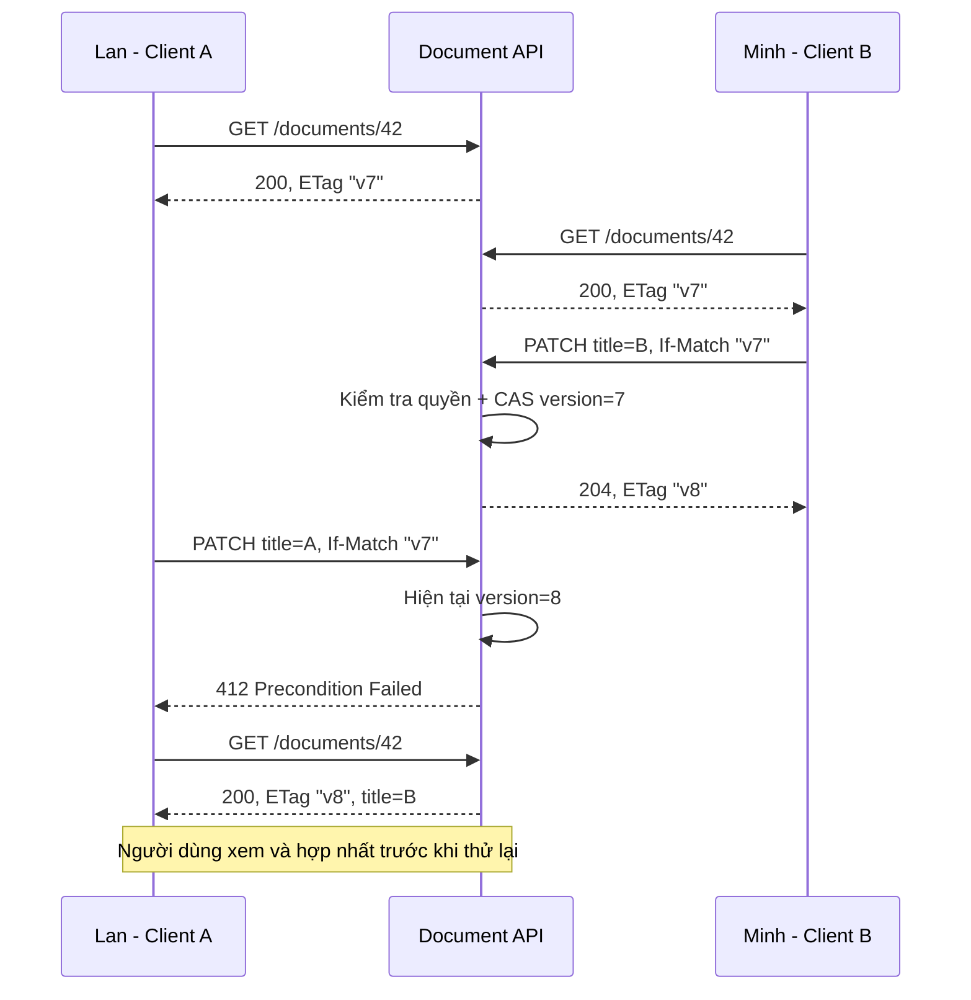
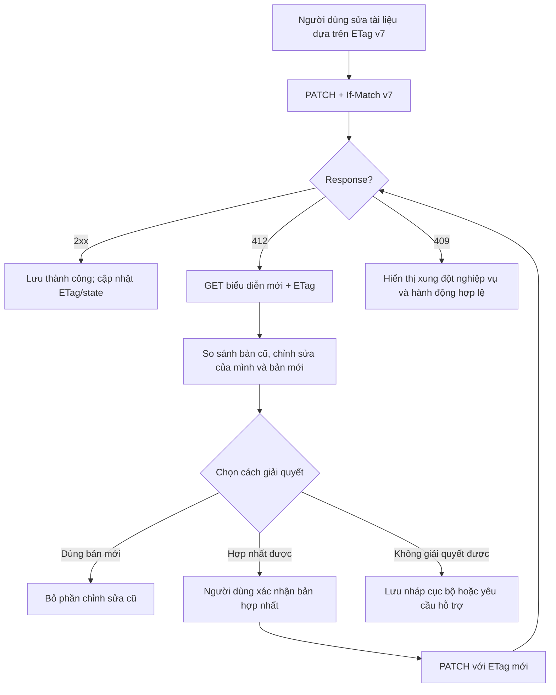

# Phân biệt xung đột phiên bản với xung đột nghiệp vụ 409

Hai nhân viên cùng mở một đơn hàng để chỉnh sửa. Lan đọc phiên bản 7, Minh đọc cùng phiên bản 7. Minh cập nhật địa chỉ giao và lưu thành phiên bản 8; vài giây sau Lan gửi bản chỉnh sửa dựa trên dữ liệu cũ. Nếu server chấp nhận vô điều kiện, thay đổi của Minh có thể bị **ghi đè mất** (*lost update*). Trường hợp khác, Lan đang xem đúng phiên bản mới nhất nhưng muốn hủy đơn hàng đã giao cho đơn vị vận chuyển; thao tác này bị cấm bởi **quy tắc nghiệp vụ** chứ không phải do phiên bản cũ.

Hai lỗi trên có thể cùng được gọi chung là “conflict” trong code, nhưng hợp đồng REST API cần phân biệt:

- **`412 Precondition Failed`:** một điều kiện HTTP mà client đặt ra, chẳng hạn `If-Match` với ETag của phiên bản đã đọc, **không còn đúng**. Client cần lấy trạng thái mới và quyết định cách hợp nhất thay đổi.
- **`409 Conflict`:** yêu cầu không thể hoàn thành vì **xung đột với trạng thái hiện tại của tài nguyên**; ví dụ không thể hủy đơn đã giao, không thể chuyển trạng thái ngược, hoặc một tên duy nhất đã được sử dụng. Nếu không sử dụng HTTP precondition, API cũng có thể dùng 409 cho cơ chế so phiên bản riêng được định nghĩa rõ, nhưng không nên đánh đồng hai trường hợp.

Bài nằm trong chương **Điều kiện và đồng thời** thuộc module **INTEGRATION_API_REST**. Người học sẽ kết nối ngữ nghĩa resource/URI, `GET`/`PUT`/`PATCH`/`DELETE`, mã trạng thái HTTP, ETag, optimistic locking, cache, idempotency, OpenAPI, xác thực–phân quyền và kiểm thử Java/Spring để xây hợp đồng cạnh tranh dữ liệu rõ ràng, tránh mất cập nhật.

## 1. Mục tiêu và từ vựng nền tảng

| Thuật ngữ | Ý nghĩa | Ví dụ |
|---|---|---|
| **Tài nguyên** | Đối tượng nghiệp vụ được định danh bằng URI | `/api/v1/orders/ord-1001` |
| **Representation** | Cách biểu diễn trạng thái tài nguyên theo một response | JSON đơn hàng sau khi áp dụng quyền và content negotiation |
| **Validator** | Giá trị hỗ trợ xác định representation có thay đổi không | `ETag: "v7"` |
| **Conditional request** | Request mang điều kiện yêu cầu server kiểm tra trước khi thực hiện | `If-Match: "v7"` |
| **Optimistic concurrency control** | Chỉ cập nhật nếu phiên bản hiện vẫn đúng, không khóa tài nguyên qua toàn bộ thời gian người dùng chỉnh sửa | `UPDATE ... WHERE version = 7` |
| **Lost update** | Một thay đổi ghi đè thay đổi hợp lệ của người khác do dùng bản đọc cũ | Lan ghi đè địa chỉ vừa được Minh sửa |
| **Business conflict** | Hành động không phù hợp trạng thái/ràng buộc nghiệp vụ hiện tại | Không được hủy đơn đã giao |
| **Idempotency** | Lặp lại cùng yêu cầu có hiệu quả dự kiến như một lần, theo ngữ nghĩa phương thức hoặc hợp đồng bổ sung | Retry DELETE không tạo thêm tác dụng xóa |

**Bất biến cần đạt:** request có điều kiện chỉ thay đổi dữ liệu khi điều kiện còn đúng, toàn bộ phép kiểm tra và ghi diễn ra **nguyên tử**, và client nhận được phản hồi đủ để lựa chọn: nạp lại, hợp nhất, sửa mục tiêu nghiệp vụ hoặc dừng thao tác.

## 2. Ba mã phải phân biệt: 409, 412 và 428

| HTTP status | Ý nghĩa theo tiêu chuẩn | Tình huống điển hình | Client nên làm gì? |
|---|---|---|---|
| **`409 Conflict`** | Request xung đột với trạng thái hiện tại của tài nguyên đích | Hủy đơn đã giao; tên tài nguyên trùng trong phạm vi duy nhất; chuyển trạng thái không hợp lệ | Xem quy tắc nghiệp vụ/trạng thái mới; điều chỉnh yêu cầu hoặc xin hành động phù hợp |
| **`412 Precondition Failed`** | Một hoặc nhiều điều kiện trong request được đánh giá là sai | `If-Match: "v7"` nhưng representation hiện tại là `"v8"` | GET lại; so sánh khác biệt; hợp nhất hoặc yêu cầu người dùng quyết định |
| **`428 Precondition Required`** | Server **yêu cầu** request phải có điều kiện, nhưng request không đáp ứng chính sách đó | Endpoint chỉnh sửa bắt buộc `If-Match` nhưng client không gửi | Lấy ETag hiện tại và gửi lại request có precondition |

**Chú ý:** `428` được định nghĩa trong RFC 6585; không phải mọi API đều bắt buộc dùng mã này. `412` phát sinh từ **precondition HTTP đã được gửi và thất bại**, khác với `409` mô tả xung đột trạng thái nghiệp vụ. Có thể thiết kế endpoint yêu cầu mọi cập nhật phải kèm ETag để phòng lost update.

### 2.1. Bảng lựa chọn nhanh

| Trường hợp | Mã thường phù hợp | Vì sao |
|---|---|---|
| Client gửi `PATCH` với `If-Match` cũ | **412** | HTTP precondition không còn đúng |
| Client không gửi `If-Match`, endpoint bắt buộc có | **428** | Thiếu điều kiện chống ghi đè |
| Có ETag mới nhất nhưng đơn đã ở trạng thái `SHIPPED` nên không được hủy | **409** | Xung đột quy tắc trạng thái |
| Client gửi JSON có sai kiểu hoặc không parse được | **400** | Không phải xung đột phiên bản/nghiệp vụ |
| Request đã parse nhưng nội dung vi phạm quy tắc giá trị độc lập với trạng thái hiện tại | **422** nếu hợp đồng sử dụng | Đầu vào không xử lý được; không mặc định là 409 |
| Thiếu credential hợp lệ | **401** + `WWW-Authenticate` | Không công bố trạng thái bảo vệ trước khi xác thực |
| Không có quyền sửa đối tượng | **403** hoặc **404** để che giấu | Không tiết lộ ETag hoặc trạng thái cho người ngoài quyền |
| Tài nguyên không tồn tại hoặc bị che giấu | **404** | Không phải mọi ID sai đều là conflict |
| Lỗi database, dịch vụ không sẵn sàng | **5xx** phù hợp | Client không gây lỗi bằng việc dùng phiên bản cũ |

Kết luận thiết kế không nên dựa riêng vào class exception. Ví dụ một `OptimisticLockException` của ORM có thể là kết quả của **HTTP precondition không còn hợp lệ** hoặc race khi ghi nội bộ; server phải xét **hợp đồng request và nguyên nhân thực sự** trước khi chọn mã HTTP.

## 3. ETag và If-Match hoạt động thế nào?

ETag là **entity tag**, một validator do server cung cấp cho representation. Nó là **giá trị opaque đối với client**: client nên gửi lại nguyên văn trong request có điều kiện, không tự suy luận rằng số 7 trong `"v7"` là version của database.

Một luồng đơn giản:

```http
GET /api/v1/documents/doc-42 HTTP/1.1
Host: api.example.com
Authorization: Bearer <access_token>
Accept: application/json
```

```http
HTTP/1.1 200 OK
Content-Type: application/json
ETag: "v7"
Cache-Control: private, no-store

{
  "id": "doc-42",
  "title": "Báo cáo tháng",
  "status": "DRAFT",
  "version": 7
}
```

Client sửa title rồi gửi:

```http
PATCH /api/v1/documents/doc-42 HTTP/1.1
Host: api.example.com
Authorization: Bearer <access_token>
If-Match: "v7"
Content-Type: application/merge-patch+json

{"title": "Báo cáo tháng - hoàn chỉnh"}
```

Nếu tài nguyên vẫn ở phiên bản ứng với ETag `"v7"`, server có thể cập nhật thành công:

```http
HTTP/1.1 204 No Content
ETag: "v8"
Cache-Control: no-store
```

Response 204 **không có body**. ETag mới, nếu gửi, phải đại diện cho representation mới của tài nguyên theo hợp đồng. Ví dụ định dạng `"v7"` chỉ phục vụ minh họa; thực tế có thể dùng hash/version được bảo vệ khỏi những giả định không đúng về biến thể representation.

Nếu Minh đã cập nhật trước, ETag hiện tại là `"v8"`. Điều kiện `If-Match: "v7"` không còn khớp nên request của Lan **không được thực thi**:

```http
HTTP/1.1 412 Precondition Failed
Content-Type: application/problem+json
Cache-Control: no-store

{
  "type": "https://api.example.com/problems/stale-resource-version",
  "title": "Resource version has changed",
  "status": 412,
  "detail": "Reload the resource and review the changes before retrying.",
  "code": "STALE_RESOURCE_VERSION"
}
```

**Quan trọng:** lỗi 412 ở đây phát sinh do header `If-Match` được đánh giá là sai, **không phải** vì server phát hiện title trùng hoặc người dùng thiếu quyền. Client có thể dùng các thay đổi mới nhất để hợp nhất, nhưng không nên tự lấy ETag mới rồi ghi đè lại cùng payload mà không xem xét khác biệt.

### 3.1. ETag mạnh và yếu

| Ví dụ | Loại | Dùng với If-Match được không? |
|---|---|---|
| `ETag: "a7f2"` | Strong ETag | Có, theo quy tắc strong comparison |
| `ETag: W/"a7f2"` | Weak ETag | **Không khớp** khi dùng `If-Match` vì If-Match đòi strong comparison |
| `ETag: "v7"` | Strong ETag theo cú pháp | Có, nếu server bảo đảm validator đại diện đúng phiên bản đã trả |

Weak ETag hữu ích cho việc tái xác nhận cache khi hai representation tương đương về ngữ nghĩa nhưng byte có thể khác; nó **không đủ cho kiểm soát lost update qua If-Match**. Mẫu:

```http
If-Match: W/"v7"
```

sẽ không khớp một strong ETag hiện tại theo quy tắc mạnh. Không loại bỏ tiền tố `W/` thủ công rồi coi là bằng nhau.

### 3.2. Multiple ETags và ký tự *

Theo HTTP, `If-Match` có thể chứa danh sách entity tags hoặc ký tự `*`:

```http
If-Match: "v7", "v8"
```

Điều kiện thành công khi có **ít nhất một strong ETag** khớp representation hiện tại. `If-Match: *` kiểm tra có representation hiện tại cho tài nguyên, **không chứng minh client đang giữ phiên bản mới nhất**. Nếu sản phẩm muốn buộc gửi ETag cụ thể để ngăn lost update, cần quy định thêm chính sách đầu vào cho endpoint; không nên giả định ký tự `*` có tác dụng tương đương ETag phiên bản.

### 3.3. Khi nào ETag không đơn giản là số version?

ETag là validator của representation được chọn, không mặc định là version của bảng. Một API có thể trả các representation khác nhau theo:

- `Accept`/`Accept-Language`, media type hoặc version API.
- Vai trò/tenant: Admin nhìn thấy trường khác Viewer.
- Projection: một endpoint cho phép chọn các trường.
- Nội dung tổng hợp từ nhiều bảng/service mà chỉ một số cột có version riêng.

Nếu cùng `"v7"` dùng cho hai response có nội dung khác biệt, hoặc dữ liệu thay đổi mà version không tăng, validator có thể không chính xác. Khi cần, tạo ETag từ **phiên bản biểu diễn đầy đủ** hoặc thiết kế một version token nhất quán cho phép ghi, được tài liệu hóa riêng. Đặc biệt, không dùng ETag của một actor để xác nhận representation chứa dữ liệu thuộc actor khác.

## 4. Thí nghiệm lost update với hai client



Không dùng optimistic concurrency để ngăn **mọi** thay đổi đồng thời: hai người vẫn được chỉnh sửa ở client, nhưng mỗi thao tác ghi chỉ thành công nếu điều kiện còn đúng. Đó là ưu điểm với REST API không giữ khóa lâu giữa GET và PATCH; đổi lại client phải có trải nghiệm giải quyết conflict.

### 4.1. Điều gì xảy ra nếu không gửi If-Match?

```text
10:00:00  Lan GET title="Báo cáo tháng" (version=7)
10:00:01  Minh GET version=7
10:00:05  Minh PATCH title="Báo cáo đã duyệt" → version=8
10:00:10  Lan PATCH title="Báo cáo nháp" không điều kiện
10:00:11  Server ghi version=9; mất bản chỉnh sửa của Minh
```

Để giảm rủi ro, API có thể từ chối update thiếu precondition bằng `428 Precondition Required`. Đặc biệt nên cân nhắc với `PUT` thay toàn bộ biểu diễn hoặc `PATCH`/`DELETE` có nguy cơ xóa mất thay đổi quan trọng.

### 4.2. If-Match không bảo đảm hai tác vụ nghiệp vụ có thể cùng thành công

Giả sử cả Lan và Minh cùng muốn đặt phòng cuối cùng nhưng gửi **hai request tạo booking khác nhau**. Mỗi booking là tài nguyên mới và có thể có ETag khác nhau. Bảo vệ phiên bản từng booking không tự ngăn **overbooking**. Cần ràng buộc nhất quán ở resource tổng hợp (phòng/slot), transaction/isolation hoặc unique constraint thích hợp, rồi báo business conflict `409` nếu tài nguyên đã bị chiếm.

**Optimistic locking ở một đối tượng không thay thế các bất biến nghiệp vụ xuyên nhiều đối tượng.**

## 5. Khi nào trả 409 Conflict?

Theo HTTP Semantics (RFC 9110), `409 Conflict` biểu thị request không thể hoàn thành do **xung đột với trạng thái hiện tại của tài nguyên đích**. Server nên đưa ra đủ thông tin (trong phạm vi quyền) để người dùng nhận ra nguồn xung đột và có thể sửa yêu cầu.

### 5.1. Đơn hàng không thể hủy sau khi giao

```http
POST /api/v1/orders/ord-1001/cancellations HTTP/1.1
Host: api.example.com
Authorization: Bearer <access_token>
Content-Type: application/json

{"reason": "Customer requested"}
```

Giả sử server đã xác thực và xác minh user được quyền thao tác trên đơn, nhưng đơn đã ở trạng thái `SHIPPED` và chính sách sản phẩm cấm hủy:

```http
HTTP/1.1 409 Conflict
Content-Type: application/problem+json
Cache-Control: no-store

{
  "type": "https://api.example.com/problems/order-state-conflict",
  "title": "Order cannot be cancelled",
  "status": 409,
  "detail": "An order that has been shipped cannot be cancelled.",
  "code": "ORDER_STATE_CONFLICT",
  "currentStatus": "SHIPPED",
  "allowedActions": ["request_return"]
}
```

`currentStatus` và `allowedActions` là extension do ứng dụng định nghĩa. Chỉ đưa vào response nếu actor **có quyền biết** trạng thái đó. Đối với user khác tenant, không trả `"SHIPPED"` để giải thích 409; từ chối quyền trước.

### 5.2. Tên đã được sử dụng

Ví dụ một workspace chỉ cho phép một thư mục hoạt động có tên `Invoices`. Request tạo thư mục thứ hai cùng tên vi phạm unique constraint nghiệp vụ:

```http
HTTP/1.1 409 Conflict
Content-Type: application/problem+json

{
  "type": "https://api.example.com/problems/folder-name-conflict",
  "title": "Folder name is already in use",
  "status": 409,
  "code": "FOLDER_NAME_CONFLICT"
}
```

Đây không phải request thiếu ETag. Client có thể chọn tên khác. Nếu sản phẩm cho phép trùng tên, lỗi này sẽ không tồn tại; mã HTTP phải dựa vào **ràng buộc thật**, không mặc định mọi unique constraint trong database đều là 409 có thể công bố.

### 5.3. Các ví dụ 409 khác

| Tình huống | Lý do 409 | Hành động hợp lý |
|---|---|---|
| Chuyển đơn `CANCELLED → SHIPPED` không được phép | Trạng thái hiện tại không cho phép chuyển | Đổi quy trình, không refresh token |
| Đặt ghế đã có người đặt | Tài nguyên bị chiếm theo bất biến nghiệp vụ | Chọn ghế khác hoặc cập nhật tình trạng ghế |
| Xóa project đang chứa dữ liệu bắt buộc giữ | Trạng thái và phụ thuộc chặn xóa | Giải quyết phụ thuộc theo policy |
| Gửi lại `Idempotency-Key` với **payload khác** | Khóa đã được dùng cho ý định khác, theo hợp đồng API | Dùng khóa mới cho thao tác mới; không tạo bản ghi sai |
| Khôi phục tài liệu nhưng tên đã bị chiếm | Ràng buộc uniqueness của tài nguyên đang hoạt động | Đổi tên hoặc chọn cơ chế giải quyết |

Một số ràng buộc có thể phù hợp `422` hơn `409` nếu vấn đề nằm hoàn toàn trong **giá trị đầu vào** và không phụ thuộc trạng thái hiện tại. Phải xác định ngữ nghĩa ổn định, tránh một service trả 409 còn service khác trả 422 cho cùng lớp lỗi.

## 6. 409 và 412 có thể cùng “có vẻ đúng” không?

Có, tùy yêu cầu. Nhưng cần hỏi **client đã đặt điều kiện HTTP nào?**

| Request hoặc cách triển khai | Phản hồi nên cân nhắc | Giải thích |
|---|---|---|
| `PATCH /documents/42` kèm `If-Match: "v7"` nhưng hiện tại ETag `"v8"` | **412** | Điều kiện HTTP không còn đúng, ngay cả khi hệ thống cũng dùng optimistic locking |
| `PATCH` không có HTTP precondition; body chứa `"version": 7` và server có hợp đồng so version nghiệp vụ | Có thể **409** theo contract riêng | `version` trong JSON **không tự biến thành HTTP If-Match** |
| `PATCH` có `If-Match: "v8"` khớp, nhưng tài liệu đã `APPROVED` và cấm sửa | **409** | Có đúng phiên bản nhưng không được chuyển trạng thái nghiệp vụ |
| `DELETE` có `If-Match` không khớp | **412** khi precondition được đánh giá là sai | Ngăn xóa bản vừa được sửa |
| `POST` tạo tên tài nguyên đã tồn tại mà không có precondition | **409** thường phù hợp | Trùng đối tượng/tên theo quy tắc nghiệp vụ |
| `PUT /resources/id` có `If-None-Match: *` và representation đã tồn tại | **412** | Điều kiện tạo mới chỉ khi chưa tồn tại bị sai |
| API yêu cầu `If-Match` nhưng request thiếu | **428** | Yêu cầu điều kiện để bảo vệ concurrency |

**Ranh giới quan trọng:** lỗi `OptimisticLockingFailureException` từ Spring Data hoặc `OptimisticLockException` từ JPA **không tự quyết định status**. Một request có `If-Match` thất bại nên được ánh xạ tới 412 khi đúng semantics; một thao tác nội bộ thiếu HTTP condition có thể được báo 409 hoặc xử lý khác theo contract. Không tạo quy tắc “mọi `@Version` exception đều là 409”.

### 6.1. Thứ tự đánh giá quyền, business rule và precondition

Không có quy tắc tổng quát rằng “trong mọi request, 412 phải ưu tiên hơn tất cả 409”. HTTP yêu cầu server đánh giá preconditions **sau các kiểm tra thông thường** và trước khi thực hiện hành động; nếu request không điều kiện đã bị từ chối bởi lỗi không phải 2xx/412, preconditions có thể không được đánh giá theo semantics. Vì vậy:

- **Xác thực và phân quyền** trước khi công bố ETag, trạng thái hoặc business conflict nhạy cảm.
- **Kiểm tra điều kiện HTTP** theo RFC 9110 và hợp đồng endpoint trước khi thay đổi tài nguyên.
- **Kiểm tra nghiệp vụ** và update phải tạo thành quyết định an toàn dưới concurrency; không được xử lý state conflict bằng cách thay đổi dữ liệu rồi mới trả 409.
- Nếu resource vừa stale vừa ở trạng thái không được sửa, phản hồi phụ thuộc cách phân loại và thứ tự kiểm tra hợp lệ; API nên tài liệu hóa hành vi dễ dự đoán và không lộ thông tin.

Ví dụ một actor không có quyền đọc đơn của tenant B, dù đoán được ETag hợp lệ, không nên nhận `412` để dò phiên bản của B. Thực thi authorization trước và trả `403/404` theo chính sách.

## 7. Các HTTP preconditions liên quan

| Header request | Mục đích thường gặp | Nếu điều kiện sai |
|---|---|---|
| **`If-Match`** | Chỉ thực thi nếu representation hiện tại khớp một strong ETag; phù hợp cập nhật/xóa tránh lost update | Thường **412** với thay đổi trạng thái |
| **`If-Unmodified-Since`** | Chỉ thực thi nếu tài nguyên không được sửa sau thời điểm đưa ra | **412** nếu điều kiện được đánh giá sai |
| **`If-None-Match`** | Với GET/HEAD: revalidation cache; với tạo tài nguyên: `*` để chỉ tạo khi chưa có | **304** cho GET/HEAD khi điều kiện false; **412** cho phương thức khác khi điều kiện false |
| **`If-Modified-Since`** | Với GET/HEAD: chỉ trả representation nếu thay đổi sau mốc thời gian | **304** khi không có thay đổi theo điều kiện |

### 7.1. Ưu tiên ETag mạnh hơn Last-Modified cho lost update

`Last-Modified` thường có độ phân giải theo giây trên HTTP, nên hai lần sửa nhanh trong cùng một giây có thể không được phân biệt như kỳ vọng. Ngoài ra, timestamp có thể đến từ nhiều nguồn clock khác nhau. `If-Match` với **strong ETag được phát hành nhất quán** thường phù hợp hơn để phòng lost update.

Nếu cùng request có cả `If-Match` và `If-Unmodified-Since`, HTTP có quy tắc thứ tự ưu tiên: `If-Match` được đánh giá theo semantics và `If-Unmodified-Since` bị bỏ qua khi `If-Match` hiện diện. Đừng tự viết middleware áp dụng điều kiện theo thứ tự ngẫu nhiên.

### 7.2. If-None-Match: * để tạo mới không ghi đè

```http
PUT /api/v1/documents/doc-42 HTTP/1.1
Host: api.example.com
Authorization: Bearer <access_token>
If-None-Match: *
Content-Type: application/json

{"title":"Tài liệu mới"}
```

Điều kiện cho biết chỉ thực thi nếu URI chưa có representation hiện tại. Nếu đã có tài nguyên, khi `If-None-Match` được đánh giá là false, trả `412 Precondition Failed` (không đổi thành 409 chỉ vì “tài nguyên tồn tại”). Với GET dùng `If-None-Match`, trường hợp matching thường cho **`304 Not Modified`** thay vì 412.

Nếu API dùng `POST /documents` để server chọn ID, trùng tên theo nghiệp vụ có thể vẫn là 409; hai mô hình không mâu thuẫn vì **điều kiện HTTP khác nhau**.

### 7.3. 304 Not Modified không phải lỗi ghi đồng thời

`304` là một phản hồi phục vụ cache/revalidation cho GET/HEAD, không chứa body representation. Khi phân biệt 409/412, tránh nhầm `If-None-Match` trên GET trả 304 với `If-Match` trên PATCH trả 412. Nếu biểu diễn phụ thuộc role/tenant, origin phải xác thực và chọn representation đúng trước khi đánh giá validator; không xác nhận ETag của actor khác.

## 8. Nguyên tắc atomicity: kiểm tra và ghi phải cùng một ranh giới

Phản mẫu nguy hiểm:

```text
1. SELECT version FROM documents WHERE id = ?   → 7
2. So với If-Match "v7"                         → khớp
3. Request khác UPDATE version lên 8
4. UPDATE documents SET title = ... WHERE id = ?
5. Client nhận 204 dù đã ghi đè thay đổi mới nhất
```

Sai ở bước 4: thao tác ghi không ràng buộc version đã kiểm tra. Dùng **atomic compare-and-swap** (CAS) hoặc lock/transaction phù hợp.

### 8.1. PostgreSQL: update có điều kiện trên version

Giả sử tài liệu có trạng thái `DRAFT`, tenant và số phiên bản:

```sql
-- DDL rút gọn, không phải migration sản xuất đầy đủ.
CREATE TABLE documents (
    id          uuid NOT NULL,
    tenant_id   uuid NOT NULL,
    title       text NOT NULL,
    status      text NOT NULL,
    version     bigint NOT NULL DEFAULT 1,
    updated_at  timestamptz NOT NULL DEFAULT now(),
    PRIMARY KEY (tenant_id, id)
);

-- Update phải đồng thời đúng tenant, version và điều kiện nghiệp vụ.
UPDATE documents
SET title = :new_title,
    version = version + 1,
    updated_at = now()
WHERE tenant_id = :verified_tenant_id
  AND id = :document_id
  AND version = :expected_version
  AND status = 'DRAFT'
RETURNING id, version, updated_at;
```

Trong PostgreSQL, `UPDATE ... WHERE ... RETURNING` là một thao tác nguyên tử đối với row đáp ứng điều kiện. Nếu hai request cùng dựa trên version 7, chỉ request chiếm được trạng thái còn version 7 sẽ cập nhật sang 8; request còn lại không nên ghi đè với version 7. Ứng dụng cần xử lý **0 row updated** đúng nguyên nhân, không mặc định đó luôn là lỗi 412.

### 8.2. 0 row updated không đủ để phân loại lỗi

Một kết quả 0 row có thể do:

1. Không tồn tại document ở tenant đang truy cập.
2. Actor không có quyền trên document.
3. Version đã đổi từ 7 lên 8.
4. Document hiện ở `APPROVED`, không còn được sửa.
5. Một transaction khác vừa thay đổi/xóa tài nguyên.

Do đó, sau thất bại cần đọc lại **trong phạm vi quyền** hoặc dùng chiến lược transaction/lock/conditional mutation đủ mạnh để phân loại:

- `404`/`403` khi tài nguyên không tồn tại hoặc bị che giấu/không đủ quyền.
- `412` khi HTTP `If-Match` đã gửi **không còn khớp** ở thời điểm được đánh giá.
- `409` khi version khớp nhưng trạng thái nghiệp vụ chặn hành động.

Nếu transaction độc lập thay đổi cả status và version cùng lúc, kết quả có thể là 412 sau race; không nhất thiết client luôn nhận 409 cho cùng hành động. Quan trọng là **không thực hiện update sai và không lộ trạng thái ngoài quyền**.

### 8.3. Constraint và transaction vẫn cần cho bất biến nghiệp vụ

Optimistic locking theo version của một row không tự bảo vệ các ràng buộc liên hàng hoặc liên dịch vụ. Ví dụ hai request cùng thấy “ghế A1 còn trống”, mỗi request định tạo một booking row khác nhau. Nếu không có unique constraint hay cơ chế giữ chỗ đúng ở database, cả hai có thể thành công dù mỗi booking có version riêng.

Giải pháp tùy bài toán: unique constraint theo ghế và lịch diễn, transaction isolation/locking, optimistic version trên aggregate chung, reservation token hoặc workflow có bù trừ. Khi unique constraint bị vi phạm do có booking khác, API có thể trả 409 **nếu đó là business conflict được phép công bố**, không đưa thông điệp lỗi SQL thô ra client.

## 9. Phân biệt 409/412 khi PUT, PATCH, DELETE và POST

| Method/operation | Ví dụ cạnh tranh | Cách thiết kế |
|---|---|---|
| **PUT** thay toàn bộ tài nguyên | Client ghi lại representation cũ và làm mất trường mới | Yêu cầu `If-Match`, trả 412 khi ETag cũ; 428 khi thiếu theo policy |
| **PATCH** thay một phần | Hai người sửa cùng trường; ngay cả sửa hai trường khác vẫn có thể xung đột version | Dùng `If-Match` và CAS; 412 nếu điều kiện sai; cân nhắc tự merge chỉ khi hiểu semantics |
| **DELETE** | Người dùng xóa tài liệu vừa được đồng nghiệp sửa | Dùng `If-Match` để tránh xóa dựa trên trạng thái cũ; trả 412 nếu sai |
| **POST** tạo cancellation resource | Đơn đã `SHIPPED` | 409 do state machine, dù không có ETag; hỗ trợ idempotency nếu client có thể retry |
| **POST** tạo booking | Chỗ/khung giờ bị chiếm | 409 nếu xung đột trạng thái hiện tại; DB constraint bảo vệ race |
| **PUT** tạo tài nguyên với URI do client chọn | ID đã tồn tại, request có `If-None-Match: *` | 412 nếu precondition false, không ghi đè |
| **GET** kèm `If-None-Match` | Representation chưa đổi | 304 để tiết kiệm truyền tải, không phải 409/412 |

### 9.1. PUT, PATCH và tính idempotent

Theo HTTP, `PUT` và `DELETE` là phương thức idempotent về **hiệu quả dự kiến**, nhưng idempotency **không ngăn lost update** giữa hai người với các nội dung khác nhau. `PATCH` không được phân loại idempotent mặc định, dù một bản PATCH đặt giá trị trường cụ thể có thể được thiết kế idempotent. Dùng `If-Match` độc lập với việc phương thức có idempotent hay không.

Một request `PATCH` với If-Match cũ sau khi đã thành công lần đầu có thể nhận 412 khi retry vì ETag đã thay đổi. Điều đó không có nghĩa server đã update hai lần; client phải tra cứu kết quả hoặc dùng operation/idempotency semantics khi cần. Đừng tự làm mới ETag rồi retry một thao tác quan trọng mà không kiểm tra trạng thái sau lần gửi đầu.

## 10. Hợp đồng lỗi với Problem Details

RFC 9457 khuyến nghị dạng **Problem Details**, thường với `Content-Type: application/problem+json`. Có thể dùng một cấu trúc chung nhưng phân loại `type`/`code` khác nhau.

### 10.1. Phản hồi 412

```http
HTTP/1.1 412 Precondition Failed
Content-Type: application/problem+json
Cache-Control: no-store
X-Request-ID: req-412-a1

{
  "type": "https://api.example.com/problems/stale-resource-version",
  "title": "Resource version changed",
  "status": 412,
  "detail": "The resource has changed since you last read it.",
  "code": "STALE_RESOURCE_VERSION",
  "requestId": "req-412-a1"
}
```

Không cần công bố ETag hiện tại cho actor không được phép xem tài nguyên. Với actor đã có quyền, có thể trả một liên kết `self` để GET lại, hoặc đưa ra thông tin về version mới nếu đó là hợp đồng đã được review. **HTTP 412 không yêu cầu body cụ thể**; Problem Details là lựa chọn thiết kế, không thay đổi ý nghĩa status.

### 10.2. Phản hồi 409

```http
HTTP/1.1 409 Conflict
Content-Type: application/problem+json
Cache-Control: no-store
X-Request-ID: req-409-b2

{
  "type": "https://api.example.com/problems/order-state-conflict",
  "title": "Order state conflict",
  "status": 409,
  "detail": "This order can no longer be cancelled.",
  "code": "ORDER_STATE_CONFLICT",
  "requestId": "req-409-b2"
}
```

### 10.3. Phản hồi 428

```http
HTTP/1.1 428 Precondition Required
Content-Type: application/problem+json
Cache-Control: no-store

{
  "type": "https://api.example.com/problems/precondition-required",
  "title": "Precondition required",
  "status": 428,
  "detail": "Read the resource and send its ETag in If-Match.",
  "code": "IF_MATCH_REQUIRED"
}
```

`type`, `title`, `status`, `detail` là thành viên Problem Details; `code` và `requestId` là **extension do API định nghĩa**. Client nên dựa vào HTTP status + mã ổn định, không parse chuỗi mô tả hay thông điệp exception của Java.

## 11. Xử lý phía client: lỗi nào cần làm gì?

| HTTP status | Client có nên tự retry y hệt ngay? | Hành động phù hợp |
|---|---|---|
| **412** | **Không** | GET bản hiện tại, xem diff, hợp nhất hoặc cho người dùng quyết định; sau đó dùng ETag mới |
| **409** | Thường **không** | Hiển thị xung đột nghiệp vụ và lựa chọn khác; chỉ retry nếu trạng thái đã được xử lý đúng |
| **428** | Không gửi lại thiếu điều kiện | GET/HEAD để lấy ETag hiện tại (nếu HEAD hỗ trợ), sau đó đưa If-Match vào request |
| **401** | Theo luồng xác thực được phép | Cung cấp token hợp lệ/làm mới giới hạn; không hiểu nhầm là conflict |
| **403/404** | Không retry để “đoán tài nguyên” | Dừng/hiển thị thiếu quyền hoặc tài nguyên không công bố |
| **429/503** | Theo chính sách backoff và idempotency | Tôn trọng `Retry-After` khi có căn cứ, tránh bão retry |

### 11.1. Luồng giao diện khi gặp 412



Không nên làm “GET mới rồi tự động PATCH lại toàn bộ payload cũ” vì điều đó **né bảo vệ lost update** và vô tình ghi đè thay đổi của người khác. Với chỉnh sửa kiểu cộng tác thực thời gian, có thể cần chiến lược khác (field-level merge, CRDT/OT hoặc collaborative editing service), nhưng không thể giả định ETag tự giải quyết hợp nhất.

## 12. Bảo mật, quyền và giới hạn công bố thông tin

Một số endpoint dùng ID có thể đoán được. Nếu người thuộc tenant A gọi PATCH tài liệu của B:

- Không trả ETag hiện tại của B trong body 412.
- Không trả `409: tài liệu đã APPROVED` nếu actor không có quyền xem trạng thái đó.
- Có thể trả `403` hoặc `404` theo chính sách che giấu; cần nhất quán trên GET, PATCH, DELETE và search.
- Ngữ cảnh tenant phải được lấy từ membership/session/token đã xác minh, không lấy nguyên `tenantId` trong JSON do client gửi.
- Truy vấn cập nhật nguyên tử phải ràng buộc tenant và quyền phù hợp, không chỉ ràng buộc version.
- Không dùng `If-Match` như token xác thực; đoán hoặc biết ETag **không** cấp quyền ghi tài nguyên.

### 12.1. ETag không phải bí mật

ETag là validator, không phải credential. Dù có thể tránh để lộ metadata không cần thiết, bảo mật không nên dựa vào việc ETag khó đoán. Nếu muốn dùng nonce/capability token cho một workflow khác, phải thiết kế và quản lý riêng với yêu cầu bảo mật tương ứng.

### 12.2. HTTP cache và 304

GET có thể trả `ETag` để HTTP cache thực hiện revalidation. Với response riêng tư hoặc có quyền theo tenant, cần `Cache-Control` thích hợp, ví dụ `no-store` hoặc `private, no-cache` theo chính sách. Nếu dùng `304`, origin phải xác thực/ủy quyền và xác định representation đúng cho actor **trước** khi kết luận “not modified”. Không thể lấy ETag của tenant A xác nhận cache của tenant B.

Khi cập nhật thành công, cần làm mất hiệu lực cache, search index và các bản read model theo hợp đồng nhất quán; `204` của PATCH không tự đồng bộ mọi cache ứng dụng/Redis/CDN. Không để cache cũ làm client đọc lại ETag sai rồi rơi vào vòng 412 không cần thiết.

## 13. Triển khai Spring Boot: If-Match và xử lý conflict

Ví dụ dùng **Spring Boot 3, Spring MVC và Spring Security** theo phong cách REST stateless. Các kiểu `DocumentRepository`, `DocumentPolicy`, `TenantResolver` và `DocumentDto` là **thành phần ứng dụng cần hiện thực**, không phải project hoàn chỉnh. Hợp đồng của ví dụ: GET trả strong ETag dạng `"vN"`; PATCH yêu cầu **một ETag mạnh cụ thể**; 428 khi thiếu, 412 khi sai, 409 nếu trạng thái business không cho sửa. Phần parser đầy đủ cho danh sách tags/`*` phải được bổ sung khi hỗ trợ toàn bộ cú pháp If-Match theo RFC.

### 13.1. GET trả ETag

```java
import java.util.UUID;
import org.springframework.http.CacheControl;
import org.springframework.http.ResponseEntity;
import org.springframework.security.core.Authentication;
import org.springframework.web.bind.annotation.GetMapping;
import org.springframework.web.bind.annotation.PathVariable;
import org.springframework.web.bind.annotation.RequestMapping;
import org.springframework.web.bind.annotation.RestController;

@RestController
@RequestMapping("/api/v1/documents")
public class DocumentController {
    private final DocumentService documents;

    public DocumentController(DocumentService documents) {
        this.documents = documents;
    }

    @GetMapping("/{id}")
    public ResponseEntity<DocumentDto> get(
            @PathVariable UUID id, Authentication authentication) {
        DocumentDto dto = documents.readAuthorized(id, authentication);
        return ResponseEntity.ok()
            .eTag("v" + dto.version())
            .cacheControl(CacheControl.noStore())
            .body(dto);
    }
}
```

Ở Spring `ResponseEntity.BodyBuilder.eTag(...)` chuẩn hóa dấu ngoặc kép cho entity tag khi cần; ví dụ response được kỳ vọng có `ETag: "v7"`. Khi representation thay đổi do role/locale/projection, phải xem xét ETag riêng đúng biểu diễn; dùng version của row chỉ khi version thực sự thay đổi cho mọi thay đổi có ý nghĩa trong representation.

### 13.2. PATCH yêu cầu If-Match

Đoạn dưới đây tách xử lý PATCH thành controller riêng để ví dụ có cấu trúc Java hoàn chỉnh. Spring MVC có thể ánh xạ GET và PATCH trên cùng URI vì chúng khác phương thức HTTP; khi ghép vào project, có thể gộp hai method vào cùng controller nếu muốn:

```java
import jakarta.validation.Valid;
import jakarta.validation.constraints.NotBlank;
import java.util.UUID;
import org.springframework.http.CacheControl;
import org.springframework.http.HttpHeaders;
import org.springframework.http.HttpStatus;
import org.springframework.http.ResponseEntity;
import org.springframework.security.core.Authentication;
import org.springframework.web.bind.annotation.PatchMapping;
import org.springframework.web.bind.annotation.PathVariable;
import org.springframework.web.bind.annotation.RequestBody;
import org.springframework.web.bind.annotation.RequestHeader;
import org.springframework.web.bind.annotation.RequestMapping;
import org.springframework.web.bind.annotation.RestController;
import org.springframework.web.server.ResponseStatusException;

@RestController
@RequestMapping("/api/v1/documents")
public class DocumentPatchController {
    private final DocumentService documents;

    public DocumentPatchController(DocumentService documents) {
        this.documents = documents;
    }

    @PatchMapping(path = "/{id}", consumes = "application/json")
    public ResponseEntity<Void> rename(
            @PathVariable UUID id,
            @RequestHeader(value = HttpHeaders.IF_MATCH, required = false)
            String ifMatch,
            @Valid @RequestBody RenameDocumentRequest request,
            Authentication authentication) {
        if (ifMatch == null) {
            throw new ResponseStatusException(
                HttpStatus.PRECONDITION_REQUIRED, "If-Match is required");
        }
        documents.renameIfUnchanged(
            id, ifMatch, request.title(), authentication);
        return ResponseEntity.noContent()
            .cacheControl(CacheControl.noStore())
            .build();
    }
}

record RenameDocumentRequest(@NotBlank String title) {}
```

**Lưu ý về ví dụ:** `DocumentPatchController` dùng cùng đường dẫn với GET nhưng khác HTTP method nên không tạo mapping xung đột; nếu gộp vào `DocumentController`, chỉ giữ một class và các annotations đúng vị trí. Request dùng `application/json` với DTO thao tác `title`, **không khẳng định** đây là JSON Merge Patch (RFC 7396); nếu dùng `application/merge-patch+json` thì phải triển khai semantics của merge patch đúng chuẩn.

### 13.3. Service kết hợp phân quyền, business rule và CAS

```java
import java.util.UUID;
import org.springframework.http.HttpStatus;
import org.springframework.security.core.Authentication;
import org.springframework.stereotype.Service;
import org.springframework.transaction.annotation.Transactional;
import org.springframework.web.server.ResponseStatusException;

@Service
public class DocumentService {
    private final DocumentRepository repository;
    private final DocumentPolicy policy;
    private final TenantResolver tenants;

    public DocumentService(
            DocumentRepository repository,
            DocumentPolicy policy,
            TenantResolver tenants) {
        this.repository = repository;
        this.policy = policy;
        this.tenants = tenants;
    }

    @Transactional
    public void renameIfUnchanged(
            UUID documentId,
            String ifMatch,
            String newTitle,
            Authentication authentication) {
        UUID tenantId = tenants.requireVerifiedTenant(authentication);
        var doc = repository.findVisible(tenantId, documentId)
            .orElseThrow(() ->
                new ResponseStatusException(HttpStatus.NOT_FOUND));

        policy.requireEdit(authentication, doc);

        // Giả định API chỉ hỗ trợ một strong ETag "vN" ở ví dụ này.
        String currentTag = String.format("%cv%d%c", '"', doc.version(), '"');
        if (!currentTag.equals(ifMatch)) {
            throw new ResponseStatusException(
                HttpStatus.PRECONDITION_FAILED,
                "Resource version changed");
        }

        if (!"DRAFT".equals(doc.status())) {
            throw new ResponseStatusException(
                HttpStatus.CONFLICT, "Document is not editable");
        }

        // WHERE tenant_id, id, version, status bảo vệ race sau khi đọc.
        int changed = repository.renameDraftIfVersion(
            tenantId, documentId, doc.version(), newTitle);
        if (changed != 1) {
            throw new ResponseStatusException(
                HttpStatus.PRECONDITION_FAILED,
                "Resource changed concurrently");
        }
    }
}
```

Ví dụ `findVisible` phải thực hiện truy vấn **có giới hạn tenant và chính sách quyền**; `policy.requireEdit` là bước bảo vệ hành động. `renameDraftIfVersion` là **atomic update có điều kiện**, không phải method Spring Data tự sinh sẵn. Giả định mọi thay đổi liên quan trạng thái/representation đều tăng version, nên sau race có 0 row changed thì 412 là cách xử lý có cơ sở. Trong hệ thống thực, có thể đọc lại có kiểm soát để phân biệt tài nguyên đã mất/thu hồi quyền hay trạng thái business chuyển đổi, và xác định ưu tiên lỗi theo contract.

### 13.4. Repository với optimistic compare-and-swap

```java
import java.util.Optional;
import java.util.UUID;
import org.springframework.data.jpa.repository.JpaRepository;
import org.springframework.data.jpa.repository.Modifying;
import org.springframework.data.jpa.repository.Query;
import org.springframework.data.repository.query.Param;

public interface DocumentRepository extends JpaRepository<DocumentEntity, UUID> {
    @Query("""
        select d from DocumentEntity d
        where d.tenantId = :tenantId and d.id = :id
        """)
    Optional<DocumentEntity> findVisible(
        @Param("tenantId") UUID tenantId,
        @Param("id") UUID id);

    @Modifying(clearAutomatically = true, flushAutomatically = true)
    @Query("""
        update DocumentEntity d
        set d.title = :title,
            d.version = d.version + 1
        where d.tenantId = :tenantId
          and d.id = :id
          and d.version = :expectedVersion
          and d.status = 'DRAFT'
        """)
    int renameDraftIfVersion(
        @Param("tenantId") UUID tenantId,
        @Param("id") UUID id,
        @Param("expectedVersion") long expectedVersion,
        @Param("title") String title);
}
```

Đoạn code cần entity `DocumentEntity` có các field và mapping tương ứng, constraint/role database phù hợp. Với JPQL bulk update, persistence context và entity-version management có **đặc thù khác** với `entityManager.persist/merge` hoặc JPA `@Version` thông thường: tự tăng version trong câu lệnh, đồng bộ/clear persistence context và kiểm thử đúng hành vi ORM. Nếu chọn `@Version` trên entity thay vì bulk update, có thể dùng cơ chế optimistic locking do JPA cung cấp và bắt đúng exception để ánh xạ thành 412/409 theo request.

### 13.5. Lỗi business conflict được chuẩn hóa

Không trả nguyên `Exception.getMessage()` từ service cho client. Có thể dùng `@RestControllerAdvice` để ánh xạ exception nghiệp vụ đã định nghĩa thành Problem Details:

```java
import java.net.URI;
import org.springframework.http.HttpStatus;
import org.springframework.http.ProblemDetail;
import org.springframework.http.ResponseEntity;
import org.springframework.web.bind.annotation.ExceptionHandler;
import org.springframework.web.bind.annotation.RestControllerAdvice;

@RestControllerAdvice
public class DocumentErrorHandler {
    @ExceptionHandler(DocumentStateConflictException.class)
    ResponseEntity<ProblemDetail> businessConflict(
            DocumentStateConflictException ignored) {
        ProblemDetail problem =
            ProblemDetail.forStatus(HttpStatus.CONFLICT);
        problem.setType(URI.create(
            "https://api.example.com/problems/document-state-conflict"));
        problem.setTitle("Document state conflict");
        problem.setDetail("The document cannot be edited in its current state.");
        problem.setProperty("code", "DOCUMENT_STATE_CONFLICT");
        return ResponseEntity.status(HttpStatus.CONFLICT).body(problem);
    }
}
```

`DocumentStateConflictException` là kiểu lỗi do ứng dụng định nghĩa. Trong ví dụ service mục 13.3, code trả trực tiếp `ResponseStatusException(CONFLICT)` để ngắn gọn; nếu muốn handler ở đây thực sự xử lý, **đổi service sang ném DocumentStateConflictException**. Không khai báo handler rồi ngộ nhận nó tự bắt các exception khác kiểu. Các lỗi 412/428 và security 401/403 cần mapping riêng hoặc cấu hình mặc định đã được kiểm thử.

## 14. OpenAPI 3.1: mô tả 409 và 412 riêng biệt

Ví dụ endpoint chỉnh sửa title bắt buộc If-Match:

```yaml
openapi: 3.1.0
info:
  title: Document Concurrency API
  version: 1.0.0
paths:
  /api/v1/documents/{id}:
    get:
      summary: Read a document and its version validator
      security:
        - bearerAuth: []
      parameters:
        - $ref: "#/components/parameters/DocumentId"
      responses:
        "200":
          description: Document representation
          headers:
            ETag:
              description: Strong entity tag for the selected representation
              schema:
                type: string
              example: '"v7"'
          content:
            application/json:
              schema:
                $ref: "#/components/schemas/Document"
        "401":
          description: Missing or invalid authentication
          headers:
            WWW-Authenticate:
              schema:
                type: string
        "403":
          description: No permission to read
        "404":
          description: Document absent or hidden by access policy
    patch:
      summary: Rename a document if its version has not changed
      security:
        - bearerAuth: []
      parameters:
        - $ref: "#/components/parameters/DocumentId"
        - name: If-Match
          in: header
          required: true
          description: Strong ETag obtained from GET of this resource
          schema:
            type: string
          example: '"v7"'
      requestBody:
        required: true
        content:
          application/json:
            schema:
              type: object
              required: [title]
              properties:
                title:
                  type: string
                  minLength: 1
      responses:
        "204":
          description: Title updated successfully; no response body
        "400":
          description: Invalid JSON, header syntax or input
          content:
            application/problem+json:
              schema:
                $ref: "#/components/schemas/ApiProblem"
        "401":
          description: Missing or invalid access token
          headers:
            WWW-Authenticate:
              schema:
                type: string
        "403":
          description: Caller lacks update permission
        "404":
          description: Document absent or hidden by access policy
        "409":
          description: Document state does not allow the operation
          content:
            application/problem+json:
              schema:
                $ref: "#/components/schemas/ApiProblem"
        "412":
          description: If-Match precondition failed
          content:
            application/problem+json:
              schema:
                $ref: "#/components/schemas/ApiProblem"
        "428":
          description: If-Match is required but missing
          content:
            application/problem+json:
              schema:
                $ref: "#/components/schemas/ApiProblem"
components:
  securitySchemes:
    bearerAuth:
      type: http
      scheme: bearer
      bearerFormat: JWT
  parameters:
    DocumentId:
      name: id
      in: path
      required: true
      schema:
        type: string
        format: uuid
  schemas:
    Document:
      type: object
      required: [id, title, status, version]
      properties:
        id:
          type: string
          format: uuid
        title:
          type: string
        status:
          type: string
          enum: [DRAFT, APPROVED, ARCHIVED]
        version:
          type: integer
    ApiProblem:
      type: object
      properties:
        type:
          type: string
        title:
          type: string
        status:
          type: integer
        detail:
          type: string
        code:
          type: string
```

**Điểm nhất quán:** HTTP request ví dụ `doc-42` là ID ngắn để dễ đọc, còn OpenAPI và Spring mẫu dùng UUID; dự án thực phải chọn một schema định danh thống nhất. `If-Match` ở phần OpenAPI này được yêu cầu; Spring method đã minh họa 428 khi thiếu. Nếu API hỗ trợ header chứa **nhiều entity tags hoặc `*`** đúng toàn bộ RFC 9110, cần bổ sung parser/validator thích hợp và test. Ví dụ service chỉ minh họa **một strong ETag đơn**; không nên phát hành đặc tả hứa hỗ trợ cú pháp đầy đủ khi code vẫn so chuỗi đơn giản.

## 15. Kiểm thử concurrency và status HTTP

### 15.1. Ma trận kiểm thử

| Mã | Tình huống | Kết quả phải xác minh |
|---|---|---|
| PRE-01 | GET tài liệu ở version 7 | 200, strong `ETag: "v7"`, body đúng version và quyền |
| PRE-02 | PATCH với `If-Match: "v7"` khi version vẫn 7 | 204 hoặc response thành công theo contract; version tăng, dữ liệu đúng |
| PRE-03 | PATCH với `If-Match: "v7"` khi version đã 8 | **412**; tài liệu không bị ghi đè |
| PRE-04 | PATCH thiếu `If-Match` khi endpoint bắt buộc | **428**; tài liệu không đổi |
| PRE-05 | PATCH `If-Match: W/"v7"` trong khi server có strong `"v7"` | Không strong-match; phải xử lý theo semantics/policy đã công bố |
| PRE-06 | Header If-Match chứa danh sách ETags và ký tự `*` | Xử lý theo RFC 9110 nếu hỗ trợ, hoặc trả lỗi cú pháp/chính sách theo contract đã quy định |
| PRE-07 | `PUT If-None-Match: *` tới URI đã có representation | **412**; không ghi đè |
| PRE-08 | `GET If-None-Match` khớp ETag hiện tại, actor được phép | **304**; không có body và không lộ dữ liệu actor khác |
| BUS-01 | Version đúng nhưng document ở trạng thái APPROVED không cho sửa | **409** với mã nghiệp vụ; không sửa |
| BUS-02 | Hủy đơn SHIPPED với token và quyền hợp lệ | **409**; không thay đổi trạng thái |
| BUS-03 | Tạo folder trùng tên trong workspace | **409** khi unique business rule; không lộ dữ liệu khác tenant |
| AUTH-01 | PATCH không có token hợp lệ | **401** + `WWW-Authenticate`; không báo ETag ngoài quyền |
| AUTH-02 | Token hợp lệ nhưng thiếu quyền sửa | **403/404** theo policy; không thay đổi dữ liệu |
| TEN-01 | User tenant A gửi If-Match đoán được cho tài liệu tenant B | **403/404**; không tiết lộ version/status B |
| CON-01 | Hai PATCH cùng version 7 chạy song song | Chỉ một cập nhật hợp lệ; request còn lại bị 412 hoặc kết quả tương đương theo contract; không mất update |
| CON-02 | Đổi trạng thái DRAFT→APPROVED cạnh tranh với PATCH title | Không sửa title sau khi APPROVED; mọi chuyển trạng thái tăng version |
| CON-03 | DELETE cạnh tranh với PATCH dùng ETag cũ | Không xóa/sửa dựa vào trạng thái sai, không hồi sinh tài nguyên |
| IDEM-01 | PATCH được commit nhưng response mất, client retry `If-Match` cũ | Không ghi lần hai; có thể nhận 412 và client phải xác minh trạng thái |
| CACHE-01 | GET sau PATCH thành công qua cache/index | Không trả ETag/representation cũ trái hợp đồng nhất quán |
| DOC-01 | OpenAPI có 409, 412, 428 và If-Match bắt buộc | SDK/client phân biệt business conflict và stale version |

Mỗi test quan trọng phải kiểm tra **HTTP status, headers, bản ghi database, version, audit/outbox và side effects**. Chỉ assert 412 mà không đối chiếu database có thể bỏ sót lỗi ghi trước khi phát hiện conflict.

### 15.2. Test đồng thời: mô tả kết quả mong đợi

Một test tích hợp có thể:

1. Tạo tài liệu `DRAFT` version 7 trong tenant A.
2. Gửi hai PATCH với `If-Match: "v7"`, title khác nhau, sử dụng barrier để chúng tranh cập nhật cùng lúc.
3. Kết thúc hai request, đọc bản ghi cuối; **version = 8**, title là một trong hai giá trị đã gửi.
4. Có đúng một request được ghi thành công; request còn lại bị từ chối theo contract, thường 412.
5. Lặp lại với nhiều lần chạy, bật isolation thực tế của database; test mock repository không đủ để chứng minh tính nguyên tử.

Nếu repository thử nghiệm không có transaction/concurrent connection thật, kết quả chạy tuần tự có thể cho “PASS” giả. Với Postgres, kiểm tra số row updated và thực thi CAS trong DB thật.

### 15.3. MockMvc minh họa

```java
import static org.springframework.security.test.web.servlet.request.SecurityMockMvcRequestPostProcessors.jwt;
import static org.springframework.test.web.servlet.request.MockMvcRequestBuilders.patch;
import static org.springframework.test.web.servlet.result.MockMvcResultMatchers.status;

import org.junit.jupiter.api.Test;
import org.springframework.beans.factory.annotation.Autowired;
import org.springframework.boot.test.autoconfigure.web.servlet.AutoConfigureMockMvc;
import org.springframework.boot.test.context.SpringBootTest;
import org.springframework.http.HttpHeaders;
import org.springframework.http.MediaType;
import org.springframework.security.core.authority.SimpleGrantedAuthority;
import org.springframework.test.web.servlet.MockMvc;

@SpringBootTest
@AutoConfigureMockMvc
class DocumentConcurrencyApiTest {
    @Autowired MockMvc mvc;

    @Test
    void missingIfMatchReturns428() throws Exception {
        mvc.perform(patch("/api/v1/documents/{id}",
                "00000000-0000-4000-8000-000000000042")
                .with(jwt().authorities(
                    new SimpleGrantedAuthority("SCOPE_documents:write")))
                .contentType(MediaType.APPLICATION_JSON)
                .content("{\"title\":\"New name\"}"))
            .andExpect(status().isPreconditionRequired());
    }

    @Test
    void staleIfMatchReturns412() throws Exception {
        mvc.perform(patch("/api/v1/documents/{id}",
                "00000000-0000-4000-8000-000000000042")
                .with(jwt().authorities(
                    new SimpleGrantedAuthority("SCOPE_documents:write")))
                .header(HttpHeaders.IF_MATCH, "\"v6\"")
                .contentType(MediaType.APPLICATION_JSON)
                .content("{\"title\":\"New name\"}"))
            .andExpect(status().isPreconditionFailed());
    }
}
```

Các test trên **giả định** có fixture tài liệu version 7, tenant/actor hợp lệ và security filter kiểm tra scope `documents:write`. Nếu không có fixture hoặc actor không được cấp quyền, API có thể trả 404/403 trước khi xét precondition; phải cấu hình test data đầy đủ. `jwt()` từ Spring Security Test chỉ dựng ngữ cảnh xác thực giả, không kiểm chứng chữ ký/issuer/audience JWT production. Bổ sung test tích hợp cho security và CAS ở database thực.

## 16. Bài tập thiết kế: sửa đơn hàng và giữ chỗ cạnh tranh

### Đề bài

Một SaaS quản lý đơn hàng có:

- `GET /api/v1/orders/{id}` trả JSON và strong ETag.
- `PATCH /api/v1/orders/{id}` cho sửa địa chỉ khi đơn ở trạng thái `DRAFT`.
- `POST /api/v1/orders/{id}/confirmations` chuyển `DRAFT → CONFIRMED` nếu hàng còn.
- `POST /api/v1/reservations` đặt chỗ hàng tồn với số lượng hữu hạn.
- Mỗi người dùng thuộc một tenant; không được đọc/sửa tài nguyên tenant khác.
- Hai client có thể cập nhật đồng thời; request có thể bị retry do mạng không ổn định.

Một timeline:

```text
09:00  Alice GET order-1 → DRAFT, ETag "v5"
09:01  Bob   GET order-1 → DRAFT, ETag "v5"
09:02  Bob   PATCH địa chỉ, If-Match "v5" → 204, ETag "v6"
09:03  Alice PATCH địa chỉ, If-Match "v5" → ?
09:04  Alice GET order-1 → DRAFT, ETag "v6"
09:05  Hệ thống chuyển order-1 → CONFIRMED, ETag "v7"
09:06  Alice PATCH địa chỉ, If-Match "v7" → ?
09:07  Hai người cùng đặt sản phẩm chỉ còn 1 đơn vị → ?
```

**Yêu cầu:**

1. Phân loại mỗi kết quả `409`, `412`, `428` hoặc status khác theo hợp đồng; giải thích dựa trên precondition và state machine.
2. Vẽ sequence diagram tránh lost update khi hai PATCH cùng ETag.
3. Thiết kế schema version + SQL CAS ràng buộc tenant, version và trạng thái `DRAFT`.
4. Xác định constraint/transaction cần thêm để không bán vượt tồn kho; vì sao ETag của order không đủ.
5. Định nghĩa response Problem Details khác nhau cho `STALE_RESOURCE_VERSION` và `ORDER_STATE_CONFLICT`.
6. Thiết kế client workflow khi nhận 412 và khi nhận 409; không tự ghi đè bản mới nhất.
7. Viết OpenAPI cho If-Match/ETag cùng các response; lập tối thiểu 10 test cases có kiểm tra DB thực.
8. Đánh giá trường hợp user tenant A gửi If-Match đúng của order tenant B: làm sao không lộ trạng thái?

### Gợi ý đáp án

| Thời điểm | Kết luận hợp lý |
|---|---|
| 09:02 | Bob cập nhật thành công, version lên 6 nếu quyền/điều kiện đúng |
| 09:03 | Alice có If-Match v5 cũ → **412**, không ghi đè |
| 09:04 | Alice được cấp bản v6; cần đọc khác biệt chứ không chỉ lấy ETag mới để ghi lại payload |
| 09:06 | Nếu If-Match v7 khớp nhưng trạng thái đã CONFIRMED và cấm đổi địa chỉ → **409** |
| 09:07 | Chỉ một reservation hợp lệ; request khác có thể nhận **409** do hết tồn kho. Cần constraint/transaction bảo vệ stock, không chỉ version order |

Nếu request 09:06 dùng ETag v6 thay vì v7, điều kiện sai nên 412 có thể được trả khi precondition được đánh giá; trạng thái nghiệp vụ cũng đã đổi và cần được xử lý theo thứ tự hợp lệ. Đề bài cố ý dùng v7 để tách bạch **xung đột nghiệp vụ** khỏi **xung đột phiên bản**.

## 17. Phản mẫu thường gặp và cách sửa

1. **Trả 409 cho mọi version mismatch:** khi client gửi `If-Match` sai, hãy sử dụng semantics `412`; client cần hành vi khác lỗi nghiệp vụ.
2. **Trả 412 cho mọi lỗi nghiệp vụ:** ETag đúng nhưng order không thể hủy là state conflict, thường là 409.
3. **Chỉ so version rồi UPDATE không có WHERE version:** tạo race giữa kiểm tra và ghi, không thực sự chống lost update.
4. **Dùng weak ETag `W/"v7"` với If-Match:** không strong-match theo HTTP.
5. **Dùng Last-Modified độ phân giải giây cho mọi cập nhật nhanh:** có thể không đủ phân biệt thay đổi cạnh tranh.
6. **Bỏ If-Match vì PATCH “chỉ sửa một trường”:** có thể vẫn ghi đè trường đó hoặc vi phạm workflow.
7. **Tự lấy ETag mới và retry payload cũ sau 412:** né cơ chế bảo vệ, ghi đè thay đổi người khác.
8. **Coi ETag là token bảo mật:** biết ETag không cấp quyền; vẫn cần authentication, tenant và resource authorization.
9. **Không tăng version cho mọi thay đổi có liên quan:** ETag không phản ánh representation hoặc trạng thái cần bảo vệ.
10. **Ánh xạ `OptimisticLockException` sang 409 ở mọi controller:** bỏ qua ý nghĩa HTTP precondition và có thể che lỗi thật.
11. **409 tiết lộ tài nguyên ngoài quyền:** trả trạng thái “SHIPPED” của tenant khác mà không kiểm tra quyền.
12. **Nghĩ If-Match ngăn mọi business race:** hai booking khác row vẫn có thể overbook khi không có unique constraint/transaction.
13. **Thiếu 428 nhưng tuyên bố bắt buộc If-Match:** server vẫn cho request không điều kiện ghi đè; OpenAPI không khớp code.
14. **Gọi 304 là version conflict:** 304 thuộc revalidation của GET/HEAD, không phải lỗi PATCH.
15. **Trả 204 trước commit:** client tưởng cập nhật thành công nhưng transaction có thể rollback.
16. **Không test retry và concurrency thật:** unit test tuần tự không phát hiện race ở database.

## 18. Checklist phát hành API có concurrency control

- [ ] Mỗi thao tác được xác định là xung đột do **HTTP precondition**, **trạng thái nghiệp vụ** hay **validation/permission**.
- [ ] GET trả validator strong ETag nhất quán với representation và quyền; không dùng ETag stale/sai biến thể.
- [ ] PUT/PATCH/DELETE quan trọng có chính sách If-Match; thiếu header trả 428 nếu bắt buộc.
- [ ] If-Match không khớp được ánh xạ 412; business state conflict thường 409; mã lỗi ứng dụng khác nhau.
- [ ] Support của `If-Match: *`, danh sách tags, weak tags và cú pháp lỗi được ghi rõ và kiểm thử.
- [ ] CAS/optimistic locking được thực thi nguyên tử tại DB, với tenant, ID, version và điều kiện trạng thái.
- [ ] Tất cả chuyển trạng thái có ý nghĩa tăng version đúng cách; không có đường update “lách” qua batch/job/admin.
- [ ] Việc phân loại 0 row updated không làm lộ tài nguyên ngoài quyền hoặc gán sai nguyên nhân.
- [ ] Ràng buộc nghiệp vụ xuyên nhiều row/service có constraint/transaction hoặc workflow riêng, không chỉ dựa vào ETag.
- [ ] GET 304, cache/ETag, invalidation và response sau update được kiểm chứng trong cùng hợp đồng.
- [ ] Client khi gặp 412 tải lại/so diff/merge có kiểm soát, không auto overwrite; 409 hiển thị quy tắc nghiệp vụ.
- [ ] OpenAPI ghi `ETag`, `If-Match` và các mã 409/412/428/401/403/404 nhất quán với code.
- [ ] Test gồm hai client PATCH cùng version, update cạnh tranh với chuyển trạng thái/DELETE, retry, phân quyền và tenant isolation.
- [ ] Log/trace theo request ID nhưng không chứa raw token, dữ liệu nhạy cảm hoặc trạng thái ngoài quyền.

## 19. Tiêu chuẩn tham khảo

- **RFC 9110 — HTTP Semantics:** `409 Conflict`, `412 Precondition Failed`, entity tags, `If-Match`, `If-None-Match`, thứ tự đánh giá precondition và conditional requests. https://www.rfc-editor.org/rfc/rfc9110.html
- **RFC 6585 — Additional HTTP Status Codes:** `428 Precondition Required` để buộc client dùng request có điều kiện. https://www.rfc-editor.org/rfc/rfc6585.html
- **RFC 9111 — HTTP Caching:** cache validators, freshness, revalidation và nguy cơ tái sử dụng representation sai. https://www.rfc-editor.org/rfc/rfc9111.html
- **RFC 9457 — Problem Details for HTTP APIs:** body lỗi có cấu trúc và extension codes. https://www.rfc-editor.org/rfc/rfc9457.html
- **RFC 5789 — PATCH Method for HTTP:** semantics của PATCH và các cân nhắc khi thực hiện cập nhật có điều kiện. https://www.rfc-editor.org/rfc/rfc5789.html
- **OpenAPI Specification 3.1:** tham số header, response statuses và schema lỗi. https://spec.openapis.org/oas/v3.1.0
- **Spring Framework / Spring Data JPA:** `ResponseEntity.eTag(...)`, transaction, `@Version` và optimistic locking theo phiên bản thực tế của dự án.

**Điểm cần nhớ:** **`412` trả lời “điều kiện HTTP client gửi đã không còn đúng”**, còn **`409` trả lời “hành động xung đột với trạng thái nghiệp vụ hiện tại”**. `428` giúp bắt buộc client dùng precondition để tránh lost update. Việc chọn đúng status chỉ đáng tin khi backend **kiểm tra và cập nhật nguyên tử**, phân quyền theo tài nguyên/tenant, có constraint cho bất biến nghiệp vụ và kiểm thử đồng thời với dữ liệu thật. Khi gặp 412, client phải xem thay đổi mới trước khi ghi tiếp; khi gặp 409, client cần giải quyết xung đột nghiệp vụ thay vì tự refresh token hoặc retry vô hạn.
