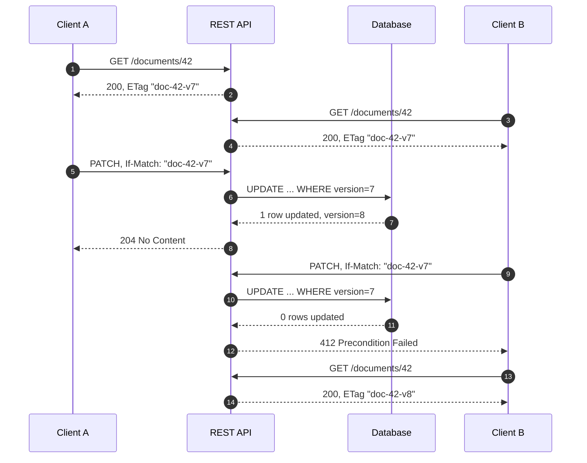
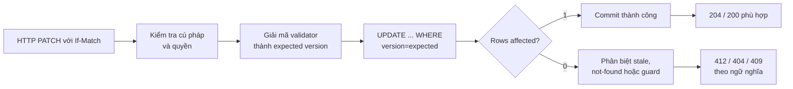
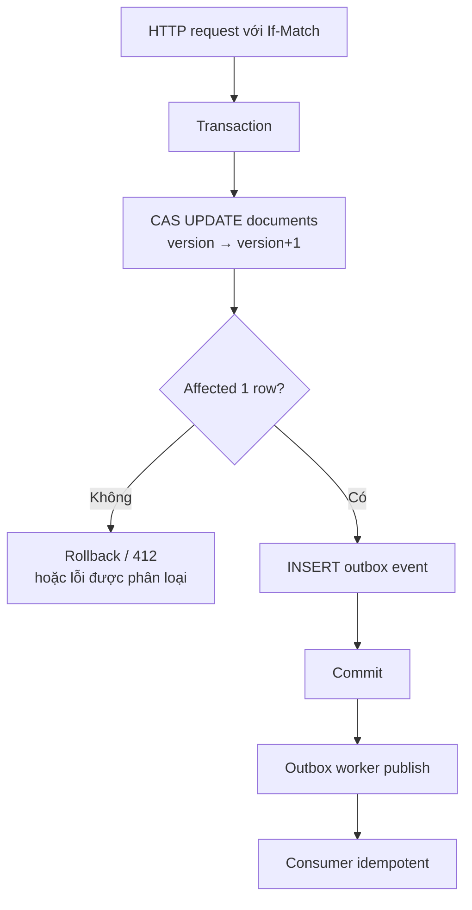

# Ánh xạ optimistic locking của dữ liệu sang HTTP precondition

> **Chương:** Điều kiện và đồng thời  
> **Module:** `INTEGRATION_API_REST` — học thiết kế REST API dựa trên resource, URI, phương thức và mã trạng thái HTTP, với hợp đồng dữ liệu rõ ràng; thực hành phân trang, cache, idempotency, OpenAPI, xác thực, phân quyền, xử lý lỗi và kiểm thử bằng Java/Spring hoặc công nghệ tương đương.

Một REST API có thể kiểm tra dữ liệu đầu vào đúng, xác thực thành công và trả `200 OK`, nhưng vẫn **làm mất cập nhật của người khác**. Lỗi thường xảy ra khi hai client cùng đọc một tài nguyên, sau đó gửi thay đổi dựa trên **hai bản sao đã không còn đồng nhất**.

Ở tầng dữ liệu, **optimistic locking** giải quyết vấn đề bằng cách chỉ ghi nếu phiên bản hiện tại khớp phiên bản đã đọc. Ở ranh giới HTTP, **conditional requests** diễn đạt ý định tương tự: “Chỉ thực hiện thay đổi nếu biểu diễn của tài nguyên vẫn khớp điều kiện tôi gửi”. Bài này chỉ ra cách nối hai cơ chế thành **một hợp đồng end-to-end an toàn**, từ `GET` và `ETag`, qua `If-Match`, tới `UPDATE ... WHERE version = ?` hoặc `@Version`, rồi trả status phù hợp.

**Thông điệp chính:** trả đúng `412 Precondition Failed` không đủ nếu server kiểm tra ETag rồi ghi database không nguyên tử. Và ngược lại, có `@Version` trong ORM chưa tự động làm API tuân ngữ nghĩa HTTP.

## Mục tiêu học tập

Sau bài học, bạn có thể:

1. Giải thích lost update, optimistic locking, version column, ETag và HTTP precondition, đồng thời phân biệt vai trò của chúng.
2. Thiết kế chu trình `GET` → nhận strong `ETag` → `PATCH/PUT/DELETE` kèm `If-Match` → CAS ở database → trả status.
3. Chọn `412` cho precondition sai, `428` cho thiếu precondition bắt buộc và `409` cho xung đột trạng thái nghiệp vụ, với các ngoại lệ hợp đồng cần lưu ý.
4. Ánh xạ version trong Spring Data JPA `@Version` hoặc SQL compare-and-swap thành validator HTTP mà không tạo khe hở race.
5. Nhận diện hạn chế của `If-Match: *`, weak ETag, timestamp validator, HTTP method, cache/content negotiation và cập nhật từ tiến trình nền.
6. Xử lý trường hợp tài nguyên bị xóa, được tạo lại, được sửa ở nhiều hệ thống hoặc client retry sau timeout.
7. Viết OpenAPI, Problem Details và integration/concurrency tests chứng minh **không mất cập nhật**, không chỉ chứng minh đúng mã trạng thái.

## 1. Lost update: vấn đề cần giải quyết

Giả sử tài liệu `/api/documents/42` hiện có:

```http
GET /api/documents/42 HTTP/1.1
Accept: application/json
Authorization: Bearer <token>
```

```http
HTTP/1.1 200 OK
Content-Type: application/json
ETag: "doc-42-v7"

{
  "id": 42,
  "title": "Bản nháp",
  "body": "Nội dung ban đầu",
  "status": "DRAFT"
}
```

Client A và B đều nhận phiên bản `v7`. A đổi `title` thành “Đã rà soát”, trong khi B sửa cùng trường thành “Đã chuẩn bị”. Nếu backend xử lý kiểu “đọc row → gán thuộc tính → save” mà không bảo vệ phiên bản, thay đổi đến sau có thể **ghi đè** thay đổi trước.



Thay vì ghi đè, B nhận thông báo rằng điều kiện cập nhật **không còn đúng**. B phải xem trạng thái mới, quyết định hòa giải nội dung hay hủy thao tác, rồi mới thử lại với ETag mới.

**Phân biệt ba thuật ngữ:**

- **Lost update:** một ghi mới vô tình thay thế dữ liệu mà client khác đã sửa.
- **Optimistic locking:** cho phép các bên đọc mà không khóa dài hạn, nhưng kiểm tra phiên bản **ở lúc commit/ghi**; nếu không khớp thì một bên thất bại.
- **HTTP conditional request:** client gửi header thể hiện điều kiện đối với **representation hiện tại của request target**; server chỉ thực hiện thao tác nếu precondition được đánh giá đúng.

Một lần thất bại optimistic locking là **kết quả được dự kiến trong môi trường cạnh tranh**, không nhất thiết là bug server. Bug xảy ra khi xung đột đáng lẽ phải bị phát hiện nhưng lại bị ghi đè hoặc được báo sai cho client.

## 2. Hai lớp của cùng một hợp đồng

| Thành phần | Ngữ nghĩa | Ví dụ | Điều nó **không tự bảo đảm** |
| --- | --- | --- | --- |
| **Database version** | Dấu hiệu cho biết dữ liệu có bị cập nhật kể từ lần đọc hay không. | `documents.version = 7`. | Client HTTP không tự biết version/cách so sánh. |
| **Optimistic CAS** | Ghi nếu điều kiện phiên bản trong database còn đúng. | `UPDATE ... WHERE id=42 AND version=7`. | Không định nghĩa status/header HTTP cho client. |
| **ETag** | Validator của **representation được chọn** của một tài nguyên HTTP. | `ETag: "doc-42-v7"`. | Không tự kiểm tra và chặn thao tác ghi. |
| **If-Match** | Precondition: yêu cầu chỉ được thực hiện khi ETag hiện tại khớp mạnh một tag được cung cấp. | `If-Match: "doc-42-v7"`. | Không thể thay thế phép ghi nguyên tử ở DB. |
| **412** | Một precondition đã gửi được đánh giá là sai. | Client gửi tag cũ. | Không nói nguyên nhân domain cụ thể ngoài precondition. |
| **428** | Server yêu cầu request gửi precondition thích hợp nhưng client chưa cung cấp. | Không có `If-Match` trong API bắt buộc. | Không phải mã chung cho mọi field JSON bị thiếu. |

Khi thiết kế, cần một **quy tắc ánh xạ nhất quán**:

```text
Representation GET          HTTP conditional write           Database
-----------------------     ---------------------------      ---------------------
document(id=42, version=7)  If-Match: "doc-42-v7"            WHERE id=42 AND version=7
document(id=42, version=8)  If-Match: "doc-42-v8"            WHERE id=42 AND version=8
```

Ở đây ETag chỉ dùng version **nếu** server bảo đảm mọi thay đổi có ảnh hưởng đến representation đều làm version thay đổi, và token thực sự thỏa các yêu cầu của **strong validator**. Đừng coi “ETag chính là số version” là chân lý cho mọi endpoint, mọi biến thể nội dung hoặc mọi dạng cache.

## 3. ETag là validator của representation, không phải chỉ một biến ORM

Theo HTTP semantics, `ETag` là một **entity-tag** có dạng chuỗi trong dấu nháy kép. Ví dụ:

```http
ETag: "doc-42-v7"
ETag: W/"doc-42-v7"
```

Dòng đầu là **strong ETag**, dòng thứ hai là **weak ETag** (có tiền tố `W/`).

### 3.1 Strong ETag phù hợp cho If-Match

`If-Match` sử dụng **strong comparison**. Nếu current ETag là `"doc-42-v7"`, header `If-Match: W/"doc-42-v7"` **không khớp mạnh**, dù phần chữ giống hệt. Một API cần tránh lost update nên phát một strong ETag đáng tin cậy và yêu cầu client gửi lại.

Client cần coi ETag là **opaque token**:

- Lưu nguyên văn `"doc-42-v7"`, bao gồm dấu nháy kép.
- Gửi lại nguyên văn trong `If-Match`.
- Không tự đoán rằng “v8” là phiên bản kế tiếp hoặc tự sửa chuỗi để ép thành công.
- Không dùng tag từ tài nguyên khác hoặc một representation không tương đương với request target.

### 3.2 Khi nào version có thể sinh strong ETag?

Một ánh xạ đơn giản là:

```text
ETag = quoted("doc-" + documentId + "-v" + documentVersion)
```

Nó chỉ bảo vệ được nội dung nếu có các điều kiện:

1. **Mọi đường ghi** thay đổi dữ liệu có ý nghĩa của representation đều **tăng version**: web API, job nền, batch, SQL trực tiếp và dịch vụ khác.
2. Version không bị tái sử dụng cho **nội dung khác** trong cùng phạm vi validator. Nếu xóa rồi tạo lại ID và reset version, cần một **incarnation/generation identifier** hoặc thiết kế token không trùng.
3. Không có trường động/tính toán ngoài row làm body đổi mà token giữ nguyên, ví dụ `lastViewedAt` theo request, tên người dùng lấy từ bảng khác hoặc biểu diễn được cá nhân hóa.
4. Content negotiation, encoding hoặc các biến thể khác có thể tạo **representation data khác nhau** cần validator phù hợp. ETag phải đại diện cho đúng selected representation, không chỉ cho một row.
5. Client không được tin token là thông tin phân quyền hoặc dùng nó để suy ra nội dung bí mật.

Nếu không bảo đảm các điều kiện đó, có thể sinh ETag mạnh từ **bytes của representation sau khi đã chuẩn hóa và chọn representation** hoặc dùng generation key/version tổng hợp. Đổi lại, tính hash có chi phí và cần thiết kế để không trở thành phép tính quá đắt.

### 3.3 HTTP cache và phiên bản dữ liệu khác mục tiêu

- `If-None-Match` trên `GET` là một cơ chế **cache revalidation** thường dẫn đến `304 Not Modified` nếu validator khớp theo quy tắc thích hợp.
- `If-Match` trên request sửa là cơ chế **kiểm soát ghi có điều kiện**.
- `@Version` bảo vệ thao tác ghi trong ORM/database.

Cùng một token có thể được dùng ở cả đọc có điều kiện và ghi có điều kiện nếu đáp ứng ngữ nghĩa tương ứng; nhưng ba cơ chế vẫn có **trách nhiệm khác nhau**.

## 4. Định nghĩa chu trình HTTP: GET → If-Match → PATCH

### Bước 1 — Client đọc tài nguyên

```http
GET /api/documents/42 HTTP/1.1
Accept: application/json
```

```http
HTTP/1.1 200 OK
Content-Type: application/json
ETag: "doc-42-v7"
Cache-Control: private, no-store

{"id":42,"title":"Bản nháp","body":"Nội dung ban đầu","status":"DRAFT"}
```

Giả sử API chỉ cho cập nhật `title` qua `PATCH` và body dùng JSON Merge Patch (`application/merge-patch+json`).

### Bước 2 — Client gửi điều kiện cùng thay đổi

```http
PATCH /api/documents/42 HTTP/1.1
Content-Type: application/merge-patch+json
If-Match: "doc-42-v7"

{"title":"Đã rà soát"}
```

Nếu biểu diễn hiện tại vẫn khớp tag, server thực hiện ghi CAS và có thể trả:

```http
HTTP/1.1 204 No Content
Cache-Control: no-store
```

Ví dụ chọn `204` **không có body và không phát ETag mới**; client có thể `GET` lại nếu cần representation và validator sau cập nhật. Với `PATCH`, ứng dụng khác có thể trả `200` với representation mới nếu có contract rõ và validator thực sự đúng với representation đó.

### Bước 3 — Nếu ETag cũ, không được ghi

```http
HTTP/1.1 412 Precondition Failed
Content-Type: application/problem+json
Cache-Control: no-store

{
  "type": "https://api.example.test/problems/stale-etag",
  "title": "Precondition failed",
  "status": 412,
  "detail": "The document changed. Reload and review it before retrying.",
  "code": "STALE_RESOURCE_VERSION"
}
```

Thông điệp này **không phải yêu cầu client chỉ thay chuỗi `If-Match` rồi lặp lại nội dung cũ**. Để tránh lost update, client cần đọc và so khác biệt trước khi quyết định.

### Bước 4 — Nếu thiếu điều kiện trong endpoint bắt buộc

```http
PATCH /api/documents/42 HTTP/1.1
Content-Type: application/merge-patch+json

{"title":"Đã rà soát"}
```

```http
HTTP/1.1 428 Precondition Required
Content-Type: application/problem+json
Cache-Control: no-store

{
  "type": "https://api.example.test/problems/if-match-required",
  "title": "Precondition required",
  "status": 428,
  "detail": "Fetch the current resource ETag and send it in If-Match.",
  "code": "IF_MATCH_REQUIRED"
}
```

`428 Precondition Required` được định nghĩa trong RFC 6585. **Response 428 không được phép được lưu trong cache** theo chuẩn; thêm `Cache-Control: no-store` giúp thể hiện rõ chính sách.

## 5. Khi nào trả 412, 428, 409 và 404?

Ba tình huống thường bị trộn lẫn:

- **428:** server yêu cầu conditional write nhưng client **không cung cấp điều kiện bắt buộc**.
- **412:** client có conditional header, nhưng **precondition HTTP được đánh giá là sai**.
- **409:** precondition (nếu có) đạt, song thao tác xung đột với **trạng thái nghiệp vụ hiện tại**.
- **404:** tài nguyên không tồn tại/không thể được công bố theo hợp đồng trong tình huống phù hợp.

| Tình huống | Phản hồi gợi ý | Điểm cần nhớ |
| --- | --- | --- |
| `PATCH` không có `If-Match` trong API yêu cầu version cụ thể. | **428** | Thiếu điều kiện chính sách API. |
| `PATCH` có `If-Match: "doc-42-v7"`, hiện tại là v8. | **412** | Condition sai, không sửa dữ liệu. |
| `PATCH` có `If-Match` đúng nhưng muốn sửa tài liệu `LOCKED` không cho sửa. | **409** | Xung đột state/business rule. |
| `PUT` create-if-absent có `If-None-Match: *`, resource đã tồn tại. | **412** | Precondition “chưa tồn tại” sai. |
| `PATCH` có `If-Match` nhưng resource bị xóa. | **412** nếu precondition được đánh giá trên target không còn representation; **404** có thể được trả khi request vốn phải thất bại là resource không tồn tại, theo thứ tự xử lý/precondition của HTTP. | Không tự quy kết tất cả race xóa thành một mã duy nhất. |
| `PATCH` có ETag đúng, nhưng validation body thiếu trường cần thiết. | **400/422** tùy schema/contract. | Kiểm tra input có thể khiến request thất bại độc lập với condition. |
| Không có quyền xem/sửa tài liệu. | **401/403**, có thể `404` để không lộ tồn tại. | Bảo mật và HTTP processing precedence vẫn phải áp dụng. |
| `If-Match: W/"doc-42-v7"` khi current strong ETag là `"doc-42-v7"`. | **412** nếu header được đánh giá. | Weak tag không khớp strong comparison. |
| `If-Match: *` khi target còn tồn tại. | **Điều kiện tồn tại đạt** theo HTTP. | **Không** đủ kiểm tra “phiên bản tôi đã đọc”; endpoint cần chính sách cụ thể nếu buộc dùng version. |
| Client dùng lại idempotency key với payload khác. | **409** trong nhiều hợp đồng idempotency. | Không phải optimistic locking qua `If-Match`. |

Một response `412` thường có nghĩa method **không được thực thi**. HTTP còn cho phép một số tình huống trả `2xx` nếu server **xác minh được thay đổi mà client đang yêu cầu đã được áp dụng thành công** (ví dụ retry sau mất response); đó là ngoại lệ chặt chẽ, không phải lý do tự động trả thành công bất cứ khi nào ETag cũ. Với API thông thường, default đơn giản là `412` và hướng dẫn client đọc lại.

**Thứ tự kiểm tra không hoàn toàn là “nếu thiếu If-Match thì luôn 428 trước mọi lỗi”**: theo HTTP, server có thể không đánh giá preconditions nếu request vốn thất bại vì phương thức, quyền hay những lý do khác. Phần mềm ở gateway/security filter cũng có thể xử lý trước ứng dụng. Giữ trạng thái HTTP của lỗi ban đầu khi phù hợp.

## 6. If-Match là điều kiện của HTTP request target

Điểm dễ nhầm là **tài nguyên nào đang được kiểm tra**. Với:

```http
PATCH /api/documents/42 HTTP/1.1
If-Match: "doc-42-v7"
```

`If-Match` áp dụng với **selected representation của `/api/documents/42`**, không phải tùy ý với row khác, một command resource khác hay toàn bộ database.

Nếu thiết kế `POST /api/documents/42/publish`, ETag lấy từ `GET /api/documents/42` **không tự động** trở thành validator cho URI `/api/documents/42/publish`. Muốn dùng precondition từ tài liệu cho một command URL riêng, phải định nghĩa rõ ngữ nghĩa tài nguyên đích và cơ chế điều kiện, hoặc cân nhắc thực hiện state transition trên chính URI tài liệu bằng `PATCH` phù hợp.

### Các header liên quan

| Header | Nghĩa chính | Khi phù hợp | Nếu không đạt |
| --- | --- | --- | --- |
| `If-Match: "tag"` | Selected representation hiện tại phải khớp mạnh một tag. | Cập nhật/xóa có optimistic concurrency. | `412` trong trường hợp thông thường. |
| `If-Match: *` | Selected representation hiện tại phải tồn tại. | Điều kiện tồn tại, **không** kiểm tra version đã đọc. | `412` khi điều kiện được đánh giá là sai. |
| `If-None-Match: *` | Chỉ thực hiện nếu representation hiện tại **không tồn tại**. | `PUT` tạo tại URI client chọn, không ghi đè. | `412` nếu đã tồn tại. |
| `If-None-Match: "tag"` | Condition không khớp theo **weak comparison**. | Cache validation cho `GET`/`HEAD`. | `304` cho `GET/HEAD`; `412` cho method khác. |
| `If-Unmodified-Since` | Tài nguyên không bị sửa kể từ thời điểm chỉ định. | Hệ thống không có ETag đáng tin; độ chính xác yếu hơn. | `412` khi điều kiện được đánh giá là sai. |

`If-Match` thường nên được ưu tiên hơn `If-Unmodified-Since` để tránh vấn đề timestamp có độ phân giải thấp. Khi `If-Match` hiện diện, `If-Unmodified-Since` **phải được bỏ qua** trong thứ tự đánh giá precondition chuẩn. Nếu cả `If-Match` và `If-None-Match` có mặt, server tuân thứ tự quy định của HTTP semantics, không tùy ý đánh giá cái tiện nhất.

### API có nên chấp nhận If-Match: *?

Một endpoint cần **chống ghi đè phiên bản cũ** có thể đặt policy “phải gửi một **strong entity-tag cụ thể**”, không chấp nhận `*` như cách thỏa điều kiện version. Khi đó hãy ghi rõ trong OpenAPI:

- `If-Match: *` là cú pháp HTTP hợp lệ nhưng **không đáp ứng yêu cầu kiểm soát phiên bản cụ thể của endpoint**.
- Phân biệt **header hợp lệ nhưng không đáp ứng policy** với **header sai cú pháp**; thống nhất status/error code, chẳng hạn `400 INVALID_VERSION_PRECONDITION` cho policy giới hạn của ứng dụng.
- Một triển khai generic hỗ trợ đầy đủ HTTP conditional requests cần xử lý cả **danh sách ETag**, `*` và strong comparison theo chuẩn, không dùng `String.equals` một cách tùy tiện.

Không nên trả `412` chỉ vì server không muốn hỗ trợ `If-Match: *` nếu trên thực tế điều kiện tồn tại **được đánh giá là đúng**; trường hợp đó là hạn chế/policy contract của endpoint chứ không phải “precondition sai”.

## 7. Phép ghi nguyên tử: optimistic lock thực sự nằm trong database

Thiết kế **không an toàn**:

```java
Document doc = repository.findById(id).orElseThrow();
if (!requestEtag.equals(tagFor(doc.getVersion()))) {
    throw new PreconditionFailedException();
}
doc.setTitle(request.title());
repository.saveWithoutVersionCheck(doc); // Có thể ghi đè request khác.
```

Hai request đồng thời đều có thể đọc version 7, đều pass điều kiện, rồi cập nhật mà không kiểm tra lại ở commit.

### SQL compare-and-swap

```sql
UPDATE documents
SET title = :new_title,
    version = version + 1
WHERE id = :document_id
  AND tenant_id = :authorized_tenant
  AND version = :expected_version;
```

- **1 hàng cập nhật:** điều kiện phiên bản đúng **tại lúc ghi**.
- **0 hàng cập nhật:** target không tồn tại trong scope có quyền, hoặc version đã đổi (hoặc một guard bổ sung không đạt). Không được xem là thành công.
- **Nhiều hơn 1 hàng:** là lỗi thiết kế/schema; `id` và `tenant_id` phải xác định duy nhất tài nguyên mục tiêu.

Việc tăng `version` phải nằm **trong cùng atomic statement/transaction** với thay đổi dữ liệu. Nếu nhiều bảng liên quan được cập nhật cùng thao tác, cần quản lý giao dịch/constraint và giới hạn nhất quán tương ứng.



**Không nên đọc lại version rồi ghi vô điều kiện** sau khi gặp 0 row. Thao tác “retry tự động với version mới” sẽ đánh bại mục tiêu chống lost update.

### Đã xóa, tạo lại và race khi phân loại 0 row

Giả sử request có tag v7 nhưng tài liệu bị xóa trước khi ghi. `UPDATE` không ảnh hưởng hàng nào. Có thể kiểm tra sự tồn tại để trả `404` hoặc `412` theo hợp đồng và ngữ nghĩa condition, nhưng một truy vấn kiểm tra sau `UPDATE` cũng có thể gặp **race** nếu có tác vụ xóa/tạo đồng thời.

Muốn phân loại **chính xác tại một thời điểm**, cần cân nhắc khóa giao dịch, isolation, ràng buộc tồn tại, tombstone/generation token hoặc chiến lược xử lý rõ. Dù status cụ thể có thể thay đổi do race, **điều kiện bắt buộc phải giữ là không thực hiện ghi sai phiên bản** và không tiết lộ tài nguyên ngoài quyền.

### Khi DB tự tăng version

Một số hệ thống sử dụng `@Version` trong JPA; hệ thống khác dùng `xmin`/row version của DB hoặc cột tăng thủ công. Không nên giả định cơ chế metadata nội bộ của một DB luôn là public validator bền vững qua backup/restore, migration và đổi nhà cung cấp. Thiết kế token công khai ổn định theo nhu cầu tương thích và bảo mật.

## 8. Spring Data JPA: @Version và phép so sánh trước commit

Trong JPA, optimistic locking thường dùng `@Version`:

```java
import jakarta.persistence.*;

@Entity
@Table(name = "documents")
public class DocumentEntity {
    @Id
    private Long id;

    @Column(name = "tenant_id", nullable = false)
    private Long tenantId;

    @Version
    @Column(name = "version", nullable = false)
    private Long version;

    @Column(name = "title", nullable = false)
    private String title;

    @Column(name = "body", nullable = false)
    private String body;

    @Enumerated(EnumType.STRING)
    private DocumentStatus status;

    public Long getId() { return id; }
    public Long getTenantId() { return tenantId; }
    public Long getVersion() { return version; }
    public String getTitle() { return title; }
    public String getBody() { return body; }
    public DocumentStatus getStatus() { return status; }
    public void setTitle(String title) { this.title = title; }
}

enum DocumentStatus { DRAFT, LOCKED, PUBLISHED }
```

Một flow tầng service:

```java
@Transactional
public void renameDocument(long tenantId, long id,
                           long expectedVersion, String newTitle) {
    DocumentEntity entity =
        repository.findByIdAndTenantId(id, tenantId)
            .orElseThrow(DocumentNotFoundException::new);

    if (entity.getVersion() != expectedVersion) {
        throw new StaleEtagException();
    }

    if (entity.getStatus() != DocumentStatus.DRAFT) {
        throw new DocumentStateConflictException();
    }

    entity.setTitle(newTitle);
    repository.flush(); // Buộc ORM thực thi update/version check trước khi method kết thúc.
}
```

Trong môi trường cạnh tranh, dù cả hai request **đều đọc version 7 và qua kiểm tra ban đầu**, chỉ một bên được commit. JPA provider thường tạo cập nhật có điều kiện version; bên thua sẽ nhận exception optimistic locking như `OptimisticLockException` hoặc abstraction tương ứng từ Spring.

**Ánh xạ exception phụ thuộc hợp đồng HTTP:**

- Nếu request đã mang `If-Match` như điều kiện bắt buộc, lỗi optimistic locking do version đổi trong lúc ghi thường được map thành **`412 Precondition Failed`**.
- Nếu một thao tác domain độc lập với HTTP precondition gặp xung đột trạng thái, **`409 Conflict`** có thể hợp lý.
- Không bắt toàn bộ `OptimisticLockException` thành `409` theo thói quen nếu nó thực chất biểu diễn `If-Match` đã sai.

**Giới hạn:** version chỉ bảo vệ những cập nhật thực sự tham gia cơ chế version check. Native SQL, bulk JPQL updates, database jobs hoặc dịch vụ khác có thể **bỏ qua** logic `@Version` nếu không được thiết kế tương ứng. Vì vậy, cần kiểm kê **mọi đường ghi** chứ không chỉ endpoint Spring MVC.

### Không bắt xung đột rồi tiếp tục sử dụng transaction đã thất bại

Khi JPA ném optimistic locking exception, giao dịch có thể đã bị đánh dấu rollback-only. Không nên bắt exception trong cùng transaction, rồi cố lưu lại bằng version mới để “thành công”. Hãy để rollback hoàn tất, chuyển exception ra tầng HTTP và trả lỗi hoặc bắt đầu một giao dịch mới **chỉ sau khi đã có quyết định retry hợp lệ của nghiệp vụ/client**.

## 9. Spring Boot với JDBC CAS: ví dụ end-to-end ở một endpoint

Ví dụ tiếp theo dùng **Spring Boot 3 / Spring Framework 6**, MVC và `JdbcTemplate` để biểu diễn rõ ràng điều kiện nguyên tử. Để ngắn gọn, ví dụ dành cho **PATCH chỉ sửa `title`** bằng JSON Merge Patch; các field khác không bị thay đổi. Code minh họa đã bỏ qua imports thông thường, kiểm thử security, cấu hình nguồn dữ liệu và một số trường hợp HTTP syntax nâng cao.

### 9.1 DTO và ETag policy

```java
record DocumentView(long id, String title, String body, String status) {}
record TitlePatch(String title) {}

// Dùng strong ETag đặc thù của API ví dụ.
// Production phải kiểm chứng token đại diện đúng selected representation.
final class DocumentTags {
    private DocumentTags() {}

    static String strongTag(long id, long version) {
        return "\"doc-" + id + "-v" + version + "\"";
    }

    static long parseSpecificTag(long id, String header) {
        String prefix = "\"doc-" + id + "-v";

        // Policy ví dụ: chỉ hỗ trợ một strong tag cụ thể, không dùng *.
        // Triển khai full RFC cần parser hỗ trợ danh sách tag và strong comparison.
        if (header.equals("*")) {
            throw new ResponseStatusException(
                HttpStatus.BAD_REQUEST, "A specific version tag is required");
        }
        if (header.startsWith("W/")) {
            throw new ResponseStatusException(
                HttpStatus.PRECONDITION_FAILED, "Weak tag does not match");
        }
        if (!header.startsWith(prefix) || !header.endsWith("\"")) {
            throw new ResponseStatusException(
                HttpStatus.BAD_REQUEST, "Invalid or unsupported If-Match syntax");
        }

        String digits = header.substring(prefix.length(), header.length() - 1);
        try {
            long version = Long.parseLong(digits);
            if (version < 0) throw new NumberFormatException();
            return version;
        } catch (NumberFormatException ex) {
            throw new ResponseStatusException(
                HttpStatus.BAD_REQUEST, "Invalid resource version");
        }
    }
}
```

**Đây là parser giới hạn có chủ đích**, không phải implementation đầy đủ các precondition của RFC 9110. Trong production, một framework/parser HTTP đáng tin cậy nên xử lý danh sách entity-tag, cấu trúc header, `*` và các biến thể. Với header hợp lệ nhưng bị policy endpoint từ chối, status phải được tài liệu hóa; ví dụ này chọn `400`. Không bao giờ chỉ dùng so chuỗi với ETag yếu rồi coi như match mạnh.

### 9.2 Controller lấy ETag và yêu cầu If-Match

```java
@RestController
@RequestMapping("/api/documents")
class DocumentController {
    private final DocumentService service;
    private final AuthorizedTenantResolver tenants;

    DocumentController(DocumentService service, AuthorizedTenantResolver tenants) {
        this.service = service;
        this.tenants = tenants;
    }

    @GetMapping("/{id}")
    ResponseEntity<DocumentView> get(@PathVariable long id) {
        long tenantId = tenants.requireAuthorizedTenant();
        DocumentRow doc = service.get(tenantId, id);
        return ResponseEntity.ok()
            .header(HttpHeaders.ETAG, DocumentTags.strongTag(id, doc.version()))
            .cacheControl(CacheControl.noStore())
            .body(new DocumentView(
                doc.id(), doc.title(), doc.body(), doc.status()));
    }

    @PatchMapping(
        value = "/{id}",
        consumes = "application/merge-patch+json"
    )
    ResponseEntity<Void> rename(
            @PathVariable long id,
            @RequestHeader(name = HttpHeaders.IF_MATCH, required = false)
                String ifMatch,
            @RequestBody TitlePatch input) {
        if (ifMatch == null || ifMatch.isBlank()) {
            throw new ResponseStatusException(
                HttpStatus.PRECONDITION_REQUIRED, "If-Match is required");
        }
        if (input.title() == null || input.title().isBlank()) {
            throw new ResponseStatusException(
                HttpStatus.BAD_REQUEST, "title must not be blank");
        }

        long tenantId = tenants.requireAuthorizedTenant();
        long expectedVersion = DocumentTags.parseSpecificTag(id, ifMatch);

        service.renameIfVersionMatches(
            tenantId, id, expectedVersion, input.title());

        // Đơn giản hóa: client GET lại để lấy biểu diễn và ETag mới.
        return ResponseEntity.noContent().build();
    }
}

// Interface được cung cấp bởi security infrastructure của ứng dụng.
interface AuthorizedTenantResolver {
    long requireAuthorizedTenant();
}
```

`TitlePatch` chỉ cho phép cập nhật `title` và từ chối null/blank trong ví dụ. JSON Merge Patch có ngữ nghĩa riêng đối với `null` (xóa thuộc tính); nếu dùng chuẩn này, server phải nhất quán với schema và quy tắc cấm xóa trường bắt buộc. Không được coi bất kỳ PATCH body bất kỳ là Merge Patch nếu không xử lý đúng ngữ nghĩa đã công bố.

**Lưu ý thứ tự kiểm tra:** ví dụ chỉ trình bày nhánh chính. Production cần phối hợp auth/security filter, routing, parsing/validation, HTTP precondition evaluation và các error handler của Spring. Đừng áp chính sách `428` một cách mù quáng trước những lỗi mà request đã phải thất bại như `401`, `403`, `405` hoặc `415`.

### 9.3 Service dùng cập nhật có điều kiện

```java
record DocumentRow(long id, String title, String body,
                   String status, long version) {}

@Service
class DocumentService {
    private final JdbcTemplate jdbc;

    DocumentService(JdbcTemplate jdbc) {
        this.jdbc = jdbc;
    }

    DocumentRow get(long tenantId, long id) {
        var rows = jdbc.query(
            "SELECT id, title, body, status, version " +
            "FROM documents WHERE id = ? AND tenant_id = ?",
            (rs, n) -> new DocumentRow(
                rs.getLong("id"), rs.getString("title"),
                rs.getString("body"), rs.getString("status"),
                rs.getLong("version")),
            id, tenantId
        );
        if (rows.isEmpty()) {
            throw new ResponseStatusException(HttpStatus.NOT_FOUND);
        }
        return rows.get(0);
    }

    @Transactional
    void renameIfVersionMatches(
            long tenantId, long id, long expectedVersion, String newTitle) {

        // Atomic CAS: version phải khớp tại thời điểm UPDATE, không chỉ lúc GET.
        int updated = jdbc.update(
            "UPDATE documents " +
            "SET title = ?, version = version + 1 " +
            "WHERE id = ? AND tenant_id = ? AND version = ?",
            newTitle, id, tenantId, expectedVersion
        );

        if (updated == 1) {
            return;
        }

        // Chỉ để mô tả phân loại; có thể có race delete/recreate giữa hai query.
        // Giao dịch/isolation/tombstone cần được thiết kế nếu đòi tính chính xác cao.
        boolean exists = Boolean.TRUE.equals(jdbc.queryForObject(
            "SELECT EXISTS (SELECT 1 FROM documents " +
            "WHERE id = ? AND tenant_id = ?)",
            Boolean.class, id, tenantId));

        if (!exists) {
            throw new ResponseStatusException(HttpStatus.NOT_FOUND);
        }
        throw new ResponseStatusException(
            HttpStatus.PRECONDITION_FAILED, "Stale resource version");
    }
}
```

Ví dụ yêu cầu các imports Spring như `HttpHeaders`, `HttpStatus`, `CacheControl`, `ResponseEntity`, `JdbcTemplate`, `@Service`, `@Transactional`, `ResponseStatusException` và các annotation MVC. Trong ứng dụng thật, nên tách domain exceptions khỏi HTTP status để service có thể dùng lại mà không phụ thuộc Spring Web.

**Điều cần bảo vệ:** `tenant_id` đi từ security context đã được xác minh, không từ tham số tùy ý; điều kiện CAS nằm trong SQL; không gửi nội dung/ETag mới khi transaction chưa commit. Nếu có một service khác cập nhật trực tiếp row mà quên tăng `version`, ví dụ này **không còn bảo vệ** đúng như kỳ vọng.

### 9.4 Problem Details và xử lý lỗi

Có thể chuẩn hóa trả lỗi bằng `application/problem+json` (RFC 9457):

```http
HTTP/1.1 412 Precondition Failed
Content-Type: application/problem+json
Cache-Control: no-store

{
  "type": "https://api.example.test/problems/stale-resource",
  "title": "Precondition failed",
  "status": 412,
  "detail": "Document version is no longer current.",
  "code": "STALE_ETAG"
}
```

`400` cho header không được hỗ trợ theo policy, `404` cho target không công bố được, `409` cho trạng thái nghiệp vụ ngăn sửa, `428` cho thiếu precondition và `412` cho stale tag cần có **mã lỗi ứng dụng ổn định**, thay vì client so chuỗi `detail`. Các trường mở rộng `code`, `traceId` không được phép rò rỉ title hoặc nội dung thuộc tenant khác.

## 10. Không chỉ sửa một row: trạng thái, guard và tính toàn vẹn nghiệp vụ

Optimistic version giúp chống ghi đè một row, nhưng không tự bảo đảm **invariant trên nhiều row**. Giả sử tài liệu chỉ được xác nhận khi `status=DRAFT` và ít nhất một người duyệt còn hợp lệ.

SQL có thể thêm guard trạng thái:

```sql
UPDATE documents
SET status = 'APPROVED',
    version = version + 1
WHERE id = :id
  AND tenant_id = :tenant_id
  AND version = :expected_version
  AND status = 'DRAFT';
```

Nếu `updated=0`, có ít nhất ba khả năng:

- Row không tồn tại/không có quyền → `404` hoặc lỗi quyền phù hợp.
- Version đã đổi → `412` khi `If-Match` là điều kiện HTTP.
- Version vẫn khớp nhưng status không còn cho phép → `409` theo domain contract.

Khi cần phân biệt chính xác trong cạnh tranh cao, hãy dùng transaction isolation/locking và cách đọc nhất quán thích hợp; một lượt `SELECT` rời rạc có thể cho phân loại thay đổi trong lúc kiểm tra.

**Các invariant trải rộng nhiều thực thể** như “không được có hai người cùng giữ một ghế” còn cần unique constraint, transaction, locking/serializable isolation hoặc reservation model thích hợp. Hai row có hai version độc lập không đủ chống **write skew** nếu mỗi transaction sửa một row khác nhưng điều kiện phụ thuộc vào tổng thể.

### Khi có event và hệ thống phụ thuộc

Một thay đổi version thành công trong DB không có nghĩa event đã được phát bền vững. Nếu cần publish sự kiện sau khi tài liệu được chấp nhận, hãy cân nhắc **transactional outbox**: cùng transaction cập nhật document + ghi outbox, sau đó worker publish với cơ chế at-least-once và consumer idempotent. Tránh thực hiện side effect không thể rollback **trước khi CAS thành công**.



Nếu nghiệp vụ có payment, thông điệp được gửi tới cổng thanh toán và client retry, **ETag không thay cho idempotency key**. Điều kiện phiên bản bảo vệ trạng thái tài nguyên, còn idempotency xử lý việc **một tác vụ logic bị gửi lại**.

## 11. PUT, PATCH, DELETE và create-if-absent

### PUT cập nhật toàn bộ

`PUT` thường biểu diễn **thay thế trạng thái của resource đích** theo representation gửi lên. Nếu API cho phép `PUT /api/documents/42` với `If-Match`, cần định nghĩa các trường mutable/immutable và bảo đảm cả representation đầu vào, validator và logic lưu có semantics nhất quán.

```http
PUT /api/documents/42 HTTP/1.1
Content-Type: application/json
If-Match: "doc-42-v7"

{"id":42,"title":"Tài liệu mới","body":"Nội dung mới","status":"DRAFT"}
```

Nếu service **biến đổi representation trước khi lưu** theo cách không thỏa điều kiện của HTTP standard, không tùy ý phát ETag mới trong phản hồi thành công của `PUT`. Khi cần, trả `204` rồi yêu cầu `GET` lại. Server phải kiểm tra CAS cho **toàn bộ phép thay thế**, không cập nhật một nửa rồi thông báo thành công.

### PATCH sửa một phần

`PATCH` thể hiện một thay đổi một phần; phương thức **không được HTTP định nghĩa là idempotent một cách mặc định**, nhưng client có thể làm nó an toàn hơn bằng precondition và thiết kế patch phù hợp. Một `PATCH` dưới cùng ETag có thể thành công một lần và nhận `412` khi retry ETag cũ. Điều này không có nghĩa lần đầu đã thất bại.

### DELETE có điều kiện

```http
DELETE /api/documents/42 HTTP/1.1
If-Match: "doc-42-v7"
```

Dùng điều kiện version khi xóa:

```sql
DELETE FROM documents
WHERE id = :id
  AND tenant_id = :tenant
  AND version = :expected_version;
```

Nếu xóa được row, phản hồi có thể là `204`. Nếu tag cũ và row còn tồn tại, `412` là phù hợp. Nếu row đã bị xóa, API phải áp dụng HTTP precondition semantics, authorization và quy tắc `404/204` được tài liệu hóa. Tính **idempotent của DELETE** không bắt buộc mọi lần gọi trả cùng status.

### Tạo ở URI chỉ khi chưa có tài nguyên

Đây là use case khác với `If-Match`:

```http
PUT /api/documents/client-chosen-id HTTP/1.1
Content-Type: application/json
If-None-Match: *

{"title":"Mới","body":"Nội dung"}
```

- Nếu chưa có representation và tạo thành công, trả `201 Created` theo contract.
- Nếu đã có representation và `If-None-Match: *` được đánh giá là sai, trả **`412 Precondition Failed`**.
- DB vẫn cần **unique constraint**/transaction để bảo vệ hai request tạo đồng thời; không thể chỉ SELECT rồi INSERT.
- Nếu server bắt buộc có điều kiện nhưng request không gửi, có thể trả `428` theo policy.

`If-None-Match: *` là **create-if-absent**, không phải một cách lấy version hiện tại.

## 12. Client retry, timeout và idempotency: tránh “thành công nhưng báo lỗi”

Một tình huống thường gặp:

1. Client gửi `PATCH` với `If-Match: "doc-42-v7"`.
2. Database cập nhật thành v8 và server commit.
3. Response `204` bị mất vì kết nối mạng.
4. Client retry y nguyên request với ETag v7.
5. Server nhận thấy v8, thường trả `412`.

Client **không được suy ra rằng lần cập nhật đầu thất bại** chỉ từ `412` của lần retry. Nó cần `GET` lại trạng thái hiện tại và kiểm tra thay đổi mong muốn có được áp dụng hay không.

### Có nên retry tự động với ETag mới?

Không, nếu client chưa kiểm tra nội dung mới. Việc tự đổi `If-Match` từ v7 sang v8 rồi gửi lại JSON cũ có thể **ghi đè hợp lệ** thay đổi mà người khác vừa thực hiện. Đó chính là lost update ở cấp client.

Gợi ý xử lý:

- **409:** nhận diện state conflict, có thể đề xuất thao tác khác; không retry mù.
- **412:** đọc mới, so diff hoặc merge an toàn, để người dùng/quy tắc nghiệp vụ quyết định.
- **428:** lấy validator và gửi request có điều kiện.
- **Network timeout / 5xx:** kiểm tra kết quả đã commit qua GET hoặc operation ID; retry có điều kiện, giới hạn số lần/backoff.
- **Tác vụ có side effect không thể lặp**, ví dụ thanh toán: cần **idempotency key** và lưu kết quả/dedup theo hợp đồng; optimistic version một mình chưa đủ.

Có thể thiết kế idempotent domain command kết hợp `If-Match` và idempotency key, nhưng hai header phải được định nghĩa riêng. Với HTTP method vốn idempotent như `PUT`, retry vẫn có thể trả status khác nếu precondition không còn đúng; idempotency ở đây là **ngữ nghĩa hiệu ứng khi lặp**, không bảo đảm response giống nhau.

## 13. Phân quyền, tenant isolation và không để lộ trạng thái

API có optimistic locking vẫn có thể rò rỉ thông tin qua status, ETag, Problem Details hay cache.

### Checklist an toàn

- **Xác thực và phân quyền** trước khi công bố chi tiết tài nguyên; kiểm tra quyền ở đường `GET` lẫn `PATCH/PUT/DELETE`.
- **Tenant scope** phải có trong query CAS và query đọc; không chỉ kiểm tra tenant ở controller rồi update theo ID toàn cục.
- Nếu muốn che giấu sự tồn tại của tài nguyên, áp policy `404` nhất quán; không để response `412` hay `409` vô tình xác nhận resource ở tenant khác.
- Không chứa PII hoặc secret trong ETag, kể cả token được mã hóa đơn giản dễ đảo ngược.
- Với representation cá nhân hóa, validator/cache phải đúng theo phạm vi người dùng và media type; cân nhắc `Cache-Control: private`/`no-store`.
- Tránh log raw `Authorization`, nội dung nhạy cảm hoặc đầy đủ request body khi phát hiện stale update.
- Giới hạn kích thước và số lượng ETag trong header theo chính sách parser; chặn abuse của request headers lớn ở gateway nếu cần.

### Ghi nhớ về HTTP status

Một request không có quyền sửa tài liệu có thể nhận `403`, ngay cả khi ETag cũng cũ; `412` không phải phương tiện “để client đoán có tài liệu hay không”. Chỉ sử dụng `412` khi precondition **thực sự được đánh giá** trong ngữ cảnh HTTP hợp lệ.

## 14. Mô tả OpenAPI cho optimistic conditional update

Client SDK cần biết **lấy ETag ở đâu** và **gửi lại thế nào**. Đây là đoạn OpenAPI rút gọn:

```yaml
paths:
  /api/documents/{id}:
    get:
      summary: Get document and its entity tag
      parameters:
        - name: id
          in: path
          required: true
          schema: { type: integer, format: int64 }
      responses:
        '200':
          description: Current document representation
          headers:
            ETag:
              description: Strong validator for this representation
              schema: { type: string }
          content:
            application/json:
              schema:
                $ref: '#/components/schemas/DocumentView'
        '404':
          description: Resource not found or not disclosed
    patch:
      summary: Update document title conditionally
      parameters:
        - name: id
          in: path
          required: true
          schema: { type: integer, format: int64 }
        - name: If-Match
          in: header
          required: true
          description: >
            A current, specific strong ETag from GET of this document.
            This endpoint does not accept wildcard * as a version validator.
          schema: { type: string }
          example: '"doc-42-v7"'
      requestBody:
        required: true
        content:
          application/merge-patch+json:
            schema:
              type: object
              required: [title]
              properties:
                title: { type: string, minLength: 1 }
      responses:
        '204':
          description: Document updated; GET to retrieve a new ETag
        '400':
          description: Invalid request or unsupported If-Match policy
        '401':
          description: Authentication required
        '403':
          description: Forbidden
        '404':
          description: Resource not found or not disclosed
        '409':
          description: Business state conflict
          content:
            application/problem+json:
              schema: { $ref: '#/components/schemas/ApiProblem' }
        '412':
          description: HTTP precondition was false
          content:
            application/problem+json:
              schema: { $ref: '#/components/schemas/ApiProblem' }
        '428':
          description: Specific If-Match precondition required
          content:
            application/problem+json:
              schema: { $ref: '#/components/schemas/ApiProblem' }
components:
  schemas:
    DocumentView:
      type: object
      properties:
        id: { type: integer, format: int64 }
        title: { type: string }
        body: { type: string }
        status: { type: string }
    ApiProblem:
      type: object
      properties:
        type: { type: string, format: uri-reference }
        title: { type: string }
        status: { type: integer }
        detail: { type: string }
        code: { type: string }
```

Đoạn trên **chưa phải hồ sơ API chạy độc lập**: còn cần phiên bản OpenAPI, `securitySchemes`, schema đủ cho các thao tác khác, auth, examples và response headers. Cần mô tả semantics của `If-Match` trong tài liệu bên cạnh schema: client phải hiểu rằng ETag là opaque, có thể đổi theo representation, và phải **review thay đổi** sau `412`.

## 15. Kiểm thử đủ cả HTTP và database

Không đủ nếu unit test chỉ mock service ném `StaleVersionException` rồi kiểm tra controller trả `412`. Cần integration test với **database thực** và nhiều luồng/transaction để chứng minh **không có hai ghi thành công với cùng version**.

### Ma trận kiểm thử

| Test | Chuẩn bị | Hành động | Kỳ vọng |
| --- | --- | --- | --- |
| T01 — GET phát validator | Document version 7. | `GET /documents/42`. | `200`, strong ETag hợp lệ, representation khớp version. |
| T02 — thiếu precondition | Endpoint yêu cầu `If-Match`. | `PATCH` không có header. | `428`; DB không đổi. |
| T03 — tag đúng | Row v7. | `PATCH` có ETag v7. | `204`, DB chuyển v8, title mới. |
| T04 — tag cũ | Row v8. | `PATCH` với ETag v7. | `412`, DB giữ v8. |
| T05 — hai ghi đồng thời | Cả hai request giữ v7. | Hai `PATCH` gần đồng thời với ETag v7. | Chỉ một commit, request còn lại `412`; version +1. |
| T06 — weak ETag | Current strong ETag v7. | `If-Match: W/"doc-42-v7"`. | Không match mạnh; thường `412`, không ghi. |
| T07 — If-Match * | Row tồn tại, policy yêu cầu version cụ thể. | `PATCH` với `If-Match: *`. | Bị từ chối **theo policy công bố**, không coi là phiên bản khớp. |
| T08 — ETag khác resource | Tag của document 43 gửi tới 42. | `PATCH /documents/42`. | Không sửa document 42; lỗi theo policy/header handling. |
| T09 — tag lỗi cú pháp | Header không phải valid entity-tag. | `PATCH`. | `400` theo parser/contract. |
| T10 — không có quyền | Token tenant khác. | `PATCH` với một ETag đã biết. | `403/404` theo policy; không lộ trạng thái, không ghi. |
| T11 — xung đột domain | Document hiện `LOCKED`, tag khớp. | `PATCH title`. | `409`, giữ version và nội dung. |
| T12 — xóa song song | Một client xóa trong khi client khác sửa. | `DELETE` và `PATCH` với cùng tag. | Chỉ hiệu ứng hợp lệ theo commit/condition; không khôi phục sai row đã xóa. |
| T13 — retry sau mất response | Lần PATCH đầu commit thành công, response mất. | Retry cùng ETag cũ. | Thường `412`; GET cho biết kết quả hiện tại, không ghi đè tiếp. |
| T14 — job nền | Job cập nhật title/status và tăng version. | PATCH dùng tag trước khi job chạy. | `412`; mọi đường ghi đều tham gia versioning. |
| T15 — bulk/native update | Có một lệnh update trực tiếp ngoài ORM. | Sửa representation rồi GET/PATCH. | Validator phải đổi; không bỏ qua version. |
| T16 — create-if-absent | URI đã tồn tại. | `PUT` với `If-None-Match: *`. | `412`; unique constraint ngăn duplicate. |
| T17 — cache/negotiation | Cùng document có hai representation khác biệt. | `GET` với các `Accept` khác nhau. | Validator/`Vary` và precondition đúng với representation thực. |
| T18 — lỗi DB không mong đợi | Database không phục vụ. | `PATCH` hợp lệ. | Phân loại server error hợp lý, không dán nhãn `412` cho mọi lỗi transaction. |

### Ý tưởng concurrency test với JUnit và HTTP client

```java
// Pseudocode: cần fixture, client và ExecutorService do test harness cung cấp.
String initialTag = getDocumentEtag(42); // ví dụ "doc-42-v7"

CountDownLatch start = new CountDownLatch(1);

Callable<HttpResult> first = () -> {
    start.await();
    return patchTitle(42, "Title A", initialTag);
};
Callable<HttpResult> second = () -> {
    start.await();
    return patchTitle(42, "Title B", initialTag);
};

var results = runInParallel(first, second, start);

assertThat(results.stream().filter(r -> r.status() == 204).count())
    .isEqualTo(1);
assertThat(results.stream().filter(r -> r.status() == 412).count())
    .isEqualTo(1);

DocumentSnapshot current = getDocument(42);
assertThat(current.version()).isEqualTo(8);
assertThat(current.title()).isIn("Title A", "Title B");
```

**Quan trọng khi test:** phải tạo hai request thật đến backend dùng cùng database và **đồng bộ thời điểm** cho race có khả năng xảy ra. Test chỉ kiểm tra output nhưng không kiểm tra row/version cuối sẽ không chứng minh được không mất dữ liệu. Nếu test đôi khi chỉ chạy tuần tự, hãy lặp lại có kiểm soát hoặc dùng barrier ngay trước đoạn CAS trong fixture/test instrumentation, không chèn sleep ngẫu nhiên rồi coi là bằng chứng.

### Phân tích kết quả 0 affected rows

Để viết test chặt, cho mỗi trường hợp **tag stale**, **resource deleted**, **domain status conflict**, **tenant unauthorized** một fixture riêng; quan sát status, row count, audit và không có event/side effect ngoài ý muốn. Nếu mọi trường hợp đều trả `412` thì API có thể đang che lấp lỗi quyền hoặc đánh mất thông tin nghiệp vụ.

## 16. Điều cần đo trong vận hành

Hệ thống có nhiều client chỉnh sửa đồng thời sẽ phát sinh xung đột **có chủ đích**. Quan sát đúng giúp phân biệt hành vi bình thường với lỗi giao diện hoặc backend.

| Metric | Vì sao cần | Tín hiệu bất thường |
| --- | --- | --- |
| `http_requests_total{route,status}` | Tỷ lệ `412`/`428`/`409` theo endpoint. | `428` tăng sau phát hành client thiếu header. |
| `conditional_write_conflicts_total` | Xác định tần suất CAS thất bại. | Đột biến sau thay đổi UI/traffic. |
| `optimistic_lock_exception_total` | Phát hiện exception JPA/ORM do cạnh tranh. | Rất cao hoặc xuất hiện nơi không được kỳ vọng. |
| `etag_missing_total` | Theo dõi response GET thiếu validator khi contract yêu cầu. | Client không thể dùng conditional update. |
| `write_retry_total` | Phân biệt retry do network, stale tag, lỗi nghiệp vụ. | Retry vô hạn với cùng ETag hoặc storm khi downstream lỗi. |
| `http_request_duration_seconds` theo route | Đo chi phí GET, PATCH và CAS. | p95/p99 tăng khi contention hoặc DB overload. |
| `domain_transition_conflicts_total` | Theo dõi xung đột trạng thái thực sự. | UX liên tục cho phép hành động đã hết hợp lệ. |

Không dùng ID tài liệu, token, email hay tenant tùy ý làm nhãn metric có cardinality cao. Đưa chi tiết tương ứng vào log/trace có kiểm soát, kèm correlation ID và redaction.

Một tỷ lệ `412` cao không nhất thiết là hệ thống “hỏng”; có thể chứng tỏ server đang **ngăn lost update thành công**. Nhưng nếu liên tục có nhiều `412` vì client giữ dữ liệu stale hàng giờ, cần cải thiện UX cập nhật, merge hoặc cảnh báo thay đổi.

## 17. Sai lầm phổ biến và cách khắc phục

| Sai lầm | Hệ quả | Cách sửa |
| --- | --- | --- |
| Kiểm tra ETag ở controller rồi `save()` vô điều kiện. | Race giữa check và write, mất cập nhật. | CAS SQL hoặc JPA `@Version` thực sự dùng tại commit. |
| Gắn `@Version` nhưng API không phát ETag/không đòi `If-Match`. | Server phát hiện conflict nhưng client không có hợp đồng rõ để phòng tránh. | Chuẩn hóa GET validator và conditional write. |
| Mapping mọi optimistic lock exception thành `409`. | Client không hiểu precondition HTTP đã sai. | `412` khi liên quan `If-Match`, `409` cho domain conflict thích hợp. |
| Thiếu `If-Match` trả `412`. | Không có precondition nào được đánh giá là sai. | `428` nếu API bắt buộc điều kiện, áp đúng xử lý HTTP. |
| Chấp nhận `If-Match: *` như “cùng version”. | Bất kỳ cập nhật nào lên tài nguyên đang tồn tại cũng có thể ghi đè. | Yêu cầu strong tag cụ thể hoặc nêu rõ giới hạn policy. |
| Dùng weak ETag trong `If-Match` và so chuỗi thô. | Vi phạm strong comparison. | Parser chuẩn, dùng strong validator. |
| Tạo ETag từ version không tăng ở job nền. | Validator cũ vẫn trông hợp lệ khi body đã đổi. | Mọi đường ghi tăng version hoặc đổi chiến lược ETag. |
| Tái sử dụng ETag sau xóa/tạo lại cùng ID. | ABA: tag cũ có thể trùng tài nguyên mới. | Generation/UUID, version monotonic và chính sách tombstone. |
| Dùng `If-Match` trên action sub-URI nhưng lấy ETag từ URI khác mà không định nghĩa semantics. | Kiểm tra sai request target. | Gắn precondition với representation đích hoặc thiết kế action contract rõ. |
| Retry `412` bằng cách đổi ETag mới tự động. | Ghi đè thay đổi người khác bằng dữ liệu cũ. | GET, diff/merge, xin quyết định người dùng/nghiệp vụ. |
| Lấy lỗi DB bất kỳ làm `412`. | Che lỗi hạ tầng, sai retry. | Chỉ ánh xạ đúng stale/version condition; lỗi server khác theo 5xx. |
| Không kiểm tra authorization trong CAS. | Cross-tenant writes hoặc rò rỉ tồn tại. | Điều kiện tenant/owner trong query và security boundary. |
| Cho rằng CAS một row bảo vệ invariant nhiều row. | Write skew, vi phạm quy tắc tổng thể. | Constraint/transaction/isolation/locking hoặc workflow thích hợp. |
| Chỉ test handler trả status, không test concurrency DB thật. | Mã lỗi đúng nhưng data vẫn mất cập nhật. | Tạo race thật, assert version và state cuối. |

## 18. Bài thực hành: nâng cấp API chỉnh sửa hồ sơ dự án

Bạn được giao triển khai `/api/projects/{id}`. Mỗi dự án có `id`, `name`, `description`, `state` và `version`. Hai người quản lý có thể đồng thời sửa dự án; khi `state=ARCHIVED` thì không cho sửa. Một số job nền cập nhật `description`, và API yêu cầu client gửi strong `If-Match` trên mọi `PATCH`/`DELETE`.

**Dữ liệu ban đầu:**

```http
HTTP/1.1 200 OK
Content-Type: application/json
ETag: "project-77-v15"

{"id":77,"name":"Phoenix","description":"Bản thảo","state":"ACTIVE"}
```

### Phần A — Thiết kế HTTP contract

1. Viết request `PATCH` đổi `name` với `If-Match: "project-77-v15"`.
2. Viết response thành công khi dùng `204 No Content`; giải thích client lấy ETag mới bằng cách nào.
3. Nếu thiếu `If-Match`, chọn status và body `application/problem+json`.
4. Nếu job nền đã tăng version thành 16, chọn status khi client vẫn dùng tag v15.
5. Nếu version hiện tại khớp nhưng `state=ARCHIVED`, chọn status nào?
6. Nếu client gửi `If-Match: *`, giải thích tại sao việc resource tồn tại không đủ chứng minh phiên bản; đưa ra policy rõ ràng.
7. Nếu client gửi lại PATCH sau timeout trong khi lần đầu đã commit, client phải làm gì trước khi retry thêm?

### Phần B — Bảo toàn dữ liệu

Viết SQL CAS cho việc đổi `name`:

```sql
UPDATE projects
SET name = :name,
    version = version + 1
WHERE id = :id
  AND tenant_id = :authorized_tenant
  AND version = :expected_version
  AND state = 'ACTIVE';
```

Giải thích ý nghĩa của `updated=1` và `updated=0`, cách phân loại `404/412/409` sau thất bại, cùng phương pháp bảo đảm mọi job nền **không quên tăng version**. Nếu có quan hệ nhiều bảng liên quan đến dự án, nêu cơ chế transaction và invariant cần bảo vệ thêm.

### Phần C — Java/Spring và kiểm thử

1. Thêm `@Version` vào entity và mô tả exception khi hai transaction cạnh tranh.
2. Dùng controller đưa header `If-Match` vào service; chỉ trả `204` sau khi commit thành công.
3. Viết integration test hai request cùng tag v15: một thành công, một `412`, row cuối v16.
4. Viết test `DELETE` có điều kiện và test project bị lưu trữ sau khi client nhận ETag.
5. Viết test cross-tenant với ETag bị biết trước: không rò rỉ dự án, không có ghi dữ liệu.
6. Viết test job nền đổi `description` rồi client PATCH với ETag cũ.

### Gợi ý đáp án

| Trường hợp | Phản hồi / hành vi |
| --- | --- |
| Không gửi precondition bắt buộc | **`428 Precondition Required`**; hướng dẫn GET để lấy strong ETag. |
| Tag không khớp sau khi job nền cập nhật | **`412 Precondition Failed`**; không ghi và cần review dữ liệu mới. |
| Tag đúng nhưng dự án `ARCHIVED` | **`409 Conflict`** theo state machine của bài. |
| Tag đúng, dự án `ACTIVE`, CAS cập nhật 1 row | **`204`**; version tăng 15 → 16, GET sau đó phát ETag mới. |
| Hai request cạnh tranh cùng version 15 | Một commit, một **`412`**; không lost update. |
| Gửi `If-Match: *` | Condition tồn tại có thể đúng, nhưng **không bảo vệ stale version**; endpoint đòi strong tag cụ thể. |
| Retry khi response mất | GET/kiểm tra kết quả đã áp dụng; không tự thay ETag mới và ghi đè. |
| Cross-tenant biết ETag | Không được ghi/công bố dữ liệu; `403/404` tùy security policy. |

### Tiêu chí tự đánh giá

Một lời giải đạt yêu cầu khi:

- Phân biệt **HTTP validator** và **ORM/database version**, nối chúng bằng quy tắc đúng.
- Có CAS ở thời điểm commit và không để kiểm tra tại controller thay thế CAS.
- Dùng `412` cho stale condition, `428` cho thiếu header cần thiết và `409` cho xung đột trạng thái.
- Không dùng weak ETag hoặc `If-Match: *` để giả làm phiên bản cụ thể.
- Bảo vệ authorization, các update từ job nền, transaction và retry/idempotency.
- Có ít nhất một concurrency integration test chứng minh state/version cuối cùng đúng, không chỉ đúng response status.

**Kết luận:** Optimistic locking giữ tính đúng đắn **trong tầng lưu trữ**; HTTP preconditions giúp client và server **thỏa thuận rõ điều kiện được phép ghi**. Thiết kế an toàn cần cả hai: phát validator đúng từ representation, yêu cầu `If-Match` phù hợp, thực thi compare-and-swap nguyên tử, trả status có ngữ nghĩa và cho client con đường đọc lại/giải quyết xung đột. Bỏ qua bất kỳ mắt xích nào đều có thể khiến hệ thống trông như đã chống cạnh tranh nhưng vẫn mất dữ liệu.
