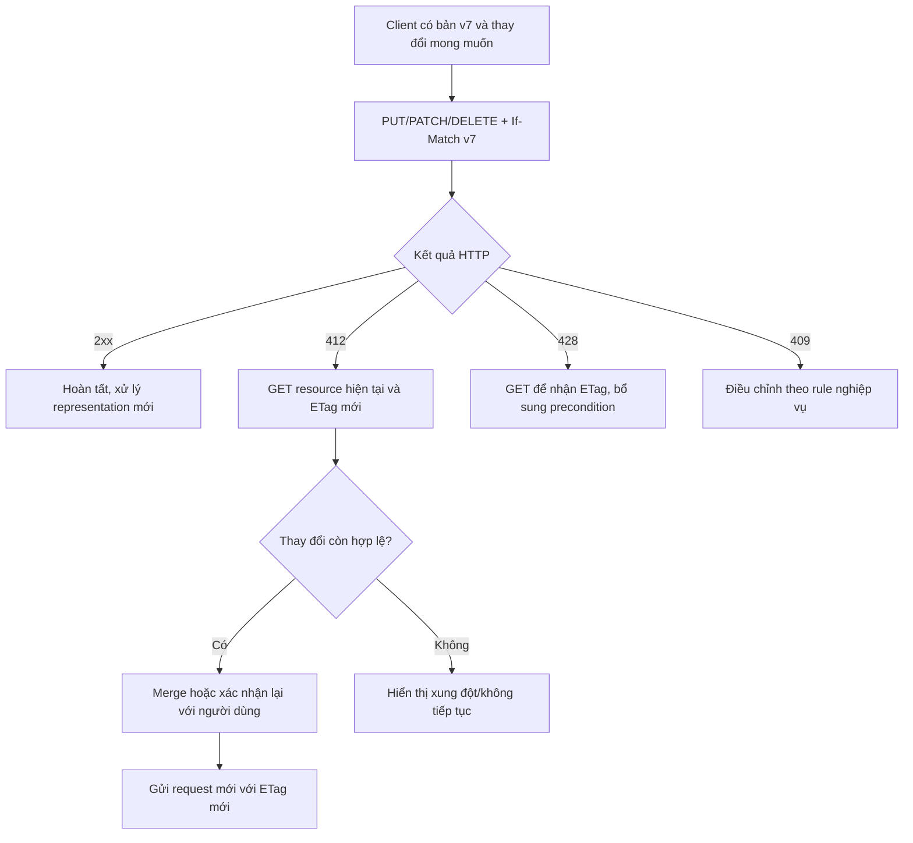
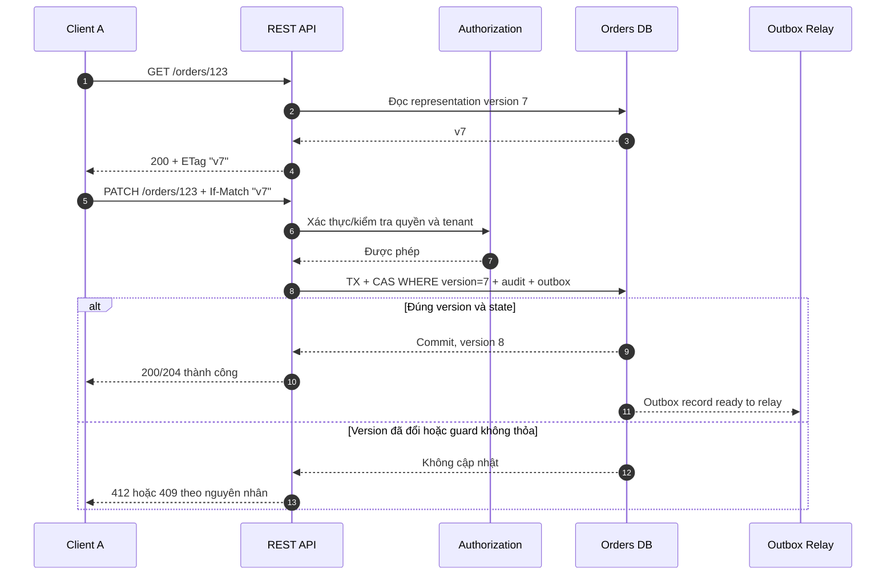
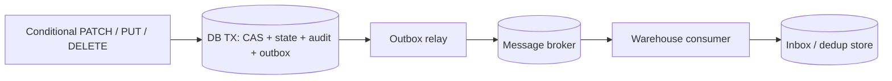

# Điều kiện cho PUT, PATCH, DELETE và tính nguyên tử phía server

## 1. Khi hai client cùng sửa một tài nguyên

Một REST API quản lý đơn hàng cho phép nhân viên cập nhật ghi chú giao hàng, thay đổi địa chỉ khi đơn chưa xuất kho và xóa một bản nháp chưa xác nhận. Các thao tác này có thể hợp lệ khi một người sử dụng hệ thống, nhưng gây lỗi nghiêm trọng khi nhiều người thao tác đồng thời.

Giả sử đơn `ord-123` ban đầu có phiên bản 7:

```json
{
  "id": "ord-123",
  "status": "DRAFT",
  "shippingAddress": "Địa chỉ A",
  "deliveryNote": "Giao giờ hành chính"
}
```

Hai client cùng đọc bản này:

1. **Client A** đổi `shippingAddress` thành “Địa chỉ B”.
2. **Client B** đổi `deliveryNote` thành “Gọi trước khi giao” trên bản dữ liệu đã đọc từ trước.
3. Nếu cả hai gửi **PUT thay thế toàn bộ representation** mà server chỉ thực hiện ghi sau cùng, cập nhật của A có thể bị B ghi đè. Đây là **lost update**.
4. Nếu một client gửi DELETE trong lúc client kia sửa, hệ thống còn phải giải quyết việc **xóa nhầm phiên bản mới hơn** hoặc phát side effect đã không còn hợp lệ.

Trong chương **Điều kiện và đồng thời** của module **INTEGRATION_API_REST**, giải pháp cần kết hợp hai lớp:

- **Hợp đồng HTTP:** server cung cấp validator cho representation; client gửi **conditional request** như `If-Match` hoặc `If-None-Match` để nói rõ điều kiện cho phép thay đổi tài nguyên.
- **Tính nguyên tử phía server:** việc kiểm tra điều kiện và commit thay đổi phải tạo thành một hành động không bị race; nếu không, dù header đúng cú pháp, hệ thống vẫn có thể mất cập nhật.

Bài gắn với mục tiêu học thiết kế REST API từ resource/URI, phương thức và mã trạng thái, đến hợp đồng dữ liệu, idempotency, bảo mật, OpenAPI và kiểm thử bằng Java/Spring hoặc công nghệ tương đương.

### Kết quả học tập

Sau bài này, bạn có thể:

1. Giải thích strong ETag, `If-Match`, `If-None-Match`, `If-Unmodified-Since` và quy tắc đánh giá điều kiện.
2. Thiết kế **PUT để tạo/thay thế**, **PATCH để cập nhật một phần**, **DELETE để xóa**, với điều kiện đúng **URI đích**.
3. Phân biệt **412 Precondition Failed**, **428 Precondition Required**, **409 Conflict** và các mã liên quan.
4. Bảo vệ thao tác bằng **compare-and-swap**, optimistic locking, unique constraint và database transaction; hiểu giới hạn của transaction qua nhiều dịch vụ.
5. Kiểm thử race condition, retry sau timeout, validator cũ, lỗi quyền và tác động ngoài hệ thống.

## 2. HTTP conditional requests: điều kiện do client khai báo

Một conditional request là request có header nêu điều kiện mà server phải kiểm tra trước khi thực hiện method nếu điều kiện đó áp dụng.

Ví dụ client đọc tài nguyên:

```http
GET /api/orders/ord-123 HTTP/1.1
Authorization: Bearer <synthetic-token>
Accept: application/json
```

Origin trả:

```http
HTTP/1.1 200 OK
Content-Type: application/json
ETag: "order-ord-123-v7"
Cache-Control: private, no-store

{
  "id": "ord-123",
  "status": "DRAFT",
  "shippingAddress": "Địa chỉ A",
  "deliveryNote": "Giao giờ hành chính"
}
```

`ETag` ở đây là **validator do server tạo** cho **representation được chọn** của `/api/orders/ord-123`. Client không nên tự đoán version hoặc tạo ETag từ JSON. Sau khi sửa tại giao diện, client gửi lại validator:

```http
PATCH /api/orders/ord-123 HTTP/1.1
Authorization: Bearer <synthetic-token>
Content-Type: application/merge-patch+json
If-Match: "order-ord-123-v7"

{"deliveryNote":"Gọi trước khi giao"}
```

Ý nghĩa: “Chỉ áp dụng bản vá nếu representation hiện tại của **tài nguyên đích** vẫn khớp strong ETag đã biết”. Nếu version đã là 8, server từ chối mà không thực hiện thay đổi:

```http
HTTP/1.1 412 Precondition Failed
Content-Type: application/problem+json
Cache-Control: no-store

{
  "type": "about:blank",
  "title": "Precondition Failed",
  "status": 412,
  "detail": "Tài nguyên đã thay đổi. Vui lòng tải lại trước khi cập nhật.",
  "code": "RESOURCE_VERSION_CHANGED"
}
```

### 2.1. Validator và so sánh mạnh/yếu

Theo ngữ nghĩa HTTP (RFC 9110):

| Khái niệm | Ví dụ | Ý nghĩa |
| --- | --- | --- |
| **Strong ETag** | `ETag: "order-ord-123-v7"` | Validator dùng **strong comparison**; phù hợp bảo vệ cập nhật một representation xác định |
| **Weak ETag** | `ETag: W/"order-ord-123-v7"` | Validator yếu, hữu ích cho cache khi khác biệt representation không quan trọng |
| **`If-Match`** | `If-Match: "order-ord-123-v7"` | Yêu cầu strong comparison với representation hiện tại |
| **`If-None-Match`** | `If-None-Match: *` | Điều kiện chỉ đúng khi **không có representation hiện hành** của resource đích |
| **`If-Unmodified-Since`** | `If-Unmodified-Since: Wed, 18 Nov 2026 08:00:00 GMT` | Chỉ xử lý nếu resource không bị thay đổi sau thời điểm được chỉ định, trong giới hạn HTTP date |

**`If-Match` sử dụng strong comparison.** ETag yếu có tiền tố `W/` không thỏa điều kiện so khớp mạnh với một validator mạnh; không dùng weak ETag làm công cụ bảo vệ lost update. Server nên cấp strong ETag có chiến lược version đáng tin cậy cho những tài nguyên có thao tác ghi được bảo vệ.

ETag là **opaque validator**, không nhất thiết là số version. Server có thể chọn hash hoặc revision identifier miễn là bảo đảm semantics về representation. Khi representation thay đổi vì trạng thái, địa chỉ, giá trị hiển thị hoặc biến thể `Content-Type`/ngôn ngữ, phải bảo đảm validator không tạo **false match** giữa các representation khác nhau ở mức cần bảo vệ.

### 2.2. So sánh `If-Match`, `If-None-Match` và `If-Unmodified-Since`

| Header | Phép kiểm tra | Tình huống điển hình |
| --- | --- | --- |
| `If-Match: "v7"` | Representation của URI đích phải có strong ETag khớp một phần tử trong danh sách | **Thay đổi chỉ khi chưa có người sửa từ lúc đọc** |
| `If-Match: *` | URI đích phải có representation hiện hành | Chỉ thay đổi khi resource đang tồn tại; **không ngăn lost update theo version** |
| `If-None-Match: *` | URI đích không được có representation hiện hành | **Tạo mới không ghi đè** với `PUT` |
| `If-Unmodified-Since: <HTTP-date>` | Không bị sửa sau mốc thời gian, nếu server có thể đánh giá điều kiện | Phương án kém chính xác hơn ETag khi không có validator tốt |

Header `If-Match` có thể chứa **danh sách entity tags** hoặc ký hiệu `*`; phần mềm production phải xử lý cú pháp HTTP đúng chuẩn, không so sánh nguyên chuỗi header với một giá trị ETag duy nhất khi hợp đồng cho phép nhiều giá trị. Với danh sách, điều kiện được đáp ứng nếu có ít nhất một strong ETag khớp current selected representation.

### 2.3. Khi nào server xét precondition?

Server chỉ áp dụng điều kiện sau khi xác định request có thể được xử lý theo các bước thông thường. Nếu một request thiếu authentication hoặc path không tồn tại theo policy, response `401`/`403`/`404` có thể được trả trước khi đánh giá `If-Match`. Điều kiện ghi **không thay thế xác thực, phân quyền, kiểm tra trạng thái nghiệp vụ hoặc validation**.

Với một method mà nếu không có điều kiện sẽ trả `2xx` hoặc `412`, server đánh giá conditional headers theo quy tắc giao thức. Nếu điều kiện thất bại, thông thường server trả **`412 Precondition Failed`**, không áp dụng thay đổi. Không dùng `304 Not Modified` để phản hồi một PUT/PATCH/DELETE thất bại về điều kiện.

## 3. Điều kiện cho PUT: thay thế toàn bộ hoặc tạo mới không ghi đè

`PUT` yêu cầu tạo hoặc thay thế trạng thái của **target resource** bằng representation trong request. Nó có tính **idempotent về tác động dự kiến** theo HTTP; điều đó không bảo đảm mọi retry có cùng status hoặc không còn nhu cầu kiểm soát đồng thời.

### 3.1. PUT thay thế resource đã có bằng `If-Match`

Client GET và nhận:

```http
ETag: "order-ord-123-v7"
```

Sau đó gửi:

```http
PUT /api/orders/ord-123 HTTP/1.1
Content-Type: application/json
If-Match: "order-ord-123-v7"
Authorization: Bearer <synthetic-token>

{
  "status": "DRAFT",
  "shippingAddress": "Địa chỉ B",
  "deliveryNote": "Giao giờ hành chính"
}
```

Server cần kiểm tra:

1. Caller được phép thay thế resource này?
2. Hợp đồng có cho phép **PUT toàn bộ** representation không; thuộc tính nào được client ghi?
3. Target `/api/orders/ord-123` vẫn tồn tại và validator có **strong match**?
4. Trạng thái nghiệp vụ còn cho phép sửa địa chỉ không?
5. Có thể commit **kiểm tra version và thay đổi dữ liệu** trong cùng ranh giới nguyên tử không?

Nếu có thay đổi đồng thời trước commit, trả `412` khi precondition không còn đúng. Nếu precondition đúng nhưng thay thế không hợp lệ do state machine (ví dụ đơn đã giao), dùng `409 Conflict` hoặc mã nghiệp vụ khác theo hợp đồng rõ ràng.

**Không dùng PUT như PATCH giả:** Nếu client gửi chỉ một thuộc tính và server ngầm giữ các field còn lại, đó không phải cách hiểu thay thế toàn bộ thông thường của PUT. Nếu API chỉ cập nhật một phần, chọn PATCH hoặc thiết kế một resource nhỏ có representation được thay thế trọn vẹn.

### 3.2. PUT tạo mới với `If-None-Match: *`

Nếu client được quyền chọn URI cho resource mới, `If-None-Match: *` ngăn PUT **ghi đè** resource đã tồn tại:

```http
PUT /api/user-preferences/u-42 HTTP/1.1
Content-Type: application/json
If-None-Match: *

{"locale":"vi-VN","notificationsEnabled":true}
```

| Trạng thái target | Điều kiện `If-None-Match: *` | Kết quả |
| --- | --- | --- |
| Không có representation hiện hành | Đúng | Có thể tạo resource, thường `201 Created` nếu thành công |
| Đã có representation hiện hành | Sai | `412 Precondition Failed`, không ghi đè |
| Hai request đồng thời cùng muốn tạo | Chỉ một request được commit | Request còn lại không được overwrite; xử lý xung đột precondition |

**Bẫy lớn:** Đừng chỉ làm `SELECT ... WHERE id = ?` rồi `INSERT`, vì hai request có thể cùng thấy resource chưa tồn tại. Dùng **unique constraint** ở database, transaction và cơ chế insert có điều kiện để đảm bảo kết quả.

`If-None-Match: *` khác với `If-Match: *`: một cái yêu cầu **chưa tồn tại**, một cái yêu cầu **đang tồn tại**. Không được tráo hai header.

### 3.3. Status của PUT và validator trả về

| Tình huống | Status thường gặp |
| --- | --- |
| PUT tạo resource mới thành công | `201 Created` |
| PUT cập nhật resource đã tồn tại | `200 OK` nếu trả body hoặc `204 No Content` nếu không trả body |
| `If-Match` không khớp | `412 Precondition Failed` |
| Thiếu điều kiện mà API yêu cầu | `428 Precondition Required` |
| Điều kiện đúng nhưng business invariant ngăn thay thế | `409 Conflict` |
| Media type request không hỗ trợ | `415 Unsupported Media Type` |

Theo quy tắc HTTP, **không gửi validator như `ETag` trong phản hồi thành công của PUT** trừ khi representation từ request được **lưu không qua biến đổi** và validator phản ánh representation mới. Đây là điểm dễ sai khi server tự chuẩn hóa/biến đổi payload rồi trả ETag mà không bảo đảm điều kiện tương ứng. Nếu có xử lý biến đổi, có thể để client GET lại để lấy biểu diễn và ETag mới.

### 3.4. PUT retry sau timeout

Client gửi PUT với `If-Match: "v7"` và mất kết nối. Có thể server đã commit phiên bản 8 nhưng client chưa nhận response. Khi client retry cùng request:

- Precondition `"v7"` có thể không còn khớp, dẫn đến **`412`**.
- Điều này **không chứng minh** lần đầu thất bại. Client nên GET tài nguyên và so sánh trạng thái, hoặc dùng operation/idempotency mechanism phù hợp khi có side effect.
- Tính idempotent của PUT bảo vệ **tác động dự kiến khi lặp**, nhưng không cho phép bỏ qua kiểm tra điều kiện hoặc tự diễn giải `412` như một thất bại chắc chắn của lần đầu.

RFC 9110 có một trường hợp ngoại lệ cần hiểu: khi precondition không còn đúng nhưng origin **xác minh được request thay đổi trạng thái đã thành công trước đó**, nó có thể phản hồi `2xx` thay vì `412`. Nếu gửi validator trong phản hồi thành công kiểu này, origin phải xác minh được đó là bản gửi lại của một thay đổi ngay trước đó do **cùng user agent** thực hiện, theo quy tắc giao thức. Không tự động trả `2xx` chỉ vì dữ liệu “trông giống” payload; nếu không đủ bằng chứng, giữ hành vi an toàn và để client đối soát trạng thái.

## 4. Điều kiện cho PATCH: cập nhật một phần không làm mất thay đổi

`PATCH` được dùng khi client gửi **tập thay đổi** áp dụng lên target resource. PATCH **không mặc định idempotent**: một bản vá “tăng số lượng thêm 1” có thể gây thay đổi nhiều lần khi retry. Điều kiện `If-Match` là cơ chế quan trọng để tránh áp bản vá dựa trên trạng thái cũ.

### 4.1. JSON Merge Patch và JSON Patch là hai hợp đồng khác nhau

Ví dụ **JSON Merge Patch** (`application/merge-patch+json`, RFC 7396):

```http
PATCH /api/orders/ord-123 HTTP/1.1
Content-Type: application/merge-patch+json
If-Match: "order-ord-123-v7"

{"deliveryNote":"Gọi trước khi giao"}
```

Theo JSON Merge Patch, một member đặt thành `null` có ngữ nghĩa loại bỏ member trong nhiều tình huống, nên phải cân nhắc API với các thuộc tính **được phép null như giá trị dữ liệu**.

Ví dụ **JSON Patch** (`application/json-patch+json`, RFC 6902):

```http
PATCH /api/orders/ord-123 HTTP/1.1
Content-Type: application/json-patch+json
If-Match: "order-ord-123-v7"

[
  {"op":"test","path":"/status","value":"DRAFT"},
  {"op":"replace","path":"/deliveryNote","value":"Gọi trước khi giao"}
]
```

`test` trong JSON Patch có thể bổ sung một điều kiện trên **nội dung tài liệu**, nhưng **không thay thế** `If-Match` nếu cần kiểm soát thay đổi của toàn representation. Khi một phép thử/bước patch thất bại, server không được để một nửa patch đã được commit rồi mới báo lỗi.

### 4.2. Tính nguyên tử của PATCH

Một PATCH có nhiều phép biến đổi phải được áp dụng **nguyên tử** theo ngữ nghĩa của PATCH (RFC 5789): hoặc toàn bộ thay đổi của request có hiệu lực, hoặc không thay đổi nào được áp dụng. Điều này đặc biệt quan trọng với JSON Patch gồm các bước `test`, `remove`, `add`, `replace`.

```text
PATCH operations:
  1. test /status == DRAFT
  2. replace /deliveryNote
  3. replace /shippingAddress

Một bước không hợp lệ -> không commit bất kỳ thay đổi nào của patch.
```

Không nên sửa entity từng bước rồi flush/commit từng bước riêng lẻ. Với ORM cần đảm bảo transaction/rollback bao trọn validation và persist; với JSON document database cần dùng atomic document update hoặc transaction tương đương.

### 4.3. Khi hai PATCH cập nhật hai field khác nhau

Giả sử A và B cùng đọc version 7, A thay địa chỉ, B thay ghi chú:

| Thứ tự | Hành động | Kết quả kỳ vọng |
| --- | --- | --- |
| 1 | A PATCH với `If-Match: "v7"` | Nếu hợp lệ, commit version 8 |
| 2 | B PATCH với `If-Match: "v7"` | `412`, không áp thay đổi dựa trên representation cũ |
| 3 | B GET lại nhận version 8 | Có thể xem địa chỉ đã đổi |
| 4 | B quyết định áp dụng bản vá lên version 8 | PATCH với `"v8"` sau khi xác minh logic nghiệp vụ |

Đây là mô hình **optimistic concurrency**. Nếu hệ thống muốn tự hòa giải những trường độc lập, cần một **merge policy có thiết kế và kiểm thử**, không âm thầm bỏ `If-Match` để cho bản ghi cuối thắng.

### 4.4. Retry PATCH và side effect

Khi PATCH điều chỉnh điểm thưởng, tồn kho hoặc tiền:

- Một thao tác kiểu “tăng thêm 10” có thể gây **double increment** nếu retry không được kiểm soát.
- `If-Match` giúp request dùng version cũ không áp lại khi resource đã đổi; nhưng không đủ cho tác động đã phát tới service ngoài nếu backend không có workflow idempotent.
- Với operation có side effect, cân nhắc **idempotency key**, định danh lệnh bền vững, outbox và dedup của consumer.

`If-Match` bảo vệ **điều kiện trước khi commit vào target**; không phải phép bảo đảm “exactly once” xuyên hệ thống.

## 5. Điều kiện cho DELETE: chỉ xóa đúng phiên bản đã xem

`DELETE` có tính **idempotent về hiệu quả dự kiến** theo HTTP: gửi lặp yêu cầu xóa không có nghĩa server phải tạo ra thêm các bản xóa hoặc tác động dữ liệu mới. Tuy nhiên, cần cân nhắc **resource đã bị thay đổi** giữa lúc người dùng xem và xác nhận xóa.

### 5.1. DELETE dùng `If-Match`

```http
GET /api/draft-orders/ord-123 HTTP/1.1
```

```http
HTTP/1.1 200 OK
ETag: "draft-order-v7"

{"id":"ord-123","status":"DRAFT"}
```

Client yêu cầu xóa đúng bản nháp đã xem:

```http
DELETE /api/draft-orders/ord-123 HTTP/1.1
If-Match: "draft-order-v7"
Authorization: Bearer <synthetic-token>
```

Nếu chưa có ai sửa và xóa thành công, API có thể trả:

```http
HTTP/1.1 204 No Content
```

Nếu một người khác sửa bản nháp thành version 8 trước khi DELETE commit, server phải bảo đảm điều kiện cũ không còn hiệu lực; phản hồi **`412 Precondition Failed`** và không xóa version 8.

### 5.2. DELETE lặp và resource đã biến mất

Một DELETE đầu tiên có thể trả `204`, lần tiếp theo trả `404` hoặc `412` (tùy target còn tồn tại, precondition có được đánh giá và hợp đồng). Điều này **không vi phạm idempotency**: idempotency nói về tác động của các lần gửi lặp, không bảo đảm status giống nhau.

Nếu DELETE khởi động xử lý bất đồng bộ thay vì xóa ngay, `202 Accepted` và operation status URL có thể phù hợp. Việc trả 202 **không chứng minh** tác vụ cuối cùng đã hoàn thành; client cần theo dõi đúng trạng thái.

### 5.3. Soft delete, tombstone và race tái tạo

Một hệ thống có thể đánh dấu `deleted_at` hoặc ghi tombstone thay vì xóa vật lý ngay. Khi đó:

- Phải định nghĩa với client resource được xem như không còn tồn tại hay ở trạng thái bị xóa.
- Conditional DELETE phải đối chiếu version **trước khi** đánh dấu xóa.
- Khi muốn tạo lại cùng URI, cần chính sách rõ cho tombstone, version không lặp và quyền tạo mới.
- Tránh **ABA problem**: resource phiên bản A bị xóa rồi tạo lại cùng ID, trong khi ETag cũ vô tình khớp khiến client thao tác trên thế hệ resource mới.

Với dữ liệu pháp lý/đơn hàng đã phát hành, “hủy nghiệp vụ” có thể phải dùng **resource yêu cầu hủy** thay vì DELETE. Conditional DELETE chỉ có ý nghĩa khi API thực sự hỗ trợ xóa target resource.

## 6. Mã trạng thái và thứ tự đánh giá điều kiện

Một API tốt không chỉ phát ra `412` cho “mọi lỗi đồng thời”. Nó phải phân biệt **điều kiện HTTP sai**, **thiếu điều kiện bắt buộc**, **xung đột nghiệp vụ**, **không có resource** và **lỗi authorization**.

### 6.1. Bảng quyết định thực dụng

| Tình huống | Phản hồi điển hình | Ghi chú |
| --- | --- | --- |
| Resource còn version v8 nhưng `If-Match: "v7"` | **412 Precondition Failed** | Điều kiện HTTP không thỏa; không commit thay đổi |
| API bắt buộc `If-Match` nhưng client không gửi | **428 Precondition Required** | Server yêu cầu thao tác có điều kiện để tránh lost update |
| `PUT` create-only với `If-None-Match: *` nhưng target đã tồn tại | **412 Precondition Failed** | Không được ghi đè |
| `PATCH` có precondition đúng nhưng trạng thái nghiệp vụ không cho phép | **409 Conflict** | Ví dụ order đã `SHIPPED` và cấm đổi địa chỉ |
| Body `PATCH` sai cú pháp | **400 Bad Request** | Ví dụ JSON hỏng |
| Body có media type không hỗ trợ | **415 Unsupported Media Type** | Phân biệt PATCH type với JSON thông thường |
| Method không được resource hỗ trợ | **405 Method Not Allowed** | Phải có header `Allow` |
| User chưa đăng nhập | **401 Unauthorized** | Xác thực có thể được xử lý trước precondition |
| User không có quyền thay đổi | **403 Forbidden**, hoặc **404** khi cố ý che resource | Không dùng 412 làm cơ chế kiểm soát quyền |
| URI đích không tồn tại | **404 Not Found** hoặc kết quả theo hợp đồng tạo mới/điều kiện | Nếu muốn PUT create-only dùng `If-None-Match: *` |
| Target tồn tại, cập nhật thành công | **200/204** | Có thể trả representation hoặc không |
| PUT tạo mới thành công | **201 Created** | URI target giờ có resource |
| DELETE hoặc PATCH chờ tác vụ bất đồng bộ | **202 Accepted** | Cần monitor URL để biết trạng thái cuối |

Lưu ý `428` thuộc nhóm mã khuyến nghị bởi RFC 6585; API có thể chọn policy bắt buộc precondition cho tài nguyên quan trọng. Nếu dùng mã này, tài liệu lỗi nên giải thích cách client lấy validator trước khi sửa.

### 6.2. Thứ tự ưu tiên giữa các conditional headers

RFC 9110 định nghĩa thứ tự đánh giá preconditions khi chúng cùng xuất hiện. Một cách ghi nhớ:

1. **`If-Match`** trước tiên, nếu header có và áp dụng.
2. **`If-Unmodified-Since`** chỉ xét khi không có `If-Match` hợp lệ/được cung cấp theo điều kiện áp dụng.
3. **`If-None-Match`** sau đó.
4. **`If-Modified-Since`** chỉ dành cho GET/HEAD và được xét khi không có `If-None-Match`.
5. **`If-Range`** cho range request khi phù hợp, không phải cơ chế thông thường của PUT/PATCH/DELETE.

Đây là thứ tự kiểm tra **HTTP preconditions**, không phải thứ tự chạy authorization, validation, transaction hay business guards. Nói “`If-Match` luôn chạy đầu tiên” mà không xét các bước xử lý request bình thường là sai.

Ví dụ request có:

```http
PATCH /api/orders/ord-123 HTTP/1.1
If-Match: "order-ord-123-v7"
If-Unmodified-Since: Wed, 18 Nov 2026 08:00:00 GMT
```

Khi `If-Match` được cung cấp, nó là điều kiện có ưu tiên; không nên dựa vào timestamp để vượt qua ETag mismatch. API nên hướng dẫn client **chọn một chiến lược concurrency chính**, ưu tiên strong ETag khi có thể.

### 6.3. `If-None-Match` cho GET khác với PUT

Điều kiện `If-None-Match` thất bại có thể tạo kết quả khác theo method:

```http
GET /api/orders/ord-123 HTTP/1.1
If-None-Match: "order-ord-123-v7"
```

Nếu tài nguyên chưa đổi, GET/HEAD có thể trả **304 Not Modified** và không có body representation.

```http
PUT /api/user-preferences/u-42 HTTP/1.1
If-None-Match: *
```

Nếu target đã tồn tại, **không trả 304 cho PUT**; điều kiện false của method không phải GET/HEAD dẫn tới **412** theo HTTP.

### 6.4. `If-Unmodified-Since` không phải cơ chế chống đua mạnh nhất

`If-Unmodified-Since` có ích khi không có ETag, nhưng dựa vào timestamp HTTP vốn có độ phân giải và cách xử lý clock hạn chế. Hai cập nhật trong cùng một giây có thể gây khó khăn nếu chỉ so thời gian; đồng hồ giữa các hệ thống cũng có thể chênh.

Nếu server hỗ trợ strong ETag thì **`If-Match` thường đáng tin cậy hơn** cho cập nhật cạnh tranh. Trong trường hợp cần dùng timestamp, server phải tạo `Last-Modified` từ nguồn có thẩm quyền và đánh giá điều kiện một cách nhất quán trước commit.

### 6.5. Client làm gì sau 412?

Không tự động thay `If-Match` bằng `*` hoặc bỏ header để ép server ghi. Quy trình phù hợp:



Với DELETE, hỏi lại người dùng nếu dữ liệu mới đã thay đổi ý nghĩa của thao tác xóa. Với PATCH trên dữ liệu tài chính, hệ thống có thể cần quy trình đối soát thay vì tự merge.

## 7. Vì sao header đúng vẫn chưa đủ? Tính nguyên tử tại server

Một lỗi phổ biến là đọc version, kiểm tra ETag trong application code, rồi cập nhật database **ở một transaction khác**:

```text
Request A                       Request B
---------                       ---------
Read version = 7                Read version = 7
If-Match v7 -> true             If-Match v7 -> true
                                UPDATE row -> v8
UPDATE row -> v8/v9             Commit
Commit                          (A đã ghi đè thay đổi của B)
```

**Đây là TOCTOU (time-of-check to time-of-use)**: một khoảng hở giữa kiểm tra và dùng kết quả khiến hai request cùng qua điều kiện. Ngay cả khi controller nhận đúng `If-Match`, invariant vẫn vỡ.

### 7.1. Compare-and-swap bằng một câu lệnh có điều kiện

Với database quan hệ như PostgreSQL, có thể dùng update điều kiện:

```sql
BEGIN;

UPDATE orders
SET delivery_note = :new_delivery_note,
    version = version + 1,
    updated_at = CURRENT_TIMESTAMP
WHERE id = :order_id
  AND version = :expected_version
  AND status = 'DRAFT'
RETURNING id, version, status, delivery_note;

-- 1 row: thao tác đã thắng cạnh tranh;
-- 0 row: không được commit thay đổi, cần phân loại lỗi.

COMMIT;
```

Trong hệ thống thật:

- **Số row cập nhật phải là đúng một** trước khi xác nhận thành công.
- `expected_version` chỉ được lấy từ một ETag **do server phát hành**, sau khi kiểm tra cú pháp và ngữ nghĩa strong match phù hợp với representation đích.
- `status = 'DRAFT'` là một **business guard**, độc lập với version guard.
- Nếu 0 row, không được âm thầm trả `200`; cần xác định resource không còn tồn tại, version sai hay state không cho phép, rồi trả mã theo hợp đồng.
- Nếu lệnh có audit/outbox, chỉ thêm chúng trong transaction **khi cập nhật chính thành công**.

Sự phân loại lỗi sau 0 row có thể phải đọc lại trạng thái hiện tại. Lần đọc đó cũng có race nếu resource tiếp tục đổi; điều quan trọng nhất là **đã bảo đảm không commit một thay đổi không đủ điều kiện**. Đối với status trả client, hệ thống nên thiết kế precedence nhất quán và không tiết lộ tài nguyên ngoài quyền.

### 7.2. Không dùng “SELECT trước, UPDATE sau” nếu thiếu lock/version guard

Đoạn SQL thiếu bảo vệ:

```sql
SELECT version, status FROM orders WHERE id = :order_id;
-- Application thấy version 7, status DRAFT

UPDATE orders
SET delivery_note = :new_note
WHERE id = :order_id;
-- Không còn guard ở điểm ghi!
```

Ngay cả khi SELECT và UPDATE ở trong **cùng transaction** dưới isolation không đủ chặt, nếu không có lock/guard phù hợp vẫn có nguy cơ race. Các cách bảo vệ thường dùng:

1. **Optimistic compare-and-swap:** `UPDATE ... WHERE version = expected`, kiểm tra row count.
2. **Pessimistic locking:** đọc `SELECT ... FOR UPDATE` và giữ lock qua kiểm tra/ghi trong transaction; cần đánh giá deadlock/throughput.
3. **Serializable transaction:** phù hợp một số invariant phức tạp, nhưng cần xử lý serialization failure/retry và không coi nó là thay thế mọi constraint.
4. **Unique/check constraint:** bảo vệ invariant dữ liệu ở nơi có thẩm quyền, đặc biệt cho tạo mới.

Không có chiến lược nào tự động bảo vệ side effect bên ngoài database.

### 7.3. PATCH gồm nhiều bước phải hoàn tất hoặc rollback

Giả sử JSON Patch:

```json
[
  {"op":"test","path":"/status","value":"DRAFT"},
  {"op":"replace","path":"/shippingAddress","value":"Địa chỉ B"},
  {"op":"replace","path":"/deliveryNote","value":"Gọi trước"}
]
```

Nếu validation ở bước cuối thất bại, API **không được lưu địa chỉ mới nhưng giữ ghi chú cũ**. Có hai hướng triển khai:

- Áp bản vá vào bản sao in-memory, validate toàn bộ, rồi commit bằng CAS một lần.
- Dùng transaction bao trùm các thay đổi dữ liệu; rollback khi một bước thất bại, đồng thời dùng lock/version guard.

Trả `409` cho xung đột nghiệp vụ hoặc `412` cho HTTP precondition false theo contract, không biến một phần thay đổi thành “thành công một phần” khi semantics của PATCH yêu cầu atomicity.

### 7.4. DELETE và unique constraint ở storage

`DELETE FROM orders WHERE id = :id AND version = :v` có thể bảo vệ xóa đúng version. Nếu dùng soft delete:

```sql
UPDATE draft_orders
SET deleted_at = CURRENT_TIMESTAMP,
    version = version + 1
WHERE id = :id
  AND version = :expected_version
  AND deleted_at IS NULL
RETURNING id;
```

Nếu hệ thống cho phép **tạo lại cùng URI**, version/tombstone phải tránh tình huống ETag cũ hợp lệ với resource mới (ABA). Có thể dùng generation ID riêng hoặc version tăng đơn điệu trên định danh logic, tùy mô hình dữ liệu.

### 7.5. Transaction chứa audit và transactional outbox

Với thao tác có hậu quả ngoài database, transaction nên lưu **trạng thái tài nguyên + lịch sử thao tác + ý định phát sự kiện** cùng nhau:

```sql
BEGIN;

UPDATE draft_orders
SET status = 'READY_TO_SHIP',
    version = version + 1
WHERE id = :id
  AND version = :expected_version
  AND status = 'APPROVED'
RETURNING id, version;

-- Chỉ khi rowcount = 1 mới tiếp tục:
INSERT INTO order_audit(
    order_id, actor_id, action, occurred_at
) VALUES (:id, :actor_id, 'MARK_READY_TO_SHIP', CURRENT_TIMESTAMP);

INSERT INTO outbox_events(
    event_id, aggregate_id, event_type, payload
) VALUES (:event_id, :id, 'OrderReadyToShip', :event_payload);

COMMIT;
```

**Đây là sơ đồ SQL minh họa, không phải script chạy độc lập:** nhánh `rowcount=0` phải rollback toàn bộ và không thực hiện hai INSERT. `:event_payload` nên chứa dữ liệu tối thiểu, không nhúng token hoặc bí mật.

Outbox relay có thể phát lại event, nên consumer cần idempotent/inbox dedup. Database transaction chỉ bảo đảm nguyên tử với các bảng trong **cùng transaction boundary**; nó không tạo distributed transaction với broker, PSP hay Warehouse Service.

## 8. Một kiến trúc xử lý request có điều kiện từ HTTP đến database



**Nên suy nghĩ theo hai câu hỏi độc lập:**

1. **Request có được phép commit trạng thái mới?** Trả lời bằng quyền, HTTP precondition, business guard và atomic database operation.
2. **Tác động sau commit được thực thi đúng một lần về mặt nghiệp vụ không?** Trả lời bằng idempotency key, outbox, inbox/dedup, saga/compensation, đối soát và monitoring.

Một ứng dụng chỉ trả 412 đẹp nhưng phát webhook hai lần khi retry vẫn chưa an toàn.

## 9. Java/Spring Boot: nhận precondition và bảo vệ optimistic locking

Ví dụ sử dụng **Java 17+, Spring Boot 3, Spring MVC 6**. Controller chỉ thể hiện HTTP contract; service phía sau phải có implementation kiểm tra validator, business guard, transaction và optimistic locking.

### 9.1. HTTP controller cho PATCH và DELETE

```java
package example.orders.api;

import com.fasterxml.jackson.databind.JsonNode;
import java.security.Principal;

import org.springframework.http.HttpHeaders;
import org.springframework.http.ResponseEntity;
import org.springframework.web.bind.annotation.DeleteMapping;
import org.springframework.web.bind.annotation.PatchMapping;
import org.springframework.web.bind.annotation.PathVariable;
import org.springframework.web.bind.annotation.RequestBody;
import org.springframework.web.bind.annotation.RequestHeader;
import org.springframework.web.bind.annotation.RequestMapping;
import org.springframework.web.bind.annotation.RestController;

@RestController
@RequestMapping("/api/draft-orders")
public class DraftOrderController {

    private final DraftOrderApplicationService service;

    public DraftOrderController(DraftOrderApplicationService service) {
        this.service = service;
    }

    @PatchMapping(value = "/{id}",
            consumes = "application/merge-patch+json")
    public ResponseEntity<Void> patch(
            @PathVariable("id") String id,
            @RequestHeader(value = HttpHeaders.IF_MATCH, required = false)
                String ifMatch,
            @RequestBody JsonNode mergePatch,
            Principal principal) {

        if (ifMatch == null || ifMatch.isBlank()) {
            throw new PreconditionRequiredException();
        }
        service.patchAtomically(id, ifMatch, mergePatch, principal.getName());
        return ResponseEntity.noContent().build();
    }

    @DeleteMapping("/{id}")
    public ResponseEntity<Void> delete(
            @PathVariable("id") String id,
            @RequestHeader(value = HttpHeaders.IF_MATCH, required = false)
                String ifMatch,
            Principal principal) {

        if (ifMatch == null || ifMatch.isBlank()) {
            throw new PreconditionRequiredException();
        }
        service.deleteAtomically(id, ifMatch, principal.getName());
        return ResponseEntity.noContent().build();
    }
}

interface DraftOrderApplicationService {
    void patchAtomically(
            String id, String ifMatch, JsonNode patch, String actor);
    void deleteAtomically(
            String id, String ifMatch, String actor);
}

class PreconditionRequiredException extends RuntimeException {}
class PreconditionFailedException extends RuntimeException {}
```

Đoạn này **không phải một dự án chạy độc lập**: nó giả định đã có cấu hình authentication tạo `Principal`, service implementation, repository và policy phân quyền. Tuy nhiên, nó minh họa rõ:

- `PATCH /api/draft-orders/{id}` dùng JSON Merge Patch, yêu cầu `If-Match`.
- `DELETE /api/draft-orders/{id}` cũng yêu cầu `If-Match`.
- Thiếu header được phân loại riêng; controller **không tự đọc/sửa DB**.
- HTTP `204 No Content` chỉ được trả sau khi service xác nhận **commit thành công**.

Một endpoint PUT create-only có thể dùng `@PutMapping("/{id}")` và kiểm tra header `If-None-Match: *` trong service. Đừng viết một endpoint PUT chung tự hiểu `If-Match` như `If-None-Match`, vì chúng có ý nghĩa trái ngược.

### 9.2. Trả 428 và 412 an toàn bằng Problem Details

```java
package example.orders.api;

import org.springframework.http.HttpStatus;
import org.springframework.http.ProblemDetail;
import org.springframework.http.ResponseEntity;
import org.springframework.web.bind.annotation.ExceptionHandler;
import org.springframework.web.bind.annotation.RestControllerAdvice;

@RestControllerAdvice
public class ConditionalErrorHandler {

    @ExceptionHandler(PreconditionRequiredException.class)
    public ResponseEntity<ProblemDetail> missingPrecondition() {
        ProblemDetail p = ProblemDetail.forStatus(428);
        p.setTitle("Precondition Required");
        p.setDetail("Gửi If-Match với ETag hiện tại của tài nguyên.");
        p.setProperty("code", "IF_MATCH_REQUIRED");
        return ResponseEntity.status(428).body(p);
    }

    @ExceptionHandler(PreconditionFailedException.class)
    public ResponseEntity<ProblemDetail> failedPrecondition() {
        ProblemDetail p = ProblemDetail.forStatus(
                HttpStatus.PRECONDITION_FAILED);
        p.setTitle("Precondition Failed");
        p.setDetail("Tài nguyên đã thay đổi. Hãy tải lại và thử tiếp.");
        p.setProperty("code", "RESOURCE_VERSION_CHANGED");
        return ResponseEntity.status(HttpStatus.PRECONDITION_FAILED).body(p);
    }
}
```

Trong ứng dụng thực tế, cần có handler riêng cho validation, 401/403, 404, 409, lỗi database và các trạng thái HTTP framework. Không trả nguyên SQL/exception/stack trace hoặc phiên bản tài nguyên mà caller không được phép thấy. Kiểm thử để những handler này không biến 405/415/400 thành 500.

### 9.3. JPA `@Version` và nguyên tắc triển khai service

Với JPA, `@Version` cho phép ORM phát hiện cập nhật cạnh tranh:

```java
package example.orders.persistence;

import jakarta.persistence.Entity;
import jakarta.persistence.Id;
import jakarta.persistence.Version;

@Entity
public class DraftOrder {

    @Id
    private String id;

    @Version
    private long version;

    private String status;
    private String deliveryNote;

    protected DraftOrder() {}

    public long getVersion() { return version; }
    public String getStatus() { return status; }

    public void changeDeliveryNote(String value) {
        if (!"DRAFT".equals(status)) {
            throw new IllegalStateException("State conflict");
        }
        this.deliveryNote = value;
    }
}
```

Khi hai transaction đọc cùng JPA entity version 7, một transaction cập nhật và tăng version trước, transaction còn lại sẽ gặp **optimistic locking failure** khi flush/commit thay vì âm thầm overwrite. Lớp service phải ánh xạ failure phù hợp:

- Nếu request dùng `If-Match` của target và validator trở nên không đúng vì cạnh tranh, trả `412` sau khi transaction lỗi đã được rollback.
- Nếu không có HTTP precondition mà quy tắc nghiệp vụ xung đột, dùng `409` khi phù hợp; hoặc yêu cầu điều kiện từ đầu bằng `428`.
- `@Version` **không tự đọc/so khớp header If-Match**. Server vẫn phải ánh xạ validator HTTP sang trạng thái representation hiện tại và kiểm tra trước ghi.
- Version JPA không tự bảo vệ dữ liệu cập nhật bằng SQL ngoài ORM nếu lệnh đó không tăng/kiểm tra version.

### 9.4. Pseudocode của service, chú ý transaction boundary

```text
patchAtomically(id, ifMatch, patch, actor):
    authenticate_and_authorize(actor, id)
    validate_patch_document_and_allowed_fields(patch)

    begin_transaction()
        order = load_target_for_update_or_optimistic_version(id)
        currentEtag = strong_etag_for_selected_representation(order)

        if !if_match_strongly_matches(ifMatch, currentEtag):
            abort_and_respond_412

        if !business_state_allows_patch(order, patch):
            abort_and_respond_409

        apply_entire_merge_patch_to_canonical_model(order, patch)
        validate_whole_resulting_model(order)
        persist_using_version_guard_or_lock(order)
        persist_audit_record(...)
        persist_outbox_event_if_needed(...)
    commit_transaction()

    return_204
```

**`if_match_strongly_matches` phải xử lý cú pháp chuẩn** (`*`, danh sách ETag, weak vs strong) hoặc dựa vào thư viện giao thức đã được kiểm chứng. Không viết kiểm tra đơn giản `ifMatch.equals("\"v7\"")` rồi cho production chạy khi client có thể gửi nhiều token, chuỗi không hợp lệ hoặc header bị lặp.

Nếu service dùng JPA `@Version`, optimistic locking failure có thể xảy ra **ở lúc flush/commit**, ngoài thời điểm gọi `save`. Việc bắt exception và ánh xạ response phải đặt ở ranh giới phù hợp để transaction **thật sự rollback**; không nuốt lỗi rồi trả 204.

Ví dụ sử dụng Java code trong controller không tự đảm bảo tính nguyên tử; tính đúng đắn nằm ở **service/database implementation, transaction management và contract tests**.

### 9.5. Giao thức conditional request chỉ áp dụng đúng URI đích

Một lỗi tinh vi là dùng:

```http
POST /api/orders/ord-123/cancellation-requests
If-Match: "order-ord-123-v7"
```

rồi giả định RFC 9110 tự hiểu `If-Match` đang kiểm tra **đơn hàng cha**. Không đúng: request target là **collection `/cancellation-requests`**, không phải `/api/orders/ord-123`. Nếu muốn `If-Match` bảo vệ đúng order, thiết kế thao tác cập nhật **chính URI order** bằng PUT/PATCH khi phù hợp. Nếu endpoint là POST tạo resource con, có thể thiết kế **header phiên bản nghiệp vụ riêng** như `Expected-Order-Version` hoặc body field được công bố, rồi dùng CAS ở Order DB. Khi phiên bản ứng dụng không khớp, hợp đồng có thể dùng **409 Conflict**; đừng nhầm đó là 412 do HTTP `If-Match` trên target.

## 10. Khi phải cập nhật nhiều dịch vụ: atomicity không tự lan truyền

Một database transaction không thể mặc nhiên bao trùm các tác động lên Warehouse, Payment, broker và hệ thống vận chuyển.

Ví dụ PATCH đặt trạng thái đơn là `READY_TO_SHIP`:

1. Order API cập nhật `orders.status` và `version`.
2. Warehouse Service nhận lệnh chuẩn bị hàng.
3. Notification Service gửi thông báo.

Nếu server thực hiện **(2) trước khi commit (1)** và transaction lỗi, kho có thể nhận yêu cầu không hợp lệ. Nếu commit (1) rồi gọi (2) trực tiếp nhưng ứng dụng crash, có thể mất lệnh gửi kho.

### 10.1. Cặp công cụ bổ sung: transactional outbox và idempotent consumer



Những bất biến:

- **Trước khi commit:** xác thực quyền, evaluate precondition, business guard, versioned write, audit và outbox record trong cùng transaction cục bộ.
- **Sau khi commit:** relay có thể phát event nhiều lần; consumer xử lý bằng operation ID ổn định, dedup và logic idempotent.
- **Nếu kết quả bên ngoài chưa rõ:** lưu trạng thái `PROCESSING`/`NEEDS_RECONCILIATION` và đối soát; không suy từ HTTP timeout thành “chắc chắn chưa xử lý”.
- **Nếu cần bù trừ:** dùng Saga/compensation theo quy tắc nghiệp vụ, thay vì giả định có rollback ACID xuyên nhiều dịch vụ.

### 10.2. Không tạo side effect trước khi hoàn tất điều kiện

Không nên:

```text
chargePayment()
if checkIfMatch():
    saveOrder()
else:
    return 412
```

Nếu `If-Match` false, payment đã có thể bị charge dù API trả 412. Hướng đúng là xác thực/kiểm tra điều kiện và **commit ý định thực hiện** theo transaction trước, sau đó mới xử lý side effect thông qua workflow tin cậy.

Ngay cả khi precondition đúng ở thời điểm commit, **tình trạng bên ngoài có thể thay đổi**. Ví dụ kho bàn giao hàng ngay sau khi Order DB chuyển trạng thái. Hệ thống cần protocol dừng/giữ hàng, điều phối, fencing hoặc đối soát tương ứng; `If-Match` chỉ bảo vệ target representation, không khóa mọi service.

### 10.3. Idempotency và conditional requests giải quyết hai vấn đề khác

| Cơ chế | Bảo vệ chính | Không tự đảm bảo |
| --- | --- | --- |
| `If-Match` strong ETag | Không ghi đè target nếu representation đổi | Không bảo đảm exactly-once downstream |
| `If-None-Match: *` | Không tạo đè lên target đã tồn tại | Không định danh được mọi thao tác nghiệp vụ trùng |
| `@Version`/CAS | Không có hai transaction cùng ghi dựa trên version cũ | Không bảo vệ side effect ngoài DB |
| `Idempotency-Key` ứng dụng | Nhận biết retry trùng của một operation | Không tự giải quyết xung đột giữa hai thao tác khác nhau |
| Transactional outbox | Không mất ý định phát event sau commit cục bộ | Broker/consumer không có giao hàng exactly once end-to-end |
| Consumer dedup/inbox | Không xử lý lặp một event/command đã biết | Không tự khôi phục nghiệp vụ nếu kết quả bên ngoài chưa rõ |

Với POST có side effect, idempotency key đặc biệt quan trọng; với PATCH/DELETE có side effect ngoài DB cũng có thể cần operation ID riêng. Retry sau 504 phải dựa vào trạng thái công việc và contract, không chỉ nhìn HTTP method.

## 11. Bảo mật, cache và validator của representation

### 11.1. `If-Match` không phải quyền truy cập

Biết ETag của resource không chứng minh caller được sửa hoặc xóa nó. Trước khi tiết lộ trạng thái resource và cho phép mutation, server phải:

- Xác thực danh tính và kiểm tra tenant/ownership/role.
- Ngăn BOLA/IDOR: không thao tác resource chỉ vì caller đoán được ID.
- Chỉ cho sửa những thuộc tính được phép; không chấp nhận `PATCH /status` tùy tiện bỏ qua state machine.
- Kiểm tra `If-Match` sau các điều kiện request bình thường phù hợp, không biến 412 thành kênh dò sự tồn tại/version của resource khác.

Trong một số API, `404` có thể được dùng để tránh tiết lộ resource thuộc người khác, theo chính sách được thiết kế nhất quán. Response lỗi nên theo Problem Details nhưng không trả raw SQL, stack trace, validator nội bộ hay payload nhạy cảm.

### 11.2. ETag theo biến thể representation

Một order có thể có các representation khác nhau theo `Accept`, `Accept-Language`, quyền người dùng hoặc projection. ETag phải gắn với **selected representation**; không lấy một `version` thô rồi tự cho rằng nó luôn đại diện mọi biến thể nếu chúng có nội dung và semantics khác nhau.

Ví dụ:

```http
GET /api/orders/ord-123 HTTP/1.1
Accept: application/json
```

Server có thể trả ETag khác với response `application/xml` hoặc representation có trường riêng theo quyền. Nếu dùng `Vary`, cache phải phân biệt các biến thể phù hợp; nếu phản hồi là dữ liệu cá nhân, chọn policy cache thích hợp như `Cache-Control: private, no-store`.

**Không coi ETag là bí mật hoặc token authorization.** Dù là opaque, validator có thể tiết lộ tín hiệu thay đổi tài nguyên nếu endpoint không kiểm tra quyền; việc bảo vệ response và GET vẫn là trách nhiệm của server.

### 11.3. `If-None-Match` trên GET và điều kiện ghi khác nhau

Một client gửi `If-None-Match` để tối ưu đọc GET có thể nhận `304`. Không dùng kết quả 304 để kết luận bất kỳ request PUT/PATCH/DELETE nào sẽ được phép: trạng thái có thể đổi, quyền và business guards vẫn phải kiểm tra trong request ghi.

Với API có caching, khi ghi thành công có thể invalidated cache theo quy tắc HTTP/cache implementation, nhưng **không dựa vào invalidation hoàn hảo** để đảm bảo concurrent writes. Chỉ CAS/lock tại database hoặc điểm có thẩm quyền mới bảo vệ invariant tại commit.

## 12. OpenAPI: ghi rõ yêu cầu conditional request trong hợp đồng

Client phải biết **lấy ETag ở đâu, header nào bắt buộc và cần xử lý status nào**. Không chỉ khai báo `PATCH` mà không nói điều kiện concurrency.

Ví dụ OpenAPI 3.1 rút gọn:

```yaml
openapi: 3.1.0
info:
  title: Draft Orders API
  version: 1.0.0
paths:
  /api/draft-orders/{id}:
    parameters:
      - name: id
        in: path
        required: true
        schema: { type: string }
    get:
      operationId: getDraftOrder
      responses:
        '200':
          description: Current representation and validator
          headers:
            ETag:
              description: Strong validator for this representation
              schema: { type: string }
          content:
            application/json:
              schema:
                type: object
                properties:
                  id: { type: string }
                  status: { type: string }
                  deliveryNote: { type: string }
    patch:
      operationId: patchDraftOrder
      description: |
        Apply a JSON Merge Patch atomically. The caller MUST supply
        the current strong ETag of the target in If-Match.
      parameters:
        - name: If-Match
          in: header
          required: true
          description: Current strong ETag; use the value received from GET.
          schema: { type: string }
      requestBody:
        required: true
        content:
          application/merge-patch+json:
            schema:
              type: object
              properties:
                deliveryNote:
                  type: [string, 'null']
      responses:
        '204': { description: Patch committed successfully }
        '400': { description: Invalid patch syntax }
        '401': { description: Authentication required }
        '403': { description: Forbidden }
        '404': { description: Resource not found or hidden }
        '409': { description: Business state conflict }
        '412': { description: If-Match condition failed }
        '415': { description: Unsupported patch media type }
        '428': { description: If-Match precondition required }
    delete:
      operationId: deleteDraftOrder
      parameters:
        - name: If-Match
          in: header
          required: true
          schema: { type: string }
      responses:
        '204': { description: Draft deleted }
        '401': { description: Authentication required }
        '403': { description: Forbidden }
        '404': { description: Resource not found or hidden }
        '409': { description: Business state prevents deletion }
        '412': { description: If-Match condition failed }
        '428': { description: If-Match precondition required }
```

Đây là khung tài liệu, chưa gồm các `securitySchemes`, schema Problem Details, quy tắc ETag theo biến thể, versioning và pagination của hệ thống hoàn chỉnh. Dấu `null` trong JSON Merge Patch có tác động đặc biệt; nếu hợp đồng không cho xóa `deliveryNote`, cần **loại null khỏi schema/validation**.

Với endpoint PUT:

- Nếu cho **thay thế tài nguyên hiện hữu**, mô tả `If-Match` cùng response 200/204/412/428.
- Nếu cho **tạo resource mới không overwrite**, mô tả `If-None-Match: *` cùng response 201/412.
- Nếu phục vụ cả hai chế độ tại cùng URI, phải nêu rõ cách server phân biệt và những request thiếu precondition bị xử lý ra sao.

OpenAPI là **tài liệu contract**, không tự triển khai CAS trong database hay tự tạo đúng ETag. Cần contract test nối tài liệu với runtime thực tế.

## 13. Kiểm thử tự động: từ controller tới giao dịch đồng thời

### 13.1. Test MockMvc cho header và status

Ví dụ Spring MVC Test dưới đây dùng controller và exception handler đã trình bày ở mục 9, với một service giả chỉ để kiểm tra **giao thức HTTP**:

```java
package example.orders.api;

import static org.junit.jupiter.api.Assertions.assertEquals;
import static org.springframework.test.web.servlet.request.MockMvcRequestBuilders.delete;
import static org.springframework.test.web.servlet.request.MockMvcRequestBuilders.patch;
import static org.springframework.test.web.servlet.result.MockMvcResultMatchers.status;

import com.fasterxml.jackson.databind.JsonNode;
import org.junit.jupiter.api.Test;
import org.springframework.http.HttpHeaders;
import org.springframework.test.web.servlet.MockMvc;
import org.springframework.test.web.servlet.setup.MockMvcBuilders;

class DraftOrderConditionalHttpTest {

    private int committedPatches = 0;

    private final DraftOrderApplicationService fake =
            new DraftOrderApplicationService() {

        @Override
        public void patchAtomically(
                String id, String ifMatch, JsonNode patch, String actor) {
            // Fake kiểm tra một kịch bản; production phải parse If-Match chuẩn
            // và dùng database transaction + version guard.
            if (!"\"draft-v7\"".equals(ifMatch)) {
                throw new PreconditionFailedException();
            }
            committedPatches++;
        }

        @Override
        public void deleteAtomically(
                String id, String ifMatch, String actor) {
            if (!"\"draft-v7\"".equals(ifMatch)) {
                throw new PreconditionFailedException();
            }
        }
    };

    private final MockMvc mvc = MockMvcBuilders
            .standaloneSetup(new DraftOrderController(fake))
            .setControllerAdvice(new ConditionalErrorHandler())
            .build();

    @Test
    void missingIfMatchReturns428() throws Exception {
        mvc.perform(patch("/api/draft-orders/ord-123")
                    .principal(() -> "alice")
                    .contentType("application/merge-patch+json")
                    .content("{\"deliveryNote\":\"Gọi trước\"}"))
            .andExpect(status().is(428));
        assertEquals(0, committedPatches);
    }

    @Test
    void staleIfMatchReturns412WithoutCommit() throws Exception {
        mvc.perform(patch("/api/draft-orders/ord-123")
                    .principal(() -> "alice")
                    .header(HttpHeaders.IF_MATCH, "\"draft-v6\"")
                    .contentType("application/merge-patch+json")
                    .content("{\"deliveryNote\":\"Gọi trước\"}"))
            .andExpect(status().isPreconditionFailed());
        assertEquals(0, committedPatches);
    }

    @Test
    void matchingIfMatchAllowsPatch() throws Exception {
        mvc.perform(patch("/api/draft-orders/ord-123")
                    .principal(() -> "alice")
                    .header(HttpHeaders.IF_MATCH, "\"draft-v7\"")
                    .contentType("application/merge-patch+json")
                    .content("{\"deliveryNote\":\"Gọi trước\"}"))
            .andExpect(status().isNoContent());
        assertEquals(1, committedPatches);
    }

    @Test
    void staleDeleteIsRejected() throws Exception {
        mvc.perform(delete("/api/draft-orders/ord-123")
                    .principal(() -> "alice")
                    .header(HttpHeaders.IF_MATCH, "\"draft-v6\""))
            .andExpect(status().isPreconditionFailed());
    }
}
```

Đây là **contract test lớp HTTP**; fake service so sánh chuỗi đơn giản chỉ để mô phỏng response, **không phải implementation xử lý ETag chuẩn** và không bảo vệ race. Các bài test concurrency thực phải sử dụng repository/transaction thật.

### 13.2. Ma trận kiểm thử end-to-end

| Request | Trạng thái server | Kỳ vọng |
| --- | --- | --- |
| GET resource | Tài nguyên hiện hữu | 200 và strong ETag phù hợp |
| PUT replacement + đúng If-Match | Version không đổi, actor có quyền | 200/204, một lần commit, version mới |
| PUT replacement + ETag cũ | Version đã đổi | 412, không ghi đè |
| PUT create-only + If-None-Match `*` | URI chưa tồn tại | 201, resource được tạo đúng một lần |
| PUT create-only + If-None-Match `*` | URI đã tồn tại | 412, không overwrite |
| PUT create-only đồng thời | Hai request cùng URI còn trống | Chỉ một tạo; request còn lại không ghi đè |
| PATCH Merge Patch + đúng If-Match | Trạng thái hợp lệ | 204/200, chỉ field được phép thay đổi |
| PATCH JSON Patch gồm nhiều bước, một bước sai | Bước cuối không hợp lệ | Không có thay đổi từng phần |
| PATCH và PUT cùng version | Hai client sửa đồng thời | Chỉ một request commit dựa trên version cũ |
| DELETE + If-Match hiện tại | Resource chưa đổi, cho phép xóa | 204 hoặc contract xóa đã định |
| DELETE + If-Match cũ | Người khác đã sửa | 412, resource không bị xóa |
| PUT/PATCH/DELETE thiếu If-Match khi policy bắt buộc | Chưa có header | 428, không có side effect |
| Method không được resource hỗ trợ | Route tồn tại nhưng thiếu mapping | 405 + Allow |
| If-Match weak validator | Client gửi `W/"v7"` | Không được xem là strong match |
| If-Match dạng danh sách và wildcard | Gửi nhiều ETags / `*` | Xử lý theo semantics HTTP, không parse sai |
| Auth sai, không thuộc tenant | Resource có thể tồn tại | 401/403/404 theo policy, không lộ dữ liệu |
| Business guard sai | ETag đúng nhưng trạng thái không cho phép | 409 hoặc mã nghiệp vụ tương ứng |
| Retry sau timeout | Commit trước đó có thể đã xảy ra | Không lặp side effect; client có cách đối soát |

### 13.3. Test concurrency ở database bằng hai transaction

Không thể chứng minh atomicity bằng một test đơn luồng với `MockMvc` đơn giản. Hãy dùng test có database thật (hoặc integration environment tương đương), hai transaction độc lập và cơ chế đồng bộ bắt đầu:

```text
Given:
  order ord-123 exists at version 7, status DRAFT
  both A and B read version 7

When:
  A PATCH with If-Match "v7" -> new deliveryNote
  B PATCH with If-Match "v7" -> new shippingAddress
  both try to commit concurrently

Then:
  exactly one mutation based on v7 commits
  the other fails with a concurrency/precondition response
  final order version advances once (to v8)
  audit/outbox contains exactly one successful state-change event
  no partial PATCH state exists
```

Trong test, nên dùng **latch/barrier** để đưa hai request đến điểm cạnh tranh có chủ đích; không dựa vào `Thread.sleep()` rồi giả định luôn xảy ra race. Lặp test nhiều lần và chạy với database/isolation thực của sản phẩm, vì in-memory database hoặc mock repository không nhất thiết mô phỏng lock semantics giống production.

### 13.4. Test lost update và ABA

Một bài test nên chứng minh **trước** và **sau** khi thêm version guard:

1. Hai client cùng đọc v7, A sửa địa chỉ, B sửa ghi chú bằng PUT full body.
2. Không có guard: có thể mất một trong hai thay đổi.
3. Có `If-Match` + CAS: một request thành công, request cũ bị từ chối; client tải lại để merge có chủ đích.
4. Xóa rồi tạo lại cùng ID: ETag thế hệ cũ không được khớp ETag thế hệ mới nếu semantics yêu cầu phân biệt.

Với PATCH dạng `increment`, phải kiểm tra retry sau timeout và idempotency/outbox. Một 412 trên lần gửi thứ hai **không phủ nhận** khả năng lần đầu đã commit.

## 14. Dùng curl để kiểm chứng contract

Giả sử ví dụ API chạy ở `http://localhost:8080` trong môi trường học và resource tồn tại, không bật authentication hoặc đã dùng token thử nghiệm hợp lệ. Các lệnh sau cần được điều chỉnh theo contract của ứng dụng thật.

### 14.1. Nhận ETag từ GET

```bash
curl -i http://localhost:8080/api/draft-orders/ord-123
```

Ví dụ phản hồi:

```http
HTTP/1.1 200 OK
ETag: "draft-v7"
Content-Type: application/json

{"id":"ord-123","status":"DRAFT","deliveryNote":"Giao giờ hành chính"}
```

### 14.2. PATCH với validator đã đọc

```bash
curl -i -X PATCH http://localhost:8080/api/draft-orders/ord-123 \
  -H 'If-Match: "draft-v7"' \
  -H 'Content-Type: application/merge-patch+json' \
  --data '{"deliveryNote":"Gọi trước khi giao"}'
```

Kỳ vọng khi version vẫn là v7: thành công theo contract, ví dụ `204`. Nếu version đã đổi: `412` và không cập nhật.

### 14.3. DELETE stale không được xóa

```bash
curl -i -X DELETE http://localhost:8080/api/draft-orders/ord-123 \
  -H 'If-Match: "draft-v6"'
```

Khi resource đang có validator `"draft-v7"`, server phải bảo đảm không xóa do điều kiện false; phản hồi thường là `412` nếu request đã qua xác thực, quyền và các kiểm tra thông thường.

### 14.4. PUT create-only không ghi đè

```bash
curl -i -X PUT http://localhost:8080/api/user-preferences/u-42 \
  -H 'If-None-Match: *' \
  -H 'Content-Type: application/json' \
  --data '{"locale":"vi-VN","notificationsEnabled":true}'
```

Nếu URI chưa tồn tại và API cho tạo: `201`. Gửi cùng request khi URI đã tồn tại: `412`; **không được overwrite** nội dung cũ. Đây là một ví dụ **endpoint riêng**, không thuộc controller `DraftOrderController` chỉ khai báo PATCH/DELETE ở mục 9.

### 14.5. Kiểm thử 428

```bash
curl -i -X PATCH http://localhost:8080/api/draft-orders/ord-123 \
  -H 'Content-Type: application/merge-patch+json' \
  --data '{"deliveryNote":"Gọi trước"}'
```

Nếu contract bắt buộc `If-Match`, response nên là `428 Precondition Required` và không thực hiện thay đổi. Khi ứng dụng bật Spring Security, cần bảo đảm request qua được lớp authentication/CSRF để thực sự kiểm tra precondition.

## 15. Những phản mẫu khi thiết kế điều kiện và đồng thời

| Phản mẫu | Hậu quả | Cách khắc phục |
| --- | --- | --- |
| Chỉ dùng `if (etag.equals(current))` trước một UPDATE không có guard | Race TOCTOU, lost update | CAS/lock/JPA `@Version` ở điểm commit |
| Dùng `If-Match: *` thay cho ETag cụ thể để chống lost update | Chỉ kiểm tra resource tồn tại, không phân biệt version | Gửi strong ETag đã đọc |
| Dùng `If-None-Match: *` khi muốn cập nhật resource hiện hữu | Ngữ nghĩa ngược; luôn false khi target tồn tại | Dùng `If-Match` cho thay thế có điều kiện |
| Gửi weak ETag `W/"..."` trong `If-Match` và coi là trùng | Bỏ qua strong comparison của HTTP | Dùng strong validator đúng representation |
| Dùng timestamp độ phân giải giây như revision đáng tin tuyệt đối | Hai thay đổi trong cùng giây có thể không phát hiện | Strong ETag/version được đảm bảo tại nguồn dữ liệu |
| Nhận `412` rồi bỏ If-Match để thử lại | Ghi đè thay đổi của người khác | GET lại, merge có kiểm soát, gửi validator mới |
| Một PATCH gồm nhiều phép ghi nhưng commit từng bước | Trạng thái nửa cập nhật | Áp patch nguyên tử trong transaction/document |
| Xem `@Version` là toàn bộ logic xử lý HTTP | Thiếu `If-Match`, 428/412 và đúng representation | Tách contract HTTP và concurrency guard ở DB |
| Trả `409` cho mọi ETag mismatch | Client không phân biệt lỗi HTTP precondition | Trả `412` khi điều kiện HTTP false |
| Trả `412` cho lỗi quyền hoặc business state | Có thể lộ tài nguyên và khiến client retry sai | 401/403/404 hoặc 409 theo nguyên nhân |
| Dùng ETag của order cha ở POST tạo subresource rồi mặc định là `If-Match` của order | Kiểm tra sai target theo HTTP | Dùng PATCH/PUT trên order hoặc custom expected-version được mô tả |
| Gửi event/charge payment trước khi commit CAS | Có side effect dù update bị từ chối | Outbox sau transaction, consumer idempotent |
| Catch optimistic lock rồi trả 204 | Client tưởng thao tác thành công dù không commit | Rollback, phân loại lỗi và trả status đúng |
| Coi DELETE idempotent tức response mọi lần phải 204 | Che tình trạng resource biến mất hoặc bị sửa | Phân biệt idempotent effect và HTTP status |
| Chỉ test MockMvc một luồng | Bỏ sót race giữa hai transaction thật | Test concurrency với database/isolation production-like |
| Để ETag lặp sau khi xóa và tạo lại cùng ID | Old conditional write khớp sai thế hệ | Generation ID/tombstone/version không trùng |
| Coi `If-Match` là một loại authorization | BOLA/IDOR, sửa resource không thuộc quyền | Kiểm tra tenant và quyền trước khi tiết lộ/chỉnh sửa |

## 16. Bài thực hành: quản lý bản nháp vận đơn

### 16.1. Đề bài

Một hệ thống quản lý vận đơn có resource:

```text
GET    /api/shipments/{id}
PUT    /api/shipments/{id}
PATCH  /api/shipments/{id}
DELETE /api/shipments/{id}
```

Quy tắc:

- `DRAFT`: được sửa địa chỉ và ghi chú; có thể xóa.
- `READY`: chỉ được sửa ghi chú trong phạm vi giới hạn.
- `DISPATCHED`: không được xóa hoặc đổi địa chỉ qua các endpoint này.
- Nhân viên A và B có thể làm việc cùng lúc; hệ thống dùng `ETag` strong.
- Tạo URI vận đơn mới bằng PUT chỉ được phép nếu ID chưa có.
- Mỗi chuyển trạng thái được ghi audit; khi phát lệnh giao hàng phải đưa vào outbox.

Giả sử:

```http
GET /api/shipments/s-42
```

trả:

```http
HTTP/1.1 200 OK
ETag: "shipment-s42-v5"
Content-Type: application/json

{"id":"s-42","status":"DRAFT","address":"A","deliveryNote":"Ban đầu"}
```

Hai nhân viên cùng đọc `v5`. A gửi PATCH đổi địa chỉ, B gửi PUT đổi ghi chú với toàn bộ representation từ bản `v5`.

**Yêu cầu thực hành:**

1. Viết request PATCH của A dùng `If-Match` và media type phù hợp.
2. Viết request PUT của B dùng `If-Match`, và giải thích nếu A commit trước thì server phải làm gì.
3. Viết request PUT **tạo mới** `/api/shipments/s-99` với `If-None-Match: *`; mô tả race khi hai client cùng tạo.
4. Viết request DELETE với ETag cũ và giải thích khác biệt giữa 412 với 409.
5. Thiết kế câu SQL hoặc pseudocode với **guard version + status** và kiểm tra rowcount/rollback.
6. Chọn status cho thiếu `If-Match`, thiếu quyền, resource không tồn tại, state không phù hợp và version mismatch.
7. Viết test concurrent PATCH/PUT để chứng minh **chỉ một thao tác dựa trên v5 được commit**.
8. Nêu cách tránh phát hai event giao hàng hoặc gọi Warehouse hai lần nếu API timeout sau khi commit.

### 16.2. Gợi ý lời giải

**PATCH của A:**

```http
PATCH /api/shipments/s-42 HTTP/1.1
If-Match: "shipment-s42-v5"
Content-Type: application/merge-patch+json

{"address":"Địa chỉ mới"}
```

**PUT của B** (có representation đầy đủ theo contract):

```http
PUT /api/shipments/s-42 HTTP/1.1
If-Match: "shipment-s42-v5"
Content-Type: application/json

{
  "id":"s-42",
  "status":"DRAFT",
  "address":"A",
  "deliveryNote":"Gọi trước khi giao"
}
```

Nếu A commit trước, version hiện hành chuyển sang v6. Server **không được** cho B overwrite địa chỉ mới: điều kiện `"shipment-s42-v5"` false → `412`, B tải lại rồi quyết định merge. Nếu trạng thái thực tế đã sang `DISPATCHED`, việc từ chối thay địa chỉ có thể còn do **business guard**, với `409` theo contract khi precondition đã thỏa.

**Tạo mới không overwrite:**

```http
PUT /api/shipments/s-99 HTTP/1.1
If-None-Match: *
Content-Type: application/json

{"id":"s-99","status":"DRAFT","address":"B","deliveryNote":""}
```

Unique constraint và transaction bảo đảm chỉ một request tạo thành công, thường `201`; request còn lại không được ghi đè và có thể nhận `412` do điều kiện tạo mới thất bại. Tính chính xác của kết quả không thể chỉ dựa vào SELECT trước INSERT.

**DELETE với validator cũ:**

```http
DELETE /api/shipments/s-42 HTTP/1.1
If-Match: "shipment-s42-v4"
```

Khi current ETag là v6, precondition false → **412**, không xóa. Nếu current ETag khớp nhưng state `DISPATCHED` không cho xóa, đó là xung đột nghiệp vụ → **409**.

**SQL guard** minh họa:

```sql
BEGIN;

UPDATE shipments
SET delivery_note = :note,
    version = version + 1
WHERE id = :id
  AND version = :expected_version
  AND status IN ('DRAFT', 'READY')
RETURNING id, version;

-- Chỉ một row -> ghi audit và outbox rồi COMMIT.
-- Không row -> ROLLBACK, phân loại 404 / 409 / 412.
COMMIT;
```

Nếu không có header điều kiện bắt buộc thì **428**. Nếu actor không có quyền thì **401/403** tùy xác thực; không dùng validator để thay thế authorization. Hệ thống cần bảo vệ trạng thái/phiên bản dưới transaction hoặc CAS ở nơi có thẩm quyền.

**Outbox/Idempotency:** Audit và outbox record được ghi trong transaction thắng; worker có thể nhận event nhiều lần, nên cần dedup theo operation ID. Nếu HTTP timeout, client không được tự tạo lệnh giao hàng mới chỉ vì không thấy 2xx; phải tra cứu trạng thái và retry theo hợp đồng.

### 16.3. Checklist tự đánh giá

- [ ] `If-Match` dùng strong ETag của **URI đích** cho PUT/PATCH/DELETE.
- [ ] `If-None-Match: *` dùng cho PUT create-only và có unique constraint chống race.
- [ ] Thiếu precondition bắt buộc → 428; precondition false → 412; business conflict → 409.
- [ ] Authorization và quyền trên từng resource được thực hiện độc lập với validator.
- [ ] PUT thay thế đầy đủ theo hợp đồng; PATCH chỉ chấp nhận patch media type được công bố.
- [ ] PATCH nhiều phép biến đổi hoặc dữ liệu phụ thuộc được áp dụng **nguyên tử**.
- [ ] Check version/state được ràng buộc vào **điểm ghi/commit**, không chỉ trong controller.
- [ ] Các transaction cạnh tranh tạo kết quả “một thắng, một bị từ chối” khi cùng dựa trên version cũ.
- [ ] Retry sau timeout không gây double side effect ở bên ngoài database.
- [ ] OpenAPI, Problem Details và test HTTP/DB thể hiện cùng hợp đồng.

## 17. Kết luận

Điều kiện HTTP cho **PUT, PATCH và DELETE** là công cụ giao thức để client nói rõ **“chỉ thực hiện thao tác nếu tài nguyên đích vẫn ở trạng thái tôi đã biết”**. `If-Match` với **strong ETag** là cách phổ biến để bảo vệ ghi có điều kiện; `If-None-Match: *` giúp PUT tạo mới **không ghi đè**; `If-Unmodified-Since` là lựa chọn theo thời gian khi không có validator mạnh phù hợp. Khi điều kiện sai, server trả **412**; khi thiếu điều kiện mà policy bắt buộc, trả **428**; còn xung đột với business state dùng **409** theo hợp đồng.

Điều quan trọng nhất là **không đánh đồng header đúng với tính nguyên tử**. Server phải bảo vệ version và business invariant ngay tại điểm commit bằng transaction, CAS, optimistic/pessimistic locking hoặc constraint tương ứng. Với tác động xuyên dịch vụ, cần thêm outbox, idempotency, dedup và đối soát. Nhờ vậy, REST API vừa giữ đúng ngữ nghĩa HTTP vừa ngăn lost update, thao tác lặp và trạng thái dữ liệu bị ghi đè ngoài ý muốn.

### Đặc tả tham khảo

- [RFC 9110 — HTTP Semantics](https://www.rfc-editor.org/rfc/rfc9110): conditional requests, entity tags, PUT và DELETE.
- [RFC 9111 — HTTP Caching](https://www.rfc-editor.org/rfc/rfc9111): ETag và tái xác thực response khi đọc.
- [RFC 5789 — PATCH Method for HTTP](https://www.rfc-editor.org/rfc/rfc5789): ý nghĩa và atomicity của PATCH.
- [RFC 6902 — JSON Patch](https://www.rfc-editor.org/rfc/rfc6902): các phép `test`, `add`, `remove`, `replace`.
- [RFC 7396 — JSON Merge Patch](https://www.rfc-editor.org/rfc/rfc7396): cập nhật một phần bằng representation merge patch.
- [RFC 6585 — Additional HTTP Status Codes](https://www.rfc-editor.org/rfc/rfc6585): `428 Precondition Required`.
- [RFC 9457 — Problem Details for HTTP APIs](https://www.rfc-editor.org/rfc/rfc9457): định dạng phản hồi lỗi thống nhất.


