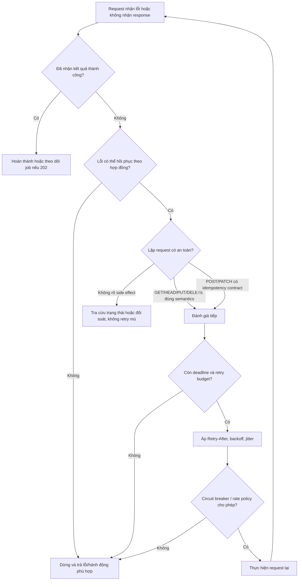
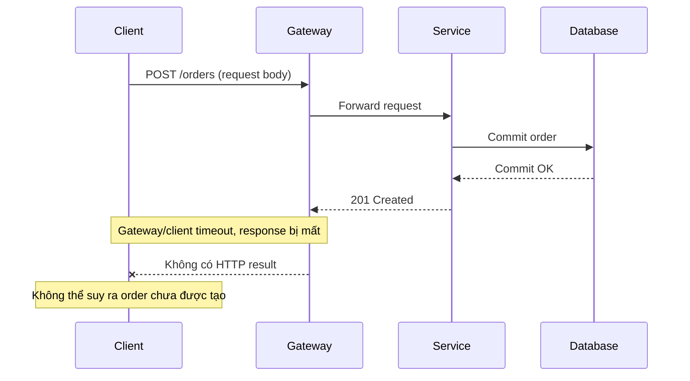
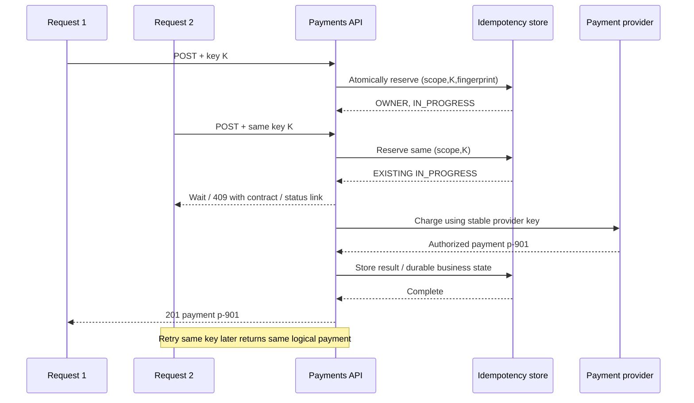
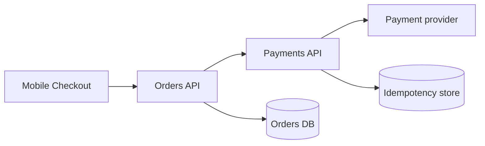

# Phân loại lỗi được thử lại theo phương thức và hợp đồng

## 1. Retry là một quyết định nghiệp vụ, không chỉ là thao tác HTTP client

Một REST API hoạt động qua mạng không đáng tin tuyệt đối. Client có thể gặp mất kết nối, timeout, gateway trả `502 Bad Gateway`, dịch vụ tạm quá tải trả `503 Service Unavailable` hoặc bộ giới hạn tốc độ trả `429 Too Many Requests`. Một hành động thường gặp là **thử gửi lại request (retry)**.

Tuy nhiên, gửi lại có thể gây hậu quả nghiêm trọng nếu request ban đầu **đã được server xử lý nhưng phản hồi bị mất**. Ví dụ:

```text
Client                      Payment API                  Payment provider
  | POST /payments               |                              |
  |----------------------------->| Thu tiền thành công           |
  |                              |----------------------------->|
  |                              |<-----------------------------|
  |   X  kết nối đứt trước 201   |                              |
  |                              |                              |
  | POST /payments lần nữa       |                              |
  |----------------------------->| Thu tiền lần hai nếu không chống trùng
```

Client chỉ biết **không nhận được response**. Nó **không biết** server chưa xử lý, đang xử lý hay đã xử lý xong. Nếu API không có hợp đồng lũy đẳng (idempotency), retry có thể nhân đôi thanh toán, đơn hàng, email hoặc sự kiện.

Vì vậy, câu hỏi không phải là **“gặp lỗi nào thì retry?”** mà là:

> **“Với phương thức này, hợp đồng này và trạng thái yêu cầu chưa chắc chắn, việc thực hiện lại có an toàn và còn giá trị không?”**

Bài thuộc chương **Lũy đẳng và thử lại** của module **INTEGRATION_API_REST**. Nội dung liên hệ thiết kế resource/URI, HTTP methods và status, xử lý lỗi, idempotency key, timeout, phân trang/cache khi đọc, xác thực/phân quyền, OpenAPI và kiểm thử bằng Java/Spring hoặc công nghệ tương đương.

### Mục tiêu học tập

Sau bài này, bạn có thể:

1. Phân biệt **safe**, **idempotent**, **retryable** và **exactly-once**.
2. Phân loại lỗi HTTP/network theo khả năng tạm thời và mức **an toàn khi thực hiện lại request**.
3. Chọn chính sách retry theo `GET/HEAD/PUT/DELETE/PATCH/POST` và hợp đồng ứng dụng.
4. Xử lý `Retry-After`, exponential backoff, jitter, deadline và giới hạn tổng retry.
5. Thiết kế `Idempotency-Key`, optimistic concurrency (`If-Match`), job polling và error contract.
6. Viết client Spring retry có kiểm soát và kiểm thử những tình huống response bị mất, request bị gửi lặp.
7. Nhận diện retry storm, retry nhiều tầng, lộ dữ liệu và nguy cơ thực hiện side effect hai lần.

## 2. Bốn khái niệm phải tách riêng

| Khái niệm | Ý nghĩa | Ví dụ | Không đồng nghĩa với |
|---|---|---|---|
| **Safe** | Client chỉ yêu cầu hành vi có tính đọc; không yêu cầu thay đổi trạng thái nghiệp vụ | `GET /orders/123` | “Server không bao giờ ghi log” |
| **Idempotent** | Lặp lại cùng request có **tác động mong muốn** tương đương một lần | `PUT` đặt cấu hình thành A | Response mọi lần giống từng byte |
| **Retryable** | Có thể thử lại trong **điều kiện cụ thể** mà vẫn đúng và hữu ích | `GET` sau `503`, có backoff | Cứ thấy 5xx là gửi lại |
| **Exactly-once** | Một hiệu ứng nghiệp vụ được thực hiện chính xác một lần theo phạm vi cam kết | Xử lý một lệnh thanh toán với cơ chế dedupe bền vững và đối soát | Có một header là đủ bảo đảm trên nhiều hệ thống |

HTTP quy định `GET`, `HEAD`, `OPTIONS` là **safe**; những phương thức safe cũng idempotent theo ngữ nghĩa. `PUT` và `DELETE` được định nghĩa là idempotent, dù không safe. `POST` và `PATCH` **không được bảo đảm idempotent mặc định**, nhưng ứng dụng có thể tạo hợp đồng khiến một số yêu cầu dùng chúng có thể thực hiện lại an toàn.

### Idempotency nói về tác động, không phải mã response

Ví dụ:

```http
DELETE /sessions/s-9 HTTP/1.1
```

- Lần đầu server trả `204 No Content` và session hết hiệu lực.
- Lần hai server có thể trả `404 Not Found` vì session không còn.
- **Tác động mong muốn vẫn như nhau**: session `s-9` không còn hoạt động.

Không yêu cầu lần hai luôn trả 204 để gọi `DELETE` là idempotent. Ngược lại, nếu mỗi lần `DELETE` trừ thêm một khoản phí hủy, implementation đã đi ngược ngữ nghĩa idempotent cần được sửa.

### Không nhầm retry với replay từ tầng mạng

Retry ở HTTP client, SDK hoặc service mesh có thể gửi **một request nghiệp vụ mới**. Replay do TLS early data, proxy hoặc queue có những điều kiện và rủi ro riêng. Dù nguồn lặp là gì, **server phải xử lý lặp an toàn theo hợp đồng đã công bố**, đặc biệt với thanh toán và tác vụ nền.

## 3. Mô hình phân loại: hai trục không thể thiếu

Một lỗi có thể là **tạm thời** nhưng request vẫn **không an toàn để gửi lại**. Ngược lại, một request an toàn gửi lại có thể gặp lỗi **vĩnh viễn**, retry chỉ lãng phí.

| | Lỗi có khả năng tạm thời | Lỗi có khả năng bền vững |
|---|---|---|
| **Request an toàn khi lặp** | Retry có giới hạn, backoff và deadline; ví dụ GET gặp 503 | Không retry mù; sửa nguyên nhân như GET URI sai 404 |
| **Request không an toàn khi lặp** | Kiểm tra kết quả hoặc dùng idempotency key trước khi retry; ví dụ POST thanh toán timeout | Không retry; yêu cầu người dùng/sửa dữ liệu, ví dụ POST thiếu quyền 403 |

**Quy tắc tổng quát:**

```text
retryAllowed =
    failureIsPotentiallyRecoverable
    AND repeatingRequestIsSafeByMethodOrContract
    AND budgetAndDeadlineAllow
    AND serverPolicyAndRetryAfterPermit
    AND requestBodyCanBeReplayedCorrectly
```

Đây là **mô hình quyết định**, không phải một biểu thức chuẩn HTTP. Các yếu tố có thể có thêm: circuit breaker, giới hạn tài nguyên, trạng thái giao dịch hiện tại, token authentication và chính sách người dùng.

### Hai câu hỏi trước khi viết @Retryable

1. **Nếu lần trước đã thành công nhưng response mất, lần lặp có gây side effect mới không?**
2. **Nếu tình trạng hiện tại không đổi, retry có khả năng tạo kết quả khác không?**

Nếu câu 1 chưa có đáp án an toàn, không bật automatic retry trên thao tác gây thay đổi trạng thái chỉ dựa vào exception hoặc status.

## 4. Cây quyết định retry từ client



Đặc biệt, nhánh `POST/PATCH` có hợp đồng idempotency **không đồng nghĩa retry mọi status**: lỗi `400`, `403`, `422`, phần lớn `409` là những lỗi cần sửa request hoặc trạng thái nghiệp vụ, không được phục hồi bằng gửi lại nguyên xi.

## 5. Ma trận theo HTTP method

| Method | Safe | Idempotent theo ngữ nghĩa HTTP | Retry sau lỗi tạm thời có thể thực hiện? | Điểm cần xác minh |
|---|---|---|---|---|
| **GET** | Có | Có | Thường có | GET không gây side effect nghiệp vụ; deadline/quota |
| **HEAD** | Có | Có | Thường có | Chỉ đọc metadata; không body response |
| **OPTIONS** | Có | Có | Có thể, nếu thật sự cần | Thường dùng discovery/CORS, ít nghiệp vụ |
| **PUT** | Không | Có | Có thể | Gửi **trạng thái đích**, không dùng PUT cho lệnh tăng số |
| **DELETE** | Không | Có | Có thể | Xóa lại không tạo phí hoặc hiệu ứng lặp ngoài ý muốn |
| **PATCH** | Không | Không bảo đảm | Chỉ khi patch/hợp đồng cho phép | `replace` giá trị khác `increment`/`add`; `If-Match` |
| **POST** | Không | Không bảo đảm | Chỉ khi có bằng chứng an toàn hoặc idempotency contract | Tạo resource/giao dịch; body, key, scope, dedupe và thời hạn |

Một số client HTTP chỉ tự retry các phương thức idempotent theo mặc định, nhưng **hành vi phụ thuộc thư viện, adapter, proxy và cấu hình**. Không suy luận hệ thống đã an toàn vì một SDK “thường không retry POST”; tầng khác vẫn có thể retry hoặc gửi lại message.

### GET/HEAD: an toàn nhưng không vô hạn

`GET /products/p-1` sau `503` có thể được retry với backoff. Nhưng 1.000 request retry từ hàng nghìn client có thể khiến server tiếp tục quá tải. **Tính safe là điều kiện về nghĩa, không phải giấy phép dùng tài nguyên không giới hạn.**

Nếu `GET /sendEmail?userId=42` thực sự gửi email do client yêu cầu, API đã dùng sai method. Không nên dùng workaround “tắt retry mọi GET” để che thiết kế sai; cần sửa endpoint thành một thao tác gây thay đổi phù hợp.

### PUT: đặt trạng thái, không tăng tích lũy

Hợp lý:

```http
PUT /users/42/preferences HTTP/1.1
Content-Type: application/json

{"emailNotifications":false,"locale":"vi"}
```

Gửi lặp representation này vẫn có trạng thái đích như nhau, nếu không có thao tác khác xen giữa. Không hợp lý:

```http
PUT /wallets/42/increase-balance HTTP/1.1
Content-Type: application/json

{"addMinor":100000}
```

Lần lặp có thể cộng thêm tiền. Đây là **lệnh có hiệu ứng tích lũy**, không phản ánh ngữ nghĩa đặt trạng thái của PUT; cần mô hình khác hoặc idempotency contract đúng.

### DELETE: response lần lặp có thể thay đổi

`DELETE /tokens/t-9` lần đầu trả `204`, lần sau trả `404` có thể vẫn đáp ứng idempotency. Client không được tự kết luận 404 ở lần hai là lỗi hệ thống nếu mục đích là token không còn tồn tại; nhưng cũng **không được đồng nhất mọi 404 với thành công** khi không biết request ban đầu đã diễn ra ra sao.

### PATCH: phân biệt lệnh thay thế với lệnh tương đối

Ví dụ có thể idempotent nếu ứng dụng hỗ trợ:

```http
PATCH /users/42/preferences HTTP/1.1
Content-Type: application/merge-patch+json

{"emailNotifications":false}
```

Ví dụ thường không idempotent:

```http
PATCH /counters/visits HTTP/1.1
Content-Type: application/json

{"operation":"increment","amount":1}
```

Cần xác định định dạng patch, semantics và trạng thái hiện hành. **PATCH không tự an toàn chỉ vì payload nhỏ**.

## 6. Đọc status code nhưng không quyết định chỉ từ status

### Bảng lỗi và hướng hành động điển hình

| Status/tình huống | Ý nghĩa chính | Retry tự động? | Hành động phù hợp |
|---|---|---|---|
| **200/201/204** | Request hoàn tất thành công | Không | Xử lý kết quả; không gửi lặp chỉ vì muốn chắc chắn |
| **202 Accepted** | Yêu cầu được nhận, xử lý có thể chưa hoàn tất | **Không lặp POST tạo job ngay** | Theo dõi resource job qua GET, theo contract |
| **304 Not Modified** | Conditional GET/HEAD không đổi | Không | Dùng representation cache hợp lệ |
| **400 Bad Request** | Request sai cấu trúc/cú pháp | Không | Sửa request |
| **401 Unauthorized** | Thiếu/sai credential | Không retry y nguyên | Xác thực/làm mới token một cách có giới hạn |
| **403 Forbidden** | Server từ chối thực hiện | Không | Xem lại quyền, không lặp vô ích |
| **404 Not Found** | Resource không được tìm thấy hoặc bị che giấu | Không mặc định | Kiểm tra URI/quyền; polling eventual consistency chỉ theo contract |
| **405 Method Not Allowed** | Method không hỗ trợ tại resource | Không | Sửa method/URI, đọc `Allow` |
| **408 Request Timeout** | Server không nhận được request hoàn chỉnh đúng hạn | Có điều kiện | Đánh giá request đã có tác dụng phụ chưa; mở kết nối mới khi phù hợp |
| **409 Conflict** | Xung đột trạng thái resource | Không mặc định | Đọc trạng thái mới/đối soát; retry chỉ khi contract nêu conflict tạm thời |
| **410 Gone** | Resource đã biến mất theo nghĩa của mã | Không | Không retry URI cũ y nguyên |
| **412 Precondition Failed** | `If-Match`/điều kiện HTTP không còn đúng | Không retry mù | GET ETag/trạng thái mới rồi quyết định |
| **415 Unsupported Media Type** | Body có media type không được hỗ trợ | Không | Sửa `Content-Type`/encoding |
| **422 Unprocessable Content** | Body hiểu được nhưng chỉ dẫn không xử lý được | Không | Sửa dữ liệu, xử lý validation |
| **425 Too Early** | Server tránh rủi ro replay khi request có thể là early data | Có điều kiện | Gửi lại **không dùng early data**, tuân chính sách bảo mật |
| **428 Precondition Required** | Thiếu điều kiện cập nhật bắt buộc | Không retry nguyên xi | Bổ sung `If-Match` theo contract |
| **429 Too Many Requests** | Vượt rate/quota tại thời điểm này | Có điều kiện | Dùng `Retry-After`, backoff, quota; không tăng tải |
| **500 Internal Server Error** | Lỗi server không có mã chuyên biệt hơn | **Không mặc định** | Phân biệt bug bền vững với transient, xét idempotency |
| **501 Not Implemented** | Server thiếu hỗ trợ chức năng cần thiết | Không | Sửa client/triển khai; không phải lỗi tạm thời thường gặp |
| **502 Bad Gateway** | Gateway/proxy nhận phản hồi upstream không hợp lệ | Có điều kiện | Retry request an toàn, coi side effect của POST là không rõ |
| **503 Service Unavailable** | Dịch vụ tạm không sẵn sàng | Có điều kiện | `Retry-After`/backoff, circuit breaker và deadline |
| **504 Gateway Timeout** | Gateway/proxy chờ upstream quá hạn | Có điều kiện | Request có thể **đã được upstream xử lý**; phải xét side effect |

**“Có điều kiện” không có nghĩa “retry tất cả request của mã đó”.** Một `503` của `GET` có thể thử lại; cùng `503` sau `POST /payments` mà không có idempotency key có thể cần tra cứu giao dịch trước.

### 408 khác client-side timeout

`408` là một **HTTP response** từ server, thường liên quan server chờ request không hoàn chỉnh. Ngược lại, **timeout ở HTTP client** là trường hợp client không nhận được kết quả đúng deadline và có thể **không có status nào**. Đừng ánh xạ mọi timeout thành “server chắc chưa làm gì”.

### 425 Too Early

`425` liên quan rủi ro replay của request trong cơ chế early data. Với client hỗ trợ early data, xử lý có thể là thử lại **qua kết nối không gửi early data**. Nó không phải lỗi “server bận, cứ đợi rồi gửi lại” chung. Phải tôn trọng bảo vệ chống replay và hợp đồng phương thức.

### 429 và 503

Cả hai có thể mang `Retry-After`, nhưng ý nghĩa khác nhau:

- `429` thường gắn với **client/quota/rate limiting**, không nên tạo hàng loạt retries đồng thời.
- `503` là trạng thái dịch vụ tạm không sẵn sàng; cần tránh retry storm khi origin đã quá tải.

`Retry-After` là hướng dẫn về **thời gian**, không bảo đảm lần thử sau thành công hay làm request không idempotent trở nên an toàn.

## 7. Phân loại lỗi mạng: thiếu response không chứng minh thất bại

Không phải mọi lỗi đến từ HTTP status. Client có thể gặp:

| Tình huống | Mức chắc chắn về tác dụng phụ | Quy tắc |
|---|---|---|
| DNS lookup thất bại trước khi kết nối | Thường chưa gửi request HTTP tới đích | Có thể thử lại khi hợp lý; không đổi URI tùy tiện |
| Không thể thiết lập TCP/TLS tới origin trước khi gửi request | Thường chưa gửi request tới origin đó | Có thể retry theo network policy |
| Connection reset **trước khi gửi byte request** và thư viện chứng minh được | Request này chưa đến server ở kết nối đó | Có thể retry, kể cả một số operation không idempotent, khi bằng chứng thực sự chắc chắn |
| Connection reset **sau khi đã gửi request hoặc không biết đã gửi chưa** | **Không xác định** server đã xử lý đến đâu | Chỉ retry nếu idempotent hoặc có hợp đồng chống lặp |
| Client hết thời gian chờ sau khi gửi body | **Không xác định** server đã commit chưa | Không tự kết luận “thất bại” |
| Server trả `504` từ gateway | Upstream có thể đã xử lý nhưng gateway không nhận response | Xét hợp đồng trước khi retry |
| Response body bị cắt sau status/header | Có thể server đã hoàn tất side effect | Không tự gửi lại POST không idempotent |
| Client hủy request | Server **có thể vẫn tiếp tục** xử lý | Cancellation ở client không tương đương rollback server |

Một SDK đôi khi có thể cho biết lỗi xảy ra **trước khi ghi request**. Chỉ được sử dụng tín hiệu đó khi bảo đảm từ thư viện/transport đủ mạnh; nhiều exception tổng quát như `IOException` hoặc `TimeoutException` **không cho phép kết luận** request đã được server nhận hay chưa.

### Timeline quan trọng



Chính tình huống này làm idempotency key, operation status resource và đối soát trở thành yêu cầu quan trọng.

## 8. Retry-After: thời điểm được gợi ý thử lại

Response điển hình:

```http
HTTP/1.1 429 Too Many Requests
Retry-After: 30
Content-Type: application/problem+json

{
  "type": "https://api.example.test/problems/rate-limited",
  "title": "Rate limit exceeded",
  "status": 429,
  "code": "RATE_LIMITED"
}
```

`Retry-After` có thể chứa:

- **delay-seconds**: số giây không âm, như `Retry-After: 30`.
- **HTTP-date**: thời điểm tuyệt đối theo cú pháp ngày HTTP.

Ví dụ:

```http
HTTP/1.1 503 Service Unavailable
Retry-After: Wed, 18 Nov 2026 11:15:00 GMT
```

### Client nên xử lý

1. Parse đúng cả hai dạng và dùng đồng hồ/`Date` header thận trọng với clock skew.
2. Nếu header vắng hoặc sai, dùng backoff policy mặc định theo contract.
3. Không gửi trước thời điểm được yêu cầu khi chính sách đã xác định phải tuân theo.
4. Vẫn áp **deadline, retry budget, giới hạn tối đa chờ và yêu cầu người dùng**; nếu phải đợi quá lâu, có thể dừng và báo lại thay vì giữ request vô hạn.
5. Nếu nhiều client cùng được hẹn mốc giống nhau, có thể cộng jitter phù hợp để tránh dồn tải.
6. Không dùng `Retry-After` làm bằng chứng rằng `POST` có thể gửi lặp an toàn.

`Retry-After` có thể xuất hiện với một số redirect như `3xx` hoặc các tình huống khác. Không nên xây parser chỉ hỗ trợ chính xác 429 mà bỏ qua ngữ nghĩa tương ứng khi API có công bố sử dụng.

## 9. Exponential backoff và jitter

Ngay cả khi retry đúng, gọi lại ngay lập tức trong vòng lặp có thể khiến sự cố nặng hơn. Một chính sách phổ biến là **exponential backoff** với **jitter**.

Ví dụ:

\[
\operatorname{delay}_n
=
\min(\operatorname{maxDelay},\operatorname{baseDelay}\cdot 2^{n})
\cdot U(0.5,1.0)
\]

Trong đó:

- `n=0` ứng với lần retry thứ nhất, không phải request đầu.
- `baseDelay` là khoảng chờ cơ sở, ví dụ 200 ms.
- `maxDelay` là trần cho khoảng chờ.
- `U(0.5,1.0)` minh họa chọn ngẫu nhiên trong khoảng để phân tán thời điểm retry.

Nhiều biến thể jitter hợp lệ, như full jitter từ 0 tới trần, equal jitter hoặc decorrelated jitter. Chọn theo SDK/workload; không có một công thức bắt buộc cho mọi API.

### Một ví dụ giới hạn dễ hiểu

Chính sách cho GET tới service catalog:

- Gửi request lần đầu.
- Nếu gặp `429/502/503/504` đủ điều kiện, thử lại tối đa **2 lần**.
- Backoff từ 200 ms, tăng theo retry và có jitter.
- Tổng deadline: **3 giây** cho cả lần gọi.
- Tôn trọng `Retry-After` trong giới hạn deadline.
- Chỉ retry request có body/headers có thể phát lại an toàn; GET đọc không có side effect nghiệp vụ.

**“2 retries” khác “2 attempts”**: 2 retries nghĩa là tối đa 3 attempts tính cả lần gọi đầu.

### Vì sao jitter cần thiết?

Nếu hàng nghìn client gặp 503 cùng lúc và đều retry sau đúng 1 giây, chúng sẽ tạo một làn sóng đồng bộ. Jitter rải thời điểm retry, giúp giảm đột biến. Nhưng nếu lượng request quá lớn hoặc server bị lỗi bền vững, jitter **không đủ**: còn cần retry budget, rate limiting, circuit breaker, load shedding và giám sát.

## 10. Deadline, timeout và retry budget

Một request có **timeout mỗi attempt** nhưng không giới hạn tổng thời gian có thể bị kéo dài hàng chục giây do nhiều attempt và backoff.

### Phân biệt ba giới hạn

| Giới hạn | Trả lời câu hỏi | Ví dụ minh họa |
|---|---|---|
| **Connect timeout** | Chờ kết nối/TLS bao lâu? | 300 ms |
| **Response/read timeout** | Một attempt có thể chờ response bao lâu? | 1 giây |
| **Overall deadline** | Toàn bộ operation, gồm retry/backoff, có bao nhiêu thời gian? | 3 giây |

Các con số chỉ minh họa; lựa chọn thực phải dựa trên SLO, network path, percentile latency và rủi ro retry.

Retry policy còn nên có:

- **Maximum attempts**.
- **Maximum total elapsed time**.
- **Retry budget** theo tỷ lệ requests hoặc token bucket, tránh retry chiếm hết tài nguyên.
- **Circuit breaker** dừng gửi khi upstream gặp nhiều lỗi trong thời gian ngắn.
- **Concurrency limit** và backpressure để tránh xếp hàng vô hạn.
- **Phân loại per-operation**: GET catalog khác POST thanh toán.

### Retry nhiều tầng gây nhân tải

Nếu client ngoài retry 3 attempts, gateway retry 3 attempts, service A retry tới B 3 attempts, một yêu cầu logical có thể tạo tối đa:

\[
3 \times 3 \times 3 = 27
\]

attempt tới một tầng sâu trong trường hợp xấu. Đây là ví dụ khuếch đại lý thuyết; thực tế còn phụ thuộc timeout và điều kiện. Vì vậy:

1. Chọn **tầng sở hữu retry** rõ ràng.
2. Tránh gateway + SDK + service cùng retry không biết nhau.
3. Truyền và tôn trọng deadline qua các service khi có thiết kế hỗ trợ.
4. Giữ thống kê attempts/retries tách khỏi logical request và business operation.

### Hedged request không phải retry vô hại

Gửi một bản sao request song song nếu bản đầu chậm (hedging) có thể giảm tail latency cho một số **GET an toàn**. Nhưng với `POST /payments`, hedging có thể thực hiện nghiệp vụ hai lần nếu không có cơ chế idempotency nghiêm ngặt. Không bật hedging như cấu hình mặc định cho tất cả endpoints.

## 11. POST và Idempotency-Key: từ thao tác nguy hiểm đến retry có hợp đồng

Một API thanh toán thường dùng `POST` vì tạo hoặc xử lý yêu cầu nghiệp vụ. Để cho phép client retry khi mạng bất ổn, server có thể triển khai **idempotency key**.

```http
POST /payments HTTP/1.1
Content-Type: application/json
Authorization: Bearer <access-token>
Idempotency-Key: pay-checkout-123-01

{"orderId":"123","amountMinor":850000,"currency":"VND"}
```

Server công bố hợp đồng: **cùng key trong cùng phạm vi nghiệp vụ, với cùng request hợp lệ, không tạo một payment mới lần thứ hai**.

### Những yếu tố một hợp đồng idempotency phải chốt

| Yếu tố | Câu hỏi cần trả lời |
|---|---|
| **Phạm vi key** | Theo tenant, principal, endpoint/operation, payment/order nào? |
| **Độ dài/định dạng** | Key do client sinh có đủ entropy, giới hạn kích thước và ký tự không? |
| **Request fingerprint** | Làm sao phát hiện cùng key nhưng payload khác? |
| **Kết quả lặp lại** | Trả response cũ, representation hiện tại hay status khác? |
| **In-progress** | Hai request cùng key đến đồng thời sẽ chờ, trả conflict hay kết quả tạm? |
| **Retention/expiry** | Key lưu bao lâu và điều gì xảy ra khi hết hạn? |
| **Crash/recovery** | Nếu server chết sau commit nhưng trước khi lưu response thì sao? |
| **Provider ngoài** | Idempotency key có được truyền theo phạm vi và quy tắc của payment provider không? |
| **Quyền** | Caller khác không được dùng key để truy xuất hoặc chiếm kết quả của user khác |
| **Observability** | Theo dõi duplicate/mismatch/in-progress mà không ghi secret/payload nhạy cảm |

`Idempotency-Key` là cơ chế được nhiều API sử dụng nhưng **không được giả định mọi server, gateway hay endpoint hiểu cùng một hợp đồng**. Phải kiểm tra tài liệu API cụ thể về header, retention, mã lỗi, in-progress và cách trả response.

### Ví dụ ba tình huống

**Lần đầu:**

```http
HTTP/1.1 201 Created
Location: /payments/p-901
Content-Type: application/json

{"id":"p-901","status":"AUTHORIZED"}
```

**Gửi lại cùng key, cùng payload:** server trả kết quả theo hợp đồng, ví dụ giữ `201` và `Location` cũ, **không tạo payment mới**.

**Gửi lại cùng key, payload khác:** server từ chối, ví dụ `409 Conflict` cùng mã `IDEMPOTENCY_KEY_REUSED`, thay vì coi request mới là một thanh toán khác. Không có mã HTTP áp dụng duy nhất cho mọi API; document rõ.

### Key không tự tạo an toàn

Nếu server chỉ nhận header rồi tạo payment trước khi kiểm tra trùng, sẽ vẫn có thể thu tiền hai lần. Cần lưu trữ/key reservation có tính **nguyên tử và bền vững**, đồng thời thiết kế xử lý duplicate ở provider/outbox/reconciliation.

## 12. Server-side idempotency phải xử lý concurrent requests

Hai request cùng key có thể đến **gần như đồng thời** vì người dùng double-click, SDK retry hoặc gateway gửi lặp.



### Một bảng khóa tối giản

```sql
CREATE TABLE idempotency_records (
    tenant_id        VARCHAR(80) NOT NULL,
    operation        VARCHAR(80) NOT NULL,
    request_key      VARCHAR(160) NOT NULL,
    request_hash     VARCHAR(128) NOT NULL,
    state            VARCHAR(24) NOT NULL,
    result_http_code INTEGER,
    result_body      TEXT,
    created_at       TIMESTAMP NOT NULL,
    expires_at       TIMESTAMP NOT NULL,
    PRIMARY KEY (tenant_id, operation, request_key)
);
```

Đây là **schema minh họa**, không phải thiết kế đầy đủ để áp dụng nguyên xi. Dữ liệu kết quả có thể chứa PII, token hoặc thông tin thanh toán, nên cần policy mã hóa, thời hạn lưu và quyền truy cập. Việc giữ nguyên response trong bảng cũng không bắt buộc: có thể lưu **tham chiếu đến business operation** rồi dựng response phù hợp.

### Thuật toán xử lý cơ bản

```text
process(request, identity, key):
    authenticateAndAuthorize(identity)
    scope = (trustedTenant(identity), operationName)
    fingerprint = canonicalFingerprint(relevantRequestFields)

    row = atomicReserveIfAbsent(scope, key, fingerprint)

    if row already exists:
        if row.request_hash != fingerprint:
            return 409 IDEMPOTENCY_KEY_REUSED
        if row.state == COMPLETED:
            return documentedResultForSameLogicalOperation(row)
        if row.state == IN_PROGRESS:
            return documentedInProgressBehavior(row)

    result = executeBusinessOperationWithDurableState(key)
    atomicallyPublishOrPersistFinalState(result)
    return result
```

Điểm khó không nằm ở `if (map.containsKey(key))` mà ở **atomicity, crash recovery và ranh giới side effect ngoài DB**:

- Không dùng map trong một JVM nếu hệ thống nhiều instance hoặc có restart.
- Cần unique constraint/transaction/lock hoặc cơ chế dedupe phân tán đáng tin.
- Nếu provider đã thu tiền nhưng API crash trước khi lưu kết quả, retry phải **đối soát** hoặc gọi provider bằng idempotency key đã được provider hỗ trợ.
- Có thể cần **transactional outbox**, workflow state machine và reconciler.
- Với cùng key nhưng fingerprint khác, từ chối thay vì âm thầm tái dùng.
- Khi key đã hết hạn, contract phải giải thích giới hạn chống trùng; không thể hứa dedupe vĩnh viễn nếu đã xóa record.

**Exactly-once ở mức business effect** là một cam kết cần định nghĩa và chứng minh trong phạm vi tích hợp; HTTP đơn thuần không cung cấp phép màu exactly-once xuyên nhiều service.

## 13. PUT, DELETE và If-Match: retry khác xử lý xung đột

Một PUT đặt trạng thái resource có ngữ nghĩa idempotent, nhưng nếu hai client cùng sửa có thể xảy ra **lost update**.

```http
GET /orders/123 HTTP/1.1
```

```http
HTTP/1.1 200 OK
ETag: "order-v7"
Content-Type: application/json

{"id":"123","shippingAddress":"Địa chỉ cũ"}
```

Client gửi:

```http
PATCH /orders/123 HTTP/1.1
Content-Type: application/merge-patch+json
If-Match: "order-v7"

{"shippingAddress":"Địa chỉ mới"}
```

Nếu server cập nhật thành v8 nhưng response bị mất, client gửi **lại request nguyên xi với If-Match v7** có thể nhận `412 Precondition Failed`. Không nên suy luận “bản cập nhật lần đầu thất bại”, vì chính request đầu có thể đã thành công và làm ETag đổi.

### Cách xử lý `412` đúng

1. `GET` resource hiện hành và ETag mới.
2. So sánh trạng thái với **ý định mong muốn** của client.
3. Nếu trạng thái đã đúng, có thể xem logical operation đã đạt mục tiêu theo hợp đồng.
4. Nếu trạng thái khác do client khác cập nhật, hiển thị conflict hoặc merge theo quy tắc nghiệp vụ.
5. Chỉ gửi request mới với `If-Match` mới khi được cho phép; **đừng thay ETag rồi ghi đè mù quáng**.

Cơ chế `If-Match` yêu cầu validator mạnh phù hợp và **kiểm tra điều kiện cùng cập nhật một cách nguyên tử**. Chỉ so sánh ETag ở controller rồi update không có version condition không ngăn được race.

### Phân biệt 409, 412 và 428

- **409 Conflict**: request không phù hợp trạng thái nghiệp vụ hiện tại, ví dụ hủy đơn đã giao.
- **412 Precondition Failed**: điều kiện request trong header như `If-Match` sai.
- **428 Precondition Required**: server yêu cầu client gửi conditional request nhưng client chưa gửi.

Đây thường là tín hiệu **cần đọc lại/xử lý xung đột**, không phải “lỗi tạm thời, cứ retry cùng body” như `503`.

## 14. 202 Accepted: polling thay vì tạo operation lặp

Một request xuất báo cáo cần vài phút:

```http
POST /report-jobs HTTP/1.1
Content-Type: application/json
Idempotency-Key: export-2026-10-tenantA

{"month":"2026-10","format":"csv"}
```

```http
HTTP/1.1 202 Accepted
Location: /report-jobs/j-901
Content-Type: application/json
Retry-After: 5

{"id":"j-901","status":"QUEUED"}
```

Client nên **theo dõi**:

```http
GET /report-jobs/j-901 HTTP/1.1
```

```http
HTTP/1.1 200 OK
Content-Type: application/json

{"id":"j-901","status":"RUNNING"}
```

Không gửi thêm `POST /report-jobs` liên tục để “kiểm tra đã xong chưa”. Nó có thể tạo nhiều job trùng. Nếu response POST đầu bị mất, cần idempotency key, query theo operation identity hoặc endpoint tra cứu kết quả có contract rõ để phục hồi.

### Polling cũng cần backoff

GET trạng thái job là safe nhưng không nên polling 20 lần/giây khi xử lý mất vài phút. Dùng `Retry-After`/polling interval nếu server công bố, backoff và deadline. Khi `status=FAILED` trong resource job, `GET` vẫn có thể trả **200** vì việc đọc trạng thái thành công; client phải xử lý **business state** tách khỏi HTTP status.

## 15. Các trường hợp 404/409 có thể retry nhưng không phải mặc định

Trong hệ thống eventual consistency, một job mới tạo có thể chưa xuất hiện ngay tại read replica. API có thể quy định:

```text
POST /jobs -> 202 Accepted + Location: /jobs/j-901
GET /jobs/j-901 -> tạm 404 vài trăm ms trong thời gian replicate
```

Nếu **hợp đồng công bố rõ** rằng 404 tạm thời có thể xuất hiện tại URL job mới, client có thể polling với giới hạn. Nhưng đó là **ngoại lệ theo resource và workflow**, không phải quy tắc retry mọi `404`.

Tương tự, một số `409` của hệ thống dùng lock tạm hoặc tranh chấp có thể được retry **khi server công bố rõ cách và thời gian**; `409` do “đơn đã giao không thể hủy” thì retry cùng request không tạo kết quả khác. Mã ứng dụng như `TEMPORARY_LOCK_CONFLICT` có thể giúp phân biệt với `ORDER_ALREADY_DELIVERED`, nhưng không thay HTTP status và không cho phép retry side effect thiếu idempotency.

### Quản lý lỗi theo hợp đồng, không theo chuỗi message

Sai:

```javascript
if (error.message.includes("try again")) {
  retry();
}
```

Đúng về thiết kế:

```text
if httpStatus in contract.retryableStatuses
   and errorCode in contract.retryableBusinessCodesIfRequired
   and operation is repeatSafe
   and retryBudgetAllows:
       scheduleRetry()
else:
       return actionableResult()
```

Message có thể được sửa nội dung hoặc bản địa hóa; client nên dùng status, stable business code và điều kiện chính thức.

## 16. Error response và Problem Details: client biết vì sao dừng hoặc chờ

RFC 9457 **Problem Details** cung cấp cấu trúc lỗi HTTP thông dụng với `application/problem+json`.

Ví dụ `429`:

```http
HTTP/1.1 429 Too Many Requests
Retry-After: 15
Content-Type: application/problem+json

{
  "type": "https://api.example.test/problems/rate-limited",
  "title": "Rate limit exceeded",
  "status": 429,
  "detail": "Đã vượt giới hạn yêu cầu trong cửa sổ hiện tại.",
  "code": "RATE_LIMITED",
  "traceId": "req-92ac"
}
```

`type`/`title`/`status`/`detail` là các thành phần Problem Details; `code` và `traceId` là **extension của API**, không phải member bắt buộc của RFC.

### Những điểm phải nhất quán

- Actual HTTP status là `429`, không trả `200` với body `{"status":429}`.
- `Retry-After` là header có ý nghĩa giao thức; nếu có thêm extension time, không cho hai thông tin mâu thuẫn.
- `code` ổn định như `RATE_LIMITED` hoặc `DEPENDENCY_UNAVAILABLE` giúp SDK phân biệt trường hợp.
- `detail` dành cho con người, không dùng để viết logic retry.
- Không đưa token, SQL, stack trace, thông tin tenant khác hoặc request payload nhạy cảm vào error response.
- `retryable: true` (nếu API có extension này) chỉ là gợi ý; **không thể vô hiệu hóa quy tắc an toàn về method/side effect**.

### Status và hành động phải được công bố qua OpenAPI

Một API có thể hỗ trợ những nhóm response khác nhau cho từng endpoint. Ví dụ `POST /payments` có thể trả `201`, `202`, `409`, `422`, `429` và `503`. Nhưng **chỉ liệt kê status chưa đủ**: tài liệu cần nói rõ 503 có cho retry POST không, idempotency key bắt buộc hay tùy chọn, thời hạn lưu và cách tra cứu payment khi mất response.

## 17. Redirect cũng có thể lặp request: đặc biệt cẩn trọng với POST

Các status `301/302/303/307/308` liên quan chuyển hướng. Chúng **không phải nhóm lỗi tạm thời giống 503**, và client có thể tự thực hiện follow redirect.

- `303 See Other` thường hướng client thực hiện `GET` đến URI khác để xem kết quả sau POST.
- `307 Temporary Redirect` và `308 Permanent Redirect` yêu cầu **giữ nguyên method** khi follow, dẫn đến việc phát lại body nếu client hỗ trợ.
- `301` và `302` có lịch sử hành vi đổi POST sang GET ở một số client; không nên dựa vào hành vi không rõ mà bỏ qua tài liệu.

**An toàn:** không tự động follow redirect đến host không tin cậy cùng `Authorization`, cookie hoặc body nhạy cảm. Đặc biệt `307/308` cho POST thanh toán cần chính sách rõ về địa chỉ đích, tính lũy đẳng và replay. Việc server chuyển URI không cấp thêm quyền hay thay đổi hợp đồng side effect.

## 18. Retry policy phải cụ thể cho từng operation

Một policy “`retryOn=5xx` cho toàn bộ API” là thiết kế quá rộng. Nên có ma trận operation, method, idempotency và lỗi.

### Ma trận tham khảo

| Operation | Method | Chứng cứ an toàn khi lặp | Status/network được cân nhắc retry | Không retry y nguyên khi |
|---|---|---|---|---|
| Lấy catalog công khai | GET | Safe/read-only | 429, 502, 503, 504, connection transient | 400, 403, 404 (trừ contract đặc biệt) |
| Lấy đơn theo ID | GET | Safe nhưng có auth | 429, 502, 503, 504; timeout có giới hạn | 401 chưa refresh, 403, 404 thông thường |
| Đặt toàn bộ cấu hình | PUT | Idempotent, representation đầy đủ | 502, 503, 504 với deadline; 429 theo policy | 409 business conflict, 412 stale ETag |
| Xóa session | DELETE | Idempotent nếu implement đúng | Lỗi transient/network phù hợp | 403; không xem mọi 404 là thành công |
| Đặt cờ thông báo | PATCH | Contract cụ thể xác định là idempotent | Chỉ lỗi transient với precondition phù hợp | 412, payload lỗi, phép patch tương đối |
| Tăng bộ đếm | PATCH/POST | **Không idempotent mặc định** | Không automatic retry nếu thiếu key/dedupe | Timeout không biết kết quả |
| Tạo đơn hàng | POST | Idempotency key + store bền vững | 429/503/504 và mất response **theo hợp đồng** | Key/payload mismatch, conflict không hồi phục |
| Tạo thanh toán | POST | Dedupe + đối soát provider + operation identity | Chỉ theo payment contract; thường ưu tiên lookup | Không biết giao dịch đã thu tiền và không có key |
| Poll trạng thái job | GET | Safe | 429/503; 404 tạm chỉ nếu contract cho phép | Job không tồn tại vĩnh viễn/không có quyền |

Các status là **ứng viên**, không phải danh sách retry mặc định. Có những request `GET` không nên retry ngay khi dữ liệu quá đắt hoặc deadline còn rất ít. Các thao tác `PUT/DELETE` vẫn phải tuân rate limit, điều kiện đồng thời và business constraints.

### Chọn policy theo resource và SLA

API tìm kiếm có thể chấp nhận 1 retry để cải thiện trải nghiệm; API kiểm tra tồn kho real-time có thể prefer fail fast; API payment có thể ưu tiên trả “đang xác minh” thay vì tự động lặp. Chính sách nên được xác định bởi **người sở hữu nghiệp vụ/API**, không chỉ thư viện HTTP.

## 19. Spring WebClient: retry GET đúng phạm vi

Dưới đây là ví dụ với Spring WebFlux và Reactor cho **GET catalog không gây side effect**. Nó chủ động chỉ coi một số HTTP status là lỗi transient, giới hạn lần thử và tổng deadline.

```java
import java.time.Duration;
import org.springframework.http.HttpStatusCode;
import org.springframework.stereotype.Service;
import org.springframework.web.reactive.function.client.WebClient;
import reactor.core.publisher.Mono;
import reactor.util.retry.Retry;

final class TransientCatalogException extends RuntimeException {
    final int status;

    TransientCatalogException(int status, Throwable cause) {
        super("Temporary catalog HTTP failure: " + status, cause);
        this.status = status;
    }
}

record CatalogView(String version) {}

@Service
public class CatalogClient {
    private final WebClient client;

    public CatalogClient(WebClient.Builder builder) {
        this.client = builder.baseUrl("https://catalog.example.test").build();
    }

    public Mono<CatalogView> fetchPublicCatalog() {
        return client.get()
            .uri("/public/catalog")
            .retrieve()
            .onStatus(
                code -> code.value() == 429
                     || code.value() == 502
                     || code.value() == 503
                     || code.value() == 504,
                response -> response.createException()
                    .map(ex -> new TransientCatalogException(
                        ex.getStatusCode().value(), ex))
            )
            .bodyToMono(CatalogView.class)
            .retryWhen(
                Retry.backoff(2, Duration.ofMillis(200))
                    .maxBackoff(Duration.ofSeconds(2))
                    .jitter(0.5)
                    .filter(ex -> ex instanceof TransientCatalogException)
            )
            .timeout(Duration.ofSeconds(3));
    }
}
```

### Đọc đúng giới hạn của ví dụ

- `Retry.backoff(2, ...)` cho **tối đa hai lần retry** bên cạnh attempt đầu. `timeout(3s)` đặt giới hạn tổng cho pipeline này, gồm retry/backoff.
- Chỉ các status đã được chuyển thành `TransientCatalogException` mới được retry. **Lỗi network chưa được ánh xạ** theo ví dụ này nên không mặc định được retry; nếu thêm, phải phân biệt loại lỗi và idempotency.
- `Retry-After` **chưa được parse/tuân theo** trong đoạn đơn giản này. Production cần chính sách chờ hiểu `Retry-After`, deadline và rate limit của upstream; nếu header yêu cầu chờ dài hơn deadline, nên dừng/cấp lại kết quả phù hợp.
- Circuit breaker, token bucket/retry budget, telemetry, cancellation và quyền truy cập chưa được trình bày đầy đủ.
- `CatalogView` chỉ có trường `version` minh họa; production cần DTO đúng schema và media type.
- Không sao chép `.retryWhen(...)` sang `POST /payments` khi chưa có hợp đồng chống xử lý lặp.
- Phụ thuộc Spring WebFlux/Reactor và phiên bản SDK cần tương thích. Với `RestClient`/`RestTemplate` hoặc HTTP client khác, áp dụng **cùng nguyên tắc phân loại**, không phụ thuộc duy nhất vào API Reactor.

### Vì sao filter quan trọng?

Sai:

```java
client.post()
    .uri("/payments")
    .bodyValue(request)
    .retrieve()
    .bodyToMono(PaymentView.class)
    .retryWhen(Retry.backoff(5, Duration.ofMillis(100)));
```

Đoạn này có thể retry cả lỗi validation, không đủ quyền hoặc timeout sau khi đã thu tiền, tùy exception. Đây là **phản mẫu**, không phải mẫu code production.

## 20. Tầng server Spring: hợp đồng lỗi và Idempotency-Key

Server phải trả status/headers rõ ràng và giữ ngữ nghĩa đồng nhất. Ví dụ controller minh họa dùng một service có cơ chế idempotency bền vững:

```java
import java.net.URI;
import org.springframework.http.ResponseEntity;
import org.springframework.web.bind.annotation.*;

@RestController
@RequestMapping("/payments")
class PaymentController {

    private final PaymentService service;

    PaymentController(PaymentService service) {
        this.service = service;
    }

    @PostMapping
    ResponseEntity<PaymentView> create(
            @RequestHeader("Idempotency-Key") String key,
            @RequestBody CreatePaymentRequest body,
            AuthenticatedPrincipal principal) {

        PaymentResult result = service.createIdempotently(
            principal, key, body);

        return ResponseEntity
            .status(result.responseStatus())
            .location(URI.create("/payments/" + result.payment().id()))
            .body(result.payment());
    }
}
```

Đây là mã **khung hợp đồng**, không đủ để chạy độc lập. `PaymentService`, `PaymentResult`, `PaymentView`, `CreatePaymentRequest` và `AuthenticatedPrincipal` do ứng dụng định nghĩa; cần xác thực/phân quyền, validate key/body, security, storage/transaction và mapping exception.

Những tình huống cần mapping rõ:

- Missing/malformed `Idempotency-Key` → status lỗi request theo hợp đồng, thường `400`.
- Cùng key và cùng payload đang xử lý → status/response được tài liệu hóa, có thể `409` tạm hoặc resource trạng thái theo dõi.
- Cùng key nhưng payload khác → từ chối, ví dụ `409` với mã `IDEMPOTENCY_KEY_REUSED`.
- Tạo payment thành công → `201 Created` và `Location` đúng.
- Provider tạm không sẵn sàng → `503` có thể phù hợp tùy kiến trúc, không làm mất tham chiếu operation đang xử lý.
- Nếu response bị mất, request lặp với cùng key → trả kết quả cũ/trạng thái cùng logical payment theo hợp đồng, không tạo payment mới.

**Không để controller tự gọi provider lần nữa trước khi kiểm tra/dedupe ở service.** Tránh race và đảm bảo phục hồi sau crash.

## 21. Retry-After và backoff khi dùng Spring: cần chính sách chung

Một Spring client production có thể tách hai trách nhiệm:

1. **HTTP adapter**: ánh xạ status, headers và transport exception sang loại kết quả/lỗi có cấu trúc.
2. **Retry policy**: quyết định có retry không bằng operation metadata, idempotency guarantee, `Retry-After`, deadline và budget.

Pseudo-code:

```text
attempt = 0
deadline = now + overallTimeout
while true:
    if deadlinePassed() or circuitOpen() or not budgetAvailable():
        return failureOrUnknownOutcome()
    result = sendRequestWithRemainingDeadline()

    if result.success:
        return result

    decision = policy.classify(
        method, operation, idempotencyContract,
        result.httpStatus, result.businessCode, result.transportPhase)

    if not decision.retryable or attempt >= maxRetries:
        return result

    wait = computeBackoffWithJitter(attempt)
    wait = combineWithValidRetryAfter(wait, result.retryAfter)

    if now + wait >= deadline:
        return resultOrUnknownOutcome()
    sleep(wait)
    attempt += 1
```

Đây là **mã giả thuật toán**, không phải triển khai blocking thread dành cho mọi môi trường; trong reactive hoặc async runtime cần timer/scheduler tương ứng, không chặn event loop bằng `Thread.sleep`.

Nếu server báo `Retry-After: 30` nhưng client có deadline 3 giây, **không đợi vô hạn**. Trả kết quả lỗi có kiểm soát, cung cấp cách theo dõi nếu cần, hoặc cho phép người dùng chủ động thử lại sau.

## 22. OpenAPI nên mô tả retry contract ra sao?

OpenAPI chuẩn mô tả HTTP operation, status và header. Chi tiết “có thể retry với điều kiện gì” thường cần **description, extension do API định nghĩa, profile hoặc tài liệu bổ sung**, vì không có một khóa chuẩn phổ quát của OpenAPI để tự động suy toàn bộ chính sách retry.

Ví dụ trích đoạn OpenAPI 3.1:

```yaml
openapi: 3.1.0
info:
  title: Payments API
  version: 1.0.0
paths:
  /payments:
    post:
      summary: Tạo thanh toán
      description: >
        Idempotency-Key bắt buộc. Gửi lại cùng key và cùng request
        trong retention window không tạo thanh toán mới.
        Khi mất response, dùng cùng key hoặc tra cứu trạng thái payment.
      parameters:
        - name: Idempotency-Key
          in: header
          required: true
          schema:
            type: string
            minLength: 8
            maxLength: 160
          description: Khóa chống xử lý trùng theo tenant và operation.
      requestBody:
        required: true
        content:
          application/json:
            schema:
              $ref: "#/components/schemas/CreatePaymentRequest"
      responses:
        "201":
          description: Payment đã tạo hoặc kết quả lặp được xử lý theo contract
          headers:
            Location:
              schema: { type: string }
              description: URI của payment
        "409":
          description: Key/payload xung đột hoặc trạng thái đang xử lý
          content:
            application/problem+json:
              schema:
                $ref: "#/components/schemas/ApiProblem"
        "429":
          description: Vượt giới hạn
          headers:
            Retry-After:
              schema: { type: string }
              description: HTTP delay-seconds hoặc HTTP-date
        "503":
          description: Dịch vụ tạm không sẵn sàng
          headers:
            Retry-After:
              schema: { type: string }
              description: Thời gian gợi ý thử lại nếu được cung cấp
```

Trích đoạn này **chưa đầy đủ** các schema `components`, `securitySchemes`, `401/403/422` và response khác; cần bổ sung theo hợp đồng thật.

### Những điều tài liệu phải nói rõ

- Operation nào **safe/idempotent** và yêu cầu idempotency key.
- Status/code nào retryable, trong **điều kiện nào**.
- Request body/key có được gửi lại nguyên xi không.
- Thời hạn giữ key, scope và cách xử lý in-progress.
- Client nên **poll resource** hay lặp POST khi response mất.
- Quy tắc `Retry-After`, deadline và giới hạn tốc độ.
- Những mã lỗi không nên retry như validation/permission/conflict.
- Đường tra cứu/đối soát khi kết quả không xác định.

Chỉ viết “Please retry later” trong `detail` không tạo thành một hợp đồng retry đủ rõ.

## 23. Quan sát retries mà không làm sai SLI

Một retry thành công sau 503 có thể che cảm nhận thất bại với người dùng nhưng vẫn tạo tải và chi phí hệ thống. Nên theo dõi **logical operation** và **individual attempts** riêng.

| Metric/trace | Giúp trả lời gì? |
|---|---|
| `http_client_attempts_total{route,status}` | Gửi bao nhiêu HTTP attempts thực tế? |
| `retry_attempts_total{operation,reason}` | Retry do status, timeout hay network? |
| `retry_exhausted_total{operation}` | Bao nhiêu lần đã hết budget/deadline? |
| `retry_delay_seconds` | Đang chờ bao lâu giữa attempts? |
| `retry_after_observed_total` | Server thường yêu cầu chờ bao lâu/có đúng không? |
| `idempotency_deduplicated_total` | Bao nhiêu duplicate được phát hiện đúng? |
| `idempotency_mismatch_total` | Bao nhiêu key dùng lại với payload khác? |
| `ambiguous_outcome_total` | Bao nhiêu operation chưa xác định kết quả sau network timeout? |
| `downstream_requests_per_operation` | Retry amplification ở nhiều tầng? |
| `business_effects_total` | Có lệnh payment/order bị thực hiện lặp hay không? |

Không đưa key, raw URL có ID user, token, email hoặc payload vào metric labels; cardinality và rủi ro bảo mật rất cao. Có thể dùng correlation ID trong trace/log đã hạn chế quyền, với quy tắc không làm lộ nội dung nhạy cảm.

### Tách success rate cấp HTTP và cấp nghiệp vụ

- HTTP GET phải retry một lần rồi thành công: client thấy thành công nhưng upstream đã có lỗi cần theo dõi.
- Một thanh toán response bị mất nhưng provider đã charge thành công: business effect có thể thành công, **HTTP attempt có lỗi truyền thông**.
- Một job nhận `202` rồi cuối cùng `FAILED`: request tạo job được chấp nhận, nhưng business workflow thất bại.

Không dùng một nhãn `success=true/false` để thay toàn bộ status, attempt metrics, business state và trace.

## 24. Security: retry không được làm rò dữ liệu hoặc vượt quyền

Các nguyên tắc:

1. **Không lưu idempotency key cùng response nhạy cảm trong log công khai**; key phải có entropy đủ và có scope đúng.
2. **Không dùng key làm token truy cập**. Khi tra cứu kết quả theo key/operation, vẫn phải authenticate và authorize.
3. **Không retry credential vô hạn** khi `401`. Refresh token cần giới hạn; `403` là không có quyền chứ không phải lỗi có thể sửa bằng spam request.
4. **Không tự follow redirect sang host lạ** và gửi lại `Authorization`/body chứa payment information.
5. **Không dùng response lỗi có `retryable:true` như nguồn quyền**; client vẫn phải tôn trọng method/idempotency và security policy.
6. **Không ghi raw body chứa PII** để tính hash ở chỗ không kiểm soát; fingerprint phải có phạm vi, canonicalization và bảo vệ dữ liệu.
7. **Tránh replay của thao tác tốn tài nguyên** khi attacker gửi nhiều key mới; kết hợp rate limiting/quota.
8. **Xác thực quyền ở mỗi retry**, không coi request thứ hai chắc chắn được phép chỉ vì request đầu đã được nhận.
9. **Tôn trọng thời hạn idempotency key và policy retention**; không để key vĩnh viễn làm lộ kết quả sau khi đổi chủ tài khoản.

Với multi-tenant API, bảng idempotency phải phân vùng logic theo **tenant/principal/operation** thích hợp, không có trường hợp tenant B gửi trùng chuỗi key và nhận response của tenant A.

## 25. Kiểm thử retry theo tầng: một ma trận tối thiểu

| Kịch bản | Request | Kỳ vọng |
|---|---|---|
| GET gặp 503 rồi 200 | `GET /catalog` | Client retry trong budget, trả body đúng |
| GET gặp 400 | `GET /catalog?size=bad` | Không retry |
| GET gặp 429 và Retry-After | `GET /catalog` | Tuân điều kiện chờ/deadline, không storm |
| GET luôn 503 | `GET /catalog` | Dừng sau max retries hoặc deadline |
| PUT đặt cấu hình gặp mất response | `PUT /configs/c1` | Trạng thái đích đúng, không tăng/tích lũy |
| DELETE lần đầu 204, lần sau 404 | `DELETE /sessions/s1` | Không gây hiệu ứng nghiệp vụ mới |
| PATCH increment timeout | `PATCH /counters/c1` | Không automatic retry nếu thiếu idempotency |
| PATCH với If-Match cũ | `PATCH /orders/123` | `412`, không tự đổi ETag rồi ghi đè |
| POST payment response mất **sau commit** | `POST /payments` cùng key | Không tạo payment/charge thứ hai |
| Hai POST đồng thời cùng key | `POST /payments` | Chỉ một logical payment được tạo |
| Hai POST cùng key khác payload | `POST /payments` | Từ chối, không trừ thêm tiền |
| POST payment thiếu key | `POST /payments` | Lỗi theo hợp đồng nếu key bắt buộc |
| POST payment provider timeout | `POST /payments` | Tra cứu/đối soát, không tự charge lần nữa |
| POST tạo job trả 202 | `POST /jobs` | Client poll GET status, không gửi POST liên tục |
| Network timeout không biết phase | POST không idempotent | Trả trạng thái chưa xác định hoặc tra cứu, không retry mù |
| 401 sau token hết hạn | GET cần auth | Refresh có giới hạn, không lặp vô hạn |
| Gateway retry và SDK retry đồng thời | Nhiều tầng | Tổng attempts nằm trong budget đã thiết kế |
| Tenant A/B dùng cùng chuỗi key | POST payment | Không lộ/chiếm kết quả tenant khác |

### Kỹ thuật test fault injection

Dùng stub server, HTTP mock hoặc test proxy để mô phỏng:

1. Origin **xử lý và commit thành công nhưng cắt connection trước response**.
2. Origin trả `503` một số lần trước khi trả `200`.
3. Origin trả `429 Retry-After: 2`.
4. Kết nối reset trước/sau khi gửi request body.
5. Hai request cùng key đến cùng lúc.
6. Dependency trả thành công nhưng service crash trước khi cập nhật idempotency store.

**Ca kiểm thử quan trọng nhất cho POST thanh toán là “response mất sau side effect”**, không chỉ “server trả 503 trước khi xử lý”. Vì đây mới là tình huống dễ gây double charge.

### MockWebServer/WireMock và Spring

- Dùng stub để xác nhận **số lần HTTP client thực gửi** và chính xác những header/body được gửi lại.
- Dùng database/integration test để xác nhận **số business effects** trong repository/provider test double.
- Thử `Retry-After` số giây và HTTP-date, deadline ngắn hơn khoảng chờ.
- Thử backoff bằng scheduler/clock có thể kiểm soát để test không phụ thuộc sleep thực.
- Không chỉ assert `HTTP 200` ở cuối: test phải đếm attempts, số payment và trạng thái khi hết budget.

## 26. Case study: checkout qua Order API, Payment API và provider

### Bối cảnh

Ứng dụng bán hàng có luồng:



Người dùng nhấn “Thanh toán”. Mobile gửi `POST /payments` có `Idempotency-Key`. Payments API gọi provider, provider ghi nhận tiền, nhưng kết nối tới mobile bị lỗi.

### Thiết kế sai

Client áp `retryOn=all(5xx, timeout)`, không dùng key hoặc mỗi lần retry sinh key mới. Payment service cũng tự retry gọi provider với request mới. Một lần checkout có thể tạo nhiều charge; service metrics thấy nhiều attempts và không có cách biết chúng cùng logical operation.

### Thiết kế tốt hơn

1. **Client sinh một key ổn định cho một logical checkout attempt**; khi retry cùng operation, giữ nguyên key/body.
2. **Server kiểm tra key và fingerprint nguyên tử** trong phạm vi tenant/principal/operation.
3. **Payment provider nhận một idempotency identifier phù hợp với hợp đồng của provider** hoặc có cơ chế đối soát bền vững.
4. **Server lưu business operation/payment ID**, trạng thái in-progress và final outcome; đối soát khi response không rõ.
5. **Client ưu tiên GET trạng thái payment/checkout đã biết** sau timeout thay vì tự tạo thanh toán mới.
6. Retry tự động chỉ diễn ra khi có bằng chứng an toàn; budget/backoff và Retry-After được áp.
7. Nếu kết quả chưa xác định, UI báo “Đang xác minh giao dịch” thay vì “Thanh toán thất bại, hãy thanh toán lại ngay”.
8. Telemetry gắn logical operation ID an toàn, giúp thấy attempts và business effects tách biệt.

### Một dòng thời gian cần kiểm thử

| Thời điểm | Sự kiện | Client nên suy luận |
|---|---|---|
| T0 | POST payment + key K | Có một logical operation K |
| T1 | Provider charge thành công | Client chưa biết |
| T2 | API bị cắt response | **Outcome chưa xác định** |
| T3 | Client GET payment status hoặc POST cùng key theo contract | Không tạo charge mới |
| T4 | API/đối soát trả payment p-901 | Hiển thị kết quả thật |
| T5 | Người dùng bấm lại checkout với yêu cầu khác | Đây là operation mới, cần chính sách và key riêng |

**Tiêu chí chấp nhận:** mọi fault injection và retry hợp lệ không tạo quá một business payment effect cho cùng logical operation theo phạm vi cam kết; trường hợp chưa biết được đánh dấu để đối soát, không bị hiểu sai là thất bại chắc chắn.

## 27. Bài tập thực hành: phân loại lỗi và viết retry policy

### Bài A — Chọn quyết định retry

Xét 12 tình huống sau. Với mỗi trường hợp, ghi **retry ngay / retry sau backoff / sửa request / tra cứu kết quả / dừng**, lý do theo method và contract:

1. `GET /products` gặp `503 Retry-After: 2`.
2. `GET /orders/123` trả `404`.
3. `GET /jobs/j-9` trả `404` ngay sau `202`, trong contract cho phép read replica trễ 2 giây.
4. `POST /payments` timeout sau khi gửi body, **không có** idempotency key.
5. `POST /payments` timeout với key và dedupe contract bền vững đã được xác minh.
6. `POST /orders` trả `422 VALIDATION_FAILED`.
7. `PATCH /counters/1` dùng `increment=1` và nhận `504`.
8. `PATCH /users/42` gửi `If-Match v3`, server trả `412`.
9. `PUT /configs/c1` đặt trạng thái đầy đủ, gặp `502`.
10. `DELETE /sessions/s1` lần đầu trả 204, request lặp trả 404.
11. `GET /public/catalog` trả `429 Retry-After: 60` nhưng deadline của client còn 3 giây.
12. `POST /jobs` trả `202 Accepted` kèm Location.

**Gợi ý:** (1) retry sau 2 giây nếu deadline/budget cho phép; (2) không mặc định retry; (3) polling có giới hạn theo contract; (4) tra cứu/đối soát, không retry mù; (5) có thể retry cùng key/body theo contract, hoặc tra cứu trạng thái; (6) sửa request; (7) không tự gửi lại; (8) GET trạng thái mới, không ghi đè; (9) có thể retry trong budget; (10) xử lý theo idempotent effect và contract; (11) dừng/đưa ra hành động khác, không vi phạm server hint; (12) poll GET job.

### Bài B — Thiết kế một retry contract

Thiết kế contract cho `POST /shipments/{id}/return-requests`:

- Có bắt buộc `Idempotency-Key` không? Phạm vi và retention?
- Cùng key/payload, key khác payload và key đang xử lý sẽ trả gì?
- Response thành công: `201` hay `202`, `Location` trỏ resource nào?
- Client làm gì khi POST timeout **sau khi server tạo yêu cầu trả hàng**?
- Những `429/503/504` nào có thể retry; khi nào cần poll?
- Làm sao không tạo hai yêu cầu hoàn trả và không ghi lặp email/warehouse event?
- Viết OpenAPI description và ít nhất 5 test cases.

### Bài C — Kiểm thử Spring client

Với `GET /public/catalog`:

1. Stub server trả 503 hai lần, sau đó 200; client phải thành công sau đúng số lần retry được phép.
2. Stub trả 400; client không retry.
3. Stub trả 429 với Retry-After dài hơn deadline; client không chờ vô hạn.
4. Stub trả 503 liên tục; client dừng ở budget và phát lỗi có thể xử lý.
5. Kiểm tra metrics cho số attempts và retry reason, không ghi raw URL/credential.

### Bài D — Fault injection sau commit

Viết integration test cho `POST /payments`: service/provider test double thực hiện charge, sau đó cố tình làm mất HTTP response. Client gửi lại cùng `Idempotency-Key`. **Assertion bắt buộc:** tổng số charge logical bằng một; payment resource/operation ID không bị nhân đôi; kết quả được tra cứu/hoàn trả theo contract và tenant B không thể nhận response của tenant A bằng cách trùng key.

## 28. Những phản mẫu cần nhận diện

| Phản mẫu | Hậu quả | Cách sửa |
|---|---|---|
| `retryOn=all 5xx` áp cho mọi method | POST có thể gây side effect hai lần | Policy theo method + contract |
| Cứ timeout là cho rằng chưa xử lý | Double charge/order khi response mất | Đối soát hoặc dedupe bền vững |
| Sinh key mới ở mỗi retry | Vô hiệu hóa idempotency | Giữ key theo một logical operation |
| Dùng map RAM làm idempotency store production | Mất dedupe sau restart/nhiều replica | Store bền vững với unique constraint |
| `if (!exists(key)) then charge` không nguyên tử | Hai request đồng thời cùng charge | Reserve atomically, xử lý in-progress |
| Cùng key nhưng payload khác vẫn xử lý | Trộn/mất nghĩa của logical operation | Fingerprint và reject mismatch |
| Coi `412` là lỗi transient | Ghi đè cập nhật của user khác | GET ETag mới, giải quyết conflict |
| Retry `422` validation nhiều lần | Không thay đổi kết quả, tăng tải | Sửa request |
| Retry ngay hàng loạt khi 429/503 | Thác retry, kéo dài outage | Retry-After, backoff, jitter, budget |
| Client + gateway + service đều retry | Nhân số request vào dependency | Chọn ownership và giới hạn tổng |
| Không có overall deadline | Người dùng đợi rất lâu | Deadline, max attempts, circuit breaker |
| Retry POST với body stream không replayable | Body lần hai rỗng/hỏng | Thiết kế body replay và hợp đồng rõ |
| Retry sau 202 bằng tạo job mới | Trùng job/process | Poll GET resource job |
| Cho key truy xuất kết quả user khác | Rò rỉ cross-tenant | Scope tenant/principal và auth mỗi request |
| Dùng exception message để chọn retry | Thay câu chữ là client hỏng | Status + stable error code + contract |
| Dùng `retryable:true` để bỏ qua idempotency | Vẫn có side effect lặp | Điều kiện method/contract là bắt buộc |
| Không đếm attempts khi request cuối 200 | Ẩn upstream flakiness và chi phí | Metric attempts và business effects |
| Circuit breaker không có recovery | Ngừng phục vụ vĩnh viễn | Half-open/probe và policy phục hồi phù hợp |

## 29. Checklist kiểm tra trước khi phát hành

- [ ] Với mỗi operation, đã phân loại safe/idempotent và business side effects.
- [ ] Không có retry toàn cục theo exception/status áp cho mọi POST/PATCH.
- [ ] Bảng retry quy định rõ status, network phase, stable error code và action tiếp theo.
- [ ] GET/HEAD/PUT/DELETE tuân đúng HTTP semantics; PUT không thực hiện tăng tích lũy, DELETE không gây phí trùng.
- [ ] POST/PATCH không idempotent chỉ được retry khi có hợp đồng chống lặp và bằng chứng thực thi.
- [ ] `Idempotency-Key` được scope theo principal/tenant/operation, gắn fingerprint và retention rõ ràng.
- [ ] Dedupe bền vững, nguyên tử và chịu được concurrent requests/crash.
- [ ] Side effect ngoài DB/provider có cơ chế dedupe hoặc đối soát, không tuyên bố exactly-once suông.
- [ ] `If-Match`/`412` được xử lý như cập nhật cạnh tranh, không retry mù.
- [ ] `202` đi kèm resource theo dõi, client poll GET thay vì lặp tạo operation.
- [ ] `429/503` và `Retry-After` được hiểu cả delay-seconds và HTTP-date.
- [ ] Backoff có jitter, max attempts, overall deadline và retry budget.
- [ ] Retry ở các tầng client/gateway/service mesh không nhân tải ngoài kiểm soát.
- [ ] 401/403/404/409/422/428 có hành động rõ, không coi mọi 4xx đều retryable.
- [ ] Timeout sau khi gửi request được đánh dấu là **outcome có thể chưa xác định**.
- [ ] Error response có status HTTP thật và mã ứng dụng ổn định; không trả 200 cho mọi lỗi.
- [ ] OpenAPI mô tả idempotency key, status, header, body, retry/polling và retention.
- [ ] Tests có fault injection **sau commit trước response**, concurrent duplicate và key mismatch.
- [ ] Test xác minh business effects, không chỉ status cuối hoặc số lần gọi client.
- [ ] Quan sát attempts, retries, exhaustion, latency, idempotency dedupe và lỗi theo resource/tenant an toàn.
- [ ] Bảo mật không để key, credential, payload nhạy cảm hoặc response tenant khác bị lộ qua log/kho lưu.

## 30. Kết luận

**Retry không được quyết định chỉ bởi mã lỗi HTTP.** Một request đọc `GET` gặp `503` thường có thể thử lại với backoff, nhưng `POST /payments` gặp `504` có thể đã thu tiền thành công trước khi mất response. Client cần phân loại đồng thời **mức độ tạm thời của lỗi**, **HTTP method**, **ngữ nghĩa thao tác**, **hợp đồng idempotency**, **khả năng phát lại body** và **deadline/budget**.

**`PUT` và `DELETE` có ngữ nghĩa idempotent; `POST` và `PATCH` phải được thiết kế thêm nếu muốn retry an toàn.** `Idempotency-Key` là khởi đầu của hợp đồng chứ không phải bảo đảm tự động: triển khai phải chống trùng nguyên tử, lưu trạng thái bền vững và đối soát side effects. `If-Match` giúp chống lost update, nhưng `412` sau retry có thể chỉ ra yêu cầu đầu đã thành công nên phải kiểm tra lại trạng thái.

Một REST API đáng tin cậy không cố retry mọi lỗi. Nó biết **khi nào lặp an toàn, khi nào nên chờ, khi nào phải sửa request và khi nào kết quả chưa xác định cần đối soát**. Đó là nền tảng của tích hợp Java/Spring hoạt động ổn định trong môi trường mạng và hệ thống phân tán thực tế.

