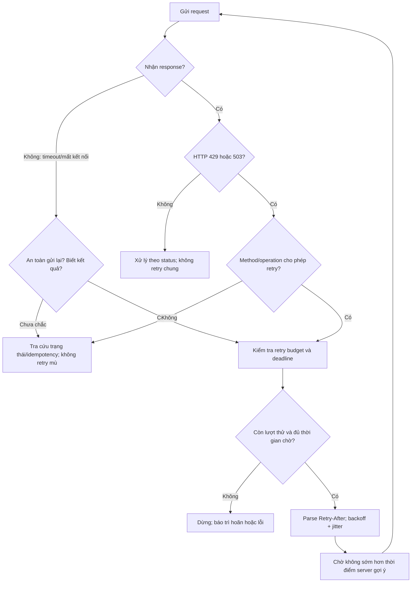

# Retry-After và cách client tôn trọng tín hiệu server

## 1. Tình huống: server yêu cầu chờ, client không nên gửi lại ngay

Ứng dụng gọi `GET /products/p-42` để lấy thông tin sản phẩm. API đang giới hạn số request của một tài khoản nên trả:

```http
HTTP/1.1 429 Too Many Requests
Retry-After: 30
Content-Type: application/problem+json
Cache-Control: no-store

{
  "type": "https://api.example.test/problems/rate-limit",
  "title": "Đã vượt giới hạn yêu cầu",
  "status": 429,
  "detail": "Vui lòng thử lại sau.",
  "code": "rate_limit.exceeded"
}
```

Con số `30` trong `Retry-After` nói client nên **đợi 30 giây trước khi gửi lại**. Nếu hàng nghìn client đều retry lập tức, API sẽ càng quá tải. Nếu tất cả cùng retry chính xác sau 30 giây, một đợt tải đột biến khác có thể xuất hiện. Do đó cần kết hợp **tín hiệu chờ của server**, **giới hạn retry phía client** và **jitter**.

Bài học thuộc chương **Lũy đẳng và thử lại** của học phần `INTEGRATION_API_REST`. Trọng tâm là cách REST client đọc `Retry-After`, quyết định có được retry an toàn không, và kiểm thử behavior với HTTP/Java/Spring. Ngữ cảnh học phần bao gồm resource, URI, HTTP method, status code, hợp đồng dữ liệu, idempotency, cache, OpenAPI, xác thực/phân quyền và xử lý lỗi.

**Sau bài, bạn có thể** phân tích hai dạng `Retry-After`, chọn phản ứng đúng với 429/503, bảo vệ thao tác POST/PATCH khỏi lặp side effect, thiết kế deadline/backoff/jitter, triển khai một retry policy có thể kiểm thử và tài liệu hóa hành vi cho API.

## 2. Ý nghĩa chuẩn của Retry-After

`Retry-After` là **response header** mang thời gian mà server đề nghị user agent chờ trước khi thực hiện yêu cầu tiếp theo có liên quan. Theo HTTP Semantics (RFC 9110), giá trị có hai dạng:

```abnf
Retry-After = HTTP-date / delay-seconds
delay-seconds = 1*DIGIT
```

| Dạng | Header ví dụ | Cách hiểu |
| --- | --- | --- |
| **delay-seconds** | `Retry-After: 30` | Chờ tối thiểu theo chỉ dẫn, tính bằng **giây** |
| **HTTP-date** | `Retry-After: Fri, 01 Jan 2027 00:00:30 GMT` | Không gửi lại trước thời điểm tuyệt đối được chỉ ra |

`delay-seconds` là số nguyên thập phân **không âm**. `0` hợp lệ; `0.5`, `-1` hoặc `30ms` không phải dạng hợp lệ. Dạng ngày dùng cú pháp HTTP-date, không phải chuỗi ISO 8601 tùy ý.

### Những status thường gặp

| Status | Ý nghĩa liên quan | Cách dùng Retry-After |
| --- | --- | --- |
| **429 Too Many Requests** | Client/nhóm client bị rate limit; định nghĩa trong RFC 6585 | Response **có thể** kèm `Retry-After` để gợi ý khi nào thử lại |
| **503 Service Unavailable** | Server tạm không phục vụ, ví dụ bảo trì hoặc quá tải | Server **có thể** kèm `Retry-After` để ước lượng thời gian chờ |
| **3xx Redirection** | Client cần theo redirect | Theo RFC 9110, header chỉ thời gian tối thiểu chờ **trước khi thực hiện request được chuyển hướng**, không phải một lỗi 429 |
| **413 Content Too Large** | Server từ chối nội dung lớn; việc từ chối có thể tạm thời | Trong một số tình huống có thể kèm `Retry-After`; client vẫn phải xét lại kích thước/policy |

Không phải mọi 429/503 đều có `Retry-After`. Ngược lại, **có header cũng không bảo đảm yêu cầu kế tiếp sẽ thành công**: quota, tình trạng hệ thống hoặc quyền của người gọi có thể thay đổi.

Một số API có header giới hạn lưu lượng riêng như quota còn lại/thời điểm reset. Chúng bổ sung thông tin, nhưng **không mặc nhiên thay thế ngữ nghĩa `Retry-After`**; tên, đơn vị và cách kết hợp phải theo hợp đồng cụ thể.

## 3. Cách đọc hai dạng header cho đúng

### 3.1. Dạng số giây

```http
HTTP/1.1 503 Service Unavailable
Retry-After: 120
```

Client có thể tính thời điểm được phép thử lại dựa trên lúc nhận phản hồi, rồi dùng **đồng hồ đơn điệu** để lên lịch chờ, tránh ảnh hưởng khi đồng hồ hệ thống bị chỉnh. Một client có deadline tổng 20 giây không nên chờ 120 giây bên trong request: **dừng vòng retry và trả trạng thái trì hoãn/thất bại có kiểm soát**, tuyệt đối không rút thời gian xuống 20 giây rồi gửi lại sớm hơn chỉ dẫn.

### 3.2. Dạng HTTP-date

```http
HTTP/1.1 503 Service Unavailable
Date: Fri, 01 Jan 2027 00:00:00 GMT
Retry-After: Fri, 01 Jan 2027 00:00:30 GMT
```

Server đang gợi ý mốc 30 giây sau thời gian của nó. Cần lưu ý **clock skew**: đồng hồ client có thể nhanh hoặc chậm hơn server. Một cách triển khai thận trọng là tham chiếu `Date` của response và `Age` nếu đi qua cache, đồng thời đo thời gian nhận bằng đồng hồ đơn điệu. Ở ví dụ đơn giản khi các đồng hồ đã đồng bộ, thời gian chờ là hiệu giữa mốc Retry-After và thời gian hiện tại.

Nếu thời điểm đã qua, parser có thể trả thời gian chờ `0`; **chính sách retry vẫn nên chống vòng lặp nóng** bằng số lần thử, backoff tối thiểu hoặc giới hạn tốc độ. Nếu header không hợp lệ, không tự hiểu nó là yêu cầu “retry ngay”.

### 3.3. Trường hợp cần xử lý phòng thủ

- Header vắng: dùng chính sách retry nội bộ, **không suy ra server yêu cầu chờ bằng 0**.
- Số quá lớn/overflow hoặc ngày không parse được: coi như tín hiệu không hợp lệ và fallback an toàn.
- HTTP-date chứa dấu phẩy: **không tách header bằng `split(",")`**; parser HTTP-date phải hiểu cả giá trị.
- Tín hiệu vượt deadline hoặc thời hạn cho phép của ứng dụng: dừng hoặc chuyển sang tác vụ chờ có quản lý, **không retry trước thời điểm server đề nghị**.
- Nhiều hop/proxy: kiểm tra header thực sự đến client và metadata thời gian; không giả định đồng hồ edge/origin luôn giống nhau.

## 4. Retry-After là tín hiệu thời gian, không phải giấy phép retry

Trước khi hỏi **“chờ bao lâu?”**, phải hỏi **“có an toàn khi gửi lại request này không?”**.

| HTTP method / tình huống | Có nên tự retry? | Điều kiện |
| --- | --- | --- |
| `GET`, `HEAD` | Thường có thể | An toàn về ngữ nghĩa HTTP; vẫn cần deadline, giới hạn và quyền |
| `PUT` | Có thể khi thao tác được thiết kế đúng semantics idempotent | Chú ý precondition `If-Match` và tác dụng phụ của hệ thống |
| `DELETE` | Có thể theo semantics idempotent | Response lần sau có thể khác (ví dụ 404); kết quả trạng thái đích vẫn cần xét |
| `POST /orders` | **Không tự động** chỉ vì có 429/503 | Cần hợp đồng idempotency key/chống tạo trùng, hoặc có thể xác minh chưa thực hiện |
| `PATCH` | **Không mặc định** | Chỉ retry khi thao tác được thiết kế idempotent hoặc có cơ chế chống lặp và điều kiện phiên bản |
| Thanh toán / ghi giao dịch | Cần kiểm soát chặt | Idempotency, tra cứu trạng thái và reconciliation trước khi gửi lại |

HTTP định nghĩa `PUT` và `DELETE` là idempotent về **hiệu ứng dự kiến của nhiều request giống nhau**, không có nghĩa cùng status hay cùng body phản hồi ở mọi lần, và cũng không hứa mọi side effect phụ như log/metrics đều giống nhau. `PATCH` có thể được thiết kế idempotent nhưng không tự được bảo đảm.

### Timeout không giống response 429/503

Khi nhận 429/503, client đã nhận một response cho request. Nhưng trong trường hợp **timeout/mất kết nối**, client có thể không biết server đã commit rồi hay chưa. Đặc biệt với POST và PATCH có tác dụng phụ, gửi lại không kiểm soát có thể tạo hai đơn hàng, hai lần thu phí hoặc phát nhiều sự kiện.

Ví dụ dùng idempotency key theo **hợp đồng riêng của API**:

```http
POST /orders HTTP/1.1
Host: api.example.test
Content-Type: application/json
Idempotency-Key: "checkout-8b27"

{"customerId":"cus-12","items":[{"sku":"BOOK-01","quantity":1}]}
```

Server cần lưu và kiểm tra khóa theo phạm vi caller/endpoint, fingerprint payload, trạng thái xử lý và thời hạn theo hợp đồng; không thể chỉ tin rằng header này tự tạo lũy đẳng. Khi retry, client **giữ nguyên khóa cho cùng một ý định**, không tạo khóa mới; nếu không biết kết quả, có thể tra cứu resource/trạng thái thao tác trước khi quyết định.

## 5. Chính sách client: tôn trọng server nhưng vẫn bảo vệ hệ thống

Một retry policy có bốn giới hạn quan trọng:

1. **Điều kiện retry:** status và method/idempotency có cho phép gửi lại không?
2. **Số lần thử:** ví dụ tối đa 3 lần gọi HTTP, **bao gồm lần đầu**.
3. **Deadline tổng:** tổng thời gian còn cho phép, bao gồm network timeout và thời gian chờ.
4. **Thời gian chờ:** không sớm hơn `Retry-After` hợp lệ; kết hợp backoff và jitter để giảm tải.

Một chiến lược minh họa:

```text
serverDelay = parse(Retry-After)       // nếu hợp lệ
localBackoff = exponential(attempt)    // ví dụ 200 ms, 400 ms, 800 ms
jitter = random trong [0, 150 ms]

delay = max(serverDelay hoặc 0, localBackoff) + jitter

Nếu delay > thời gian còn lại đến deadline:
    DỪNG và trả kết quả có kiểm soát
Ngược lại:
    lên lịch chờ delay, rồi retry khi thao tác an toàn
```

**Jitter ở đây được cộng không âm**, không trừ vào thời gian server yêu cầu. Nếu `Retry-After: 30`, chờ 29 giây “để ngẫu nhiên hóa” là không tôn trọng chỉ dẫn. Khi header quá lớn so với giới hạn của ứng dụng, **không ép chờ về mức nhỏ rồi retry sớm**; hãy dừng hoặc chuyển sang cơ chế theo lịch dài hạn nếu có.

Một retry budget ở cấp hệ thống nên giới hạn tổng số request gửi lại theo thời gian, không chỉ từng client/request. Nếu mọi client đều có 3 lần thử, lưu lượng origin vẫn có thể nhân lên nhiều lần khi xảy ra sự cố.

### Không dùng một chính sách cho mọi lỗi

| Kết quả | Phản ứng gợi ý |
| --- | --- |
| 429 có Retry-After | Nếu request an toàn, chờ theo header và các giới hạn |
| 503 có Retry-After | Coi là tín hiệu tạm thời; chỉ retry khi an toàn |
| 429/503 không header | Áp dụng backoff có jitter, số lần thử và deadline |
| 400/415/422 | Sửa request; retry nguyên bản thường vô ích |
| 401/403 | Xử lý xác thực/phân quyền; không retry như transient failure |
| 409/412 | Giải quyết xung đột, GET lại/If-Match khi cần; không retry y hệt |
| Timeout sau POST | Tra cứu trạng thái/idempotency trước khi gửi lại |

## 6. Luồng quyết định của client



Sơ đồ là quy tắc client minh họa, không có nghĩa GET nhất thiết phải retry: người dùng đã rời màn hình, request bị hủy hoặc deadline quá ngắn đều là lý do dừng hợp lệ.

### Đừng tạo “retry storm”

Ngay cả khi mỗi client tôn trọng `Retry-After`, hàng nghìn client có thể cùng thức dậy ở một mốc thời gian. Giải pháp là **jitter dương, giới hạn đồng thời, queue/bulkhead, retry budget và circuit breaker**. Nếu API có quota theo API key/tenant, phối hợp retry giữa các request cùng key để tránh nhiều luồng chạy độc lập và cùng vượt hạn mức. Một tín hiệu chờ ở request hiện tại cũng có thể gợi ý tạm giảm lưu lượng trên cùng phạm vi quota; phạm vi đó phải được tài liệu hóa chứ không đoán từ status 429.

## 7. Ví dụ HTTP hoàn chỉnh: từ 429 tới request thành công

Giả định client GET sản phẩm và giới hạn local retry tối đa ba lần. Lần thứ nhất:

```http
GET /products/p-42 HTTP/1.1
Host: api.example.test

HTTP/1.1 429 Too Many Requests
Retry-After: 3
Content-Type: application/problem+json

{"type":"https://api.example.test/problems/rate-limit","status":429}
```

Client chờ **ít nhất 3 giây** và thêm jitter không âm nếu còn deadline. Sau đó thử lại:

```http
GET /products/p-42 HTTP/1.1
Host: api.example.test

HTTP/1.1 200 OK
Content-Type: application/json
ETag: "p42-r8"

{"id":"p-42","name":"Bút máy"}
```

Khi đã nhận 200, vòng retry kết thúc. Nếu lần thứ hai lại nhận 429, cần tính **chỉ dẫn mới từ response mới**, không dùng cố định 3 giây của lần trước. Nếu server gửi `Retry-After: 300` trong khi deadline còn 10 giây, client dừng retry trong lượt hiện tại và có thể thông báo:

> Dịch vụ đang giới hạn yêu cầu. Bạn có thể thử lại sau.

Không hứa chính xác dịch vụ sẽ phục hồi tại một thời điểm tuyệt đối; `Retry-After` là chỉ dẫn chờ, không phải SLA.

## 8. Java: parser Retry-After có thể kiểm thử

Mẫu sau tập trung vào hai dạng giá trị thông dụng. Nó nhận thời gian hiện tại từ `Clock`/`Instant` bên ngoài để test không lệ thuộc đồng hồ thật:

```java
import java.time.Duration;
import java.time.Instant;
import java.time.ZonedDateTime;
import java.time.format.DateTimeFormatter;
import java.time.format.DateTimeParseException;
import java.util.Optional;

final class RetryAfterParser {
    private RetryAfterParser() {}

    static Optional<Duration> parse(String raw, Instant now) {
        if (raw == null || raw.isBlank()) {
            return Optional.empty();
        }
        String value = raw.trim();

        if (value.matches("[0-9]+")) {
            try {
                return Optional.of(
                    Duration.ofSeconds(Long.parseLong(value))
                );
            } catch (NumberFormatException ex) {
                return Optional.empty(); // overflow
            }
        }

        try {
            Instant due = ZonedDateTime.parse(
                value, DateTimeFormatter.RFC_1123_DATE_TIME
            ).toInstant();
            Duration remaining = Duration.between(now, due);
            return Optional.of(
                remaining.isNegative() ? Duration.ZERO : remaining
            );
        } catch (DateTimeParseException ex) {
            return Optional.empty();
        }
    }
}
```

**Phạm vi mẫu:** `DateTimeFormatter.RFC_1123_DATE_TIME` xử lý định dạng ngày hiện hành trong ví dụ (IMF-fixdate). Một HTTP-date parser đầy đủ có thể cần chấp nhận các dạng ngày cũ mà HTTP cho phép đọc để tương thích; thư viện HTTP chuyên dụng đáng cân nhắc. Khi server/client lệch đồng hồ, production cần xét `Date`/`Age` và tính elapsed time nhất quán. Parser **không quyết định có retry hay không**; nó chỉ trả duration hoặc đánh dấu header không đọc được.

### Kiểm thử parser không cần sleep

```java
import static org.junit.jupiter.api.Assertions.*;
import org.junit.jupiter.api.Test;
import java.time.Duration;
import java.time.Instant;

class RetryAfterParserTest {
    private static final Instant NOW =
        Instant.parse("2027-01-01T00:00:00Z");

    @Test
    void parsesDelaySeconds() {
        assertEquals(Duration.ofSeconds(30),
            RetryAfterParser.parse("30", NOW).orElseThrow());
        assertEquals(Duration.ZERO,
            RetryAfterParser.parse("0", NOW).orElseThrow());
    }

    @Test
    void parsesHttpDateAndClampsPastToZero() {
        assertEquals(Duration.ofSeconds(5),
            RetryAfterParser.parse(
                "Fri, 01 Jan 2027 00:00:05 GMT", NOW
            ).orElseThrow());
        assertEquals(Duration.ZERO,
            RetryAfterParser.parse(
                "Thu, 31 Dec 2026 23:59:59 GMT", NOW
            ).orElseThrow());
    }

    @Test
    void rejectsInvalidOrOverflow() {
        assertTrue(RetryAfterParser.parse("-1", NOW).isEmpty());
        assertTrue(RetryAfterParser.parse("1.5", NOW).isEmpty());
        assertTrue(RetryAfterParser.parse(
            "9999999999999999999999999", NOW).isEmpty());
        assertTrue(RetryAfterParser.parse(null, NOW).isEmpty());
    }
}
```

Test này kiểm tra **cú pháp và diễn giải thời gian**, chưa kiểm tra số lần gửi lại, deadline hoặc header được tích hợp vào HTTP client.

## 9. Spring RestClient: retry GET an toàn và có giới hạn

Ví dụ dùng **Spring Framework 6.1+ `RestClient`**. Dùng `exchange` để giữ nguyên status/header kể cả response 429/503, thay vì để cơ chế exception mặc định của `retrieve` che mất metadata cần đọc. Vòng lặp là **blocking**, phù hợp worker/command có giới hạn; không dùng `Thread.sleep` trong event loop của WebFlux.

```java
// Imports minh họa: java.time.*, java.nio.charset.StandardCharsets,
// java.util.function.Supplier, org.springframework.http.*,
// org.springframework.web.client.RestClient.

@FunctionalInterface
interface Sleeper {
    void sleep(Duration delay) throws InterruptedException;
}

final class ProductApiClient {
    private final RestClient client;
    private final Clock clock;
    private final Sleeper sleeper;
    private final Supplier<Duration> jitter;

    ProductApiClient(RestClient client, Clock clock,
                     Sleeper sleeper, Supplier<Duration> jitter) {
        this.client = client;
        this.clock = clock;
        this.sleeper = sleeper;
        this.jitter = jitter; // 0 đến 150 ms, không âm
    }

    ResponseEntity<String> getProduct(String id)
            throws InterruptedException {
        Instant deadline = clock.instant().plusSeconds(10);

        for (int attempt = 1; attempt <= 3; attempt++) {
            ResponseEntity<String> response = client.get()
                .uri("/products/{id}", id)
                .exchange((request, raw) ->
                    ResponseEntity.status(raw.getStatusCode())
                        .headers(raw.getHeaders())
                        .body(new String(
                            raw.getBody().readAllBytes(),
                            StandardCharsets.UTF_8
                        ))
                );

            int status = response.getStatusCode().value();
            if ((status != 429 && status != 503) || attempt == 3) {
                return response;
            }

            Duration serverDelay = RetryAfterParser.parse(
                response.getHeaders().getFirst(HttpHeaders.RETRY_AFTER),
                clock.instant()
            ).orElse(Duration.ZERO);

            // 200 ms sau lần 1; 400 ms sau lần 2.
            Duration backoff = Duration.ofMillis(
                200L * (1L << (attempt - 1))
            );
            Duration baseline = serverDelay.compareTo(backoff) > 0
                ? serverDelay : backoff;
            Duration wait = baseline.plus(jitter.get());

            if (clock.instant().plus(wait).isAfter(deadline)) {
                return response; // Không retry sớm hơn chỉ dẫn server.
            }
            sleeper.sleep(wait);
        }
        throw new IllegalStateException("Unreachable");
    }
}
```

Khởi tạo minh họa:

```java
RestClient restClient = RestClient.builder()
    .baseUrl("https://api.example.test")
    .build();

ProductApiClient api = new ProductApiClient(
    restClient,
    Clock.systemUTC(),
    delay -> Thread.sleep(delay.toMillis()),
    () -> Duration.ofMillis(
        java.util.concurrent.ThreadLocalRandom.current()
            .nextLong(0, 151)
    )
);
```

### Giới hạn cần bổ sung ở production

- Đặt **connect/response timeout** cho từng HTTP attempt. Deadline trong ví dụ chỉ kiểm soát **thời gian chờ retry**, chưa cưỡng chế hủy một HTTP call đang treo.
- Xử lý `IOException`/lỗi kết nối riêng: có thể chưa biết request đã đến server chưa; không áp chính sách GET này cho POST/PATCH mà không có idempotency.
- Với HTTP-date, dùng ước lượng thời gian server có xét `Date`/`Age` nếu cần; ví dụ chỉ dùng `clock.instant()`.
- Giới hạn concurrency, retry budget, hủy khi client không còn cần kết quả và tránh giữ nhiều thread ngủ.
- Trong reactive/nonblocking client, dùng scheduler/tín hiệu thời gian **không khóa luồng**, đồng thời giữ nguyên quy tắc status, deadline và server delay.
- Không coi việc có `Retry-After` là lý do chuyển từ 400/401/409/412/422 sang retry.

**Đặc biệt:** nếu server bảo chờ 120 giây nhưng deadline còn 10 giây, hàm trả lại response 429/503. Caller có thể hiển thị thông báo, trì hoãn nghiệp vụ bằng queue hợp lệ hoặc kết thúc yêu cầu. Nó **không thử lại sau 10 giây**, vì như vậy là bỏ qua tín hiệu server.

## 10. Kiểm thử policy với fake clock và HTTP responses

Trong kiểm thử, **không dùng `Thread.sleep` thật**: dùng clock/sleeper giả để xác nhận thời gian dự kiến và số lần gọi. Với Spring, có thể dùng `MockRestServiceServer` gắn với `RestClient.Builder` hoặc mock HTTP server trong integration test.

### Ma trận tối thiểu

| Kịch bản | Response đầu | Hành vi client phải chứng minh |
| --- | --- | --- |
| Retry-After dạng số | 429 + `Retry-After: 3` | GET thứ hai diễn ra sau ít nhất 3 giây giả lập |
| Retry-After dạng ngày | 503 + HTTP-date tương lai | Tính delay từ mốc phù hợp và không retry trước |
| Không có header | 503, thiếu Retry-After | Backoff+jitter theo policy nội bộ |
| Header sai/overflow | 429 + `Retry-After: 1.5` | Không crash, fallback có giới hạn |
| Header = 0 | 429 + `Retry-After: 0` | Không vòng lặp nóng; vẫn áp backoff tối thiểu |
| Header vượt deadline | 429 + `Retry-After: 300` | Chỉ một attempt, dừng chứ không retry sớm |
| Thành công ngay | 200 | Một attempt, không sleep |
| Thành công sau lỗi | 429 rồi 200 | Hai attempts, dừng sau 200 |
| Lỗi không retry | 400/401/409/412/422 | Một attempt, caller xử lý theo status |
| Quá giới hạn số lần thử | Ba lần 503 | Không có attempt thứ tư |
| POST không bảo vệ | Timeout/503 sau POST tạo đơn | Không tự gửi lại thiếu idempotency |
| Nhiều client cùng bị 429 | Các lịch chờ có jitter khác nhau | Không tạo burst đồng loạt đúng một mốc |

### Pseudocode kiểm thử Spring client

```java
@Test
void retryAfterIsRespectedBeforeSecondGet() {
    // MockRestServiceServer hoặc mock web server trả theo thứ tự:
    // 1. 429 Retry-After: 3
    // 2. 200 {"id":"p-42"}
    //
    // FakeClock và RecordingSleeper không chờ thời gian thật:
    // RecordingSleeper ghi duration và đẩy FakeClock tiến tương ứng.
    //
    // ProductApiClient dùng jitter = () -> Duration.ZERO.

    ResponseEntity<String> result = client.getProduct("p-42");

    assertEquals(200, result.getStatusCode().value());
    assertEquals(2, mockServer.requestCount());
    assertEquals(List.of(Duration.ofSeconds(3)), sleeper.recorded());
}

@Test
void retryAfterLongerThanDeadlineDoesNotRetryEarly() {
    // Mock trả 429 Retry-After: 300.
    ResponseEntity<String> result = client.getProduct("p-42");

    assertEquals(429, result.getStatusCode().value());
    assertEquals(1, mockServer.requestCount());
    assertTrue(sleeper.recorded().isEmpty());
}
```

Đây là **pseudocode JUnit**: `FakeClock`, `RecordingSleeper`, `mockServer` và fixture được dự án định nghĩa. Khi hiện thực, kiểm tra cả header thực trả từ Spring client, thứ tự requests và số lần retry. Với HTTP-date, thêm test khi client clock lệch server; test với `Date` và `Age` nếu policy của bạn dùng chúng.

## 11. Server Spring: phát Retry-After đúng ngữ nghĩa

Client chỉ có thể tôn trọng tín hiệu nếu server phát chính xác. Ví dụ khi rate limit chặn request:

```java
// Spring MVC / Spring Framework 6+, lược bỏ imports.
@RestControllerAdvice
class RateLimitProblemHandler {
    @ExceptionHandler(RateLimitExceededException.class)
    ResponseEntity<ProblemDetail> handle(RateLimitExceededException ex) {
        ProblemDetail body = ProblemDetail.forStatusAndDetail(
            HttpStatus.TOO_MANY_REQUESTS,
            "Giới hạn yêu cầu đã được sử dụng. Vui lòng thử lại sau."
        );
        body.setType(URI.create(
            "https://api.example.test/problems/rate-limit"
        ));
        body.setTitle("Đã vượt giới hạn yêu cầu");
        body.setProperty("code", "rate_limit.exceeded");

        long seconds = Math.max(0, ex.retryAfterSeconds());
        return ResponseEntity.status(HttpStatus.TOO_MANY_REQUESTS)
            .header(HttpHeaders.RETRY_AFTER, Long.toString(seconds))
            .contentType(MediaType.parseMediaType("application/problem+json"))
            .cacheControl(CacheControl.noStore())
            .body(body);
    }
}
```

Trong sản phẩm thật, `retryAfterSeconds()` phải phản ánh chính sách rate limiter: bucket/quota còn bao lâu mới đủ capacity cho request tiếp theo, chứ không phải một số ngẫu nhiên. Nếu là quota theo API key, xử lý đồng bộ trên toàn bộ instance/gateway để các node không trả tín hiệu mâu thuẫn. Với quá tải hệ thống, bảo trì hoặc circuit breaker, 503 có thể được phát ở gateway/load balancer thay vì controller; hãy kiểm tra header ở **lớp cuối cùng mà client nhìn thấy**.

`ProblemDetail` giúp diễn đạt lỗi dễ hiểu theo RFC 9457; `code` trong ví dụ là extension riêng của API. **HTTP status và Retry-After header** vẫn là tín hiệu cốt lõi cho client, không buộc client parse `detail` tiếng Việt để tính thời gian chờ.

## 12. OpenAPI: ghi rõ 429/503 và chính sách retry

Ví dụ OpenAPI 3.0.3 rút gọn:

```yaml
openapi: 3.0.3
info:
  title: Catalog API
  version: 1.0.0
paths:
  /products/{id}:
    get:
      summary: Lấy thông tin sản phẩm
      parameters:
        - in: path
          name: id
          required: true
          schema: { type: string }
      responses:
        '200':
          description: Sản phẩm
          content:
            application/json:
              schema:
                type: object
                properties:
                  id: { type: string }
                  name: { type: string }
        '429':
          description: >
            Vượt giới hạn. Client có thể thử lại khi an toàn,
            tôn trọng Retry-After nếu có và giới hạn retry.
          headers:
            Retry-After:
              description: >
                Số giây không âm hoặc HTTP-date; có thể vắng.
                Không bảo đảm retry sau đó sẽ thành công.
              schema: { type: string }
          content:
            application/problem+json:
              schema:
                $ref: '#/components/schemas/Problem'
        '503':
          description: Dịch vụ tạm không khả dụng
          headers:
            Retry-After:
              description: Số giây không âm hoặc HTTP-date, khi được cấp
              schema: { type: string }
          content:
            application/problem+json:
              schema:
                $ref: '#/components/schemas/Problem'
components:
  schemas:
    Problem:
      type: object
      properties:
        type: { type: string, format: uri-reference }
        title: { type: string }
        status: { type: integer }
        detail: { type: string }
        code: { type: string }
```

Đây là hợp đồng ví dụ. Nếu API hỗ trợ POST hoặc PATCH có idempotency key, hãy mô tả rõ **phạm vi, TTL, xử lý payload không khớp, kết quả gửi lặp và khả năng tra cứu trạng thái**. Không thể mô tả đầy đủ behavior retry chỉ bằng một header trong schema; phần description và contract tests vẫn cần thiết.

## 13. Bài thực hành: thiết kế client chịu tải mà không gửi lặp đơn hàng

Giả sử hệ thống bán hàng có hai thao tác:

- `GET /catalog/items/{id}`: truy vấn công khai, có thể retry an toàn khi quá tải.
- `POST /orders`: tạo đơn, có tác dụng phụ; hỗ trợ `Idempotency-Key` theo hợp đồng riêng.

Server có thể trả `429 Retry-After: 5` khi vượt hạn mức và `503 Retry-After: Fri, 01 Jan 2027 00:00:30 GMT` khi bảo trì.

**Nhiệm vụ A — Phân loại.** Với GET trả 429/503, chọn thời gian retry theo header, budget và deadline. Với POST, giải thích vì sao timeout không chứng minh đơn chưa được tạo; mô tả cách giữ nguyên idempotency key và tra cứu kết quả trước khi gửi lại.

**Nhiệm vụ B — Viết policy.** Số attempts tối đa là 3, local backoff lần lượt 200 ms và 400 ms, jitter từ 0–150 ms, deadline 10 giây. Hãy xác định điều gì xảy ra khi nhận `Retry-After: 2`, `Retry-After: 20`, `Retry-After: 0` và header sai.

**Nhiệm vụ C — Test.** Dùng fake clock và fake sleeper để chứng minh client không gửi request trước `Retry-After`, không có lần thứ tư, không retry status 422 và không gọi lại POST khi kết quả trước chưa xác định mà thiếu cơ chế idempotency.

**Nhiệm vụ D — Quan sát.** Đề xuất metric cho tỷ lệ 429/503, số attempts, thời gian chờ, deadline exceeded và số request được ngăn nhờ retry budget. Không dùng raw token, user ID, `Retry-After` tự do hoặc câu thông báo làm metric label.

### Gợi ý kiểm tra đáp án

| Case, còn đủ attempts | Quyết định khi deadline còn 10 giây |
| --- | --- |
| 429 + `Retry-After: 2` | Chờ ít nhất 2 giây, cộng jitter không âm |
| 503 + `Retry-After: 20` | **Không retry trong lượt này**; không rút xuống 10 giây |
| 429 + `Retry-After: 0` | Dùng backoff nội bộ để tránh vòng lặp nóng |
| 503 + Retry-After không hợp lệ | Fallback có giới hạn và ghi nhận tín hiệu sai |
| POST bị timeout, chưa biết có tạo đơn | Tra cứu trạng thái/idempotency; không gửi lại mù |

## 14. Những lỗi thiết kế cần tránh

1. **Xem Retry-After như mệnh lệnh retry mọi request**, kể cả POST thanh toán không có idempotency.
2. **Bỏ qua header và retry tức thì** sau 429/503, làm tăng tải origin.
3. **Dùng jitter âm hoặc rút ngắn delay do server chỉ định**, khiến client gửi sớm hơn mốc được gợi ý.
4. **Cắt Retry-After dài xuống deadline rồi vẫn retry**, thay vì dừng vòng thử.
5. **Quên rằng HTTP-date có dấu phẩy**, parse sai bằng cách tách chuỗi thủ công.
6. **Tin clock của client là tuyệt đối chính xác**, bỏ qua lệch giờ khi server phát mốc tuyệt đối.
7. **Không giới hạn attempts hoặc tổng thời gian**, dẫn đến retry storm và treo tác vụ.
8. **Đặt `Thread.sleep` trong reactive event loop**, chặn các request khác.
9. **Gửi lại POST với idempotency key mới** sau timeout, phá tác dụng chống trùng.
10. **So khớp `detail` trong Problem Details để tính retry**, thay vì đọc status/header.
11. **Xem Retry-After là bảo đảm server phục hồi đúng lúc**, tạo UX sai kỳ vọng.
12. **Chỉ test HTTP status mà không test lịch gửi lại**, khiến bug chờ sai bị bỏ sót.

## 15. Câu hỏi tự kiểm tra

1. Hai dạng hợp lệ của `Retry-After` là gì? `Retry-After: 1.5` có hợp lệ không?
2. `429` khác `503` ở ý nghĩa nào? Cả hai có bắt buộc trả `Retry-After` không?
3. Trong 3xx, `Retry-After` được hiểu như thế nào?
4. Với `Retry-After: 30` và deadline còn 10 giây, client phải làm gì?
5. Vì sao jitter nên được cộng không âm vào delay đã chọn khi có Retry-After?
6. `Retry-After: 0` có cho phép một vòng retry vô hạn ngay lập tức không?
7. Vì sao phải xét HTTP method và idempotency **trước** khi quyết định retry?
8. Tại sao timeout sau POST khác việc nhận response 429?
9. Nếu HTTP-date từ server và clock client lệch nhau, bạn sẽ dùng những tín hiệu thời gian nào để giảm sai lệch?
10. Vì sao backoff riêng của từng client chưa đủ ngăn retry storm?
11. Trong Spring, tại sao cần lấy cả status và headers của 429/503 thay vì chỉ bắt một exception chung?
12. Test nào chứng minh `Retry-After: 300` không bị ép xuống 10 giây rồi gửi lại?

**Điểm cần nhớ:** `Retry-After` là **tín hiệu về thời gian chờ**, không phải giấy phép thực hiện lại thao tác. Client đúng phải kiểm tra an toàn/idempotency, đọc `delay-seconds` hoặc `HTTP-date`, chờ **không sớm hơn** chỉ dẫn hợp lệ, bổ sung backoff/jitter, rồi dừng khi vượt retry budget hoặc deadline. Với request có side effect và kết quả chưa biết, ưu tiên **idempotency và tra cứu trạng thái** thay vì retry mù.
