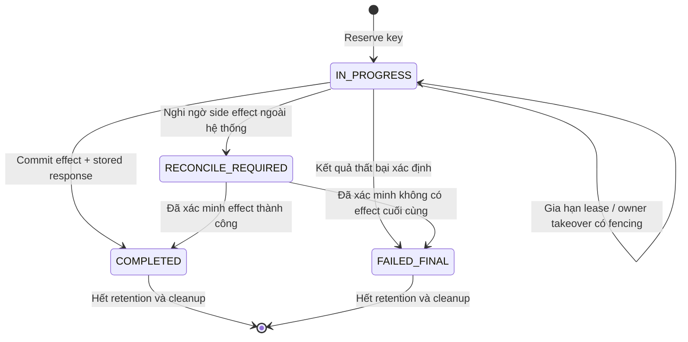

# Lưu bền kết quả, trạng thái đang xử lý và thời hạn giữ khóa

> **Module:** INTEGRATION_API_REST — thiết kế REST API theo resource, URI, phương thức và mã trạng thái HTTP; thực hành idempotency, thử lại, OpenAPI, xác thực, phân quyền, xử lý lỗi và kiểm thử với Java/Spring.  
> **Chương:** Lũy đẳng và thử lại.  
> **Trọng tâm:** Thiết kế kho **idempotency key** để lưu bền kết quả, phân biệt request đã hoàn tất với request đang xử lý, và quản lý **lease** cùng **thời hạn lưu khóa** mà không tạo tác động nghiệp vụ lặp lại.

## 1. Bài toán: server đã tạo đơn, nhưng client không nhận được phản hồi

Client tạo đơn hàng bằng `POST`:

```http
POST /api/orders HTTP/1.1
Host: api.example.com
Authorization: Bearer <access-token>
Idempotency-Key: 018fd6e7-4cd8-7a10-a2de-912d8221e4ae
Content-Type: application/json

{"customerId":"cus-17","items":[{"sku":"KB-01","quantity":1}]}
```

Server đã lưu đơn `ord-501`, nhưng kết nối bị đứt trước khi client nhận được `201 Created`. Client không thể biết:

- Request chưa đến server;
- Server đang xử lý;
- Đơn đã tạo thành công nhưng response bị mất;
- Giao dịch thất bại trước khi commit;
- Một hệ thống bên ngoài đã nhận lệnh nhưng kết quả chưa được xác nhận.

Nếu client gửi lại `POST` như một request mới, hệ thống có thể tạo **hai đơn** cho cùng một ý định mua hàng. Trái lại, nếu server chỉ ghi “đã thấy key này” mà **không lưu kết quả**, client vẫn không biết đơn nào được tạo.

**Mục tiêu của idempotency key là nhận diện một ý định nghiệp vụ được thử lại**, trả lại kết quả đã xác định, hoặc báo rõ nó còn đang xử lý — trong phạm vi và thời gian được API cam kết.

Sau bài học, bạn có thể:

1. Thiết kế khóa lũy đẳng gắn với tenant, operation và fingerprint request.
2. Phân biệt trạng thái `IN_PROGRESS`, `COMPLETED`, lỗi cuối cùng và kết quả chưa xác định.
3. Lưu bền status/body/header cần thiết để **replay response**, không thực thi lại nghiệp vụ.
4. Ngăn hai request cùng key chạy đồng thời bằng unique constraint, transaction và lease có fencing.
5. Phân biệt **thời hạn lease** với **thời hạn giữ bản ghi kết quả**; xử lý crash và key hết hạn.
6. Thiết kế API Java/Spring, SQL, OpenAPI và kiểm thử race, retry, crash recovery.

## 2. Khóa lũy đẳng giải quyết điều gì — và không giải quyết điều gì?

`POST` không mặc nhiên idempotent như `PUT` theo ngữ nghĩa HTTP. Với một endpoint tạo resource do server cấp ID, client có thể gửi cùng header `Idempotency-Key` cho **những lần thử lại của cùng một ý định**.

Ví dụ sau là **một chính sách API được định nghĩa rõ**, không phải lời khẳng định mọi REST API đều tự hiểu header đó:

```http
Idempotency-Key: 018fd6e7-4cd8-7a10-a2de-912d8221e4ae
```

- **Lần đầu:** server tạo đơn, lưu kết quả và trả `201`.
- **Gửi lại cùng key, cùng nội dung, cùng phạm vi sau khi hoàn tất:** trả **kết quả đã lưu**, không tạo đơn thứ hai.
- **Gửi lại khi lần đầu còn chạy:** trả phản hồi **đang xử lý** theo hợp đồng, không chạy tác vụ song song thứ hai.
- **Cùng key nhưng payload khác:** báo **xung đột sử dụng key**, không coi đó là một ý định mới.
- **Sau khi hết thời hạn lưu:** key có thể không còn được nhận diện; API **không được hứa chống tạo trùng vô thời hạn** nếu không có cơ chế nghiệp vụ khác.

Idempotency key **không phải khóa bảo mật**, không thay authentication/authorization, không chứng minh client có quyền truy cập đơn, và không bảo đảm “exactly-once execution” xuyên database, queue và nhà cung cấp bên ngoài.

### 2.1. Chuỗi thử lại cần hỗ trợ

```mermaid
sequenceDiagram
    participant C as Client
    participant A as REST API
    participant D as Database
    C->>A: POST /orders + Idempotency-Key K
    A->>D: Reserve K (IN_PROGRESS)
    A->>D: Create order + store response (atomic)
    D-->>A: Commit: ord-501, COMPLETED
    A--xC: 201 Created bị mất trên mạng
    Note over C: Timeout; không biết đã commit chưa
    C->>A: POST /orders + cùng K, cùng payload
    A->>D: Lookup K + verify fingerprint
    D-->>A: COMPLETED + stored response
    A-->>C: Replay 201 Created, ord-501
```

Thứ tự **commit nghiệp vụ và lưu kết quả vào cùng ranh giới nguyên tử** là điểm quan trọng. Nếu đơn đã được lưu nhưng bản ghi kết quả chưa có, lần thử lại phải có cơ chế đối soát/khóa duy nhất nghiệp vụ để không tạo đơn mới.

## 3. Định nghĩa phạm vi khóa và fingerprint

Một key như `abc-123` không nên có nghĩa toàn cục cho mọi người và mọi endpoint. Cần định nghĩa phạm vi server tin cậy:

```text
identity = (authenticatedTenantId, operationId, idempotencyKey)
fingerprint = SHA-256(canonicalBusinessRequest)
```

Ví dụ `operationId = "POST:/api/orders:v1"`. Không dùng chuỗi path bất kỳ của người gửi làm nguồn scope duy nhất; route/operation nên được server xác định sau khi routing và authentication.

| Thành phần | Cách xác định | Mục đích |
|---|---|---|
| Tenant/account | Từ principal đã xác thực | Cách ly request của các tenant |
| Operation | ID cố định do server định nghĩa | Không nhầm khóa của tạo đơn với hoàn tiền |
| Idempotency key | Do client cấp, đủ ngẫu nhiên, giới hạn độ dài | Phân biệt những ý định trong cùng phạm vi |
| Request fingerprint | Băm request đã chuẩn hóa theo hợp đồng | Phát hiện tái dùng key cho nội dung khác |
| User/permission scope nếu cần | Theo threat model của API | Không để một user khác trong tenant dùng bản ghi ngoài quyền |

**Fingerprint không phải authorization.** Khi replay, server vẫn kiểm tra người gọi hiện tại có quyền sử dụng/thấy kết quả không. Nếu quyền đã thay đổi, không được trả thông tin đơn hàng chỉ vì key giống nhau.

### 3.1. Canonical request phải ổn định

Hai JSON này có thể tương đương về ý nghĩa:

```json
{"customerId":"cus-17","items":[{"sku":"KB-01","quantity":1}]}
```

```json
{"items":[{"quantity":1,"sku":"KB-01"}],"customerId":"cus-17"}
```

Nếu băm raw bytes, chúng có hash khác nhau dù cùng ý định. API phải **công bố tiêu chí “cùng request”** và dùng một cách chuẩn hóa ổn định: schema/DTO hợp lệ, tên field, giá trị mặc định, cách biểu diễn số, đơn vị tiền tệ, danh sách có thứ tự hay không, API version và những header ảnh hưởng kết quả.

Có thể chọn so khớp raw request nếu hợp đồng nói rõ “payload phải giống hệt” và client tái gửi nguyên bytes; nhưng đừng ngầm coi đó là tương đương ngữ nghĩa. Không đưa token Bearer hoặc header không liên quan vào fingerprint. Khi canonicalization thay đổi giữa các phiên bản, phải giữ khả năng diễn giải các key còn hạn hoặc version hóa fingerprint.

### 3.2. Quy tắc khi cùng key nhưng nội dung khác

Lần đầu:

```http
POST /api/orders HTTP/1.1
Idempotency-Key: K-123
Content-Type: application/json

{"customerId":"cus-17","items":[{"sku":"KB-01","quantity":1}]}
```

Lần sau, cùng phạm vi và key nhưng thay quantity thành 2:

```http
POST /api/orders HTTP/1.1
Idempotency-Key: K-123
Content-Type: application/json

{"customerId":"cus-17","items":[{"sku":"KB-01","quantity":2}]}
```

Server phải **từ chối**, chẳng hạn `409 Conflict` với Problem Details mang `type=idempotency-key-reused`. Không tạo đơn thứ hai và không trả bản kết quả cũ như thể request mới có quantity 2 đã được chấp nhận.

## 4. Mô hình trạng thái tối thiểu nhưng đủ để vận hành

Một bản ghi idempotency có thể đi qua các trạng thái:



| Trạng thái | Ý nghĩa | Khi client gửi lại cùng key/payload |
|---|---|---|
| `IN_PROGRESS` | Một worker đang xử lý hoặc giữ quyền xử lý theo lease | Không chạy song song; trả “đang xử lý” theo hợp đồng |
| `COMPLETED` | Tác động nghiệp vụ đã có kết quả cuối được lưu bền | Replay status/body/header đã lưu |
| `FAILED_FINAL` | Thất bại **đã xác định, không có tác động cần tiếp tục** | Replay lỗi được chọn là kết quả cuối |
| `RECONCILE_REQUIRED` | Không chắc side effect bên ngoài đã xảy ra hay chưa | Không tái thực thi mù quáng; đối soát hoặc trả trạng thái chờ |

Không cần lưu mọi lỗi tạm thời vào `FAILED_FINAL`. Một lỗi kết nối database trước khi commit khác với từ chối nghiệp vụ cuối cùng. Với kết quả `500` mơ hồ, không thể chỉ “xóa key rồi cho retry” nếu có khả năng hệ thống bên ngoài đã thực thi lệnh.

### 4.1. Phải chọn chính sách lưu các lỗi nào

| Kết quả của lần đầu | Có lưu để replay không? | Lý do |
|---|---|---|
| `201 Created` sau commit đơn | **Có**, bắt buộc nếu cam kết replay | Tránh tạo đơn thứ hai sau timeout |
| `200/204` của thao tác thành công | **Có**, lưu đúng kết quả đã công bố | Client thấy cùng kết quả cuối |
| `409` do trạng thái nghiệp vụ đã được kiểm tra chắc chắn | Có thể lưu là `FAILED_FINAL` theo hợp đồng | Thất bại xác định tại thời điểm xử lý |
| `400` malformed JSON trước khi nhận diện intent hợp lệ | Có thể từ chối **trước khi reserve** | Không cần chiếm key của request chưa hợp lệ |
| `401/403` | Thường xử lý **trước** lookup/replay | Không replay nội dung cho người đã mất quyền |
| `500/503` trước commit, chắc chắn không có side effect | Cho retry an toàn sau khi giải phóng/recover theo chính sách | Chưa có kết quả nghiệp vụ cuối |
| Timeout tới payment provider, không rõ đã charge chưa | Đánh dấu cần đối soát | Không được tạo charge lần hai chỉ vì chưa có response |

Điều quan trọng là định nghĩa **điểm mà một ý định bắt đầu được thực thi** và **kết quả cuối được cam kết lưu**. Chính sách lưu lỗi phải ổn định theo API, không tùy hứng theo exception message.

## 5. Lưu kết quả gì để replay?

Đừng chỉ lưu `key → orderId` nếu hợp đồng nói **replay phản hồi đầu tiên**. Cần tối thiểu:

- **HTTP status** như `201` hoặc một `4xx` cuối đã chọn.
- **Response body** (hoặc tham chiếu bền vững có thể tái tạo cùng hợp đồng).
- **Một số response headers** cần giữ nhất quán, chẳng hạn `Location` của tài nguyên đã tạo và media type.
- **Fingerprint**, tenant, operation, trạng thái, thời điểm tạo/hoàn thành/hết hạn.
- **Business reference** như `orderId` để đối soát và vận hành.

Ví dụ lần đầu:

```http
HTTP/1.1 201 Created
Location: /api/orders/ord-501
Content-Type: application/json

{"id":"ord-501","status":"PENDING_PAYMENT"}
```

Lần retry trong thời hạn giữ key có thể nhận **cùng `201`, `Location` và body**, vì đó là **replay kết quả tạo mới trước đó**, không phải một lần tạo mới nữa. API cũng có thể thêm header mô tả replay (ví dụ `Idempotency-Replayed: true`), nhưng phải xem nó là extension của chính API.

### 5.1. Không lưu bừa toàn bộ headers

Không lưu/replay:

- `Set-Cookie`, `Authorization` hoặc header có dữ liệu phiên nhạy cảm.
- Hop-by-hop headers như `Connection`, `Transfer-Encoding`.
- `Date` từ response cũ nếu nó cần do HTTP stack phát theo thời gian hiện tại.
- Header có nội dung phụ thuộc principal hiện tại mà chưa xác minh quyền.

Lưu **allowlist** metadata phản hồi cần thiết; khi replay, framework nên sinh các header giao thức động phù hợp. Nếu body chứa dữ liệu cá nhân, đặt chính sách retention, mã hóa at rest, phân quyền truy cập và xóa dữ liệu đúng yêu cầu.

### 5.2. Lưu bytes hay tái tạo từ orderId?

Hai cách khả thi:

1. **Snapshot response**: lưu status, JSON body và các header chọn lọc. Replay chính xác hơn, nhưng tốn dung lượng và có rủi ro dữ liệu nhạy cảm/định dạng cũ.
2. **Business reference**: lưu order ID rồi tái tạo response. Tiết kiệm storage, nhưng nếu order đổi trạng thái hoặc schema API đổi, response retry có thể **khác lần đầu**.

Nếu contract hứa “trả lại phản hồi gốc”, dùng snapshot hoặc một representation đã version hóa, không giả định GET hiện tại tương đương response POST tại thời điểm tạo. Có thể chọn “trả tham chiếu tài nguyên hiện tại” nhưng phải nói rõ đó là **một hợp đồng khác**.

## 6. Hai khoảng thời gian không được đánh đồng

**Lease** và **retention TTL** đều dùng thời gian, nhưng mục tiêu hoàn toàn khác nhau.

| Thuộc tính | Processing lease | Retention TTL của idempotency record |
|---|---|---|
| Mục đích | Cho biết worker nào đang có quyền thực thi | Nhớ ý định/kết quả trong bao lâu |
| Ví dụ minh họa | 30 giây, gia hạn khi cần | 48 giờ tính từ lúc hoàn tất |
| Hết hạn nghĩa là | Worker có thể đã chết/kẹt; cần kiểm tra và có thể takeover | Bản ghi cuối có thể được cleanup theo chính sách |
| Có nên xóa ngay khi hết? | **Không**; cần fencing/recovery | Chỉ cleanup record đủ điều kiện, sau thời hạn |
| Hậu quả nếu dùng sai | Hai worker cùng thực thi | Client retry sau TTL có thể tạo nghiệp vụ lặp |

### 6.1. Lease hết hạn không chứng minh worker cũ đã dừng

Worker A giữ lease tới 10:00:30. Nó bị pause vì GC 40 giây, sau đó tiếp tục. Worker B thấy lease quá hạn và giành quyền xử lý.

Nếu không có **fencing**, A và B đều có thể tiếp tục ghi. Lease chỉ là **quy tắc quyền sở hữu tạm thời**, không phải khóa vật lý giết được worker cũ.

Giải pháp: mỗi lần reserve/reclaim có một **attempt token** hoặc **fencing version tăng đơn điệu**. Trước khi commit nghiệp vụ, worker phải kiểm tra nó vẫn là owner hiện tại trong một transaction/compare-and-swap. Worker cũ không được commit chỉ vì nó từng giữ lease.

```mermaid
sequenceDiagram
    participant A as Worker A
    participant DB as DB/idempotency store
    participant B as Worker B
    A->>DB: Reserve K, attempt=17, lease=30s
    Note over A: Bị pause > 30s
    B->>DB: Reclaim K sau kiểm tra, attempt=18
    DB-->>B: B là owner hiện tại
    A->>DB: Commit với attempt=17
    DB-->>A: Fencing reject; không commit effect
    B->>DB: Commit với attempt=18
    DB-->>B: Commit effect + response
```

Fencing phải được **enforce ở nơi ghi tác động**. Kiểm tra token tại application rồi gọi một API ngoài không hỗ trợ fencing/idempotency vẫn có thể tạo side effect trùng.

### 6.2. Retention TTL hết hạn khác gì?

Giả sử giữ kết quả trong 48 giờ sau khi hoàn tất. Trong khoảng đó client dùng lại key và payload tương ứng sẽ nhận kết quả lưu. Sau 48 giờ, record có thể bị xóa, nên cùng key có thể được xem như ý định mới **nếu API không có cơ chế khác**.

Với tác động quan trọng như thanh toán, cần cơ chế business uniqueness hoặc khóa tham chiếu nghiệp vụ lâu hơn retention cache để tránh tạo double charge/order ngoài cửa sổ retry.

**Không xóa `IN_PROGRESS` chỉ vì `lease_until` đã qua.** Nếu chưa biết trạng thái side effect, xóa record có thể mở đường cho tác động lặp.

### 6.3. Chọn retention bằng yêu cầu nghiệp vụ

Phải tính tới:

- Cửa sổ retry thực tế của web/mobile/SDK và backoff.
- Offline client đồng bộ lại sau nhiều giờ.
- Timeout qua proxy, queue, webhook hoặc client có thể retry muộn.
- Thời gian tối đa xử lý và recovery/outage.
- Quy định dữ liệu, chi phí lưu trữ và xóa dữ liệu cá nhân.
- Rủi ro nghiệp vụ khi thực thi lại sau retention.

Một API có thể công bố **key được nhớ tối thiểu 48 giờ sau khi kết thúc**. Đây chỉ là ví dụ; không có TTL chung bắt buộc cho REST API. Đừng gia hạn TTL vô hạn mỗi khi client replay nếu làm record không bao giờ bị cleanup.

## 7. Thiết kế schema và ràng buộc ở database

Với đơn hàng lưu trong PostgreSQL, một schema minh họa:

```sql
CREATE TABLE idempotency_records (
    id              BIGSERIAL PRIMARY KEY,
    tenant_id       UUID NOT NULL,
    operation_id    VARCHAR(80) NOT NULL,
    idem_key        VARCHAR(128) NOT NULL,
    request_hash    CHAR(64) NOT NULL,
    state           VARCHAR(24) NOT NULL
                    CHECK (state IN ('IN_PROGRESS',
                                    'COMPLETED',
                                    'FAILED_FINAL',
                                    'RECONCILE_REQUIRED')),
    attempt_version BIGINT NOT NULL DEFAULT 1,
    lease_until     TIMESTAMPTZ,
    status_code     INTEGER,
    response_body   JSONB,
    response_location TEXT,
    business_ref    TEXT,
    created_at      TIMESTAMPTZ NOT NULL DEFAULT now(),
    completed_at    TIMESTAMPTZ,
    expires_at      TIMESTAMPTZ,
    UNIQUE (tenant_id, operation_id, idem_key)
);

CREATE INDEX idx_idempotency_expiry
    ON idempotency_records (expires_at)
    WHERE state IN ('COMPLETED', 'FAILED_FINAL');

-- Ánh xạ effect với bản ghi idempotency trong retention.
-- Không đặt FK ngăn xóa record khi hết thời hạn:
ALTER TABLE orders
    ADD COLUMN idempotency_record_id BIGINT UNIQUE;

-- Nếu cần chống trùng dài hơn retention, duy trì thêm một mã
-- nghiệp vụ ổn định, độc lập với record ID có thể bị cleanup:
ALTER TABLE orders
    ADD COLUMN client_order_ref VARCHAR(128);
CREATE UNIQUE INDEX idx_orders_tenant_client_order_ref
    ON orders (tenant_id, client_order_ref)
    WHERE client_order_ref IS NOT NULL;
```

Schema này là **mẫu thiết kế**, không phải migration áp dụng ngay. Bảng `orders` có `tenant_id` đã được giả định tồn tại. `idempotency_record_id` giúp ngăn tạo nhiều order từ cùng record trong thời gian record còn tồn tại; nó **không** thay một khóa nghiệp vụ sau khi record bị xóa. Để chống trùng vượt retention, hợp đồng tạo đơn cần có `clientOrderRef` ổn định (hoặc định danh nghiệp vụ tương đương), lưu vào `client_order_ref` và áp unique constraint riêng. Nếu không có định danh đó, API không thể cam kết ngăn tạo trùng sau khi đã quên key. Chọn FK/cleanup, index và chính sách retention phù hợp dữ liệu thật.

### 7.1. Vì sao unique constraint ở database là bắt buộc?

Không được chỉ làm:

```text
if cache.get(key) == null:
    cache.put(key, IN_PROGRESS)
    createOrder()
```

Hai node có thể đồng thời thấy key chưa tồn tại và cùng tạo đơn. Cần một thao tác **atomic create-if-absent** ở kho được coi là nguồn chân lý, ví dụ unique constraint + transaction của DB.

Trong PostgreSQL:

```sql
INSERT INTO idempotency_records (
    tenant_id, operation_id, idem_key, request_hash,
    state, attempt_version, lease_until
)
VALUES (
    :tenantId, 'create-order-v1', :key, :requestHash,
    'IN_PROGRESS', 1, now() + INTERVAL '30 seconds'
)
ON CONFLICT (tenant_id, operation_id, idem_key)
DO NOTHING
RETURNING id;
```

Nếu không insert được vì key đã tồn tại, đọc record hiện có và quyết định theo **fingerprint/state**. Hai request cùng key được database serialize ở unique constraint để không cùng tạo reservation mới. Không phụ thuộc vào một `synchronized` trong JVM, vì hệ thống có thể có nhiều instance.

### 7.2. Trạng thái IN_PROGRESS phải được commit riêng

Nếu vừa insert `IN_PROGRESS`, vừa tạo đơn và chuyển `COMPLETED` trong **cùng một transaction chưa commit**, request khác không nhìn thấy trạng thái đang xử lý. Nó thường chờ unique lock rồi chỉ thấy kết quả cuối sau commit.

Điều này có thể chấp nhận với transaction rất ngắn, nhưng **không thể dùng nó để hứa client luôn quan sát được IN_PROGRESS**. Khi cần trả “đang xử lý” và quản lý lease, một thiết kế là:

1. **Transaction A:** reserve key, lưu `IN_PROGRESS` và commit nhanh.
2. **Xử lý:** tính toán/chuẩn bị nghiệp vụ, kiểm soát lease và tác động bên ngoài.
3. **Transaction B:** kiểm tra owner/fencing, ghi business effect **và** kết quả cuối idempotency **trong cùng transaction**, rồi commit.

Nếu transaction B rollback, không được xuất hiện đơn đã commit mà record vẫn đang ở `IN_PROGRESS`. Với side effect không nằm trong cùng database, phải thiết kế outbox/reconciliation riêng.

### 7.3. Điều kiện commit có fencing

Pseudocode SQL trong transaction B:

```sql
BEGIN;

SELECT state, attempt_version, lease_until, request_hash
FROM idempotency_records
WHERE id = :recordId
FOR UPDATE;

-- Application kiểm tra:
-- state = IN_PROGRESS
-- attempt_version = :ownedAttempt
-- lease_until vẫn hợp lệ
-- request_hash đúng, quyền/ngữ cảnh vẫn phù hợp
-- Nếu sai: ROLLBACK, không tạo order.

INSERT INTO orders (tenant_id, idempotency_record_id, ...)
VALUES (:tenantId, :recordId, ...)
RETURNING id;

INSERT INTO outbox_events (aggregate_id, event_type, payload)
VALUES (:newOrderId, 'OrderCreated', :eventPayload);

UPDATE idempotency_records
SET state = 'COMPLETED',
    status_code = 201,
    response_body = :responseJson,
    response_location = :location,
    business_ref = :newOrderId,
    completed_at = now(),
    expires_at = now() + INTERVAL '48 hours'
WHERE id = :recordId
  AND state = 'IN_PROGRESS'
  AND attempt_version = :ownedAttempt;

-- Bắt buộc kiểm tra update đúng 1 dòng;
-- nếu không: ROLLBACK toàn bộ.
COMMIT;
```

Trong ứng dụng thật, mọi bước phải nằm dưới cùng transaction DB. Điều kiện thời gian/fencing phải được kiểm tra **khi row lock đang giữ**; trong code không được bỏ qua kết quả `UPDATE`. Nếu lease hết hạn trong lúc transaction quá dài, cần quy tắc rõ ràng: từ chối commit quá hạn, gia hạn an toàn trước xử lý dài, hoặc khóa tới điểm commit mà không cho takeover trái phép. Đừng đặt network call lâu trong transaction giữ row lock.

### 7.4. Redis SET NX EX có đủ không?

`SET key IN_PROGRESS NX EX 30` có thể hữu ích để hạn chế contention, nhưng **một khóa Redis TTL ngắn không tự bảo đảm lưu bền kết quả và không tạo side effect trùng**:

- TTL có thể hết khi worker vẫn chạy.
- Redis restart/failover có thể làm mất dữ liệu tùy cấu hình durability.
- Không có giao dịch nguyên tử giữa Redis lock và database tạo đơn.
- Một request mới có thể chiếm key trong khi tác động cũ đã xảy ra.

Có thể kết hợp Redis làm cache/lock phụ, nhưng hệ thống cần một **nguồn chân lý bền vững**, business uniqueness và cơ chế recovery phù hợp. Với workload vừa phải, database có unique constraint và transaction thường dễ chứng minh tính đúng hơn.

## 8. API phản hồi thế nào khi cùng key đang xử lý?

Một request trùng key/payload đến khi record vẫn `IN_PROGRESS`, lease chưa hết và owner đang làm việc. Có một số hợp đồng hợp lệ:

| Cách xử lý | Khi nào phù hợp | Lưu ý |
|---|---|---|
| `409 Conflict` + Problem Details | API đồng bộ, yêu cầu client retry sau | Không thực thi lần thứ hai; có thể gửi `Retry-After` nếu có thời gian gợi ý hợp lý |
| Chờ có giới hạn rồi replay kết quả | Tác vụ rất ngắn, latency budget cho phép | Phải timeout có kiểm soát; tránh giữ quá nhiều connection |
| `202 Accepted` + URI trạng thái | API **chủ động thiết kế bất đồng bộ** | Có resource/job để theo dõi; không dùng 202 chỉ như “đang bận” nếu không có contract |
| `503` khi hạ tầng không xử lý được | Sự cố tài nguyên thật sự | Khác với conflict key đang chạy; đừng đánh đồng |

Một chính sách minh họa cho endpoint đồng bộ:

```http
HTTP/1.1 409 Conflict
Content-Type: application/problem+json
Retry-After: 2
Cache-Control: no-store

{
  "type": "https://api.example.com/problems/idempotency-in-progress",
  "title": "Yêu cầu đang được xử lý",
  "status": 409,
  "detail": "Yêu cầu với khóa này đang chạy. Hãy thử lại sau."
}
```

`Retry-After: 2` là gợi ý hai giây, **không** là cam kết request sẽ hoàn tất đúng sau hai giây. Client cần retry giới hạn, backoff/jitter và tôn trọng deadline tổng thể. Không trả một `201` giả khi chưa commit, hoặc chấp nhận một worker thứ hai tạo đơn song song.

### 8.1. Cùng key khác fingerprint

Nên trả lỗi riêng, ví dụ:

```http
HTTP/1.1 409 Conflict
Content-Type: application/problem+json

{
  "type": "https://api.example.com/problems/idempotency-key-reused",
  "title": "Khóa đã dùng cho nội dung khác",
  "status": 409,
  "detail": "Hãy dùng khóa mới cho một yêu cầu nghiệp vụ mới."
}
```

Client **không** nên sửa payload rồi tiếp tục retry với cùng key. Với ý định khác, tạo key mới. Nếu request ban đầu đã tạo đơn, thay payload và tạo key mới có thể là một nghiệp vụ mới thực sự; UI nên yêu cầu người dùng xác nhận thay vì âm thầm nhân đôi đơn.

## 9. Crash recovery, kết quả chưa chắc chắn và hệ thống ngoài

### 9.1. Các điểm crash cần có lời giải

| Điểm crash | Trạng thái có thể thấy | Xử lý đúng |
|---|---|---|
| Trước khi reserve được commit | Không có record | Retry có thể reserve như lần đầu |
| Sau reserve, trước business transaction | `IN_PROGRESS` | Lease/recovery xác minh chưa có effect rồi takeover |
| Trong transaction tạo order + lưu response | Transaction rollback hoặc commit nguyên tử | Retry nhìn thấy chưa có effect hoặc `COMPLETED` |
| Sau commit, trước khi gửi HTTP response | `COMPLETED` và order đã có | Replay response lưu bền |
| Sau khi provider ngoài đã nhận lệnh, trước khi lưu kết quả | Có thể `RECONCILE_REQUIRED` | Tra cứu provider theo operation ID, không tự gọi lại mù quáng |

Với **một database hỗ trợ transaction**, cập nhật order, outbox và idempotency terminal state có thể commit cùng nhau. Với payment gateway hoặc dịch vụ ngoài, không có transaction chung; cần **provider idempotency key, tra cứu trạng thái, webhook/đối soát** và xử lý “unknown outcome”.

### 9.2. Không nên tự reclaim chỉ vì lease hết

Khi lease quá hạn:

1. Lock record và kiểm tra `state`, `attempt_version`, `lease_until`.
2. Kiểm tra business reference hoặc side effect đã commit chưa.
3. Nếu kết quả có thể xác định, chuyển tới terminal state và lưu replay response.
4. Nếu chưa có effect và có thể retry an toàn, tăng fencing version, cấp lease mới.
5. Nếu kết quả ngoài hệ thống chưa chắc chắn, chuyển `RECONCILE_REQUIRED` và không chạy trùng.

Một scheduled recovery worker có thể xử lý các record quá hạn. Recovery nên idempotent, có metrics và cảnh báo các record không thể kết thúc, thay vì xóa key quá hạn rồi để client tạo nghiệp vụ mới.

### 9.3. Thanh toán cần phòng thủ sâu hơn tạo đơn

Ví dụ lệnh charge có `Idempotency-Key: K`. Worker đã gửi yêu cầu tới payment provider rồi mất kết nối. Nếu không có provider-side idempotency hoặc khả năng tra cứu, server **không thể biết** charge đã xảy ra. Không nên suy ra “chưa lưu DB = chưa thanh toán”.

Thiết kế tốt có thể:

- Sinh một **merchant operation ID** bền vững từ ý định thanh toán.
- Truyền cùng provider idempotency key cho các lần retry được provider hỗ trợ.
- Lưu trạng thái `PENDING/UNKNOWN`, nhận webhook và đối soát.
- Đặt unique constraint để không tạo thêm payment intent cho cùng nghiệp vụ.
- Không đánh dấu hoàn tất chỉ vì network call trả timeout.
- Dừng auto-retry và chuyển xử lý thủ công khi không còn cách xác minh an toàn.

Không có một “exactly once” toàn cục chỉ nhờ header HTTP. Bảo đảm thực tế là **at-most-one business effect theo các ràng buộc và cửa sổ đã định**, cộng với recovery khi kết quả không rõ.

## 10. Java/Spring: tách reservation và commit ra hai transaction

Ví dụ dưới đây là **bản thiết kế lớp phục vụ triển khai**, không phải ứng dụng có thể biên dịch độc lập. Các kiểu repository, fingerprint service, principal và error handler cần được hiện thực theo stack thực tế.

### 10.1. Controller và header

```java
import jakarta.validation.Valid;
import org.springframework.http.HttpHeaders;
import org.springframework.http.ResponseEntity;
import org.springframework.web.bind.annotation.*;

import java.net.URI;

@RestController
@RequestMapping("/api/orders")
public class OrderController {
    private final OrderCreationService creation;

    public OrderController(OrderCreationService creation) {
        this.creation = creation;
    }

    @PostMapping
    public ResponseEntity<OrderCreated> create(
            @RequestHeader("Idempotency-Key") String key,
            @Valid @RequestBody CreateOrderRequest request) {

        // Tenant và quyền lấy từ SecurityContext bên trong service.
        StoredResult result = creation.create(key, request);

        // result chứa snapshot response đã commit (cả khi replay).
        return ResponseEntity.status(result.statusCode())
                .location(URI.create(result.location()))
                .header(HttpHeaders.CACHE_CONTROL, "no-store")
                .body(result.body());
    }
}
```

Đây là contract cho **kết quả thành công có `Location`**. Các kết quả lỗi/in-progress được ánh xạ bằng exception handler thành Problem Details. Không dùng cùng nhánh dựng `Location` cho lỗi không có location.

### 10.2. Orchestrator không giữ một transaction bao trùm network call

```java
public final class OrderCreationService {
    private final ReservationService reservations;
    private final OrderCommitService orderCommit;
    private final RequestFingerprint fingerprints;

    public StoredResult create(String key, CreateOrderRequest request) {
        String tenant = CurrentPrincipal.requiredTenant();
        validateKey(key);
        validateRequest(request);

        String hash = fingerprints.forOrderCreate(request);
        AcquireResult acquired = reservations.acquire(
                tenant, "create-order-v1", key, hash);

        return switch (acquired.kind()) {
            case REPLAY -> acquired.storedResult();
            case REPLAY_FINAL_ERROR ->
                    throw new StoredFinalProblemException(
                            acquired.storedProblem());
            case IN_PROGRESS -> throw new RequestInProgressException();
            case KEY_REUSED -> throw new KeyReusedException();
            case RECONCILE -> throw new OutcomeUnknownException();
            case OWNED -> orderCommit.createAndFinalize(
                    acquired.recordId(),
                    acquired.attemptVersion(),
                    tenant,
                    request);
        };
    }
}
```

Các kiểu trong ví dụ là do dự án định nghĩa. `ReservationService.acquire` phải nằm trong **transaction độc lập, commit reservation trước khi trả về OWNED**. `OrderCommitService.createAndFinalize` là bean khác, đặt `@Transactional` để ghi order/outbox và chuyển record sang terminal cùng một commit. Việc tách bean tránh lỗi thường gặp khi gọi phương thức `@Transactional` nội bộ cùng instance khiến Spring proxy không được áp dụng.

### 10.3. Transaction B: một ranh giới commit nghiệp vụ và replay record

```java
import org.springframework.stereotype.Service;
import org.springframework.transaction.annotation.Transactional;

@Service
public class OrderCommitService {
    private final IdempotencyRepository idempotency;
    private final OrderRepository orders;
    private final OutboxRepository outbox;

    public OrderCommitService(IdempotencyRepository idempotency,
                              OrderRepository orders,
                              OutboxRepository outbox) {
        this.idempotency = idempotency;
        this.orders = orders;
        this.outbox = outbox;
    }

    @Transactional
    public StoredResult createAndFinalize(
            long recordId,
            long expectedAttempt,
            String tenant,
            CreateOrderRequest request) {

        IdempotencyRecord record =
                idempotency.lockForUpdate(recordId);

        if (!record.isOwnedBy(tenant, expectedAttempt)
                || record.leaseExpired()) {
            throw new LostProcessingLeaseException();
        }

        Order order = orders.insertForIntent(
                tenant, recordId, request); // UNIQUE(recordId)
        outbox.insertOrderCreated(order);    // Same DB transaction

        StoredResult response = StoredResult.created(
                "/api/orders/" + order.id(),
                new OrderCreated(order.id(), "PENDING_PAYMENT"));

        idempotency.markCompleted(recordId, expectedAttempt,
                response, order.id());

        return response; // Transaction commit xảy ra trước khi HTTP hoàn tất.
    }
}
```

Đây là **mẫu thể hiện giao dịch**, không phải implementation đủ chạy. `lockForUpdate` cần thật sự dùng `SELECT ... FOR UPDATE`; `markCompleted` phải kiểm tra owner/fencing và số dòng cập nhật. `orders.insertForIntent` cần ràng buộc unique để ngăn nhân đôi khi recovery. Các side effect qua network không được thực hiện trực tiếp trong transaction này; outbox event có thể được publish sau commit và consumer phải idempotent.

**Điểm dễ sai:** nếu `markCompleted` lỗi nhưng service nuốt exception rồi commit order, hệ thống sẽ có business effect mà không có replay record. Phải để toàn bộ transaction rollback.

### 10.4. Reservation khi nhiều request chạy đồng thời

`ReservationService.acquire` có thể thực thi:

```text
transaction A:
    INSERT reservation ON CONFLICT DO NOTHING
    SELECT record FOR UPDATE

    nếu request_hash không khớp -> KEY_REUSED
    nếu COMPLETED -> REPLAY
    nếu FAILED_FINAL -> REPLAY_FINAL_ERROR
    nếu RECONCILE_REQUIRED -> RECONCILE
    nếu IN_PROGRESS và lease còn hiệu lực:
        nếu record do request hiện tại vừa insert -> OWNED
        ngược lại -> IN_PROGRESS
    nếu IN_PROGRESS nhưng lease đã hết:
        kiểm tra business effect / unknown outcome
        nếu an toàn reclaim:
            attempt_version += 1, lease_until = now + leaseDuration
            -> OWNED
        nếu chưa xác định:
            -> RECONCILE
commit transaction A
```

Việc phân biệt **“vừa insert” với “đã tồn tại”** là cần thiết: request đầu được sở hữu xử lý, request trùng không được tự coi mình là owner chỉ vì thấy `IN_PROGRESS`.

Trong ứng dụng production, cần thiết kế xử lý collision và chờ unique lock khi hai transaction reserve cùng lúc, quyết định timeout, cách ưu tiên recovery và quyền truy cập hiện tại. Không tải result từ tenant khác khi scope/hash không hợp lệ.

## 11. HTTP contract và OpenAPI

Một hợp đồng có thể chọn:

| Tình huống | Response mẫu | Ý nghĩa |
|---|---|---|
| Key hợp lệ, lần đầu tạo đơn thành công | `201 Created`, `Location`, body | Đã commit và lưu kết quả |
| Cùng key/scope/fingerprint, đã hoàn tất | Replay **`201`**, `Location`, body | Không tạo đơn thứ hai |
| Cùng key, đang xử lý | `409 Conflict`, `Retry-After`, Problem Details | Client thử lại có giới hạn |
| Cùng key nhưng payload khác | `409 Conflict`, Problem Type khác | Client phải dùng key mới cho ý định mới |
| Thiếu key khi API bắt buộc | `400 Bad Request` theo hợp đồng | Không thực thi |
| Key sai định dạng/quá dài | `400 Bad Request` | Không lưu record |
| Kết quả provider ngoài chưa xác định | `409/202/503` tùy hợp đồng trạng thái | Không thực thi lại mù quáng |
| Request thiếu quyền | `401/403` hoặc `404` theo chính sách | Không được replay dữ liệu ngoài quyền |

Không mặc định `202` có nghĩa “đang xử lý” nếu API chưa cung cấp resource/job để theo dõi. Nếu chọn bất đồng bộ, trả `202 Accepted` và `Location`/status link rõ ràng để client hỏi tiến độ.

OpenAPI rút gọn:

```yaml
openapi: 3.0.3
info:
  title: Order API
  version: 1.0.0
paths:
  /api/orders:
    post:
      summary: Tạo đơn hàng với idempotency key
      description: >
        Cùng một Idempotency-Key trong phạm vi tenant và operation,
        với cùng nội dung hợp lệ, sẽ replay kết quả cuối trong
        thời hạn lưu tối thiểu 48 giờ sau hoàn tất.
        Khóa cũ sau thời hạn này có thể được xử lý như ý định mới.
      parameters:
        - name: Idempotency-Key
          in: header
          required: true
          description: >
            Khóa cho một ý định tạo đơn; giữ nguyên khi retry.
            Không dùng lại cho nội dung khác.
          schema:
            type: string
            minLength: 16
            maxLength: 128
      requestBody:
        required: true
        content:
          application/json:
            schema:
              type: object
              required: [customerId, items]
              properties:
                customerId:
                  type: string
                items:
                  type: array
                  minItems: 1
                  items:
                    type: object
                    required: [sku, quantity]
                    properties:
                      sku: {type: string}
                      quantity: {type: integer, minimum: 1}
      responses:
        '201':
          description: >
            Đơn được tạo; retry hoàn tất có thể replay cùng
            status, Location và body đã lưu.
          headers:
            Location:
              schema: {type: string}
          content:
            application/json:
              schema:
                type: object
                properties:
                  id: {type: string}
                  status: {type: string}
        '400':
          description: Key hoặc request không hợp lệ
        '401':
          description: Chưa xác thực
        '403':
          description: Không đủ quyền
        '409':
          description: >
            Key đang được xử lý hoặc bị tái dùng với nội dung khác.
          headers:
            Retry-After:
              description: Gợi ý thời gian thử lại, khi phù hợp
              schema: {type: string}
          content:
            application/problem+json:
              schema:
                type: object
                properties:
                  type: {type: string}
                  title: {type: string}
                  status: {type: integer}
                  detail: {type: string}
        '500':
          description: Lỗi không mong đợi; không suy ra effect chưa xảy ra
```

Các số 48 giờ và độ dài key là **chính sách minh họa**. OpenAPI thực cần schema đầy đủ, security scheme, mô tả retention/cleanup, cách xử lý request khác nội dung và lỗi hạ tầng; đặc biệt phải nói khi nào client **được phép** retry an toàn.

## 12. Kiểm thử đúng trọng tâm: retry, trạng thái và thời gian

### 12.1. Ma trận test tối thiểu

| Test | Tình huống | Bằng chứng cần assert |
|---|---|---|
| IDEM-01 | Request đầu thành công | 201, một order, record COMPLETED và response đã lưu |
| IDEM-02 | Retry cùng key/payload sau commit | Replay cùng result; vẫn **một order và một outbox event** |
| IDEM-03 | Mất HTTP response sau commit | Retry đọc bản ghi COMPLETED, không gọi nghiệp vụ thêm lần nào |
| IDEM-04 | Hai request cùng key đến đồng thời | Chỉ một worker có quyền xử lý; request còn lại chờ/409/replay |
| IDEM-05 | Cùng key nhưng payload khác | 409 riêng, không tạo effect |
| IDEM-06 | Khác tenant nhưng cùng key | Không đọc response tenant khác; xử lý trong scope riêng |
| IDEM-07 | Client mất quyền sau lần đầu | Replay vẫn phải tuân quyền hiện tại |
| IDEM-08 | Lease hết khi worker cũ còn chạy | Fencing ngăn worker cũ commit |
| IDEM-09 | Crash trước business transaction | Reservation recover được, không tạo trùng |
| IDEM-10 | Crash sau commit trước HTTP response | Kết quả replay nguyên vẹn |
| IDEM-11 | DB commit fail giữa order và record | Transaction rollback **cả hai** |
| IDEM-12 | Provider timeout sau khi nhận effect | RECONCILE_REQUIRED, không retry mù quáng |
| IDEM-13 | Retention hết hạn | Cleanup đúng terminal record; hành vi key cũ được tài liệu hóa |
| IDEM-14 | Processing lease hết nhưng outcome chưa rõ | Không xóa record để tạo tác động thứ hai |
| IDEM-15 | Hai instance dùng chung DB | Unique constraint hoạt động, không phụ thuộc JVM lock |
| IDEM-16 | Một lỗi cuối được lưu | Replay lỗi đúng chính sách, không chạy lại nghiệp vụ |

### 12.2. MockMvc: response replay

Test minh họa giả định service, security fixture và DB đã cấu hình. **Không phải bằng chứng test đã chạy.**

```java
import org.junit.jupiter.api.Test;
import org.springframework.beans.factory.annotation.Autowired;
import org.springframework.boot.test.autoconfigure.web.servlet.AutoConfigureMockMvc;
import org.springframework.boot.test.context.SpringBootTest;
import org.springframework.http.MediaType;
import org.springframework.test.web.servlet.MockMvc;
import org.springframework.test.web.servlet.MvcResult;

import static org.assertj.core.api.Assertions.assertThat;
import static org.springframework.test.web.servlet.request.MockMvcRequestBuilders.post;
import static org.springframework.test.web.servlet.result.MockMvcResultMatchers.*;

@SpringBootTest
@AutoConfigureMockMvc
class OrderIdempotencyTest {
    @Autowired MockMvc mvc;
    @Autowired OrderRepository orders;

    @Test
    void completedRequestIsReplayedWithoutCreatingAnotherOrder()
            throws Exception {

        String key = "018fd6e7-4cd8-7a10-a2de-912d8221e4ae";
        String body = """
            {"customerId":"cus-17",
             "items":[{"sku":"KB-01","quantity":1}]}
            """;

        long before = orders.count();

        MvcResult first = mvc.perform(post("/api/orders")
                .header("Idempotency-Key", key)
                .contentType(MediaType.APPLICATION_JSON)
                .content(body))
            .andExpect(status().isCreated())
            .andReturn();

        MvcResult retried = mvc.perform(post("/api/orders")
                .header("Idempotency-Key", key)
                .contentType(MediaType.APPLICATION_JSON)
                .content(body))
            .andExpect(status().isCreated())
            .andReturn();

        assertThat(retried.getResponse().getContentAsString())
            .isEqualTo(first.getResponse().getContentAsString());
        assertThat(retried.getResponse().getHeader("Location"))
            .isEqualTo(first.getResponse().getHeader("Location"));
        assertThat(orders.count()).isEqualTo(before + 1);
    }
}
```

Fixture phải cô lập key và tenant giữa test, đồng thời kiểm tra outbox/side effect thực tế. Nếu API có authentication, cung cấp principal hợp lệ qua Spring Security test; test này giả định tenant cố định đã được setup.

### 12.3. Concurrency test cần DB thật và fault injection

MockMvc tuần tự chưa chứng minh hệ thống chịu race. Nên tạo integration test với hai thread/barrier hoặc Testcontainers/PostgreSQL:

1. Cùng tenant, operation, key, fingerprint; hai request cùng đến.
2. Giữ worker đầu trong `IN_PROGRESS` có kiểm soát.
3. Request thứ hai phải nhận in-progress hoặc chờ rồi replay, **không khởi tạo worker thứ hai**.
4. Cho worker đầu commit; retry kế tiếp replay response đã lưu.
5. Giả lập worker A bị pause quá lease rồi worker B được reclaim; A cố commit với attempt cũ → bị từ chối và không có order/outbox bổ sung.
6. Giả lập crash sau commit nhưng trước khi gửi response → retry vẫn nhận kết quả đã lưu.
7. Giả lập provider trả timeout sau khi có side effect → hệ thống vào reconciliation, không tự charge lần hai.

Để test expiry, dùng **clock có thể điều khiển** và transaction state rõ ràng. Không dùng `Thread.sleep` rồi mong timing rơi đúng lease để chứng minh concurrency. Assertion phải kiểm tra **số business effect và số outbox event**, không chỉ HTTP status.

## 13. Các phản mẫu dễ gây nhân đôi tác động

### 13.1. Chỉ nhớ key, không nhớ kết quả

Server lưu `K = seen` nhưng không lưu order ID/status/body. Khi response đầu mất, retry không có cách trả kết quả nhất quán. Lưu terminal response hoặc business reference đủ để xây đúng hợp đồng replay.

### 13.2. Dùng TTL khóa Redis làm retention

Lease 30 giây hết hạn, Redis xóa key, client retry sau 31 giây và tạo đơn thứ hai dù lần đầu đã commit. **Lease ≠ retention**; phải nhớ kết quả trong thời hạn nghiệp vụ.

### 13.3. Tạo order rồi mới lưu key trong transaction khác

Crash ở giữa hai bước khiến order có nhưng record idempotency chưa hoàn tất. Với cùng database, đưa effect và terminal result vào **một transaction**; với hệ ngoài, cần đối soát.

### 13.4. Không so fingerprint

Client vô tình dùng cùng key cho payload khác, server replay đơn cũ. Cần so request hash trong cùng scope trước khi trả kết quả hoặc bắt đầu xử lý.

### 13.5. Cho hai worker chạy sau khi lease hết

Lease không dừng worker bị pause. Thiếu fencing sẽ có hai commit. Cần attempt version và kiểm tra tại nơi ghi business effect.

### 13.6. Tự động retry side effect chưa rõ kết quả

Payment provider timeout không có nghĩa chưa charge. Cần provider key hoặc query đối soát, không tạo charge mới chỉ vì local record chưa hoàn tất.

### 13.7. Replay dữ liệu sau khi quyền bị thu hồi

Key đúng nhưng người dùng không còn quyền. Không dùng stored response để vượt authorization. Kiểm tra scope/quyền hiện tại và không lộ dữ liệu giữa tenant.

### 13.8. Cache kết quả lỗi 500 vô thời hạn

Một sự cố database tạm thời bị giữ như kết quả vĩnh viễn; client không thể hoàn tất ý định dù chưa có effect. Phân biệt lỗi cuối đã xác định, lỗi transient và outcome không chắc chắn.

### 13.9. Cleanup record đang xử lý

Một job xóa mọi record có `lease_until < now()`, kể cả `RECONCILE_REQUIRED`, khiến retry mất dấu side effect. Cleanup chỉ terminal record đúng retention, còn in-progress phải qua recovery.

## 14. Bài thực hành và checklist

### Bài A — Chọn trạng thái đúng

Một client tạo đơn, server reserve key `K`. Với mỗi tình huống, chọn xử lý và giải thích lý do:

1. Hai request cùng key/payload đến khi worker đầu chưa commit.
2. Server đã commit order nhưng mất HTTP response.
3. Key giống nhau nhưng quantity thay đổi.
4. Worker đã hết lease nhưng vẫn đang chạy.
5. Payment provider timeout, không biết đã charge chưa.
6. Client retry cùng key sau khi retention đã hết.

### Bài B — Thiết kế giao dịch và ranh giới durability

Viết schema/transaction cho `POST /api/orders` với unique `(tenant, operation, key)`. Bảo đảm:

- Reservation `IN_PROGRESS` được commit trước khi xử lý dài.
- Khi tạo order, terminal response record và outbox cùng commit.
- Worker cũ không thể ghi sau khi bị reclaim.
- Cùng key/payload sau commit được replay.
- Không có tác động nghiệp vụ khi key trùng nhưng request hash khác.

Hãy đánh dấu **điểm crash** ở mỗi bước và mô tả recovery.

### Bài C — Chọn retention và lease

Giả sử người dùng di động có thể retry sau 24 giờ offline, tác vụ tạo đơn thường dưới 5 giây nhưng đôi khi mất 45 giây khi hệ thống quá tải. Hãy đề xuất:

- Lease ban đầu và cơ chế gia hạn;
- Retention cho terminal result;
- Quy tắc takeover/recovery;
- Cách tránh duplicate sau retention bằng business key;
- Các metric để đánh giá TTL thực tế.

Không có một số giây “đúng cho mọi hệ thống”; cần nêu rõ giả định và đánh đổi.

### Checklist trước production

- [ ] API công bố scope, fingerprint, thời hạn giữ key và trạng thái khi retry.
- [ ] Key được kiểm tra định dạng/độ dài, không dùng làm credential hay lộ trong log.
- [ ] Có unique constraint hoặc reservation atomic qua mọi instance.
- [ ] `IN_PROGRESS` không bị xử lý song song khi cùng key; in-progress response có contract rõ.
- [ ] Terminal status/body/Location được lưu bền và replay đúng khi đủ quyền.
- [ ] Request khác payload với cùng key bị từ chối, không bị replay nhầm.
- [ ] Order/business effect và terminal result được commit nguyên tử khi cùng DB.
- [ ] Side effect ngoài DB có provider key/outbox/reconciliation phù hợp.
- [ ] Lease có owner/fencing; expiry không đồng nghĩa được xóa record.
- [ ] Retention TTL độc lập với lease, đủ cho retry window đã cam kết.
- [ ] Cleanup chỉ xóa record terminal đủ điều kiện, có monitoring.
- [ ] Có test race, mất response, crash trước/sau commit, expired lease, key reused và tenant isolation.
- [ ] Không tuyên bố exactly-once toàn cục nếu hệ thống không có bằng chứng.

## 15. Ghi nhớ

**Lưu bền kết quả** giúp client nhận lại một phản hồi đã xác định khi thử lại, kể cả khi response đầu bị mất. **Trạng thái đang xử lý** ngăn nhiều request cùng key cùng thực thi, nhưng phải có reservation nguyên tử và quy tắc recovery. **Lease** chỉ xác định quyền xử lý tạm thời và cần fencing; **retention TTL** xác định hệ thống nhớ key/kết quả bao lâu và không được dùng thay lease.

Thiết kế đáng tin cậy thường kết hợp **scope + fingerprint**, unique constraint, transaction lưu **business effect + terminal result**, kiểm soát replay theo quyền hiện tại và cơ chế đối soát cho side effect ngoài hệ thống. Mục tiêu là không tạo lặp **một ý định nghiệp vụ trong phạm vi và thời hạn đã công bố**, chứ không chỉ “thêm một header” hay khóa Redis ngắn hạn.
