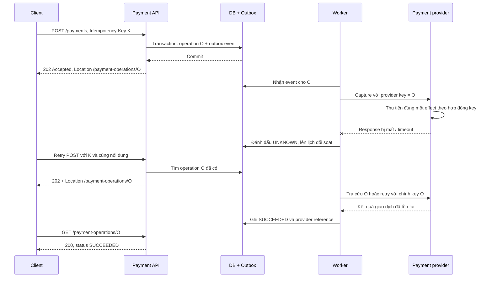
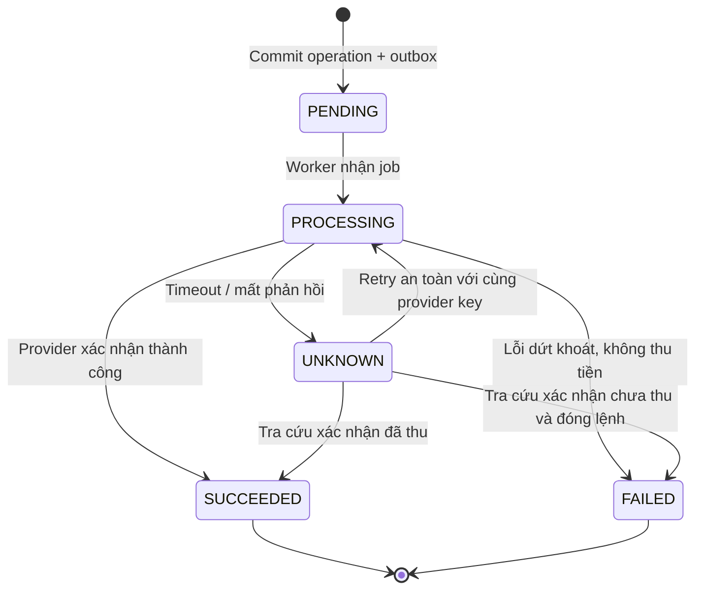

# Chống trùng tác dụng phụ ngoài cơ sở dữ liệu

Một khách hàng bấm **Thanh toán**. Dịch vụ Java gọi nhà cung cấp thanh toán, nhà cung cấp đã trừ tiền nhưng kết nối bị ngắt trước khi trả kết quả. API thấy timeout, ứng dụng mobile gửi lại yêu cầu và một lệnh thu tiền thứ hai được tạo. Trong cơ sở dữ liệu nội bộ, mỗi transaction đều nhất quán, nhưng **khách hàng vẫn bị thu tiền hai lần**. Tình huống tương tự xảy ra với email xác nhận, SMS, webhook, xuất file, gửi message tới broker hoặc cấp tài nguyên ở hệ thống bên ngoài.

Vấn đề cốt lõi: **transaction của cơ sở dữ liệu không bao trùm tác dụng phụ đã xảy ra ở hệ thống khác**. Cần thiết kế định danh nghiệp vụ ổn định, lưu ý định thực hiện trước khi gọi ra ngoài, chống trùng ở phía nhận khi có thể, xử lý kết quả chưa biết và đối soát. Bài thuộc chương **Lũy đẳng và thử lại** của module **INTEGRATION_API_REST**: áp dụng resource, HTTP methods/status, API contract, idempotency, xử lý lỗi, OpenAPI và kiểm thử với Java/Spring.

Sau bài này, người học có thể giải thích vì sao `Idempotency-Key` hoặc transactional outbox **riêng lẻ** không đủ bảo đảm không thu tiền trùng; triển khai một luồng thanh toán có trạng thái; phân biệt retry an toàn với retry nguy hiểm; và kiểm thử các cửa sổ lỗi tại ranh giới database–provider–message broker.

## 1. Hiểu đúng ba tầng chống trùng

| Tầng | Câu hỏi cần giải quyết | Cơ chế điển hình | Giới hạn |
|---|---|---|---|
| **HTTP/API** | Client gửi lại cùng lệnh `POST` thì có tạo hai thao tác nghiệp vụ không? | `Idempotency-Key`, fingerprint request, unique constraint, trả lại cùng operation/result | Không tự bảo vệ lệnh gửi tới provider nếu worker thực thi hai lần |
| **Nội bộ hệ thống** | Event/job bị giao lặp sau crash thì có tạo hai lần xử lý không? | Transactional outbox, inbox/deduplication, khóa duy nhất theo business operation, state machine | Outbox thường bảo đảm lưu ý định và giao *ít nhất một lần*, **không** bảo đảm provider nhận đúng một lần |
| **Tác dụng phụ bên ngoài** | Hai lệnh tới payment/email/webhook provider có gây hai hiệu ứng không? | Provider idempotency token, external operation ID, truy vấn trạng thái, reconciliation, business uniqueness | Cần phía nhận hợp tác; nếu không có dedupe hoặc tra cứu, không thể chắc chắn kết quả sau timeout |

Một request **không tạo trùng bản ghi** vẫn có thể gửi hai email. Một event chỉ tồn tại **một bản trong outbox** vẫn có thể được publish hai lần. Một provider có cơ chế chống trùng vẫn không giúp được nếu mỗi lần retry tạo **khóa mới**.

### 1.1. Idempotency HTTP không đồng nghĩa “exactly once”

Theo HTTP Semantics (RFC 9110), `GET`, `PUT` và `DELETE` có tính lũy đẳng theo **hiệu quả dự kiến của phương thức**; `POST` không mặc định lũy đẳng. Một `DELETE` có thể được gọi nhiều lần mà trạng thái cuối vẫn là đã xóa, nhưng hệ thống vẫn có thể gửi thông báo hoặc tạo job bên ngoài lặp nếu triển khai sai.

Với `POST /payments`, ứng dụng có thể **định nghĩa idempotency ở mức hợp đồng** bằng một khóa ổn định. Đây là cơ chế do API cung cấp, không phải tính chất mà HTTP tự áp đặt cho mọi POST. Mục tiêu thực tế thường là **hiệu ứng nghiệp vụ giống một lần** (*effectively once*) trong một phạm vi và thời hạn xác định, dù request/message được gửi nhiều lần.

Không khẳng định “exactly-once delivery” xuyên mạng chỉ vì có outbox, retry hoặc hàng đợi. Khi phản hồi bị mất, phía gọi có thể không biết lệnh đã thực hiện hay chưa; muốn ngăn tạo hiệu ứng mới phải có **deduplication có thẩm quyền ở phía nhận** hoặc khả năng tra cứu kết quả theo định danh bất biến.

## 2. Năm cửa sổ lỗi quanh một tác dụng phụ

Giả sử worker thực hiện `paymentProvider.capture(...)` rồi cập nhật database:

| Thời điểm sự cố | Trạng thái có thể xảy ra | Nếu chỉ retry mù | Biện pháp |
|---|---|---|---|
| Trước khi lưu ý định xử lý vào DB | Chưa có operation bền vững | Client tạo nhiều request khác nhau | Tạo operation/idempotency record bằng transaction với unique key |
| Sau khi lưu DB, trước khi gọi provider | DB biết operation; provider chưa chắc đã nhận | Job có thể được giao lặp | Outbox + worker idempotent, cùng external operation ID |
| **Provider đã xử lý nhưng phản hồi timeout/mất** | **Kết quả bên ngoài không xác định từ góc nhìn API** | **Có nguy cơ thu tiền lần hai** | Retry với **cùng provider idempotency key** nếu được hỗ trợ, hoặc tra cứu/đối soát |
| Sau khi nhận provider thành công, trước khi ghi DB | Provider đã xử lý, DB vẫn ghi PENDING/UNKNOWN | Worker lặp lời gọi | Provider dedupe + reconciliation + ghi nhận kết quả một cách idempotent |
| Sau khi ghi kết quả DB nhưng trước khi ACK message | DB đã biết thành công, broker gửi lại | Gửi thêm email/thu tiền nếu không kiểm tra state | Consumer kiểm tra state/dedup trước mỗi hiệu ứng, event/operation ID ổn định |

**Cửa sổ khó nhất** là “provider đã thực hiện, phản hồi không đến”. Không thể kết luận thanh toán thất bại chỉ vì HTTP client ném `SocketTimeoutException`. Nếu API trả “thanh toán thất bại, hãy thử lại với yêu cầu mới”, nó có thể khuyến khích thu tiền trùng.



Sơ đồ giả định **provider bảo đảm lũy đẳng cho khóa O trong thời hạn phù hợp** hoặc có API tra cứu giao dịch theo O. Nếu provider không hỗ trợ hai khả năng đó, không được mặc nhiên làm như bước retry sẽ an toàn.

## 3. Hợp đồng HTTP: thao tác có định danh và trạng thái

### 3.1. Tạo một payment operation

Client sinh **một Idempotency-Key đủ entropy cho đúng một ý định thanh toán** và giữ lại khi retry. Ví dụ UUID ngẫu nhiên:

```http
POST /api/v1/payments HTTP/1.1
Host: api.example.com
Authorization: Bearer <access_token>
Idempotency-Key: 7d33dd08-3de0-4930-afb1-7df3ab2b642d
Content-Type: application/json

{
  "orderId": "ord-901",
  "amountMinor": 250000,
  "currency": "VND"
}
```

Nếu server đã xác thực, kiểm tra quyền và **lưu bền vững** operation cùng ý định phát event, có thể phản hồi:

```http
HTTP/1.1 202 Accepted
Location: /api/v1/payment-operations/payop-18
Content-Type: application/json
Cache-Control: no-store

{
  "operationId": "payop-18",
  "status": "PENDING",
  "statusUrl": "/api/v1/payment-operations/payop-18"
}
```

`202` có nghĩa yêu cầu đã được chấp nhận xử lý, **chưa bảo đảm thành công hay đã trừ tiền**. Không trả `201 Created` chỉ để ám chỉ “đã thu tiền” nếu thực tế mới tạo operation; ở đây 202 tập trung vào xử lý đang chờ. `Location` trong ví dụ là URI theo dõi do API chủ động định nghĩa; cần quyền truy cập riêng.

Client retry **cùng key, cùng ý định và payload** khi lần đầu không nhận response:

```http
POST /api/v1/payments HTTP/1.1
Authorization: Bearer <access_token>
Idempotency-Key: 7d33dd08-3de0-4930-afb1-7df3ab2b642d
Content-Type: application/json

{"orderId":"ord-901","amountMinor":250000,"currency":"VND"}
```

Server phải nhận diện operation **payop-18**, không tạo `payop-19` rồi gọi provider với token mới. Nếu operation vẫn chạy, trả 202 cùng status URI. Nếu đã hoàn tất, có thể trả 200 với trạng thái cuối hoặc phát lại response ban đầu tùy hợp đồng đã công bố; **không bắt buộc hai response HTTP phải giống từng byte** để đạt lũy đẳng nghiệp vụ.

### 3.2. Cùng key nhưng thay nội dung

Nếu client dùng lại key trên với `amountMinor=350000`, đây là **ý định khác**, không phải retry hợp lệ:

```http
HTTP/1.1 409 Conflict
Content-Type: application/problem+json
Cache-Control: no-store

{
  "type": "https://api.example.com/problems/idempotency-conflict",
  "title": "Idempotency key already used",
  "status": 409,
  "code": "IDEMPOTENCY_KEY_REUSED",
  "detail": "Use a new key for a different payment request."
}
```

Lựa chọn 409 là **quy ước API** cho khóa đã được sử dụng với payload khác. Không trả lại kết quả của lệnh cũ cho nội dung mới. Để so sánh, tạo fingerprint từ các trường **có ý nghĩa nghiệp vụ** đã chuẩn hóa: order, số tiền ở đơn vị nhỏ nhất, currency, actor/tenant và operation type. Không dùng so sánh chuỗi JSON thô khi thứ tự thuộc tính hoặc khoảng trắng có thể khác mà ngữ nghĩa giống nhau.

### 3.3. Theo dõi trạng thái không gây thêm tác dụng phụ

```http
GET /api/v1/payment-operations/payop-18 HTTP/1.1
Authorization: Bearer <access_token>
```

```http
HTTP/1.1 200 OK
Content-Type: application/json
Cache-Control: no-store

{
  "operationId": "payop-18",
  "status": "SUCCEEDED",
  "paymentId": "pay-6001"
}
```

Một `GET` operation trả `200` ngay cả khi body mô tả trạng thái `FAILED`: HTTP GET đã thành công trong **việc đọc tài nguyên trạng thái**, không phải phát biểu thao tác thanh toán thành công. Client phải xem `status` để quyết định UI. Một model có thể gồm `PENDING`, `PROCESSING`, `UNKNOWN`, `SUCCEEDED`, `FAILED`; định nghĩa đầy đủ điều kiện chuyển trạng thái trong hợp đồng.

### 3.4. Các mã lỗi tại biên API

| Tình huống | HTTP status phù hợp | Hành vi |
|---|---|---|
| Thiếu hoặc sai định dạng `Idempotency-Key` theo yêu cầu API | **`400 Bad Request`** theo hợp đồng minh họa | `428` dành cho HTTP conditional precondition, không mặc định cho header tùy biến |
| Token không hợp lệ | `401` + `WWW-Authenticate` | Không cho truy cập operation hoặc dữ liệu khác tenant |
| Có token nhưng không được phép thanh toán đơn | `403` hoặc `404` theo chính sách | Không tiết lộ trạng thái payment của người khác |
| Cùng key, request khác payload | `409` | Không sinh tác dụng phụ mới |
| Operation đã nhận và đang xử lý | `202` khi POST được chấp nhận; `200` khi GET status | Không thông báo “đã thanh toán” nếu chưa có bằng chứng |
| Quá hạn mức tạo payment | `429` | `Retry-After` nếu có lịch retry đáng tin |
| Không thể **lưu bền vững** ý định trước khi nhận request | `503`/`500` theo lỗi thực | Không trả 202 nếu transaction nhận lệnh chưa commit |

### 3.5. Thời hạn sống của khóa

Phải tài liệu hóa phạm vi và thời hạn dedupe, ví dụ **tenant + actor + endpoint + key trong 7 ngày**; đây chỉ là số minh họa. Với tiền, việc xóa key sau 7 ngày **không được cho phép thu lại tiền cho cùng ý định cũ**. Cần business reference ổn định (`orderId` + loại thanh toán hoặc payment attempt ID) với quy tắc duy nhất và đối soát độc lập thời hạn cache idempotency.

Thời hạn dedupe của **provider** có thể ngắn hơn hoặc dài hơn thời hạn lưu phía API. Không tự retry sau khi provider không còn nhớ key mà chưa kiểm tra trạng thái hoặc phạm vi rủi ro của khoản tiền.

## 4. Thiết kế bền vững: operation + transactional outbox

Không nên viết:

```java
// PHẢN MẪU: ghi DB và gọi provider là hai hệ thống không chung transaction.
paymentRepository.save(payment);
paymentProvider.charge(payment);
return ResponseEntity.ok().build();
```

Nếu DB commit rồi tiến trình crash trước khi gọi provider, thanh toán có thể bị bỏ sót; nếu provider đã thu tiền nhưng DB rollback, hệ thống có thể thử lại và thu lần nữa. Bọc cả hai câu lệnh trong `@Transactional` **không** làm lệnh HTTP bên ngoài tham gia ACID transaction của database.

### 4.1. Một schema PostgreSQL minh họa

```sql
CREATE TABLE payment_operations (
    id                uuid PRIMARY KEY,
    tenant_id         uuid NOT NULL,
    actor_id          uuid NOT NULL,
    endpoint          text NOT NULL,
    idempotency_key   text NOT NULL,
    request_fingerprint bytea NOT NULL,
    order_id          uuid NOT NULL,
    amount_minor      bigint NOT NULL CHECK (amount_minor > 0),
    currency          char(3) NOT NULL,
    state             text NOT NULL,
    provider_ref      text,
    created_at        timestamptz NOT NULL DEFAULT now(),
    updated_at        timestamptz NOT NULL DEFAULT now(),
    UNIQUE (tenant_id, actor_id, endpoint, idempotency_key)
);

CREATE TABLE outbox_events (
    id             uuid PRIMARY KEY,
    operation_id   uuid NOT NULL REFERENCES payment_operations(id),
    event_type     text NOT NULL,
    payload        jsonb NOT NULL,
    published_at   timestamptz,
    UNIQUE (operation_id, event_type)
);
```

Schema được rút gọn cho mục đích học: production còn cần trạng thái có constraint rõ ràng, thông tin lease/retry/reconciliation, TTL và index vận hành. `actor_id` là danh tính **đã xác minh**, không phải trường client tự đưa. Dùng một khóa định danh nghiệp vụ riêng để không thu tiền hai lần cho cùng mục tiêu, kể cả khi **hai actor** trong tenant gửi **hai Idempotency-Key khác nhau**. Ràng buộc unique dựa trên business key phải phản ánh đúng việc một đơn có được thu nhiều lần (chia kỳ, hoàn tiền, thu bổ sung) hay không.

### 4.2. Tránh race “SELECT rồi INSERT”

Nếu hai request cùng key đến đồng thời, cả hai có thể `SELECT` thấy chưa tồn tại rồi cùng cố tạo operation. **Unique constraint** mới là điểm phân xử cuối cùng; không chỉ dựa vào kiểm tra trước khi insert.

Một chiến lược PostgreSQL:

```sql
-- Trong transaction:
INSERT INTO payment_operations
  (id, tenant_id, actor_id, endpoint, idempotency_key,
   request_fingerprint, order_id, amount_minor, currency, state)
VALUES
  (:operation_id, :tenant_id, :actor_id, :endpoint, :key,
   :fingerprint, :order_id, :amount_minor, :currency, 'PENDING')
ON CONFLICT (tenant_id, actor_id, endpoint, idempotency_key)
DO NOTHING;

-- Nếu insert thành công, ghi outbox event trong CÙNG transaction.
-- Sau đó đọc operation theo unique key và so request_fingerprint.
-- Nếu đã có operation với fingerprint khác: trả 409.
```

Khi insert thất bại do đã tồn tại, **không tạo outbox mới**. Nếu cần đọc kết quả ngay sau collision trong môi trường concurrent, giao dịch phải quan sát row đã commit theo isolation phù hợp (ví dụ READ COMMITTED), hoặc retry truy vấn có kiểm soát; không đưa ra quyết định khi kết quả còn chưa nhìn thấy. Nếu insert thành công nhưng ghi outbox thất bại, **rollback cả operation**. Như vậy API không trả 202 cho một operation mà worker không có ý định xử lý.

### 4.3. State machine



Trạng thái `UNKNOWN` là **sự thật vận hành cần giữ lại**, không phải nhãn lỗi chung để ẩn. Không chuyển `UNKNOWN → FAILED` chỉ vì đã quá số lần retry: kết quả provider vẫn có thể đã thành công. Khi provider không thể xác minh, chuyển sang **đối soát/điều tra** thay vì tự tạo khoản thu khác.

## 5. Worker xử lý outbox và nhà cung cấp

### 5.1. Nguyên tắc gọi provider

Một operation có ID bất biến `payop-18`. Provider idempotency key nên được tạo **một lần từ operation đó**, ví dụ `capture:payop-18`, và giữ nguyên cho tất cả lần giao lại event, retry, crash recovery. Payload amount/currency/merchant reference cũng phải giữ nguyên: cùng key nhưng khác số tiền là lỗi nghiêm trọng, không phải một lần retry.

Khi gửi thanh toán:

1. Worker xác định operation còn cần xử lý, kiểm tra quyền nghiệp vụ đã lưu và trạng thái.
2. Dùng **provider key cố định** và dữ liệu bất biến; không dùng timestamp/random mỗi lần thử.
3. Provider trả giao dịch thành công: ghi `provider_ref`, chuyển `SUCCEEDED` **nguyên tử trong DB** và phát outbox thông báo một lần theo business event.
4. Provider từ chối **dứt khoát** (ví dụ card declined được xác nhận): chuyển `FAILED`, lưu mã lỗi công khai phù hợp.
5. Timeout/mất kết nối/HTTP 5xx không đủ chứng minh lệnh chưa thu tiền: chuyển `UNKNOWN` và tra cứu/đối soát.
6. Nếu provider có endpoint query theo external reference hoặc idempotency key, ưu tiên xác minh; retry capture với cùng key chỉ khi provider **cam kết** xử lý lũy đẳng trong cửa sổ còn hiệu lực.

### 5.2. Vì sao outbox không ngăn được duplicate external effect?

Transactional outbox giải quyết **dual-write giữa DB và ý định phát event**: thay đổi DB và event được commit cùng nhau. Nhưng publisher có thể:

```text
1. Publish event E tới broker.
2. Broker nhận E, consumer bắt đầu xử lý.
3. Publisher crash trước khi đánh dấu event đã phát.
4. Publisher hồi phục và publish E lần nữa.
```

Kết quả là **at-least-once delivery**: một event có thể đến nhiều lần. Dùng outbox + dedupe ở consumer là cần thiết; đối với tác dụng phụ bên ngoài, vẫn cần provider idempotency/tra cứu vì consumer có thể crash **sau khi provider đã thực hiện**.

## 6. Ví dụ Java/Spring Boot: nhận lệnh và trả cùng operation

Các đoạn dưới dùng **Spring Boot 3, Spring MVC, Spring Security và transaction management**. Những interface nghiệp vụ là abstraction minh họa, cần hiện thực bằng repository, schema và cấu hình bảo mật của dự án. Chúng không phải ứng dụng độc lập có thể biên dịch ngay.

### 6.1. Controller không thực hiện charge trực tiếp

```java
import jakarta.validation.Valid;
import jakarta.validation.constraints.NotBlank;
import jakarta.validation.constraints.Positive;
import java.net.URI;
import java.util.UUID;
import org.springframework.http.CacheControl;
import org.springframework.http.HttpStatus;
import org.springframework.http.ResponseEntity;
import org.springframework.security.core.Authentication;
import org.springframework.web.bind.annotation.*;
import org.springframework.web.server.ResponseStatusException;

record CreatePaymentRequest(
    @NotBlank String orderId,
    @Positive long amountMinor,
    @NotBlank String currency
) {}

record PaymentOperationView(UUID operationId, String status) {}

@RestController
@RequestMapping("/api/v1")
class PaymentController {
    private final PaymentSubmissionService submissions;

    PaymentController(PaymentSubmissionService submissions) {
        this.submissions = submissions;
    }

    @PostMapping("/payments")
    ResponseEntity<PaymentOperationView> submit(
            @RequestHeader(value = "Idempotency-Key", required = false)
            String key,
            @Valid @RequestBody CreatePaymentRequest body,
            Authentication authentication) {
        if (key == null || !key.matches("[A-Za-z0-9_-]{8,128}")) {
            throw new ResponseStatusException(
                HttpStatus.BAD_REQUEST, "Valid Idempotency-Key is required");
        }

        var operation = submissions.submit(authentication, key, body);
        var uri = URI.create("/api/v1/payment-operations/" + operation.id());
        var response = new PaymentOperationView(
            operation.id(), operation.state());
        if ("SUCCEEDED".equals(operation.state())
                || "FAILED".equals(operation.state())) {
            return ResponseEntity.ok()
                .cacheControl(CacheControl.noStore())
                .body(response);
        }
        return ResponseEntity.accepted()
            .location(uri)
            .cacheControl(CacheControl.noStore())
            .body(response);
    }

    @GetMapping("/payment-operations/{id}")
    ResponseEntity<PaymentOperationView> status(
            @PathVariable UUID id, Authentication authentication) {
        var operation = submissions.findAuthorized(authentication, id);
        return ResponseEntity.ok()
            .cacheControl(CacheControl.noStore())
            .body(new PaymentOperationView(
                operation.id(), operation.state()));
    }
}
```

Các ví dụ HTTP trước dùng ID ngắn để dễ đọc, còn Java dùng `UUID`; triển khai thật phải thống nhất định dạng ID trong JSON, database và OpenAPI. Response `200` cho POST cùng key đã hoàn tất là **lựa chọn hợp đồng**, không bắt buộc của tiêu chuẩn. Với `FAILED`, client cần một error/status code nghiệp vụ trong operation view để biết có thể thử **ý định mới** hay không, thay vì suy diễn từ việc POST trả 200.

### 6.2. Service lưu ý định và chống race

```java
import org.springframework.security.core.Authentication;
import org.springframework.stereotype.Service;
import org.springframework.transaction.annotation.Transactional;

@Service
class PaymentSubmissionService {
    private final PaymentOperationStore operations;
    private final OutboxStore outbox;
    private final VerifiedIdentity identities;
    private final PaymentFingerprint fingerprints;

    PaymentSubmissionService(
            PaymentOperationStore operations,
            OutboxStore outbox,
            VerifiedIdentity identities,
            PaymentFingerprint fingerprints) {
        this.operations = operations;
        this.outbox = outbox;
        this.identities = identities;
        this.fingerprints = fingerprints;
    }

    @Transactional
    public PaymentOperation submit(
            Authentication auth, String key, CreatePaymentRequest request) {
        var actor = identities.requirePaymentPermission(auth, request.orderId());
        var fingerprint = fingerprints.forCanonicalPayment(
            actor.tenantId(), request);

        // insertIfAbsent phải là thao tác nguyên tử dựa trên UNIQUE key.
        // Nếu collision, trả row đã có thay vì tạo operation mới.
        var attempt = operations.insertIfAbsent(
            actor.tenantId(), actor.actorId(), "POST:/api/v1/payments",
            key, fingerprint, request);
        var stored = attempt.operation();

        // So sánh constant-time nếu fingerprint là byte[] và có yêu cầu.
        if (!fingerprints.same(stored.requestFingerprint(), fingerprint)) {
            throw new IdempotencyConflictException();
        }
        if (attempt.inserted()) {
            // Cùng database transaction với record operation.
            outbox.insertOnce(stored.id(), "PAYMENT_CAPTURE_REQUESTED");
        }
        return stored;
    }

    public PaymentOperation findAuthorized(
            Authentication auth, java.util.UUID operationId) {
        return operations.findVisibleTo(identities.requireActor(auth), operationId);
    }
}
```

`PaymentOperationStore.insertIfAbsent` là abstraction của thao tác `INSERT ... ON CONFLICT ...` và lookup bằng unique key ở mục 4; phương thức đó phải xử lý chờ commit/race đúng isolation. Trước khi lưu, server **cũng phải đối chiếu amount/currency với order đáng tin cậy**, không tin số tiền từ request là khoản phải thu cuối cùng. Ngoài unique key theo API, cần business uniqueness cho **payment attempt** để hai actor/khóa khác nhau không đồng thời thu cùng nghĩa vụ.

Một exception riêng `IdempotencyConflictException` cần được ánh xạ thành `409` + Problem Details, không trả nguyên fingerprint hoặc payload cũ. Fingerprint phải được tạo từ nội dung chuẩn hóa; không lưu raw card data, token hay chuỗi bí mật để tiện so sánh. Vì `@Transactional` chỉ bảo vệ database, service **không** gọi provider ngay bên trong transaction này.

### 6.3. Worker thực hiện tác dụng phụ theo ID bất biến

```java
import java.util.UUID;
import org.springframework.stereotype.Component;

@Component
class CapturePaymentWorker {
    private final PaymentOperationStore operations;
    private final PaymentGateway gateway;
    private final PaymentResultRecorder recorder;

    CapturePaymentWorker(
            PaymentOperationStore operations,
            PaymentGateway gateway,
            PaymentResultRecorder recorder) {
        this.operations = operations;
        this.gateway = gateway;
        this.recorder = recorder;
    }

    public void handle(UUID operationId) {
        var op = operations.findForProcessing(operationId);
        if (op.isTerminal()) return;

        String providerKey = "capture:" + op.id();
        try {
            // Dùng cùng key và payload bất biến ở mọi lần retry.
            var receipt = gateway.capture(
                op.orderId(), op.amountMinor(), op.currency(), providerKey);
            recorder.recordSuccessOnce(op.id(), receipt);
        } catch (GatewayDeclinedException definiteDecline) {
            recorder.recordDefiniteFailureOnce(op.id());
        } catch (GatewayTimeoutOrUnknownException ambiguous) {
            // Không khẳng định provider chưa thu tiền.
            recorder.markUnknownAndScheduleReconciliation(op.id());
        }
    }
}
```

**Điều kiện bắt buộc để ví dụ an toàn:** `gateway.capture` phải sử dụng idempotency key mà provider hỗ trợ với semantics đã xác minh, hoặc worker phải tra cứu trước/đối soát với provider. `PaymentResultRecorder` ghi state transition + outbox thông báo **nguyên tử và có điều kiện**, không tạo event thành công hai lần. Có thể có hai worker chạy song song sau lease expiry; local lock/lease giúp giảm trùng nhưng **không thay thế dedupe của phía provider**. Nếu provider không đáp ứng, nhánh timeout phải giữ UNKNOWN để điều tra, không gọi lại vô điều kiện.

## 7. Khi provider không hỗ trợ idempotency

Đây là ranh giới quan trọng nhất, thường bị diễn giải sai. Giả sử API gửi lệnh SMS hoặc thu tiền đến một hệ thống **không nhận operation ID, không thể tra cứu giao dịch và không có đảm bảo chống trùng**. Nếu timeout sau khi gửi:

- Không thể biết chắc provider đã thực hiện hay chưa chỉ từ client log.
- Retry có thể tạo **hiệu ứng thứ hai**; không retry có thể bỏ sót hiệu ứng thứ nhất.
- Transactional outbox, Redis lock hay một cờ `sent=true` phía mình **không giải quyết được cả hai khả năng**.

Các lựa chọn cần thống nhất với nghiệp vụ:

1. **Ưu tiên nhà cung cấp có idempotency hoặc tra cứu theo merchant reference.** Với thanh toán, đây thường là yêu cầu tích hợp bắt buộc.
2. **Dùng trạng thái UNKNOWN + đối soát** theo bảng kê, webhook được xác thực, giao dịch truy vấn hoặc hỗ trợ vận hành.
3. **Không tạo lại lệnh** cho tới khi xác minh có thể làm vậy an toàn; có thể cần quy trình xử lý thủ công cho case khó.
4. **Chấp nhận duplicate có kiểm soát** nếu tác dụng phụ ít nghiêm trọng (ví dụ email nhắc lịch có thể được nhận hai lần) và sản phẩm đã đánh giá. Không áp dụng chính sách này cho thu tiền mà không có phê duyệt.
5. **Tách ý định nghiệp vụ khỏi delivery attempt:** có thể có nhiều lần *gửi*, nhưng chỉ một `paymentOperationId` gắn khoản thu cần thực hiện.

Không sử dụng từ “exactly once” trong SLO nếu chưa mô tả rõ ranh giới hệ thống, thời hạn dedupe, khả năng truy vấn và quy trình bù khi có sai lệch.

## 8. Email, webhook, message và object storage: cùng nguyên lý, khác rủi ro

| Tác dụng phụ | Định danh ổn định nên dùng | Cơ chế ở phía nhận | Điều phải làm khi timeout |
|---|---|---|---|
| **Thu tiền** | Payment operation/attempt ID | Provider idempotency key + tra cứu giao dịch | Giữ UNKNOWN, tra cứu/đối soát trước khi thu lại |
| **Email/SMS** | Notification intent ID, template + event ID | API provider hỗ trợ idempotency hoặc tracking message ID nếu có | Nếu không xác minh được, chấp nhận chính sách duplicate/missing có chủ đích; không hứa “gửi đúng một lần” |
| **Webhook gửi ra** | Event ID cố định cho cùng business event | Receiver lưu event ID đã xử lý; retry cùng event ID | Thử lại với backoff; không sinh event ID mới mỗi lần |
| **Message broker** | Event ID / aggregate ID + sequence | Consumer inbox/dedupe, offset/checkpoint sau commit | Giao lại có thể xảy ra; handler phải lũy đẳng |
| **Upload object** | Object key gắn business operation và content/version | Conditional put, phiên bản hoặc API idempotent của storage | HEAD/query object + checksum/version; tránh tạo object key mới khi retry |
| **Cấp tài nguyên cloud** | Client token/external request ID | API idempotency của nền tảng, tra cứu trạng thái tài nguyên | Tái sử dụng token, đối soát resource trước khi tạo mới |

### 8.1. Đừng gắn email vào transaction tạo đơn

Phản mẫu:

```java
@Transactional
public Order createOrder(...) {
    Order order = orders.save(...);
    emailProvider.sendConfirmation(order); // Có thể gửi rồi DB rollback.
    return order;
}
```

Thiết kế tốt hơn: trong cùng transaction tạo đơn và ghi outbox event `ORDER_CREATED`. Sau commit, notification consumer đọc event và quyết định gửi email. Unique key của notification intent nên gồm `eventId + channel + templateVersion` theo business policy, tránh gửi hai email vì cùng event được giao nhiều lần. Tuy vậy, nếu email provider đã gửi rồi response timeout, consumer vẫn không có bảo đảm exactly-once trừ khi phía nhận có idempotency/tra cứu.

### 8.2. Webhook gửi ra: “at least once” phải được nói rõ

Một webhook event nên có ID bất biến, ví dụ `evt-3001`, timestamp, event type và resource reference. Mỗi delivery retry giữ **cùng event ID** nhưng có thể có delivery attempt ID riêng. Receiver dùng event ID để ngăn áp dụng nghiệp vụ hai lần; HTTP `2xx` xác nhận đã xử lý/nhận bền vững theo contract. Signature/HMAC với secret, timestamp và chống replay là **bảo mật**, không thay thế dedupe.

Nếu receiver trả 500 sau khi đã commit event nhưng trước khi gửi ACK, publisher sẽ retry; đó là hành vi bình thường của at-least-once. Vì vậy consumer nên persist `processed_event_id` cùng thay đổi nghiệp vụ trong một transaction.

### 8.3. Inbox pattern cho event nhận vào

```sql
CREATE TABLE processed_events (
    consumer_name text NOT NULL,
    event_id      text NOT NULL,
    processed_at  timestamptz NOT NULL DEFAULT now(),
    PRIMARY KEY (consumer_name, event_id)
);

-- Một transaction xử lý event:
-- 1) INSERT processed_events ... ON CONFLICT DO NOTHING.
-- 2) Nếu INSERT thành công: thay đổi trạng thái nghiệp vụ và ghi outbox kế tiếp.
-- 3) Commit.
-- 4) ACK message/webhook sau khi commit; nếu crash trước ACK, retry sẽ dedupe.
```

Dedup record và thay đổi nghiệp vụ phải cùng transaction. Nếu ghi processed ID **trước** rồi xử lý nghiệp vụ bên ngoài transaction bị lỗi, event có thể bị đánh dấu đã xử lý dù thực tế chưa làm gì. Inbox bảo vệ **thay đổi local DB**; nếu consumer phải gọi một dịch vụ khác, vẫn cần định danh và idempotency ở ranh giới bên ngoài như mục 5–7.

## 9. Retry policy: có giới hạn và dựa trên ngữ nghĩa

Một retry an toàn cần đồng thời trả lời:

1. **Có thể gửi lại không?** GET thường có thể retry; POST tạo payment chỉ retry nếu khóa/operation đã được bảo vệ và provider semantics phù hợp.
2. **Lỗi có tạm thời không?** Timeout, 429, 503 có thể gợi ý thử lại; 400 sai payload, 401 token không hợp lệ, 403 thiếu quyền hoặc 409 reuse key khác payload **không** nên retry y hệt.
3. **Kết quả cũ đã rõ chưa?** Timeout nghĩa là **unknown**, không phải chắc chắn thất bại.
4. **Bao nhiêu lần, khi nào dừng?** Có backoff lũy tiến, jitter, deadline, retry budget và lưu trạng thái để đối soát.

| Tình huống | Chiến lược |
|---|---|
| Provider trả kết quả thành công với providerRef | Ghi SUCCEEDED một lần; nếu DB update thất bại, phục hồi/đối soát bằng cùng ref |
| Provider xác nhận từ chối vĩnh viễn trước khi thu tiền | FAILED với mã nghiệp vụ; không retry y hệt |
| Provider timeout hoặc trả lỗi mà không thể chắc effect chưa xảy ra | UNKNOWN; tra cứu theo operation key, chỉ retry khi dedupe còn hiệu lực |
| API client mất response POST | Retry cùng Idempotency-Key hoặc GET operation nếu biết ID |
| Broker giao cùng event hai lần | Consumer dedupe theo event/operation ID, business transaction không lặp |
| Đang bị throttle/rate limit | Backoff + jitter, theo `Retry-After` khi có; không bỏ qua deadline |

Ví dụ tính khoảng nghỉ theo exponential backoff with jitter:

```text
base = 0.5 giây; cap = 30 giây
độ trễ tối đa lần n = min(cap, base * 2^n)
sleep = random trong [0, độ trễ tối đa]
Giới hạn số attempt, tổng thời gian và concurrency theo provider/tenant.
```

Các số trên chỉ là ví dụ. Phải tôn trọng quota, chính sách thanh toán và retry semantics của provider; không cho mọi instance tự retry đồng thời gây **retry storm**. Một job quá hạn nên chuyển sang trạng thái cần đối soát/cảnh báo, không âm thầm tạo transaction mới.

### 9.1. Lease, lock và fencing

Worker thường dùng lease/row locking để chỉ một tiến trình **chủ động** xử lý operation tại một thời điểm. Nhưng khi worker A timeout/lease hết hạn, worker B có thể bắt đầu trong khi A vẫn đang hoàn tất lời gọi mạng. Lock nội bộ không thể thu hồi một HTTP request đã tới provider. Nếu bên nhận hỗ trợ fencing token hoặc version check, sử dụng cơ chế đó; nếu không, **provider idempotency key bất biến** vẫn là chốt bảo vệ hiệu ứng.

## 10. Dữ liệu, bảo mật và cô lập tenant

Khi chống trùng tác dụng phụ, sai scope của key có thể vừa gây duplicate vừa gây rò thông tin:

- **Phạm vi key:** tenant + actor/merchant + operation type + key; lưu cùng business reference. Không cho tenant B dùng key của A để đọc operation A.
- **Quyền truy cập:** `GET /payment-operations/{id}` kiểm tra owner/tenant và quyền theo dữ liệu hiện hành; UUID khó đoán **không** thay thế authorization.
- **Request fingerprint:** tạo từ dữ liệu đã chuẩn hóa, không từ log raw card number, CVV, token. Nếu fingerprint có thể suy ra dữ liệu ít entropy, xem xét HMAC có khóa server; bảo vệ quyền truy cập kho lưu.
- **Idempotency-Key:** do client cung cấp nhưng phải kiểm tra chiều dài/ký tự/entropy hợp lý. Không coi nó là credential; không ghi raw key vào log không cần thiết.
- **Webhook inbound:** xác minh chữ ký, timestamp, trusted issuer trước khi dedupe/áp dụng nghiệp vụ; tránh attacker chiếm event ID để làm mất event thật.
- **Log/trace:** dùng request ID, operation ID và category lỗi đã được làm sạch; không lưu PAN, CVV, Authorization header, refresh token hay payload nhạy cảm.
- **Retention:** giữ dedupe state đủ lâu cho retry, provider window, chargeback/reconciliation theo chính sách; purge dữ liệu theo yêu cầu riêng tư nhưng vẫn cần bảo vệ bất biến nghiệp vụ.
- **Replay với khác quyền:** nếu actor mất quyền sau khi tạo operation, API không được trả dữ liệu nhạy cảm vô điều kiện chỉ vì nhận cùng key. Chính sách có thể cho xem trạng thái tối thiểu của operation đã tạo hoặc từ chối theo quyền hiện tại.

Đối với thanh toán, các trách nhiệm an toàn và yêu cầu tuân thủ có thể phụ thuộc mô hình xử lý, nhà cung cấp và thị trường. Không tự đưa dữ liệu thẻ vào database chỉ để xây fingerprint.

## 11. OpenAPI 3.1: mô tả retry như một phần hợp đồng

Ví dụ rút gọn cho hai endpoint **tạo operation** và **đọc trạng thái**:

```yaml
openapi: 3.1.0
info:
  title: Payment Operations API
  version: 1.0.0
paths:
  /api/v1/payments:
    post:
      summary: Request a payment with idempotency protection
      description: >
        Reuse the same Idempotency-Key only for the same payment intent.
        A successful acceptance does not mean the provider has charged.
      security:
        - bearerAuth: []
      parameters:
        - name: Idempotency-Key
          in: header
          required: true
          description: Stable opaque key for one business intent
          schema:
            type: string
            minLength: 8
            maxLength: 128
            pattern: "^[A-Za-z0-9_-]+$"
      requestBody:
        required: true
        content:
          application/json:
            schema:
              $ref: "#/components/schemas/CreatePayment"
      responses:
        "202":
          description: Accepted or still processing for this key
          headers:
            Location:
              schema:
                type: string
          content:
            application/json:
              schema:
                $ref: "#/components/schemas/PaymentOperation"
        "200":
          description: Existing terminal operation returned for this key
          content:
            application/json:
              schema:
                $ref: "#/components/schemas/PaymentOperation"
        "400":
          description: Invalid request or missing key
        "401":
          description: Authentication required
          headers:
            WWW-Authenticate:
              schema:
                type: string
        "403":
          description: Not allowed for the target order
        "409":
          description: Same key used with a different payment intent
          content:
            application/problem+json:
              schema:
                $ref: "#/components/schemas/ApiProblem"
        "429":
          description: Rate limit exceeded
        "503":
          description: Cannot durably accept the operation
  /api/v1/payment-operations/{id}:
    get:
      summary: Read the status of one payment operation
      security:
        - bearerAuth: []
      parameters:
        - name: id
          in: path
          required: true
          schema:
            type: string
            format: uuid
      responses:
        "200":
          description: Current operation state
          content:
            application/json:
              schema:
                $ref: "#/components/schemas/PaymentOperation"
        "401":
          description: Authentication required
          headers:
            WWW-Authenticate:
              schema:
                type: string
        "403":
          description: Caller is not allowed to view this operation
        "404":
          description: Operation absent or hidden by access policy
components:
  securitySchemes:
    bearerAuth:
      type: http
      scheme: bearer
  schemas:
    CreatePayment:
      type: object
      required: [orderId, amountMinor, currency]
      properties:
        orderId:
          type: string
        amountMinor:
          type: integer
          format: int64
          minimum: 1
        currency:
          type: string
          minLength: 3
          maxLength: 3
    PaymentOperation:
      type: object
      required: [operationId, status]
      properties:
        operationId:
          type: string
          format: uuid
        status:
          type: string
          enum: [PENDING, PROCESSING, UNKNOWN, SUCCEEDED, FAILED]
        paymentId:
          type: string
    ApiProblem:
      type: object
      properties:
        type:
          type: string
        title:
          type: string
        status:
          type: integer
        code:
          type: string
```

OpenAPI phải phản ánh đúng **khoảng thời gian lưu idempotency key**, cách hash request theo ngữ nghĩa, phản hồi duplicate đang chạy/đã hoàn tất, quy tắc retry và lỗi provider. Trong sản phẩm thật, nên mô tả `Cache-Control: no-store` cho response nhạy cảm, `Retry-After` nếu có chính sách, mã lỗi `FAILED/UNKNOWN` và ví dụ request/response cụ thể. Không ghi “exactly once” khi provider không có hợp đồng tương ứng.

## 12. Kiểm thử failure injection: không chỉ assert HTTP status

### 12.1. Ma trận test sát tác dụng phụ

| Mã | Kịch bản | Điều phải chứng minh |
|---|---|---|
| IDEM-01 | Hai POST cùng key, cùng payload, gửi tuần tự | Một operation ID; một ý định thu tiền; response theo state hiện tại |
| IDEM-02 | Hai POST cùng key đến **đồng thời** | Unique constraint phân xử; một outbox capture intent; không tạo hai payment attempts |
| IDEM-03 | Cùng key, payload thay amount/currency | 409; không sửa operation cũ, không phát event mới |
| IDEM-04 | Hai key khác nhau cho cùng nghĩa vụ thanh toán | Business uniqueness/policy ngăn thu hai lần trái phép |
| TX-01 | DB commit payment operation nhưng publisher crash trước phát | Outbox vẫn còn; recovery phát được |
| TX-02 | Ghi operation thành công nhưng ghi outbox thất bại trong transaction | Rollback cả hai; không trả 202 như đã nhận |
| EVT-01 | Event được phát hai lần vì ACK mất | Consumer/worker dùng cùng operation và provider key |
| EVT-02 | Hai worker giành cùng job sau lease expiry | Không tạo hai effect ở provider khi dedupe còn hiệu lực |
| EXT-01 | Provider thu tiền rồi response timeout | Operation UNKNOWN, không báo FAILED; đối soát tìm đúng providerRef |
| EXT-02 | Provider trả success nhưng DB update thất bại | Recovery tra cứu/retry cùng provider key, lưu một SUCCEEDED |
| EXT-03 | Provider xác nhận từ chối vĩnh viễn | FAILED; không retry thu tiền với cùng intent |
| EXT-04 | Provider không hỗ trợ dedupe và kết quả không thể tra cứu | Không blind retry; chuyển điều tra, không khẳng định chưa thu |
| EXT-05 | Provider idempotency window đã hết | Không tự tạo charge mới mà chưa kiểm tra business state |
| OUT-01 | Ghi SUCCEEDED rồi crash trước ACK broker | Giao lại không tạo event email/charge trùng |
| NOTIF-01 | Email provider gửi rồi timeout | Hành vi theo policy; không tuyên bố exactly-once nếu thiếu hỗ trợ |
| WEB-01 | Webhook cùng event ID được gửi lại | Inbox + thay đổi nghiệp vụ cùng transaction, không áp dụng hai lần |
| AUTH-01 | Actor B thử dùng key/operation của tenant A | 403/404, không trả dữ liệu A |
| RET-01 | Client retry sau mất response POST | Cùng key trả cùng operation; kết quả không nhân đôi |
| LIMIT-01 | 429/503, 100 worker cùng retry | Backoff/jitter/quota không tạo retry storm |

Với kịch bản **provider đã thành công nhưng response mất**, test cần giả lập provider **ghi nhận hiệu ứng trước rồi mới làm rơi phản hồi**. Nếu mock chỉ ném timeout mà không ghi effect, nó không kiểm tra đúng tình huống nguy hiểm nhất.

### 12.2. MockMvc: cùng key không tạo operation thứ hai

Đây là test phác thảo hợp đồng ở tầng controller; cần fixture auth và store thật/giả lập tương ứng. Việc provider chỉ bị gọi một lần phải được chứng minh ở **test tích hợp của worker/provider** tại phần dưới, không chỉ qua MockMvc.

```java
import static org.springframework.security.test.web.servlet.request.SecurityMockMvcRequestPostProcessors.jwt;
import static org.springframework.test.web.servlet.request.MockMvcRequestBuilders.post;
import static org.springframework.test.web.servlet.result.MockMvcResultMatchers.*;

import org.junit.jupiter.api.Test;
import org.springframework.beans.factory.annotation.Autowired;
import org.springframework.boot.test.autoconfigure.web.servlet.AutoConfigureMockMvc;
import org.springframework.boot.test.context.SpringBootTest;
import org.springframework.http.MediaType;
import org.springframework.security.core.authority.SimpleGrantedAuthority;
import org.springframework.test.web.servlet.MockMvc;

@SpringBootTest
@AutoConfigureMockMvc
class PaymentIdempotencyApiTest {
    @Autowired MockMvc mvc;

    @Test
    void repeatedPostUsesSameOperation() throws Exception {
        String body = """
          {"orderId":"ord-901","amountMinor":250000,"currency":"VND"}
          """;
        String key = "test-payment-intent-901";

        var first = mvc.perform(post("/api/v1/payments")
                .with(jwt().authorities(
                    new SimpleGrantedAuthority("SCOPE_payments:create")))
                .header("Idempotency-Key", key)
                .contentType(MediaType.APPLICATION_JSON)
                .content(body))
            .andExpect(status().isAccepted())
            .andReturn();

        String firstId = com.jayway.jsonpath.JsonPath.read(
            first.getResponse().getContentAsString(), "$.operationId");

        mvc.perform(post("/api/v1/payments")
                .with(jwt().authorities(
                    new SimpleGrantedAuthority("SCOPE_payments:create")))
                .header("Idempotency-Key", key)
                .contentType(MediaType.APPLICATION_JSON)
                .content(body))
            .andExpect(status().isAccepted())
            .andExpect(jsonPath("$.operationId").value(firstId));
    }
}
```

Test giả định worker chưa chuyển operation sang trạng thái terminal trong lúc chạy; nếu đã hoàn tất, lệnh POST lặp có thể trả 200 theo contract, nên test ổn định bằng cách **điều khiển worker/clock**. Cũng cần fixture mapping actor/tenant và order; `jwt()` chỉ tạo ngữ cảnh JWT giả lập, không kiểm tra chữ ký JWT production. Không nới lỏng security filter để test idempotency chạy.

### 12.3. Tích hợp provider giả lập với trạng thái “đã xử lý nhưng mất ACK”

Test quan trọng nhất nên dùng provider stub **có trạng thái lưu effect**:

```text
Given: operation O đã lưu, outbox có PAYMENT_CAPTURE_REQUESTED
When:
  - worker gọi capture(O), provider stub ghi charged[O] = 1
  - provider stub ném timeout thay vì gửi response
  - operation phía API = UNKNOWN
  - event được giao lại, worker tra cứu hoặc gọi capture(O) cùng key
Then:
  - charged[O] vẫn bằng 1
  - DB chuyển sang SUCCEEDED đúng một lần
  - có tối đa một business event PAYMENT_SUCCEEDED cho O
  - client GET /payment-operations/O thấy kết quả đúng, không tạo charge mới
```

Tách test đơn vị logic khỏi test giao dịch DB thật: cần kiểm tra unique index, outbox atomicity, row locks/leases và 2 worker đồng thời trên PostgreSQL hoặc môi trường tương đương. Không tuyên bố đã đạt chống trùng khi mới verify mock `gateway.capture(...)` được gọi một lần trong một luồng tuần tự.

## 13. Bài tập: đơn hàng, thanh toán và thông báo

Một hệ thống SaaS bán vé có `POST /orders/{id}/payments`. Ứng dụng mobile thường mất mạng. Backend lưu đơn, gọi provider thu tiền, rồi gửi email và webhook cho đối tác. Hạ tầng dùng PostgreSQL, Kafka và hai worker instances. Provider thanh toán hỗ trợ idempotency key trong một cửa sổ thời gian hữu hạn và API tra cứu theo merchant reference; email provider **không** cung cấp idempotency.

**Yêu cầu:**

1. Thiết kế URI, request/response HTTP cho lần đầu, retry cùng key, cùng key khác payload, operation đang UNKNOWN và kết quả SUCCEEDED.
2. Vẽ sơ đồ transaction DB + outbox, Kafka at-least-once và provider payment; xác định mọi cửa sổ crash.
3. Đặt unique constraints cho API key, business payment attempt, outbox và notification intent. Chọn scope có tenant và actor đáng tin.
4. Xây state machine gồm ít nhất `PENDING/PROCESSING/UNKNOWN/SUCCEEDED/FAILED`. Nêu điều kiện nào được chuyển UNKNOWN sang FAILED.
5. Khi provider đã thu tiền nhưng trả timeout, làm sao không thu thêm sau broker redelivery và sau khi provider hết thời hạn giữ dedupe key?
6. Thiết kế email/webhook thông báo theo event ID và giải thích giới hạn “đúng một lần” nếu email provider không hỗ trợ idempotency.
7. Lập test matrix gồm hai POST đồng thời, mất ACK, worker crash, response timeout và tenant isolation.

**Gợi ý lời giải:** đầu tiên commit payment operation và outbox bằng một transaction. Mỗi ý định thu có `paymentAttemptId` bất biến, gắn với một business obligation. Publisher có thể giao event nhiều lần; worker dùng đúng attempt ID làm provider key, lưu UNKNOWN khi không chắc kết quả và đối soát theo merchant reference. Chỉ khi provider xác nhận thành công mới phát một business event `PAYMENT_SUCCEEDED` từ transaction cập nhật operation; consumer notification dedupe event, nhưng **không khẳng định** email đúng một lần nếu provider đã gửi rồi timeout. Client retry POST cùng key để tìm operation cũ, không sinh khoản thu mới.

## 14. Checklist triển khai và tài liệu đối chiếu

- [ ] Mọi tác dụng phụ bên ngoài có **business operation ID** ổn định xuyên retry, restart và message redelivery.
- [ ] API định nghĩa rõ phạm vi, fingerprint, thời hạn và phản hồi của `Idempotency-Key`; cùng key khác nội dung bị từ chối.
- [ ] Có unique constraint chống race của request cùng key **và** ràng buộc nghiệp vụ ngăn hai key khác nhau tạo hai effect không hợp lệ.
- [ ] Nhận yêu cầu và outbox event được ghi trong **cùng DB transaction** trước khi trả 202.
- [ ] Worker dùng cùng external/provider idempotency key và cùng payload bất biến; không phát sinh key mới mỗi lần thử.
- [ ] Timeout sau khi gọi provider được coi là **UNKNOWN** cho tới khi có bằng chứng; không blind retry nếu phía nhận không có dedupe/tra cứu.
- [ ] Broker/webhook delivery có thể lặp; inbox/consumer lưu event ID cùng business update trong transaction.
- [ ] Có retry budget, backoff/jitter, lease, reconciliation, cảnh báo UNKNOWN kéo dài và quy trình xử lý thủ công.
- [ ] Tài nguyên operation/status được phân quyền theo tenant/actor; payload, fingerprint, log, cache không chứa secret.
- [ ] OpenAPI ghi `202`/`200`/`409`, `Location`, trạng thái operation và bảo đảm idempotency thực tế.
- [ ] Test có **provider đã thực hiện nhưng ACK mất**, worker crash sau success, hai request/worker đồng thời, mất response và provider dedupe expiry.

### Tiêu chuẩn và tài liệu tham khảo

- **RFC 9110 — HTTP Semantics:** safe/idempotent methods, POST, mã 200/202/409/429/503 và `Retry-After`. https://www.rfc-editor.org/rfc/rfc9110.html
- **RFC 9457 — Problem Details for HTTP APIs:** schema lỗi `application/problem+json` với extension code ổn định. https://www.rfc-editor.org/rfc/rfc9457.html
- **OpenAPI Specification 3.1:** header parameters, response bodies, security scheme, resource status. https://spec.openapis.org/oas/v3.1.0
- **Tài liệu provider thực tế:** luôn đối chiếu định nghĩa idempotency key, window lưu dedupe, trạng thái timeout và API tra cứu của nhà cung cấp trước khi xây retry policy.

**Điểm cần nhớ:** **chống trùng bản ghi trong database không đồng nghĩa chống trùng tác dụng phụ ngoài database**. Kiến trúc đáng tin cậy phải kết hợp **API idempotency + định danh nghiệp vụ bền vững + transactional outbox/inbox + provider idempotency hoặc reconciliation**. Kết quả không rõ sau timeout phải được giữ là **UNKNOWN**, không tùy tiện trả FAILED hoặc gửi lệnh mới; chỉ có kiểm thử các cửa sổ crash và ACK thất lạc mới chứng minh đường xử lý an toàn.
