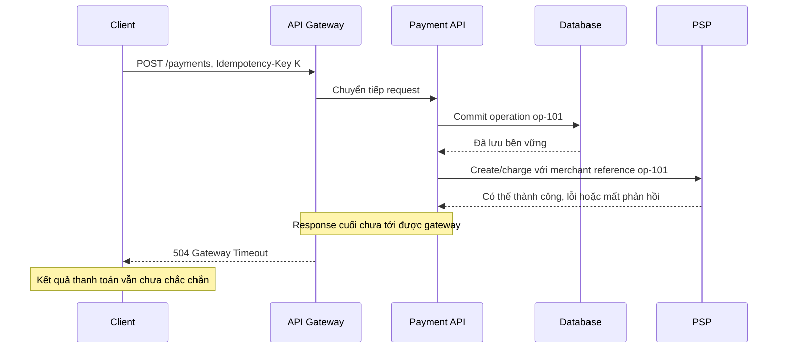
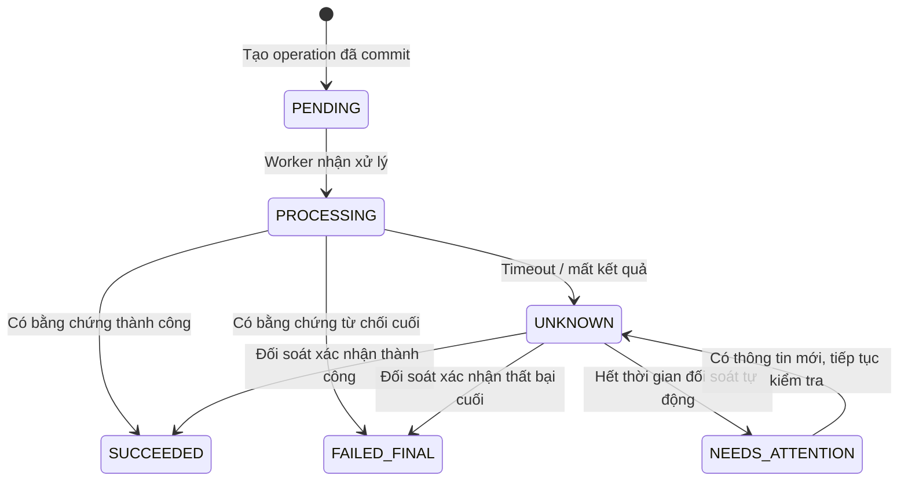
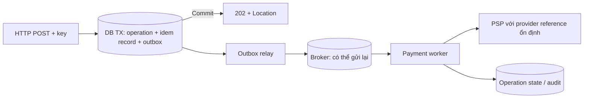
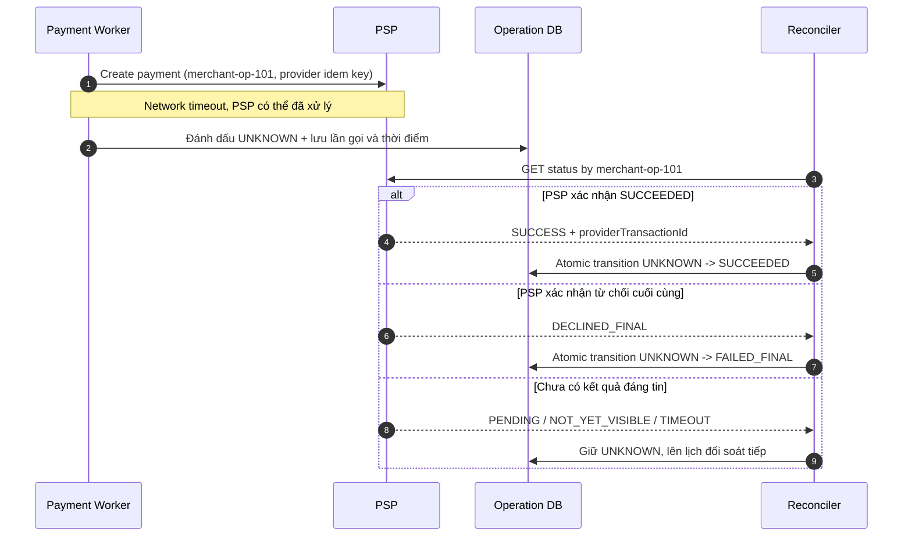

# Đối soát kết quả và giới hạn của lời hứa xử lý đúng một lần

## 1. Khi HTTP timeout nhưng giao dịch có thể đã thành công

Giả sử ứng dụng bán hàng có endpoint tạo yêu cầu thanh toán. Khách hàng nhấn **Thanh toán**, client gửi `POST`, gateway chờ một lúc rồi trả `504 Gateway Timeout`. Phải thông báo điều gì: *chưa thanh toán*, *đã thanh toán* hay *không biết*?

Không thể suy ra trạng thái giao dịch chỉ từ mã `504`. Trong lúc client chờ, hệ thống có thể đã:

1. Ghi yêu cầu thanh toán vào database nhưng chưa gửi response.
2. Gửi lệnh tới nhà cung cấp dịch vụ thanh toán (PSP), nhận kết quả thành công, nhưng mất kết nối trước khi lưu kết quả.
3. Bị ngắt mạng trong khi PSP vẫn đang xử lý lệnh.
4. Chưa nhận request vào application hoặc transaction chưa từng được commit.

Các kết quả ở trên **nhìn giống nhau từ phía client**, nhưng cách khôi phục khác nhau. Nếu client thấy timeout rồi tạo một yêu cầu hoàn toàn mới, khách có thể bị giữ tiền hoặc thu tiền hai lần. Nếu server mặc định “không thấy thành công tức là thất bại”, nó có thể trả tiền sai hoặc phát lệnh thanh toán tiếp theo trong lúc lệnh cũ chưa rõ kết quả.



Đó là trọng tâm của bài **“Đối soát kết quả và giới hạn của lời hứa xử lý đúng một lần”**, thuộc chương **Lũy đẳng và thử lại** của module **INTEGRATION_API_REST**. Theo mục tiêu module, bài kết nối HTTP resource/method/status, hợp đồng dữ liệu, idempotency, xử lý lỗi, xác thực/phân quyền, OpenAPI và kiểm thử với Java/Spring.

### Kết quả học tập

Sau bài học, người học có thể:

- Phân biệt **HTTP response**, **việc commit dữ liệu**, **việc thực thi side effect** và **trạng thái nghiệp vụ cuối cùng**.
- Giải thích tại sao “exactly once” **không thể được hứa hẹn vô điều kiện** chỉ bằng retry, message broker hoặc `Idempotency-Key`.
- Thiết kế `POST` có idempotency key, operation resource, status URL và cơ chế replay có hợp đồng.
- Xây **idempotency record bền vững** cùng transaction với nghiệp vụ ở phạm vi một database, xử lý hai request đồng thời.
- Đối soát kết quả **không chắc chắn** với PSP hoặc hệ thống phụ thuộc mà không phát side effect trùng.
- Triển khai Java/Spring theo ranh giới transaction đúng và kiểm thử bằng mô phỏng crash, timeout, duplicate event, callback đến muộn.

## 2. Bốn loại kết quả không được đánh đồng

### 2.1. Lớp HTTP không phản ánh đầy đủ trạng thái nghiệp vụ

| Câu hỏi | Bằng chứng có thể dùng | Không thể suy ra chỉ từ |
| --- | --- | --- |
| Request có đến application không? | Access log có correlation ID, idempotency record | Client thấy timeout hoặc mạng bị ngắt |
| Command đã được lưu bền vững chưa? | Transaction commit, operation ID trong DB có thẩm quyền | Worker có log “bắt đầu xử lý” |
| Tác động bên ngoài đã xảy ra chưa? | Provider transaction ID và trạng thái authoritative từ PSP | API không nhận được response PSP |
| Kết quả nghiệp vụ cuối đã được chốt chưa? | Operation terminal state, đối soát và audit | HTTP `200` ở một bước trung gian |

Vì thế cần phân biệt **acknowledgement** (đã nhận và lưu yêu cầu) với **completion** (đã đạt kết quả nghiệp vụ).

### 2.2. Từ vựng về bảo đảm

| Thuật ngữ | Nghĩa chính xác | Giới hạn cần ghi nhớ |
| --- | --- | --- |
| **At-most-once delivery** | Một message được chuyển đến tối đa một lần | Có thể bị mất, không đảm bảo đã xử lý |
| **At-least-once delivery** | Hệ thống cố gắng giao lại cho đến khi có xác nhận | Một message có thể đến nhiều lần |
| **Idempotent operation** | Thực hiện lặp cùng thao tác có cùng **hiệu quả dự kiến** | HTTP status/timestamp/log có thể khác; không chứng minh đã gửi lệnh một lần |
| **Deduplication** | Nhận diện yêu cầu/message đã thấy, tránh áp dụng lại tác động | Phụ thuộc scope, thời hạn lưu, unique key, tính nguyên tử |
| **Exactly-once processing** | Một cơ chế cụ thể có thể đảm bảo xử lý một lần **trong một ranh giới định nghĩa rõ** | Không tự mở rộng sang database, broker, PSP và notification khác |
| **Effectively-once business effect** | Các lần gửi lặp cho ra **một kết quả nghiệp vụ có thể kiểm chứng** | Cần idempotency, nguồn dữ liệu có thẩm quyền, đối soát và xử lý trường hợp ngoại lệ |

Một broker có thể quảng bá tính năng “exactly-once” cho việc xử lý/ghi kết quả **bên trong môi trường hoặc transaction do nó quản lý**. Điều đó không tự tạo một transaction nguyên tử giữa broker và giao dịch thu tiền do PSP xử lý. Hỏi chính xác **một lần của điều gì, trong phạm vi nào, với giả định nào và trong bao lâu** trước khi dùng cụm từ “exactly once” trong tài liệu kiến trúc.

### 2.3. HTTP method cũng không hứa xử lý một lần

- `GET`, `HEAD` là **safe methods** theo ngữ nghĩa HTTP; server không được dùng chúng để chủ ý kích hoạt giao dịch thanh toán.
- `PUT`, `DELETE` là idempotent về **tác động dự kiến** theo HTTP, nhưng một lần retry sau mất kết nối có thể nhận mã khác với lần đầu.
- `POST` **không mặc định idempotent**. API có thể bổ sung cơ chế idempotency ở tầng ứng dụng, nhất là khi tạo đơn, thanh toán, gửi lệnh nghiệp vụ.
- `PATCH` **không mặc định idempotent**, đặc biệt với phép tăng/giảm số lượng; điều kiện `If-Match` có thể chống ghi dựa trên phiên bản cũ, nhưng không thay thế dedup side effect đã xảy ra.

Ví dụ `PUT /preferences/u-1` được gửi hai lần có thể cho cùng trạng thái cuối; nhưng nếu handler còn phát email “Cập nhật thành công” mỗi lần, phần **side effect thông báo** vẫn có thể lặp. Một method idempotent không miễn trách nhiệm thiết kế idempotency cho tác động bên ngoài.

## 3. Đối soát là bước cần thiết khi kết quả không chắc chắn

**Đối soát kết quả (outcome reconciliation)** là quá trình lấy bằng chứng từ **nguồn có thẩm quyền** và so khớp nó với trạng thái lệnh/transaction cục bộ, nhằm xác định lệnh đã hoàn tất, thất bại dứt khoát hay vẫn cần chờ/can thiệp.

Ví dụ một operation thanh toán có các thông tin:

```json
{
  "operationId": "op-101",
  "orderId": "ord-123",
  "status": "PROCESSING",
  "providerReference": "merchant-op-101",
  "amountMinor": 125000,
  "currency": "VND"
}
```

Nếu gọi PSP bị timeout, **không** đặt trạng thái thành `FAILED_FINAL` ngay. Một luồng đối soát có thể:

1. Chuyển operation sang `UNKNOWN` hoặc `RECONCILIATION_REQUIRED`.
2. Dùng **merchant reference/operation ID ổn định** để truy vấn trạng thái từ PSP theo cơ chế họ hỗ trợ.
3. Xác minh merchant account, order, tiền tệ, số tiền và loại giao dịch; không dựa riêng vào một chuỗi `SUCCESS` thiếu ràng buộc.
4. Khi PSP xác nhận giao dịch thành công, ghi kết quả và provider transaction ID một lần theo transaction cục bộ.
5. Khi PSP xác nhận từ chối **cuối cùng**, đánh dấu lỗi cuối và áp dụng chính sách nghiệp vụ.
6. Nếu PSP chưa có kết quả chắc chắn, tiếp tục chờ/backoff, nhận webhook đã xác thực hoặc đưa vào hàng đợi xử lý thủ công.

Đối soát không đồng nghĩa “cứ timeout là gọi thu tiền lại”. Nếu PSP không hỗ trợ truy vấn/định danh giao dịch đáng tin, hệ thống phải **giới hạn hoặc dừng retry phát lệnh mới** cho đến khi có cách phân giải tình trạng, thay vì hứa chắc không thể double charge.

### 3.1. Phân biệt trạng thái tạm thời và cuối cùng



Đây là state machine **minh họa**. Có hệ thống cần thêm `CANCELLING`, `REFUND_PENDING`, `PARTIALLY_SETTLED`, `REVERSED` hoặc các trạng thái nghiệp vụ chi tiết hơn.

Ba quy tắc cần bảo vệ:

- `UNKNOWN` **không phải** `FAILED_FINAL`; không thông báo cho khách “chưa trừ tiền” nếu chưa xác minh.
- `SUCCEEDED` không nên bị ghi đè thành thất bại chỉ vì một webhook cũ hoặc retry trả lỗi sau đó.
- Chỉ transition có căn cứ từ provider/nguồn dữ liệu tin cậy mới được chốt terminal state; mọi transition được kiểm tra **nguyên tử** và có audit.

### 3.2. Nguồn chứng cứ và giới hạn của nó

| Nguồn | Giá trị | Hạn chế |
| --- | --- | --- |
| Local operation/outbox record | Bằng chứng request được commit để xử lý | Không chứng minh PSP đã thực thi |
| HTTP response đồng bộ từ PSP | Có thể mô tả kết quả thao tác | Mất response không cho biết trạng thái; “accepted” có thể chưa cuối |
| Provider status API | Nguồn kiểm tra kết quả qua provider reference | Có thể eventual consistency hoặc trạng thái chưa settled |
| Webhook đã xác thực | Cập nhật bất đồng bộ khi trạng thái thay đổi | Có thể đến lặp, trễ, lệch thứ tự hoặc thiếu |
| Báo cáo đối soát cuối ngày/settlement | Bằng chứng về kết quả tài chính ở bước đối soát | Có độ trễ; không luôn giải quyết nhu cầu realtime |

Thiết kế cần xác định **nguồn ưu tiên, cửa sổ nhất quán và cách xử lý bất đồng**. Một status API trả “not found” ngay sau timeout không luôn chứng minh lệnh trước chưa tồn tại nếu hệ thống provider có độ trễ ghi nhận; phải đọc hợp đồng provider và đặt giới hạn chờ phù hợp.

## 4. Hợp đồng HTTP: gửi lệnh an toàn, trả URI tra cứu kết quả

### 4.1. POST với khóa idempotency do client sinh

Giả sử API hỗ trợ thanh toán bất đồng bộ:

```http
POST /api/payment-operations HTTP/1.1
Host: api.example.test
Authorization: Bearer <synthetic-token>
Content-Type: application/json
Idempotency-Key: 7f4a-opaque-client-generated-key

{
  "orderId": "ord-123",
  "amountMinor": 125000,
  "currency": "VND"
}
```

`Idempotency-Key` là một **quy ước hợp đồng ứng dụng** được nhiều API sử dụng; không có nghĩa mọi server HTTP đều tự hỗ trợ hoặc mọi nhà cung cấp có chung quy tắc retention. Khóa nên là một token opaque đủ khó trùng, không chứa password, thông tin cá nhân hoặc số thẻ. Server định nghĩa rõ **scope**, yêu cầu uniqueness, fingerprint và thời gian giữ kết quả.

API có thể lưu operation **trước khi thực thi side effect** và trả:

```http
HTTP/1.1 202 Accepted
Location: /api/payment-operations/op-101
Content-Type: application/json
Cache-Control: no-store
Retry-After: 3

{
  "id": "op-101",
  "status": "PENDING",
  "statusUrl": "/api/payment-operations/op-101"
}
```

**`202 Accepted` nói rằng operation đã được nhận để xử lý, không bảo đảm thanh toán đã thành công.** `Location` dùng để chỉ URI của operation có thể tra cứu. `Retry-After` là gợi ý thời gian poll, không phải lời hứa kết quả sẵn sàng sau đúng số giây.

Nếu API tạo resource giao dịch hoàn chỉnh trong request và đã lưu nó bền vững, có thể dùng `201 Created`; nếu hoàn tất đồng bộ và trả resource, có thể dùng `200`/`201` tùy semantic. Chọn status từ **resource đã tạo và mức độ hoàn tất**, không dùng một mã cho mọi payment API.

### 4.2. GET trạng thái operation

```http
GET /api/payment-operations/op-101 HTTP/1.1
Authorization: Bearer <synthetic-token>
```

Khi còn chưa chắc:

```http
HTTP/1.1 200 OK
Content-Type: application/json
Cache-Control: no-store
Retry-After: 5

{
  "id": "op-101",
  "orderId": "ord-123",
  "status": "UNKNOWN",
  "statusReason": "AWAITING_PROVIDER_CONFIRMATION",
  "retryAfterSeconds": 5
}
```

Khi PSP xác nhận thành công:

```http
HTTP/1.1 200 OK
Content-Type: application/json
Cache-Control: no-store

{
  "id": "op-101",
  "orderId": "ord-123",
  "status": "SUCCEEDED",
  "result": {
    "paymentId": "pay-2401",
    "amountMinor": 125000,
    "currency": "VND"
  }
}
```

`GET` không kích hoạt một lần thanh toán mới. Trường hợp operation chưa hoàn tất vẫn có thể trả `200` vì **resource trạng thái** đã tồn tại; trạng thái nằm trong JSON. Cần chính sách retention đủ dài để client có thể tìm lại operation và kết quả sau sự cố; với dữ liệu cá nhân, endpoint luôn kiểm tra authorization.

### 4.3. Retry POST sau timeout

Nếu client không nhận được `202` do mạng ngắt, hành vi đúng là **gửi lại cùng phương thức, URI, key và payload** theo contract:

```http
POST /api/payment-operations HTTP/1.1
Idempotency-Key: 7f4a-opaque-client-generated-key
Content-Type: application/json

{"orderId":"ord-123","amountMinor":125000,"currency":"VND"}
```

Nếu operation `op-101` đã được tạo, API **không tạo `op-102`**. Trong contract minh họa, server có thể trả lại cùng `202`, `Location: /api/payment-operations/op-101` và body về operation ban đầu. Sau đó client GET operation; không tiếp tục POST bằng key mới vì thấy trạng thái chưa cuối.

Khi cùng key nhưng **payload khác**, server phải từ chối thay vì lặng lẽ coi là replay:

```http
HTTP/1.1 409 Conflict
Content-Type: application/problem+json
Cache-Control: no-store

{
  "type": "about:blank",
  "title": "Idempotency key conflict",
  "status": 409,
  "detail": "Khóa này đã được sử dụng cho một yêu cầu khác.",
  "code": "IDEMPOTENCY_KEY_REUSED"
}
```

Nếu yêu cầu có cùng key đang được commit hoặc xử lý, API phải có chính sách minh bạch: trả về operation đang có, hoặc mã lỗi tạm/thông báo retry như `409` tùy hợp đồng. **Không được phát side effect lần hai** chỉ vì record đang `PROCESSING`.

### 4.4. Mã HTTP và trạng thái nghiệp vụ không phải một

| Tình huống | Mã HTTP hợp lý | Thông tin cần cung cấp |
| --- | --- | --- |
| Lưu thành công operation xử lý nền | `202 Accepted` | `Location`, operation ID/status |
| Tạo resource hoàn chỉnh đồng bộ | `201 Created` | `Location` của resource đã tạo |
| Đọc một operation đang xử lý | `200 OK` | `status=PROCESSING` và hướng dẫn poll |
| Đọc một operation đã thành công | `200 OK` | `status=SUCCEEDED`, result được phép xem |
| Cùng key nhưng payload hoặc scope không khớp | `409 Conflict` theo contract | Error code ổn định, không echo dữ liệu nhạy cảm |
| Thiếu idempotency key bắt buộc | `400 Bad Request` theo contract | Hướng dẫn bổ sung header |
| Thiếu xác thực/không đủ quyền | `401`/`403` | Không tiết lộ operation của người khác |
| Request vượt rate limit | `429 Too Many Requests` | `Retry-After` khi phù hợp |
| Gateway timeout trong khi backend có thể đã commit | `504 Gateway Timeout` | **Không kết luận** giao dịch đã thất bại |
| Operation đã xác nhận bị từ chối nghiệp vụ | `200` khi GET operation, với `FAILED_FINAL`; hoặc 4xx ở request đồng bộ tùy contract | Lý do nghiệp vụ an toàn, không gây hiểu nhầm về trạng thái PSP |

Đối với `500/502/503/504`, không nên khuyên **mọi client tự retry ngay**. Retry an toàn phụ thuộc key được giữ, khả năng truy vấn kết quả và tính chất side effect; quá nhiều retry có thể gây quá tải hoặc tạo duplicate ở downstream.

### 4.5. Thuật toán retry hữu hạn ở client

Client nên tạo **một key cho một ý định thanh toán**, giữ key đó qua timeout và qua các lần thử lại:

```text
intent = load_or_create_persisted_payment_intent()
key = intent.idempotencyKey      # Tạo một lần, lưu qua app restart
payload = intent.originalPayload # Giữ nguyên ý định nghiệp vụ

for attempt in 1..MAX_ATTEMPTS:
    try:
        response = POST("/api/payment-operations", key, payload)
    catch timeout_or_connection_lost:
        backoff_with_jitter(attempt)
        continue

    if response.status == 202:
        save_operation_location(response.Location)
        poll_operation_with_bounded_interval_and_deadline()
        return

    if response.status in [502, 503, 504]:
        respect_Retry_After_if_present()
        backoff_with_jitter(attempt)
        continue

    if response.status == 429:
        respect_Retry_After_and_rate_limit_policy()
        continue_only_within_retry_budget()

    if response.status in [400, 401, 403, 409]:
        handle_per_documented_contract_without_new_payment_key()
        return

preserve_intent_and_key()
show_result_unknown_and_offer_status_recovery()
```

Đây là **giả mã**, không phải yêu cầu mọi `503` tự động retry: cần giới hạn thời gian, hiểu status/error code cụ thể, ngắt retry khi hệ thống quá tải và tránh retry đồng thời từ nhiều thiết bị cho cùng intent. Nếu ứng dụng khởi động lại sau khi timeout, key/payload và operation URL đã biết phải còn để phục hồi; nếu dữ liệu đó chỉ nằm trong RAM, client dễ tạo một ý định mới ngoài chủ đích.

## 5. Bản ghi idempotency bền vững phải lưu điều gì?

Một cache in-memory kiểu `Map<key, response>` có thể hoạt động trong demo nhưng không an toàn khi có nhiều replica, restart hoặc failover. Server cần một **nguồn dữ liệu có thẩm quyền** để mọi instance cùng xác định “operation nào đã được tạo cho key này”.

### 5.1. Mô hình dữ liệu

| Field | Ý nghĩa | Ràng buộc |
| --- | --- | --- |
| `scope_id` | Namespace của key, ví dụ tenant/account/operation type | Phải dùng server-side identity đã xác thực |
| `idempotency_key` | Token client cung cấp | Unique trong scope và retention window |
| `request_fingerprint` | Digest của nội dung request có nghĩa nghiệp vụ | Phát hiện dùng cùng key cho yêu cầu khác |
| `operation_id` | Liên kết tới resource công việc bền vững | Không được sinh ID mới khi replay |
| `accepted_status`, `accepted_location` | Kết quả HTTP được công bố cho lần chấp nhận đầu | Có thể phát lại nhất quán |
| `created_at`, `expires_at` | Vòng đời dedup/replay | Retention được tài liệu hóa và quản lý |
| `operation_state` (qua bảng operation) | PENDING/PROCESSING/UNKNOWN/SUCCEEDED... | Không dùng mỗi trạng thái HTTP làm source of truth |
| `provider_reference` (qua operation) | Khóa để đối soát PSP | Ổn định, không phát sinh mới khi retry |

**Scope và fingerprint cần được thiết kế cùng nhau.** Nếu hai tenant dùng cùng key, phải là hai namespace độc lập; nếu cùng tenant gửi key cũ cho amount khác, phải phát hiện conflict. Không tin tenant ID do client tự khai trong body nếu chưa so khớp với identity được cấp quyền.

### 5.2. Dấu vân tay request không nên là chuỗi body thô

Hai JSON có thể biểu diễn cùng dữ liệu nhưng khác thứ tự thuộc tính hoặc khoảng trắng; ngược lại cùng đường dẫn có thể có biến thể nghiệp vụ theo currency, account, amount, resource hoặc API version. Cần quy tắc fingerprint được công bố hoặc ít nhất ổn định trong triển khai:

```text
fingerprint_input =
    operation_type
    + HTTP method
    + canonical route/target identity
    + canonical business payload fields
    + semantic API version

request_fingerprint = SHA-256(fingerprint_input)
```

Đây chỉ là biểu diễn **ý tưởng**: ở production phải có encoding/canonicalization không mơ hồ, trường dữ liệu được phép và cách phân tách chuẩn. Tốt nhất tránh log raw payload hay nguyên token; với payload chứa bí mật hoặc giá trị dễ đoán, cần đánh giá cách hash/HMAC và quyền truy cập idempotency store. Không dùng digest làm cơ chế authentication.

### 5.3. Retention là một phần lời hứa idempotency

Ví dụ API cam kết nhận diện replay trong 24 giờ. Sau 24 giờ, record HTTP có thể hết hạn, nhưng **không thể mặc định lệnh thu tiền lặp lại là an toàn**. Một merchant reference hoặc business uniqueness constraint có thể cần được giữ lâu hơn cửa sổ replay để ngăn **double charge** sau khi idempotency key bị xóa.

Nên công bố rõ:

- Key có hiệu lực trong bao lâu; khi quá hạn client phải tra cứu giao dịch theo `orderId`/operation ID, không cứ thế gửi lại lệnh mới.
- Replay cùng key/cùng payload trả kết quả nào; khi operation đã terminal GET sẽ biểu diễn kết quả ra sao.
- Khi key trùng với payload khác thì status và error code là gì.
- Quy tắc scope khi cùng key được gửi bởi tenant, resource hoặc phiên bản API khác.
- Cách xử lý trường hợp key đã hết hạn nhưng một operation cũ **vẫn còn `UNKNOWN`**; không giải phóng quyền phát side effect chỉ vì TTL của HTTP record hết.

## 6. Cấp phát một operation duy nhất: transaction, unique constraint và outbox

### 6.1. Khởi tạo phải nguyên tử ở database

Không an toàn nếu nhiều replica cùng thực hiện:

```text
if cache.get(key) == null:
    callPaymentProvider()
    cache.put(key, response)
```

Hai request có thể cùng thấy cache chưa có key; hoặc server crash **sau khi PSP xử lý** nhưng **trước khi ghi cache**. Cần tạo **operation bền vững trước**, rồi mới gửi lệnh tới hệ thống ngoài qua cơ chế tin cậy.

Ví dụ schema PostgreSQL giản lược:

```sql
CREATE TABLE payment_operations (
    operation_id UUID PRIMARY KEY,
    tenant_id TEXT NOT NULL,
    payment_intent_id TEXT NOT NULL,
    provider_reference TEXT NOT NULL UNIQUE,
    state TEXT NOT NULL,
    amount_minor BIGINT NOT NULL CHECK (amount_minor > 0),
    currency CHAR(3) NOT NULL,
    provider_transaction_id TEXT,
    created_at TIMESTAMPTZ NOT NULL DEFAULT now(),
    updated_at TIMESTAMPTZ NOT NULL DEFAULT now(),
    UNIQUE (tenant_id, payment_intent_id)
);

CREATE TABLE idempotency_records (
    scope_id TEXT NOT NULL,
    idem_key TEXT NOT NULL,
    request_fingerprint TEXT NOT NULL,
    operation_id UUID NOT NULL REFERENCES payment_operations(operation_id),
    accepted_http_status SMALLINT NOT NULL,
    accepted_location TEXT NOT NULL,
    created_at TIMESTAMPTZ NOT NULL DEFAULT now(),
    expires_at TIMESTAMPTZ NOT NULL,
    PRIMARY KEY (scope_id, idem_key)
);

CREATE TABLE outbox_events (
    event_id UUID PRIMARY KEY,
    operation_id UUID NOT NULL REFERENCES payment_operations(operation_id),
    event_type TEXT NOT NULL,
    payload JSONB NOT NULL,
    created_at TIMESTAMPTZ NOT NULL DEFAULT now(),
    delivered_at TIMESTAMPTZ
);
```

`payment_intent_id` là định danh **ý định thanh toán nghiệp vụ** ổn định cho một lượt thanh toán hợp lệ. Ràng buộc `UNIQUE(tenant_id, payment_intent_id)` ngăn một payment intent bị tạo nhiều operation chỉ vì client dùng key mới. Một ý định mới sau khi giao dịch trước **thất bại cuối cùng** chỉ được tạo theo **chính sách nghiệp vụ riêng**; không dùng thay key đơn thuần để vượt hạn chế.

Một local transaction tạo cùng lúc:

```sql
BEGIN;

-- Các ID/giá trị được application tạo và validate trước transaction.
INSERT INTO payment_operations (
    operation_id, tenant_id, payment_intent_id,
    provider_reference, state, amount_minor, currency
) VALUES (
    :operation_id, :tenant_id, :intent_id,
    :provider_reference, 'PENDING', :amount_minor, :currency
);

INSERT INTO idempotency_records (
    scope_id, idem_key, request_fingerprint,
    operation_id, accepted_http_status, accepted_location, expires_at
) VALUES (
    :scope_id, :idem_key, :fingerprint,
    :operation_id, 202, :location, :expires_at
);

INSERT INTO outbox_events (
    event_id, operation_id, event_type, payload
) VALUES (
    :event_id, :operation_id, 'PaymentRequested', :minimal_payload
);

COMMIT;
```

Nếu một INSERT vi phạm unique constraint, **rollback toàn transaction**; sau đó đọc bản ghi có thẩm quyền và xử lý replay hoặc business conflict. Không giữ một operation “mồ côi” chỉ vì idempotency insert thất bại. Các ràng buộc phải tồn tại thật ở DB, không chỉ là phép `findByKey` trong application.

### 6.2. Hai POST cùng key đến đúng một thời điểm

```text
T0: Request A và B cùng key K, cùng payment intent I.
T1: A bắt đầu transaction, INSERT operation + idempotency K.
T2: B cũng bắt đầu transaction, cố INSERT cùng key/intent.
T3: Unique constraint/transaction serialization chỉ cho một
    giao dịch commit phiên bản có thẩm quyền.
T4: Request thua rollback, đọc lại idempotency record của K.
T5: Cùng fingerprint -> trả cùng Location; khác -> 409.
```

Không được dựa vào việc hai HTTP requests hiếm khi tới cùng thời điểm. Việc mất kết nối sau commit, retry của gateway hoặc double-click ở UI khiến race này rất dễ xuất hiện. Nếu transaction đang thắng chưa commit, request còn lại có thể phải chờ hoặc nhận kết quả “đang xử lý” theo chính sách deadline; **không gọi PSP trong lúc chờ khóa DB**.

### 6.3. Ghi outbox trong cùng transaction để không mất ý định xử lý

Nếu server chỉ:

```text
COMMIT operation PENDING
publish "PaymentRequested" tới broker
```

thì crash ở giữa có thể để operation tồn tại mãi nhưng **không có message**. Ghi **outbox event trong cùng DB transaction với operation** giúp relay phát event khi ứng dụng phục hồi.

Tuy nhiên, relay thường có thể phát **nhiều lần** nếu crash giữa publish và ghi `delivered_at`. Vì vậy consumer phải tự xử lý trùng theo `event_id` hoặc operation ID; outbox không mang bảo đảm exactly-once end-to-end.



### 6.4. Không giữ DB transaction mở trong lúc gọi PSP

Đừng làm:

```text
BEGIN database transaction
  lock row
  call PSP (mạng mất 30 giây)
  update result
COMMIT
```

Network call không thuộc database transaction, nên dù DB rollback, PSP có thể đã thu tiền. Hơn nữa, lock kéo dài làm giảm throughput và tăng deadlock/timeouts. Hướng triển khai thực tế:

1. Commit operation/idempotency/outbox bền vững.
2. Worker lấy công việc và đánh dấu đang xử lý bằng lease/claim có điều kiện.
3. Worker gọi PSP với **provider reference và khóa idempotency ổn định** theo contract của PSP.
4. Ghi trạng thái có căn cứ vào DB bằng transition nguyên tử.
5. Nếu timeout, chuyển sang trạng thái chưa rõ và thực hiện đối soát.

Khi worker crash sau khi claim mà chưa gọi PSP, cần **lease expiry và recovery**. Nhưng recovery không được suy từ “lease hết hạn” rằng PSP chưa xử lý; nếu có khả năng lệnh đã được gửi, phải tra cứu provider/nhận event hoặc retry bằng **đúng khóa mà PSP bảo đảm dedup**.

## 7. Đối soát với nhà cung cấp: từ UNKNOWN đến kết quả có bằng chứng

### 7.1. Một trình tự an toàn sau timeout

Giả sử PSP cung cấp:

- Endpoint tạo giao dịch có idempotency key do merchant cung cấp.
- Endpoint tra cứu kết quả bằng `merchantReference`.
- Webhook báo trạng thái đã được ký, có `providerEventId`.

Với operation `op-101`, hệ thống sinh `merchantReference = merchant-op-101` **một lần**, giữ nguyên qua retry. Trình tự:



**Đặc biệt:** “Không tìm thấy giao dịch” không phải lúc nào cũng bằng “giao dịch chưa từng được tạo”. Nếu PSP có độ trễ indexing hoặc trả kết quả eventually consistent, cần chờ thêm hoặc dùng kênh xác minh khác theo hợp đồng PSP trước khi phát lệnh mới.

### 7.2. Webhook là nguồn bằng chứng bổ sung, không phải tín hiệu tin cậy mặc định

Trước khi áp dụng webhook:

1. **Xác thực chữ ký** hoặc cơ chế xác thực webhook theo PSP, kiểm tra timestamp/replay window nếu provider yêu cầu.
2. Xác thực `merchantReference`, `providerTransactionId`, merchant account, amount và currency khớp với operation.
3. Dedup `providerEventId` bằng unique constraint, hoặc transition có điều kiện nếu provider không có ID ổn định.
4. Không cho event cũ ghi đè trạng thái mới; dùng version/sequence của provider khi có, kết hợp state machine.
5. Chỉ ACK webhook khi dữ liệu nhận và ý định xử lý được lưu **bền vững**; nếu xử lý nền, ghi inbox/outbox rồi ACK theo quy tắc provider.

Một webhook `SUCCESS` đến trước HTTP response `PENDING` có thể là bình thường. Nếu chưa thiết kế thứ tự, callback muộn từ lệnh cũ có thể đặt lại trạng thái sai. Không dùng “event nào tới sau cùng thì thắng” cho dữ liệu tài chính.

### 7.3. Khi bằng chứng mâu thuẫn

Ví dụ local DB ghi `FAILED_FINAL`, nhưng báo cáo settlement từ PSP cho thấy đã capture tiền. Không được “xóa sự kiện khó chịu” để giữ số liệu khớp. Cần chuyển sang luồng **RECONCILIATION_REQUIRED / NEEDS_ATTENTION**, ghi sai lệch, điều tra nguyên nhân và cập nhật theo quy trình có kiểm toán. Một lệnh refund mới có thể cũng bị timeout; nó phải có **operation ID/idempotency scope riêng**, không nên tự động phát lại không kiểm soát.

Các trạng thái tài chính như **AUTHORIZED, CAPTURED, VOIDED, REFUNDED, SETTLED** cần được phân biệt nếu PSP trả chúng. “Thành công” của bước authorize không đồng nghĩa tiền đã capture/settle. Việc gộp mọi giai đoạn vào một boolean `paid=true` khiến đối soát không đủ chính xác.

### 7.4. Nguồn có thẩm quyền và sự kiện đến muộn

Nên lập bảng quy tắc nguồn:

| Loại dữ kiện | Nguồn ưu tiên | Hành vi khi xung đột |
| --- | --- | --- |
| Request đã được hệ thống tiếp nhận | Idempotency/operation DB | Không tạo operation mới với cùng scope và key |
| PSP đã nhận/thu/hoàn tiền | PSP status API, webhook đã xác thực, settlement theo chính sách | Đối soát, không tự đoán từ timeout |
| Đơn hàng được phép chuyển trạng thái | Order DB/business rules có thẩm quyền | Kiểm tra version/state tại commit |
| Đã gửi notification | Notification dedup/receipt store | Có thể retry với notification ID ổn định |
| Kết quả mà client đang xem | Operation resource đã tổng hợp | Không phản ánh terminal trước khi có bằng chứng |

Không một nguồn nào là “mạnh nhất” cho **mọi loại sự thật**. Đó là lý do lưu **cả local operation và external reference**, không chỉ chọn một trường `status` chung cho tất cả.

## 8. Ma trận crash, retry và hành động khôi phục

Ma trận này là phần cần đưa vào thiết kế và test trước khi tuyên bố API an toàn với retry:

| Điểm lỗi | Có thể đã xảy ra | Client/server nên làm gì | Nguy cơ nếu làm sai |
| --- | --- | --- | --- |
| Trước DB commit tạo operation | Chưa có record bền vững | Client retry **cùng key**; server có thể tạo lần đầu | Giả định đã tạo khi chưa có record |
| Sau DB commit nhưng trước HTTP 202 | Operation và outbox đã lưu | Retry cùng key, trả lại **cùng operation ID** | Sinh thêm operation/side effect |
| Sau commit trước relay publish | Outbox còn chờ | Relay phục hồi và gửi message | Operation mắc kẹt nếu không có outbox |
| Sau relay publish trước đánh dấu delivered | Message có thể đã tới broker | Relay có thể phát lại, consumer dedup | Worker xử lý hai lần |
| Worker claim rồi crash trước call PSP | Chưa chắc đã gọi PSP | Lease/recovery, dùng reference ổn định; kiểm tra khi không chắc | Lệnh bị kẹt hoặc phát lại tùy tiện |
| PSP xử lý thành công nhưng response bị mất | Tiền đã có thể bị thu | Mark `UNKNOWN`, query provider, nhận webhook | Double charge nếu charge bằng reference mới |
| PSP trả “processing” lâu | Kết quả chưa cuối | Tiếp tục theo dõi và giới hạn retry | Kết luận thất bại quá sớm |
| Webhook `SUCCESS` gửi hai lần | Cùng event đến nhiều lần | Inbox/event ID unique, atomic transition | Nhân đôi booking/audit/notification |
| Webhook cũ đến sau terminal state mới | Thứ tự thông tin đảo | State guard/version/sequence, đối soát nếu bất thường | Ghi đè terminal state |
| Record idempotency hết TTL, operation còn UNKNOWN | Chưa rõ side effect | Giữ business guard, tra cứu operation, chưa mở lệnh mới | Vượt cửa sổ replay và double charge |
| Gateway tự retry POST không giữ key | Client không kiểm soát request lặp | Cấu hình retry có điều kiện, bảo toàn key/payload | Tạo operation khác nhau |
| Provider idempotency key hết hạn | Provider có thể nhận lại lệnh như mới | Dựa vào status/settlement và chính sách provider, không phát lại mù | Double charge sau provider TTL |

**Điểm cốt lõi:** Mỗi hàng cần một đường khôi phục **có thể lặp lại và kiểm thử được**. Nếu không xác định được hiệu quả thực tế ở provider, trạng thái đúng là **chưa rõ**, không phải tự chọn “thất bại” để giải phóng quy trình.

## 9. Java/Spring Boot: tách tiếp nhận HTTP khỏi xử lý side effect

Ví dụ dưới đây dùng **Java 17+, Spring Boot 3, Spring MVC 6**. Các DTO và controller là mẫu hợp đồng; `PaymentApplicationService` là interface cần được triển khai với database transaction, unique constraint, authorization và outbox như mục 6. Không chạy PSP trong controller và không biến các đoạn code ngắn này thành lời hứa bảo đảm xử lý đúng một lần.

### 9.1. Controller cho POST và GET operation

```java
package example.payments.api;

import java.net.URI;
import java.security.Principal;
import jakarta.validation.Valid;
import jakarta.validation.constraints.NotBlank;
import jakarta.validation.constraints.Positive;
import org.springframework.http.CacheControl;
import org.springframework.http.ResponseEntity;
import org.springframework.web.bind.annotation.*;

@RestController
@RequestMapping("/api/payment-operations")
public class PaymentController {

    private final PaymentApplicationService service;

    public PaymentController(PaymentApplicationService service) {
        this.service = service;
    }

    public record PaymentInput(
            @NotBlank String paymentIntentId,
            @NotBlank String orderId,
            @Positive long amountMinor,
            @NotBlank String currency) {}

    public record OperationView(
            String id, String orderId, String status) {}

    @PostMapping
    public ResponseEntity<OperationView> accept(
            @RequestHeader("Idempotency-Key") String key,
            @Valid @RequestBody PaymentInput input,
            Principal principal) {

        // Service lấy scope từ identity được xác thực, kiểm tra payload,
        // atomically create-or-replay operation trong DB, không gọi PSP.
        OperationView op = service.accept(
                principal.getName(), key, input);

        URI location = URI.create("/api/payment-operations/" + op.id());
        return ResponseEntity.accepted()
                .location(location)
                .cacheControl(CacheControl.noStore())
                .body(op);
    }

    @GetMapping("/{id}")
    public ResponseEntity<OperationView> get(
            @PathVariable("id") String id, Principal principal) {

        // Không kích hoạt PSP; service kiểm tra người gọi có quyền đọc.
        OperationView op = service.findVisibleTo(principal.getName(), id);
        return ResponseEntity.ok()
                .cacheControl(CacheControl.noStore())
                .body(op);
    }
}

interface PaymentApplicationService {
    PaymentController.OperationView accept(
            String actor, String key, PaymentController.PaymentInput input);
    PaymentController.OperationView findVisibleTo(String actor, String id);
}
```

Ví dụ cố ý chọn **contract replay luôn trả `202` với cùng `Location`** cho những lần gửi lại đúng key/payload, dù operation thực tế có thể đã terminal. Client đọc `GET /api/payment-operations/{id}` để biết kết quả mới nhất. Một API khác có thể trả lại **nguyên status/body lần đầu** hoặc trả `200` với trạng thái hiện tại; chính sách nào cũng cần được tài liệu hóa và thực thi nhất quán.

Chú ý `Principal` chỉ đại diện danh tính. Service vẫn phải xác minh tenant, quyền đối với `orderId`, số tiền, tiền tệ và `paymentIntentId`; không tin vào dữ liệu do client tự nhận là thuộc mình.

### 9.2. Exception về key trùng khác payload

```java
package example.payments.api;

import org.springframework.http.HttpStatus;
import org.springframework.http.ProblemDetail;
import org.springframework.http.ResponseEntity;
import org.springframework.web.bind.annotation.ExceptionHandler;
import org.springframework.web.bind.annotation.RestControllerAdvice;

class IdempotencyConflictException extends RuntimeException {}

@RestControllerAdvice
public class PaymentErrorHandler {

    @ExceptionHandler(IdempotencyConflictException.class)
    public ResponseEntity<ProblemDetail> idempotencyConflict() {
        ProblemDetail p = ProblemDetail.forStatus(HttpStatus.CONFLICT);
        p.setTitle("Idempotency key conflict");
        p.setDetail("Khóa đã được dùng cho một yêu cầu khác.");
        p.setProperty("code", "IDEMPOTENCY_KEY_REUSED");

        return ResponseEntity.status(HttpStatus.CONFLICT).body(p);
    }
}
```

Không nên đưa key, số tiền, payload gốc hoặc thông điệp lỗi SQL vào body xung đột. Trong ứng dụng thật, thêm xử lý 400/401/403/404/429/5xx phù hợp, và giữ nguyên error handling do Spring/Security thực hiện khi không liên quan idempotency.

### 9.3. Service nghiệp vụ: hai transaction không bị nhầm thành một

Pseudocode sau cho thấy ranh giới mà implementation phải giữ:

```text
accept(actor, key, payload):
    authorize(actor, payload.orderId)
    validate_amount_currency_intent(payload)
    scope = server_derived_scope(actor, endpoint, tenant)
    fingerprint = canonical_fingerprint(payload, method, target, version)

    TRANSACTION:
      if durable_idempotency_record(scope, key) exists:
          assert_same_fingerprint_or_409()
          return stored_operation_and_acceptance_response()

      create_new_payment_operation_with_stable_provider_reference()
      insert_idempotency_record(scope, key, fingerprint, operationId)
      insert_outbox_event(operationId, "PaymentRequested")
      commit
    ON UNIQUE CONFLICT:
      rollback
      read committed record/intent and resolve replay-or-conflict

    return 202 + original Location (never call PSP here)

worker(operationId):
    claim_operation_with_atomic_lease_and_state_guard()
    if external_outcome_may_already_exist:
        reconcile_by_stable_provider_reference_before_retry()
    else:
        call_PSP_with_stable_reference_and_provider_idempotency_key()
    persist_verified_outcome_in_separate_transaction()
    on timeout: mark UNKNOWN, schedule reconciliation
```

**Không để `@Transactional` bọc một call PSP kéo dài** và nghĩ rằng rollback có thể hoàn tác giao dịch tại PSP. `@Transactional` chỉ bảo vệ những resource do transaction manager đó điều phối, thường là một DB. Sau khi operation được commit, sự phục hồi dựa vào outbox, worker và PSP idempotency/status API.

Một implementation production cần thêm: retryable database conflicts, lock timeout, optimistic version guard, transactional commit của accepted response, job lease recovery, độc lập quyền xem operation, handling provider event/out-of-order và thời hạn retention. Nếu không có những thành phần ấy, controller mới chỉ định nghĩa HTTP surface.

### 9.4. Đừng trả 202 trước khi đã commit bền vững

Hãy phân biệt:

```text
Không nên:
  nhận POST -> gửi 202 -> mới ghi operation vào database
  (crash trước DB commit: client có URI nhưng server không nhớ request)

Nên:
  nhận POST -> commit operation + idempotency + outbox
  -> gửi 202 với cùng operation ID đã được lưu
```

Nếu một service dùng hàng đợi làm **nguồn ghi bền vững**, contract có thể khác, nhưng vẫn phải có bằng chứng message được nhận bền vững trước khi công bố accepted; không dựa vào thao tác enqueue chỉ tồn tại trong bộ nhớ.

## 10. Kiểm thử HTTP bằng MockMvc và kiểm thử lỗi xuyên ranh giới

### 10.1. Test POST replay cùng key và conflict khác payload

Ví dụ dùng **JUnit 5 và MockMvc standalone** với một fake service có bộ nhớ, chỉ kiểm tra contract HTTP. Fake không có transaction hoặc quyền phân tán, nên **không** được xem là test bảo đảm dedup production.

```java
package example.payments.api;

import static org.junit.jupiter.api.Assertions.assertEquals;
import static org.springframework.test.web.servlet.request.MockMvcRequestBuilders.post;
import static org.springframework.test.web.servlet.result.MockMvcResultMatchers.header;
import static org.springframework.test.web.servlet.result.MockMvcResultMatchers.status;

import java.util.HashMap;
import java.util.Map;
import org.junit.jupiter.api.Test;
import org.springframework.http.HttpHeaders;
import org.springframework.test.web.servlet.MockMvc;
import org.springframework.test.web.servlet.setup.MockMvcBuilders;

class PaymentHttpContractTest {

    private static final String URI = "/api/payment-operations";

    private static final class FakeService
            implements PaymentApplicationService {

        private final Map<String, String> fingerprintByKey = new HashMap<>();
        private int operationsCreated = 0;

        @Override
        public PaymentController.OperationView accept(
                String actor, String key, PaymentController.PaymentInput input) {

            String scopedKey = actor + "|" + key;
            // Test-only fingerprint; production dùng canonicalization chuẩn.
            String payload = input.paymentIntentId() + "|" + input.orderId()
                    + "|" + input.amountMinor() + "|" + input.currency();
            String previous = fingerprintByKey.get(scopedKey);
            if (previous != null && !previous.equals(payload)) {
                throw new IdempotencyConflictException();
            }
            if (previous == null) {
                fingerprintByKey.put(scopedKey, payload);
                operationsCreated++;
            }
            return new PaymentController.OperationView(
                    "op-101", input.orderId(), "PENDING");
        }

        @Override
        public PaymentController.OperationView findVisibleTo(
                String actor, String id) {
            return new PaymentController.OperationView(
                    id, "ord-123", "UNKNOWN");
        }
    }

    @Test
    void sameKeySamePayloadReturnsSameLocation() throws Exception {
        FakeService fake = new FakeService();
        MockMvc mvc = MockMvcBuilders
                .standaloneSetup(new PaymentController(fake))
                .setControllerAdvice(new PaymentErrorHandler())
                .build();

        String payload = """
                {"paymentIntentId":"intent-1","orderId":"ord-123",
                 "amountMinor":125000,"currency":"VND"}
                """;

        for (int i = 0; i < 2; i++) {
            mvc.perform(post(URI)
                    .principal(() -> "alice")
                    .header("Idempotency-Key", "test-key-1")
                    .contentType("application/json")
                    .content(payload))
                .andExpect(status().isAccepted())
                .andExpect(header().string(
                    HttpHeaders.LOCATION,
                    "/api/payment-operations/op-101"));
        }
        assertEquals(1, fake.operationsCreated);
    }

    @Test
    void sameKeyDifferentPayloadReturns409() throws Exception {
        FakeService fake = new FakeService();
        MockMvc mvc = MockMvcBuilders
                .standaloneSetup(new PaymentController(fake))
                .setControllerAdvice(new PaymentErrorHandler())
                .build();

        mvc.perform(post(URI).principal(() -> "alice")
                .header("Idempotency-Key", "test-key-1")
                .contentType("application/json")
                .content("""
                    {"paymentIntentId":"intent-1","orderId":"ord-123",
                     "amountMinor":125000,"currency":"VND"}
                    """))
            .andExpect(status().isAccepted());

        mvc.perform(post(URI).principal(() -> "alice")
                .header("Idempotency-Key", "test-key-1")
                .contentType("application/json")
                .content("""
                    {"paymentIntentId":"intent-1","orderId":"ord-123",
                     "amountMinor":130000,"currency":"VND"}
                    """))
            .andExpect(status().isConflict());
        assertEquals(1, fake.operationsCreated);
    }
}
```

Trong source thật, `FakeService` phải được thay bằng service dùng database uniqueness và transaction; test cần thêm Spring Security để xác minh scope/key không trộn giữa tenant. `Text Blocks` yêu cầu Java phiên bản phù hợp (Java 17+ đã được chọn).

### 10.2. Test tính nguyên tử bằng DB thực

Với PostgreSQL test environment hoặc Testcontainers, tạo **hai connection/transaction độc lập** và một barrier để hai request cùng tranh một key:

```text
Given:
  idempotency_records chưa có (scope S, key K)
  payment_intent I chưa có operation

When:
  request A POST K, payload P
  request B POST K, payload P
  chạy đồng thời trên hai application instances/transactions

Then:
  đúng một operation và một outbox command được commit
  cả A và B (sau khi conflict được giải quyết) cùng trả operation ID
  không có hai provider references cho cùng payment intent I
```

Test thêm tình huống **cùng key nhưng payload khác**: chỉ payload thắng được lưu; request còn lại nhận `409` và không tạo side effect. Không kiểm thử bằng `Thread.sleep()` và một in-memory `HashMap` rồi kết luận đã bảo đảm nguyên tử.

### 10.3. Fault injection cho những cửa sổ khó nhất

Thiết lập PSP fake có thể điều khiển việc **thu tiền rồi làm mất response**:

```text
Test: PSP đã xử lý nhưng response timeout
  1. Worker gửi operation op-101 tới PSP fake.
  2. PSP fake ghi SUCCESS cho merchant-op-101.
  3. PSP fake cắt kết nối trước khi trả HTTP response.
  4. Worker ghi UNKNOWN, không sinh provider reference mới.
  5. Reconciler query merchant-op-101, nhận SUCCESS.
  6. Operation được chốt SUCCEEDED một lần.
  7. Lần retry HTTP cùng key trả cùng op-101.

Assertions:
  one business payment effect
  one logical operation per payment intent
  one terminal transition (không bị webhook cũ ghi đè)
  provider reference stable across retries
  no duplicate customer notification for same completed operation
```

Một test khác dừng process **ngay sau outbox publish nhưng trước `delivered_at`**, rồi khởi động lại; message có thể được giao hai lần, nhưng inbox/consumer guard phải tránh tác động nghiệp vụ trùng. Test thứ ba cho webhook `SUCCESS` đến hai lần hoặc đến muộn sau khi query PSP xác nhận; chỉ một lần cập nhật kết quả.

**Không yêu cầu tất cả thành phần phải phát đúng một HTTP call.** Test cần chứng minh **hậu quả nghiệp vụ không bị nhân đôi và trạng thái cuối được đối soát**, trong phạm vi và điều kiện đã công bố.

## 11. OpenAPI và lời hứa công khai với client

Hợp đồng API phải nêu rõ **retry sau kết quả không chắc chắn**, không chỉ liệt kê header `Idempotency-Key`. Một schema OpenAPI 3.1 tối giản:

```yaml
openapi: 3.1.0
info:
  title: Payment Operations API
  version: 1.0.0
paths:
  /api/payment-operations:
    post:
      operationId: acceptPaymentOperation
      summary: Accept an idempotent payment operation
      description: |
        Same authenticated scope + Idempotency-Key + same semantic payload
        reuses the accepted operation within the documented retention window.
        HTTP 202 means accepted, not payment completion.
      parameters:
        - in: header
          name: Idempotency-Key
          required: true
          description: Opaque client-generated key retained for the documented window.
          schema:
            type: string
            minLength: 1
      requestBody:
        required: true
        content:
          application/json:
            schema:
              type: object
              required: [paymentIntentId, orderId, amountMinor, currency]
              properties:
                paymentIntentId: { type: string }
                orderId: { type: string }
                amountMinor: { type: integer, minimum: 1 }
                currency: { type: string, minLength: 3, maxLength: 3 }
      responses:
        '202':
          description: Durable operation accepted or replayed
          headers:
            Location:
              description: URI of the accepted operation
              schema: { type: string }
            Retry-After:
              description: Optional suggestion for polling delay
              schema: { type: string }
          content:
            application/json:
              schema:
                $ref: '#/components/schemas/Operation'
        '400': { description: Invalid request or missing required key }
        '401': { description: Authentication required }
        '403': { description: Caller not authorized for payment intent }
        '409': { description: Key reused with different request, or business conflict }
        '429': { description: Rate limit exceeded }
  /api/payment-operations/{id}:
    get:
      operationId: getPaymentOperation
      parameters:
        - in: path
          name: id
          required: true
          schema: { type: string }
      responses:
        '200':
          description: Current operation state, which may be nonterminal
          content:
            application/json:
              schema:
                $ref: '#/components/schemas/Operation'
        '401': { description: Authentication required }
        '403': { description: Forbidden }
        '404': { description: Operation not found or hidden }
components:
  schemas:
    Operation:
      type: object
      required: [id, orderId, status]
      properties:
        id: { type: string }
        orderId: { type: string }
        status:
          type: string
          enum:
            - PENDING
            - PROCESSING
            - UNKNOWN
            - NEEDS_ATTENTION
            - SUCCEEDED
            - FAILED_FINAL
```

Khung này không thay thế phần security schemes, Problem Details, `Cache-Control` và schema kết quả chi tiết. Trong tài liệu sản phẩm cần bổ sung **thời hạn key, chính sách key reuse, cách client lấy lại operation ID, eventual consistency window, hành vi callback/webhook và cơ chế khi operation không còn được giữ**.

### 11.1. Lời hứa có thể kiểm chứng

Nên công bố một lời hứa **giới hạn và đo được**, chẳng hạn:

> Với cùng tenant, payment intent, `Idempotency-Key` và payload hợp lệ trong cửa sổ retention đã công bố, các lần POST được server tiếp nhận sẽ tham chiếu cùng một operation bền vững. Trạng thái thanh toán cuối cùng được xác định qua operation và đối soát với PSP; client không được suy diễn thất bại từ timeout.

Tuyên bố này tách biệt **đảm bảo duplicate acceptance ở API** với **kết quả thực ở PSP**. Phần sau đòi hỏi provider reference ổn định, dedup theo hợp đồng provider, đối soát và chính sách xử lý ngoại lệ.

### 11.2. Những điều không nên quảng cáo

- “Mọi POST sẽ chỉ được thực thi một lần trên toàn mạng”, trong khi còn gateway retry, broker redelivery và provider call.
- “Nhận 504 nghĩa là giao dịch đã thất bại”.
- “Dùng `Idempotency-Key` là đủ để ngăn double charge vĩnh viễn”, không nhắc retention, business uniqueness và PSP.
- “Có Kafka exactly-once nên database và PSP đều exactly-once”.
- “Thành công của HTTP 202 nghĩa là tiền đã được thu”.
- “Nếu status provider chưa thấy giao dịch ngay thì có thể phát lệnh mới”, dù provider chưa đảm bảo read-after-write.

Đặc tả nên dùng cụm từ có phạm vi: **“at-most-one accepted operation per scope/key within retention”**, **“idempotent effect per payment intent under provider contract and reconciliation process”**, hoặc mức cam kết tương đương đã có bằng chứng test.

## 12. Quan sát và vận hành những operation chưa rõ kết quả

### 12.1. Metric nào thật sự phát hiện vấn đề?

| Metric/tín hiệu | Tại sao cần | Hành động khi vượt ngưỡng |
| --- | --- | --- |
| `idempotency_replay_total` | Đo retry hợp lệ, gateway/client timeout | Tìm nguyên nhân nhiều replay |
| `idempotency_conflict_total` | Cùng key khác payload hoặc scope sai | Điều tra lỗi client và abuse |
| `payment_operation_unknown_total` | Bao nhiêu operation chưa xác định kết quả | Kích hoạt đối soát/chặn lệnh mới nếu cần |
| `unknown_operation_age_seconds` | Operation tồn tại UNKNOWN bao lâu | Escalate theo deadline nghiệp vụ |
| `reconciliation_success_total` / `failure_total` | Mức độ tự phục hồi sau timeout | Tối ưu PSP status API/webhook |
| `provider_status_mismatch_total` | DB và PSP báo trạng thái khác nhau | Tạo incident/đối soát có kiểm toán |
| `duplicate_event_suppressed_total` | Broker/webhook giao lặp | Theo dõi dedup hoạt động và tải |
| `outbox_oldest_pending_age` | Phát hiện relay hỏng sau commit | Alert, khôi phục relay |
| `terminal_operations_without_evidence` | Phát hiện chốt trạng thái thiếu căn cứ | Sửa workflow và audit |

Chỉ số **HTTP 2xx rate** không nói được bao nhiêu khách đã thanh toán thành công, vì 202 chỉ là tiếp nhận. SLO nên có cả **tỷ lệ operation đạt trạng thái cuối trong thời hạn**, **tuổi UNKNOWN**, **tỷ lệ chênh lệch đối soát** và **độ trễ PSP**.

### 12.2. Truy vết mà không lộ dữ liệu nhạy cảm

Log nên ghi event có cấu trúc:

```json
{
  "event": "payment_reconciliation_scheduled",
  "operationId": "op-101",
  "traceId": "trace-demo-92",
  "state": "UNKNOWN",
  "providerCategory": "PAYMENT_PROVIDER",
  "retryAttempt": 2,
  "nextCheckAfterSeconds": 30
}
```

**Không ghi** access token, idempotency key nguyên bản, số thẻ, PSP credential, customer payload hoặc raw webhook chứa bí mật vào log/traces. Nếu cần đối chiếu bằng ID, dùng identifier được cấp quyền và retention phù hợp.

### 12.3. Runbook cho UNKNOWN tồn đọng

1. Xác định `operationId`, `paymentIntentId`, thời điểm tiếp nhận và trạng thái DB/outbox/inbox.
2. Truy vấn PSP qua reference ổn định bằng quyền vận hành được cấp.
3. Đối chiếu amount/currency/merchant account/transaction ID và bằng chứng từ webhook hoặc settlement.
4. Nếu thành công, cập nhật trạng thái bằng **conditional transition** và phát sự kiện một lần về mặt nghiệp vụ.
5. Nếu từ chối cuối có bằng chứng, cập nhật `FAILED_FINAL`; nếu vẫn chưa rõ, giữ `UNKNOWN`/`NEEDS_ATTENTION`, không tự phát charge mới.
6. Khi cần bù trừ (void/refund), tạo một **operation mới có ID và idempotency riêng**, theo kiểm soát tài chính.
7. Ghi audit người quyết định, nguồn bằng chứng và cách đóng incident; bổ sung regression test cho điểm lỗi đã phát hiện.

Tự động hóa đối soát giúp giảm thời gian chờ, nhưng **quy trình can thiệp thủ công** vẫn cần cho các tình huống provider không có bằng chứng đáng tin hoặc kết quả giữa các hệ thống mâu thuẫn.

## 13. Bài thực hành: timeout sau khi PSP đã thu tiền

### 13.1. Tình huống

Một order `ord-555` có `paymentIntentId=intent-555`, số tiền **125.000 VND**. Client gửi:

```http
POST /api/payment-operations HTTP/1.1
Idempotency-Key: opaque-key-K
Content-Type: application/json

{
  "paymentIntentId": "intent-555",
  "orderId": "ord-555",
  "amountMinor": 125000,
  "currency": "VND"
}
```

Hệ thống xảy ra các sự kiện:

| Thời điểm giả định | Sự kiện |
| --- | --- |
| 10:00:00 | API commit operation `op-555` và outbox, chưa kịp trả 202 |
| 10:00:01 | Gateway trả `504` cho client |
| 10:00:02 | Worker gửi lệnh `merchant-op-555` tới PSP |
| 10:00:03 | PSP ghi giao dịch thành công nhưng cắt kết nối trước response |
| 10:00:04 | Worker đánh dấu `UNKNOWN`; client retry **cùng key/payload** |
| 10:00:06 | PSP gửi webhook SUCCESS hai lần cho cùng giao dịch |
| 10:00:07 | Reconciler cũng đọc status SUCCESS từ PSP |

**Yêu cầu:**

1. Client nên làm gì ngay sau 504? Có được đổi key không?
2. Request replay lúc 10:00:04 phải tham chiếu operation nào, nhận status/Location gì theo contract minh họa?
3. Tại sao không thể coi timeout worker–PSP là một giao dịch thất bại?
4. Thiết kế rule xử lý hai webhook và một lần query status để **chỉ một terminal transition** được commit.
5. Viết ba constraint/index cần có ở storage để chống duplicate hoặc nhầm operation.
6. Nếu client retry với cùng key nhưng `amountMinor=130000`, response nào phù hợp?
7. Nếu record idempotency hết TTL sau 24 giờ nhưng provider status vẫn `UNKNOWN`, có được tạo charge mới không?
8. Nêu ít nhất **bốn test** cần chạy trước release và **ba metric** cần alert.

### 13.2. Hướng giải tham khảo

**Sau 504**, client chưa biết kết quả. Giữ **cùng key và cùng payload**, retry theo backoff/deadline hoặc tra cứu operation nếu đã có ID. Không đổi key để “tạo lại giao dịch”. Nếu chưa biết operation ID vì mất response ban đầu, replay cùng key giúp lấy lại `Location` theo contract.

**Replay** phải trả tham chiếu tới **`op-555`**, không tạo `op-556`. Ví dụ:

```http
HTTP/1.1 202 Accepted
Location: /api/payment-operations/op-555
Content-Type: application/json

{"id":"op-555","status":"PENDING","statusUrl":"/api/payment-operations/op-555"}
```

Body replay này có thể là **kết quả tiếp nhận đã lưu** (PENDING) dù trạng thái hiện hành đã là UNKNOWN/SUCCEEDED; client GET operation để biết status thật. Nếu API chọn chính sách trả current state khi replay, phải công bố và kiểm thử thay vì pha trộn ngẫu nhiên.

**Xử lý webhook và reconciler cạnh tranh:** dùng unique key cho `providerEventId`, một transition có version/state guard và lưu audit trong transaction. Hai nguồn SUCCESS cùng trỏ về `merchant-op-555`, cùng amount/currency/account. Chỉ một transition từ `UNKNOWN`/`PROCESSING` sang `SUCCEEDED` được commit; các lần còn lại là idempotent no-op hoặc được nhận diện là duplicate. Không gửi thông báo ba lần.

**Ba ràng buộc điển hình:** unique `(scope_id, idem_key)` trong idempotency table, unique `(tenant_id, payment_intent_id)` trong operation table và unique `provider_reference` (cùng provider event ID ở inbox nếu có). Lưu thêm fingerprint và so sánh khi replay.

**Key K với amount khác** phải nhận `409 IDEMPOTENCY_KEY_REUSED`, không phát lệnh mới. **Hết TTL** không xóa trách nhiệm bảo vệ payment intent đang UNKNOWN: tiếp tục tra cứu/đối soát, giữ ràng buộc nghiệp vụ và không tự tạo charge mới.

**Kiểm thử:** (1) hai POST cùng key ở DB thật, (2) crash sau commit trước 202, (3) PSP thu tiền rồi mất response, (4) webhook trùng/đảo thứ tự, (5) provider ID hết hạn, (6) tenant A/B trùng key. **Metrics:** tuổi operation UNKNOWN, discrepancy local–PSP, duplicate event suppressed và pending outbox age.

### 13.3. Checklist triển khai

- [ ] Phân biệt acknowledgement HTTP, commit cục bộ và external business outcome.
- [ ] Tạo operation + idempotency record + outbox trong **một transaction bền vững**.
- [ ] Có unique constraint theo scope/key và payment intent; hai request đồng thời không tạo hai operation.
- [ ] Fingerprint có canonicalization đúng; cùng key khác payload trả lỗi ổn định.
- [ ] POST retry sau timeout giữ nguyên key/payload; API trả cùng operation ID.
- [ ] Client có URL GET operation, không coi 202/504 là terminal outcome.
- [ ] PSP call dùng provider reference ổn định và chính sách idempotency thực sự được PSP hỗ trợ.
- [ ] Timeout PSP dẫn tới UNKNOWN + đối soát, không phải “thất bại chắc chắn”.
- [ ] Webhook được xác thực, dedup và áp dụng bằng state transition nguyên tử.
- [ ] Có đường xử lý provider status eventual consistency, callback đến muộn và settlement mismatch.
- [ ] Cửa sổ retention và giới hạn lời hứa được công bố; TTL không làm mất business protection.
- [ ] Có fault injection, integration test DB/PSP, SLO cho UNKNOWN age và runbook xử lý ngoại lệ.

## 14. Kết luận

**Idempotency không phải phép màu biến mọi message thành một lần gửi duy nhất.** Nó giúp các lần thử lại **cùng ý định** hội tụ về một operation hoặc kết quả nghiệp vụ trong phạm vi có thể kiểm chứng. Khi client thấy timeout, kết quả có thể đã thành công, chưa thực hiện hoặc đang xử lý; vì vậy hợp đồng API phải cho phép **truy xuất operation, nhận diện replay và đối soát với nguồn có thẩm quyền**, thay vì ép client đoán từ HTTP 504.

Lời hứa **“xử lý đúng một lần”** chỉ có ý nghĩa khi chỉ rõ phạm vi: một lần commit trong database, một operation cho mỗi payment intent, một side effect được PSP chống lặp theo hợp đồng, hay một notification được consumer dedup. Trong hệ thống nhiều dịch vụ, phải kết hợp **unique constraint, transaction, outbox/inbox, idempotent external request, state machine và đối soát**; vẫn cần xử lý `UNKNOWN` và trường hợp không có bằng chứng chắc chắn. Đây là cách thiết kế REST API đáng tin cậy, trung thực về giới hạn và có khả năng vận hành.

### Tài liệu tiêu chuẩn để tìm hiểu thêm

- [RFC 9110 — HTTP Semantics](https://www.rfc-editor.org/rfc/rfc9110): tính an toàn/lũy đẳng của phương thức, mã trạng thái và hành vi retry.
- [RFC 9457 — Problem Details for HTTP APIs](https://www.rfc-editor.org/rfc/rfc9457): phản hồi lỗi ổn định khi key xung đột hoặc request không hợp lệ.
- Tài liệu idempotency, status query và webhook **của chính PSP đang tích hợp**: kiểm tra scope, retention, kết quả chưa cuối, replay và điều kiện đồng bộ trước khi áp dụng một ví dụ chung cho production.

