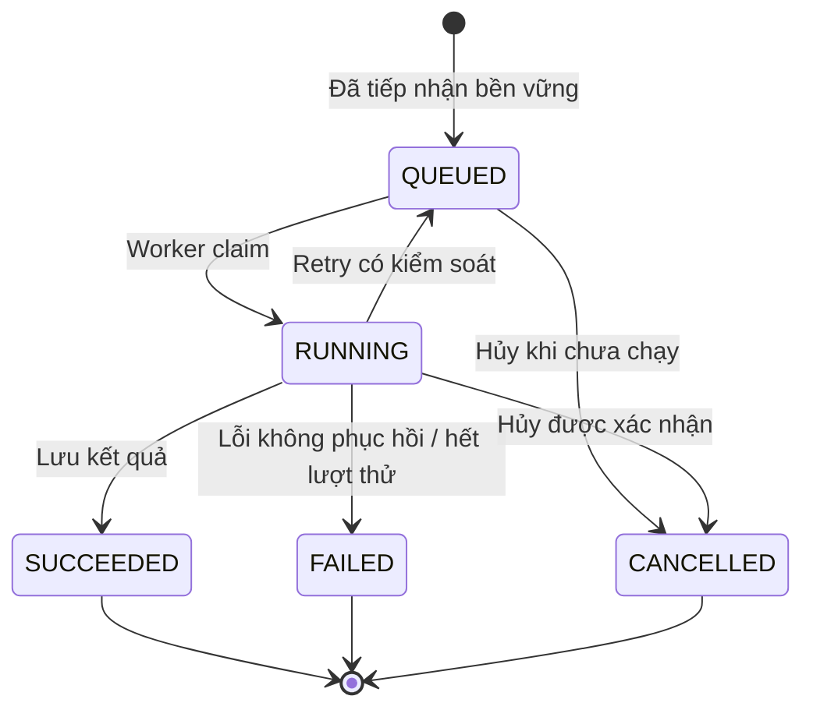
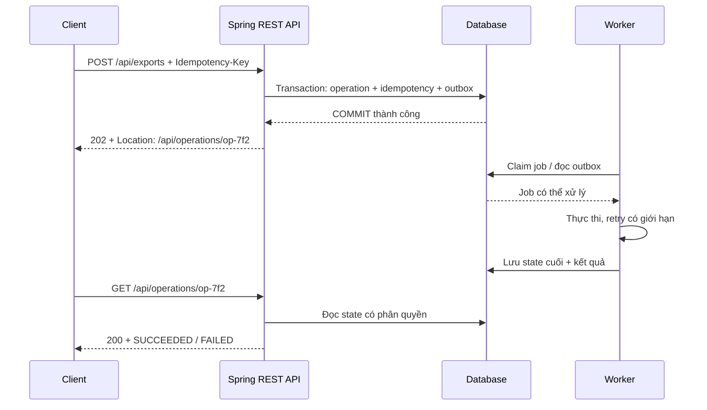

# Khi nào cần tách tiếp nhận yêu cầu khỏi hoàn tất công việc

> **Chương:** Xử lý bất đồng bộ  
> **Module:** `INTEGRATION_API_REST` — thiết kế REST API theo resource, URI, phương thức và mã trạng thái HTTP, với hợp đồng dữ liệu rõ ràng; thực hành xử lý lỗi, idempotency, xác thực, phân quyền và kiểm thử bằng Java/Spring hoặc công nghệ tương đương.

Một HTTP request không nhất thiết phải chờ toàn bộ công việc nghiệp vụ kết thúc. Ví dụ, xuất báo cáo của hàng triệu giao dịch có thể mất vài phút; việc giữ kết nối `POST` mở đến khi tệp sẵn sàng dễ gặp timeout, gây chiếm tài nguyên và khiến client không biết công việc đã bắt đầu hay chưa.

Giải pháp là **tách hai mốc**:

1. **Tiếp nhận (acceptance):** xác thực, kiểm tra điều kiện đầu vào và ghi nhận một công việc đủ bền vững để có thể tiếp tục xử lý.
2. **Hoàn tất (completion):** worker thực thi, cập nhật trạng thái, ghi kết quả hoặc nguyên nhân thất bại; client kiểm tra tiến độ qua một tài nguyên khác.

Điểm khó không nằm ở việc mở thêm thread: API phải nói thật về kết quả hiện tại, không đánh mất công việc sau khi trả lời, không chạy side effect hai lần khi client retry và có cơ chế theo dõi sau khi kết nối HTTP ban đầu đã đóng.

## Mục tiêu học tập

Sau bài này, bạn có thể:

- Quyết định **khi nào xử lý đồng bộ, khi nào trả `202 Accepted`** bằng yêu cầu latency, độ bền, phụ thuộc và trải nghiệm người dùng.
- Thiết kế hợp đồng `POST` tiếp nhận → `GET` trạng thái → truy cập kết quả; phân biệt HTTP status với trạng thái nghiệp vụ.
- Xây dựng luồng nhận việc bền vững và worker trong Java/Spring, tránh lạm dụng `@Async` như một hàng đợi tin cậy.
- Kiểm soát retry, idempotency, lỗi xử lý sau tiếp nhận, bảo mật, retention và backpressure.
- Viết kiểm thử HTTP, transaction và worker chứng minh các cam kết thực sự đạt được.

## 1. Ra quyết định: có thật sự cần bất đồng bộ?

Không có ngưỡng “mọi request lâu hơn 1 giây đều phải `202`” đúng cho tất cả API. Hãy so sánh **thời gian hoàn thành và độ biến thiên** với SLO, timeout của client/gateway, yêu cầu nghiệp vụ và chi phí giữ kết nối.

| Tình huống | Đồng bộ thường phù hợp khi | Bất đồng bộ đáng cân nhắc khi |
| --- | --- | --- |
| Đọc hoặc cập nhật một tài nguyên nhỏ | Kết quả có nhanh, ổn định và giao dịch hoàn tất trong ngân sách latency. | Cần kết hợp xử lý dài, nhiều phụ thuộc hoặc workflow tốn tài nguyên. |
| Tạo báo cáo/export | Truy vấn nhỏ, trả kết quả ngay trong thời gian dự đoán được. | Phải quét nhiều dữ liệu, tạo tệp lớn, thời gian dao động từ giây tới phút. |
| Xử lý ảnh/video | Biến đổi nhỏ, có giới hạn tài nguyên rõ. | Transcoding, AI inference hoặc batch dài, nhiều worker và khả năng retry cần thiết. |
| Nhập dữ liệu hàng loạt | Chỉ vài dòng, validate và commit nhanh. | Hàng chục nghìn bản ghi, cần tiến độ, lỗi theo dòng và khả năng chạy lại. |
| Gửi email/thông báo | Client chỉ cần ghi nhận yêu cầu gửi, không cần xác nhận đã phát tận nơi. | Nhà cung cấp chậm, quota biến động, retry theo chính sách; cần trạng thái gửi. |
| Thanh toán/đặt hàng | Client **phải biết ngay** một kết quả có thẩm quyền để tiếp tục hành trình, và hệ thống đáp ứng được trong SLO. | Phụ thuộc có kết quả muộn; nghiệp vụ cho phép `PENDING` và có kênh tra cứu/đối soát. |

### Năm câu hỏi trước khi tách

1. **SLO nào bị ảnh hưởng?** 95% request đáp ứng nhanh nhưng 1% mất ba phút có thể cần đổi kiến trúc, thay vì chỉ tăng timeout.
2. **Client cần biết điều gì ngay?** “Đã nhận yêu cầu xuất báo cáo” khác “Đã có tệp báo cáo” và khác “Đơn hàng đã thanh toán”.
3. **Thao tác có được trì hoãn không?** Nếu kết quả cần ngay để ra quyết định an toàn, trả `202` có thể chỉ đẩy trách nhiệm khó khăn sang client.
4. **Có cơ chế giữ việc bền vững không?** Nếu process chết ngay sau khi trả response, công việc có còn được thực thi hoặc được đánh dấu thất bại minh bạch không?
5. **Chi phí phức tạp có xứng đáng?** Queue, worker, trạng thái, retry, idempotency, giám sát và dọn dữ liệu đều là phần phải vận hành.

**Nguyên tắc:** dùng đồng bộ cho công việc ngắn, có thể xác nhận kết quả đúng trong ngân sách thời gian. Tách tiếp nhận và hoàn tất khi thời gian không chắc chắn, phụ thuộc dễ chậm, tải có đỉnh hoặc nghiệp vụ cần điều phối dài hạn **và** chấp nhận được kết quả cuối đến sau.

## 2. HTTP semantics: 202 nói gì và không nói gì?

**`202 Accepted`** nghĩa là request **được chấp nhận để xử lý nhưng công việc chưa hoàn tất**; việc xử lý có thể chưa bắt đầu và sau đó vẫn có thể bị từ chối/thất bại. RFC 9110 mô tả `202` là phản hồi **không cam kết hoàn tất**, và HTTP không có cơ chế để server gửi lại một status mới thay thế response đã kết thúc.

Vì vậy, một API trả `202` nên cung cấp cách xác định **trạng thái hiện tại** hoặc đường dẫn tới bộ theo dõi công việc. Đó là thiết kế hợp đồng ứng dụng, không phải bảo đảm rằng mọi `202` trên Internet đều có polling endpoint.

| Response | Ý nghĩa phù hợp |
| --- | --- |
| **200 OK** | Request hiện tại thành công; có thể trả dữ liệu hoặc kết quả. |
| **201 Created** | Request đã được thực hiện và dẫn tới việc tạo resource như HTTP contract mô tả; thường có `Location` chỉ resource mới. |
| **202 Accepted** | Server nhận yêu cầu cho công việc **chưa hoàn tất**, client phải theo dõi kết quả về sau nếu cần. |
| **204 No Content** | Request thành công và không có nội dung trả về; không dùng để tuyên bố đã hoàn tất khi công việc mới đang chờ chạy. |
| **4xx** | Request bị từ chối **trước khi được tiếp nhận**, ví dụ sai payload, thiếu quyền, xung đột hoặc quota của client. |
| **5xx** | Server không thể xử lý/tiếp nhận yêu cầu do lỗi phía phục vụ; client phải xử lý tình huống kết quả chưa chắc chắn khi mất phản hồi. |

**Phân biệt hai loại “đã tạo”:** nếu client yêu cầu tạo **chính resource job** và thao tác đó hoàn tất, `201` có thể đúng. Nếu client yêu cầu **xuất báo cáo** và hệ thống mới chấp nhận việc xuất, `202` diễn đạt trạng thái xử lý báo cáo phù hợp hơn. Không chọn status chỉ theo việc backend đã tạo một row `operations`.

`Location` trong response `202` có thể được **API contract quy ước** là URI tài nguyên theo dõi công việc. Không nên suy rằng `Location` của mọi `202` có ngữ nghĩa bắt buộc giống `Location` của `201`. `Retry-After`, nếu dùng để gợi ý khoảng chờ polling, cũng cần được mô tả rõ trong hợp đồng; nó không có nghĩa kết quả chắc chắn xong sau số giây đó.

## 3. Thiết kế contract: xuất báo cáo qua operation resource

Giả sử người dùng cần báo cáo giao dịch trong khoảng ngày. API chọn hai tài nguyên:

- `POST /api/exports`: yêu cầu tạo một export.
- `GET /api/operations/{operationId}`: tra cứu **trạng thái xử lý**.
- `GET /api/exports/{exportId}/file`: tải kết quả **sau khi thành công**, nếu được phép.

### 3.1 Tiếp nhận yêu cầu

```http
POST /api/exports HTTP/1.1
Authorization: Bearer <token>
Content-Type: application/json
Accept: application/json
Idempotency-Key: export-2026-11-18-user-task-01

{
  "fromDate": "2026-11-01",
  "toDate": "2026-11-17",
  "format": "CSV"
}
```

Sau khi xác thực, validate, kiểm tra quota và **lưu bền vững việc nhận yêu cầu**, server có thể trả:

```http
HTTP/1.1 202 Accepted
Content-Type: application/json
Location: /api/operations/op-7f2
Retry-After: 5
Cache-Control: no-store

{
  "operationId": "op-7f2",
  "state": "QUEUED",
  "statusUrl": "/api/operations/op-7f2",
  "submittedAt": "2026-11-18T09:00:00Z"
}
```

`QUEUED` là **trạng thái ứng dụng**; `202` là **trạng thái HTTP của request tiếp nhận**. Tên field và thời điểm trong ví dụ là hợp đồng minh họa, không phải định dạng bắt buộc của HTTP.

### 3.2 Theo dõi tiến độ

```http
GET /api/operations/op-7f2 HTTP/1.1
Authorization: Bearer <token>
Accept: application/json
```

```http
HTTP/1.1 200 OK
Content-Type: application/json
Cache-Control: no-store

{
  "operationId": "op-7f2",
  "state": "RUNNING",
  "progressPercent": 45,
  "updatedAt": "2026-11-18T09:00:12Z"
}
```

`200 OK` có nghĩa **truy vấn trạng thái thành công**, không có nghĩa export đã thành công. `progressPercent` chỉ nên phát nếu đo được tương đối đáng tin; không bịa phần trăm chỉ vì worker đang chạy.

Khi xử lý xong:

```http
HTTP/1.1 200 OK
Content-Type: application/json
Cache-Control: no-store

{
  "operationId": "op-7f2",
  "state": "SUCCEEDED",
  "result": {
    "exportId": "exp-a91",
    "href": "/api/exports/exp-a91/file"
  },
  "completedAt": "2026-11-18T09:01:40Z"
}
```

Client tiếp tục `GET` tới URL kết quả có quyền truy cập phù hợp. Một API khác có thể dùng `303 See Other` để chuyển từ operation tới result sau khi thành công, **nếu đã công bố quy tắc redirect**; không có yêu cầu phải dùng `303`.

### 3.3 Nếu worker thất bại

```http
HTTP/1.1 200 OK
Content-Type: application/json
Cache-Control: no-store

{
  "operationId": "op-7f2",
  "state": "FAILED",
  "error": {
    "code": "EXPORT_SOURCE_UNAVAILABLE",
    "message": "The report could not be generated.",
    "retryable": true
  },
  "completedAt": "2026-11-18T09:01:40Z"
}
```

Không đổi status của **response `202` đã gửi trước đó** thành `500`. Ở đây GET operation hoạt động bình thường, nên `200` là hợp lý dù **công việc đã thất bại**. Nếu bản thân endpoint GET operation bị lỗi hệ thống, lúc ấy mới dùng mã 5xx phù hợp.

`error.code` dành cho client xử lý; không đưa stack trace, SQL, thông tin kết nối hay nội dung nhạy cảm vào phản hồi. Có thể chọn Problem Details (RFC 9457) cho lỗi **HTTP trước tiếp nhận**, và một cấu trúc error ổn định trong operation resource cho lỗi **sau tiếp nhận**.

## 4. Vòng đời: phải công bố trạng thái và tính chất chuyển đổi

Một state machine tối thiểu:



**`RUNNING → QUEUED`** ở đây chỉ mô tả một cách tổ chức retry; có hệ thống giữ `RUNNING` với `attempt` tăng hoặc có trạng thái `RETRY_WAIT`. Điều cần nhất quán là hợp đồng công khai và thực tế worker.

| State | Ý nghĩa | Response GET operation |
| --- | --- | --- |
| `QUEUED` | Đã lưu việc, đang chờ worker. | `200` với `state=QUEUED`. |
| `RUNNING` | Worker đang thực thi; có thể retry phía trong. | `200` với `state=RUNNING`. |
| `SUCCEEDED` | Kết quả cuối đã được ghi nhận. | `200`, có URI kết quả nếu tồn tại. |
| `FAILED` | Không hoàn thành được theo chính sách đã định. | `200`, có error code và mô tả an toàn. |
| `CANCELLED` | Hủy theo quy tắc nghiệp vụ, không còn tiếp tục xử lý. | `200`, có thông tin hủy nếu được phép. |

**Hủy không đương nhiên đồng nghĩa có thể rollback mọi side effect.** Nếu job đã gọi nhà cung cấp ngoài, API cần định nghĩa “best effort cancellation”, thời điểm không thể hủy và quy trình đối soát. Một endpoint `POST /api/operations/{id}/cancel` có thể trả `202` nếu việc hủy cũng diễn ra bất đồng bộ; trả `409` nếu đã ở trạng thái không thể hủy là một lựa chọn hợp đồng phù hợp.

Cần công bố **retention** của operation. Sau thời gian lưu, có thể trả `410 Gone` khi biết resource cố ý không còn được cung cấp, hoặc `404` theo chính sách; không được xóa kết quả rồi giữ trạng thái `SUCCEEDED` với liên kết hỏng mà không có quy tắc hết hạn.

## 5. Điểm sống còn: tiếp nhận phải đủ bền vững trước khi trả 202

Hãy phân biệt hai cách triển khai:

**Không đủ tin cậy nếu chỉ dùng thread trong process:**

```java
@PostMapping("/exports")
ResponseEntity<Void> create(@RequestBody ExportRequest request) {
    executor.execute(() -> generateExport(request));
    return ResponseEntity.accepted().build();
}
```

Nếu JVM khởi động lại ngay sau `202`, phần việc trong RAM có thể mất. `@Async` hoặc `CompletableFuture.runAsync` giúp chạy ngoài luồng request, **không tự tạo hàng đợi bền vững**, không đảm bảo tiếp tục sau crash và không tự xử lý retry/distributed coordination.

**Thiết kế có cam kết nhận việc bền vững:**



Nếu tiếp nhận qua message broker, API cần **xác nhận broker đã nhận bền vững** theo mức bảo đảm hệ thống lựa chọn trước khi tuyên bố đã nhận. Nếu dùng **transactional outbox**, thao tác ghi operation và outbox nằm trong cùng DB transaction, sau đó một publisher/worker giao việc. Phân biệt rõ “đã lưu yêu cầu” với “worker đã xử lý”.

Một chuỗi sự cố điển hình:

| Điểm lỗi | Hành vi đúng |
| --- | --- |
| DB không commit operation/outbox. | **Không** trả `202` như đã nhận bền vững; trả lỗi phục vụ phù hợp và để client kiểm tra/retry an toàn. |
| DB commit xong nhưng response 202 bị mất trên mạng. | Job vẫn tồn tại; client có thể retry **cùng idempotency key** để nhận lại operation ID. |
| Worker chết giữa chừng. | Lease hết hạn, job được claim/retry theo chính sách; không mất job chỉ vì process chết. |
| Worker xử lý xong nhưng ack message mất. | Message có thể giao lại; handler phải idempotent, không tạo kết quả/side effect trùng. |
| Worker lỗi vĩnh viễn. | Ghi `FAILED` có reason code, lưu thông tin nội bộ để điều tra; không để `RUNNING` vô hạn. |

Tài nguyên công việc cần có **deadline**, giới hạn retry, cơ chế nhận diện stuck jobs, khóa/lease và quy trình dọn dữ liệu. Hàng đợi không phải “vùng đệm vô hạn”: khi queue đầy hoặc không có năng lực xử lý trong SLA, API có thể từ chối trước khi nhận (`429` theo quota client hoặc `503` khi dịch vụ quá tải), thay vì nhận mọi thứ rồi để chờ vô hạn.

## 6. Idempotency và phản hồi khi client gửi lại yêu cầu

Nếu client mất response sau `POST`, nó không biết request **chưa tới server**, **đã được lưu** hay **đã bắt đầu chạy**. Tạo một operation mới trên mỗi retry có thể dẫn đến hai báo cáo giống nhau, hai email hoặc thậm chí hai hiệu ứng không mong muốn.

Với contract minh họa, client gửi `Idempotency-Key` ổn định cho **cùng tác vụ logic**. Server lưu tối thiểu:

- Phạm vi khóa: tenant/user và loại operation phù hợp.
- Key và fingerprint của yêu cầu đã chuẩn hóa.
- Operation ID được tạo lần đầu.
- Hạn lưu khóa và cách xử lý sau hết hạn.

Hành vi:

| Lần gọi | Xử lý |
| --- | --- |
| Key mới, payload hợp lệ. | Ghi operation + key + outbox **nguyên tử**, trả `202` và URI theo dõi. |
| Key cũ, **cùng** payload trong thời hạn còn hiệu lực. | Trả cùng operation reference hoặc phản hồi đã lưu theo contract; **không tạo việc mới**. |
| Key cũ, payload **khác**. | Từ chối bằng mã xung đột (ví dụ `409`), không hiểu như retry an toàn. |
| Hai request cùng key đến đồng thời. | Dùng **unique constraint/transaction** để chỉ tạo một operation; không chỉ kiểm tra trước bằng `SELECT` rồi `INSERT`. |

**Idempotency tại API chưa đủ nếu worker có side effect bên ngoài.** Cần dedup theo operation ID ở worker, giao thức có idempotency key với nhà cung cấp khi có, unique constraints hoặc reconciliation. Với hệ thống phân tán, hàng đợi thường có thể giao message **ít nhất một lần**; thiết kế an toàn không dựa vào giả định “mỗi message chắc chắn chỉ chạy một lần”.

Đối với việc xuất tệp, một retry có thể tạo artifact tạm nhiều lần nếu có lỗi; nên công bố một **kết quả logic có thẩm quyền** cho operation thay vì nhiều đường dẫn mâu thuẫn.

## 7. Java/Spring: controller mỏng, transaction tiếp nhận và worker riêng

Ví dụ sau tập trung vào hợp đồng nhận việc và theo dõi. Đây là **skeleton có chủ đích**, cần tích hợp entity/repository, xác thực, DB transaction, queue/outbox, validation và exception mapping trong dự án thực.

### 7.1 Controller chỉ phản ánh sự thật đã được ghi nhận

```java
import jakarta.validation.Valid;
import jakarta.validation.constraints.NotNull;
import org.springframework.http.ResponseEntity;
import org.springframework.web.bind.annotation.*;
import java.net.URI;
import java.time.LocalDate;

record ExportRequest(
    @NotNull LocalDate fromDate,
    @NotNull LocalDate toDate,
    @NotNull String format
) {}

record AcceptedOperation(String id, String state) {}
record OperationView(String id, String state, String resultHref,
                     String errorCode) {}

interface ExportOperations {
    // Implementation bảo đảm commit durable acceptance trước khi trả về.
    AcceptedOperation submit(String idempotencyKey, ExportRequest request);
    OperationView findAuthorized(String operationId);
}

@RestController
@RequestMapping("/api")
class ExportController {
    private final ExportOperations operations;

    ExportController(ExportOperations operations) {
        this.operations = operations;
    }

    @PostMapping("/exports")
    ResponseEntity<AcceptedOperation> start(
            @RequestHeader("Idempotency-Key") String idempotencyKey,
            @Valid @RequestBody ExportRequest request) {

        // Service phải kiểm tra tenant/user, giới hạn ngày và quota.
        AcceptedOperation op = operations.submit(idempotencyKey, request);

        return ResponseEntity.accepted()
            .location(URI.create("/api/operations/" + op.id()))
            .header("Retry-After", "5")  // Policy polling của API ví dụ.
            .body(op);
    }

    @GetMapping("/operations/{id}")
    ResponseEntity<OperationView> getStatus(@PathVariable String id) {
        return ResponseEntity.ok(operations.findAuthorized(id));
    }
}
```

**Chú ý:** nếu `@RequestHeader` bắt buộc thiếu, Spring thường trả lỗi request (thường `400`), nhưng một API production nên trả Problem Details với error code rõ; không hứa trả `202` khi thiếu key bắt buộc. `format` cần allowlist, ngày bắt đầu phải không sau ngày kết thúc, và request phải qua quyền/limit trước khi nhận.

### 7.2 Ghi operation và outbox trong một giao dịch

Pseudocode tầng application service:

```java
@Transactional
public AcceptedOperation submit(String tenantId, String key,
                                ExportRequest request) {
    String fingerprint = canonicalFingerprint(request);

    // Chỉ là sketch: cần unique(tenant_id, operation_type, key).
    // Phải xử lý race cùng key bằng constraint + giao dịch riêng sau rollback.
    ExistingSubmission previous = idem.find(tenantId, "EXPORT", key);
    if (previous != null) {
        if (!previous.fingerprint().equals(fingerprint)) {
            throw new IdempotencyConflict();
        }
        return previous.acceptedOperation();
    }

    Operation op = operations.insertQueued(tenantId, request);
    idem.insert(tenantId, "EXPORT", key, fingerprint, op.id());
    outbox.insert("EXPORT_REQUESTED", op.id());

    // Transaction commit khi method được gọi qua Spring proxy kết thúc.
    // Nếu transaction rollback thì caller không được gửi 202.
    return new AcceptedOperation(op.id(), "QUEUED");
}
```

Đoạn mã **không phải code production hoàn chỉnh**. Phần `find → insert` vẫn có race nếu không có unique constraint và cơ chế xử lý `unique violation` đúng. Một transaction đã lỗi constraint thường không được tiếp tục dùng để đọc rồi trả kết quả; hãy rollback và tra cứu operation cũ bằng **giao dịch mới** hoặc dùng một phép insert-if-absent nguyên tử phù hợp database.

Nếu dùng broker thay outbox, phải xác định chính xác mốc **broker đã nhận bền vững**; không trả `202` trước khi nhận xác nhận cần thiết.

### 7.3 Worker độc lập và cập nhật trạng thái

Pseudocode triển khai worker:

```text
poll or receive job ID
→ claim job atomically (lease + owner + attempt)
→ check cancelled/expired/deadline
→ execute in bounded steps
→ save result durably
→ transition to SUCCEEDED
→ acknowledge delivery

on transient failure:
  persist retry policy/nextAttempt; release/renew lease safely
on permanent failure or max attempts:
  transition to FAILED with safe error code
on duplicate delivery:
  observe terminal state/result; do not repeat external side effect
```

Với Spring, có thể chạy worker ở ứng dụng riêng, dùng `@Scheduled` để poll outbox hoặc tích hợp broker consumer. **`@Async` chỉ là tiện ích lập lịch thực thi**, không thay thế durable queue, retry, lease, dedup hay monitor. Worker cần tránh xử lý vô hạn, có giới hạn concurrency và xử lý graceful shutdown.

## 8. Polling, webhook và cách client theo dõi

### Polling

Client nhận `Location` rồi định kỳ `GET` operation. Nên:

1. Poll theo `Retry-After`/`pollAfterSeconds` của contract nếu có; dùng backoff có giới hạn và jitter để tránh đồng bộ hàng nghìn client.
2. Dừng khi gặp trạng thái cuối `SUCCEEDED`, `FAILED` hoặc `CANCELLED`.
3. Có deadline phía client, ví dụ dừng hiển thị spinner nhưng vẫn cho phép quay lại kiểm tra.
4. Phân biệt lỗi truy vấn trạng thái (`401`/`403`/`404`/`5xx`) với operation `FAILED` trong body `200`.
5. Không tiếp tục lấy result URL nếu operation chưa `SUCCEEDED` hoặc quyền truy cập đã hết.

### Webhook/callback

Webhook có thể giảm polling nếu client là một hệ thống có endpoint nhận callback. Nó **không thay thế tài nguyên trạng thái** trong mọi thiết kế: callback có thể bị mất, gửi lặp, đến không theo thứ tự và cần cơ chế kiểm tra lại.

Khi dùng webhook cần: xác thực chữ ký/bí mật đúng cách, chống replay, retry có giới hạn, dedup event ID và **không tin callback tới trước/duy nhất**. Một ứng dụng trình duyệt không có endpoint công khai thường dùng polling hoặc kênh đẩy có xác thực như WebSocket/SSE nếu có yêu cầu tương tác phù hợp.

### Không đánh tráo khái niệm “progress”

`progressPercent=75` chỉ có ý nghĩa khi đơn vị đo rõ, ví dụ 750/1.000 hàng đã xử lý. Với công việc nhiều pha (đọc → tính toán → ghi tệp → upload), phần trăm đơn giản dễ gây hiểu lầm. Có thể trả `phase` và timestamps, hoặc chỉ `RUNNING` nếu chưa có phép đo đủ tin cậy.

## 9. Lỗi, quyền truy cập và sức chứa hệ thống

### Trước khi chấp nhận

API vẫn phải thực hiện các kiểm tra có thể xác định ngay:

| Tình huống | Response điển hình | Tác dụng |
| --- | --- | --- |
| JSON không đọc được hoặc thiếu header bắt buộc. | `400 Bad Request`. | Không tạo operation từ request chưa hợp lệ. |
| Payload đúng cú pháp nhưng sai quy tắc dữ liệu. | `400` hoặc `422` theo validation contract. | Client sửa dữ liệu trước retry. |
| Chưa đăng nhập/không có quyền tạo export. | `401`/`403`. | Không phát lộ job/ dữ liệu người khác. |
| Idempotency key cũ nhưng payload khác. | `409 Conflict` theo contract. | Không tạo công việc trùng sai mục tiêu. |
| Quá quota cá nhân/tenant. | `429 Too Many Requests`. | Client giảm tốc độ, có thể theo `Retry-After`. |
| Hàng đợi/storage không sẵn sàng; không thể ghi nhận bền vững. | `503 Service Unavailable` hoặc lỗi 5xx phù hợp. | Không giả vờ đã nhận việc. |

### Sau khi chấp nhận

Đừng cố trả “lỗi HTTP cuối cùng” cho `POST` đã kết thúc. Ghi nguyên nhân `FAILED` trong operation resource, còn GET của operation vẫn có thể `200`. Nếu cần truyền thông báo lỗi theo định dạng chuẩn, có thể mô tả field `error` với các thuộc tính gần Problem Details hoặc cho link đến một error resource; không nhất thiết biến chính operation resource thành `application/problem+json`.

### Bảo mật

- `operationId` phải khó đoán hoặc luôn được kiểm tra quyền; **ID khó đoán không thay authorization**.
- Chỉ chủ yêu cầu hoặc vai trò được phép mới truy vấn trạng thái và tải kết quả; kiểm tra quyền lại mỗi lần GET.
- Không đặt token, nội dung báo cáo hay dữ liệu cá nhân trong `Location`/status URL.
- Kết quả tải có thể cần URL ký ngắn hạn và giới hạn quyền; đừng phát URL còn hiệu lực quá lâu.
- Cần thời hạn lưu tệp/operation, xóa đúng quy định và không để log chứa nội dung báo cáo.
- Khi trả metadata theo người dùng, dùng cache policy phù hợp (`Cache-Control: no-store` là lựa chọn thận trọng).

## 10. Kiểm thử: chứng minh cả tiếp nhận lẫn hoàn tất

Một bộ test chỉ kiểm tra `POST` trả `202` là **chưa đủ**. Nó không phát hiện job mất sau crash hay worker thực thi side effect hai lần.

| Test | Kịch bản | Điều phải xác minh |
| --- | --- | --- |
| T01 — nhận việc hợp lệ | POST tạo export với key mới. | `202`; `Location` đúng contract; operation tồn tại bền vững ở `QUEUED`. |
| T02 — payload sai | Thiếu ngày hoặc `fromDate > toDate`. | 4xx đúng contract; **không có operation/outbox mới**. |
| T03 — mất khả năng lưu | DB/broker không ghi bền vững. | Không trả `202` sai; không có job “ma”. |
| T04 — retry sau mất response | Commit nhận việc xong nhưng HTTP response bị mất. | Retry cùng key/payload trả **cùng operation**, không duplicate. |
| T05 — key cũ, payload khác | POST khác nội dung với cùng key. | `409`; job đầu giữ nguyên. |
| T06 — hai POST đồng thời cùng key | Hai request tranh nhau tạo một export. | Chỉ **một operation và một việc logic** được nhận. |
| T07 — xử lý thành công | Worker claim và ghi tệp. | Operation chuyển `QUEUED → RUNNING → SUCCEEDED`; result truy cập được sau commit. |
| T08 — lỗi vĩnh viễn | Worker không thể xử lý theo chính sách. | Operation thành `FAILED`; GET trả `200` + error code an toàn. |
| T09 — worker crash | Worker bị dừng trước ack. | Sau lease/recovery, job không bị mất; không tạo kết quả trùng. |
| T10 — giao message lặp | Một job ID được phát hai lần. | Consumer idempotent; không lặp external side effect. |
| T11 — polling khi đang chạy | GET operation ở `RUNNING`. | `200` + trạng thái đang chạy; không phát URL tải kết quả chưa sẵn sàng. |
| T12 — tenant khác đọc job | Token không thuộc owner. | `403` hoặc `404` theo security contract; không rò rỉ metadata. |
| T13 — quá tải | Queue hoặc tenant quota đầy. | `429/503` theo chính sách; không nhận vô hạn. |
| T14 — retention | Operation đã hết thời hạn lưu. | `404/410` theo contract, link kết quả không bị rò rỉ. |
| T15 — cancel cạnh tranh | Client hủy khi worker gần hoàn tất. | Chỉ một trạng thái cuối nhất quán; không tuyên bố rollback side effect không thể hủy. |

### Ví dụ MockMvc kiểm tra hợp đồng tiếp nhận

```java
// Giả định @AutoConfigureMockMvc, @MockBean hoặc test double có cấu hình riêng.
@Test
void acceptedOperationHasMonitorUri() throws Exception {
    when(operations.submit(eq("export-once"), any()))
        .thenReturn(new AcceptedOperation("op-7f2", "QUEUED"));

    mvc.perform(post("/api/exports")
            .contentType(MediaType.APPLICATION_JSON)
            .header("Idempotency-Key", "export-once")
            .content("""
                {"fromDate":"2026-11-01",
                 "toDate":"2026-11-17","format":"CSV"}
                """))
        .andExpect(status().isAccepted())
        .andExpect(header().string(
            "Location", "/api/operations/op-7f2"))
        .andExpect(jsonPath("$.operationId").value("op-7f2"))
        .andExpect(jsonPath("$.state").value("QUEUED"));
}
```

Ví dụ này kiểm tra **HTTP contract** nhưng mock service nên **không chứng minh** durability/atomicity. Cần integration test với database và outbox thật: xác minh operation + idempotency record + outbox cùng commit, hoặc cùng rollback; rồi thử crash/retry worker theo cơ chế triển khai.

### Bài kiểm thử quan trọng nhất

```text
Given  client dùng cùng Idempotency-Key K để tạo export X.
When   server commit operation O nhưng mất response;
       client retry POST với K;
       worker nhận cùng job ID hai lần do redelivery.
Then   chỉ có một operation logic O;
       trạng thái O có thể tiến tới SUCCEEDED hoặc FAILED;
       không phát sinh hai kết quả/side effect có thẩm quyền;
       GET O trả trạng thái cuối nhất quán và có kiểm soát quyền.
```

Nếu chưa kiểm chứng được kịch bản này, API chưa chứng minh được lời hứa “đã nhận yêu cầu và sẽ theo dõi được” chỉ bằng `202`.

## 11. Quan sát vận hành: SLO của “accepted” khác SLO của “completed”

Tách hai pha cũng nghĩa là có **hai nhóm mục tiêu đo lường**:

| Chỉ số | Câu hỏi cần trả lời |
| --- | --- |
| Acceptance latency p95 | Client nhận `202` nhanh và ổn định không? |
| Accepted-to-start delay | Job chờ queue bao lâu trước khi worker chạy? |
| Accepted-to-terminal latency p95/p99 | Từ lúc đã nhận tới khi `SUCCEEDED/FAILED/CANCELLED` là bao lâu? |
| Queue depth / oldest job age | Queue có tăng vô hạn hoặc job bị kẹt không? |
| Success/failed/cancelled ratio | Nghiệp vụ có thực sự hoàn thành, không chỉ nhận nhiều việc? |
| Worker attempts / redeliveries | Retry/duplicate delivery có bất thường không? |
| Stuck/expired leases | Worker có chết giữa chừng mà job không được phục hồi? |
| Idempotency replays/conflicts | Client có retry đúng hay dùng sai key/payload? |

Một dịch vụ có **99,99% response `202` thành công** nhưng **20% job không bao giờ rời QUEUED** vẫn là dịch vụ thất bại về mục tiêu nghiệp vụ. Đặt cảnh báo theo thời gian ở queue, deadline hoàn thành và số lượng job terminal thất bại, không chỉ theo tỷ lệ HTTP `5xx`.

Khi ghi log/metrics, dùng route template và mã lỗi ổn định; tránh đưa operation ID, user ID hoặc token thành nhãn metric có cardinality cao. Gắn correlation/trace ID để nối request tiếp nhận với worker và trạng thái cuối theo chính sách lưu trữ.

## 12. Bài thực hành ngắn: chọn đúng chỗ tách

Thiết kế API nhận yêu cầu nhập một tệp CSV gồm tối đa 200.000 dòng vào hệ thống quản lý sản phẩm. Yêu cầu: người dùng phải biết upload đã được tiếp nhận, theo dõi số dòng đã xử lý, xem các dòng thất bại và không tạo bản ghi trùng khi retry do mạng mất kết nối.

Hãy hoàn thành bốn phần:

1. **Quyết định đồng bộ/bất đồng bộ:** nêu vì sao không nên giữ một HTTP request chờ nhập 200.000 dòng, nhưng việc xác thực quyền, kiểm tra format/file-size/quota và lưu file đầu vào cần hoàn thành ở mốc nào.
2. **HTTP contract:** định nghĩa `POST /api/imports` trả `202`, `Location` đến `/api/operations/{id}`; xác định biểu diễn `QUEUED`, `RUNNING`, `SUCCEEDED` và `FAILED`.
3. **Java/Spring:** mô tả transaction ghi operation/outbox và worker xử lý theo batch, checkpoint, lease, idempotency theo import ID + row identity, cách phát hiện lỗi dữ liệu từng dòng.
4. **Kiểm thử:** thiết kế test mất response sau commit, hai POST cùng key, worker crash sau khi ghi nửa tệp, lỗi dòng dữ liệu, quá quota, token tenant khác và tải kết quả sau khi hoàn tất.

### Gợi ý nghiệm thu

Một phương án đạt yêu cầu khi **không** trả `202` trước khi đã có cơ chế lưu công việc bền vững, không coi `202` là thành công cuối, có operation state rõ, hạn chế retry và đảm bảo không có import logic trùng. Khi file đầu vào hợp lệ nhưng một số dòng sai, cần công bố chính sách **partial success**: có thể lưu tổng dòng thành công/thất bại và file lỗi, hoặc yêu cầu toàn bộ import thất bại; không được để client tự suy diễn.

## 13. Checklist trước khi triển khai

- [ ] Có lý do cụ thể để tách: latency không ổn định, phụ thuộc chậm, batch dài hoặc cần điều phối/retry.
- [ ] Client không bị đánh lừa rằng `202` nghĩa là đã hoàn thành nghiệp vụ.
- [ ] Request bị từ chối trước tiếp nhận có mã 4xx/5xx đúng; không tạo job nửa vời.
- [ ] Operation + idempotency mapping + outbox/broker acceptance được ghi nhận đủ bền vững trước `202`.
- [ ] `Location`/status URL và representation `QUEUED/RUNNING/SUCCEEDED/FAILED` được công bố.
- [ ] GET operation có phân quyền, metadata kết quả, lỗi và thời hạn lưu rõ.
- [ ] Worker có claim/lease, retry giới hạn, deadline, dead-letter hoặc quy trình xử lý lỗi vĩnh viễn.
- [ ] Duplicate delivery và client retry không tạo nhiều side effect logic.
- [ ] Queue có sức chứa, rate limit/backpressure và cảnh báo stuck jobs.
- [ ] Polling/webhook có chính sách timeout, bảo mật và giảm tải.
- [ ] Có integration test cho commit/rollback, retry sau mất response, crash, redelivery và tenant isolation.
- [ ] SLO theo dõi **từ accepted đến terminal**, không chỉ latency của request `202`.

**Kết luận:** Tách tiếp nhận khỏi hoàn tất khi hệ thống **không thể hoặc không nên hứa kết quả cuối trong vòng đời một HTTP request**, nhưng vẫn có thể **ghi nhận và theo dõi công việc một cách đáng tin cậy**. `202 Accepted` là phần giao thức; operation resource, durable acceptance, idempotency, worker và kiểm thử failure mới biến nó thành một thiết kế REST API sử dụng được trong thực tế.
