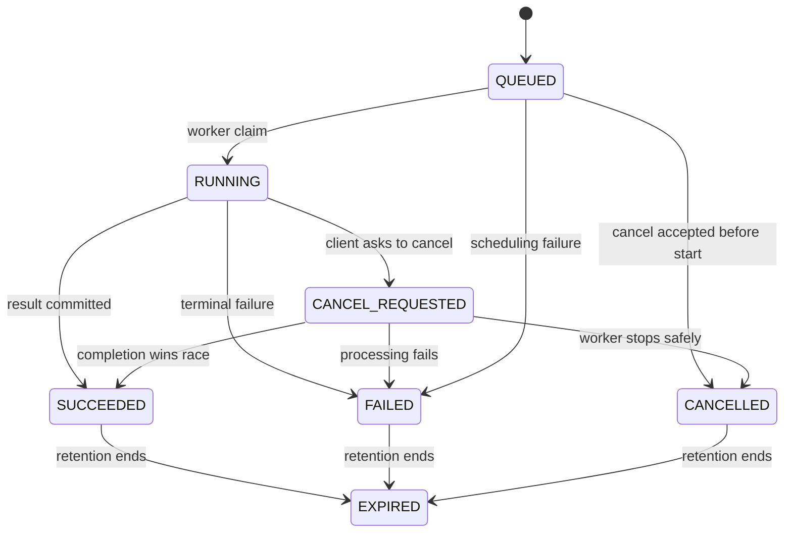
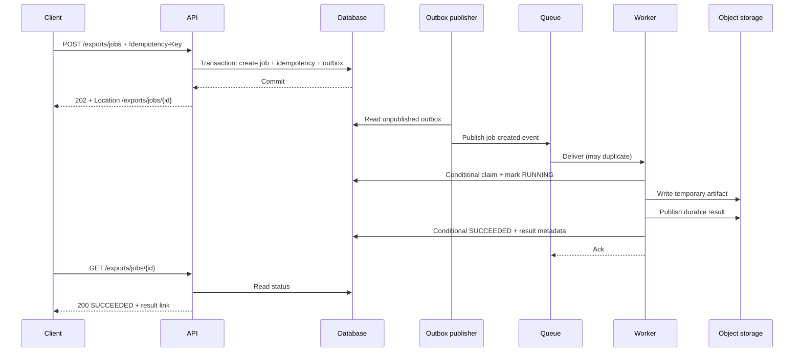

# Tài nguyên job, trạng thái, tiến độ và kết quả

## 1. Khi một request không thể chờ đến lúc hoàn thành

Xuất 500.000 đơn hàng ra CSV có thể mất vài phút. Giữ kết nối HTTP đến lúc xong dễ gây timeout ở client/gateway và khó theo dõi khi trình duyệt đóng.

Một thiết kế REST phù hợp là biến **công việc đang thực hiện thành tài nguyên có URI riêng**, chẳng hạn `/exports/jobs/j-7e21`. Request khởi tạo chỉ nhận trách nhiệm xử lý; client sau đó đọc trạng thái, tiến độ và lấy kết quả khi có. Đây là **xử lý bất đồng bộ ở mức hợp đồng HTTP**, không đồng nghĩa chỉ thêm `@Async` vào controller.

Bài thuộc chương **Xử lý bất đồng bộ** của học phần `INTEGRATION_API_REST`, kết hợp resource, HTTP, idempotency, bảo mật, OpenAPI và kiểm thử Java/Spring.

Sau bài, người học có thể:

- Thiết kế vòng đời **tạo job → theo dõi → hoàn tất/thất bại → lấy kết quả**.
- Phân biệt `202 Accepted` với `201 Created`, `200 OK` và trạng thái nghiệp vụ của job.
- Mô hình hóa trạng thái, tiến độ, lỗi, URL kết quả, thời hạn và hủy job.
- Bảo vệ việc tạo job khỏi lặp do retry và bảo vệ worker khỏi xử lý trùng từ queue.
- Cài đặt skeleton Spring/DB/worker, mô tả OpenAPI và kiểm thử các race condition quan trọng.

## 2. Job là tài nguyên, không phải một kết nối HTTP kéo dài

Một hợp đồng minh họa:

| Endpoint | Mục đích | Response tiêu biểu |
| --- | --- | --- |
| `POST /exports/jobs` | Yêu cầu tạo bản xuất dữ liệu | `202 Accepted`, `Location` trỏ tới job |
| `GET /exports/jobs/{jobId}` | Đọc trạng thái/tiến độ/kết quả | `200 OK` kèm representation |
| `GET /exports/jobs/{jobId}/result` | Lấy tệp sau khi job thành công | `200` trả file hoặc `303` tới URL tải an toàn |
| `POST /exports/jobs/{jobId}/cancellation-requests` | Yêu cầu hủy một job đang chạy | `202 Accepted` hoặc phản hồi theo trạng thái |

`POST /exports/jobs` tạo một **yêu cầu công việc**: server nhận, ghi bền trạng thái job, rồi đưa việc xử lý vào hàng đợi. Với mô hình này, ta chọn **202** vì xử lý chưa hoàn thành. Nếu API chủ yếu biểu đạt việc **tạo tài nguyên job đã hoàn tất tại thời điểm request**, `201 Created` cũng có thể phù hợp; lựa chọn phải thống nhất với semantics công bố. `202` **không phải lời hứa** job chắc chắn hoàn tất: HTTP 202 có nghĩa yêu cầu đã được chấp nhận để xử lý nhưng quá trình có thể chưa bắt đầu, có thể thất bại hoặc bị từ chối trong giai đoạn xử lý.

### Tạo job bằng HTTP

```http
POST /exports/jobs HTTP/1.1
Host: api.example.test
Authorization: Bearer <access-token>
Content-Type: application/json
Idempotency-Key: "export-9b29"

{
  "format": "csv",
  "from": "2026-11-01T00:00:00Z",
  "to": "2026-12-01T00:00:00Z"
}
```

```http
HTTP/1.1 202 Accepted
Location: /exports/jobs/j-7e21
Content-Type: application/json
Cache-Control: no-store

{
  "id": "j-7e21",
  "kind": "orders-export",
  "state": "QUEUED",
  "createdAt": "2026-11-18T10:00:00Z",
  "updatedAt": "2026-11-18T10:00:00Z",
  "progress": {
    "stage": "QUEUED",
    "processedItems": 0,
    "totalItems": null,
    "percent": null
  },
  "result": null,
  "error": null,
  "links": {
    "self": "/exports/jobs/j-7e21",
    "cancel": "/exports/jobs/j-7e21/cancellation-requests"
  },
  "pollAfterSeconds": 5
}
```

`Location` ở đây giúp client khám phá URI của job; body chứa representation hiện tại. `pollAfterSeconds` là **quy ước của API ví dụ**, không phải field chuẩn HTTP. Có API dùng `Retry-After` để gợi ý lịch polling trên 202, nhưng ngữ nghĩa chờ ở 202 phải được **công bố rõ trong hợp đồng**; không suy rằng mọi HTTP client hay proxy đều hiểu đây là quy định chuẩn cho polling.

**Invariant:** một khi server trả 202 cùng ID, job phải đã được ghi bền hoặc được đảm bảo khả năng tra cứu/tiếp tục theo hợp đồng. Trả 202 trước khi ghi DB rồi mất job khi process chết là lỗi nghiêm trọng.

## 3. Máy trạng thái rõ hơn một boolean "done"

Trả mỗi `{"done":false}` khiến client không biết đang chờ, đã bắt đầu, có thể hủy hay lỗi. Mô hình thực tế có thể dùng:



Trong ví dụ, `QUEUED` và `RUNNING` là trạng thái đang tiến hành; `CANCEL_REQUESTED` là **yêu cầu hủy đang chờ**, không bảo đảm hủy được; `SUCCEEDED`, `FAILED` và `CANCELLED` là kết thúc về xử lý; `EXPIRED` là chính sách vòng đời dữ liệu của job/kết quả.

| State | Ý nghĩa | Client nên làm |
| --- | --- | --- |
| `QUEUED` | Job được chấp nhận, chưa có worker xử lý | Chờ/poll theo lịch |
| `RUNNING` | Worker đang xử lý | Xem tiến độ; không suy kết quả đã có |
| `CANCEL_REQUESTED` | Server đã ghi nhận yêu cầu hủy | Tiếp tục theo dõi kết cục |
| `SUCCEEDED` | Kết quả đã được tạo bền và sẵn sàng theo hợp đồng | Theo `result.href` |
| `FAILED` | Công việc kết thúc không thành công | Hiển thị lỗi an toàn, cân nhắc tạo job mới |
| `CANCELLED` | Công việc đã dừng theo chính sách hủy | Không chờ kết quả |
| `EXPIRED` | Đã hết thời gian lưu job hoặc artifact | Bắt đầu yêu cầu mới nếu cần |

Định nghĩa và các chuyển trạng thái cần được **kiểm soát ở server**, chẳng hạn không cho worker chuyển `SUCCEEDED → RUNNING`, không cho hai worker cùng đánh dấu terminal khác nhau. Retry **nội bộ** của worker có thể xảy ra khi job vẫn `RUNNING` hoặc đi qua trạng thái `RETRY_WAIT` nếu API chọn công bố; không nhất thiết phơi bày mọi lần retry hạ tầng thành state public.

## 4. GET job: HTTP thành công không có nghĩa job thành công

Khi client hỏi trạng thái một job đã tồn tại:

```http
GET /exports/jobs/j-7e21 HTTP/1.1
Authorization: Bearer <access-token>

HTTP/1.1 200 OK
Content-Type: application/json
Cache-Control: private, no-store

{
  "id": "j-7e21",
  "state": "RUNNING",
  "progress": {
    "stage": "WRITING_FILE",
    "processedItems": 120000,
    "totalItems": 200000,
    "percent": 60
  },
  "result": null,
  "error": null,
  "pollAfterSeconds": 5
}
```

`200 OK` nghĩa là **GET tài nguyên trạng thái thành công**, không phải quá trình xuất dữ liệu đã thành công. Ngay cả khi job `FAILED`, việc GET representation lỗi của job vẫn thường là **200**, với `state: "FAILED"` và đối tượng `error`. Không dùng `500` cho mọi GET của job thất bại: 500 nên mô tả **sự cố khi xử lý HTTP GET hiện tại**, không phải sự cố nền đã được ghi nhận thành trạng thái job.

Nếu job không tồn tại hoặc cần che giấu quyền truy cập, có thể trả `404`; thiếu quyền có thể trả `403` theo chính sách. Kiểm tra quyền cả lúc tạo lẫn lúc xem job.

### Trạng thái terminal thành công

```http
HTTP/1.1 200 OK
Content-Type: application/json
Cache-Control: no-store

{
  "id": "j-7e21",
  "state": "SUCCEEDED",
  "finishedAt": "2026-11-18T10:02:10Z",
  "progress": {
    "stage": "DONE",
    "processedItems": 200000,
    "totalItems": 200000,
    "percent": 100
  },
  "result": {
    "href": "/exports/jobs/j-7e21/result",
    "mediaType": "text/csv",
    "sizeBytes": 14802033,
    "expiresAt": "2026-11-25T10:02:10Z"
  },
  "error": null
}
```

**Trình tự cam kết:** lưu tệp bền và đủ quyền đọc **trước khi** đánh dấu `SUCCEEDED`. Nếu chuyển sang SUCCEEDED khi object store chưa có file, client nhận link hỏng. Việc tạo artifact, cập nhật DB và cleanup cần thiết kế theo khả năng hỏng từng bước; nếu không thể transaction xuyên DB và object storage, dùng quy trình publish file và sửa trạng thái có kiểm tra.

## 5. Tiến độ có ý nghĩa khi server định nghĩa mẫu số

Tiến độ thường bị hiểu nhầm thành một bộ đếm phần trăm “luôn chính xác”. Trong thực tế tổng số bản ghi có thể chưa biết, dữ liệu thay đổi khi đang đọc hoặc một giai đoạn cuối tốn nhiều thời gian hơn toàn bộ quá trình trước đó.

| Thuộc tính | Ý nghĩa đề xuất | Quy tắc |
| --- | --- | --- |
| `stage` | Giai đoạn xử lý có nghĩa nghiệp vụ | Tên ổn định, ví dụ `QUERYING`, `WRITING_FILE`, `UPLOADING` |
| `processedItems` | Số đơn vị công việc đã xử lý | Không ngụ ý số row xuất thành công nếu có filter |
| `totalItems` | Tổng đơn vị dự kiến | Dùng `null` nếu chưa biết; nếu ước lượng hãy khai báo |
| `percent` | Phần trăm theo mô hình đo được định nghĩa | `null` nếu không thể đo; 0–100 khi có giá trị |
| `updatedAt` | Thời điểm ghi nhận state/progress gần nhất | Giúp phát hiện job bị kẹt |
| `attempt` | Số lượt worker thử chạy nếu cần công bố | Không bắt buộc; tránh rò hạ tầng |

**Không dựng `percent = 100` chỉ vì đã đọc hết bản ghi**, nếu bước ghi/upload file vẫn chưa xong. Có thể chia trọng số theo giai đoạn, nhưng phải tài liệu hóa đây là ước tính. Nếu tổng số bản ghi thay đổi hoặc worker chạy lại từ checkpoint, phần trăm có thể giảm; không hứa **đơn điệu** trừ khi implementation bảo đảm được. Có thể giữ một `percent` đơn điệu có chủ đích trong UI, nhưng không được tuyên bố nó phản ánh chính xác tiến độ thực.

Với các job không xác định mẫu số (gửi webhook, chờ phê duyệt, truy vấn không biết số phần tử), biểu diễn:

```json
{
  "state": "RUNNING",
  "progress": {
    "stage": "QUERYING",
    "processedItems": 12400,
    "totalItems": null,
    "percent": null
  }
}
```

tốt hơn một phần trăm được bịa ra. Không cập nhật DB theo từng bản ghi trên một job rất lớn; dùng checkpoint/cập nhật tiến độ theo khoảng hoặc số lượng vừa đủ để cân bằng chi phí và độ trễ quan sát.

## 6. Lỗi xử lý nền và kết quả tải về

Một job có thể thất bại khi worker đã chạy, **sau** khi request khởi tạo nhận 202. HTTP không gửi được một “response cuối” ngược về request đã kết thúc; client phải đọc trạng thái hoặc nhận thông báo qua kênh đã đăng ký.

```http
GET /exports/jobs/j-7e21 HTTP/1.1

HTTP/1.1 200 OK
Content-Type: application/json

{
  "id": "j-7e21",
  "state": "FAILED",
  "finishedAt": "2026-11-18T10:01:22Z",
  "error": {
    "type": "https://api.example.test/problems/export/source-unavailable",
    "code": "export.source_unavailable",
    "title": "Không thể hoàn tất bản xuất",
    "retryable": true
  },
  "result": null
}
```

Đây là **mô hình lỗi job riêng của API**, không phải HTTP Problem Details response chuẩn cho request GET. API có thể tái sử dụng các trường `type`/`title` nhưng cần nói rõ cách biểu diễn job error. `retryable: true` chỉ là gợi ý tạo **job mới theo quy tắc riêng**, không phải lệnh retry vô hạn. Không đưa exception, SQL, đường dẫn storage nội bộ hoặc dữ liệu khách hàng vào lỗi.

Khi job thành công, client gọi:

```http
GET /exports/jobs/j-7e21/result HTTP/1.1
Authorization: Bearer <access-token>

HTTP/1.1 200 OK
Content-Type: text/csv
Content-Disposition: attachment; filename="orders-export.csv"
Cache-Control: private, no-store

order_id,total_minor_units
ord-1,123000
ord-2,45000
```

Endpoint tải file phải **kiểm tra quyền** đối với job và artifact mỗi lần GET; không dùng một URL đoán được để truy cập object store công khai. Một cách khác là trả `303 See Other` tới URL đã ký, sống ngắn; cách đó phải có thời hạn, scope và quy tắc không rò token qua log/referer. Nếu kết quả hết hạn, có thể dùng `410 Gone` cho tài nguyên kết quả từng tồn tại nhưng không còn khả dụng, hoặc `404` theo chính sách che giấu/retention. Ghi rõ trong hợp đồng.

**Tính nhất quán dữ liệu xuất:** job chạy nền có thể đọc dữ liệu thay đổi liên tục. Nếu bản xuất phải phản ánh một mốc chính xác, request cần định nghĩa *as-of*, snapshot/watermark hoặc cơ chế versioned data; chỉ có job ID không biến một lượt đọc kéo dài thành snapshot nhất quán.

## 7. Polling có giới hạn; SSE/webhook là tùy chọn

Client có thể định kỳ gọi `GET /exports/jobs/{id}`, nhưng không được poll liên tục. Quy tắc tối thiểu: dùng URI do server cấp; chỉ tiếp tục khi state chưa terminal; áp dụng `pollAfterSeconds` theo hợp đồng kèm jitter không âm; dừng khi quá deadline/số lần thử hoặc người dùng ngừng theo dõi. Với `429`/`503`, tôn trọng `Retry-After` nếu có; lỗi `401`/`403` phải xử lý quyền thay vì retry nóng. Timeout khi GET không có nghĩa job đã thất bại.

```typescript
type Job = {
  state: "QUEUED" | "RUNNING" | "CANCEL_REQUESTED"
    | "SUCCEEDED" | "FAILED" | "CANCELLED" | "EXPIRED";
  pollAfterSeconds?: number;
};
const terminal = new Set(["SUCCEEDED", "FAILED", "CANCELLED", "EXPIRED"]);

async function monitorJob(url: string, signal: AbortSignal): Promise<Job> {
  for (let attempt = 0; attempt < 120; attempt++) {
    const response = await fetch(url, {
      signal, credentials: "include", cache: "no-store"
    });
    if (response.status === 429 || response.status === 503) {
      await waitAccordingToRetryAfter(response, signal);
      continue;
    }
    if (!response.ok) throw new Error("Không đọc được job");
    const job = await response.json() as Job;
    if (terminal.has(job.state)) return job;
    await waitWithPositiveJitter(
      Math.max(1, Math.min(job.pollAfterSeconds ?? 5, 60)), signal
    );
  }
  throw new Error("Vượt giới hạn polling");
}
```

Ví dụ là pseudocode TypeScript: `waitAccordingToRetryAfter` và `waitWithPositiveJitter` do dự án định nghĩa, phải có khả năng hủy và kiểm tra deadline. Production còn cần xử lý network timeout, giới hạn URL/scheme/host và tránh chuyển credentials tới origin lạ. Với job nhiều giờ, UI có thể tạm ngừng poll và tiếp tục bằng job URI đã lưu an toàn.

**SSE/webhook** có thể báo tiến độ nhanh hơn, nhưng mất kết nối, trùng hoặc đảo thứ tự sự kiện vẫn có thể xảy ra. SSE cần reconnect; webhook cần chữ ký, bảo vệ replay, kiểm soát URL đích và idempotent consumer. **GET job vẫn là nguồn trạng thái chuẩn** để đối soát khi thông báo bị bỏ lỡ.

## 8. Hủy job là một yêu cầu, không phải đảm bảo tức thì

Client gửi:

```http
POST /exports/jobs/j-7e21/cancellation-requests HTTP/1.1
Authorization: Bearer <access-token>
Idempotency-Key: "cancel-j-7e21"
Content-Type: application/json

{"reason":"Không còn cần bản xuất"}
```

```http
HTTP/1.1 202 Accepted
Location: /exports/jobs/j-7e21
Content-Type: application/json

{"id":"j-7e21","state":"CANCEL_REQUESTED"}
```

Worker phải kiểm tra cờ hủy ở **điểm an toàn** (trước giai đoạn tốn kém, giữa các batch, trước publish file) rồi hoàn tác hoặc dọn artifact tạm theo chính sách. Tuy nhiên:

- Job đang `QUEUED` có thể được hủy ngay.
- Job `RUNNING` có thể chuyển `CANCEL_REQUESTED` và dừng sau vài giây.
- Worker có thể đã commit kết quả đúng lúc yêu cầu hủy đến: **SUCCEEDED có thể thắng cuộc đua**.
- Job đã terminal có thể trả `409 Conflict`, `200` hoặc kết quả idempotent khác theo hợp đồng; không nên khẳng định mọi lời hủy đều thành công.

Nếu dùng `DELETE /exports/jobs/{id}`, phải **quy định rõ** nó nghĩa là hủy xử lý, xóa metadata hay cả hai; hai ý nghĩa này không nên bị nhập nhằng. Resource `cancellation-requests` thể hiện rõ hành động tạo **yêu cầu hủy**.

## 9. Idempotency: chống tạo job trùng và xử lý lại từ queue

Client có thể gửi `POST /exports/jobs`, server đã tạo job nhưng response bị mất trên mạng. Retry không kiểm soát sẽ tạo nhiều bản xuất, tiêu thụ CPU và có thể dẫn tới side effect lặp.

**Idempotency key ở HTTP** là hợp đồng ứng dụng: với cùng caller/phạm vi, key và fingerprint payload, server trả về cùng kết quả chấp nhận/job theo quy tắc đã công bố. Một key dùng cho payload khác phải bị từ chối, ví dụ `409 Conflict`; không dùng key như một “bộ nhớ đệm ngẫu nhiên” toàn hệ thống.

Quy trình an toàn:

1. Client tạo key mới **cho một ý định xuất**; khi retry ý định đó giữ nguyên key.
2. Server ràng buộc key với caller/tenant, endpoint và hash tham số đã chuẩn hóa; đặt unique constraint trong DB.
3. Ghi **job + bản ghi idempotency + outbox event cùng một transaction** trước khi trả 202.
4. Request trùng key, cùng payload và phạm vi, nhận lại cùng job (theo chính sách response replay).
5. Request cùng key nhưng payload khác bị báo lỗi, không âm thầm tạo job mới.
6. Công bố TTL, giới hạn và hành vi sau khi record idempotency hết hạn; không hứa chống trùng vĩnh viễn nếu chỉ lưu key vài ngày.

**Idempotency HTTP khác idempotency worker.** Queue thường có thể giao **ít nhất một lần**. Worker crash sau khi xử lý nhưng trước khi ack sẽ khiến event được nhận lại. Vì vậy worker cần:

- Claim job có điều kiện trạng thái/lease/fencing token, ngăn hai worker cùng ghi terminal state.
- Checkpoint theo batch nếu hữu ích, có cơ chế resume/cleanup.
- Đặt định danh duy nhất cho artifact, sự kiện, tác dụng phụ; nhận lại cùng message không xuất dữ liệu/thu phí trùng.
- Ack message **sau khi** đã ghi tiến độ/kết quả bền phù hợp; theo dõi retry và dead-letter.

`@Async` trong cùng process có thể phù hợp cho tác vụ ngắn không cần đảm bảo bền; **không tự cung cấp durable queue, recovery hoặc exactly-once processing**. “Exactly once” trên nhiều hệ thống không nên được hứa nếu chưa thiết kế và chứng minh toàn bộ ranh giới side effect.

## 10. Ranh giới transaction và mô hình worker

Một luồng thực thi đáng tin cậy:



**Transactional outbox** giải quyết khoảng hở giữa việc ghi DB và phát sự kiện: server không phát event rồi mới ghi job (có thể có “job ma”), cũng không chỉ ghi job rồi hy vọng publish không mất. Outbox và job cùng transaction; publisher có thể gửi trùng, nên downstream vẫn phải idempotent.

### Chuyển trạng thái có điều kiện trong DB

```sql
-- Một worker lấy quyền chạy job QUEUED.
UPDATE export_jobs
SET state = 'RUNNING',
    version = version + 1,
    started_at = CURRENT_TIMESTAMP
WHERE id = :job_id
  AND tenant_id = :tenant_id
  AND state = 'QUEUED'
RETURNING id, version;
```

Nếu không trả hàng, worker **không được tự ý chạy tiếp**: job có thể đã được claim hoặc hủy. Trong triển khai thật cần **lease, retry khi worker chết và fencing token** cho job chạy dài; một CAS trên `QUEUED` chỉ giải quyết cuộc đua claim đầu tiên, không giải quyết worker chết khi `RUNNING`. Mỗi lần cập nhật progress/terminal state phải xác minh token/phiên bản claim còn hợp lệ.

Khi chạy export, phần file tạm có thể tồn tại dù DB rollback; cần quy tắc cleanup với TTL. Chỉ phát `SUCCEEDED` khi artifact đã được publish và kiểm tra tồn tại; nếu update DB thất bại sau upload, retry cần **tái sử dụng hoặc dọn** artifact theo job ID để tránh lặp vô hạn.

## 11. Java/Spring: tạo job bền, tách controller khỏi worker

Ví dụ Java 17+/Spring Boot 3 dưới đây thể hiện hợp đồng HTTP; service, repository và policy là abstraction của dự án, cần hiện thực validation, authorization, mapping lỗi và transaction.

```java
record CreateExportRequest(String format, Instant from, Instant to) {}
record ExportJobView(String id, String state, Object progress,
                     Object result, Object error) {}

@RestController
@RequestMapping("/exports/jobs")
class ExportJobController {
    private final ExportJobService service;
    ExportJobController(ExportJobService service) { this.service = service; }

    @PostMapping
    ResponseEntity<ExportJobView> create(
            @Valid @RequestBody CreateExportRequest request,
            @RequestHeader("Idempotency-Key") String key,
            Authentication principal) {
        ExportJobView job = service.accept(request, key, principal);
        return ResponseEntity.accepted()
            .location(URI.create("/exports/jobs/" + job.id()))
            .cacheControl(CacheControl.noStore()).body(job);
    }

    @GetMapping("/{id}")
    ResponseEntity<ExportJobView> get(
            @PathVariable String id, Authentication principal) {
        return ResponseEntity.ok().cacheControl(CacheControl.noStore())
            .body(service.getAuthorized(id, principal));
    }

    @PostMapping("/{id}/cancellation-requests")
    ResponseEntity<ExportJobView> cancel(
            @PathVariable String id, Authentication principal) {
        return ResponseEntity.accepted()
            .body(service.requestCancel(id, principal));
    }
}
```

**Ranh giới service:** trong một transaction, kiểm tra quyền/quota và tham số, tính fingerprint chuẩn hóa, tìm record cùng `(tenant, operation, idempotencyKey)`, trả job cũ nếu payload khớp; nếu khác trả 409. Nếu chưa có, ghi `job(QUEUED) + idempotency record + outbox event` rồi commit **trước khi trả 202**. Phải đặt **UNIQUE constraint** ở DB và xử lý race giữa hai POST cùng key; chỉ kiểm tra tồn tại bằng SELECT rồi INSERT là không đủ.

Worker lấy job ID từ queue, claim có **lease + fencing token**, xử lý theo batch, lưu checkpoint và kiểm tra cờ hủy. Chỉ sau khi artifact được publish bền mới chuyển `SUCCEEDED` bằng cập nhật có điều kiện giữ quyền claim. Khi nhận lại message trùng hoặc worker cũ chạy sau khi mất lease, không được tạo kết quả/transition thứ hai. Ví dụ quy trình:

```text
queue event(jobId)
  -> tryClaimWithLease(jobId): null thì bỏ qua
  -> RUNNING; read batches, checkpoint, renew lease
  -> nếu cancel: dọn file tạm, ghi CANCELLED khi còn quyền claim
  -> nếu hoàn thành: publish artifact, ghi SUCCEEDED + result
  -> nếu lỗi recoverable: retry có giới hạn; terminal -> FAILED
  -> ack/nack queue theo kết quả bền
```

**Không dùng `@Async` thuần làm cơ chế bền vững** cho job quan trọng: tiến trình restart có thể làm mất công việc. Cần queue/outbox, worker recovery, lease expiry, idempotent side effects và cleanup file tạm. Tầng HTTP không chờ worker chạy xong.

## 12. Bảo mật và vận hành

Job và artifact có thể chứa dữ liệu nhạy cảm, vì vậy **mỗi POST, GET trạng thái, hủy và tải kết quả đều phải kiểm tra quyền của caller/tenant**. ID khó đoán không thay authorization. Khi worker chạy nền, nó vẫn phải thực thi phạm vi dữ liệu đã được kiểm tra hoặc tái đánh giá policy phù hợp, không tin tùy tiện vào tham số do client cung cấp.

| Rủi ro | Kiểm soát thiết yếu |
| --- | --- |
| Truy cập chéo tenant | Owner/scope trong DB, authorization trên mọi endpoint |
| Job quá lớn, lạm dụng queue | Quota chạy đồng thời, giới hạn dữ liệu, rate limit và admission control |
| Rò file qua URL | Download endpoint có auth hoặc signed URL ngắn hạn; không log token |
| Worker chết hoặc xử lý trùng | Lease, fencing, checkpoint, idempotent side effects và retry budget |
| Polling gây tải | `pollAfterSeconds`, 429/Retry-After, jitter và deadline |
| Artifact tạm/đã hết hạn | TTL, dọn dẹp, 404/410 hoặc trạng thái expired theo hợp đồng |
| Payload nhạy cảm trên queue/log | Gửi job ID thay vì dữ liệu; che thông tin, kiểm soát truy cập |

**Retention:** ví dụ artifact tồn tại 7 ngày và metadata job 30 ngày. Nếu tệp hết hạn nhưng job còn, client cần nhận tín hiệu rõ; đừng để link kết quả thất bại mơ hồ. **Observability:** đo thời gian chờ queue, thời gian chạy, số job theo state, tỷ lệ FAILED/CANCELLED, retry/lease expiry và tốc độ polling. Không dùng ID/tokens hoặc payload làm metric labels. SLO nên đo thời gian từ QUEUED đến terminal, không chỉ tỷ lệ HTTP 202.

## 13. OpenAPI: công bố rõ status HTTP và state job

Trích đoạn OpenAPI 3.0.3 (lược giản schema/security để tập trung vào semantics):

```yaml
openapi: 3.0.3
info: {title: Orders Export API, version: 1.0.0}
paths:
  /exports/jobs:
    post:
      summary: Chấp nhận một yêu cầu xuất
      parameters:
        - in: header
          name: Idempotency-Key
          required: true
          schema: {type: string}
      requestBody:
        required: true
        content:
          application/json:
            schema:
              type: object
              required: [format, from, to]
              properties:
                format: {type: string, enum: [csv]}
                from: {type: string, format: date-time}
                to: {type: string, format: date-time}
      responses:
        '202':
          description: Job được ghi nhận, chưa chắc đã hoàn tất
          headers:
            Location: {schema: {type: string}}
          content:
            application/json:
              schema: {$ref: '#/components/schemas/Job'}
        '409': {description: Idempotency-Key bị tái dùng với payload khác}
        '422': {description: Tham số xuất không hợp lệ}
        '429': {description: Vượt giới hạn}
  /exports/jobs/{id}:
    get:
      parameters:
        - in: path
          name: id
          required: true
          schema: {type: string}
      responses:
        '200':
          description: Job có thể đang chạy hoặc đã terminal
          content:
            application/json:
              schema: {$ref: '#/components/schemas/Job'}
        '404': {description: Không tìm thấy/không được phép biết job}
components:
  schemas:
    Job:
      type: object
      required: [id, state]
      properties:
        id: {type: string}
        state:
          type: string
          enum: [QUEUED, RUNNING, CANCEL_REQUESTED,
                 SUCCEEDED, FAILED, CANCELLED, EXPIRED]
        progress: {type: object}
        result: {type: object, nullable: true}
        error: {type: object, nullable: true}
        pollAfterSeconds: {type: integer, minimum: 1}
```

Hợp đồng hoàn chỉnh cần bổ sung `GET /result`, cancellation endpoint, security, state-specific schemas, headers/cache policy, Problem Details, thời hạn lưu job/artifact và phạm vi/TTL của idempotency key. Các trường `pollAfterSeconds`, `progress`, `result` và `error` là **quy ước API**, không phải field bắt buộc của HTTP.

## 14. Kiểm thử toàn bộ vòng đời, không chỉ status 202

| Test | Kết quả phải chứng minh |
| --- | --- |
| POST hợp lệ | 202 + Location; job QUEUED và outbox đã commit |
| Cùng key/payload | Cùng job; chỉ một ý định xử lý |
| Cùng key/payload khác | 409; không tạo job mới |
| Hai POST cùng key đồng thời | Unique constraint ngăn duplicate |
| Queue giao event hai lần | Worker claim/idempotency ngăn hai kết quả |
| Worker crash khi RUNNING | Lease hết hạn, resume/retry có giới hạn |
| GET RUNNING | HTTP 200, progress có thể null nếu không ước tính được |
| Thành công | Artifact thật sự tồn tại trước SUCCEEDED; tải đúng quyền |
| Thất bại nền | GET HTTP 200 với state FAILED/error an toàn |
| Cancel cạnh tranh completion | Chỉ một terminal transition hợp lệ |
| Tenant B truy cập job A | Không thể GET, cancel hoặc download |
| Hết TTL | Result không còn truy cập; 404/410 theo hợp đồng |

```java
// JUnit-style pseudocode: helpers do dự án tự định nghĩa.
@Test
void duplicateSubmissionDoesNotCreateSecondJob() {
    HttpResult a = postExport("key-1", validBody());
    HttpResult b = postExport("key-1", validBody());
    assertEquals(202, a.status());
    assertEquals(a.location(), b.location());
    assertEquals(1, countJobsForKey("key-1"));
    assertEquals(1, countOutboxIntentsForKey("key-1"));
}

@Test
void backgroundFailureIsJobStateNotFailedGet() {
    String id = acceptExport();
    worker.fail(id, "export.source_unavailable");
    HttpResult response = getJob(id);
    assertEquals(200, response.status());
    assertEquals("FAILED", response.json("state"));
    assertEquals("export.source_unavailable", response.json("error.code"));
}
```

Test race bằng barrier/latch và transaction độc lập, không bằng `Thread.sleep`. Sau khi hủy cạnh tranh thành công, chờ một terminal state rồi xác minh **không có hai terminal writes**; không coi `CANCEL_REQUESTED` tồn tại mãi là đạt. Test xử lý trùng cần kiểm tra artifact/sự kiện thật, không chỉ đếm số HTTP responses. Nếu xuất theo snapshot, đối soát hash, số hàng và tổng số tiền tại mốc chốt.

## 15. Bài thực hành và câu hỏi tự kiểm tra

**Bài tập:** xây dựng `POST /reports/jobs` xuất báo cáo doanh số có thời gian chạy 1–5 phút, chỉ xem được trong tenant của người gọi, có khả năng hủy và tệp kết quả hết hạn sau 48 giờ. Hãy cung cấp năm sản phẩm:

1. **HTTP contract:** request/response 202 + Location, GET trạng thái 200, tải result 200 hoặc 410 khi hết hạn, lỗi 409/422/429 có nghĩa rõ ràng.
2. **State machine:** QUEUED/RUNNING/SUCCEEDED/FAILED/CANCEL_REQUESTED/CANCELLED, chỉ rõ race hủy vs hoàn tất.
3. **Persistence:** transaction ghi job + idempotency + outbox, worker claim/lease và chỉ publish SUCCEEDED sau artifact bền.
4. **Bảo mật:** owner/tenant authorization ở mọi endpoint; quota, TTL, URL tải và dữ liệu log an toàn.
5. **Test:** duplicate POST đồng thời, duplicate queue event, crash/recovery, failed job, cancellation race, tải file hết hạn và truy cập chéo tenant.

**Tự kiểm tra:**

- Vì sao 202 không cam kết job hoàn tất, và khi nào 201 Created cũng phù hợp?
- Vì sao HTTP 200 cho GET một job có `state=FAILED` không mâu thuẫn?
- Khi nào `progress.percent` nên là `null` và không nên hứa tăng đều?
- Vì sao phải publish artifact bền trước SUCCEEDED?
- Yêu cầu hủy khác việc xóa metadata job ra sao? Ai thắng race hủy/hoàn tất?
- HTTP idempotency key và worker idempotency xử lý hai loại trùng lặp khác nhau thế nào?
- Vì sao SSE/webhook không thay nguồn trạng thái GET?
- Test nào chứng minh không thể có hai terminal outcomes?

**Điểm cần nhớ:** tách **việc tiếp nhận request** khỏi **kết quả tác vụ** bằng một tài nguyên job được lưu bền và có URI riêng. `202` mô tả tiếp nhận, `GET job` trả trạng thái/tiến độ, còn result/error/cancellation phản ánh vòng đời. Idempotency, transactional outbox, worker lease, phân quyền và kiểm thử race khiến xử lý nền đáng tin hơn một hàm `@Async` đơn thuần.
