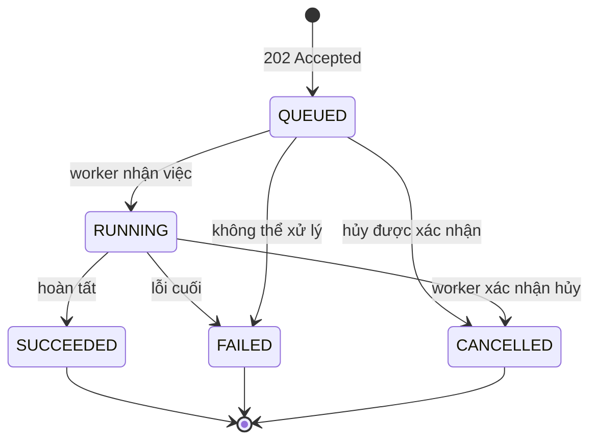
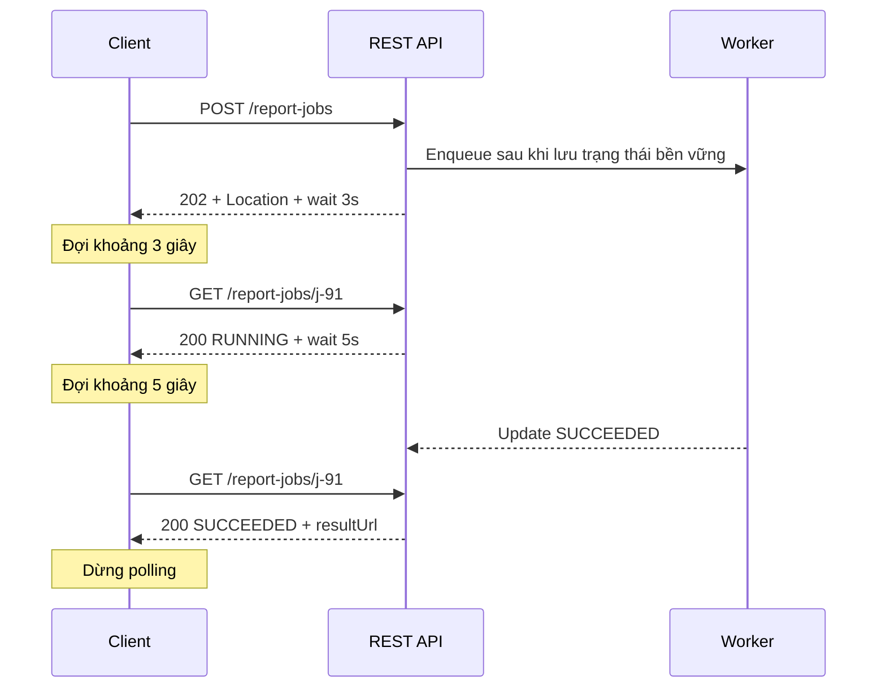
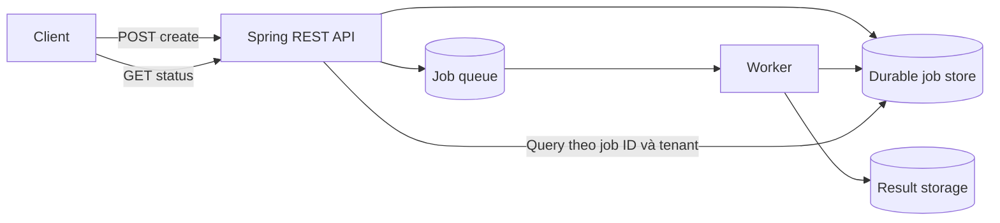

# Polling, khoảng chờ và giới hạn tần suất kiểm tra

## 1. Vấn đề: job chạy lâu, HTTP request không nên chờ mãi

Một API xuất báo cáo có thể mất vài phút để tổng hợp dữ liệu. Nếu client giữ `POST /reports` mở đến khi hoàn tất, kết nối dễ hết timeout và client khó biết công việc đang chạy hay đã thất bại. Mẫu REST phổ biến là **nhận yêu cầu, tạo một tài nguyên job, rồi cho client kiểm tra trạng thái (polling)**.

```text
POST /report-jobs         -> 202 Accepted, Location: /report-jobs/j-91
GET  /report-jobs/j-91    -> 200, phase: RUNNING
GET  /report-jobs/j-91    -> 200, phase: SUCCEEDED
GET  /reports/r-91       -> 200, tải kết quả khi được phép
```

Thách thức không chỉ là gửi GET lặp lại: nếu 10.000 client kiểm tra mỗi giây, **10.000 request/giây** có thể đổ vào endpoint chỉ để hỏi “xong chưa?”. Polling quá nhanh làm tăng CPU, kết nối và truy vấn database; quá chậm gây UX thiếu phản hồi.

Bài thuộc chương **Xử lý bất đồng bộ** của module **INTEGRATION_API_REST**, tập trung vào **khoảng chờ, giới hạn tần suất, hợp đồng trạng thái job và cách dừng polling**. Những chủ đề HTTP status, cache, idempotency, phân quyền và OpenAPI chỉ được áp dụng đúng phần liên quan để thực hành với Java/Spring.

### Mục tiêu học tập

- Thiết kế cặp endpoint **submit + status** với `202`, `Location`, status resource và trạng thái terminal.
- Chọn lịch polling cố định, tăng dần hoặc theo gợi ý từ server; áp dụng **jitter, deadline, retry budget**.
- Phân biệt **“job chưa xong”** với lỗi HTTP như `429`, `503`, `404` và với job `FAILED`.
- Tính tải từ số client/interval; giới hạn polling theo người dùng, tenant và hệ thống.
- Triển khai server/client Spring và viết kiểm thử về lịch gửi request, bảo mật và trạng thái cuối.

## 2. Hợp đồng HTTP tối thiểu cho một job

Client gửi:

```http
POST /report-jobs HTTP/1.1
Host: api.example.test
Content-Type: application/json
Authorization: Bearer <token>
Idempotency-Key: export-c42-2026-10

{"month":"2026-10","format":"csv"}
```

Server chỉ **chấp nhận xử lý**, chưa có kết quả:

```http
HTTP/1.1 202 Accepted
Location: /report-jobs/j-91
Retry-After: 3
Cache-Control: no-store
Content-Type: application/json

{
  "id": "j-91",
  "phase": "QUEUED",
  "nextPollAfterSeconds": 3,
  "links": {"self": "/report-jobs/j-91"}
}
```

`202 Accepted` nghĩa là yêu cầu đã được nhận để xử lý nhưng **chưa xác nhận hoàn tất**; job vẫn có thể thất bại hoặc bị hủy. `Location` theo hợp đồng này trỏ đến **resource theo dõi job**.

**Cẩn trọng về `Retry-After` trên `202`:** API này quy ước header là gợi ý chờ trước lần GET đầu. Không nên khẳng định mọi HTTP client tự hiểu ý nghĩa polling đó; đây là **quy ước ứng dụng phải công bố**. Field `nextPollAfterSeconds` thể hiện cùng quy tắc trong body.

Sau khi đợi, client gửi:

```http
GET /report-jobs/j-91 HTTP/1.1
Authorization: Bearer <token>
Accept: application/json
```

```http
HTTP/1.1 200 OK
Cache-Control: no-store
Content-Type: application/json

{
  "id": "j-91",
  "phase": "RUNNING",
  "progressPercent": 45,
  "nextPollAfterSeconds": 5
}
```

`200` là đúng vì **GET trạng thái thành công**, dù job chưa hoàn tất. Nếu `phase = FAILED`, GET vẫn có thể trả 200: lỗi nghiệp vụ của job và lỗi HTTP của request đọc là hai lớp khác nhau.

### Các điều khoản cần công bố

| Thuộc tính | Ý nghĩa cần xác định |
|---|---|
| `Location` | URI của job, có thể đọc ngay sau `202` hay có trễ visibility |
| `phase` | Những trạng thái hợp lệ, terminal và chuyển trạng thái được phép |
| Polling hint | Khoảng chờ lần đầu/tiếp theo, min/max và fallback |
| Kết quả | `resultUrl` hoặc liên kết tải khi `SUCCEEDED` |
| Lỗi job | `errorCode` an toàn khi `FAILED`, không lộ exception nội bộ |
| Retention | Thời điểm status/result hết hạn và phản hồi khi đã xóa |
| Quyền | Ai được GET trạng thái, hủy job, đọc kết quả |
| Hạn mức | Tốc độ polling, số job cùng lúc theo principal/tenant |
| Request lặp | Cách tránh tạo job trùng khi POST mất response |

Không cần nhồi mọi metadata vào mọi response: chỉ công bố dữ liệu thực sự giúp client xử lý đúng.

## 3. Vòng đời job: biết lúc nào phải dừng



**`SUCCEEDED`, `FAILED` và `CANCELLED` là terminal**. Đến một trạng thái cuối, client dừng polling; không tiếp tục gửi GET mỗi vài giây.

| Phase | HTTP của GET status | Hành động client |
|---|---|---|
| `QUEUED` | Thường `200` | Chờ và thử lại theo hint |
| `RUNNING` | Thường `200` | Hiển thị tiến độ nếu có, poll có kiểm soát |
| `SUCCEEDED` | `200` | Dừng, tải kết quả qua URL có quyền |
| `FAILED` | `200` | Dừng, hiển thị mã lỗi nghiệp vụ |
| `CANCELLED` | `200` | Dừng, xác nhận hủy |
| Job không tồn tại/không được phép biết | Thường `404` | Không retry vô hạn |
| Job đã hết retention, biết từng tồn tại | Có thể `410 Gone` | Dừng hoặc đề nghị tạo job mới |

Nếu worker tự retry một bước, có thể có `RETRYING` hoặc attempt counter; **logical job ID nên giữ ổn định** để client không phải theo dõi nhiều job mới.

### Tiến độ phần trăm không bắt buộc

Nhiều job không ước lượng được tiến độ chính xác. Đừng trả `80%` giả rồi đứng mãi. Nếu có `progressPercent`, hãy công bố đó là tiến độ của toàn bộ công việc hay một bước, có thể giảm khi worker retry không và tần suất cập nhật. Không biến ghi progress thành thao tác nặng hơn chính job.

## 4. Luồng polling đúng: chờ, GET, đánh giá, rồi mới lập lịch



Một client tốt đảm bảo **một GET status đang xử lý tại một thời điểm trên mỗi job**. Không dùng `setInterval` một cách vô điều kiện nếu lần GET trước có thể chậm hơn interval; khi đó request chồng chéo và response cũ có thể về sau response mới, khiến UI lùi trạng thái.

Trước khi lập lịch GET tiếp, kiểm tra:

1. Job có còn non-terminal?
2. Có hint hợp lệ không?
3. User còn xem/trông đợi kết quả không?
4. Có vượt giới hạn số lượt hoặc overall deadline không?
5. Có `429`/`503` yêu cầu đợi lâu hơn không?
6. Đã có một subscription/timer khác đang poll cùng job trên thiết bị chưa?

**Polling một job không phải thao tác tạo job lần nữa.** Nếu lần POST đầu đã trả 202, client nên theo dõi URI có sẵn, không lặp POST chỉ để hỏi tiến độ.

## 5. Ba chiến lược khoảng chờ

| Chiến lược | Ví dụ | Lợi ích | Đánh đổi |
|---|---|---|---|
| **Cố định** | GET mỗi 5 giây | Dễ hiểu, ổn định | Tốn request với job lâu |
| **Exponential backoff** | 2s → 4s → 8s → 15s | Giảm tải khi chờ lâu | Có thể phát hiện hoàn tất muộn |
| **Server-directed** | `nextPollAfterSeconds` theo phase/công suất | Phù hợp tình trạng server | Cần schema/hint nhất quán và fallback |

### Khoảng chờ cố định

Phù hợp với job có thời gian xử lý khá ổn định và lượng client vừa phải. **Không chọn 1 giây chỉ vì UI muốn nhanh**: phải tính tải trên endpoint status và độ mới thực sự cần.

### Backoff có jitter

Một công thức minh họa cho khoảng chờ trước poll thứ `n`:

\[
d_n=\min(d_{\max}, d_0 \times 2^{n-1})+J_n
\]

Với `d_0=2s`, `d_max=15s` và `J_n` là jitter không âm 0–1 giây. Nếu hợp đồng yêu cầu trần **cứng**, áp trần sau khi cộng jitter hoặc nêu rõ `d_max` chỉ là trần base.

Jitter giảm nguy cơ các client đồng loạt GET vào giây thứ 2, 4, 8 sau một đợt tạo job lớn. Nếu server yêu cầu **đợi tối thiểu** một thời gian, không dùng jitter âm khiến client poll sớm hơn.

### Server-directed

Server có thể gợi ý `QUEUED → 10s` và `RUNNING → 5s`. Client vẫn cần clamp những giá trị sai như số âm, đồng thời tránh mâu thuẫn với hạn mức. Một quy tắc:

```text
suggested = hint hợp lệ hoặc localBackoff
minimumWait = max(suggested, serverRateLimitMinimumIfAny)
actualWait = minimumWait + nonNegativeJitter

if actualWait vượt deadline tương tác:
    dừng phiên polling và cho phép người dùng quay lại sau
else:
    schedule GET sau actualWait
```

**Không clamp xuống dưới mức chờ tối thiểu server yêu cầu.** Khi `Retry-After` là 60 giây nhưng deadline còn 5 giây, dừng có kiểm soát thay vì poll sau 5 giây.

## 6. Tính tải polling trước khi triển khai

Nếu có `N` job được theo dõi đồng thời, mỗi job được hỏi khoảng `T` giây/lần:

\[
\mathrm{poll\ RPS}\approx\frac{N}{T}
\]

| Job đang được poll | Interval | Poll RPS xấp xỉ |
|---:|---:|---:|
| 1.000 | 2 giây | 500 |
| 10.000 | 2 giây | 5.000 |
| 10.000 | 10 giây | 1.000 |
| 50.000 | 10 giây | 5.000 |

Đây là **trung bình khi client phân bố đều**, chưa tính burst, retry hoặc nhiều tab. Nếu tất cả 10.000 client đồng thời poll ở mốc 10 giây, peak vẫn có thể lớn. **Jitter giảm đồng bộ, rate limit bảo vệ server**, còn index/query rẻ giúp endpoint chịu tải.

### Làm cho GET status nhẹ

- Query theo **job ID và phạm vi quyền/tenant**, có index thích hợp.
- Trả DTO nhỏ, không tính lại báo cáo hoặc truy vấn tổng số kết quả.
- Đọc trạng thái lưu sẵn, không enqueue một job mới trên GET.
- Không JOIN toàn bộ dữ liệu xuất báo cáo chỉ để lấy progress.
- Tách tải status read khỏi worker nếu hai đường đang tranh connection pool.
- Giám sát p95, DB read QPS, rows scanned, throughput worker.

Endpoint polling 5.000 RPS không nên trở thành nơi chạy SQL báo cáo nặng.

## 7. Phân biệt 202, 200, 429, 503 và những lỗi khác

| Phản hồi | Diễn giải | Client nên làm gì |
|---|---|---|
| **202** từ POST | Đã nhận xử lý, chưa xong | Lấy Location, đợi rồi GET status |
| **200** từ GET status | Đọc job thành công | Kiểm tra `phase`; terminal thì dừng |
| **304** từ conditional GET | Representation chưa thay đổi | Dùng bản đã lưu nếu được phép |
| **429** | Poll vượt rate/quota | Tôn trọng Retry-After/backoff hoặc dừng |
| **503** | Status service tạm không sẵn sàng | Retry GET có giới hạn/deadline |
| **401** | Chưa xác thực hợp lệ | Làm mới thông tin xác thực có giới hạn |
| **403** | Không có quyền truy cập job | Dừng, không retry mù |
| **404** | Không tìm thấy hoặc che giấu resource | Dừng, trừ ngoại lệ eventual consistency có hợp đồng |
| **410** | Job đã biến mất theo nghĩa của mã | Dừng hoặc tạo job mới có chủ đích |

`Retry-After` có thể là **số giây không âm** hoặc **HTTP-date**. Với `429` và `503`, nó thường được dùng để định thời điểm gửi lại. Với **`202`**, ví dụ đầu bài dùng nó làm **hướng dẫn polling do API tự quy định**; việc poll status qua GET không được tự chuẩn hóa chỉ nhờ header đó.

Ví dụ giới hạn tần suất:

```http
HTTP/1.1 429 Too Many Requests
Retry-After: 12
Content-Type: application/problem+json

{
  "type":"https://api.example.test/problems/poll-rate-limited",
  "title":"Polling rate exceeded",
  "status":429,
  "code":"POLL_RATE_LIMITED"
}
```

Client đang poll mỗi 2 giây không được tiếp tục nhịp đó khi nhận yêu cầu chờ 12 giây. `Retry-After` **không bảo đảm lần sau sẽ thành công**, cũng không thay thế deadline và retry budget.

## 8. Server phải thực thi giới hạn, không chỉ khuyên client

Client lỗi, crawler hoặc nhiều tab vẫn có thể gửi request dày. Các tầng giới hạn thường cần kết hợp:

- **Per job**: chống hỏi cùng một job quá nhanh.
- **Per user/tenant**: tổng quota polling của nhiều job.
- **Per IP**: bổ sung chống abuse nhưng không thay auth; nhiều người có thể cùng NAT.
- **Global**: bảo vệ status service và database bằng concurrency/rate cap.
- **Số job đang chạy**: quota tạo job là giới hạn khác với quota polling.

Một limiter dạng token bucket có **tốc độ nạp** và **burst capacity**. Khi vượt, server trả `429` với chính sách đợi; có thể có một lượng burst hợp lý khi user vừa mở màn hình, nhưng **không mở vô hạn**.

Nếu API có nhiều instance, bộ đếm chỉ trong RAM mỗi node có thể khiến quota không chính xác. Xem xét gateway/shared limiter hay cơ chế phân tán tương ứng.

Không cập nhật timestamp `lastPolledAt` lên database chính cho **mọi** GET nếu nó biến status endpoint thành write bottleneck. Hãy dùng limiter được thiết kế cho lưu lượng cao hoặc telemetry được sampling phù hợp.

## 9. Deadline, vòng đời màn hình và dừng đúng lúc

Một phiên polling không nên kéo dài vô hạn.

| Giới hạn | Ý nghĩa | Ví dụ minh họa |
|---|---|---|
| `maxPolls` | Số GET status tối đa trong một phiên | 30 |
| `overallDeadline` | Tổng thời gian chờ trước khi chuyển sang UX khác | 2 phút |
| `backgroundPolicy` | Khi tab nền/user rời màn hình | Tạm dừng và cho quay lại |
| `serverWaitHint` | Khoảng chờ tối thiểu cần tuân theo | 3–10 giây theo phase |

Ba kết quả khác nhau cần UI khác nhau:

- **SUCCEEDED**: dừng polling, cho tải báo cáo.
- **FAILED/CANCELLED**: dừng, thông báo lý do có thể xử lý.
- **Hết deadline**: dừng phiên chờ và nói **“Công việc có thể vẫn đang chạy; hãy quay lại kiểm tra sau”**, không tuyên bố job đã thất bại.

Khi user đóng tab, việc hủy timer/subscription **không tự hủy job server**. Nếu cần hủy tác vụ, cung cấp action hủy riêng với quyền và trạng thái được công bố; request hủy cũng có thể chỉ được tiếp nhận rồi worker mới xác nhận `CANCELLED`.

## 10. Eventual consistency: vì sao 404 ngay sau 202 là nguy hiểm?

Một lỗi thiết kế: POST trả `202 + Location`, nhưng GET ngay sau lại trả `404` do record job chưa được lưu, queue đã nhận mà database chưa commit hoặc read replica chưa đồng bộ.

**Thiết kế ưu tiên:** công bố `202` chỉ sau khi đã có record/operation identity **bền vững và truy xuất được** qua đường đã cam kết. Cần phối hợp transaction/queue để tránh job mồ côi.

Nếu hệ thống **có trễ visibility** và không thể bỏ, hợp đồng phải mô tả:

- `404` tạm chỉ áp dụng với **job vừa được tạo đã biết ID**, trong một cửa sổ nhỏ có giới hạn.
- Client dùng backoff và deadline, không retry mọi `404` trên mọi URI.
- Hết cửa sổ mà vẫn 404 thì dừng/báo lỗi, không polling vô hạn.
- `410 Gone` có thể biểu thị đã hết retention nếu server biết resource từng tồn tại.

Client phải phân biệt `404` do che giấu quyền với 404 tạm sau tạo job; **không tạo cơ chế retry làm lộ sự tồn tại của job user khác**.

## 11. Cache, ETag và bản status cũ

Job status thay đổi thường xuyên và thường là dữ liệu riêng theo user/tenant. Với dữ liệu nhạy cảm, trả `Cache-Control: no-store`, không lưu trong shared cache. Khi chính sách cho phép **cache riêng**, có thể dùng `Cache-Control: private, no-cache` kết hợp ETag để client gửi `If-None-Match` và nhận `304 Not Modified` nếu nội dung chưa đổi.

**304 không có body**, nên client phải giữ representation hợp lệ từ lần GET trước. Không dùng `no-store` rồi lại phụ thuộc vào body đã lưu để xử lý 304. ETag phải đổi khi phase, progress hoặc kết quả thay đổi; GET vẫn cần kiểm tra quyền. **304 không thay thế giới hạn polling:** revalidation vẫn tiêu thụ request và tài nguyên server.

## 12. Tách status read path khỏi worker path



Một backend vững cần:

1. Tạo identity và lưu trạng thái job **bền vững** trước khi ACK theo hợp đồng.
2. Worker cập nhật `QUEUED → RUNNING → terminal`; transition được bảo vệ bởi transaction/version, tránh ghi lùi terminal.
3. GET status chỉ đọc record nhỏ, không gọi lại nghiệp vụ nặng.
4. Kết quả có retention và authorization riêng.
5. Worker retry nội bộ không tạo resource job mới cho từng attempt.
6. Trạng thái tiến độ không ghi quá dày, tránh database write pressure.
7. Nếu queue/store tạm unavailable, POST phải trả lỗi HTTP phù hợp thay vì giả `202` đã nhận thành công.

Thiết kế job có thể dựa trên relational DB, queue, workflow engine hoặc công nghệ tương đương. Điều quan trọng là **đường tạo/quan sát có nghĩa rõ**, không phải công cụ cụ thể.

## 13. Server Java/Spring: tạo và tra cứu job

Ví dụ Spring MVC kết hợp DTO và status/header; các service/type ngoài controller là **trừu tượng minh họa**:

```java
import java.net.URI;
import java.util.UUID;
import org.springframework.http.CacheControl;
import org.springframework.http.HttpHeaders;
import org.springframework.http.ResponseEntity;
import org.springframework.security.core.Authentication;
import org.springframework.web.bind.annotation.*;

enum JobPhase {
    QUEUED, RUNNING, SUCCEEDED, FAILED, CANCELLED;

    boolean terminal() {
        return this == SUCCEEDED || this == FAILED || this == CANCELLED;
    }
}

record ExportRequest(String month, String format) {}

record JobView(
    UUID id,
    JobPhase phase,
    Integer progressPercent,
    Integer nextPollAfterSeconds,
    String resultUrl,
    String errorCode
) {}

@RestController
@RequestMapping("/report-jobs")
class ReportJobController {
    private final ReportJobService jobs;

    ReportJobController(ReportJobService jobs) {
        this.jobs = jobs;
    }

    @PostMapping
    ResponseEntity<JobView> create(
            @RequestBody ExportRequest request,
            Authentication authentication) {
        JobView job = jobs.submitDurably(authentication, request);
        return ResponseEntity.accepted()
                .location(URI.create("/report-jobs/" + job.id()))
                .header(HttpHeaders.RETRY_AFTER, "3")
                .cacheControl(CacheControl.noStore())
                .body(job);
    }

    @GetMapping("/{id}")
    ResponseEntity<JobView> status(
            @PathVariable UUID id,
            Authentication authentication) {
        JobView job = jobs.findVisible(authentication, id);
        return ResponseEntity.ok()
                .cacheControl(CacheControl.noStore())
                .body(job);
    }
}
```

**Cần bổ sung trong ứng dụng thật:** `ReportJobService` với persistence/queue, kiểm tra auth/tenant trong `submitDurably` và `findVisible`, input validation, quota tạo job, idempotency cho POST, 404/429/503/Problem Details và schema DTO. Không xem việc có `Authentication` parameter là đã phân quyền.

`nextPollAfterSeconds` chỉ nên xuất hiện hoặc có ý nghĩa khi job chưa terminal; `resultUrl` chỉ có khi kết quả sẵn sàng và caller có quyền. **Job `FAILED` đọc qua GET vẫn là 200**, không bọc thành HTTP 500.

## 14. Client Java/Spring WebClient: polling không block thread

Ví dụ dưới dùng **Reactor Mono** và một vòng polling tuần tự. Nó cố ý **chưa tự retry HTTP errors**: trong production cần thêm policy cho `429/503`, auth và mạng thay vì retry mọi exception.

```java
import java.time.Duration;
import java.util.UUID;
import java.util.concurrent.ThreadLocalRandom;
import org.springframework.web.reactive.function.client.WebClient;
import reactor.core.publisher.Mono;

public class ReportJobPoller {
    private final WebClient client;

    public ReportJobPoller(WebClient client) {
        this.client = client;
    }

    public Mono<JobView> awaitTerminal(UUID id) {
        return poll(id, 0).timeout(Duration.ofMinutes(2));
    }

    private Mono<JobView> poll(UUID id, int polls) {
        if (polls >= 30) {
            return Mono.error(new IllegalStateException(
                    "Vượt giới hạn kiểm tra trạng thái"));
        }

        return client.get()
                .uri("/report-jobs/{id}", id)
                .retrieve()
                .bodyToMono(JobView.class)
                .flatMap(job -> {
                    if (job.phase().terminal()) {
                        return Mono.just(job);
                    }

                    int hint = job.nextPollAfterSeconds() == null
                            ? 3 : job.nextPollAfterSeconds();
                    int seconds = Math.min(15, Math.max(2, hint));
                    long jitterMs = ThreadLocalRandom.current()
                            .nextLong(0, 1000);

                    return Mono.delay(Duration.ofMillis(
                                seconds * 1000L + jitterMs))
                            .then(Mono.defer(() -> poll(id, polls + 1)));
                });
    }
}
```

### Đọc đúng giới hạn của ví dụ

- Tối đa **30 GET cho một subscription**, tổng timeout 2 phút.
- `Mono.delay` không chặn event loop; request sau chỉ bắt đầu khi request trước đã trả và đã đợi.
- Hủy subscription sẽ dừng timer/client request còn hoạt động; **không tự hủy job server**.
- Phải tránh nhiều component cùng gọi `awaitTerminal` cho một job rồi gây các vòng polling trùng nhau.
- `retrieve()` mặc định chuyển 4xx/5xx thành exception, không tự retry; đây là hành vi có thể kiểm soát.
- Đoạn code **chưa parse `Retry-After`, chưa xử lý 429/503, token refresh, ETag, network failures hoặc rate policy**. Những phần này cần triển khai ở lớp adapter/policy đã kiểm thử.
- Phép clamp tối đa 15 giây **chỉ minh họa**: nếu server yêu cầu chờ ít nhất 60 giây thì không dùng clamp này để poll sớm; cần dừng hoặc lên lịch đúng hợp đồng.
- Trong dự án client riêng, định nghĩa DTO `JobView`/`JobPhase` hoặc sinh từ hợp đồng, không phụ thuộc vào package server.

### Policy đầy đủ nên có những nhánh nào?

```text
GET status:
  200 + terminal        -> stop, return job outcome
  200 + non-terminal    -> schedule next GET per hint and budget
  304                   -> reuse cached representation only if allowed
  429 + Retry-After     -> wait at least as instructed or stop on deadline
  503                   -> bounded backoff, circuit breaker, then GET again
  401                   -> authenticate correctly, prevent refresh loop
  403, 410              -> stop
  404                   -> stop unless bounded visibility contract applies
  network timeout       -> retry GET only within budget/deadline
```

Không gắn `retryWhen` cho mọi exception: 403/404/410, validation hoặc schema lỗi thường không hồi phục bằng gửi lại nguyên xi.

## 15. Bảo mật: status resource cũng phải được phân quyền

`/report-jobs/j-91` có thể tiết lộ tên báo cáo, tiến độ xử lý dữ liệu khách hàng, đường dẫn file hoặc lỗi hệ thống. **Biết job ID không có nghĩa có quyền xem nó.**

- **Authenticate/authorize từng GET** theo owner/tenant/role, không chỉ kiểm tra tại POST.
- Job ID khó đoán giúp giảm enumeration nhưng **không thay thế phân quyền**.
- Suy tenant từ danh tính đã kiểm chứng, không tin `tenantId` do caller tự khai.
- Có thể dùng `404` để ẩn sự tồn tại thay vì trả 403, theo chính sách nhất quán.
- Không đưa SQL, hostname nội bộ, stack trace, PII hoặc đường dẫn storage bí mật vào `errorCode`/`resultUrl`.
- Đường tải kết quả phải kiểm tra quyền; nếu dùng signed URL có hạn, chỉ phát sau authorization và quản lý expiration.
- Giới hạn cả **số job tạo được** lẫn **tần suất polling** để chống abuse.
- Không để CDN cache chung status giữa user/tenant; lựa chọn no-store/private theo policy.
- Khi quyền bị thu hồi giữa chừng, lần GET tiếp theo phải dùng quyền **hiện tại**.
- CORS không thay thế authorization; token và job ID động không nên đưa vào metric labels.

### Trường hợp nhiều tab

Một user mở 5 tab đều theo dõi một job: mỗi tab tự poll 2 giây tạo 2,5 GET/s cho cùng một job. Frontend có thể chia sẻ subscription giữa component hoặc có chiến lược điều phối theo tab; nhưng **server vẫn phải enforce quota**, không dựa vào thiện chí của client.

## 16. Kiểm thử HTTP và lịch kiểm tra bằng Spring

### Ma trận test quan trọng

| Kịch bản | Kỳ vọng |
|---|---|
| POST hợp lệ | 202, Location trỏ status resource, body QUEUED, hint phù hợp |
| GET RUNNING | 200, progress/hint hợp lệ |
| GET SUCCEEDED/FAILED/CANCELLED | 200 và phase terminal; client dừng |
| Poll vượt quota | 429 và Retry-After hợp lệ |
| Status service tạm unavailable | 503; client backoff trong deadline |
| Token sai/hết hạn | 401; không lặp refresh vô hạn |
| User B đọc job của A | 403 hoặc 404; không lộ status/kết quả |
| Job hết hạn | 404/410 theo retention contract |
| Lịch polling | Không GET trước hint, không request chồng nhau |
| Client hủy | Dừng timer, job server không bị coi đã hủy |
| Response thứ tự đảo | UI không lùi từ terminal về RUNNING |
| Visibility sau 202 | Status URI truy xuất theo hợp đồng |
| Load test | Poll RPS, p95, quota và tải DB nằm trong SLO |

### MockMvc minh họa

Giả sử có `mockMvc`, service mock/fixture phù hợp và Spring Security test dependency:

```java
import static org.springframework.test.web.servlet.request.MockMvcRequestBuilders.*;
import static org.springframework.test.web.servlet.result.MockMvcResultMatchers.*;
import static org.springframework.security.test.web.servlet.request.SecurityMockMvcRequestPostProcessors.user;

mockMvc.perform(post("/report-jobs")
        .with(user("alice"))
        .contentType("application/json")
        .content("{\"month\":\"2026-10\",\"format\":\"csv\"}"))
    .andExpect(status().isAccepted())
    .andExpect(header().exists("Location"))
    .andExpect(header().string("Retry-After", "3"))
    .andExpect(jsonPath("$.phase").value("QUEUED"));

mockMvc.perform(get("/report-jobs/{id}", id)
        .with(user("alice")))
    .andExpect(status().isOk())
    .andExpect(jsonPath("$.phase").value("RUNNING"));
```

Đây là phần assertion, **không phải test class chạy độc lập**. Nếu ứng dụng dùng CSRF protection cho POST theo session, cần setup CSRF token; đồng thời xác minh Location chứa đúng ID vừa tạo, không chỉ tồn tại.

### Client và integration test

1. Stub trả RUNNING ba lần rồi SUCCEEDED: client dừng chính xác, không GET thừa.
2. Stub gợi ý 5 giây: dùng **virtual time/test scheduler** để xác nhận không poll trước mốc, tránh sleep thật gây flaky test.
3. Stub trả `429 Retry-After: 20` khi deadline còn 4 giây: client dừng, không gửi lại ở mốc 2 giây.
4. Stub trả 503 liên tục: dừng khi hết budget, không tạo retry storm.
5. Kiểm tra job FAILED: dừng, không tự POST một job khác.
6. Hai tài khoản A/B gọi cùng URL: không lộ dữ liệu qua API hoặc proxy.
7. Load test từ 1.000–10.000 client ảo: đo RPS trung bình/peak, p95, DB QPS, 429 và worker throughput.

MockMvc **không kiểm chứng** rate limiter phân tán, CDN, status visibility qua replica hoặc mạng thực. Dùng môi trường tích hợp có đường request tương tự production cho những yêu cầu đó.

## 17. Quan sát hệ thống và lựa chọn thay thế polling

Đo **status GET RPS, p95 latency, số polls/job, 429/503 và deadline exceeded** riêng với **queue depth, queue wait, execution time, tỷ lệ SUCCEEDED/FAILED** của worker. Theo dõi cross-tenant denials và các request vượt quota. Không đưa job ID, user ID, token hoặc raw URL vào metric labels có cardinality cao; chỉ dùng log/trace bảo vệ khi cần điều tra từng job.

Nếu cần cập nhật gần tức thời ở quy mô lớn hoặc client không giữ màn hình mở, cân nhắc **SSE** (push một chiều), **WebSocket** (hai chiều), **webhook** (callback giữa hệ thống) hoặc **long polling** (giữ GET có timeout). Mỗi lựa chọn tăng yêu cầu về kết nối, reconnect hoặc bảo vệ callback. Dù dùng push, `GET /report-jobs/{id}` vẫn hữu ích để phục hồi trạng thái sau mất kết nối.

## 18. Case study: 20.000 người dùng cùng chờ xuất báo cáo

Hệ thống có 20.000 job được theo dõi. Poll **một giây/lần** tạo khoảng **20.000 GET/s** chưa tính retry, có thể tranh connection pool với worker.

**Phương án cải tiến:**

1. POST trả `202` + Location sau khi lưu job bền vững; GET chỉ đọc DTO theo ID + tenant.
2. `QUEUED` gợi ý 10 giây, `RUNNING` 5 giây; client thêm jitter và không gửi GET chồng nhau.
3. Server giới hạn per-job/tenant; trả `429`/Retry-After nếu vượt, client có deadline và dừng ở terminal.
4. Giám sát riêng poll RPS, queue time và job completion; rời trang chỉ dừng polling.

Với interval trung bình 10 giây, số GET trung bình giảm từ **20.000 xuống xấp xỉ 2.000 RPS** trong mô hình đơn giản. Đỉnh tải vẫn cần load test với jitter, lỗi 429/503 và nhiều tenant.

### Bài tập

Thiết kế status GET cho job 15 phút với 5.000 client: định nghĩa phase, hint, quota, RPS dự kiến, terminal, 429, 404 sau 202, quyền tải kết quả và ít nhất năm integration tests về lịch poll.

## 19. Checklist phát hành

- [ ] POST trả `202` khi chỉ chấp nhận xử lý; `Location` trỏ job có thể theo dõi.
- [ ] Trạng thái job bền vững; GET không enqueue hoặc chạy lại nghiệp vụ.
- [ ] GET thường trả `200` cho cả RUNNING và FAILED, client phân nhánh bằng `phase`.
- [ ] Terminal states rõ; client dừng polling đúng lúc.
- [ ] Hint, khoảng chờ tối thiểu, fallback, jitter và deadline được công bố.
- [ ] `Retry-After` trên 202 (nếu dùng) được giải thích là quy ước API.
- [ ] 429/503 được xử lý có backoff và budget, không spam.
- [ ] Không có các GET status chồng chéo ngoài ý muốn.
- [ ] Server giới hạn rate theo job/principal/tenant và tải toàn hệ thống.
- [ ] Endpoint status đủ nhẹ, có index, không tính lại báo cáo.
- [ ] 404 sau 202 và retention/410 có hợp đồng rõ; không retry vô hạn.
- [ ] GET job và URL kết quả đều áp quyền hiện hành, tránh leak xuyên tenant.
- [ ] Cache policy bảo vệ dữ liệu riêng; 304 chỉ dùng khi có representation hợp lệ.
- [ ] Test HTTP 202/200/429/503, terminal, quyền A/B, virtual time và tải đồng thời.
- [ ] Có metric riêng cho polling và worker; có giải pháp chuyển SSE/webhook nếu workload cần.

## 20. Ghi nhớ cốt lõi

**Polling là hợp đồng nhịp giao tiếp**, không phải vòng GET vô hạn. Mẫu REST phổ biến: **`POST → 202 + Location`**, sau đó **`GET status → 200 + phase`** cho tới khi job terminal. Khoảng chờ hợp lý, jitter, deadline và server-side rate limiting quyết định hệ thống có chịu được hàng nghìn client đang chờ hay không.

Trong Java/Spring, hãy lưu trạng thái job bền vững, giữ GET nhẹ và kiểm tra phân quyền ở mỗi lần đọc. Test không chỉ status code mà cả **thời điểm client gửi GET, số request, việc dừng khi terminal và phản ứng với 429/503**. Khi cần cập nhật gần thời gian thực ở quy mô lớn, có thể chọn SSE, WebSocket, webhook hoặc long polling — nhưng vẫn cần nguồn trạng thái job đáng tin để khôi phục sau mất kết nối.

