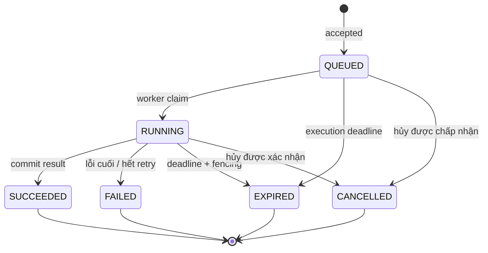
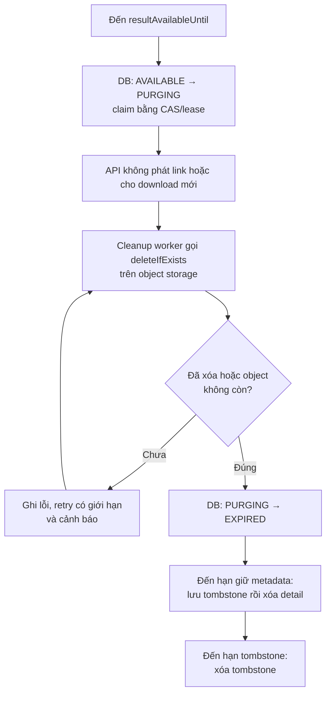

# Hết hạn job, lưu kết quả và phản hồi với tài nguyên đã dọn

> **Chương:** Xử lý bất đồng bộ  
> **Module:** `INTEGRATION_API_REST` — thiết kế REST API theo resource, URI, HTTP methods/status codes và hợp đồng dữ liệu; thực hành xác thực, phân quyền, lỗi, idempotency và kiểm thử bằng Java/Spring.

Một API xuất báo cáo có thể trả `202 Accepted` trong vài mili giây, nhưng tệp CSV chỉ sẵn sàng sau vài phút. Tệp được giữ bảy ngày; thông tin theo dõi job được giữ ba mươi ngày; hệ thống còn lưu dấu vết rằng job từng tồn tại một thời gian nữa. Khi client truy cập lại URL sau hai tuần, trả `200`, `404` hay `410`? Nếu worker vẫn chạy khi deadline đã qua thì có thể ghi `SUCCEEDED` hay không?

Điểm cốt lõi là **không đồng nhất ba sự kiện**: *job hết hạn xử lý*, *kết quả hết hạn tải* và *tài nguyên theo dõi đã được dọn*. Chúng xảy ra ở các thời điểm khác nhau, có ảnh hưởng khác nhau tới trạng thái nghiệp vụ, HTTP response, bảo mật và chiến lược cleanup.

## Mục tiêu học tập

Sau bài này, bạn có thể:

1. Thiết kế các deadline/TTL riêng cho thực thi, tệp kết quả, operation, tombstone và idempotency key.
2. Ánh xạ từng trường hợp sang `200`, `202`, `404` hoặc `410` theo **tài nguyên đích** và khả năng biết lịch sử của server.
3. Trình bày quy trình dọn dẹp có thể chạy lại khi metadata ở database, tệp ở object storage.
4. Bảo vệ hệ thống trước race giữa worker finalize, timeout, xóa kết quả và tải file.
5. Minh họa Spring Boot REST controller, Problem Details, cleanup worker và phân quyền.
6. Viết integration tests với đồng hồ giả lập, nhiều cleanup worker, sự cố storage và trường hợp cross-tenant.

## 1. Định nghĩa năm mốc thời gian khác nhau

Giả sử `POST /api/exports` tạo operation `op-72a`. Không nên dùng duy nhất trường `expiresAt` vì nó không nói rõ *cái gì* hết hạn.

| Trường | Ý nghĩa chính xác | Hành vi khi vượt hạn |
| --- | --- | --- |
| `executionDeadlineAt` | Thời điểm cuối cùng job được phép hoàn tất theo SLA/quy tắc nghiệp vụ. | Job chưa terminal có thể thành `EXPIRED`; worker không được tự ghi thành công sau deadline. |
| `resultAvailableUntil` | Thời điểm tệp/artifact còn được phép tải. | Ngừng cấp quyền tải dù bytes chưa xóa vật lý; bắt đầu thu hồi artifact. |
| `operationRetainedUntil` | Thời điểm cuối vẫn cung cấp representation chi tiết của operation. | Có thể dọn metadata chi tiết và chuyển sang tombstone. |
| `tombstoneRetainedUntil` | Thời điểm cuối lưu chứng cứ “URI này từng có tài nguyên đã dọn”. | Sau khi tombstone bị xóa, thường chỉ còn khả năng trả `404`. |
| `idempotencyRetainedUntil` | Thời điểm cuối giữ ánh xạ idempotency key → logical operation. | Request gửi lại sau đó có thể bị coi là mới, theo hợp đồng và ràng buộc nghiệp vụ. |

Các hạn này là **chính sách API**, không phải thời hạn mặc định của HTTP. Với tình huống giả định:

- Job phải hoàn tất trong **30 phút từ acceptedAt**.
- Tệp CSV tồn tại **7 ngày sau completedAt**.
- Operation detail được giữ **30 ngày sau completedAt**.
- Tombstone tồn tại thêm **30 ngày** sau khi dọn detail.
- Idempotency record được giữ ít nhất đủ lâu cho **cửa sổ retry được cam kết**; không tự gắn với TTL bảy ngày của tệp.

```text
18/11 09:00Z   POST -> 202; op-72a = QUEUED
18/11 09:02Z   Worker hoàn tất -> SUCCEEDED
25/11 09:02Z   resultAvailableUntil: không cho tải CSV mới
18/12 09:02Z   operationRetainedUntil: chuyển detail sang tombstone
17/01 09:02Z   tombstoneRetainedUntil: xóa tombstone
```


## 2. Hai chiều trạng thái: thực thi và khả năng tải kết quả

**Job state** thể hiện tiến trình đã hoàn thành hay chưa. **Result state** thể hiện tệp có còn khả dụng không. Không chuyển job `SUCCEEDED` thành `FAILED` chỉ vì tệp đã hết hạn lưu.



| `jobState` | `resultState` | Diễn giải |
| --- | --- | --- |
| `QUEUED` / `RUNNING` | `NONE` | Chưa có kết quả để tải. |
| `SUCCEEDED` | `AVAILABLE` | Có kết quả và chưa vượt thời hạn tải. |
| `SUCCEEDED` | `PURGING` | Đã thu hồi quyền tải, cleanup đang xóa object. |
| `SUCCEEDED` | `EXPIRED` | Kết quả không còn; job vẫn đã thành công. |
| `FAILED` / `CANCELLED` / `EXPIRED` | `NONE` | Không có kết quả thành công theo hợp đồng ví dụ. |


**Execution expiry không phải artifact expiry.** Job có thể hết hạn khi chưa thực hiện xong nên state là `EXPIRED`; một job hoàn tất đúng giờ có thể giữ `SUCCEEDED` vĩnh viễn trong lịch sử cho tới khi metadata bị dọn, bất kể tệp còn hay không.

## 3. HTTP semantics: chọn theo URI đang được yêu cầu

Cùng một logical job nhưng có ít nhất hai URI: `/api/operations/{id}` (trạng thái) và `/api/exports/{id}/file` (artifact). Mỗi request hỏi **một tài nguyên khác nhau**.

| Request và điều kiện | HTTP status phù hợp | Giải thích |
| --- | --- | --- |
| `POST /api/exports` đã được nhận bền vững nhưng còn phải xử lý. | **`202 Accepted`** | Yêu cầu chấp nhận để xử lý, chưa khẳng định kết quả cuối. |
| `GET /api/operations/op-72a` khi job đang chạy. | **`200 OK`** với `RUNNING` | GET trạng thái thành công; job chưa xong. |
| `GET` operation khi job đã `FAILED` hoặc `EXPIRED`. | **`200 OK`** với state/error ứng dụng | Không dùng HTTP `500` để mô tả một job từng thất bại nhưng GET trạng thái vẫn hoạt động. |
| `GET` operation đã `SUCCEEDED` nhưng result hết hạn. | **`200 OK`** với `result.state=EXPIRED` nếu metadata còn. | Lịch sử thành công vẫn có. |
| `GET /api/exports/{id}/file` khi file chưa sẵn sàng. | Ví dụ **`409 Conflict`**, `RESULT_NOT_READY` | Xung đột với trạng thái hiện tại; đây là **quy ước contract**, không bắt buộc mọi API phải chọn 409. |
| `GET` result mà server biết đã hết hạn cung cấp vĩnh viễn. | **`410 Gone`** nếu được phép tiết lộ. | Kết quả từng có nhưng không còn được phục vụ. |
| `GET` operation sau khi dọn detail, tombstone còn. | **`410 Gone`** nếu được phép tiết lộ. | Server có chứng cứ resource đã bị dọn. |
| `GET` ID chưa từng tồn tại hoặc đã xóa hết dấu vết. | **`404 Not Found`** | Không có representation và không đủ căn cứ nói tài nguyên từng tồn tại. |
| Principal không được biết job của tenant khác. | **`403` hoặc `404`** theo security policy. | Không dùng `410` tiết lộ lịch sử cho người không đủ quyền. |

Theo HTTP Semantics (RFC 9110), `410 Gone` biểu thị rằng quyền truy cập đến tài nguyên không còn được cung cấp tại server gốc và tình trạng **có khả năng lâu dài**. Khi không biết có phải vĩnh viễn hay không, `404` có thể đúng hơn. **`410` không có nghĩa job thất bại hoặc đang chờ.**


## 4. Hợp đồng HTTP từ lúc tiếp nhận đến lúc dọn

### 4.1 Tiếp nhận export

```http
POST /api/exports HTTP/1.1
Content-Type: application/json
Authorization: Bearer <token>
Idempotency-Key: export-user42-nov18

{"fromDate":"2026-11-01","toDate":"2026-11-17","format":"CSV"}
```

```http
HTTP/1.1 202 Accepted
Content-Type: application/json
Location: /api/operations/op-72a
Retry-After: 5
Cache-Control: no-store

{
  "operationId": "op-72a",
  "state": "QUEUED",
  "statusUrl": "/api/operations/op-72a",
  "executionDeadlineAt": "2026-11-18T09:30:00Z"
}
```

`Location` được hợp đồng bài học dùng để dẫn đến operation resource; không suy nó có cùng ngữ nghĩa bắt buộc với `201 Created`. `Retry-After` là gợi ý polling, không cam kết hoàn thành sau 5 giây.

### 4.2 Job thành công và tệp còn hạn

```http
GET /api/operations/op-72a HTTP/1.1
Authorization: Bearer <token>
```

```http
HTTP/1.1 200 OK
Content-Type: application/json
Cache-Control: private, no-store

{
  "operationId": "op-72a",
  "state": "SUCCEEDED",
  "completedAt": "2026-11-18T09:02:00Z",
  "result": {
    "state": "AVAILABLE",
    "href": "/api/exports/exp-19/file",
    "availableUntil": "2026-11-25T09:02:00Z"
  },
  "operationRetainedUntil": "2026-12-18T09:02:00Z"
}
```

URI tải file **không phải quyền truy cập**; endpoint file luôn xác minh authz, retention và sự tồn tại artifact khi nhận GET.

### 4.3 Kết quả hết hạn nhưng lịch sử còn

```http
HTTP/1.1 200 OK
Content-Type: application/json
Cache-Control: private, no-store

{
  "operationId": "op-72a",
  "state": "SUCCEEDED",
  "completedAt": "2026-11-18T09:02:00Z",
  "result": {
    "state": "EXPIRED",
    "availableUntil": "2026-11-25T09:02:00Z"
  },
  "operationRetainedUntil": "2026-12-18T09:02:00Z"
}
```


### 4.4 Yêu cầu tải artifact đã hết hạn

```http
GET /api/exports/exp-19/file HTTP/1.1
Authorization: Bearer <token>
```

```http
HTTP/1.1 410 Gone
Content-Type: application/problem+json
Cache-Control: private, no-store

{
  "type": "https://api.example.test/problems/result-expired",
  "title": "Result no longer available",
  "status": 410,
  "detail": "The export file is past its retention period.",
  "code": "RESULT_EXPIRED"
}
```

Chỉ áp `410` sau khi đã kiểm tra người gọi **được phép biết** kết quả từng tồn tại. Nếu tài nguyên không được công bố cho họ, `404` trung tính có thể là lựa chọn phù hợp.

### 4.5 Operation detail đã dọn, còn tombstone

```http
HTTP/1.1 410 Gone
Content-Type: application/problem+json
Cache-Control: private, no-store

{
  "type": "https://api.example.test/problems/operation-gone",
  "title": "Operation no longer available",
  "status": 410,
  "detail": "The operation record is no longer retained.",
  "code": "OPERATION_GONE"
}
```


## 5. Thu hồi quyền tải và xóa vật lý là hai bước riêng

Metadata thường ở database, tệp ở object storage. Không có một transaction ACID chung giữa thao tác `UPDATE operations` và `DELETE object`, nên cleanup phải **idempotent và có thể tiếp tục sau crash**.



**Quy tắc quan trọng:** tại `resultAvailableUntil`, API phải chặn **việc cấp quyền tải mới**, dù object bytes chưa bị xóa. Cleanup scheduler chạy trễ không được kéo dài retention công khai một cách ngầm định.

| Tình huống lỗi/race | Hành vi an toàn |
| --- | --- |
| Xóa object thành công nhưng cập nhật DB thất bại. | Giữ `PURGING`; retry xóa (idempotent) rồi đánh dấu `EXPIRED`. |
| Đánh dấu `PURGING` thành công nhưng object store tạm lỗi. | API vẫn không cấp link; cleanup retry và báo cảnh báo. |
| Hai cleanup workers nhận cùng candidate. | Claim bằng lease/CAS để một worker sở hữu; thao tác vẫn thiết kế idempotent. |
| Worker tạo object đúng lúc job bị timeout. | Không ghi `SUCCEEDED` nếu CAS state/deadline/lease thất bại; dọn object mồ côi. |
| Một download đang stream khi cleanup bắt đầu. | Phải định nghĩa chính sách stream đang mở; có thể dùng lease/stream proxy hoặc chấp nhận stream đã mở tiếp tục theo contract. |
| URL ký sẵn còn sống sau TTL logic. | Không cam kết revoke tức thì nếu storage không hỗ trợ; giới hạn TTL URL và/hoặc proxy kiểm tra quyền ở mỗi request. |

**Lưu ý presigned URL:** một URL đã ký có thể tiếp tục được dùng đến khi signature hết hạn, dù database đã đổi `resultState`. Để cam kết “không tải sau 09:02”, cần cơ chế có khả năng thực thi cam kết đó, không chỉ cập nhật một flag.

### Dọn metadata nhưng vẫn trả 410

Không xóa operation detail và tombstone cùng lúc nếu hợp đồng hứa `410` trong một cửa sổ nhất định. Một mô hình:

1. Chỉ dọn detail của job **terminal** và result đã `NONE/EXPIRED`.
2. Trong transaction, lưu tombstone tối thiểu gồm operation ID, owner scope phù hợp, ngày hết hạn; sau đó xóa detail.
3. Khi tombstone còn và người gọi đủ quyền, trả `410`.
4. Khi tombstone hết hạn, dọn và trả `404` cho các request về sau nếu không còn metadata khác.

Tombstone cũng có retention và có thể bị buộc xóa sớm theo chính sách quyền riêng tư. Không lưu request payload, PII hoặc secret không cần thiết chỉ để trả một status đẹp.

## 6. Ngăn job hết deadline nhưng worker vẫn ghi thành công

Đánh dấu `EXPIRED` trong database không tự dừng code đang chạy hoặc hủy giao dịch với đối tác. Worker phải sử dụng **lease/fencing token** và kiểm tra deadline tại điểm finalize.

SQL minh họa trên PostgreSQL:

```sql
UPDATE operations
SET state = 'SUCCEEDED',
    result_object_key = :object_key,
    completed_at = now(),
    version = version + 1
WHERE id = :id
  AND state = 'RUNNING'
  AND lease_token = :lease_token
  AND execution_deadline_at > now();
```

Nếu `updated=0`, worker **không được công bố kết quả thành công**, dù đã sinh tệp. Nó cần xác minh token đã mất quyền, job đã hủy hay deadline qua, rồi dọn artifact chưa liên kết. Một tác vụ timeout có thể chuyển trạng thái:

```sql
UPDATE operations
SET state = 'EXPIRED',
    completed_at = now(),
    version = version + 1
WHERE state IN ('QUEUED', 'RUNNING')
  AND execution_deadline_at <= now();
```

Hai câu lệnh cạnh tranh phải nằm trong mô hình transaction/isolation có thể chứng minh **chỉ một trạng thái terminal thắng**. Chúng **không tự rollback side effect bên ngoài**: với thanh toán hoặc email đã gửi, cần idempotency, reconciliation và quy tắc hủy riêng.

Nếu hệ thống có cả **timeout cho từng attempt** và **deadline tổng**, phải dùng hai trường và hai cơ chế. Retry một attempt không được vô tình kéo dài deadline tổng đã cam kết.

## 7. Java/Spring: status endpoint và Problem Details

Ví dụ dùng Spring Boot 3 / Spring Framework 6. Service/repository là điểm tích hợp của ứng dụng thật; mục tiêu chính là cho thấy **lớp HTTP không được đoán trạng thái đã dọn** và phải kiểm tra phân quyền trước khi phản hồi.

```java
import java.time.*;
import org.springframework.http.*;
import org.springframework.security.core.Authentication;
import org.springframework.web.bind.annotation.*;
import org.springframework.web.server.ResponseStatusException;

enum JobState { QUEUED, RUNNING, SUCCEEDED, FAILED, EXPIRED, CANCELLED }
enum ResultState { NONE, AVAILABLE, PURGING, EXPIRED }

record ResultView(ResultState state, String href, Instant availableUntil) {}
record OperationView(
    String operationId, JobState state, ResultView result,
    Instant executionDeadlineAt, Instant operationRetainedUntil
) {}

interface OperationQueries {
    // UNKNOWN hoặc không có quyền biết -> NotFoundException.
    // Tombstone thấy được -> OperationGoneException.
    OperationView readVisible(String id, String principal, Instant now);

    // Demo tệp nhỏ; service xác minh authz và TTL trước khi đọc.
    byte[] readSmallResult(String exportId, String principal, Instant now);
}

@RestController
@RequestMapping("/api")
class OperationController {
    private final OperationQueries queries;
    private final Clock clock;

    OperationController(OperationQueries queries, Clock clock) {
        this.queries = queries;
        this.clock = clock;
    }

    @GetMapping("/operations/{id}")
    ResponseEntity<OperationView> status(
            @PathVariable String id, Authentication auth) {
        if (auth == null || !auth.isAuthenticated()) {
            throw new ResponseStatusException(HttpStatus.UNAUTHORIZED);
        }
        var view = queries.readVisible(id, auth.getName(), clock.instant());
        return ResponseEntity.ok().cacheControl(CacheControl.noStore())
            .body(view);
    }

    @GetMapping("/exports/{id}/file")
    ResponseEntity<byte[]> smallFileDemo(
            @PathVariable String id, Authentication auth) {
        if (auth == null || !auth.isAuthenticated()) {
            throw new ResponseStatusException(HttpStatus.UNAUTHORIZED);
        }
        byte[] bytes = queries.readSmallResult(
            id, auth.getName(), clock.instant());
        return ResponseEntity.ok()
            .cacheControl(CacheControl.noStore())
            .contentType(MediaType.parseMediaType("text/csv"))
            .header(HttpHeaders.CONTENT_DISPOSITION,
                "attachment; filename=\"export.csv\"")
            .body(bytes);
    }
}
```

**Giới hạn:** dùng `byte[]` chỉ cho file rất nhỏ. Export lớn cần streaming/`Resource` hoặc đường tải có bảo vệ quyền và giới hạn bộ nhớ; URL ký phải tuân TTL đã công bố. Trong production, cấu hình Spring Security/authorization ở service và filter, không chỉ một kiểm tra `Authentication` ở controller.

### 7.1 Ánh xạ 410 qua Problem Details

```java
import java.net.URI;
import org.springframework.http.*;
import org.springframework.web.bind.annotation.*;

final class OperationGoneException extends RuntimeException {}
final class ResultGoneException extends RuntimeException {}
final class ResultNotReadyException extends RuntimeException {}

@RestControllerAdvice
class JobErrorHandler {
    private ResponseEntity<ProblemDetail> gone(
            String type, String code, String description) {
        ProblemDetail p = ProblemDetail.forStatusAndDetail(
            HttpStatus.GONE, description);
        p.setType(URI.create("https://api.example.test/problems/" + type));
        p.setTitle("Resource no longer available");
        p.setProperty("code", code);
        return ResponseEntity.status(HttpStatus.GONE)
            .cacheControl(CacheControl.noStore())
            .contentType(MediaType.APPLICATION_PROBLEM_JSON)
            .body(p);
    }

    @ExceptionHandler(OperationGoneException.class)
    ResponseEntity<ProblemDetail> operationGone() {
        return gone("operation-gone", "OPERATION_GONE",
                    "The operation record is no longer retained.");
    }

    @ExceptionHandler(ResultGoneException.class)
    ResponseEntity<ProblemDetail> resultGone() {
        return gone("result-expired", "RESULT_EXPIRED",
                    "The result file is no longer available.");
    }

    @ExceptionHandler(ResultNotReadyException.class)
    ResponseEntity<ProblemDetail> resultNotReady() {
        ProblemDetail p = ProblemDetail.forStatusAndDetail(
            HttpStatus.CONFLICT, "The result is not ready.");
        p.setType(URI.create(
            "https://api.example.test/problems/result-not-ready"));
        p.setTitle("Result not ready");
        p.setProperty("code", "RESULT_NOT_READY");
        return ResponseEntity.status(HttpStatus.CONFLICT)
            .cacheControl(CacheControl.noStore())
            .contentType(MediaType.APPLICATION_PROBLEM_JSON)
            .body(p);
    }
}
```

**Thứ tự an toàn trong service:**

1. Xác minh người dùng có quyền **biết** operation/export đó. Nếu không, trả `403` hoặc `404` theo security policy.
2. Nếu detail còn, trả trạng thái và chỉ phát result href khi **chưa qua hạn** và có quyền tải.
3. Nếu detail đã dọn nhưng tombstone hợp lệ của người có quyền còn, trả `410`.
4. Nếu không còn detail/tombstone hoặc không thể xác định lịch sử, trả `404`.

Handler 410 **không tự bảo đảm an toàn** nếu service ném `GoneException` trước khi kiểm tra quyền. Cần test không có phân biệt thời gian/status giữa ID có thật của tenant khác và ID ngẫu nhiên khi chính sách che giấu sự tồn tại được áp dụng.

## 8. Spring cleanup worker: idempotent và có lease

Một scheduler có thể dọn artifact theo batch. Phần quan trọng nhất nằm ở **repository claim nguyên tử**, không phải annotation `@Scheduled`:

```java
import java.time.*;
import java.util.*;
import org.springframework.scheduling.annotation.Scheduled;
import org.springframework.stereotype.Component;

record CleanupClaim(String operationId, String objectKey, String token) {}

interface CleanupRepository {
    // Claim với CAS/lease. Không giao cùng job cho hai worker còn lease.
    List<CleanupClaim> claimExpired(Instant now, int batchSize);
    void markExpiredIfOwner(String operationId, String token);
    void recordFailure(String operationId, String token);
}

interface ArtifactStore {
    // Xóa object đã không tồn tại cũng được xem là thành công.
    void deleteIfExists(String objectKey);
}

@Component
class ResultCleanup {
    private final CleanupRepository repository;
    private final ArtifactStore store;
    private final Clock clock;

    ResultCleanup(CleanupRepository repository,
                  ArtifactStore store, Clock clock) {
        this.repository = repository;
        this.store = store;
        this.clock = clock;
    }

    @Scheduled(fixedDelay = 60000)
    void runBatch() {
        for (CleanupClaim claim
                : repository.claimExpired(clock.instant(), 100)) {
            try {
                store.deleteIfExists(claim.objectKey());
                repository.markExpiredIfOwner(
                    claim.operationId(), claim.token());
            } catch (Exception ex) {
                repository.recordFailure(
                    claim.operationId(), claim.token());
                // Log/metric + retry/backoff theo chính sách vận hành.
            }
        }
    }
}
```

Skeleton cần các implementation, cấu hình scheduling, lease timeout, retry, metrics và quyền object storage. Nhiều replica `@Scheduled` vẫn phải dùng claim nguyên tử.

Nếu xóa object thành công nhưng DB thất bại, lần sau xóa lại object phải an toàn. Nếu xóa DB detail trước khi xóa bytes hoặc ghi tombstone, có thể mất căn cứ cleanup; vì vậy thứ tự và transaction của từng pha rất quan trọng.

## 9. Idempotency khi job cũ đã hết hạn lưu

Một client mất response sau `POST` có thể retry cùng `Idempotency-Key`. Hệ thống cần giữ ánh xạ key → logical operation trong cửa sổ retry đã cam kết. **Hết TTL của file không có nghĩa được quên request cũ.**

| Tình huống | Hành vi theo contract minh họa |
| --- | --- |
| Key cũ, payload giống, job còn chạy. | Trả reference cũ, không tạo operation khác. |
| Key cũ, payload giống, job thành công và file còn. | Trả reference/receipt cũ. |
| Key cũ, payload giống, file đã dọn nhưng mapping còn. | Cho biết kết quả đã hết hạn hoặc hướng dẫn tạo **yêu cầu mới với key mới**; không lặp công việc dưới key cũ. |
| Key cũ, payload giống, operation detail dọn nhưng receipt còn. | Trả thông tin tối thiểu hoặc lỗi hợp đồng về receipt hết hạn; không tạo side effect mới âm thầm. |
| Key cũ, payload khác trong cửa sổ bảo vệ. | `409 Conflict` theo idempotency contract. |
| Key đã bị xóa do retention. | Quy tắc request mới áp dụng; không hứa chống lặp vượt TTL nếu không có ràng buộc nghiệp vụ khác. |


## 10. Bảo mật, quyền riêng tư và caching

- **Kiểm tra quyền trước khi trả 410:** response `410` có thể tiết lộ job từng tồn tại, ngay cả khi body chỉ chứa một mã lỗi.
- **Tombstone tối thiểu:** giữ ID, owner scope cần thiết, thời hạn và trạng thái dọn; không giữ raw request, email, token hoặc nội dung báo cáo.
- **Xóa trước hạn:** quy định quyền riêng tư hoặc yêu cầu thu hồi có thể buộc xóa sớm hơn retention mặc định. API cần phản ánh thực tế, không phát link còn quyền truy cập.
- **Signed URL:** hạn chữ ký không vượt chính sách đã hứa; nếu cần revoke tức thì, dùng download proxy hoặc cơ chế thực thi tương ứng.
- **Cache:** đặt `Cache-Control: private, no-store` cho operation/result và lỗi riêng tư; không để proxy cache 410/404 theo heuristic rồi trả nhầm cho principal khác.
- **Audit và backup:** xóa artifact khỏi storage nóng không đồng nghĩa mọi bản sao backup/log đã biến mất. Cần kiểm tra chính sách dữ liệu thực tế.
- **Khóa lưu trữ:** không tái sử dụng cùng object key cho operation mới. Dùng generation/version để tránh cleanup cũ xóa nhầm artifact mới.


## 11. Kiểm thử TTL và cuộc đua

Sử dụng `java.time.Clock` được inject để kiểm thử ranh giới thời gian; có thể dùng `Clock.fixed(...)` hoặc clock giả thay đổi được. Không nên dùng `Thread.sleep` trong test chỉ để chờ TTL nhiều ngày.

| Test | Thiết lập | Kỳ vọng |
| --- | --- | --- |
| T02 | Job `RUNNING` chưa đến hạn. | `GET operation → 200 RUNNING`; không có file URL. |
| T03 | Đúng tại execution deadline, worker chưa finalize. | Job chuyển `EXPIRED` theo CAS/fencing; GET vẫn `200` với state `EXPIRED`. |
| T05 | Vừa qua result TTL nhưng cleanup chưa xóa bytes. | Không cấp link/download mới; GET operation `200 SUCCEEDED` + `resultState=EXPIRED/PURGING`. |
| T06 | Xóa object thành công, DB update lỗi. | Retry idempotent, cuối cùng `EXPIRED`; không phục hồi link. |
| T07 | Hai cleanup workers chạy đồng thời. | Chỉ một claim hợp lệ; trạng thái nhất quán. |
| T08 | Worker finalize cùng lúc timeout. | Chỉ một terminal transition thắng; không publish artifact sau deadline. |
| T09 | Detail bị dọn, tombstone còn. | Owner thấy `410` với `no-store`. |
| T10 | Tombstone hết hạn/xóa. | `404`; không giả định lịch sử. |
| T11 | User tenant khác biết ID đã dọn. | `403/404` theo chính sách; không dùng 410 tiết lộ. |
| T13 | URL ký còn sống sau hạn logic. | Test phát hiện vi phạm; điều chỉnh hạn ký hoặc cơ chế revoke. |
| T14 | Download và cleanup diễn ra đồng thời. | Tuân quy tắc stream/lease đã công bố, không tạo lỗ hổng quyền. |

### MockMvc: xác minh 410 và cache policy

```java
// Test sketch: Spring Security Test + MockMvc + mock service.
@Test
void operationGoneIsNotCacheable() throws Exception {
    when(queries.readVisible(eq("op-72a"), eq("user-42"), any()))
        .thenThrow(new OperationGoneException());

    mvc.perform(get("/api/operations/op-72a").with(user("user-42")))
        .andExpect(status().isGone())
        .andExpect(header().string(
            "Cache-Control", org.hamcrest.Matchers.containsString("no-store")))
        .andExpect(content().contentTypeCompatibleWith(
            MediaType.APPLICATION_PROBLEM_JSON))
        .andExpect(jsonPath("$.code").value("OPERATION_GONE"));
}
```

MockMvc trên chỉ chứng minh **HTTP contract**. Integration test cần DB/object storage thật hoặc môi trường kiểm chứng tương đương:

```text
Given  operation O = SUCCEEDED, artifact A hết hạn tại T.
When   thời gian > T; cleanup claim rồi xóa A;
       cập nhật DB bị lỗi một lần và cleanup retry.
Then   GET file không cấp quyền tải từ thời điểm T;
       xóa A cuối cùng thành công, không xóa object khác;
       O vẫn SUCCEEDED với resultState EXPIRED;
       GET O là 200 trước hạn metadata,
       410 khi chỉ còn tombstone hợp lệ và đủ quyền,
       404 khi không còn dấu vết.
```

Nếu SQL dùng `now()` từ database nhưng API dùng `Clock` của JVM, cần kiểm tra lệch thời gian giữa hai nguồn. Một phương án là nhất quán sử dụng thời gian database cho các cập nhật nguyên tử và định nghĩa rõ cách API đánh giá ranh giới TTL.

## 12. Bài thực hành: job nhập dữ liệu hết hạn và dọn tệp lỗi

Hệ thống `POST /api/imports` nhận tối đa 100.000 dòng. Yêu cầu giả định:

- Execution deadline: **20 phút từ lúc accepted**.
- File lỗi CSV (nếu có): giữ **3 ngày từ lúc job terminal**.
- Operation detail: giữ **14 ngày từ lúc terminal**.
- Tombstone: giữ thêm **14 ngày**.
- Chỉ chủ yêu cầu được xem trạng thái và tải file.
- Client có thể retry sau mất response trong cửa sổ được công bố.

**Nhiệm vụ:**

1. Thiết kế các trường `acceptedAt`, `executionDeadlineAt`, `completedAt`, `resultAvailableUntil`, `operationRetainedUntil`, `tombstoneRetainedUntil`. Với job chưa terminal, chưa được phép giả định có `completedAt`.
2. Chọn HTTP response cho bốn tình huống: job `EXPIRED` nhưng detail còn; job `SUCCEEDED` nhưng tệp lỗi hết hạn; chỉ còn tombstone; mọi dấu vết đã bị xóa.
3. Thiết kế thứ tự kiểm tra quyền để người thuộc tenant khác không suy ra job đã từng tồn tại.
4. Viết pseudocode cleanup có lease, delete-idempotent và retry nếu storage/DB lỗi ở giữa.
5. Viết test cho worker finalize cùng lúc deadline, cleanup chạy hai lần và URL ký còn hiệu lực sau TTL.
6. Chọn TTL cho idempotency key và giải thích hậu quả khi client retry sau TTL đó.

**Gợi ý:** câu 2 lần lượt có thể là `200` với `state=EXPIRED`; `200` ở operation với `resultState=EXPIRED` và `410` nếu request vào URI file đã dọn; `410` cho chủ thể được quyền biết tombstone; `404` khi không còn metadata. Nếu operator cố trả `410` cho job chỉ vì worker chạy timeout, cần sửa lại mô hình: **resource theo dõi vẫn tồn tại**.

## 13. Checklist trước khi phát hành

- [ ] Có deadline thực thi, TTL file, TTL operation, TTL tombstone và TTL idempotency riêng.
- [ ] `202` không bị nhầm với kết quả nghiệp vụ cuối; `GET operation` còn trả `200` khi state `FAILED/EXPIRED`.
- [ ] Job `SUCCEEDED` không bị đổi thành `FAILED` khi artifact bị dọn.
- [ ] API từ chối cấp quyền tải sau hạn logic, dù bytes chưa xóa vật lý.
- [ ] `404`/`410` được quyết định theo tài nguyên đích, bằng chứng lịch sử và quyền caller.
- [ ] Tombstone không chứa PII không cần thiết; có hạn lưu riêng.
- [ ] Worker finalize có CAS/lease/deadline để ngăn ghi thành công sau khi job bị timeout.
- [ ] Cleanup object storage có claim, idempotency, retry, cảnh báo và không tái sử dụng object key.
- [ ] Hạn URL ký/download lease tương thích chính sách retention.
- [ ] Idempotency mapping giữ đủ cho cửa sổ retry cam kết và side effect nghiệp vụ.
- [ ] Response riêng tư có cache policy rõ; không để 410 thành “existence oracle”.
- [ ] Integration tests bao phủ clock boundary, cross-tenant, race và sự cố hai kho dữ liệu.

**Kết luận:** một job có thể **thành công**, trong khi **kết quả của nó không còn tải được** và **thông tin theo dõi chỉ được giữ thêm một thời gian**. REST API tốt phân biệt rõ những mốc này; HTTP status nói **tài nguyên đang hỏi còn tồn tại và được phục vụ hay không**, còn quy trình timeout/cleanup phải đảm bảo dữ liệu đúng, bảo mật và có thể khôi phục sau sự cố.
