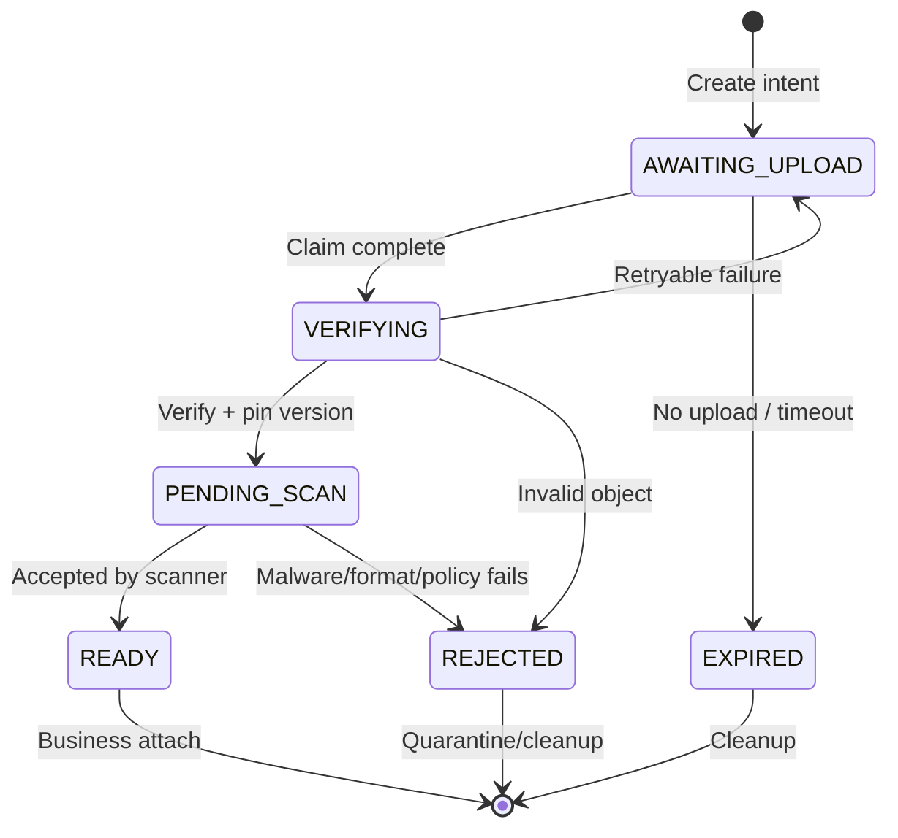

# Upload trực tiếp và upload qua URL có chữ ký giới hạn thời gian

> **Module:** INTEGRATION_API_REST — thiết kế REST API theo resource, URI, phương thức và mã trạng thái HTTP; thực hành hợp đồng dữ liệu, cache, idempotency, xác thực, phân quyền, xử lý lỗi và kiểm thử bằng Java/Spring.  
> **Chương:** Tệp và dữ liệu lớn.  
> **Trọng tâm:** So sánh việc **upload qua backend** và **upload trực tiếp lên object storage bằng URL ký sẵn có hạn**, thiết kế hợp đồng khởi tạo–truyền dữ liệu–hoàn tất, xử lý bảo mật và kiểm thử khi truyền tệp lớn.

## 1. Bài toán: người dùng gửi tệp 200 MB lên REST API

Một ứng dụng cho phép người bán tải lên tài liệu PDF hoặc ảnh sản phẩm. Nếu tất cả byte đi qua web server:

```text
Browser ── 200 MB ──> Spring API ── 200 MB ──> Object storage
```

API phải tiếp nhận luồng dữ liệu lớn, giữ kết nối lâu và chịu thêm băng thông, timeout, bộ nhớ/tệp tạm cùng chi phí mở rộng. Một cách khác là **server chỉ cấp quyền upload tạm thời**, để client gửi byte thẳng tới kho lưu trữ:

```text
Browser ── metadata ──> Spring API ── cấp URL ký sẵn ──> Browser
Browser ── 200 MB + signed URL ───────────────────────> Object storage
Browser ── thông báo hoàn tất ──> Spring API ── kiểm tra object
```

Hai cách đều hợp lệ. Chọn cách nào tùy kích thước tệp, yêu cầu quét virus, kiểm soát payload, mạng khách hàng, chi phí, vận hành và khả năng của storage.

**Mục tiêu học tập:** sau bài này, bạn có thể thiết kế endpoint upload phù hợp, hiểu **presigned URL là quyền hạn hẹp và có thời hạn**, phân biệt **upload thành công** với **file đã được hệ thống chấp nhận**, viết ví dụ Spring và xây test cho giới hạn dung lượng, chữ ký, quyền, timeout và retry.

## 2. Hai luồng và điểm khác biệt

Trong bài, dùng hai thuật ngữ rõ ràng:

- **Upload qua backend (backend-proxied):** client gửi `multipart/form-data` hoặc byte stream vào API; backend xác thực, nhận nội dung và lưu tới storage.
- **Upload bằng URL ký sẵn (direct-to-storage):** client xin URL ngắn hạn từ API rồi gọi trực tiếp object storage, thường bằng `PUT`. API vẫn quản lý **quyền và vòng đời file**, không chuyển luồng byte chính.

| Tiêu chí | Qua backend | URL ký sẵn tới storage |
|---|---|---|
| Đường đi bytes | Qua API và storage | Client → storage; API chỉ xử lý metadata |
| Tải lên API | Băng thông/kết nối tăng theo file | Nhẹ hơn, dễ mở rộng control plane |
| Kiểm soát dung lượng/nội dung | Chặn khi nhận luồng | Policy storage và hậu kiểm bắt buộc |
| Browser/CORS | Same-origin thường đơn giản | Cần CORS storage cho PUT/headers |
| File nhiều GB | Cần streaming/chia phần | Storage hỗ trợ multipart/resumable |

Không nên gọi presigned URL là “đưa quyền quản trị bucket cho browser”. URL chỉ nên cấp **một khả năng thao tác cụ thể trên một object key**, giới hạn thời gian và các ràng buộc đi kèm.

## 3. Hợp đồng upload qua backend

Một API nhận biểu mẫu:

```http
POST /api/files HTTP/1.1
Host: api.example.com
Authorization: Bearer <token>
Content-Type: multipart/form-data; boundary=----abc

------abc
Content-Disposition: form-data; name="file"; filename="catalog.pdf"
Content-Type: application/pdf

<binary PDF>
------abc--
```

Khi backend đã nhận và lưu bản tạm thành công:

```http
HTTP/1.1 201 Created
Location: /api/files/file-87
Content-Type: application/json
Cache-Control: no-store

{
  "fileId": "file-87",
  "status": "PENDING_SCAN",
  "size": 1048576
}
```

`201` ở đây xác nhận **resource quản lý file đã được tạo**, **không** khẳng định tệp đã qua kiểm tra bảo mật. Nếu tác vụ nền chưa hoàn thành, response có thể trả trạng thái `PENDING_SCAN`. API phải công bố khi nào file chuyển sang `READY` và được phép gắn vào tài nguyên nghiệp vụ.

### 3.1. Triển khai Spring MVC

```java
@RestController
@RequestMapping("/api/files")
class FileUploadController {
    private final FileStorageService service;

    FileUploadController(FileStorageService service) {
        this.service = service;
    }

    @PostMapping(consumes = MediaType.MULTIPART_FORM_DATA_VALUE)
    ResponseEntity<FileView> upload(
            @RequestPart("file") MultipartFile file,
            Authentication authentication) throws IOException {

        String tenantId = TenantIdentity.require(authentication);
        if (file.isEmpty()) {
            throw new InvalidUploadException("Tệp rỗng");
        }

        // Quyền/quota và giới hạn bytes được kiểm tra trong service.
        try (InputStream input = file.getInputStream()) {
            FileView result = service.receive(
                    tenantId,
                    input,
                    file.getSize(),
                    file.getOriginalFilename(),
                    file.getContentType());
            return ResponseEntity.created(
                    URI.create("/api/files/" + result.fileId())
                ).body(result);
        }
    }
}
```

`FileStorageService`, `TenantIdentity` và DTO là các thành phần của ứng dụng cần tự triển khai. Service phải cấp **object key ngẫu nhiên do server quản lý**, không dùng nguyên filename làm đường dẫn lưu, giới hạn byte thực đọc, kiểm tra quota/loại nội dung và lưu trạng thái `PENDING_SCAN`.

Với Spring Boot có thể cấu hình giới hạn nhận multipart:

```yaml
spring:
  servlet:
    multipart:
      max-file-size: 25MB
      max-request-size: 26MB
```

Các ngưỡng chỉ minh họa. Gateway/reverse proxy cũng có thể có giới hạn riêng. Khi body vượt giới hạn, API nên trả **413 Content Too Large** (tên cũ `Payload Too Large`) theo hợp đồng; Spring có thể ném exception ở tầng multipart **trước khi controller chạy**, nên cần handler tương ứng.

**Lưu ý hiệu năng:** `MultipartFile` có thể được buffer ở RAM hoặc tệp tạm bởi multipart resolver/container; gọi `getInputStream()` không đồng nghĩa ứng dụng đã streaming end-to-end từ socket tới storage. Với file hàng GB, cần kiến trúc streaming phù hợp hoặc URL ký sẵn. Tránh `file.getBytes()` vì dễ tạo bản sao toàn bộ payload trong bộ nhớ.

## 4. Upload bằng URL ký sẵn: ba giai đoạn

Luồng khuyến nghị là **initiate → upload bytes → complete/verify**, với trạng thái riêng ở backend.

```mermaid
sequenceDiagram
    participant C as Client
    participant A as Spring API
    participant D as Database
    participant S as Private object storage
    C->>A: POST /api/uploads (name, size, type, checksum?)
    A->>A: AuthN/AuthZ, quota, policy
    A->>D: Create upload intent (AWAITING_UPLOAD)
    A-->>C: 201 uploadId + PUT URL + headers + expiresAt
    C->>S: PUT bytes vào staging key, dùng signed headers
    S-->>C: 200/204 từ storage
    C->>A: POST /api/uploads/{id}/complete
    A->>S: HEAD/metadata + checksum/version checks
    A->>D: Mark PENDING_SCAN (hoặc REJECTED)
    A-->>C: 202 Accepted + status resource
    Note over A,S: Quét và xác minh; chỉ READY mới được sử dụng
```

### 4.1. Khởi tạo: client gửi metadata, không gửi byte

```http
POST /api/uploads HTTP/1.1
Authorization: Bearer <token>
Content-Type: application/json
Idempotency-Key: 3fcfb443-17de-46a4-98df-99c2e7953b69

{
  "fileName": "catalog.pdf",
  "contentType": "application/pdf",
  "size": 1048576,
  "sha256": "base64-of-sha256-if-supported"
}
```

Server xác thực người gọi và tenant; kiểm tra quyền upload, quota, loại file khai báo, size tối đa, số upload đang chạy. Sau đó server sinh `uploadId` và **staging object key riêng**, ví dụ:

```text
staging/<tenant-internal-id>/<random-upload-id>/payload
```

Không để client truyền tên bucket, object key tùy ý, region hoặc host dùng để ký. Tên file gốc chỉ là metadata hiển thị đã được lọc.

Phản hồi minh họa:

```http
HTTP/1.1 201 Created
Location: /api/uploads/up-912
Content-Type: application/json
Cache-Control: no-store

{
  "uploadId": "up-912",
  "status": "AWAITING_UPLOAD",
  "method": "PUT",
  "url": "https://storage.example.com/private-bucket/staging/...?...signature...",
  "headers": {
    "Content-Type": "application/pdf"
  },
  "expiresAt": "2026-11-18T10:10:00Z",
  "maxSize": 10485760,
  "completeUrl": "/api/uploads/up-912/complete"
}
```

URL trên là **minh họa cấu trúc**, không phải URL có chữ ký hợp lệ. `maxSize` là **giới hạn hợp đồng**, không có nghĩa PUT URL mặc nhiên tự thực thi ràng buộc đó; cách enforce thực tế tùy loại presign/storage và sẽ được kiểm tra ở các bước sau. Thời điểm hết hạn cần theo đồng hồ phía server, nhưng client phải dự phòng network delay và clock skew.

### 4.2. Client gửi byte trực tiếp lên storage

```http
PUT /private-bucket/staging/...?...signature... HTTP/1.1
Host: storage.example.com
Content-Type: application/pdf
Content-Length: 1048576

<binary PDF>
```

Client phải dùng **đúng method, URL và những header đã được đưa vào chữ ký**. Đổi `Content-Type`, chỉnh query parameter, đổi key hoặc dùng sai method có thể khiến storage trả lỗi chữ ký, thường là 403.

Ví dụ gửi bằng curl:

```bash
curl --fail-with-body -X PUT \
  -H 'Content-Type: application/pdf' \
  --upload-file catalog.pdf \
  'https://storage.example.com/...?...signature...'
```

Không gửi bearer token của API vào storage; signed URL tự mang quyền hạn chế cần thiết. Trong trình duyệt, phải cấu hình CORS phù hợp cho origin, method `PUT` và header cần gửi. **CORS không phải cơ chế xác thực hoặc giới hạn quyền**: storage kiểm tra chữ ký/chính sách của nó.

### 4.3. Complete: server kiểm tra object rồi mới chấp nhận

```http
POST /api/uploads/up-912/complete HTTP/1.1
Authorization: Bearer <token>
Content-Type: application/json

{}
```

Server cần:

1. Xác thực tenant/quyền; dùng transaction ngắn để **claim** intent hợp lệ sang `VERIFYING`, tránh hai complete cùng xử lý.
2. Ngoài transaction, kiểm tra object **đúng key**, kích thước, metadata và checksum được cam kết.
3. Pin **phiên bản object** hoặc copy/promote phiên bản xác định đến key bất biến, chống URL cũ ghi đè sau kiểm tra.
4. Trong transaction ngắn khác, xác minh claim còn hợp lệ, chuyển `PENDING_SCAN` và ghi outbox/job; khi kiểm tra thất bại thì `REJECTED` hoặc retry theo contract.
5. Quét nội dung/định dạng/malware; chỉ chuyển `READY` sau khi đạt kiểm tra, rồi mới cho phép gắn vào tài nguyên nghiệp vụ.

Ví dụ response khi kiểm tra bất đồng bộ:

```http
HTTP/1.1 202 Accepted
Location: /api/uploads/up-912
Content-Type: application/json

{"uploadId":"up-912","status":"PENDING_SCAN"}
```

`202` có nghĩa xử lý được chấp nhận nhưng chưa hoàn tất. API nên cung cấp `GET /api/uploads/{id}` để client theo dõi và trả trạng thái `READY` hoặc `REJECTED` cùng lý do an toàn. Không dùng `202` khi thực tế đã hoàn tất mọi việc nhưng không có ý nghĩa theo dõi.

## 5. URL ký sẵn cấp chính xác những quyền gì?

Presigned URL là một **capability URL**: ai giữ URL còn hiệu lực có thể dùng nó theo phạm vi chữ ký và chính sách storage. Nó **không được tự động ràng buộc với người dùng** khi request đã tới storage, trừ khi provider/cấu hình có điều kiện kiểm soát bổ sung.

Các ràng buộc cần thiết:

| Yếu tố | Chính sách |
|---|---|
| Method | Chỉ `PUT` để upload (không dùng làm GET/download URL) |
| Bucket và key | Một vùng staging private, key ngẫu nhiên do backend cấp |
| Thời hạn | Ngắn, ví dụ 10 phút, đủ cho kết nối và retry hợp lý |
| Signed headers | Client phải gửi đúng `Content-Type`, checksum hoặc metadata được ký nếu dùng |
| Credential/policy của bên ký | Quyền tối thiểu, chỉ cho phép ghi prefix staging |
| Upload intent | Gắn tenant, expected size/type/hash và status trong DB |
| Replay/overwrite | Không mặc nhiên ngăn cùng URL PUT nhiều lần; cần thiết kế khóa/phiên bản |
| Finalize | Backend kiểm tra object độc lập trước khi cho dùng |

**Hết hạn chữ ký không tự xóa file hay cắt chắc chắn upload đã bắt đầu.** Hành vi phụ thuộc provider; cần lifecycle cleanup. URL đã phát thường khó thu hồi riêng lẻ nếu không có policy/credential/key revocation tương ứng.

### 5.1. Giới hạn dung lượng với PUT và presigned POST

**Presigned PUT** thông thường không tự áp đặt `content-length-range`: trả `maxSize` trong JSON **chưa phải enforce**. Có thể ký `Content-Length`/checksum nếu provider hỗ trợ nhưng phải kiểm thử thực. **Presigned POST policy** dùng form upload và có thể ràng buộc `content-length-range` cùng các field của policy; đây là giao thức khác PUT. Nếu phải chặn byte quá hạn **ngay tại storage**, chọn policy thực thi được hoặc upload qua tầng kiểm soát. Dù chọn cách nào, backend vẫn xác minh kích thước thực sau upload.

### 5.2. Signed headers và checksum

Một số object storage có cơ chế checksum, ví dụ SHA-256/CRC. Nếu client biết hash trước upload, backend có thể yêu cầu checksum header được ký và storage kiểm tra. Nhưng:

- `ETag` không luôn là MD5 toàn file, nhất là khi multipart/mã hóa. Không tự ghép hash part thành hash toàn file.
- `Content-Type` chỉ là metadata; chữ ký không chứng minh file thực sự là PDF.
- Checksum client cung cấp giúp phát hiện bytes sai, **không chứng minh nội dung an toàn**.

## 6. Java/Spring: tạo presigned PUT với AWS SDK v2

Ví dụ dưới đây minh họa giao diện của **`S3Presigner`** trong AWS SDK for Java v2. Project cần cấu hình credential, region, endpoint/bucket và dependency tương ứng. Đoạn mã tập trung vào hành vi ký, **không phải một ứng dụng production hoàn chỉnh**.

```java
import java.time.Duration;
import java.time.Instant;
import java.util.Map;

import org.springframework.stereotype.Service;
import software.amazon.awssdk.services.s3.S3Presigner;
import software.amazon.awssdk.services.s3.model.PutObjectRequest;
import software.amazon.awssdk.services.s3.presigner.model.PutObjectPresignRequest;
import software.amazon.awssdk.services.s3.presigner.model.PresignedPutObjectRequest;

@Service
public class PresignedUploadService {
    private final S3Presigner presigner;
    private final UploadIntentRepository intents;
    private final String stagingBucket = "private-staging-bucket";

    public PresignedUploadService(
            S3Presigner presigner,
            UploadIntentRepository intents) {
        this.presigner = presigner;
        this.intents = intents;
    }

    public UploadTicket initiate(
            String authenticatedTenant,
            UploadStartRequest request) {

        // Validate authz/quota/type/size ở service chính.
        validatePolicy(authenticatedTenant, request);

        String uploadId = java.util.UUID.randomUUID().toString();
        String objectKey = "staging/"
                + authenticatedTenant + "/" + uploadId + "/payload";

        // Lưu intent AWAITING_UPLOAD bền vững, gồm expected
        // size/type, key, owner và hạn finalize; bảo đảm unique key.
        intents.create(uploadId, authenticatedTenant,
                objectKey, request.size(), request.contentType());

        PutObjectRequest put = PutObjectRequest.builder()
                .bucket(stagingBucket)
                .key(objectKey)
                .contentType(request.contentType())
                .build();

        PresignedPutObjectRequest signed =
                presigner.presignPutObject(
                    PutObjectPresignRequest.builder()
                        .signatureDuration(Duration.ofMinutes(10))
                        .putObjectRequest(put)
                        .build());

        return new UploadTicket(
                uploadId,
                "PUT",
                signed.url().toExternalForm(),
                Map.of("Content-Type", request.contentType()),
                Instant.now().plus(Duration.ofMinutes(10)));
    }

    // validatePolicy và DTO/Repository do ứng dụng định nghĩa.
}
```

**Hai điều kiện triển khai thực tế cần lưu ý:**

1. Với presigned request, **header nào được ký thì client phải gửi đúng**. Khi phát triển, đối chiếu với `signed.signedHeaders()` và test một PUT thật tới storage của bạn. `Host` thường do HTTP client thiết lập từ URL, không tự ép bằng header tùy ý.
2. Ví dụ lưu intent trước rồi ký. Nếu bước ký thất bại, có thể còn record `AWAITING_UPLOAD` không có URL cấp cho client; cần timeout/cleanup hoặc transition thất bại có kiểm soát. `expiresAt` nên được tính từ cùng thời điểm ký/cấu hình TTL; lấy thời gian trước/sau có thể lệch nhỏ, nên nêu hạn chỉ là thông tin cho client và coi storage signature là nguồn kiểm tra cuối.

### 6.1. API controller cho bước initiate

```java
@RestController
@RequestMapping("/api/uploads")
class UploadController {
    private final UploadWorkflow workflow;

    UploadController(UploadWorkflow workflow) {
        this.workflow = workflow;
    }

    @PostMapping
    ResponseEntity<UploadTicket> initiate(
            @Valid @RequestBody UploadStartRequest request,
            Authentication authentication) {
        String tenant = TenantIdentity.require(authentication);
        UploadTicket ticket = workflow.initiate(tenant, request);

        return ResponseEntity.created(
            URI.create("/api/uploads/" + ticket.uploadId())
        ).cacheControl(CacheControl.noStore()).body(ticket);
    }

    @PostMapping("/{uploadId}/complete")
    ResponseEntity<UploadStatus> complete(
            @PathVariable String uploadId,
            Authentication authentication) {
        String tenant = TenantIdentity.require(authentication);
        UploadStatus status = workflow.complete(tenant, uploadId);

        return ResponseEntity.accepted()
            .location(URI.create("/api/uploads/" + uploadId))
            .cacheControl(CacheControl.noStore())
            .body(status);
    }
}
```

`UploadWorkflow.complete` ở đây được giả định **bắt đầu quy trình kiểm tra bất đồng bộ**, nên trả `202`. Nếu workflow đồng bộ và đã sẵn sàng, controller phải dùng status và body phản ánh kết quả thật. Cả hai phương thức phải kiểm tra tenant/quyền; không coi biết `uploadId` là có quyền.

### 6.2. Pseudocode cho complete/verify

```text
complete(uploadId, authenticatedTenant):
  authenticate, authorize and check tenant
  transaction A:
      if READY/PENDING_SCAN: return status (idempotent)
      claim AWAITING_UPLOAD -> VERIFYING using CAS; get claimVersion
  outside transaction:
      object = storage.head(exactBucket, intent.objectKey)
      if missing: set retryable state and return 409
      verify size, checksum and metadata
      pin versionId or promote exact version to immutable destination
  transaction B:
      require state == VERIFYING and claimVersion still matches
      persist pinned version + PENDING_SCAN + outbox scan job
  on failure: mark REJECTED or recover claim by policy

  async scanner reads pinned version:
       validate file signature/structure + malware policy
       READY or REJECTED
  client may reference file only if READY
```

`HEAD` không chứng minh nội dung sạch. Dùng versioning/copy có nguồn phiên bản cố định để tránh **TOCTOU**, và **không giữ row lock của DB trong lúc gọi storage qua mạng**. Nếu crash trong `VERIFYING`, recovery phải kiểm tra claim và object trước khi tiếp tục.

## 7. Bảo mật: URL ký sẵn không thay authorization

### 7.1. Threat model tối thiểu

| Nguy cơ | Biện pháp |
|---|---|
| Lộ URL hoặc `uploadId` | HTTPS, TTL ngắn, không log URL có chữ ký; API kiểm tra tenant |
| Sửa key/method, ghi đè staging | Chữ ký giới hạn thao tác; key ngẫu nhiên, versioning và finalize bất biến |
| Vượt quota/dung lượng | Quota trước ký; storage policy nếu có; hậu kiểm size và cleanup |
| Giả MIME, script, zip bomb | Magic bytes, parser an toàn, scan và giới hạn giải nén |
| Filename path traversal | Không bao giờ dùng filename làm object key/path |
| Upload mồ côi | Intent expiry, lifecycle cleanup, cảnh báo orphan |
| Bucket/scanner sai quyền | Private-by-default, least privilege, quarantine tách biệt |
| URL bị thay host | Client chỉ gọi origin storage được tin cậy, không gửi Bearer token |

### 7.2. File upload là vùng không tin cậy

Phải xác minh **nội dung thực**, không chỉ tin `filename`, extension và `Content-Type`. Một file có đuôi `.jpg` có thể chứa định dạng khác; file ảnh thật cũng có thể gây lỗi parser/decompression bomb. Quy trình thường gồm:

- Kiểm tra byte, parser định dạng và malware; giới hạn CPU/thời gian/kích thước giải nén.
- Không hiển thị HTML/SVG chưa xử lý inline trên origin chính; đặt `Content-Disposition` và media type download an toàn.
- Giữ file ở private/quarantine tới `READY`; `REJECTED` phải được cleanup/audit.

Với dữ liệu nhạy cảm, cần mã hóa at rest, retention/delete policy, quản lý quyền download theo tenant và tránh phát URL đọc có hạn quá dài.

### 7.3. CORS, CSRF và SSRF

**CORS** phải cho phép frontend origin, PUT và signed headers; nó **không** xác thực hay ngăn curl dùng URL lộ. **CSRF** vẫn phải xét cho initiate/complete nếu dùng cookie. Để tránh **SSRF**, complete không nhận URL bất kỳ để HEAD mà tra bucket/key từ DB; callback từ storage phải được xác minh nguồn và đối chiếu intent.

## 8. Trạng thái, retry và nhất quán

Một mô hình tối thiểu:



- **Retry PUT:** timeout không chứng minh PUT thất bại; thử lại khi được phép, nhưng phải tránh ghi đè sau verify và đối chiếu object version/checksum.
- **Retry initiate:** dùng `Idempotency-Key` hoặc intent ID để không tạo nhiều file nghiệp vụ từ một lần bấm.
- **Retry complete:** idempotent theo `uploadId`, không tạo hai scan job; hoàn tất song song qua CAS/transaction.
- **Hết hạn/crash:** xin URL mới theo hợp đồng; reconciler tìm intent mắc kẹt, sweeper xóa staging mồ côi, scanner chỉ đọc pinned version.

Giữ **idempotency của workflow** tách biệt với idempotency của `PUT` lên một object key. Cùng object key có thể bị thay thế, còn cùng `uploadId` không được tạo hai file đã duyệt.

## 9. Upload file nhiều GB: multipart/resumable

Với file nhiều GB/mạng kém, dùng **multipart/resumable** của storage:

1. Tạo intent và multipart session; cấp URL có hạn **cho từng part**.
2. Client truyền part và lưu ETag/checksum theo provider.
3. Backend xác minh part, hoàn thành multipart, kiểm tra object cuối rồi đưa vào `PENDING_SCAN`.
4. Quét trước `READY`; abort và dọn part chưa hoàn tất để tránh phí lưu trữ.

Đừng tự coi `ETag` multipart là checksum MD5 toàn file. Giới hạn part size/count, tổng quota, số part song song và vòng đời session phải theo storage provider. Việc hoàn thành multipart của storage **không thay thế** endpoint complete/kiểm tra nghiệp vụ.

Provider khác S3 có thể dùng resumable session/offset riêng; vẫn phải xác minh object trước khi sử dụng.

## 10. Mã trạng thái và Problem Details

| Tình huống | HTTP status gợi ý | Ý nghĩa |
|---|---|---|
| Upload qua backend, tạo file record | `201 Created` | Resource file đã tạo, có thể `PENDING_SCAN` |
| Initiate, tạo upload intent | `201 Created` | Trả `uploadId`/signed URL |
| Complete được nhận, scan bất đồng bộ | `202 Accepted` | Có endpoint trạng thái theo dõi |
| Định dạng request/metadata sai | `400 Bad Request` | Sai contract |
| Chưa đăng nhập / không đủ quyền | `401/403` | Không tiết lộ bucket/key ngoài quyền |
| File vượt hạn tại backend/gateway | `413 Content Too Large` | Không nhận quá giới hạn |
| Content type không hỗ trợ | `415 Unsupported Media Type` | Kiểm tra media type theo hợp đồng |
| File đã upload nhưng metadata/checksum không đạt | `422 Unprocessable Content` | Từ chối payload có vấn đề |
| Complete trước khi object tồn tại | `409 Conflict` | Trạng thái chưa cho phép hoàn tất |
| Upload intent đã hết hạn | `410 Gone` hoặc `409` theo hợp đồng | Bắt đầu lại hoặc lấy ticket mới |
| Signed URL hết hạn/sai chữ ký | Thường `403` từ storage | Lỗi provider, không phải response của Spring |
| Lỗi storage tạm thời | `503` hoặc lỗi phù hợp | Retry có backoff, không suy ra file không tồn tại |

Với các lỗi do Spring tạo, API có thể dùng `application/problem+json`:

```http
HTTP/1.1 422 Unprocessable Content
Content-Type: application/problem+json
Cache-Control: no-store

{
  "type": "https://api.example.com/problems/upload-content-invalid",
  "title": "Tệp không hợp lệ",
  "status": 422,
  "detail": "Nội dung không phù hợp loại tệp được cho phép.",
  "instance": "/problems/occurrences/req-21a"
}
```

**Không kỳ vọng object storage trả cùng Problem Details với Spring.** Client cần phân biệt lỗi `PUT` trực tiếp lên storage và lỗi API khởi tạo/hoàn tất; SDK phải diễn giải trạng thái, hướng dẫn retry và telemetry tương ứng.

## 11. Kiểm thử sát luồng upload

### 11.1. Ma trận test

| Test | Kịch bản | Kỳ vọng |
|---|---|---|
| UP-01 | Multipart qua backend đúng/sai size | 201 hoặc 413, không có file READY sai |
| UP-02 | Không có quyền, sai tenant | Không cấp URL/không complete, không lộ metadata |
| UP-03 | Initiate vượt size/quota hoặc MIME sai | 400/413/415 theo hợp đồng |
| UP-04 | Hai intent | Key staging riêng, không ghi đè |
| UP-05 | PUT đúng/sai header, key, method | Storage xác minh chữ ký |
| UP-06 | PUT sau hạn | Storage từ chối, client xin URL mới |
| UP-07 | PUT payload quá size | Storage policy nếu có; complete luôn từ chối |
| UP-08 | Complete trước PUT | 409, không READY |
| UP-09 | Complete đúng dữ liệu | PENDING_SCAN rồi READY sau kiểm tra |
| UP-10 | Malware/giả PDF | REJECTED, không có link download |
| UP-11 | Complete song song và ghi đè lúc verify | Một job, pin đúng object version |
| UP-12 | Không complete/multipart dang dở | Cleanup staging và abort part |
| UP-13 | Retry sau timeout PUT | Không nhân đôi file nghiệp vụ |

### 11.2. MockMvc cho bước initiate

Ví dụ dưới là test contract cho controller giả định `UploadWorkflow` và bảo mật tenant đã được cấu hình; không phải test đã chạy trong bài:

```java
@SpringBootTest
@AutoConfigureMockMvc
class UploadContractTest {
    @Autowired MockMvc mvc;

    @Test
    void rejectsUnsupportedUploadType() throws Exception {
        mvc.perform(post("/api/uploads")
                .contentType(MediaType.APPLICATION_JSON)
                .content("""
                    {"fileName":"script.sh",
                     "contentType":"application/x-sh",
                     "size":2048}
                    """))
            .andExpect(status().isUnsupportedMediaType());
    }

    @Test
    void initiateReturnsShortLivedPutTicket() throws Exception {
        mvc.perform(post("/api/uploads")
                .contentType(MediaType.APPLICATION_JSON)
                .content("""
                    {"fileName":"catalog.pdf",
                     "contentType":"application/pdf",
                     "size":102400}
                    """))
            .andExpect(status().isCreated())
            .andExpect(jsonPath("$.uploadId").isString())
            .andExpect(jsonPath("$.method").value("PUT"))
            .andExpect(jsonPath("$.url").isString())
            .andExpect(jsonPath("$.expiresAt").isString());
    }
}
```

Để test được, cung cấp fixture principal/tenant, cấu hình chính sách và mock các thao tác ký/lưu intent. Lỗi `415` trong ví dụ là **lựa chọn contract** khi loại tệp không được hỗ trợ, không phải mặc định của Spring cho một JSON body có trường `contentType` bất kỳ; handler/service phải ánh xạ rõ.

**Integration test bắt buộc:** dùng storage sandbox hoặc S3-compatible test environment để thực hiện **PUT thật bằng URL ký sẵn**, kiểm tra chữ ký với header đúng/sai, CORS, hết hạn và kiểm tra HEAD/size/checksum. Chỉ mock `S3Presigner` không chứng minh client gửi đúng request.

## 12. Bài tập thực hành

### Bài A — Chọn kiến trúc

Một hệ thống nhận ảnh dưới 5 MB, PDF 200 MB và video 8 GB. Hãy chọn upload qua backend, presigned PUT hoặc multipart/resumable cho từng loại. Nêu băng thông, timeout, quét virus, CDN/bucket policy và UX khi kết nối gián đoạn.

### Bài B — Thiết kế ba endpoint

Thiết kế `POST /api/uploads`, `POST /api/uploads/{id}/complete`, `GET /api/uploads/{id}` với: tenant scope, quota 100 MB, signed URL 10 phút, trạng thái `AWAITING_UPLOAD → PENDING_SCAN → READY/REJECTED`, quyền sử dụng file chỉ khi READY. Viết request/response và Problem Details cho file vượt hạn, chưa upload, hết hạn hoặc không đủ quyền.

### Bài C — Threat model và test

Đề xuất ít nhất tám test để ngăn: lộ URL ký, thay object key, dùng uploadId tenant khác, giả MIME, upload vượt dung lượng, ghi đè staging sau verify, complete hai lần và multipart mồ côi. Giải thích tại sao **CORS, signed URL và Content-Type** không thể thay kiểm tra nội dung ở backend.

## 13. Checklist và ghi nhớ

- [ ] Backend xác thực/phân quyền/quota **trước khi phát URL** hoặc nhận byte.
- [ ] Bucket private; key staging ngẫu nhiên do server tạo; không tin filename/path client.
- [ ] Presigned URL có **method, object key và TTL ngắn**, header ký đúng; không ghi URL nguyên văn vào log.
- [ ] Phân biệt **expiry của chữ ký**, **thời hạn upload intent** và **retention của object staging**.
- [ ] Có giới hạn byte được enforce ở tầng phù hợp; không chỉ gửi `maxSize` dưới dạng JSON.
- [ ] Complete lấy bucket/key từ DB, xác minh object size/checksum và pin version chống TOCTOU.
- [ ] File đi qua trạng thái quét/kiểm tra; chỉ `READY` mới được dùng hoặc tải xuống.
- [ ] Retry initiate/PUT/complete có hợp đồng, kiểm soát race và cleanup orphan.
- [ ] CORS chỉ hỗ trợ browser; mọi API initiate/complete/status vẫn kiểm tra quyền.
- [ ] Multipart/resumable có cách finalize và abort các part chưa hoàn thành.
- [ ] Đã test bằng HTTP thực với storage, không chỉ unit test Spring.

**Upload trực tiếp qua backend** cho phép kiểm soát luồng byte tập trung nhưng tốn băng thông và kết nối của API. **URL ký sẵn** giảm tải backend, song chuyển trách nhiệm thực thi chữ ký sang storage và đòi hỏi một workflow **khởi tạo → upload vào staging → xác minh → quét → READY**. Chữ ký có hạn là **quyền ghi tạm**, không phải bằng chứng tệp hợp lệ hay quyền đọc dữ liệu; tính đúng và an toàn nằm ở ràng buộc phạm vi, hậu kiểm và quản lý vòng đời.
