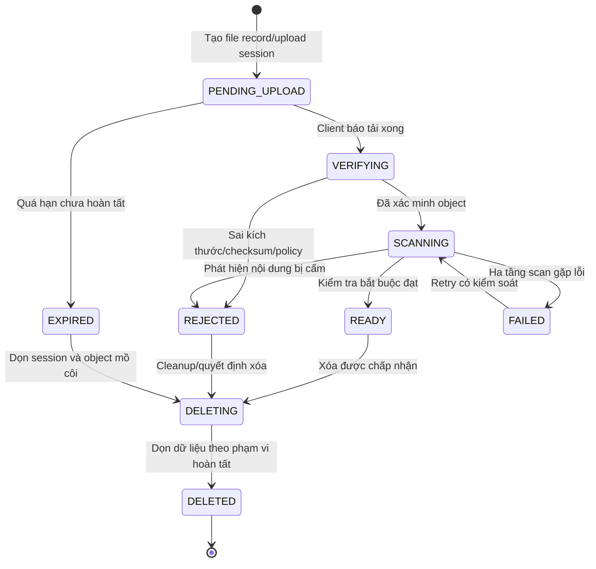

# Metadata, trạng thái xử lý và vòng đời của tệp

Người dùng tải một tệp PDF 400 MB lên hệ thống quản lý hồ sơ. Object storage trả thành công, nhưng hệ thống còn phải kiểm tra kích thước, định dạng, mã độc, quyền truy cập và tạo bản xem trước. Nếu API lập tức trả “tệp sẵn sàng” thì người khác có thể tải nội dung chưa được kiểm duyệt. Nếu client mất mạng rồi tải lại, hai bản tệp và hai lượt xử lý có thể được tạo. Nếu người dùng xóa tệp đúng lúc worker đang tạo thumbnail, một bản sao có thể xuất hiện trở lại.

Đây là bài toán **metadata, trạng thái xử lý và vòng đời của tệp**, thuộc chương **Tệp và dữ liệu lớn** của module **INTEGRATION_API_REST**. REST API cần mô hình hóa **tài nguyên tệp** độc lập với byte nội dung, khai báo rõ chuyển trạng thái, HTTP status, quyền, idempotency, cache và tính nhất quán giữa database với object storage. Ví dụ sử dụng HTTP, Java/Spring Boot và PostgreSQL; nguyên lý áp dụng tương tự cho công nghệ khác.

**Sau bài học**, người học có thể thiết kế upload trực tiếp hoặc qua API, phản hồi bất đồng bộ 201/202/200, chỉ cho tải khi `READY`, bảo vệ thao tác hoàn tất/xóa trước race, và kiểm thử vòng đời với ít nhất hai tenant.

## 1. Metadata và content là hai tài nguyên liên quan

**Metadata** lưu danh tính, quyền, trạng thái và thông tin kiểm chứng; **content** là byte trong object storage. Metadata có thể tồn tại khi byte chưa upload hoặc chưa đạt kiểm duyệt.

| Metadata | Nguồn | Nguyên tắc |
|---|---|---|
| `id`, `tenantId`, owner, ACL | Backend | ID ổn định; tenant/quyền được xác minh, không tin client |
| `name`, `declaredMediaType`, `expectedSizeBytes` | Client | Chỉ là khai báo; không dùng tên làm storage key |
| `sizeBytes`, `mediaType`, `sha256` | Object storage/processor | Chỉ công bố là *verified* khi đã xác minh byte |
| `status`, `version`, timestamps | Database workflow | Chuyển trạng thái nguyên tử, có thể dùng ETag |
| Storage key/version, scan findings | Nội bộ | Không tiết lộ bucket/key và chi tiết engine quét |

Ví dụ response metadata khi đã xử lý:
 
```http
HTTP/1.1 200 OK
Content-Type: application/json
Cache-Control: no-store
ETag: "file-v4"

{
  "id": "4cae32d0-4f75-47c4-8aca-c482fb930873",
  "name": "hop-dong.pdf",
  "status": "READY",
  "sizeBytes": 419430400,
  "mediaType": "application/pdf",
  "version": 4,
  "readyAt": "2026-11-18T08:04:20Z"
}
```

`GET /api/v1/files/{id}` lấy metadata; `GET /api/v1/files/{id}/content` lấy byte **sau xác thực/quyền và khi READY**. Không nhét file lớn vào JSON dưới dạng Base64. Checksum SHA-256, nếu trả cho client, phải là giá trị tính trên **byte đã xác minh**, không đơn giản copy khai báo từ upload request.

## 2. Trạng thái là một hợp đồng nghiệp vụ

Một mô hình đơn giản nhưng đủ xử lý lỗi:



| Trạng thái | Có cho tải content? | Ý nghĩa đối với client |
|---|---|---|
| `PENDING_UPLOAD` | Không | Metadata đã tạo, còn chờ byte nội dung |
| `VERIFYING` | Không | Đang đối chiếu object thực tế với hợp đồng upload |
| `SCANNING` | Không | Đang quét mã độc, loại nội dung, chính sách hoặc xử lý bắt buộc |
| `READY` | **Có**, nếu đủ quyền | Tệp đạt tiêu chí công bố đã định nghĩa |
| `REJECTED` | Không | Bị từ chối theo chính sách; chỉ công bố mã lý do an toàn |
| `FAILED` | Không | Lỗi hạ tầng xử lý; có thể thử lại ở backend |
| `EXPIRED` | Không | Session upload đã hết hiệu lực mà chưa hoàn thành |
| `DELETING`/`DELETED` | Không | Quyền đọc nội dung đã bị thu hồi; dữ liệu đang được dọn hoặc đã dọn |

**Bất biến quan trọng:** chỉ `READY` mới được truy cập nội dung; `READY` đòi hỏi đã có object đúng phiên bản, vượt qua mọi bước kiểm tra **bắt buộc**. Nếu chỉ thumbnail là tác vụ tùy chọn, có thể để file `READY` trong khi thumbnail có trạng thái riêng; nếu thumbnail là yêu cầu bảo mật hay nghiệp vụ bắt buộc, phải chờ nó trước khi READY. Quy tắc cần được ghi rõ, không dựa vào tên trạng thái mơ hồ.

Không hồi sinh `DELETING` thành `READY` chỉ vì sự kiện scan đến trễ. Mọi worker phải cập nhật có điều kiện theo trạng thái và version.

## 3. Hợp đồng REST và HTTP status

| Hành động | URI/method tham khảo | Thành công |
|---|---|---|
| Tạo file metadata và upload session | `POST /api/v1/files/uploads` | **201 Created** + `Location`, PENDING_UPLOAD |
| Chuyển byte | Signed PUT storage hoặc upload endpoint API | 200/201/204 **của storage**, chưa READY |
| Xác nhận đủ byte và yêu cầu scan | `POST /api/v1/files/{id}/completions` | **202 Accepted** sau commit trạng thái/outbox |
| Đọc metadata/trạng thái | `GET /api/v1/files/{id}` | **200 OK** kể cả SCANNING, FAILED |
| Đọc content | `GET /api/v1/files/{id}/content` | **200 stream** hoặc **302** signed redirect khi READY |
| Thay metadata | `PATCH /api/v1/files/{id}` | 200/204; 412 nếu If-Match sai |
| Xóa | `DELETE /api/v1/files/{id}` | **202** nếu cleanup nền, hoặc 204 theo hợp đồng |

Không dùng GET để kích hoạt completion hoặc scan vì GET phải an toàn về ngữ nghĩa. Các URI là quy ước thiết kế, không phải đường dẫn chuẩn bắt buộc.

**Phân biệt lỗi:** 400 dữ liệu/cú pháp sai; 401 + `WWW-Authenticate` khi chưa xác thực; 403/404 khi ngoài quyền; **409** khi content chưa READY hoặc sai trạng thái; **412/428** cho `If-Match` sai/thiếu nếu bắt buộc; **413** khi request quá lớn; **415** với media type request không được hỗ trợ; **422** với nội dung hợp lệ về cú pháp nhưng không đạt ràng buộc nếu contract chọn; 429/503 cho quá tải/lỗi tạm. Scanner timeout phải thành FAILED/retry, **không** gán nhãn malware REJECTED.

## 4. Luồng HTTP: tạo session, upload byte, xác nhận

Với file lớn, **client tải byte trực tiếp vào private/quarantine storage**; API chịu trách nhiệm quyền, metadata và trạng thái.

**1. Khởi tạo.** Client dùng một `Idempotency-Key` cho một ý định tải tệp, giữ nguyên khi retry:

```http
POST /api/v1/files/uploads HTTP/1.1
Host: api.example.com
Authorization: Bearer <access_token>
Idempotency-Key: a0b11b3d-54d5-4d68-b623-76df12b7a681
Content-Type: application/json

{
  "name": "hop-dong.pdf",
  "expectedSizeBytes": 419430400,
  "declaredMediaType": "application/pdf"
}
```

```http
HTTP/1.1 201 Created
Location: /api/v1/files/4cae32d0-4f75-47c4-8aca-c482fb930873
Content-Type: application/json
Cache-Control: no-store

{
  "id": "4cae32d0-4f75-47c4-8aca-c482fb930873",
  "status": "PENDING_UPLOAD",
  "upload": {
    "method": "PUT",
    "url": "https://storage.example.invalid/private/upload?signature=REDACTED",
    "headers": {"Content-Type": "application/pdf"},
    "expiresAt": "2026-11-18T08:15:00Z"
  }
}
```

**2. Upload.** Client PUT byte tới URL cùng các header đã cấp; storage có thể trả 200/201/204 theo provider. **Đây chưa phải READY**. Signed URL là quyền truy cập tạm thời dạng bearer: không log/copy, giới hạn method, key, TTL và kích thước/checksum theo **khả năng thực của provider**. Với multipart phải hoàn tất các part theo protocol storage; ETag object không mặc nhiên là MD5/SHA-256.

**3. Xác nhận.** Sau khi upload xong, client yêu cầu API kiểm tra object:

```http
POST /api/v1/files/4cae32d0-4f75-47c4-8aca-c482fb930873/completions HTTP/1.1
Host: api.example.com
Authorization: Bearer <access_token>
Content-Length: 0
```

```http
HTTP/1.1 202 Accepted
Location: /api/v1/files/4cae32d0-4f75-47c4-8aca-c482fb930873
Content-Type: application/json
Cache-Control: no-store

{"id":"4cae32d0-4f75-47c4-8aca-c482fb930873","status":"SCANNING"}
```

API chỉ trả 202 sau khi **tự xác minh đúng object/session/size/version/checksum** và commit SCANNING + outbox. Client gửi completion lặp phải được nhận diện: khi SCANNING có thể trả 202, khi READY trả 200, không tạo job mới. Nếu object chưa đầy đủ, bị thay, sai kích thước hoặc hết hạn, không tự công bố READY; áp mã lỗi/trạng thái và retry policy đã tài liệu hóa.

## 5. Chọn upload qua API hay storage trực tiếp

| Cách | Phù hợp | Kiểm soát |
|---|---|---|
| Spring `multipart/form-data` | Tệp nhỏ/vừa; API xử lý upload | Giới hạn ở gateway/Servlet, stream thay vì `MultipartFile.getBytes()` với file lớn; dọn temp |
| Signed PUT/POST tới storage | Tệp lớn, giảm tải API | Quarantine/private bucket, key/TTL/method giới hạn, verify object sau tải |
| Multipart/resumable upload | File rất lớn, mạng di động không ổn định | Part/checksum/offset, resume theo upload ID, abort session quá hạn |

Với Spring MVC, `MultipartFile` có thể dùng bộ nhớ hoặc tệp tạm tùy cấu hình. Đặt max request/part size và quota ở **nhiều lớp**, không tin `Content-Length` do client gửi. Direct upload giảm tải application server nhưng **không loại bỏ** xác thực, kiểm duyệt và chống trùng completion. ETag của object multipart hoặc object có mã hóa **không mặc nhiên là MD5/SHA-256**.

## 6. Kiểm chứng metadata thay vì tin client

Trước khi công bố, phân biệt **dự kiến** (`expectedSizeBytes`, `declaredMediaType`) với **đã xác minh** (`sizeBytes`, `mediaType`, SHA-256, object version). Backend HEAD hoặc đọc object và xác minh theo khả năng storage/processor; `sha256` phải phản ánh đúng byte đã lưu. Một file có extension `.pdf` và header `application/pdf` vẫn có thể chứa nội dung khác hoặc mã độc.

Tên do client gửi chỉ dùng **hiển thị**; không dùng làm path/key, phải giới hạn chiều dài, ký tự điều khiển và dấu phân cách. Khi trả `Content-Disposition` với tên có dấu tiếng Việt, encode theo RFC 6266/8187; không nối raw filename vào header. `rejectionCode` là mã an toàn, không tiết lộ signature/chi tiết engine quét. Storage key, object version và log scanner thuộc metadata **nội bộ**.

Nếu kết quả biến đổi có thumbnail/OCR, gắn chúng với **file ID + content version**; đừng dùng lại derivative của phiên bản cũ hoặc của tenant khác.

## 7. CAS, outbox và race giữa scan với xóa

PostgreSQL không thể dùng một transaction ACID chung với object storage. Vì vậy API ghi **metadata và ý định xử lý** nhất quán trong DB, còn byte/object được xác minh rồi xử lý bất đồng bộ.

```sql
CREATE TABLE files (
  id uuid PRIMARY KEY,
  tenant_id uuid NOT NULL,
  owner_id uuid NOT NULL,
  private_object_key text NOT NULL UNIQUE,
  upload_session_id uuid NOT NULL UNIQUE,
  expected_size_bytes bigint NOT NULL CHECK (expected_size_bytes > 0),
  verified_size_bytes bigint,
  object_version text,
  status text NOT NULL,
  version bigint NOT NULL DEFAULT 1,
  upload_expires_at timestamptz NOT NULL
);
CREATE TABLE file_outbox (
  id uuid PRIMARY KEY,
  file_id uuid NOT NULL REFERENCES files(id),
  event_type text NOT NULL,
  UNIQUE (file_id, event_type)
);
```

Schema mẫu dành cho **một upload attempt/file**; sản phẩm hỗ trợ phiên bản mới phải thêm attempt ID và ràng buộc riêng. Sau khi xác minh object, transaction xử lý completion:

```sql
UPDATE files
SET status = 'SCANNING',
    verified_size_bytes = :verified_size,
    object_version = :object_version,
    version = version + 1
WHERE id = :file_id
  AND tenant_id = :verified_tenant
  AND upload_session_id = :upload_session_id
  AND status = 'PENDING_UPLOAD'
  AND upload_expires_at > now()
RETURNING id;

-- Chỉ nếu UPDATE trả 1 dòng, INSERT outbox trong CÙNG transaction.
INSERT INTO file_outbox(id, file_id, event_type)
VALUES (:event_id, :file_id, 'FILE_SCAN_REQUESTED');
```

Nếu UPDATE trả 0 dòng, **không insert outbox**: có thể do request lặp, hết hạn, sai tenant hoặc đã xóa. Đọc lại trong phạm vi được phép để trả trạng thái/lỗi phù hợp. Publisher có thể giao event lặp sau crash; scanner dedupe theo file ID + object version/attempt.

**Tránh race:** storage HEAD trước commit chưa đủ nếu client có thể ghi đè object sau đó. Dùng **private key bất biến theo attempt**, lưu object version/checksum, giới hạn quyền ghi, và scanner đọc **đúng version đã xác minh**. Sau khi người dùng DELETE chuyển sang DELETING, worker chỉ được chuyển SCANNING → READY bằng **compare-and-swap trên status/version**. Nếu CAS trả 0 dòng, không công bố thumbnail hay tệp; dọn derivative tạm. Worker timeout không được tự chuyển READY.

Một bản scan thành công **không chứng minh byte đã upload không còn bị thay đổi** nếu object key/version không được cố định. Đây là bất biến xuyên storage–database bắt buộc kiểm thử bằng hai worker và lỗi mạng giả lập.

## 8. Security: upload phải đi qua quarantine

| Rủi ro | Kiểm soát |
|---|---|
| IDOR, vượt tenant | Kiểm tra actor/owner/tenant trên metadata, completion, delete và cấp signed URL |
| Signed URL bị lộ | TTL ngắn, TLS, scope method/object/version; tránh log/copy URL vào analytics |
| File quá lớn hoặc nén phình | Quota và kiểm tra **byte thật**, giới hạn số part, độ sâu archive và kích thước giải nén |
| MIME giả, polyglot, macro/malware | Sniff nội dung, allowlist loại, scanner/sandbox; không dựa vào extension |
| XSS/header injection | Storage key ngẫu nhiên, tên file được sanitize, `Content-Disposition` và `nosniff` |
| Download trước scan | Quarantine/private bucket; không public ACL; chỉ tạo URL content khi READY |
| Worker/preview quá quyền | Least privilege, isolation, không chạy nội dung người dùng như code tin cậy |
| Search/cache rò file | Chỉ index/preview nội dung đã được cho phép; cùng tenant/permission guard |

**Không có scanner nào bảo đảm tuyệt đối không malware**. Nếu quét lỗi/hết thời gian, chuyển FAILED hoặc retry có kiểm soát, không “fail-open”. Lỗi công khai chỉ nêu mã như `FILE_REJECTED`, không đưa signature, đường dẫn nội bộ, raw bytes hay token vào response/log. Với dữ liệu riêng tư, dùng `Cache-Control: no-store` cho metadata và phản hồi chứa signed URL.

## 9. Download: READY và quyền mới cho phép lấy byte

Client lấy metadata trước:

```http
GET /api/v1/files/4cae32d0-4f75-47c4-8aca-c482fb930873 HTTP/1.1
Authorization: Bearer <access_token>
```

Khi đang SCANNING, API trả **200 cho metadata** với `"status":"SCANNING"`; nếu gọi content sớm, có thể trả **409 FILE_NOT_READY** (quy ước API mẫu):

```http
HTTP/1.1 409 Conflict
Content-Type: application/problem+json
Cache-Control: no-store

{
  "type": "https://api.example.com/problems/file-not-ready",
  "title": "File is not ready",
  "status": 409,
  "code": "FILE_NOT_READY"
}
```

Khi READY và actor có quyền, API có thể **stream byte** với 200 hoặc cấp redirect ngắn hạn:

```http
GET /api/v1/files/4cae32d0-4f75-47c4-8aca-c482fb930873/content HTTP/1.1
Authorization: Bearer <access_token>
```

```http
HTTP/1.1 302 Found
Location: https://storage.example.invalid/private/download?signature=REDACTED
Cache-Control: no-store
Referrer-Policy: no-referrer
```

Redirect tới signed URL tạo ra **một capability có thể sử dụng đến khi hết hạn**, dù quyền trên API vừa bị thu hồi. Với dữ liệu cần quyền bị thu hồi ngay, cân nhắc streaming qua lớp luôn tái kiểm tra quyền, URL rất ngắn hạn, hoặc mô hình phân phối khác có revocation; không hứa một redirect đã cấp có thể bị vô hiệu ngay trong mọi storage.

Nếu API tự stream, cần xét `Content-Type` sau kiểm tra, `Content-Disposition: attachment` cho nội dung không tin cậy và `X-Content-Type-Options: nosniff`; giới hạn memory/backpressure. Với download lớn, HTTP Range/`206 Partial Content` và `416 Range Not Satisfiable` có thể hữu ích khi thực sự hỗ trợ và phân quyền; không mặc nhiên quảng bá khả năng resume nếu chưa triển khai.

## 10. Xóa, retention và tài nguyên mồ côi

Khi user yêu cầu xóa:

1. Xác thực/quyền và kiểm tra `If-Match` nếu API yêu cầu bảo vệ cập nhật đồng thời.
2. Chuyển sang `DELETING` **trong database trước**, ngay lập tức không cho nội dung mới được tải qua API.
3. Ghi outbox event cleanup cùng transaction; trả 202 nếu xử lý storage bất đồng bộ.
4. Worker xóa object gốc và derivative/index/cache theo **đúng version/key**, retry idempotent, sau đó ghi `DELETED` khi tiêu chí hoàn tất đã đạt.
5. Dọn session `EXPIRED` và object orphan; giám sát số lượng, dung lượng và thời gian tồn đọng.

`DELETE` theo HTTP mô tả loại bỏ liên kết URI–tài nguyên theo hợp đồng, **không bắt buộc vật lý xóa ngay mọi bản sao**. Backup, log, retention và legal hold cần chính sách riêng, không cam kết “đã xóa vĩnh viễn” khi mới chuyển DELETING. Một tệp bị xóa cần được loại khỏi danh sách/read/search/preview theo quyền ngay cả khi worker cleanup chưa xong.

**Phản mẫu:** job cũ sau DELETE vẫn có quyền `PUT thumbnail` vào đường dẫn được cache công khai. Giải pháp: derivative key gắn version/attempt, worker CAS trạng thái trước publish, cleanup idempotent và access policy không phục vụ file đã DELETING.

## 11. Java/Spring Boot: controller và chuyển trạng thái

Ví dụ Spring Boot 3 dùng `FileWorkflow` (service do ứng dụng xây dựng) để kiểm tra quyền, thao tác storage và ghi trạng thái. Tệp lớn **không được nạp thành `byte[]` ở controller**.

```java
import jakarta.validation.Valid;
import jakarta.validation.constraints.*;
import java.net.URI;
import java.time.Instant;
import java.util.Map;
import java.util.UUID;
import org.springframework.http.*;
import org.springframework.security.core.Authentication;
import org.springframework.web.bind.annotation.*;

record StartUploadRequest(
    @NotBlank String name,
    @NotNull @Min(1) Long expectedSizeBytes,
    @NotBlank String declaredMediaType
) {}
record UploadInstruction(
    String method, URI url, Map<String,String> headers, Instant expiresAt) {}
record UploadTicket(UUID id, String status, UploadInstruction upload) {}
record FileView(UUID id, String status, Long sizeBytes, long version) {}
record StartResult(UploadTicket ticket, boolean created) {}

@RestController
@RequestMapping("/api/v1/files")
class FileController {
    private final FileWorkflow workflow;
    FileController(FileWorkflow workflow) { this.workflow = workflow; }

    @PostMapping("/uploads")
    ResponseEntity<UploadTicket> start(
            @Valid @RequestBody StartUploadRequest req,
            @RequestHeader("Idempotency-Key") String key,
            Authentication actor) {
        StartResult result = workflow.start(actor, key, req);
        return ResponseEntity.status(
                result.created() ? HttpStatus.CREATED : HttpStatus.OK)
            .location(URI.create("/api/v1/files/" + result.ticket().id()))
            .cacheControl(CacheControl.noStore()).body(result.ticket());
    }

    @PostMapping("/{id}/completions")
    ResponseEntity<FileView> complete(
            @PathVariable UUID id, Authentication actor) {
        FileView view = workflow.complete(actor, id);
        return ResponseEntity.status(
                "READY".equals(view.status()) ? HttpStatus.OK : HttpStatus.ACCEPTED)
            .cacheControl(CacheControl.noStore()).body(view);
    }

    @GetMapping("/{id}")
    ResponseEntity<FileView> metadata(
            @PathVariable UUID id, Authentication actor) {
        return ResponseEntity.ok().cacheControl(CacheControl.noStore())
            .body(workflow.readAuthorized(actor, id));
    }

    @GetMapping("/{id}/content")
    ResponseEntity<Void> content(@PathVariable UUID id, Authentication actor) {
        URI url = workflow.authorizeReadyDownload(actor, id);
        return ResponseEntity.status(HttpStatus.FOUND).location(url)
            .cacheControl(CacheControl.noStore())
            .header("Referrer-Policy", "no-referrer").build();
    }
}
```

Các record và `FileWorkflow` là cấu trúc minh họa, cần repository, security filter, exception mapping và thêm `no-store` cho response metadata thực tế. `start` phải kiểm tra tenant/quota/loại file và so fingerprint của `Idempotency-Key`. Retry cùng ý định trả **cùng file ID** (mẫu 200 thay vì 201), không cấp object key mới tùy tiện. `complete` chỉ trả 202 **sau khi** xác minh object và ghi SCANNING + outbox bền vững; request lặp không tạo event khác. Mọi content download phải xác minh quyền hiện hành và READY trước khi phát signed URL.

Ở service, nên **kiểm tra storage ngoài transaction DB**, sau đó CAS theo tenant/session/status/version và ghi outbox **trong cùng transaction**; không giữ transaction database mở suốt lần gọi object storage. Nếu HEAD đã xác minh object version nhưng sau đó client có thể overwrite, phải từ chối hoặc khóa quyền ghi bằng object key/version bất biến (mục 7).

## 12. OpenAPI 3.1: hợp đồng chính

Đặc tả rút gọn cho metadata/upload; các schema dùng shape `upload` như HTTP và Java ở trên.

```yaml
openapi: 3.1.0
info: { title: File Lifecycle API, version: 1.0.0 }
paths:
  /api/v1/files/uploads:
    post:
      security: [{ bearerAuth: [] }]
      parameters:
        - name: Idempotency-Key
          in: header
          required: true
          schema: { type: string }
      requestBody:
        required: true
        content:
          application/json:
            schema: { $ref: "#/components/schemas/StartUpload" }
      responses:
        "201":
          description: Metadata created, upload pending
          headers:
            Location: { schema: { type: string } }
          content:
            application/json:
              schema: { $ref: "#/components/schemas/UploadTicket" }
        "200": { description: Retry with existing operation }
        "409": { description: Idempotency key conflict }
  /api/v1/files/{id}/completions:
    post:
      security: [{ bearerAuth: [] }]
      parameters:
        - $ref: "#/components/parameters/FileId"
      responses:
        "202": { description: Processing accepted or running }
        "200": { description: File already READY }
        "409": { description: Incompatible state }
        "422": { description: Object failed validation }
  /api/v1/files/{id}:
    get:
      security: [{ bearerAuth: [] }]
      parameters:
        - $ref: "#/components/parameters/FileId"
      responses:
        "200":
          description: Authorized metadata and processing status
          content:
            application/json:
              schema: { $ref: "#/components/schemas/FileView" }
        "403": { description: Forbidden }
        "404": { description: Not found or hidden }
  /api/v1/files/{id}/content:
    get:
      security: [{ bearerAuth: [] }]
      parameters:
        - $ref: "#/components/parameters/FileId"
      responses:
        "302":
          description: Short-lived signed download URL
          headers:
            Location: { schema: { type: string, format: uri } }
        "409": { description: Not READY }
        "403": { description: Forbidden }
components:
  securitySchemes:
    bearerAuth: { type: http, scheme: bearer }
  parameters:
    FileId:
      name: id
      in: path
      required: true
      schema: { type: string, format: uuid }
  schemas:
    StartUpload:
      type: object
      required: [name, expectedSizeBytes, declaredMediaType]
      properties:
        name: { type: string }
        expectedSizeBytes: { type: integer, minimum: 1 }
        declaredMediaType: { type: string }
    UploadTicket:
      type: object
      required: [id, status, upload]
      properties:
        id: { type: string, format: uuid }
        status: { type: string }
        upload:
          type: object
          properties:
            method: { type: string }
            url: { type: string, format: uri }
            headers:
              type: object
              additionalProperties: { type: string }
            expiresAt: { type: string, format: date-time }
    FileView:
      type: object
      properties:
        id: { type: string, format: uuid }
        status: { type: string }
        sizeBytes: { type: [integer, "null"] }
        version: { type: integer }
```

Khi triển khai cần bổ sung `DELETE` (202), status enum, `Cache-Control: no-store`, 401/403/404/429/503, `WWW-Authenticate`, Problem Details (RFC 9457) và headers/provider-specific upload conditions. OpenAPI là **mô tả**; phải test auth, TTL và response thật qua gateway/CDN.

## 13. Kiểm thử vòng đời và race

| Test | Kịch bản | Kết quả |
|---|---|---|
| UP-01 | POST khởi tạo lặp cùng key/body; hoặc cùng key khác body | Cùng ID khi đúng ý định; 409 khi ý định khác |
| UP-02 | Multipart thiếu part, size/checksum sai, MIME giả | Không READY; cleanup/quarantine an toàn |
| UP-03 | Hai completion chạy đồng thời | Một SCANNING transition, một scan intent |
| SCAN-01 | Event giao lặp; scan thành công/thất bại/timeout | READY một lần hoặc REJECTED/FAILED, không fail-open |
| RACE-01 | DELETE tới trước kết quả scanner | Không hồi sinh READY hay tạo public derivative |
| RACE-02 | Object bị thay giữa HEAD và scan | Chỉ scan object version đã xác minh |
| AUTH-01 | Tenant B đoán file ID/URL của A | 403/404, không rò byte, metadata hay signed URL |
| DL-01 | Gọi content trước READY; filename chứa CRLF | 409 không cấp URL; header download không injection |
| CLEAN-01 | Upload hết hạn, xóa gặp lỗi một bước | Cleanup retry/alert, không xóa nhầm tenant |
| AUTH-02 | Quyền bị thu hồi, URL tải đã cấp | Không cấp URL mới; URL cũ tuân TTL đã công bố |

### 13.1. MockMvc: metadata đọc được nhưng content bị chặn

```java
import static org.springframework.security.test.web.servlet.request.SecurityMockMvcRequestPostProcessors.jwt;
import static org.springframework.test.web.servlet.request.MockMvcRequestBuilders.get;
import static org.springframework.test.web.servlet.result.MockMvcResultMatchers.*;
import org.junit.jupiter.api.Test;
import org.springframework.beans.factory.annotation.Autowired;
import org.springframework.boot.test.autoconfigure.web.servlet.AutoConfigureMockMvc;
import org.springframework.boot.test.context.SpringBootTest;
import org.springframework.security.core.authority.SimpleGrantedAuthority;
import org.springframework.test.web.servlet.MockMvc;

@SpringBootTest
@AutoConfigureMockMvc
class FileLifecycleContractTest {
    @Autowired MockMvc mvc;

    @Test
    void scanningContentIsBlocked() throws Exception {
        String id = "4cae32d0-4f75-47c4-8aca-c482fb930873";
        mvc.perform(get("/api/v1/files/{id}", id).with(jwt()
                .authorities(new SimpleGrantedAuthority("SCOPE_files:read"))))
            .andExpect(status().isOk())
            .andExpect(jsonPath("$.status").value("SCANNING"));
        mvc.perform(get("/api/v1/files/{id}/content", id).with(jwt()
                .authorities(new SimpleGrantedAuthority("SCOPE_files:read"))))
            .andExpect(status().isConflict());
    }
}
```

Test giả định fixture SCANNING và actor thuộc tenant có quyền; `jwt()` chỉ giả lập JWT, không xác minh chữ ký. Test tích hợp cần storage stub có state + DB thật: **storage nhận byte nhưng completion mất ACK**, worker crash sau scan, broker giao lặp và DELETE cạnh tranh READY. Assert DB version, outbox, object version và việc **không cấp signed URL** sai, không chỉ HTTP status.

## 14. Bài tập: tệp hồ sơ nhân sự 800 MB

Một SaaS nhiều tenant cho upload PDF, ảnh, ZIP tới hồ sơ nhân sự. Mobile có thể mất mạng; tất cả tệp phải qua kiểm tra loại, malware và các biến đổi bắt buộc. Upload chưa hoàn tất sau 7 ngày sẽ dọn; khi DELETE phải ngừng cấp download ngay, trong khi cleanup storage có thể chạy nền.

Hãy thiết kế: **(1)** state machine với điều kiện READY; **(2)** POST khởi tạo, signed/multipart upload, POST completion, GET metadata/content và DELETE; **(3)** HTTP status cho đang quét, sai checksum, file bị từ chối, thiếu quyền, quá quota; **(4)** CAS + outbox và cơ chế chống upload/scan lặp; **(5)** chống ZIP bomb, IDOR, signed URL leak, orphan object; **(6)** ít nhất 10 testcase có tenant A/B và scan-vs-delete race.

**Gợi ý:** 201 tạo metadata PENDING_UPLOAD, completion verify object rồi commit SCANNING + outbox trước 202; scanner chỉ chuyển READY nếu đúng version và các bước bắt buộc đã đạt. GET metadata 200 với status; GET content trước READY trả 409 theo hợp đồng; DELETE chuyển DELETING chặn tải ngay. Không cho phép session upload hoặc scanner đến trễ hồi sinh file.

## 15. Checklist và tài liệu tham khảo

- [ ] Metadata tách khỏi byte; có ID/tenant/owner/status/version, giá trị client khai báo tách giá trị đã xác minh.
- [ ] Quy tắc PENDING_UPLOAD → SCANNING → READY/REJECTED/FAILED và EXPIRED/DELETING được kiểm tra bằng state machine.
- [ ] Bucket quarantine/private; signed upload giới hạn method/key/TTL theo hỗ trợ provider; content chỉ cấp khi READY và đủ quyền.
- [ ] HEAD/checksum/size/object version được xác minh; CAS + outbox trong cùng DB transaction; event/worker lặp không tạo hiệu ứng trùng.
- [ ] Có guardrails quota, MIME sniffing, malware, archive bomb, filename, download headers và signed URL leakage.
- [ ] DELETE chặn đọc trước cleanup; có retry, dọn orphan/session hết hạn, retention/backup/legal hold và theo dõi lỗi.
- [ ] OpenAPI/HTTP mô tả 201/202/200, 401/403/404/409, 413/415/422, 412/428 nếu có; metadata và redirect nhạy cảm `no-store`.
- [ ] Test hai tenant, retry completion, scan-vs-delete, object overwrite, malformed input và scanner timeout.

**Tiêu chuẩn đối chiếu:** [RFC 9110 — HTTP Semantics](https://www.rfc-editor.org/rfc/rfc9110.html), [RFC 9111 — HTTP Caching](https://www.rfc-editor.org/rfc/rfc9111.html), [RFC 9457 — Problem Details](https://www.rfc-editor.org/rfc/rfc9457.html), [RFC 6266 — Content-Disposition](https://www.rfc-editor.org/rfc/rfc6266.html), [OpenAPI 3.1](https://spec.openapis.org/oas/v3.1.0). Đặc tính signed URL, multipart, checksum và version **phải đối chiếu nhà cung cấp storage cụ thể**.

**Điểm cần nhớ:** upload thành công byte **không đồng nghĩa file READY**. Metadata và state machine quyết định khả năng đọc; storage được xác minh, scan bất đồng bộ, phân quyền trước download, CAS chống race và cleanup bảo đảm file không lộ sớm hoặc hồi sinh sau xóa.
