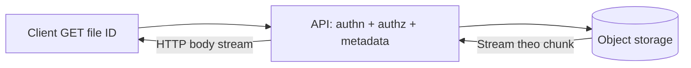

# Content-Disposition, tên tệp và Content-Type khi tải xuống

## 1. Ba quyết định trong một phản hồi tải tệp

Khi API trả một tệp, nội dung bytes chỉ là một phần hợp đồng. Client còn cần biết **đó là loại nội dung gì**, **nên hiển thị hay đề xuất lưu xuống** và **tên tệp gợi ý là gì**. Ba quyết định liên quan đến các HTTP response headers:

| Header | Câu hỏi nó trả lời | Ví dụ |
| --- | --- | --- |
| `Content-Type` | Bytes đại diện cho media type nào? | `application/pdf` |
| `Content-Disposition` | Nên xử lý nội dung như `inline` hay `attachment`; tên lưu gợi ý? | `attachment; filename="report.pdf"` |
| `Content-Length` | Body của response này dài bao nhiêu octet, nếu biết trước? | `845321` |

Ví dụ một API tải báo cáo:

```http
GET /api/files/f-204/download HTTP/1.1
Host: api.example.test
Authorization: Bearer <synthetic-token>
```

```http
HTTP/1.1 200 OK
Content-Type: application/pdf
Content-Disposition: attachment; filename="bao-cao-thang-11.pdf"; filename*=UTF-8''B%C3%A1o%20c%C3%A1o%20th%C3%A1ng%2011.pdf
Content-Length: 845321
Cache-Control: private, no-store
X-Content-Type-Options: nosniff

<845321 octet PDF>
```

`Content-Type` xác định PDF; `attachment` gợi ý tải về; `filename` là tên ASCII dự phòng, còn `filename*` biểu diễn **“Báo cáo tháng 11.pdf”** bằng UTF-8 percent-encoding. Trình duyệt có thể dùng các header này để đề xuất tên tệp, nhưng **tên và hành vi cuối cùng do client quyết định**. Cụm `<845321 octet PDF>` chỉ là mô tả body, không phải bytes HTTP thật.

Bài thuộc chương **Tệp và dữ liệu lớn** của module **INTEGRATION_API_REST**. Nó kết nối thiết kế resource/URI, HTTP method/status, hợp đồng dữ liệu, cache, xác thực/phân quyền, xử lý lỗi và kiểm thử với **Java/Spring** trong tình huống download, đặc biệt khi tệp lớn hoặc tên tệp đến từ người dùng.

**Mục tiêu:** sau bài học, người học có thể thiết kế header download theo RFC, mã hóa tên Unicode đúng, chặn injection/path traversal, streaming bytes mà không giữ toàn bộ trong RAM, và kiểm tra các trường hợp lỗi, phân quyền, range và cache.

## 2. Content-Disposition: `inline` và `attachment`

Theo RFC 6266, `Content-Disposition` trong **HTTP response** cung cấp cách xử lý nội dung:

```http
Content-Disposition: inline
```

`inline` biểu thị cách trình bày thông thường (nếu media type/client cho phép). Ví dụ ảnh hoặc PDF có thể được hiển thị trong trình duyệt.

```http
Content-Disposition: attachment
```

`attachment` đề nghị client coi phần nội dung như một tệp đính kèm, thường kích hoạt lưu xuống hoặc hộp thoại tải. Đây là **chỉ dẫn cho user agent**, không phải biện pháp bảo mật tuyệt đối và không bảo đảm mọi ứng dụng đều phản ứng giống nhau.

### 2.1. Cùng bytes, hai trải nghiệm

```http
HTTP/1.1 200 OK
Content-Type: image/png
Content-Disposition: inline; filename="preview.png"
```

Có thể phù hợp cho ảnh minh họa công khai đã được kiểm tra. Đối với chứng từ tải về:

```http
HTTP/1.1 200 OK
Content-Type: application/pdf
Content-Disposition: attachment; filename="invoice-2026.pdf"
```

Hệ thống không nên xem `inline` và `attachment` là hai **media type** khác nhau: MIME type mô tả nội dung, còn disposition hướng dẫn cách trình bày/tải. Việc dùng `attachment` **không biến HTML nguy hiểm thành dữ liệu an toàn**; nếu người dùng mở tệp đã tải, ứng dụng xử lý tệp vẫn có thể gặp rủi ro.

### 2.2. Không nhầm header response với multipart upload

Khi upload `multipart/form-data`, từng **part** có thể dùng `Content-Disposition: form-data; name="file"; filename="..."` theo đặc tả multipart. Đó là metadata **đầu vào chưa đáng tin** do client cung cấp.

Khi **download**, server sinh header **response** `Content-Disposition: attachment` hoặc `inline`. Không sao chép nguyên header của multipart part vào response; phải xác định tên hiển thị và loại nội dung hợp lệ qua hệ thống của mình.

## 3. Tên tệp Unicode: `filename` và `filename*`

### 3.1. Vì sao cần hai tham số?

`filename` truyền thống dùng **quoted-string** phù hợp với tập ký tự/khả năng tương thích của client, ví dụ:

```http
Content-Disposition: attachment; filename="monthly-report.pdf"
```

Với tên có dấu như `Báo cáo tháng 11.pdf`, không nên gắn tùy tiện raw Unicode vào quoted-string và trông đợi mọi browser/proxy diễn giải giống nhau. `filename*` dùng **extended parameter** theo RFC 8187 (kế thừa cơ chế RFC 5987) với UTF-8 và percent-encoding:

```http
Content-Disposition: attachment; filename="bao-cao-thang-11.pdf"; filename*=UTF-8''B%C3%A1o%20c%C3%A1o%20th%C3%A1ng%2011.pdf
```

Ý nghĩa:

- `filename="bao-cao-thang-11.pdf"`: tên ASCII dự phòng cho client cũ.
- `filename*=UTF-8''...`: tên quốc tế hóa; dấu nháy đơn kép sau `UTF-8` phân cách phần **language tag rỗng** với giá trị đã encode.
- `B%C3%A1o`: `á` được mã UTF-8 thành bytes `C3 A1` rồi percent-encode; khoảng trắng là `%20`, **không phải `+`**.
- Khi hiểu cả hai, user agent theo RFC 6266 nên ưu tiên giá trị `filename*`.

Trật tự đặt **`filename` trước, `filename*` sau** giúp một số client cũ bỏ qua tham số không hiểu mà vẫn có fallback. Không gửi lặp hai `filename` hoặc lặp hai `filename*` trong cùng disposition-value: các tham số trùng tên làm trường không hợp lệ theo RFC 6266.

### 3.2. Những cách mã hóa dễ sai

| Cách làm | Vấn đề | Cách sửa |
| --- | --- | --- |
| `filename="Báo cáo.pdf"` với giả định mọi client tự hiểu UTF-8 | Không đáng tin xuyên browser/proxy | Dùng fallback ASCII + `filename*` |
| `filename*=UTF-8''B%C3%A1o+cao.pdf` | `+` không phải cách encode khoảng trắng trong RFC 8187 | Dùng `%20` |
| `filename*=UTF-8''B%C3%A1o%2520cao.pdf` | Có thể double-encode `%` | Encode UTF-8 bytes **một lần** |
| Dùng `URLEncoder.encode(name, UTF_8)` nguyên xi | `URLEncoder` phục vụ HTML form, chuyển space thành `+` | Dùng encoder đúng RFC 8187 |
| Dùng `filename*` làm URL để trình duyệt truy cập | Nhầm tên hiển thị với target URI | Tên tệp không phải đường dẫn server |
| Sao chép tên raw từ request upload | Có thể chứa CRLF/path/Unicode nguy hiểm | Chuẩn hóa, lọc và lưu tên hiển thị an toàn |

### 3.3. Header không được là đường dẫn lưu trữ

Ví dụ metadata lưu ở database:

```json
{
  "fileId": "f-204",
  "storageKey": "files/7a/6d8c94e0.bin",
  "displayName": "Báo cáo tháng 11.pdf",
  "verifiedMediaType": "application/pdf",
  "sizeBytes": 845321
}
```

`storageKey` do hệ thống sinh, không dựa trên tên người dùng; `displayName` chỉ là **gợi ý tên khi tải**. Client gọi `/api/files/f-204/download`, backend kiểm tra quyền từ `fileId` rồi mở đối tượng lưu trữ đã liên kết. Không xây `File("/data/uploads/" + filename)` từ tên do client cung cấp.

### 3.4. Bộ quy tắc làm sạch tên

Tên tệp phải được xử lý như **untrusted data** trước khi tạo header:

1. Giữ **tên cơ sở**; loại `/`, `\`, path, CR/LF, NUL, control/bidi characters, tên rỗng, `.`, `..` và tên thiết bị dành riêng khi thích hợp.
2. Giới hạn độ dài theo bytes/ký tự, cân nhắc chuẩn hóa Unicode NFC.
3. So khớp **đuôi file** với verified media type và policy, không tin extension người upload.
4. Sinh ASCII fallback không có `"`, `\`, `%` hoặc dấu phân cách header.
5. Phía client vẫn phải chống overwrite/path nguy hiểm khi lưu; `filename*` chỉ là gợi ý tên.

Ví dụ tên đầu vào **không được dùng nguyên văn**:

```text
../../secrets/customer-list.csv
invoice.pdf.exe
report.pdf\r\nSet-Cookie: injected=1
..\\..\\windows\\system.ini
photo\u202Egpj.exe           (ký tự U+202E có thể đảo hiển thị)
```

`invoice.pdf.exe` không phải header injection, nhưng là **lừa tên/đuôi tệp**. Không thể loại bỏ mọi rủi ro chỉ bằng regex: quyết định tên hiển thị cần kết hợp media type đã kiểm tra, metadata nghiệp vụ và file-type policy. Không đưa tên gốc nhạy cảm vào access log hoặc metric labels.

## 4. Content-Type: mô tả đúng bytes sẽ tải

`Content-Type` là metadata về **media type của representation**. Với tải tệp, header này ảnh hưởng cách browser/ứng dụng chọn trình xem, xử lý nội dung và đôi khi lựa chọn tên/đuôi tệp.

| Tệp thực tế | Content-Type ví dụ | Lưu ý |
| --- | --- | --- |
| PDF | `application/pdf` | Có thể hiển thị inline hoặc tải xuống |
| PNG | `image/png` | Khác với `image/jpeg`; không suy từ tên |
| ZIP | `application/zip` | Có thể chứa nhiều loại tệp; kiểm soát chính sách giải nén |
| CSV UTF-8 | `text/csv; charset=UTF-8` | CSV formula injection là rủi ro riêng khi mở bằng spreadsheet |
| JSON xuất dữ liệu | `application/json` | Nếu muốn tải như tệp, dùng thêm disposition |
| Excel XLSX | `application/vnd.openxmlformats-officedocument.spreadsheetml.sheet` | Không phải `application/vnd.ms-excel` (thường gắn với XLS cũ) |
| Bytes chưa xác định đáng tin | `application/octet-stream` | Dùng như binary chung; không tự biến dữ liệu thành an toàn |

Ví dụ xuất CSV:

```http
HTTP/1.1 200 OK
Content-Type: text/csv; charset=UTF-8
Content-Disposition: attachment; filename="orders-2026.csv"
X-Content-Type-Options: nosniff

orderId,total
ord-123,250000
```

`Content-Type` không có nhiệm vụ quy định file sẽ được lưu với tên nào. Ngược lại, đuôi `.csv` trong `filename` không tự biến một tệp HTML thành CSV.

### 4.1. Không tin vào Content-Type của upload

Khi file được tải lên, client có thể gửi `Content-Type: application/pdf` nhưng bytes thực tế là HTML, script hoặc định dạng độc hại. Pipeline nên:

1. Áp giới hạn dung lượng và loại file cho phép ngay khi nhận upload.
2. Kiểm tra media type bằng **nguồn đáng tin + signature/format parsing** khi phù hợp, không dựa riêng vào extension hoặc header do client gửi.
3. Quét mã độc hoặc đưa vào trạng thái cách ly khi loại tệp/rủi ro đòi hỏi; không cho tải file chưa đạt policy.
4. Lưu **verified media type**, kích thước và định danh storage tách khỏi display name.
5. Khi trả về, dùng media type đã kiểm tra và chính sách disposition của server.

Magic bytes cũng không phải chứng chỉ an toàn tuyệt đối: tệp polyglot hoặc payload độc hại trong PDF/Office có thể qua một phép kiểm tra chữ ký đơn giản. Khi ứng dụng phân phối tệp không tin cậy, cần thêm **isolation origin, kiểm soát preview, sandbox/scanning và policy tải**.

### 4.2. `nosniff` và loại nội dung có thể thực thi

```http
X-Content-Type-Options: nosniff
```

Header này hướng trình duyệt không tự suy đoán sai media type trong những ngữ cảnh được áp dụng; đặc biệt hữu ích khi ngăn tải script/style với MIME sai. Tuy nhiên, nó **không bảo đảm một tệp độc hại không thể được mở hoặc thực thi sau khi download**, và không thay thế kiểm tra nội dung.

Với HTML, SVG hoặc file do người dùng tạo có thể chứa nội dung chủ động, cân nhắc **không cho preview trên cùng origin đăng nhập của ứng dụng**. Dùng miền phân phối tệp tách biệt, chính sách cookie/credentials phù hợp, `Content-Security-Policy` và sandbox khi có nhu cầu preview. Thay đổi `Content-Type` sang `application/octet-stream` và đặt `attachment` có thể giảm khả năng render trực tiếp, nhưng vẫn **không thay thế cách ly origin**.

### 4.3. Không nên dùng sai status khi đàm phán nội dung

- `Content-Type` của **response** nói loại bytes trả về, không phải điều kiện kiểm tra request body.
- `415 Unsupported Media Type` chủ yếu dùng khi server **không hỗ trợ media type trong request content** (thường gặp khi upload hoặc PATCH).
- `406 Not Acceptable` có thể dùng khi không có representation nào chấp nhận được theo `Accept` của client và server chọn tuân thủ negotiation chặt.
- API download có thể công bố chỉ trả **một media type cố định** theo file đang lưu; không nên tự đổi PDF thành JSON chỉ vì client gửi `Accept: application/json`.

Khi lỗi phân quyền hoặc file không tồn tại, phản hồi Problem Details là **representation của lỗi**, không phải bytes của tệp. Vì vậy đừng cố đặt header tên tệp hoặc `Content-Length` của file trên response 401/403/404.

## 5. Tệp lớn: streaming, length và byte ranges

Với file vài gigabyte, dùng `byte[]` hoặc `Files.readAllBytes` để giữ toàn bộ body trong heap làm tăng bộ nhớ, GC và nguy cơ hết RAM. Nên **stream** từ object storage hoặc filesystem qua response, hoặc chuyển việc tải sang dịch vụ lưu trữ có cơ chế ủy quyền phù hợp.



### 5.1. `Content-Length` phải khớp số bytes truyền

Nếu biết chính xác kích thước representation đang truyền và không có biến đổi nội dung trên đường đi, có thể dùng:

```http
Content-Length: 845321
```

Đối với streaming không biết trước độ dài, **không tự đoán** `Content-Length`. HTTP/1.1 có thể dùng chunked transfer encoding; ở HTTP/2/3 framing do giao thức xử lý. Nếu có nén `Content-Encoding` hoặc biến đổi ở proxy, độ dài bytes truyền có thể khác độ dài file gốc.

Sai `Content-Length` có thể khiến tải thiếu, client chờ vô hạn hoặc gây vấn đề đóng khung thông điệp HTTP. Việc ghi `Content-Length` trong Spring cần dựa trên metadata đáng tin được kiểm tra so với object lưu trữ.

### 5.2. Byte range cho tải tiếp

Nếu API hỗ trợ range requests, client có thể yêu cầu:

```http
GET /api/files/f-204/download HTTP/1.1
Range: bytes=0-1023
```

Với file đủ dài và một range hợp lệ, response điển hình:

```http
HTTP/1.1 206 Partial Content
Content-Type: application/pdf
Content-Disposition: attachment; filename="bao-cao.pdf"
Accept-Ranges: bytes
Content-Range: bytes 0-1023/845321
Content-Length: 1024

<1024 octet đầu>
```

`Content-Length` ở **206** là kích thước **phần được gửi**, không phải toàn bộ tệp; `Content-Range` mới nêu vị trí trong representation đầy đủ. Với range không đáp ứng được, có thể trả **`416 Range Not Satisfiable`** và `Content-Range: bytes */845321` theo điều kiện RFC 9110.

Nếu quảng bá:

```http
Accept-Ranges: bytes
```

server phải có cơ chế thực thi range nhất quán; đừng chỉ thêm header rồi vẫn trả `200` toàn bộ với body cắt thủ công không đúng. **Ví dụ `StreamingResponseBody` ở mục 7 chỉ hỗ trợ trả toàn bộ tệp**, không tự động triển khai 206/416. Nếu cần download resume thực sự, dùng resource handler hoặc endpoint range-aware có kiểm thử riêng.

### 5.3. Validator và tải tiếp an toàn

Khi nội dung file có thể thay đổi ở cùng URI, dùng `ETag`/`Last-Modified` để client biết representation đã đổi. `If-Range` có thể giúp client chỉ dùng range khi validator còn phù hợp; nếu không, origin có thể trả lại toàn bộ representation thay vì ghép phần mới vào file cũ.

Với download lớn, nên ưu tiên file **immutable theo version** hoặc strong ETag cho bytes thực tế. Nếu client ghép hai range của hai phiên bản khác nhau, tệp tải về có thể bị hỏng dù từng response 206 đều hợp lệ.

### 5.4. Lỗi khi stream đã bắt đầu

Khi server đã gửi header `200` và một phần body, lỗi đọc storage hoặc client ngắt kết nối có thể xảy ra. Khi response **đã commit**, ứng dụng không thể biến nó thành một JSON `500 ProblemDetail` đầy đủ. Cần:

- Đóng input stream, giải phóng tài nguyên và dừng đọc.
- Ghi metrics `bytesSent`, lỗi stream, thời gian tải, tỉ lệ client abort theo chính sách logging.
- Thiết kế retry/resume bằng range nếu có hỗ trợ, hoặc yêu cầu client tải lại.
- Không coi “đã gửi status 200” là bằng chứng file được truyền hoàn chỉnh.

## 6. Bảo mật toàn đường đi của download

### 6.1. Luôn phân quyền theo file ID

Endpoint ví dụ:

```text
GET /api/files/{fileId}/download
```

Tại server, thực hiện **authorization theo từng đối tượng**: người dùng thuộc tenant nào, có quyền xem file nào, file đã qua kiểm tra nội dung chưa, có bị thu hồi quyền hoặc hết hạn không. Biết `fileId` hoặc đoán được storage key **không** có nghĩa được tải file.

| Rủi ro | Cơ chế phòng vệ |
| --- | --- |
| BOLA/IDOR: đọc file của user/tenant khác | Authorize trên file record trước khi mở stream |
| Path traversal từ tên | Không dùng display name làm đường dẫn storage; canonical storage key riêng |
| CRLF response splitting | Làm sạch tên, dùng header builder/encoder đúng chuẩn |
| MIME spoofing, nội dung độc hại | Verified media type, scanning, cách ly nguồn phát |
| Cache/CDN phát nhầm file giữa user | `Cache-Control: private, no-store` hoặc cache policy bảo vệ identity đúng |
| Signed URL bị phát tán | TTL ngắn, phạm vi tối thiểu, HTTPS, hạn chế log/referrer và quyền tải |
| Tải file quá lớn / đồng thời quá nhiều | Quota, rate limit, streaming, giới hạn tài nguyên |

`404` có thể được dùng để che sự tồn tại file ngoài quyền, tùy chính sách nhất quán; `401` khi chưa xác thực và `403` khi có danh tính nhưng không được phép thường phù hợp. Không trả đường dẫn lưu trữ, tên file thuộc người khác hoặc stack trace trong body lỗi.

### 6.2. Cache dữ liệu riêng tư

Với chứng từ hoặc file chứa dữ liệu cá nhân:

```http
Cache-Control: private, no-store
```

Header này yêu cầu HTTP caches tuân thủ không lưu response; nó **không** cấm người dùng lưu tệp trực tiếp trên thiết bị. Nếu file là tài nguyên công khai, immutable, có thể thiết kế cache lâu hơn với URL/version và chính sách phù hợp. Cần kiểm tra CDN có đang override origin headers hoặc đưa response có `Authorization` vào shared cache không.

### 6.3. Truy cập cross-origin qua JavaScript

Khi frontend khác origin dùng `fetch`, browser có thể nhận response mà **không cho JavaScript đọc `Content-Disposition`** nếu server không expose header theo CORS. Nếu đã cho phép origin cụ thể, có thể bổ sung:

```http
Access-Control-Allow-Origin: https://app.example.test
Access-Control-Expose-Headers: Content-Disposition, Content-Length, ETag
```

Các header CORS **không cấp quyền đọc file**: backend vẫn kiểm tra danh tính và quyền. Với credentialed requests, cấu hình CORS phải tuân thủ quy tắc origin/credentials, không dùng wildcard tùy tiện. Việc expose `Content-Disposition` chỉ cho phép JavaScript xem metadata header trong response đã được CORS chấp nhận.

## 7. Ví dụ Java/Spring: tải tệp bằng StreamingResponseBody

Ví dụ dùng **Java 17+, Spring Boot 3, Spring MVC 6**. Đây là mã minh họa các lớp của một ứng dụng; cần kết nối Spring Security, storage và xử lý lỗi thực tế để chạy. Tập trung vào bốn nguyên tắc: **quyền trước khi mở stream**, metadata đã kiểm tra, header download hợp lệ và không giữ toàn bộ file trong bộ nhớ.

### 7.1. Metadata có thẩm quyền và controller

```java
package example.files.api;

import java.io.IOException;
import java.io.InputStream;
import java.nio.charset.StandardCharsets;
import java.security.Principal;
import org.springframework.http.HttpHeaders;
import org.springframework.http.MediaType;
import org.springframework.http.ResponseEntity;
import org.springframework.web.bind.annotation.GetMapping;
import org.springframework.web.bind.annotation.PathVariable;
import org.springframework.web.bind.annotation.RequestMapping;
import org.springframework.web.bind.annotation.RestController;
import org.springframework.web.servlet.mvc.method.annotation.StreamingResponseBody;

record FileMeta(
        String storageKey,
        String asciiFallback,
        String displayName,
        String verifiedContentType,
        long sizeBytes) {}

interface FileStore {
    // Kiểm tra actor/tenant/quyền đọc và trạng thái file trước khi trả metadata.
    FileMeta findReadable(String actor, String fileId);
    InputStream openStream(String storageKey) throws IOException;
}

@RestController
@RequestMapping("/api/files")
public class FileDownloadController {
    private final FileStore store;

    public FileDownloadController(FileStore store) {
        this.store = store;
    }

    @GetMapping("/{id}/download")
    public ResponseEntity<StreamingResponseBody> download(
            @PathVariable("id") String id, Principal principal) {

        FileMeta file = store.findReadable(principal.getName(), id);
        String disposition = DownloadFilename.header(file);

        StreamingResponseBody body = output -> {
            try (InputStream input = store.openStream(file.storageKey())) {
                input.transferTo(output);
            }
        };

        ResponseEntity.BodyBuilder response = ResponseEntity.ok()
                .contentType(MediaType.parseMediaType(
                        file.verifiedContentType()))
                .header(HttpHeaders.CONTENT_DISPOSITION, disposition)
                .header("X-Content-Type-Options", "nosniff")
                .header(HttpHeaders.CACHE_CONTROL, "private, no-store");

        // Chỉ ghi length khi metadata là kích thước chính xác của body.
        if (file.sizeBytes() >= 0) {
            response.contentLength(file.sizeBytes());
        }
        return response.body(body);
    }
}

final class DownloadFilename {
    private DownloadFilename() {}

    static String header(FileMeta file) {
        String fallback = file.asciiFallback();
        String display = file.displayName();

        // Chỉ nhận fallback ASCII đã kiểm soát, không nhận dấu nháy
        // hay ký tự phân cách header; tên thật còn phải qua policy ở store.
        if (fallback == null ||
                !fallback.matches("[A-Za-z0-9][A-Za-z0-9._-]{0,119}")) {
            throw new IllegalArgumentException("Invalid ASCII filename");
        }
        if (display == null || display.isBlank() ||
                display.codePointCount(0, display.length()) > 150 ||
                display.codePoints().anyMatch(cp ->
                        Character.isISOControl(cp) || cp == '/' ||
                        cp == '\\' || cp == 0x202E || cp == 0x202D)) {
            throw new IllegalArgumentException("Invalid display filename");
        }

        return "attachment; filename=\"" + fallback +
                "\"; filename*=UTF-8''" + percentEncodeUtf8(display);
    }

    private static String percentEncodeUtf8(String value) {
        final String hex = "0123456789ABCDEF";
        StringBuilder out = new StringBuilder();
        for (byte b : value.getBytes(StandardCharsets.UTF_8)) {
            int v = b & 0xff;
            // Tập ký tự ASCII unreserved: đủ an toàn cho RFC 8187.
            if ((v >= 'A' && v <= 'Z') ||
                (v >= 'a' && v <= 'z') ||
                (v >= '0' && v <= '9') ||
                v == '-' || v == '.' || v == '_' || v == '~') {
                out.append((char) v);
            } else {
                out.append('%')
                   .append(hex.charAt(v >>> 4))
                   .append(hex.charAt(v & 0x0f));
            }
        }
        return out.toString();
    }
}
```

**Phạm vi mẫu code:** `DownloadFilename.header` là hàng rào cuối trước lúc ghi header, **không phải bộ chuẩn hóa tên hoàn chỉnh**. Tầng nhập dữ liệu vẫn cần xử lý Unicode normalization, ký tự điều khiển hướng văn bản khác, tên đặc biệt (`.`, `..`, device names), extension phù hợp và chính sách file type. Trong ứng dụng có nhiều kiểu MIME/định dạng phức tạp, có thể dùng builder `ContentDisposition` của Spring phù hợp phiên bản đang chạy; **kiểm tra header thực xuất** với Unicode, fallback và browser mục tiêu thay vì giả định mọi builder phát cả `filename` và `filename*` như mong muốn.

`Principal` ở controller yêu cầu route đã cấu hình authentication; `findReadable` **phải tự kiểm tra quyền** trước khi trả metadata. `storageKey` nội bộ chỉ tới đối tượng đã được cho phép, không phải đường dẫn ghép từ `id` hay `displayName`. Nếu đối tượng bị thay đổi/xóa giữa lần đọc metadata và mở stream, storage cần snapshot/version hoặc xử lý lỗi phù hợp, tránh khai báo size/ETag không còn đúng.

### 7.2. Những điểm production cần bổ sung

- Giới hạn tải đồng thời; cấu hình **async executor**, timeout, backpressure và metrics.
- Xử lý lỗi quyền/tệp **trước khi stream**; lỗi sau response commit không thể đổi sang Problem Details.
- Nếu cần `Range`, `If-Range`, `ETag`, `HEAD`, dùng endpoint **range-aware** và test riêng.
- Với **signed URL** do object storage cấp, kiểm tra quyền, TTL, scope và disposition thật; không để lộ URL ký trên logs/referrer.

## 8. Kiểm thử: hợp đồng HTTP và nội dung thực

### 8.1. Kiểm thử MockMvc với tên có dấu

Test sau dùng Mockito và controller ở mục 7 để xác minh tên UTF-8, fallback ASCII, MIME và bytes nhận được. Với `StreamingResponseBody`, MockMvc cần xử lý **async dispatch**:

```java
package example.files.api;

import static org.mockito.Mockito.*;
import static org.hamcrest.Matchers.containsString;
import static org.springframework.test.web.servlet.request.MockMvcRequestBuilders.*;
import static org.springframework.test.web.servlet.result.MockMvcResultMatchers.*;

import java.io.ByteArrayInputStream;
import java.nio.charset.StandardCharsets;
import org.junit.jupiter.api.Test;
import org.springframework.http.HttpHeaders;
import org.springframework.test.web.servlet.MockMvc;
import org.springframework.test.web.servlet.MvcResult;
import org.springframework.test.web.servlet.setup.MockMvcBuilders;

class FileDownloadContractTest {
    @Test
    void usesUtf8FilenameAndStreamsExactBytes() throws Exception {
        byte[] content = "sample-pdf-bytes".getBytes(StandardCharsets.UTF_8);
        FileStore store = mock(FileStore.class);
        when(store.findReadable("alice", "f-204")).thenReturn(new FileMeta(
                "object-key-1", "bao-cao-thang-11.pdf",
                "Báo cáo tháng 11.pdf", "application/pdf", content.length));
        when(store.openStream("object-key-1"))
                .thenReturn(new ByteArrayInputStream(content));

        MockMvc mvc = MockMvcBuilders
                .standaloneSetup(new FileDownloadController(store)).build();
        MvcResult pending = mvc.perform(get("/api/files/f-204/download")
                    .principal(() -> "alice"))
                .andExpect(request().asyncStarted())
                .andReturn();

        mvc.perform(asyncDispatch(pending))
                .andExpect(status().isOk())
                .andExpect(header().string(HttpHeaders.CONTENT_TYPE,
                        "application/pdf"))
                .andExpect(header().string(HttpHeaders.CONTENT_DISPOSITION,
                        containsString(
                          "filename*=UTF-8''B%C3%A1o%20c%C3%A1o%20th%C3%A1ng%2011.pdf")))
                .andExpect(header().string("X-Content-Type-Options",
                        "nosniff"))
                .andExpect(content().bytes(content));
        verify(store).findReadable("alice", "f-204");
        verify(store).openStream("object-key-1");
    }
}
```

**Giới hạn:** Dữ liệu test là bytes giả, không phải PDF hợp lệ; test này kiểm tra **contract streaming** chứ không kiểm tra parser PDF. `MockMvc` standalone cũng **không chứng minh SecurityFilterChain**, quyền tenant, object storage, CDN hay hành vi trình duyệt. Các bước đó cần integration test đúng tầng.

### 8.2. Ma trận test để phát hành

| Trường hợp | Assert cần có |
| --- | --- |
| PDF hợp lệ, tên ASCII | `200`, `application/pdf`, disposition `attachment`, bytes toàn vẹn |
| Tên `Báo cáo tháng 11.pdf` | Có ASCII fallback và `filename*` UTF-8 đúng `%20`/percent bytes |
| Tên chứa CR/LF hoặc đường dẫn `../` | Bị từ chối hoặc chuẩn hóa ở pipeline; không tạo header lạ/đường dẫn ngoài vùng lưu |
| Client không xác thực / không có quyền | `401`/`403`/`404` theo policy; **không gọi `openStream`** |
| File 1 GiB | Streaming ổn định, heap không tăng tuyến tính theo file size |
| Storage lỗi trước/sau khi gửi body | Lỗi trước commit xử lý HTTP đúng; sau commit không trả JSON lỗi chồng lên bytes |
| Độ dài metadata sai hoặc object bị thay giữa request | Không trả body bị cắt/trộn phiên bản; có xử lý lỗi và metrics |
| Có hỗ trợ Range | `206`, `Content-Range`, `416`, `If-Range` đúng; ghép range ra đúng file |
| Khác origin | `Content-Disposition` đọc được qua CORS khi được phép, credential không rò |
| File riêng qua CDN | Không chia sẻ bytes giữa user/tenant; cache policy được thực thi |

**Kiểm tra quan trọng nhất:** không chỉ assert `Content-Disposition` có chữ `filename`; phải kiểm tra **bytes thực**, header đúng như client sẽ nhận, khả năng tải file có dấu trên browser mục tiêu và đường lỗi bảo mật. Nếu hỗ trợ tải tiếp, so sánh checksum của file ghép từ ranges với checksum của bản đầy đủ.

## 9. Bài tập tình huống

Một ứng dụng cho phép người dùng tải **“Hóa đơn tháng 11.pdf”** (`application/pdf`, 2 MiB) từ `GET /api/files/f-88/download`. Chứng từ thuộc một tenant cụ thể, lưu dưới object key do server sinh; frontend gọi API từ một origin được phép.

**Yêu cầu:**

1. Viết các header chính cho response `200`: tên ASCII fallback, `filename*` UTF-8, MIME type, chính sách cache và chống MIME sniffing.
2. Nếu tên lưu từ upload là `../Hóa đơn.pdf` hoặc chứa CRLF, chỉ ra bước phải chặn và vì sao không dùng tên này để mở storage object.
3. Frontend không đọc được `Content-Disposition` qua `fetch` dù response thành công: kiểm tra lớp nào?
4. Khách yêu cầu `Range: bytes=0-1023`: nếu API có hỗ trợ range, phải trả status, length và content-range gì? Nếu chưa hỗ trợ, không được giả vờ trả 206.
5. Nêu ba kiểm thử chứng minh quyền truy cập, encoding tên và stream bytes không sai.

**Gợi ý:** `attachment; filename="hoa-don-thang-11.pdf"` kèm `filename*=UTF-8''H%C3%B3a%20%C4%91%C6%A1n%20th%C3%A1ng%2011.pdf`, `Content-Type: application/pdf`, `Cache-Control: private, no-store`, `X-Content-Type-Options: nosniff`. Kiểm tra authorization tại `fileId` trước khi mở stream; làm sạch tên tại biên nhập dữ liệu và trước khi sinh header. Với CORS, cấu hình `Access-Control-Expose-Headers: Content-Disposition` cho origin hợp lệ. Response một range hợp lệ từ tệp 2 MiB có thể là `206`, `Content-Length: 1024`, `Content-Range: bytes 0-1023/2097152`. Test bằng file giả có tên Unicode, người dùng khác tenant và đối chiếu toàn bộ bytes/chunk thực nhận.

## 10. Kết luận

Trong REST download, **`Content-Type` mô tả bytes**, còn **`Content-Disposition` đề xuất cách hiển thị/lưu và tên tệp**. `filename*` giúp truyền tên Unicode đúng RFC, nhưng cả tên lẫn MIME đầu vào đều phải được kiểm tra và không được dùng làm đường dẫn lưu trữ. Với tệp lớn, streaming, range/validator và kiểm soát response commit quyết định độ tin cậy; với tệp riêng tư, authorization, cache policy, origin isolation và kiểm thử end-to-end quyết định an toàn.


