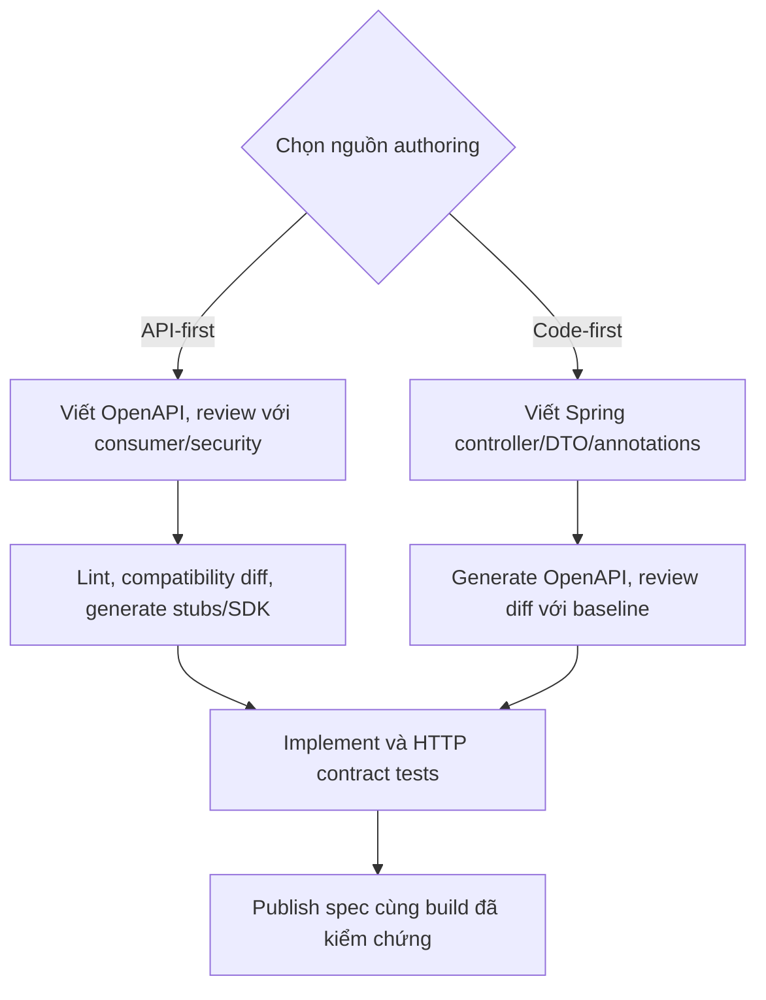

# API-first, code-first và đồng bộ hợp đồng với triển khai

## 1. Khi OpenAPI và API thực tế không còn giống nhau

Một đội phát triển công bố trong OpenAPI rằng `POST /orders` trả **201 Created**, header `Location` và JSON theo schema `Order`. Nhưng controller Spring thực tế trả **200 OK** với một đối tượng JPA khác schema. SDK được sinh từ OpenAPI có thể không xử lý đúng; kiểm thử frontend vẫn “xanh” vì mock dựa trên tài liệu, trong khi production đã lệch hợp đồng.

Đây là **contract drift**: điều client được hứa khác hành vi thật của API. Nó không chỉ xảy ra với body JSON, mà còn ở URI, method, query, status, header, content type, authentication, error response và quy tắc tương thích.

**OpenAPI** mô tả bề mặt HTTP API theo dạng có cấu trúc, máy có thể đọc. Nhưng file `openapi.yaml` không tự bảo đảm controller, security filter, database và gateway tuân theo đặc tả đó. Cần một **quy trình đồng bộ hợp đồng với triển khai**, bất kể chọn API-first hay code-first.

Bài thuộc chương **Hợp đồng OpenAPI** của module **INTEGRATION_API_REST**: học thiết kế REST dựa trên resource, URI, HTTP methods/status, hợp đồng dữ liệu rõ ràng, phân trang, cache, idempotency, xác thực/phân quyền, xử lý lỗi và kiểm thử bằng Java/Spring hoặc công nghệ tương đương.

### Sau bài này, bạn có thể

- Giải thích sự khác nhau giữa **API-first** và **code-first**, chọn phù hợp hoàn cảnh.
- Định nghĩa **nguồn sự thật** (source of truth) của hợp đồng và trách nhiệm review thay đổi.
- Thiết kế một trích đoạn OpenAPI 3.1 nhất quán với HTTP requests/responses và security.
- Dùng Spring MVC, validation và mô tả OpenAPI từ code mà không nhầm tài liệu với enforcement.
- Xây pipeline **lint → diff → generate → test → publish** để phát hiện drift.
- Đánh giá breaking changes, viết contract/integration tests và xử lý tình huống migration.

## 2. “Hợp đồng API” rộng hơn một file YAML

Hợp đồng HTTP bao gồm ít nhất:

| Phần của hợp đồng | Câu hỏi phải trả lời | Ví dụ |
|---|---|---|
| Resource/URI | Tài nguyên nào, có danh tính ra sao? | `/orders/{orderId}` |
| Method | Đọc, tạo, thay thế, cập nhật, xóa? | `GET`, `POST` |
| Parameters | Path/query/header nào được phép, bắt buộc và có ràng buộc gì? | `size: integer, 1..100` |
| Request body | Media type, fields, required, nullability và validation | `application/json`, `items` tối thiểu 1 |
| Response | Status, headers, media type và schema | `201` + `Location` + `Order` |
| Authentication/authorization | Cần cơ chế đăng nhập và quyền tài nguyên nào? | Bearer token; chỉ thấy đơn thuộc tenant |
| Error contract | Status và mã lỗi ổn định, thông tin có thể tiết lộ | `409 ORDER_CONFLICT`, Problem Details |
| Tương thích | Trường hợp nào được coi là breaking change? | Không tự đổi `size` sang string |
| Quy tắc hành vi | Những điều OpenAPI khó mô tả hoàn toàn | Trạng thái đơn, idempotency, pagination ordering |

OpenAPI mô tả tốt **hình dạng và cấu trúc giao tiếp**. Những quy tắc như “mỗi Idempotency-Key chỉ tạo một đơn”, “tenant A không xem đơn tenant B”, “trang sau không lặp phần tử khi dữ liệu ổn định” cần thêm **description, ADR, business tests và security tests**. Không coi đặc tả hình thức là toàn bộ nghiệp vụ.

**Ba loại bằng chứng** nên đi cùng nhau: (1) đặc tả đã review, (2) triển khai trả HTTP đúng, (3) kiểm thử máy móc chứng minh sự tương ứng.

## 3. API-first và code-first khác ở đâu?

**API-first (contract-first/spec-first)**: đội thiết kế trước HTTP contract, thường là OpenAPI, cùng consumer review; sau đó viết controller, generate interfaces/SDK và tests dựa vào nó.

**Code-first**: đội viết resource/controller/DTO trước, rồi dùng annotations và công cụ như springdoc-openapi để trích OpenAPI từ ứng dụng. Đặc tả có thể là artifact sinh ra, được review và publish.

Không nên hiểu API-first là “không được viết prototype” hoặc code-first là “không cần thiết kế”. Sự khác biệt là **nguồn được chỉnh sửa chính và thứ tự ra quyết định**.

| Tiêu chí | API-first | Code-first |
|---|---|---|
| Nguồn sự thật chủ đạo | Đặc tả OpenAPI đã version-control | Mapping, DTO và annotations của code |
| Bắt đầu thay đổi | Review contract trước | Thay code, generate/review spec |
| Consumer tham gia sớm | Dễ mock/SDK trước khi backend xong | Cần xuất spec sớm để nhận feedback |
| Giảm lệch schema | Tốt khi generated interface và tests được dùng | Tốt khi generator phản ánh code đúng và output được kiểm tra |
| Rủi ro | Đặc tả đẹp nhưng code bỏ qua; generator không hỗ trợ hết schema | Annotations thiếu status/error/security; accidental schema exposure |
| Phù hợp | Public API, đa đội/SDK, thay đổi cần phê duyệt | Internal API, team nhỏ, Spring-centric, thay đổi nhanh |
| Yêu cầu chung | CI kiểm tra spec với implementation | CI kiểm tra implementation với spec đã phát hành |

Một tổ chức có thể **kết hợp** hai phương pháp: design contract API-first ở ranh giới public; dùng code-first cho API nội bộ nhưng luôn so bản OpenAPI sinh ra với baseline đã chấp thuận.

## 4. Hai vòng phát triển và điểm chặn drift



Phải phân biệt **authoring source** (nơi được sửa), **generated artifact** (SDK, interface hoặc `openapi.json` tái tạo được) và **published baseline** (phiên bản consumer đang dùng). API-first không cho sửa generated stubs thay vì sửa spec. Code-first không cho sửa tay generated spec rồi hy vọng code đổi theo. Cả hai phải test **HTTP thực**, không chỉ file YAML.

## 5. OpenAPI 3.1: ví dụ hợp đồng đơn hàng

Giả sử ứng dụng có hai operation chính: tạo đơn và đọc đơn. Hợp đồng dùng **OpenAPI 3.1** (schema dựa trên JSON Schema 2020-12); các API/tooling đang dùng phiên bản khác phải kiểm tra khả năng hỗ trợ trước khi chuyển.

```yaml
openapi: 3.1.0
info:
  title: Orders REST API
  version: 1.0.0
servers:
  - url: https://api.example.test
security:
  - bearerAuth: []

paths:
  /orders:
    post:
      operationId: createOrder
      summary: Tạo đơn hàng
      description: >
        Idempotency-Key áp cho một logical create operation;
        cùng key và cùng request không tạo đơn mới trong retention window.
      parameters:
        - name: Idempotency-Key
          in: header
          required: true
          schema:
            type: string
            minLength: 8
            maxLength: 160
      requestBody:
        required: true
        content:
          application/json:
            schema:
              $ref: '#/components/schemas/CreateOrderRequest'
      responses:
        '201':
          description: Đơn hàng đã được tạo
          headers:
            Location:
              required: true
              schema: { type: string, format: uri-reference }
          content:
            application/json:
              schema:
                $ref: '#/components/schemas/Order'
        '400':
          $ref: '#/components/responses/BadRequest'
        '401':
          $ref: '#/components/responses/Unauthorized'
        '409':
          $ref: '#/components/responses/Conflict'

  /orders/{orderId}:
    get:
      operationId: getOrder
      summary: Lấy đơn hàng được phép xem
      parameters:
        - name: orderId
          in: path
          required: true
          schema: { type: string }
      responses:
        '200':
          description: Chi tiết đơn hàng
          content:
            application/json:
              schema:
                $ref: '#/components/schemas/Order'
        '401':
          $ref: '#/components/responses/Unauthorized'
        '404':
          description: Không có đơn hàng hiển thị với caller
          content:
            application/problem+json:
              schema:
                $ref: '#/components/schemas/Problem'

components:
  securitySchemes:
    bearerAuth:
      type: http
      scheme: bearer
      bearerFormat: JWT

  schemas:
    CreateOrderRequest:
      type: object
      required: [customerId, items]
      additionalProperties: false
      properties:
        customerId:
          type: string
          minLength: 1
        items:
          type: array
          minItems: 1
          items:
            $ref: '#/components/schemas/OrderItemRequest'
    OrderItemRequest:
      type: object
      required: [sku, quantity]
      additionalProperties: false
      properties:
        sku: { type: string, minLength: 1 }
        quantity: { type: integer, minimum: 1 }
    Order:
      type: object
      required: [id, status, createdAt]
      properties:
        id: { type: string }
        status:
          type: string
          enum: [PENDING, PAID, CANCELLED]
        createdAt:
          type: string
          format: date-time
    Problem:
      type: object
      required: [type, title, status]
      properties:
        type: { type: string, format: uri-reference }
        title: { type: string }
        status: { type: integer }
        detail: { type: string }
        code: { type: string }

  responses:
    BadRequest:
      description: Request không hợp lệ
      content:
        application/problem+json:
          schema:
            $ref: '#/components/schemas/Problem'
    Unauthorized:
      description: Thiếu hoặc sai thông tin xác thực
      content:
        application/problem+json:
          schema:
            $ref: '#/components/schemas/Problem'
    Conflict:
      description: Xung đột nghiệp vụ hoặc idempotency key
      content:
        application/problem+json:
          schema:
            $ref: '#/components/schemas/Problem'
```

Đây là ví dụ **tối giản có chủ đích**: sản phẩm thật còn cần 403/422/429/500 khi phù hợp, ví dụ request/response, rate limit, scope phân quyền và business errors. `bearerFormat: JWT` chỉ là gợi ý về định dạng; **không kích hoạt xác minh JWT** trong server.

### Các điểm cần đọc từ spec

- `operationId` phải **duy nhất và ổn định** nếu SDK/code generation dựa vào tên này.
- `path` parameter bắt buộc có `required: true`.
- `POST /orders` hứa **201 + Location + JSON Order**; controller trả 200 sẽ vi phạm.
- `CreateOrderRequest.required` ràng buộc **sự có mặt** của `items`; `minItems: 1` ràng buộc độ dài; quyền customerId vẫn phải kiểm tra ở service.
- `additionalProperties: false` là quyết định về khả năng mở rộng request: client gửi field mới ngoài schema có thể bị từ chối nếu runtime enforce.
- `security` cấp global yêu cầu bearer auth; không thay thế quy tắc phân quyền theo đơn hàng.
- Response lỗi dùng `application/problem+json` với `code` là extension của ứng dụng, không phải member bắt buộc của Problem Details.

## 6. Required, null, format và validation dễ bị lệch

| Ý định | OpenAPI 3.1 | Kiểm tra ở runtime |
|---|---|---|
| Field phải xuất hiện | `required: [name]` | Validation/DTO mapping |
| Field cho phép null | `type: [string, 'null']` | Jackson và null handling |
| String không rỗng | `minLength: 1` | `@NotBlank` hoặc rule tương đương |
| List ít nhất một phần tử | `type: array`, `minItems: 1` | `@NotEmpty`, `@Valid` |
| Số nguyên dương | `type: integer`, `minimum: 1` | `@Min(1)` và overflow |
| Thời gian | `type: string`, `format: date-time` | JSON serialize/parse theo chuẩn |
| Enum | `enum` | Java enum và forward compatibility |
| Field lạ | `additionalProperties` | Jackson unknown-property policy |

**`required` chỉ buộc field hiện diện, không tự buộc string khác rỗng.** JSON Schema của OpenAPI 3.1 có cú pháp khác một phần với 3.0; đừng dùng `nullable: true` kiểu 3.0 thay cho union type `type: [string, 'null']` ở 3.1. Generator, linter và validator phải hỗ trợ dialect tương ứng. Enforce runtime còn phụ thuộc cách kích hoạt Bean Validation, deserialize và xử lý lỗi.

## 7. API-first trong dự án Java/Spring

Quy trình: **thiết kế OpenAPI → review với consumers/security → lint/diff → generate interfaces/mocks/SDK → implement Spring → HTTP/security tests → publish**.

```text
api/openapi.yaml     (nguồn authoring)
   -> generated-api/ (artifact không chỉnh tay)
   -> controller/service/DTO
   -> integration + contract tests
   -> publish version tương ứng
```

Không giả định mọi code generator đều hỗ trợ trọn OpenAPI 3.1, đặc biệt `oneOf`, discriminator hay union/nullability. Kiểm chứng generated DTO và cách serialize bằng tests. Nếu schema phức tạp không được hỗ trợ, ghi limitation và chốt một giải pháp thay thế có review.

**Một nguồn sự thật:** thay request schema phải bắt đầu ở spec. Mọi output generate cần tái tạo được; CI chặn khi regenerate tạo diff không dự kiến.

## 8. Code-first trong Spring: controller là điểm bắt đầu

Một đội dùng Spring Boot có thể viết resource và DTO trước, rồi dùng springdoc-openapi tạo `/v3/api-docs` (đường dẫn ví dụ theo cấu hình thường gặp) để xuất OpenAPI. Dependency và cách triển khai phải phù hợp phiên bản Spring Boot đang chạy; **không tự ghim một version từ ví dụ này**.

Controller minh họa:

```java
import java.net.URI;
import org.springframework.http.ResponseEntity;
import org.springframework.security.core.Authentication;
import org.springframework.web.bind.annotation.*;
import jakarta.validation.Valid;
import io.swagger.v3.oas.annotations.Operation;
import io.swagger.v3.oas.annotations.responses.ApiResponse;
import io.swagger.v3.oas.annotations.responses.ApiResponses;
import io.swagger.v3.oas.annotations.security.SecurityRequirement;

@RestController
@RequestMapping("/orders")
@SecurityRequirement(name = "bearerAuth")
class OrderController {
    private final OrderService service;

    OrderController(OrderService service) {
        this.service = service;
    }

    @PostMapping
    @Operation(operationId = "createOrder", summary = "Tạo đơn hàng")
    @ApiResponses({
        @ApiResponse(responseCode = "201", description = "Created"),
        @ApiResponse(responseCode = "400", description = "Invalid request"),
        @ApiResponse(responseCode = "409", description = "Conflict")
    })
    ResponseEntity<OrderDto> create(
            @Valid @RequestBody CreateOrderRequest request,
            @RequestHeader("Idempotency-Key") String idempotencyKey,
            Authentication authentication) {

        OrderDto order =
            service.createAuthorizedIdempotently(
                authentication, idempotencyKey, request);

        return ResponseEntity
            .created(URI.create("/orders/" + order.id()))
            .body(order);
    }

    @GetMapping("/{orderId}")
    @Operation(operationId = "getOrder", summary = "Đọc đơn hàng")
    ResponseEntity<OrderDto> get(
            @PathVariable String orderId,
            Authentication authentication) {
        return ResponseEntity.ok(
            service.getVisibleOrder(authentication, orderId));
    }
}
```

DTO sử dụng Jakarta Bean Validation:

```java
import java.time.OffsetDateTime;
import java.util.List;
import jakarta.validation.Valid;
import jakarta.validation.constraints.*;

record OrderItemRequest(
    @NotBlank String sku,
    @Min(1) int quantity
) {}

record CreateOrderRequest(
    @NotBlank String customerId,
    @NotEmpty List<@Valid OrderItemRequest> items
) {}

record OrderDto(
    String id,
    String status,
    OffsetDateTime createdAt
) {}
```

**Đây là code minh họa, chưa phải ứng dụng độc lập:** còn thiếu `OrderService`, cấu hình Spring Security, `SecurityScheme` tương ứng, exception handlers, OpenAPI descriptions/response schemas, validation error mapping và test. Chỉ thêm `@SecurityRequirement` không làm endpoint thực sự yêu cầu token: **Spring Security phải enforce**.

### Những chỗ spec sinh ra có thể khác mong đợi

- `@ApiResponse(responseCode="201")` có nhưng service thực tế ném exception được mapping thành 200/500.
- `@Valid` thiếu, hoặc chỉ áp validation ở code chứ schema generated thiếu `minItems`/`minLength`.
- `@NotBlank`/`@NotEmpty` trong DTO không thay thế phân quyền `customerId`.
- Không mô tả `Location` header, `Idempotency-Key`, error content type.
- DTO Jackson đổi tên thuộc tính bằng `@JsonProperty` nhưng annotation OpenAPI không phản ánh đúng.
- Nullability, enum values, polymorphism và Java time serialization khác generator giả định.
- Controller được bảo vệ theo role nhưng spec chỉ ghi bearer auth chung.
- Response `OrderDto` không chứa những trường mà spec trước đó đã phát hành yêu cầu.

Vì vậy **“generate OpenAPI thành công” không đồng nghĩa “API tuân hợp đồng đã công bố”**.

## 9. Liên kết security spec với security runtime

Hợp đồng OpenAPI mô tả cơ chế:

```yaml
components:
  securitySchemes:
    bearerAuth:
      type: http
      scheme: bearer
      bearerFormat: JWT
security:
  - bearerAuth: []
```

**Nhưng server phải tự cấu hình** xác minh token, issuer/audience, expiry, signature và authorization theo resource. Trong Spring Security, phần xác thực có thể do OAuth2 Resource Server hoặc cơ chế thích hợp đảm nhiệm; OpenAPI không tự tạo filter.

Hợp đồng và kiểm thử phải tách:

- **401 Unauthorized**: chưa có/thông tin xác thực không hợp lệ; thường có `WWW-Authenticate` theo cơ chế.
- **403 Forbidden**: đã xác thực nhưng không được phép.
- **404 Not Found**: có thể dùng để ẩn sự tồn tại resource theo chính sách, nhưng phải được tài liệu hóa và kiểm thử nhất quán.

Ví dụ: user thuộc tenant A gửi `GET /orders/{id}` của tenant B. Dù id có đúng schema string, runtime phải **không trả đơn của B**. Không thể chứng minh điều đó bằng `security: bearerAuth` trong YAML.

### Cảnh báo công cụ và rò rỉ dữ liệu

- Kiểm soát quyền truy cập endpoint tài liệu `/v3/api-docs` và UI tài liệu theo chính sách tổ chức; tài liệu có thể tiết lộ routes/capabilities nội bộ.
- Không đặt token, password, secret, endpoint nội bộ nhạy cảm hoặc dữ liệu cá nhân thật vào examples.
- Không dùng `@Schema(hidden=true)` làm cơ chế ẩn dữ liệu runtime: DTO/serializer và quyền mới quyết định body.
- Nếu chỉ một số operation public, chúng có thể khai báo `security: []` để override security global; phải review kỹ và test **thật sự public**, tránh vô tình mở toàn bộ API.
- Phân quyền theo role/scope và ownership phải được test; thêm requirement trong spec chỉ là mô tả.

## 10. Đồng bộ hợp đồng cần các cổng CI khác nhau

| Cổng kiểm tra | Mục đích |
|---|---|
| **Parse/validate** | YAML/JSON hợp lệ, `$ref` tồn tại và cấu trúc OpenAPI đúng |
| **Lint** | `operationId`, naming, security, lỗi, pagination nhất quán |
| **Compatibility diff** | So version mới với published baseline, phát hiện breaking changes |
| **Generate/reproducibility** | SDK/interface/spec sinh lại không có diff bất ngờ |
| **HTTP contract tests** | Runtime trả đúng method, status, header, JSON và error schema |
| **Security/consumer tests** | Xác thực, tenant/role và client cũ vẫn hoạt động |
| **Release gate** | Spec/SDK publish đúng cùng build đã kiểm tra |

**API-first:** lint spec nguồn → sinh interface/SDK → implement → thử HTTP theo spec. **Code-first:** build controller/DTO → export OpenAPI → review diff với baseline → thử HTTP. Các công cụ như **Spectral**, **openapi-diff** và **OpenAPI Generator** là ví dụ; khả năng hỗ trợ 3.1, cách cấu hình và rule breaking change tùy phiên bản. Không coi tool lint là sự thay thế cho test hành vi.

Chỉ checksum một file YAML không phát hiện controller đổi từ `201` sang `200`. Cần **test response thực tế** và so output code-first với hợp đồng đã phát hành.

## 11. Breaking changes phải nhìn từ phía consumer

| Thay đổi | Đánh giá thông thường |
|---|---|
| Bỏ operation hoặc đổi GET sang POST | Breaking: thay contract URI/method |
| Đổi request `quantity` integer sang string | Breaking: parse và SDK thay đổi |
| Thêm field request **bắt buộc** | Breaking: client cũ không gửi |
| Siết `size` tối đa 100 → 20 | Có thể breaking: request cũ thành 400 |
| Thay `201 + Location` bằng `200` | Breaking với consumer dựa status/header |
| Bỏ required response field | Breaking hoặc rủi ro cao |
| Thêm optional response field | Thường compatible, nhưng strict client có thể fail |
| Thêm response enum value | Có nguy cơ với exhaustive switch |
| Đổi auth/permission policy | Có thể breaking về khả năng truy cập |
| Đổi mặc định sort/pagination | Có thể breaking về hành vi dù JSON shape không đổi |

**Request và response có hướng tương thích khác nhau:** buộc client gửi thêm request field khác với server trả thêm response field. Làm rõ case nào ảnh hưởng consumer trước khi gắn nhãn “non-breaking”. Khi cố ý phá hợp đồng, cần version/migration plan, deprecation và consumer tests; không được bỏ API cũ âm thầm.

## 12. Bảo đảm error contract không bị bỏ quên

API spec có thể rất kỹ với 200/201 nhưng thiếu response lỗi, dẫn đến SDK không biết parse `application/problem+json`. Mỗi operation nên công bố **các lỗi có ý nghĩa thực sự**: 400, 401, 403, 404, 409, 422, 429 hoặc 5xx theo thiết kế.

Ví dụ response:

```http
HTTP/1.1 409 Conflict
Content-Type: application/problem+json

{
  "type": "https://api.example.test/problems/order-conflict",
  "title": "Order conflict",
  "status": 409,
  "code": "ORDER_CONFLICT",
  "detail": "Đơn không thể cập nhật ở trạng thái hiện tại."
}
```

`type/title/status/detail` là những member thường dùng của **Problem Details (RFC 9457)**; `code` là extension do API định nghĩa. Client không nên suy retry từ chuỗi `detail`, vì text có thể đổi hoặc được dịch.

Trong Spring, cần kiểm thử **@ControllerAdvice/exception mappings và security filters**: lỗi authentication có thể được phát trước controller, nên annotations trên method **không đủ** mô tả 401/403 thực tế.

## 13. Contract test: đối chiếu HTTP response với đặc tả

**Unit test một DTO chưa đủ**. Cần gọi HTTP qua Spring MVC/security filter và kiểm tra:

- Method/path/query parsing và validation.
- Status/`Location`/`Content-Type`/`Cache-Control` khi contract yêu cầu.
- Response body field/type/required/nullable.
- Authentication/authorization và lỗi.
- Pagination/cursor/idempotency ở điểm giao contract.
- Biến thể body cho success và error, không chỉ happy path.

Ví dụ MockMvc (giả sử có security fixtures và service mock tương ứng):

```java
import static org.springframework.test.web.servlet.request.MockMvcRequestBuilders.*;
import static org.springframework.test.web.servlet.result.MockMvcResultMatchers.*;
import static org.springframework.security.test.web.servlet.request
    .SecurityMockMvcRequestPostProcessors.user;

mockMvc.perform(post("/orders")
        .with(user("buyer"))
        .header("Idempotency-Key", "checkout-123456")
        .contentType("application/json")
        .content("""
            {"customerId":"c-1",
             "items":[{"sku":"SKU-1","quantity":2}]}
            """))
    .andExpect(status().isCreated())
    .andExpect(header().string("Location",
        org.hamcrest.Matchers.matchesPattern(".*/orders/.+")))
    .andExpect(content().contentTypeCompatibleWith("application/json"))
    .andExpect(jsonPath("$.id").isString())
    .andExpect(jsonPath("$.status").exists());

mockMvc.perform(post("/orders")
        .with(user("buyer"))
        .header("Idempotency-Key", "checkout-123456")
        .contentType("application/json")
        .content("""
            {"customerId":"c-1","items":[]}
            """))
    .andExpect(status().isBadRequest());
```

Đây là **đoạn test minh họa**, không phải class chạy độc lập. Nếu ứng dụng bật CSRF protection theo session, phải cấu hình CSRF test phù hợp. Nếu kiểm thử JWT Resource Server, dùng token/claims fixture hoặc công cụ mock JWT phù hợp thay vì chỉ `user("buyer")`.

### Contract validator khác assertion thủ công

MockMvc giúp kiểm tra behavior cụ thể; thêm một **OpenAPI response validator** có thể kiểm tra response JSON/status/media type với schema trong spec. Nhưng validator không biết rằng user B không được thấy order A trừ khi có **security test riêng**.

Test nên có cả **negative cases**. Một API chỉ hợp đồng-đúng ở 201 nhưng trả 500 cho input `items=[]` vẫn chưa tuân hợp đồng đã công bố về 400.

## 14. Từ spec sang test case có hệ thống

Đừng chỉ kiểm tra happy path. Với `createOrder`, biến mỗi ràng buộc thành test độc lập:

| Quy tắc contract | Test HTTP bắt buộc |
|---|---|
| `Idempotency-Key` required | Thiếu header → lỗi đã công bố |
| `items.minItems=1`, `quantity.minimum=1` | Mảng rỗng hoặc quantity=0 → validation error |
| `201 + Location + Order` | Kiểm tra status, URI và body thật |
| Bearer authentication | Không token → 401; sai tenant → không lộ dữ liệu |
| `409` conflict | Cùng key, payload khác → mã lỗi ổn định và không tạo bản ghi mới |
| `createdAt` date-time, status enum | JSON serialize theo schema |

Schema-driven test có thể sinh nhiều input để kiểm tra kiểu dữ liệu; **business invariants** như phân quyền và chống tạo trùng vẫn cần integration tests riêng.

## 15. Đồng bộ cả đặc tả đã phát hành với server đang chạy

Spec và source code có thể đồng bộ trong CI nhưng **deployment** lại chạy binary cũ hoặc gateway đổi path/header. Gắn build/release với version hoặc hash của OpenAPI; smoke test vài operation qua **public gateway URL**, không chỉ MockMvc. Kiểm tra đặc biệt status, `Location`, `Content-Type`, prefix và authentication ở môi trường thật.

`servers.url` có thể khác staging/production; cấu hình theo environment thay vì hard-code một hostname. Với code-first, review **generated diff** như thay đổi public API. Không lấy ảnh Swagger UI hoặc checksum file YAML làm bằng chứng duy nhất cho runtime correctness.

## 16. Chính sách PR/release để ngăn contract drift

- **API-first:** thay OpenAPI trước hoặc trong PR, regenerate interfaces/SDK, kiểm thử HTTP với bản hợp đồng đã review.
- **Code-first:** thay controller/DTO/annotations, regenerate OpenAPI, review diff với baseline đã phát hành.
- **Cả hai:** breaking changes cần owner/consumer approval; auth/tenant policy phải có security tests.
- **Release:** publish spec/SDK cùng build đã qua contract tests; không triển khai behavior phá baseline ngoài kế hoạch migration.
- **Trường hợp generator thiếu hỗ trợ:** ghi chú limitation và thêm test riêng, không chỉnh generated output âm thầm.

**Phản mẫu:** controller đổi `201` thành `200`, test chỉ kiểm tra body không null và spec vẫn ghi `201`. Cổng kiểm thử status/header và diff hợp đồng phải khiến PR thất bại.

## 17. Bài tập thực hành: cải tạo Orders API

Controller hiện tại:

```java
@PostMapping("/orders")
public OrderEntity create(@RequestBody OrderEntity input) {
    return service.save(input);
}
```

Frontend cần `201 + Location`; request có `customerId` và ít nhất một item với quantity dương; có xác thực, giới hạn đúng tenant và lỗi validation theo Problem Details. Hãy:

1. Viết OpenAPI 3.1 cho POST và GET theo ID, gồm schema, security, status/error và Location.
2. Với **API-first**, nêu nguồn authoring, review, generate, implement và CI gates; với **code-first**, đổi sang DTO + `@Valid`, xuất OpenAPI và review diff.
3. Viết MockMvc tests cho 201/Location, body không hợp lệ, thiếu auth, sai tenant và 409.
4. Phân loại breaking changes: thêm response field tùy chọn, thêm request field bắt buộc, đổi quantity integer sang string.
5. Giải thích vì sao `security: bearerAuth` trong spec không thay thế authorization runtime.

**Gợi ý:** API nhiều SDK/client độc lập thường có lợi với API-first; một nhóm Spring nội bộ có thể chọn code-first. Cả hai vẫn cần HTTP tests, security tests, compatibility diff và quản lý version.

## 18. Checklist trước khi phát hành hợp đồng OpenAPI

- [ ] Chọn rõ API-first hay code-first cho endpoint và **một nguồn authoring chủ đạo**.
- [ ] Có baseline version đã phát hành, owner và quy trình review breaking changes.
- [ ] Method, URI, operationId, path/query/header params đúng và ổn định.
- [ ] Request/body schema phản ánh required/nullability/min/max/enum và runtime validation.
- [ ] Response success có status, Content-Type, headers như Location/ETag khi cần.
- [ ] Response lỗi có status/media type/schema và mã lỗi ổn định phù hợp.
- [ ] Security scheme, operation requirement và quyền resource/tenant được test riêng.
- [ ] Không lộ JPA entities, secrets, stack trace hay PII qua schema/examples/runtime.
- [ ] OpenAPI validator/linter chạy trong CI và dùng đúng version/dialect.
- [ ] Spec/SDK/generated code có thể tái tạo; không sửa output generated không kiểm soát.
- [ ] CI so spec mới với published baseline và đánh dấu breaking changes.
- [ ] Contract tests gọi HTTP thật, không chỉ so DTO hoặc đọc annotation.
- [ ] Negative tests bao gồm 400/401/403/404/409 theo contract.
- [ ] Integration/smoke tests kiểm tra gateway/path prefix, content negotiation và Location.
- [ ] Spec phát hành cùng build/deploy đúng version; consumer migration có kế hoạch.

## 19. Kết luận

**API-first và code-first đều có thể tạo REST API chất lượng cao** nếu nhóm định nghĩa được **nguồn sự thật**, review thay đổi và buộc triển khai chứng minh tuân theo contract. API-first ưu tiên thống nhất với consumer trước khi code; code-first ưu tiên mô tả từ mapping/DTO thực tế. Không phương pháp nào tự loại bỏ drift.

Mục tiêu cuối cùng không phải tạo file OpenAPI đẹp, mà bảo đảm **những gì spec công bố là những gì client thực sự nhận được qua HTTP** — gồm status, headers, schema, lỗi và quyền truy cập. Hãy xem OpenAPI, CI compatibility checks, HTTP contract tests và security tests là **một chuỗi bằng chứng thống nhất** từ thiết kế đến phát hành.

