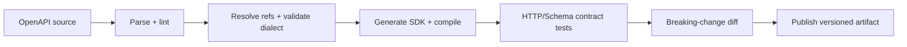

# Chọn phiên bản OpenAPI theo công cụ và khả năng JSON Schema

> **Module:** INTEGRATION_API_REST — thiết kế REST API từ resource, URI, HTTP method/status và hợp đồng dữ liệu; thực hành với Java/Spring, OpenAPI, xác thực, phân quyền, xử lý lỗi và kiểm thử API.  
> **Chương:** Hợp đồng OpenAPI.  
> **Mục tiêu:** Biết chọn **OpenAPI 3.0.x, 3.1.x hoặc 3.2.x** dựa trên **khả năng của chuỗi công cụ và nhu cầu JSON Schema**, thay vì chỉ đổi số phiên bản ở đầu tệp YAML.

## 1. Tình huống: hợp đồng hợp lệ nhưng SDK đọc sai

Một nhóm cung cấp REST API quản lý đơn hàng:

- Backend Java/Spring tạo tài liệu API.
- Frontend TypeScript sinh client từ OpenAPI.
- QA dùng validator và mock server để kiểm tra request/response.
- Đối tác nhập tài liệu vào API gateway, portal hoặc công cụ sinh SDK riêng.

Nhóm muốn mô tả trường `note` có thể là chuỗi hoặc `null`, và ràng buộc rằng khi `paymentType` bằng `CARD` thì `cardToken` là bắt buộc. Họ đổi:

```yaml
openapi: 3.0.3
```

thành:

```yaml
openapi: 3.1.2
```

rồi dùng `type: [string, "null"]` cùng `if/then`. Tài liệu có thể đúng theo OpenAPI 3.1, nhưng một generator cũ vẫn đọc bằng parser 3.0, bỏ qua điều kiện hoặc sinh kiểu dữ liệu không đúng. Kết quả: **schema đúng theo tiêu chuẩn nhưng chuỗi công cụ không hỗ trợ trọn vẹn**.

Lựa chọn phiên bản vì thế là một quyết định kỹ thuật của **toàn bộ hệ sinh thái tích hợp**, không chỉ của người viết YAML.

**Sau bài học, bạn có thể:**

1. Phân biệt phiên bản **đặc tả OpenAPI** với phiên bản **API nghiệp vụ**.
2. So sánh chính xác Schema Object của OpenAPI 3.0 với **JSON Schema Draft 2020-12** trong 3.1/3.2.
3. Chọn phiên bản từ ma trận hỗ trợ của editor, parser, generator, validator, UI, gateway và Spring.
4. Thiết kế hợp đồng HTTP có schema, response, security và lỗi đúng phiên bản.
5. Thực hiện migration, kiểm thử tính tương thích và chống **contract drift**.

## 2. Ba nhánh phiên bản và ý nghĩa thực tế

Tính đến **18/11/2026**, đặc tả chính thức liệt kê các bản vá mới nhất của ba nhánh là **3.0.4**, **3.1.2** và **3.2.1**. Bản 3.2.1 được công bố ngày 10/09/2026. Đây là thông tin về **đặc tả**, không phải khẳng định mọi công cụ đã hỗ trợ 3.2.1.

| Nhánh | Schema Object | Điểm mạnh | Lưu ý lựa chọn |
|---|---|---|---|
| **OAS 3.0.x** | Biến thể giới hạn của JSON Schema, **không phải** Draft 2020-12 đầy đủ | Chuỗi công cụ cũ có thể hỗ trợ tốt hơn | `nullable` riêng; hạn chế keyword JSON Schema hiện đại |
| **OAS 3.1.x** | Tương thích **JSON Schema Draft 2020-12**, có OpenAPI dialect | `type` nhiều giá trị, `if/then/else`, `const`, `unevaluatedProperties`, `$schema` | Phải kiểm tra generator/validator có thực sự áp dụng keyword |
| **OAS 3.2.x** | Tiếp tục dựa trên Draft 2020-12 và dialect OAS 3.2 | Bổ sung khả năng như method `QUERY`, mô tả streaming bằng `itemSchema`, nâng cấp tags và URI resolution | Hỗ trợ tool có thể chưa đồng đều; chỉ dùng tính năng mới nếu toàn chuỗi chấp nhận |

Không nên suy ra “OAS 3.0 lỗi thời nên bị cấm dùng”. Một doanh nghiệp có các hệ thống đối tác phụ thuộc generator 3.0 vẫn có thể chủ động giữ 3.0.x trong giai đoạn chuyển tiếp. Ngược lại, khi cần schema chính xác và toolchain hỗ trợ đầy đủ, **3.1.x là điểm cân bằng tốt**; chọn 3.2.x nếu có lợi ích cụ thể và đã kiểm thử hỗ trợ.

### 2.1. `openapi` khác `info.version` và URL `/v1`

```yaml
openapi: 3.1.2
info:
  title: Orders API
  version: 2.4.0
servers:
  - url: https://api.example.com/v1
```

Ba giá trị **khác mục đích**:

- `openapi: 3.1.2`: phiên bản **ngôn ngữ đặc tả** để tool hiểu cú pháp.
- `info.version: 2.4.0`: phiên bản **mô tả/API** do nhóm quản lý, không bị ràng buộc phải theo OAS.
- `/v1`: một chiến lược **versioning URI** của API đang chạy, không được quyết định tự động bởi hai giá trị trên.

Bạn có thể nâng từ OAS 3.0 sang 3.1 **mà không đổi HTTP endpoints**, nếu hợp đồng wire và code sinh ra vẫn tương thích. Ngược lại, đổi kiểu trường từ string sang integer có thể là breaking change của API dù `openapi` vẫn giữ 3.1.2.

## 3. JSON Schema là yếu tố phân định lớn nhất

### 3.1. OAS 3.0: không thể đưa mọi keyword JSON Schema vào Schema Object

Trong OAS 3.0, kiểu nullable phổ biến được mô tả:

```yaml
# Schema Object hợp lệ cho OpenAPI 3.0
type: string
nullable: true
maxLength: 200
```

`nullable` là keyword riêng của OAS 3.0 và cần chú ý cách nó tương tác với `type`. Không được mặc định validator JSON Schema Draft 2020-12 nguyên bản sẽ diễn giải `nullable: true` như một ràng buộc chuẩn; nhiều validator thuần JSON Schema sẽ coi nó là keyword không biết.

OAS 3.0 cũng có cú pháp `exclusiveMinimum` dạng boolean đi kèm `minimum`:

```yaml
type: number
minimum: 0
exclusiveMinimum: true
```

Nếu lấy cấu trúc này đặt trong Schema Object 3.1, bạn đã trộn hai dialect không tương thích. Chỉ đổi dòng `openapi` mà không đổi schema sẽ tạo lỗi hoặc ngữ nghĩa sai.

### 3.2. OAS 3.1: đồng bộ với Draft 2020-12

Trong 3.1, trường có thể là chuỗi hoặc null:

```yaml
type:
  - string
  - "null"
maxLength: 200
```

Giới hạn lớn hơn 0 được mô tả trực tiếp:

```yaml
type: number
exclusiveMinimum: 0
```

Với kiểu dữ liệu có điều kiện:

```yaml
type: object
required: [paymentType]
properties:
  paymentType:
    type: string
    enum: [CARD, BANK_TRANSFER]
  cardToken:
    type: string
    minLength: 1
if:
  properties:
    paymentType:
      const: CARD
  required: [paymentType]
then:
  required: [cardToken]
```

Ý nghĩa: khi `paymentType = CARD` thì `cardToken` bắt buộc. Chú ý `if/then` là quy tắc JSON Schema, **không** khiến Spring/Jackson/Bean Validation tự động thực thi ràng buộc đó; cần validator hỗ trợ, business validation hoặc test riêng.

Một số keyword bạn có thể dùng theo Draft 2020-12 gồm `const`, `if`/`then`/`else`, `dependentRequired`, `prefixItems`, `contains`, `unevaluatedProperties` và `$defs`. Tuy nhiên, hỗ trợ **cú pháp** của công cụ chưa chắc đồng nghĩa hỗ trợ **đúng nghĩa validation**.

### 3.3. Schema examples khác Media Type examples

Trong Schema Object 3.0 thường thấy:

```yaml
# OAS 3.0
type: string
example: "Giao buổi sáng"
```

Với Schema Object 3.1/3.2, nên dùng keyword JSON Schema:

```yaml
# OAS 3.1+
type: string
examples:
  - "Giao buổi sáng"
  - "Để ở quầy lễ tân"
```

Đừng chuyển **mọi** `example` thành `examples` một cách mù quáng. `Media Type Object` và `Parameter Object` có trường `example`/`examples` theo cấu trúc OpenAPI riêng. Vị trí của keyword quyết định cú pháp đúng.

### 3.4. `required` và `null` là hai khái niệm độc lập

Đây là nguồn lỗi khá thường gặp khi chuyển từ Java record/DTO sang OpenAPI.

```yaml
type: object
required: [orderId]
properties:
  orderId:
    type: string
  note:
    type: [string, "null"]
```

- `orderId` **phải xuất hiện**, và phải là string.
- `note` có thể **không xuất hiện**; nếu xuất hiện, được phép là string hoặc null.
- Muốn `note` phải xuất hiện nhưng được phép null, thêm `note` vào `required`.
- Dùng `type: [string, "null"]` không tự thêm một trường vào `required`.

Phân biệt này quan trọng với Java: `@NotNull`, `Optional<T>`, Jackson property inclusion và trường nullable trong database không tương đương nhau 1:1.

## 4. Dialect, `$schema` và tham chiếu bên ngoài

Từ OAS 3.1, `Schema Object` sử dụng một **JSON Schema dialect**. Mặc định của 3.1 là `https://spec.openapis.org/oas/3.1/dialect/base`; OAS 3.2 dùng dialect thuộc nhánh `/oas/3.2/dialect/...` theo schema iteration tương ứng. Trường `jsonSchemaDialect` ở cấp OpenAPI đặt mặc định; `$schema` tại **schema resource root** có thể chỉ định dialect riêng.

```yaml
openapi: 3.1.2
jsonSchemaDialect: https://spec.openapis.org/oas/3.1/dialect/base
info:
  title: Orders API
  version: 1.0.0
paths: {}
components:
  schemas:
    Order:
      type: object
      properties:
        id:
          type: string
```

Nếu không khai báo, công cụ OAS-aware dùng dialect mặc định của nhánh đặc tả. Không đặt URI 3.1 vào 3.2 chỉ vì copy template cũ, và không giả định mọi JSON Schema engine đều hiểu các keyword mở rộng OpenAPI.

Với tham chiếu:

```yaml
customer:
  $ref: "./schemas/customer.yaml"
```

cần kiểm tra **base URI**, JSON Pointer, `$id`/`$anchor`, dialect và khả năng bundle. `$ref` trong **Schema Object** 3.1+ tuân quy tắc JSON Schema; `Reference Object` ở các vị trí OpenAPI khác có quy tắc riêng, kể cả sibling fields.

**Bảo mật:** resolver tải remote `$ref` có thể gây SSRF hoặc đọc tệp ngoài ý muốn. Dùng local refs/allowlist, pin phiên bản phụ thuộc và hạn chế quyền mạng, filesystem của CI. Đừng dùng `$schema` để giả vờ một parser cũ đã hỗ trợ keyword mới.

## 5. OAS 3.2 bổ sung gì và khi nào đáng dùng?

Nhánh **3.2.x** không bỏ nền tảng JSON Schema Draft 2020-12 của 3.1, nhưng mở rộng những khả năng mô tả HTTP mới, ví dụ:

- Khả năng mô tả HTTP method **`QUERY`** trong Path Item.
- `additionalOperations` cho một số HTTP method không có field tên riêng.
- Mô hình tag phong phú hơn như `summary`, `parent`, `kind`.
- `itemSchema` để mô tả **từng item của luồng dữ liệu tuần tự** thay vì bắt toàn bộ stream thành một tài liệu JSON duy nhất.
- Cải thiện cách định danh tài liệu và phân giải URI, với field cấp cao `$self`.

Ví dụ mô tả response sự kiện theo item stream **chỉ dùng khi công cụ hỗ trợ OAS 3.2**:

```yaml
openapi: 3.2.1
info:
  title: Order Events API
  version: 1.0.0
paths:
  /api/orders/events:
    get:
      responses:
        "200":
          description: Dòng sự kiện đơn hàng
          content:
            text/event-stream:
              itemSchema:
                type: object
                required: [orderId, status]
                properties:
                  orderId:
                    type: string
                  status:
                    type: string
```

Trong triển khai thật, còn cần mô tả cú pháp SSE, event metadata, xác thực, reconnect, `Last-Event-ID` và cách parse từng event. Ví dụ chỉ minh họa điểm khác về **khả năng mô tả stream**.

Cẩn trọng: OAS 3.2 mô tả được method `QUERY` **không có nghĩa** tất cả browser, gateway, load balancer hay SDK đã hỗ trợ vận chuyển method đó. Nếu hệ thống không dùng tính năng 3.2, nâng phiên bản chỉ vì nó mới nhất thường không mang lại lợi ích tương xứng với rủi ro tool compatibility.

## 6. Ma trận chọn phiên bản theo công cụ

Chọn theo **phiên bản cụ thể** của mọi thành phần đang dùng, không chỉ theo lời quảng cáo “supports OpenAPI”.

| Thành phần | Phép thử quyết định |
|---|---|
| Editor/parser/bundler | Đọc đúng minor version, resolve `$ref` và không đánh rơi schema constraints |
| JSON Schema validator | Thực thi `type: [string, "null"]`, `if/then`, `unevaluatedProperties` |
| Java/TypeScript generator | Sinh kiểu null/enum/union đúng; code biên dịch và chạy |
| Swagger UI/portal | Hiển thị required, auth, examples và response đúng |
| Gateway/Spring exporter | Import/export không làm biến đổi method/schema, triển khai được |
| Diff tool/đối tác | Bắt breaking changes và tiêu thụ được artifact đã xuất bản |

### 6.1. “Canary contract” để phát hiện hỗ trợ giả

```yaml
openapi: 3.1.2
info: {title: Schema Canary, version: 1.0.0}
paths: {}
components:
  schemas:
    Canary:
      type: object
      required: [kind]
      properties:
        kind: {type: string, enum: [A, B]}
        note: {type: [string, "null"]}
        code: {type: string}
      if:
        properties:
          kind: {const: A}
        required: [kind]
      then:
        required: [code]
      unevaluatedProperties: false
```

Kỳ vọng validator: `{"kind":"B","note":null}` **pass**; `{"kind":"A"}` **fail** (thiếu code); `{"kind":"B","extra":1}` **fail** (field dư); `{"kind":"B","note":1}` **fail** (kiểu sai). Parser chỉ mở được YAML **chưa đủ**. Hãy sinh SDK, compile và chạy cùng bộ mẫu.

**Ra quyết định:** giữ 3.0.x khi đối tác chỉ có tool 3.0; chọn 3.1.x khi cần JSON Schema 2020-12 và chuỗi công cụ đã qua test; chọn 3.2.x khi cần khả năng như streaming/itemSchema hoặc QUERY **và đã kiểm chứng end-to-end**. Nếu phải xuất bản artifact tương thích cho đối tác cũ, chuyển đổi có kiểm chứng; không âm thầm bỏ ràng buộc để hạ phiên bản.

## 7. Hợp đồng OpenAPI 3.1 cho một REST API

Ví dụ `POST /api/orders` mô tả status, header, dữ liệu, lỗi và bảo mật Bearer. Đây là contract minh họa, không phải response đã chạy:

```yaml
openapi: 3.1.2
info: {title: Orders API, version: 1.0.0}
servers:
  - url: https://api.example.com
security:
  - bearerAuth: []
paths:
  /api/orders:
    post:
      operationId: createOrder
      parameters:
        - name: Idempotency-Key
          in: header
          required: true
          schema: {type: string, minLength: 16}
      requestBody:
        required: true
        content:
          application/json:
            schema:
              $ref: "#/components/schemas/CreateOrder"
      responses:
        "201":
          description: Đã tạo đơn
          headers:
            Location:
              schema: {type: string}
          content:
            application/json:
              schema:
                $ref: "#/components/schemas/Order"
        "400":
          description: Request không hợp lệ
          content:
            application/problem+json:
              schema: {$ref: "#/components/schemas/Problem"}
        "401": {description: Chưa xác thực}
        "403": {description: Không đủ quyền}
        "409": {description: Xung đột nghiệp vụ hoặc idempotency}
components:
  securitySchemes:
    bearerAuth: {type: http, scheme: bearer, bearerFormat: JWT}
  schemas:
    CreateOrder:
      type: object
      required: [customerId, quantity]
      properties:
        customerId: {type: string, minLength: 1}
        quantity: {type: integer, minimum: 1}
      additionalProperties: false
    Order:
      type: object
      required: [id, customerId, quantity]
      properties:
        id: {type: string}
        customerId: {type: string}
        quantity: {type: integer}
        note: {type: [string, "null"]}
    Problem:
      type: object
      required: [type, title, status]
      properties:
        type: {type: string, format: uri-reference}
        title: {type: string}
        status: {type: integer}
        detail: {type: string}
```

HTTP thực phải khớp:

```http
POST /api/orders HTTP/1.1
Authorization: Bearer <token>
Idempotency-Key: 018fd6e7-4cd8-7a10-a2de-912d8221e4ae
Content-Type: application/json

{"customerId":"cus-17","quantity":2}
```

```http
HTTP/1.1 201 Created
Location: /api/orders/ord-901
Content-Type: application/json

{"id":"ord-901","customerId":"cus-17","quantity":2,"note":null}
```

`bearerFormat` chỉ là metadata; Spring Security vẫn phải xác thực và phân quyền. `Problem` không tự tạo handler. `additionalProperties: false` là ràng buộc hợp đồng, cần validator/runtime tương ứng. `note` cho phép **vắng hoặc null**; `Idempotency-Key` đòi service lưu kết quả theo scope/TTL, không chỉ nhận header.

## 8. Java/Spring: sinh OpenAPI từ code có đủ không?

Spring Boot có thể tạo OpenAPI từ controller và annotation bằng hệ sinh thái `springdoc-openapi` hoặc công cụ tương đương. **Khả năng xuất OAS 3.1/3.2 phụ thuộc phiên bản thật**; phải kiểm tra artifact mà build tạo.

```java
import jakarta.validation.Valid;
import jakarta.validation.constraints.Min;
import jakarta.validation.constraints.NotBlank;
import org.springframework.http.ResponseEntity;
import org.springframework.web.bind.annotation.*;
import java.net.URI;

record CreateOrderRequest(@NotBlank String customerId,
                          @Min(1) int quantity) {}
record OrderResponse(String id, String customerId,
                     int quantity, String note) {}

@RestController
@RequestMapping("/api/orders")
class OrderController {
    private final OrderService service;

    OrderController(OrderService service) { this.service = service; }

    @PostMapping
    ResponseEntity<OrderResponse> create(
            @RequestHeader("Idempotency-Key") String key,
            @Valid @RequestBody CreateOrderRequest request) {
        String tenant = CurrentTenant.required();
        OrderResponse order = service.create(tenant, key, request);
        return ResponseEntity.created(
            URI.create("/api/orders/" + order.id())).body(order);
    }
}
```

`OrderService` và `CurrentTenant` do dự án định nghĩa. Cấu hình Spring Security, idempotency store và exception handler **không** xuất hiện chỉ nhờ annotations.

Kiểm tra generated spec có: `quantity.minimum=1`, `customerId` required, `note` nullable đúng dialect, `Idempotency-Key` bắt buộc, `201 + Location`, lỗi `400/409` và security. Đặc biệt `String note` trong Java không tự nói rõ null hay field vắng; phải công bố và test Jackson/annotations.

**Code-first:** nhanh, nhưng dễ thiếu domain constraints và lỗi HTTP. **Contract-first:** thống nhất trước với consumer, nhưng runtime có thể lệch. Cách kết hợp tốt là xác định **một nguồn chân lý**, rồi so generated artifact, contract tests và kiểm tra breaking changes trong CI.

## 9. JSON Schema validator không phải toàn bộ HTTP validator

Một contract cần ít nhất **ba tầng kiểm tra**:

1. **Cấu trúc OpenAPI:** `openapi`, `paths`, `components`, reference, security fields, response status có đúng đặc tả không?
2. **Schema của payload:** body JSON có tuân `type`, `required`, `if/then`, `format` và những constraint đã hỗ trợ không?
3. **Giao thức/nghiệp vụ:** HTTP method/status, header, quyền tenant, idempotency, concurrency, trạng thái resource có được thực thi không?

Ví dụ JSON Schema 3.1 có thể mô tả:

```yaml
type: object
properties:
  email:
    type: string
    format: email
required: [email]
```

Nhưng với JSON Schema Draft 2020-12, `format` thường là **annotation** trong dialect mặc định; việc có **assert** format hay không tùy cấu hình/capability của validator. Vì vậy, đừng chỉ nhìn thấy `format: email` rồi khẳng định mọi runtime sẽ từ chối chuỗi `"not-email"`.

Tương tự, `readOnly` và `writeOnly` là metadata có ý nghĩa theo ngữ cảnh request/response; validator JSON Schema thuần chưa chắc tự phân biệt các ngữ cảnh này.

### 9.1. Một test mang giá trị hơn lời cam kết “supports 3.1”

Cho canary ở mục 6:

| Payload | Kỳ vọng |
|---|---|
| `{"kind":"A","code":"x"}` | Pass |
| `{"kind":"A"}` | Fail vì thiếu `code` |
| `{"kind":"B","note":null}` | Pass |
| `{"kind":"B","note":23}` | Fail kiểu dữ liệu |
| `{"kind":"B","extra":1}` | Fail khi `unevaluatedProperties: false` |

Nếu một validator trả Pass cho tất cả, có thể nó chỉ parse tài liệu mà **không thực hiện validation** cho keyword hiện đại. Ghi rõ phạm vi kiểm tra và không dùng validator đó làm lớp bảo vệ runtime duy nhất.

## 10. Bảo mật khi mô tả và dùng OpenAPI

```yaml
components:
  securitySchemes:
    bearerAuth:
      type: http
      scheme: bearer
      bearerFormat: JWT
security:
  - bearerAuth: []
```

Đây là **mô tả** auth. Spring Security vẫn phải kiểm tra chữ ký, issuer/audience/expiry và quyền tenant/resource. `security: [{a: [], b: []}]` thể hiện **AND**; `security: [{a: []}, {b: []}]` thể hiện **OR**. Override `security: []` cho endpoint công khai chỉ sau khi review.

Các rủi ro cần chặn:

- **Schema không được thực thi:** `additionalProperties: false` trong contract nhưng Jackson âm thầm bỏ field lạ; kiểm tra runtime và test payload xấu.
- **Polymorphic deserialization:** `oneOf`/`discriminator` không cho phép client tùy chọn Java class name; dùng mapping allowlist.
- **Lộ thông tin:** không đưa token thật, PII, server nội bộ, admin route hoặc secret vào examples/UI công khai.
- **“Try it out”:** không để thao tác POST/PATCH trong docs gây thay đổi production không kiểm soát.
- **Remote `$ref`:** hạn chế mạng/file của resolver để giảm SSRF và supply-chain risk.
- **Public/private docs:** công bố theo audience, nhưng endpoint thật phải có AuthN/AuthZ dù tài liệu bị ẩn.

## 11. Kiểm thử và CI: chứng minh toolchain thực sự tương thích

Pipeline gợi ý:



### 11.1. MockMvc kiểm tra HTTP ngoài việc lint YAML

```java
@SpringBootTest
@AutoConfigureMockMvc
class OrderContractTest {
    @Autowired MockMvc mvc;

    @Test
    void rejectsQuantityZero() throws Exception {
        mvc.perform(post("/api/orders")
                .header("Idempotency-Key",
                    "018fd6e7-4cd8-7a10-a2de-912d8221e4ae")
                .contentType(MediaType.APPLICATION_JSON)
                .content("{\"customerId\":\"cus-17\",\"quantity\":0}"))
            .andExpect(status().isBadRequest());
    }

    @Test
    void createsOrderWithLocation() throws Exception {
        mvc.perform(post("/api/orders")
                .header("Idempotency-Key",
                    "2aeae349-6676-4d89-b9df-198d4cfa120c")
                .contentType(MediaType.APPLICATION_JSON)
                .content("{\"customerId\":\"cus-17\",\"quantity\":2}"))
            .andExpect(status().isCreated())
            .andExpect(header().exists("Location"))
            .andExpect(jsonPath("$.id").isString());
    }
}
```

Test là mẫu, **chưa chạy**. Cần principal/tenant giả lập, DB fixture, service và handler phản hồi lỗi. Chạy thêm test contract với validator **đúng dialect**, không chỉ Bean Validation.

| Test | Bằng chứng |
|---|---|
| OAS-01 | Parser đọc nhánh OAS đã chọn, resolve `$ref` không mất constraint |
| OAS-02 | Null/conditional/extra-field payload đúng/sai được phân biệt |
| OAS-03 | Java + TypeScript SDK compile; union/nullable/enums đúng |
| OAS-04 | Spring trả status/body/header đúng; 201 có Location |
| OAS-05 | Không auth/khác tenant bị từ chối, Problem Details đúng |
| OAS-06 | UI/gateway import và gọi endpoint thành công |
| OAS-07 | Diff bắt thêm required, đổi type, xóa endpoint/status |
| OAS-08 | Nếu dùng 3.2, streaming/QUERY được kiểm tra end-to-end |

**Breaking changes** có thể gồm: thêm field bắt buộc cho request, đổi kiểu response, xóa status/endpoint, siết enum/`additionalProperties` hoặc thay security. Thay description/examples thường không phá wire contract. Diff tool chỉ là bộ lọc; vẫn cần review ngữ nghĩa nghiệp vụ.

## 12. Lộ trình nâng từ 3.0 lên 3.1, rồi cân nhắc 3.2

### 12.1. Trước khi đổi dòng version

1. **Chốt đầu ra cần tương thích:** UI/portal, gateway, generator SDK, validator, code exporters và các đối tác.
2. **Pin versions** của từng tool cùng container/runtime trong CI.
3. Tạo canary schema chứa đúng những keyword dự định dùng.
4. Chạy parse, generate, compile, validator negative tests và contract tests.
5. Chọn thời điểm phát hành artifact mới; giữ bản cũ nếu đối tác còn phụ thuộc.

### 12.2. Những thay đổi schema cần rà soát khi 3.0 → 3.1

| OAS 3.0 | OAS 3.1+ | Vì sao |
|---|---|---|
| `type: string` + `nullable: true` | `type: [string, "null"]` | Dùng union type chuẩn JSON Schema |
| `minimum: 0` + `exclusiveMinimum: true` | `exclusiveMinimum: 0` | Keyword nhận giá trị số |
| Schema `example: x` | Schema `examples: [x]` | Theo JSON Schema, không nhầm vị trí Media Type |
| `type: string` + `format: binary` cho raw bytes | Mô tả media type binary thích hợp, thường không cần schema `format: binary` | Tách binary HTTP representation khỏi JSON string |
| Sử dụng keyword ngoài OAS 3.0 không được hỗ trợ | `if/then/else`, `const`, `unevaluatedProperties` nếu toolchain hỗ trợ | Validation giàu biểu đạt hơn |
| Không có `jsonSchemaDialect` | Có thể khai báo `jsonSchemaDialect`/`$schema` ở root thích hợp | Xác định dialect rõ ràng |

Nếu dự án có `$ref` kèm `nullable` trong OAS 3.0, đừng tìm–thay đơn giản. Cần xác định constraint thực tế và chuyển sang `anyOf` hoặc union type đúng ngữ nghĩa.

Với **binary/multipart**, cần kiểm tra lại ví dụ, `encoding`, media type, SDK generator và cách serialize; không tự động coi `contentEncoding` là lệnh đổi cách truyền bytes ở HTTP.

### 12.3. 3.1 → 3.2: chỉ khi có yêu cầu cụ thể

Nếu không dùng feature 3.2, việc nâng chỉ nên thực hiện sau khi toàn bộ toolchain xác nhận tương thích. Với streaming hoặc HTTP QUERY, test end-to-end trên gateway/proxy, SDK và runtime trước khi công bố. Không phải cứ thêm `openapi: 3.2.1` là có thể gửi HTTP QUERY qua mọi môi trường.

Cần **rollback plan**: giữ artifact/SDK đã phát hành, có thể quay lại mô tả 3.1 tương thích nếu đối tác chưa sẵn sàng. Không để pipeline tự “downgrade” 3.2 sang 3.0 bằng cách âm thầm bỏ keyword.

## 13. Bài tập thực hành

### Bài A — Chọn phiên bản có lý do

Ba dự án: **A** có gateway chỉ nhận 3.0, schema đơn giản; **B** cần `if/then` và mọi validator/SDK hỗ trợ 2020-12; **C** cần `itemSchema` cho luồng sự kiện và đã thử OAS 3.2 end-to-end. Chọn phiên bản, nêu rủi ro và **bằng chứng từ toolchain** cho từng dự án.

### Bài B — Sửa schema trộn dialect

```yaml
openapi: 3.1.2
info: {title: Mixed, version: 1.0.0}
paths: {}
components:
  schemas:
    Price:
      type: number
      minimum: 0
      exclusiveMinimum: true
    Note:
      type: string
      nullable: true
      example: "Giao chiều mai"
```

Đổi sang cú pháp OAS 3.1, tạo các payload pass/fail và chỉ ra sự khác nhau giữa schema examples với media type examples.

### Bài C — Kiểm thử Spring và generated SDK

Thiết kế `POST /api/orders` có Bearer auth, `Idempotency-Key`, `201 + Location` và lỗi `400/409`. Viết ít nhất sáu tests: không auth, sai tenant, thiếu key, quantity 0, tạo đúng, retry cùng key. Sau đó thử hai generator/validator với canary `type: [string, "null"]` và `if/then`; ghi nhận trường hợp tool parse được nhưng không enforce.

## 14. Checklist trước khi chốt phiên bản

- [ ] Phân biệt `openapi`, `info.version` và version URI của API.
- [ ] Có danh sách **phiên bản công cụ thật**: parser, editor, UI, generator, validator, gateway, Spring exporter.
- [ ] Canary chứng minh tính năng JSON Schema cần dùng, không chỉ parse thành công.
- [ ] 3.0.x: không dùng tùy ý keyword Draft 2020-12/`$schema` như thể đã được hỗ trợ.
- [ ] 3.1+: nullable, exclusive bounds và schema examples dùng cú pháp đúng dialect.
- [ ] `jsonSchemaDialect`/`$schema` và external refs được giải quyết bằng tool phù hợp, hạn chế SSRF.
- [ ] `format`, `readOnly`/`writeOnly`, `if/then` được runtime thực thi hoặc có validation bổ sung đã test.
- [ ] HTTP method/status, header, request/response, `Location` và Problem Details đúng hợp đồng.
- [ ] Security scheme chỉ mô tả; backend thực thi AuthN/AuthZ/tenant isolation.
- [ ] Generated Java/TypeScript SDK biên dịch và hoạt động với API thật.
- [ ] CI có lint, schema positive/negative tests, contract tests và breaking-change diff.
- [ ] Nếu dùng 3.2, các feature như `itemSchema`/`QUERY` đã được xác minh qua gateway/SDK.
- [ ] Migration có versioned artifacts, kế hoạch chuyển đối tác và rollback.

## 15. Ghi nhớ

**Chọn OpenAPI theo khả năng chuỗi công cụ và nhu cầu mô tả dữ liệu, không phải theo số phiên bản cao nhất.** OAS **3.0.x** hữu ích khi cần tương thích công cụ cũ; **3.1.x** mở ra JSON Schema Draft 2020-12; **3.2.x** thêm mô tả HTTP/streaming nhưng đòi xác minh hỗ trợ thực tế.

Bản YAML hợp lệ **chưa phải** hợp đồng đúng khi triển khai. Muốn đáng tin cậy, hãy test **schema dialect → generator → runtime Spring → HTTP/security → consumer**, dùng những payload hợp lệ và bất hợp lệ cụ thể. Khi chuyển phiên bản, giữ nguyên semantics của API nếu không có thay đổi nghiệp vụ chủ đích, và không âm thầm bỏ ràng buộc schema để công cụ cũ đọc được.

### Tài liệu chính thức để đối chiếu

- [OpenAPI Specification v3.0.4](https://spec.openapis.org/oas/v3.0.4.html)
- [OpenAPI Specification v3.1.2](https://spec.openapis.org/oas/v3.1.2.html)
- [OpenAPI Specification v3.2.1](https://spec.openapis.org/oas/v3.2.1.html)
- [Hướng dẫn nâng từ OpenAPI 3.0 lên 3.1](https://learn.openapis.org/upgrading/v3.0-to-v3.1.html)
- [Hướng dẫn nâng từ OpenAPI 3.1 lên 3.2](https://learn.openapis.org/upgrading/v3.1-to-v3.2.html)
- [JSON Schema Draft 2020-12](https://json-schema.org/draft/2020-12)
