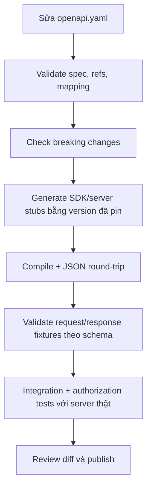

# allOf, oneOf, anyOf, discriminator và giới hạn công cụ sinh mã

## 1. Vấn đề: một API, nhiều kiểu payload

Giả sử API bán hàng nhận yêu cầu hoàn tất đơn theo hai cách: khách nhận tại cửa hàng (`PICKUP`) hoặc giao tới địa chỉ (`SHIP`). Cả hai dùng cùng thao tác nghiệp vụ, nhưng `PICKUP` yêu cầu `storeId` còn `SHIP` yêu cầu `addressId`. Nếu chỉ mô tả một object gồm toàn bộ thuộc tính tùy chọn, client có thể gửi `{"kind":"SHIP","storeId":"store-7"}` rồi tưởng rằng hợp lệ dù thiếu địa chỉ.

OpenAPI mô tả các dạng dữ liệu này bằng `allOf`, `oneOf`, `anyOf` và `discriminator`. Chúng có ngữ nghĩa **kiểm tra dữ liệu** khác nhau. Cách một generator biến schema thành Java class, TypeScript union hoặc server stub **không phải lúc nào cũng giữ đúng** những ngữ nghĩa đó.

Bài thuộc chương **Hợp đồng OpenAPI** trong học phần `INTEGRATION_API_REST`. Nội dung kết nối thiết kế resource, URI, phương thức và mã trạng thái HTTP với hợp đồng dữ liệu, Java/Spring, bảo mật, kiểm thử và khả năng tương thích SDK. Các ví dụ chính dùng **OpenAPI 3.0.3**; điểm khác với 3.1 được nêu riêng.

Sau bài học, bạn có thể:

1. Phân biệt điều kiện **thỏa tất cả**, **thỏa đúng một**, **thỏa ít nhất một** schema.
2. Thiết kế union có tag `kind`, các subtype loại trừ nhau và mapping tường minh.
3. Phân biệt **schema validation**, **JSON deserialization** và **business validation**.
4. Nhận diện lỗi thường gặp của code generator với polymorphism, inheritance, null và thuộc tính lạ.
5. Kiểm thử hợp đồng trên JSON thực, kiểm tra Spring/Jackson, quyền truy cập và compatibility khi mở rộng biến thể.

## 2. Ngữ nghĩa chính xác của ba từ khóa

Coi mỗi schema là **tập hợp những JSON instances được chấp nhận**. Kết quả kết hợp được xác định bằng điều kiện logic, không bằng quy tắc kế thừa của ngôn ngữ lập trình.

| Từ khóa | Điều kiện | Cách diễn giải | Nhu cầu tiêu biểu |
| --- | --- | --- | --- |
| `allOf: [A, B]` | Phải hợp lệ theo **A và B** | Giao các tập | Kết hợp ràng buộc chung/riêng |
| `oneOf: [A, B]` | Phải hợp lệ theo **chính xác một** | Đúng một nhánh | Hai biến thể loại trừ nhau |
| `anyOf: [A, B]` | Phải hợp lệ theo **ít nhất một** | Một hoặc nhiều nhánh | Các tiêu chí có thể cùng xuất hiện |

| Thỏa A? | Thỏa B? | allOf | oneOf | anyOf |
| --- | --- | --- | --- | --- |
| Không | Không | Sai | Sai | Sai |
| Có | Không | Sai | Đúng | Đúng |
| Không | Có | Sai | Đúng | Đúng |
| Có | Có | Đúng | **Sai** | Đúng |

Một `oneOf` có ba nhánh đòi hỏi **đúng một trong ba**, không phải “tối đa một”. Nếu hai nhánh cùng khớp, dữ liệu **không hợp lệ** dù cả hai đều có thể parse thành object Java. `discriminator` giúp chọn subtype nhưng **không sửa được** các ràng buộc logic thiếu chặt.

## 3. allOf: kết hợp constraint, không tự động extends

Một schema chung yêu cầu `kind`, và schema `PickupChoice` cần thêm `storeId`:

```yaml
components:
  schemas:
    FulfillmentBase:
      type: object
      required: [kind]
      properties:
        kind: { type: string }

    PickupChoice:
      allOf:
        - $ref: '#/components/schemas/FulfillmentBase'
        - type: object
          required: [storeId]
          properties:
            kind: { type: string, enum: [PICKUP] }
            storeId: { type: string, minLength: 1 }
```

Instance `{"kind":"PICKUP","storeId":"store-7"}` phải thỏa cả schema base và schema riêng. Các yêu cầu `required` ở hai nơi **cùng có hiệu lực**. Giá trị `enum: [PICKUP]` chỉ hợp lệ khi `kind` đúng `PICKUP`.

**allOf không có nghĩa tự merge JSON** và cũng không bắt buộc generator tạo class `PickupChoice extends FulfillmentBase`. Một generator có thể chọn kế thừa, interface, flattened model hoặc composition. Đó là chiến lược của công cụ, không phải semantics của OpenAPI. Hai constraint có thể mâu thuẫn và khiến không một instance nào thỏa, ví dụ vừa yêu cầu một trường string vừa yêu cầu trường ấy là number.

### Bẫy additionalProperties: false

Nếu đặt `additionalProperties: false` trong `FulfillmentBase`, khi base chỉ khai báo `kind` thì `storeId` có thể bị coi là thuộc tính lạ **ngay lúc đánh giá schema base**. Từ khóa ấy không tự nhìn qua các nhánh `allOf` để cộng dồn mọi field được khai báo ở nơi khác.

Trong OpenAPI 3.0, nên cân nhắc giữ schema base mở, hoặc mô tả schema phẳng/đặt kiểm soát unknown field ở validator hiểu toàn bộ representation. OpenAPI 3.1/JSON Schema 2020-12 có `unevaluatedProperties` để xử lý một số bài toán composition, nhưng cần kiểm tra công cụ hỗ trợ thực tế.

## 4. oneOf: một trong các lựa chọn hoàn tất đơn

Endpoint `POST /orders/{id}/fulfillment-requests` có cùng mục đích ở mức resource, nhận một trong hai kiểu:

```http
POST /orders/ord-42/fulfillment-requests HTTP/1.1
Host: api.example.test
Authorization: Bearer <access-token>
Content-Type: application/json

{"kind":"PICKUP","storeId":"store-7"}
```

Hoặc:

```json
{"kind":"SHIP","addressId":"addr-81","deliveryNote":"Giao sau 17 giờ"}
```

### OpenAPI 3.0.3 đầy đủ cho union

```yaml
openapi: 3.0.3
info:
  title: Orders API
  version: 1.0.0
paths:
  /orders/{id}/fulfillment-requests:
    post:
      summary: Chọn cách hoàn tất đơn
      operationId: createFulfillmentRequest
      parameters:
        - name: id
          in: path
          required: true
          schema: { type: string }
      requestBody:
        required: true
        content:
          application/json:
            schema:
              $ref: '#/components/schemas/FulfillmentChoice'
      responses:
        '201':
          description: Đã tạo resource yêu cầu
          headers:
            Location:
              schema: { type: string }
        '400': { description: JSON sai cú pháp }
        '401': { description: Chưa xác thực }
        '403': { description: Không có quyền }
        '409': { description: Trạng thái đơn không cho phép thao tác }
        '422': { description: Nội dung không phù hợp schema/nghiệp vụ }
components:
  schemas:
    FulfillmentChoice:
      oneOf:
        - $ref: '#/components/schemas/PickupChoice'
        - $ref: '#/components/schemas/ShipChoice'
      discriminator:
        propertyName: kind
        mapping:
          PICKUP: '#/components/schemas/PickupChoice'
          SHIP: '#/components/schemas/ShipChoice'

    FulfillmentBase:
      type: object
      required: [kind]
      properties:
        kind: { type: string }

    PickupChoice:
      allOf:
        - $ref: '#/components/schemas/FulfillmentBase'
        - type: object
          required: [storeId]
          properties:
            kind: { type: string, enum: [PICKUP] }
            storeId: { type: string, minLength: 1 }

    ShipChoice:
      allOf:
        - $ref: '#/components/schemas/FulfillmentBase'
        - type: object
          required: [addressId]
          properties:
            kind: { type: string, enum: [SHIP] }
            addressId: { type: string, minLength: 1 }
            deliveryNote: { type: string, maxLength: 200 }
```

**Giải thích sự kết hợp:**

- `FulfillmentChoice.oneOf` yêu cầu request khớp đúng một schema cụ thể.
- `FulfillmentBase` tái sử dụng điều kiện `kind` bắt buộc.
- `PickupChoice` và `ShipChoice` ràng buộc tag bằng **enum khác nhau**, nên không thể cùng thỏa dù payload có cả `storeId` và `addressId`.
- `discriminator.mapping` chỉ rõ wire value `PICKUP/SHIP` tới schema tương ứng, không phụ thuộc tên class do generator đặt.

**Hạn chế quan trọng:** hai nhánh chưa cấm thuộc tính dư. Payload `{"kind":"PICKUP","storeId":"s1","addressId":"addr-x"}` vẫn có thể hợp lệ theo schema PICKUP, vì không có ràng buộc từ chối `addressId`. Nếu contract muốn loại field lạ, phải bổ sung policy/schema đúng chỗ và kiểm thử thực sự. `oneOf` chỉ giải quyết số nhánh khớp, **không tự thực hiện strict field checking**.

## 5. anyOf: khi nhiều tiêu chí có thể cùng đúng

Giả sử một object truy vấn khách hàng được phép chứa email hoặc số điện thoại **hoặc cả hai**:

```yaml
CustomerLookup:
  type: object
  properties:
    email: { type: string, format: email }
    phone: { type: string, minLength: 6 }
  anyOf:
    - required: [email]
    - required: [phone]
```

| Instance | anyOf hợp lệ? | Lý do |
| --- | --- | --- |
| `{"email":"a@example.test"}` | Có | Thỏa nhánh email |
| `{"phone":"0900000000"}` | Có | Thỏa nhánh phone |
| `{"email":"a@example.test","phone":"0900000000"}` | **Có** | Thỏa cả hai, vẫn đạt ít nhất một |
| `{}` | Không | Không thỏa nhánh nào |

Nếu đổi sang `oneOf`, payload có cả email và phone trở thành **không hợp lệ**. Chọn `anyOf` khi nghiệp vụ thực sự cho phép tổ hợp, không phải để “tránh lỗi validator” của một union cần chính xác một nhánh.

## 6. discriminator là gợi ý phân kiểu, không phải validator thay thế

Trong ví dụ:

```yaml
discriminator:
  propertyName: kind
  mapping:
    PICKUP: '#/components/schemas/PickupChoice'
    SHIP: '#/components/schemas/ShipChoice'
```

`propertyName` xác định trường tag xuất hiện trên wire; `mapping` liên kết giá trị tag với schema. Nên khai báo tag **required**, và ràng buộc đúng giá trị trong từng nhánh bằng `enum` ở OAS 3.0 hoặc cách tương đương.

| Giúp ích | Không tự đảm bảo |
| --- | --- |
| Chỉ dẫn deserializer chọn subtype | Dữ liệu thực sự thỏa schema nhánh |
| Code generator tạo factory/interface/wrapper | Mọi generator sinh cùng kiểu Java/TypeScript |
| Ổn định tag nghiệp vụ trên wire | Tự cấm unknown tag hoặc field thừa |
| Ánh xạ tag sang schema cụ thể | Biến instance khớp hai nhánh thành hợp lệ |

Một deserializer có thể dispatch ngay khi đọc `kind`, nhưng một schema validator độc lập có thể đánh giá **toàn bộ nhánh**. Cả hai phải cho kết quả phù hợp trên các JSON test cases. Payload `{"kind":"SHIP","storeId":"s1"}` không hợp lệ dù thư viện đã tạo được đối tượng kiểu Ship.

### Vì sao mapping tường minh?

Nếu bỏ `mapping`, một số công cụ có thể suy tên schema từ giá trị tag. Việc đổi component name, thay chữ hoa/thường hoặc dùng alias dễ gây lỗi tương thích. Dùng `$ref` tới components có tên và mapping rõ ràng giúp ổn định công cụ; không hứa mọi generator hỗ trợ cùng mức độ.

**allOf không tự đăng ký các subtype.** Một base được tham chiếu bởi nhiều schema con không có nghĩa mọi endpoint tự biết các con đó. Khi một operation nhận union, khai báo danh sách nhánh của nó bằng `oneOf` hoặc `anyOf` ở schema request/response thích hợp.

## 7. oneOf thất bại vì các nhánh chồng lấn

Ví dụ sai về ý định:

```yaml
Identifier:
  oneOf:
    - type: object
      required: [email]
      properties:
        email: { type: string }
    - type: object
      required: [phone]
      properties:
        phone: { type: string }
```

Payload `{"email":"a@example.test","phone":"0900000000"}` thỏa **cả hai** vì mỗi nhánh không cấm field còn lại. Vì `oneOf` đòi đúng một, đây là **payload không hợp lệ**. Không thể “chữa” bằng cách gắn thêm `discriminator` mà không thay đổi ràng buộc của các nhánh.

**Cách xử lý tùy nghiệp vụ:** nếu cho phép cả hai, dùng `anyOf`; nếu phải loại trừ, thiết kế tag bắt buộc với enum riêng; hoặc tách các schema phẳng có điều kiện không đồng thời thỏa. Viết test cho instance khớp **0, 1 và 2 nhánh** — ba trường hợp này phát hiện nhiều lỗi hơn chỉ chạy happy path.

## 8. OpenAPI 3.0 và 3.1 không dùng cùng một JSON Schema dialect

Schema Object của OpenAPI 3.0.x chỉ hỗ trợ một tập từ khóa theo quy định OAS 3.0, **không phải toàn bộ JSON Schema mới**. OpenAPI 3.1 đồng bộ sát hơn với JSON Schema 2020-12 và hỗ trợ thêm từ khóa, nhưng parser, validator và generator vẫn có mức tương thích khác nhau.

| Chủ đề | OpenAPI 3.0.x | OpenAPI 3.1 |
| --- | --- | --- |
| `allOf/oneOf/anyOf` | Có | Có |
| `discriminator` | Tính năng của OpenAPI | Vẫn là phần ngữ nghĩa OpenAPI, không phải keyword JSON Schema |
| Nullable | `nullable: true` khi kết hợp `type` phù hợp | Ví dụ `type: [string, 'null']` |
| `const`, `if/then/else`, `unevaluatedProperties` | Không nằm trong bộ keyword Schema Object chuẩn 3.0 | Có trong JSON Schema dialect tương ứng |
| Codegen | Có nhiều tool lâu năm | Phải kiểm chứng từng keyword/version cụ thể |

Ví dụ trong 3.0 dùng `kind: {type: string, enum: [PICKUP]}`; ở JSON Schema 2020-12 có thể dùng `const: PICKUP`. Không sao chép `nullable`/`type` từ 3.0 sang 3.1 mà không chạy validator. Các trường null, vắng mặt và optional có nghĩa khác nhau, đặc biệt với PATCH và DTO sinh mã.

**Quy tắc nâng cấp:** đổi phiên bản OpenAPI không có nghĩa generator tự tương thích. Cần pin và kiểm tra parser, generator, Java/Jackson, TypeScript SDK, schema validator và các JSON test cases trước khi phát hành.

## 9. HTTP contract: schema đúng chưa chắc thao tác hợp lệ

Một request có thể là JSON hợp lệ về cú pháp nhưng không phù hợp schema:

```http
POST /orders/ord-42/fulfillment-requests HTTP/1.1
Host: api.example.test
Content-Type: application/json
Authorization: Bearer <access-token>

{"kind":"SHIP","storeId":"store-7"}
```

Payload không khớp `ShipChoice` vì thiếu `addressId`, cũng không khớp `PickupChoice` vì tag không phải `PICKUP`. Nếu API chọn 422 cho lỗi validation:

```http
HTTP/1.1 422 Unprocessable Content
Content-Type: application/problem+json
Cache-Control: no-store

{
  "type": "https://api.example.test/problems/invalid-fulfillment-choice",
  "title": "Lựa chọn hoàn tất đơn không hợp lệ",
  "status": 422,
  "code": "fulfillment.invalid_choice",
  "errors": [
    {
      "pointer": "/addressId",
      "code": "required",
      "message": "Cần địa chỉ giao hàng khi kind là SHIP"
    }
  ]
}
```

`errors` và `code` là extensions riêng của API theo RFC 9457; chuẩn Problem Details không bắt buộc một định dạng lỗi từng trường. Validator `oneOf` đôi khi chỉ trả “không khớp chính xác một schema”; tầng API nên ánh xạ lỗi có ý nghĩa nhưng không rò thông tin nội bộ.

| Tình huống | Status thường phù hợp | Điểm phân biệt |
| --- | --- | --- |
| JSON sai cú pháp | `400 Bad Request` | Parser không tạo được JSON |
| Sai `Content-Type` request | `415 Unsupported Media Type` | Không hỗ trợ media type gửi lên |
| JSON parse được nhưng vi phạm `oneOf`/validation | `422 Unprocessable Content` nếu hợp đồng chọn | Không đạt shape/semantics đã công bố |
| Đơn đã giao, không thể thay cách nhận | `409 Conflict` | Xung đột trạng thái nghiệp vụ |
| Caller không được thao tác trên order/address | `403` hoặc `404` theo chính sách | Authorization khác schema |
| Caller không có thông tin xác thực | `401 Unauthorized` | Xác thực độc lập với polymorphism |

Không bắt buộc mọi API chọn 422 thay vì 400 cho validation. Hãy thống nhất mã lỗi, tài liệu hóa và kiểm thử. Một class cast exception từ generated model **không** nên biến payload do client sai thành 500.

## 10. Java/Spring: kiểu đa hình có kiểm soát

Java không có union type trực tiếp như TypeScript. Với Java 17+, một cách chủ động biểu diễn hai biến thể là **sealed interface + record** và Jackson polymorphic deserialization.

```java
import com.fasterxml.jackson.annotation.JsonSubTypes;
import com.fasterxml.jackson.annotation.JsonTypeInfo;
import jakarta.validation.constraints.NotBlank;
import jakarta.validation.constraints.Size;

@JsonTypeInfo(
    use = JsonTypeInfo.Id.NAME,
    include = JsonTypeInfo.As.PROPERTY,
    property = "kind"
)
@JsonSubTypes({
    @JsonSubTypes.Type(value = PickupChoice.class, name = "PICKUP"),
    @JsonSubTypes.Type(value = ShipChoice.class, name = "SHIP")
})
sealed interface FulfillmentChoice permits PickupChoice, ShipChoice {}

record PickupChoice(
    @NotBlank String storeId
) implements FulfillmentChoice {}

record ShipChoice(
    @NotBlank String addressId,
    @Size(max = 200) String deliveryNote
) implements FulfillmentChoice {}
```

`@JsonTypeInfo` gắn nhãn subtype khi đọc/ghi JSON; `@JsonSubTypes` khai báo **allowlist**. Record không nhất thiết lưu `kind` là field nghiệp vụ: Jackson có thể dùng metadata type để serialize/deserialize. Nhưng hành vi thực phụ thuộc cấu hình ObjectMapper và version, **phải có round-trip tests** để chứng minh JSON tạo ra đúng tag và có thể đọc lại.

Controller Spring MVC:

```java
@RestController
@RequestMapping("/orders")
class FulfillmentController {
    private final FulfillmentService service;

    FulfillmentController(FulfillmentService service) {
        this.service = service;
    }

    @PostMapping(
        path = "/{id}/fulfillment-requests",
        consumes = MediaType.APPLICATION_JSON_VALUE
    )
    ResponseEntity<Void> create(
        @PathVariable String id,
        @Valid @RequestBody FulfillmentChoice choice,
        Authentication caller
    ) {
        URI uri = service.createAuthorized(id, choice, caller);
        return ResponseEntity.created(uri).build();
    }
}
```

Tầng service cần kiểm tra kiểu, quyền truy cập và trạng thái hiện tại trước khi ghi:

```java
void validateForOrder(
    Order order, FulfillmentChoice choice, User caller
) {
    requireCanFulfill(order, caller);
    if (choice instanceof PickupChoice p) {
        requireValidStoreForOrder(order, p.storeId());
    } else if (choice instanceof ShipChoice s) {
        requireAddressOwnedBy(caller, s.addressId());
    } else {
        throw new IllegalArgumentException("Unsupported choice");
    }
}
```

Các lớp `Order`, `User`, service và helper là abstraction của ví dụ, không phải ứng dụng độc lập có thể chạy ngay. Production cần transaction, validation cho status, bảo vệ side effects và xử lý lỗi có cấu trúc. Một `@Valid` trên DTO **không tự thực hiện đầy đủ** mọi ràng buộc `oneOf`/`anyOf`, đặc biệt khi JSON có field lạ hoặc schema áp điều kiện mà Bean Validation không biểu diễn.

### Đừng mở Jackson default typing theo tên class từ client

Không cho payload tùy ý chứa tên Java class để Jackson tạo object bất kỳ. Chỉ chấp nhận subtype đã allowlist qua `kind`; kiểm tra quyền cho từng nhánh. Khi thêm `LOCKER` vào API, phải review chính sách, codegen, serialization, validation và client compatibility, không chỉ thêm một `@JsonSubTypes.Type`.

## 11. Giới hạn thực tế của công cụ sinh mã

Các generator như OpenAPI Generator, công cụ tạo SDK TypeScript và plugin sinh Spring server có thể tạo mô hình khác nhau theo **version và cấu hình**. Nên xác minh hành vi phiên bản cụ thể, không khẳng định một cấu trúc class là kết quả chuẩn duy nhất.

| Đặc điểm schema | Sự cố thường thấy | Cách phòng tránh |
| --- | --- | --- |
| `allOf` dùng để tái sử dụng field | Generator tạo inheritance trong khi domain chỉ cần composition | Review generated DTO và serialization |
| `oneOf` có nhánh giao nhau | Generator chọn subtype đầu tiên, validator nói không hợp lệ | Đặt enum/tag loại trừ nhau; test overlap |
| `anyOf` nhiều nhánh đồng thời | SDK chỉ sinh một wrapper khó biểu đạt nhiều tiêu chí | Test thực hoặc thiết kế schema đơn giản hơn |
| `discriminator.mapping` | Tag trên wire bị đổi theo tên class | Mapping rõ và test tag ổn định |
| Schema inline trong union | Class sinh tên khó đoán, mất polymorphism | Dùng named components với `$ref` |
| `required` qua `allOf` | DTO thiếu annotation hoặc áp sai required | Test thiếu từng field thật |
| Unknown fields | Client/server chấp nhận rộng hoặc bỏ dữ liệu im lặng | Định nghĩa strictness và thực thi thống nhất |
| Null, missing, nullable | Optional trong generated Java/TS lệch wire contract | Test null, vắng mặt và giá trị có mặt |
| OpenAPI 3.1 keywords | Validator hiểu nhưng generator bỏ qua `const/unevaluatedProperties` | Pin tool/version; thử keyword sử dụng |
| Subtype mới | Client cũ không deserialize enum/union lạ | Compatibility test hoặc API version strategy |

**Phân biệt ba tiêu chuẩn thành công:**

1. **OpenAPI document hợp lệ:** khai báo paths, refs, schema và mapping đúng cú pháp.
2. **JSON instance hợp lệ:** HTTP body thỏa `allOf/oneOf/anyOf` theo validator tương ứng.
3. **SDK/server chạy đúng:** encode/decode, nhánh unknown, nullability, lỗi HTTP và security tương thích.

Ba điều này không suy ra nhau. Spec hợp lệ không chứng minh generator hỗ trợ hết. Mã Java biên dịch không chứng minh dữ liệu JSON qua HTTP đạt schema. Response HTTP 201 cũng không chứng minh server loại bỏ payload sai nhánh.

### Thay đổi subtype có phải backward compatible?

Nếu API thêm `LOCKER` và trả `{"kind":"LOCKER", ...}`, SDK cũ chỉ biết PICKUP/SHIP có thể ném exception hoặc parse thành object thiếu trường. Vì vậy thêm nhánh mới trong union response **có thể là breaking change** dù không đổi path, method hay status. Với request union, client cũ có thể không tự gửi tag mới nhưng vẫn phải hiểu lỗi/metadata nếu server thay đổi contract. Cần khảo sát client đang dùng và chính sách hỗ trợ phiên bản.

## 12. Thiết kế pipeline kiểm tra hợp đồng

Một luồng kiểm tra tối thiểu trong CI:



Pin các phiên bản generator/template, OpenAPI dialect, Java/Jackson, validation library và TypeScript compiler. Không nên nâng toàn bộ lên “latest” tự động rồi cho phát hành vì build xanh. Khi đổi generator, review **diff generated models** và JSON trên wire; sự thay đổi tên property hoặc null/default có thể là breaking change.

### Khi công cụ hỗ trợ không đầy đủ

Không nhất thiết phải bỏ OpenAPI. Có thể giữ schema làm **nguồn hợp đồng**, viết adapter/DTO thủ công cho phần union khó, và đưa validator độc lập vào test hoặc runtime. Nếu schema phức tạp bất thường, cân nhắc **tách operations** hoặc dùng một tagged object phẳng được mô tả rành mạch. Không nên chọn `anyOf` chỉ vì generator xử lý `oneOf` lỗi, nếu nghiệp vụ vẫn đòi đúng một.

## 13. Kiểm thử trên wire: cả nhánh hợp lệ lẫn sai

Ma trận cho ví dụ fulfillment:

| Fixture / tình huống | Mong đợi |
| --- | --- |
| `{"kind":"PICKUP","storeId":"s1"}` | Đúng Pickup, tạo resource nếu có quyền |
| `{"kind":"SHIP","addressId":"a1"}` | Đúng Ship, serialize/deserialize vẫn giữ kind |
| Thiếu `kind` | Không hợp lệ |
| `kind:"UNKNOWN"` | Không tự fallback sang subtype ngẫu nhiên |
| `SHIP` nhưng thiếu `addressId` | Không hợp lệ |
| `PICKUP` với `storeId:""` | Không hợp lệ do `minLength` |
| Extra `addressId` trên PICKUP | Theo chính sách unknown field đã công bố |
| Null thay cho `storeId` | Không được coi null là string hợp lệ |
| `anyOf` có cả email và phone | Hợp lệ |
| `oneOf` cố tình khớp hai nhánh | **Không hợp lệ** |
| SDK cũ gặp tag mới | Có fallback có chủ đích hoặc phát hiện breaking change |
| Caller không sở hữu `addressId` | Không được tạo dù schema hợp lệ |

### Spring MockMvc minh họa

```java
@Test
void pickupIsAccepted() throws Exception {
    mockMvc.perform(post("/orders/ord-42/fulfillment-requests")
            .contentType(MediaType.APPLICATION_JSON)
            .content("""
                {"kind":"PICKUP","storeId":"store-7"}
                """)
            .with(user("orderOwner")))
        .andExpect(status().isCreated());
}

@Test
void shipWithoutAddressIsRejected() throws Exception {
    mockMvc.perform(post("/orders/ord-42/fulfillment-requests")
            .contentType(MediaType.APPLICATION_JSON)
            .content("""
                {"kind":"SHIP","storeId":"store-7"}
                """)
            .with(user("orderOwner")))
        .andExpect(status().isUnprocessableEntity());
}
```

Ví dụ giả định fixture cho Order/quyền và `@RestControllerAdvice` ánh xạ lỗi Bean Validation sang 422. Nếu Jackson không deserialize được kiểu và Spring trả 400 theo chính sách, test phải phân biệt **lỗi cú pháp/deserialize** với **dữ liệu đã parse được nhưng không đạt validation**. Ngoài MockMvc, cần một **schema validator test** độc lập để phát hiện trường hợp Java nhận payload nhưng `oneOf` lại không hợp lệ. Với mỗi union, hãy thử JSON khớp 0, 1 và 2 nhánh.

## 14. Bảo mật của polymorphic API

- **Subtype allowlist:** không dùng tên class do client cung cấp để tạo object tùy ý; chỉ nhận tag đã công bố.
- **Mass assignment:** không bind/copy toàn bộ JSON vào entity; chỉ cho sửa field đúng với subtype và quyền.
- **Object-level authorization:** quyền trên Order khác quyền trên `storeId`/`addressId`; kiểm tra tenant/owner trước khi tạo request.
- **Domain invariants:** JSON hợp lệ vẫn có thể vi phạm trạng thái đơn, hạn hủy hoặc giới hạn giao hàng; kiểm tra tại thời điểm ghi.
- **Giới hạn tài nguyên:** chặn body quá lớn, JSON lồng sâu, union có hàng trăm nhánh hoặc validation quá tốn CPU.
- **Lỗi an toàn:** không lộ Java class names, stack trace, SQL hoặc dữ liệu tenant khác trong Problem Details.
- **Versioning có chủ đích:** thêm/đổi tag làm thay đổi tập payload/response mà client cũ phải xử lý; đánh giá như thay đổi contract.

Một validator tốt giúp bảo đảm **shape**, không thay thế xác thực, phân quyền và transaction.

## 15. Bài thực hành: ba phương thức giao hàng

Thiết kế `POST /orders/{id}/delivery-requests` với ba loại:

- `PICKUP`: bắt buộc `storeId`.
- `SHIP`: bắt buộc `addressId`, `deliveryNote` tùy chọn.
- `LOCKER`: bắt buộc `lockerId`, chỉ hợp lệ trong khu vực được hỗ trợ.

**Nhiệm vụ:**

1. Viết `oneOf` gồm ba `$ref`, `discriminator.mapping` tường minh, `kind` required và enum riêng cho mỗi subtype.
2. Dùng `allOf` cho phần chung nếu có lợi; giải thích vì sao `additionalProperties: false` ở base có thể làm schema con không hợp lệ.
3. Thiết kế JSON cho ba ca hợp lệ, thiếu tag, thiếu required field, tag unknown và một ca overlap nếu schema không đủ ràng buộc.
4. So sánh với bộ lọc email/phone dùng `anyOf` cho trường hợp cả hai cùng có.
5. Tạo Spring/Jackson DTO, controller, lỗi 422/409/403 và test round-trip JSON; phân quyền `lockerId` theo tenant.
6. Mobile client cũ chỉ hiểu PICKUP/SHIP: phân tích rủi ro khi server phát LOCKER và đề xuất kế hoạch rollout/versioning.

| Tiêu chí chấm (100 điểm) | Điểm |
| --- | ---: |
| Phân biệt allOf/oneOf/anyOf chính xác | 20 |
| Schema union, tag, mapping và constraints | 25 |
| Overlap, unknown fields và OAS dialect | 15 |
| Java/Spring, codegen limits, wire tests | 20 |
| Bảo mật, versioning, HTTP errors | 15 |
| Đánh đổi thiết kế resource | 5 |

## 16. Câu hỏi tự kiểm tra

1. Vì sao `allOf` không đồng nghĩa Java `extends`?
2. Một instance khớp hai nhánh trong `oneOf` hợp lệ không? Còn `anyOf`?
3. `discriminator.mapping` hỗ trợ điều gì, và điều gì nó không bảo đảm?
4. Vì sao nên có tag required và enum/const khác nhau cho từng subtype?
5. `additionalProperties: false` ở base của `allOf` có thể làm hỏng schema con như thế nào?
6. OpenAPI 3.0 và 3.1 khác nhau thế nào về nullability và JSON Schema keywords?
7. SDK biên dịch thành công có chứng minh mọi payload tuân `oneOf` không?
8. Nếu Jackson tạo ShipChoice nhưng thiếu `addressId`, server cần làm gì?
9. Thêm subtype LOCKER có luôn là thay đổi tương thích với client cũ không?
10. Vì sao cần test union với 0, 1 và 2 nhánh hợp lệ?
11. Schema hợp lệ có chứng minh caller được quyền dùng `addressId` không?
12. Khi nào nên tách endpoints thay vì dùng union ngày càng lớn?

**Điểm cần nhớ:** `allOf` = **thỏa tất cả**, `oneOf` = **thỏa đúng một**, `anyOf` = **thỏa ít nhất một**. `discriminator` giúp xác định subtype trên wire, không thay thế schema validation. Thiết kế tốt cần nhánh loại trừ nhau, mapping rõ ràng, hiểu giới hạn OAS dialect/codegen và kiểm thử JSON thực, cùng authorization và business rules ở server.
