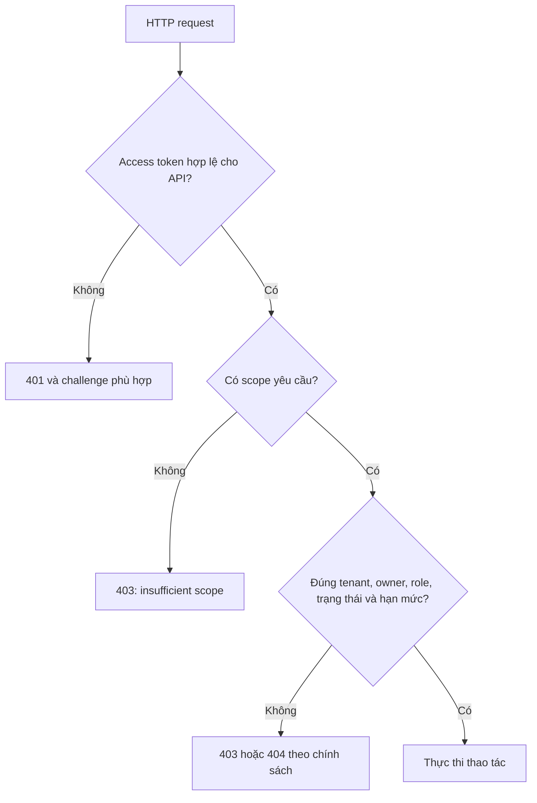

# Security scheme, requirement và mô tả scope trong OpenAPI

## 1. Vì sao hợp đồng bảo mật API phải mô tả ba lớp khác nhau?

Một REST API đơn hàng có thể công khai danh mục sản phẩm, yêu cầu người dùng đăng nhập để xem đơn, và chỉ cho dịch vụ nội bộ chạy tác vụ đối soát. Việc đặt một biểu tượng ổ khóa trong Swagger UI không đủ để mô tả những ràng buộc đó.

Trong **OpenAPI 3.1**, cần phân biệt:

| Thành phần | Nằm ở đâu? | Trả lời câu hỏi gì? |
| --- | --- | --- |
| **Security Scheme Object** | `components.securitySchemes` | API nhận thông tin xác thực bằng **cơ chế nào**: Bearer, API key, OAuth 2.0, OpenID Connect, mTLS...? |
| **Security Requirement Object** | `security` ở root hoặc từng operation | Operation này **yêu cầu scheme nào**, kết hợp **AND/OR** ra sao, cần scope nào? |
| **Scope và mô tả scope** | Khai báo trong `flows.*.scopes`; sử dụng trong `security` | Một quyền được đặt tên có **ý nghĩa và giới hạn** gì, operation cần quyền nào? |

Đây là chương **Hợp đồng OpenAPI** thuộc module **INTEGRATION_API_REST**: học xây dựng REST API theo resource, URI, phương thức và mã HTTP, phân trang/cache/idempotency, xác thực/phân quyền, xử lý lỗi và kiểm thử với Java/Spring hoặc công nghệ tương đương.

**Mục tiêu bài học:** đọc và viết đúng `securitySchemes`, `security`, OAuth scopes; phân biệt authentication với authorization; thiết kế yêu cầu bảo mật cho endpoint công khai, người dùng và máy–máy; triển khai chính sách tương ứng trong Spring Security và kiểm thử để đặc tả không xa rời runtime.

Ví dụ khởi đầu:

```yaml
openapi: 3.1.0
info:
  title: Orders API
  version: 1.0.0
components:
  securitySchemes:
    accessToken:
      type: http
      scheme: bearer
      bearerFormat: JWT
security:
  - accessToken: []
```

Khối `accessToken` **định nghĩa** một cơ chế gửi bearer token; `security` **áp dụng** cơ chế ấy mặc định cho các operation. Dấu `[]` sau `accessToken` không có nghĩa “endpoint công khai”; nó là **danh sách scope rỗng** của một scheme kiểu HTTP. Nếu muốn yêu cầu scope như `orders:read` theo ngữ nghĩa OpenAPI, cần khai báo một scheme **OAuth 2.0 hoặc OpenID Connect** phù hợp, thay vì tự ghi scope vào `http` bearer scheme.

## 2. Security scheme: khai báo cách trình bày thông tin xác thực

### 2.1. Các loại scheme thường gặp

| `type` | Thuộc tính cần chú ý | Dùng khi | Lưu ý an toàn |
| --- | --- | --- | --- |
| `http` | `scheme: bearer` (có thể `bearerFormat: JWT`) | API nhận `Authorization: Bearer ...` | `bearerFormat` chỉ là gợi ý tài liệu; không xác minh JWT |
| `http` | `scheme: basic` | Hệ thống đặc thù dùng HTTP Basic | Chỉ qua HTTPS, cân nhắc rủi ro mật khẩu lâu dài |
| `apiKey` | `name`, `in: header/query/cookie` | Khóa API do ứng dụng quản lý | Ưu tiên header khi phù hợp; hạn chế key trong URL/query |
| `oauth2` | `flows` với URL và `scopes` | API dùng OAuth 2.0, yêu cầu quyền theo scope | Resource server phải xác minh access token và scopes |
| `openIdConnect` | `openIdConnectUrl` | Dùng thông tin OIDC Discovery để mô tả cơ chế | Không dùng ID token thay access token khi gọi API |
| `mutualTLS` | Scheme kiểu mTLS (OpenAPI 3.1) | Xác thực client bằng chứng chỉ TLS | Cần cấu hình TLS/mTLS và trust chain thực tế |

Tên scheme (`accessToken`, `ordersOAuth`, `internalMtls`) là **tên tham chiếu cục bộ** trong tài liệu, không phải protocol token hoặc scope. Mọi tham chiếu từ Security Requirement Object phải trỏ đúng tên scheme đã định nghĩa.

### 2.2. HTTP Bearer và API key

```yaml
components:
  securitySchemes:
    bearerAccess:
      type: http
      scheme: bearer
      bearerFormat: JWT
      description: |
        Gửi access token trong Authorization: Bearer <token>.
        Token phải hợp lệ theo issuer, audience, thời hạn và chính sách API.
    partnerApiKey:
      type: apiKey
      in: header
      name: X-Partner-Key
      description: Khóa đối tác được cấp và xoay vòng theo chính sách.
```

Bearer đi qua `Authorization: Bearer <synthetic-access-token>`; API key trong ví dụ đi qua `X-Partner-Key: <synthetic-key>`. Với `apiKey`, OpenAPI dùng danh sách scope **rỗng**; quyền key nếu có phải được giải thích và thực thi riêng, không ghi `partnerApiKey: [orders:read]`. Tránh đặt key trong query string vì URL dễ rò vào logs/history.

### 2.3. OAuth 2.0: flows và scope catalog

Ví dụ Authorization Code flow (với PKCE theo chính sách hiện đại) dành cho client tương tác thay mặt người dùng:

```yaml
components:
  securitySchemes:
    ordersOAuth:
      type: oauth2
      description: |
        Access token do Authorization Server phát hành cho Orders API.
        Scope là quyền tối thiểu của token, không thay quyền sở hữu đơn.
      flows:
        authorizationCode:
          authorizationUrl: https://auth.example.test/oauth2/authorize
          tokenUrl: https://auth.example.test/oauth2/token
          scopes:
            orders:read: Đọc đơn hàng mà chủ thể được phép truy cập.
            orders:write: Tạo hoặc cập nhật đơn thuộc phạm vi được phép.
            orders:reconcile: Yêu cầu đối soát đơn với quyền vận hành riêng.
```

`scopes` là **mapping tên scope → mô tả**, không phải danh sách `true/false`; quyền thật do Authorization Server cấp và Resource Server kiểm tra.

Authorization Code mô tả cách **lấy token**; browser/mobile cần PKCE, redirect URI, state và quản lý token an toàn. Resource Server vẫn phải xác minh token.

Đối với dịch vụ máy–máy, có thể mô tả `clientCredentials`:

```yaml
components:
  securitySchemes:
    machineOAuth:
      type: oauth2
      flows:
        clientCredentials:
          tokenUrl: https://auth.example.test/oauth2/token
          scopes:
            inventory:read: Đọc tồn kho được cấp cho service principal.
            inventory:reserve: Đặt giữ tồn kho theo phạm vi dịch vụ.
```

`clientCredentials` đại diện **service principal**, không phải người mua; không tự cấp quyền đọc mọi tenant.

Không ưu tiên OAuth Implicit hoặc Resource Owner Password Credentials cho thiết kế mới; chọn flow theo client và Authorization Server, không theo giao diện Swagger UI.

### 2.4. OpenID Connect và mTLS

```yaml
components:
  securitySchemes:
    companyOidc:
      type: openIdConnect
      openIdConnectUrl: https://auth.example.test/.well-known/openid-configuration
    internalMtls:
      type: mutualTLS
      description: Yêu cầu chứng chỉ client từ CA được doanh nghiệp tin cậy.
```

OIDC Discovery cung cấp metadata; API vẫn phải xác minh access token đúng issuer/audience/quyền. **ID token không thay thế access token**.

Khai báo `mutualTLS` không tự cấu hình TLS, trust chain hay certificate rotation. Không tin `X-Client-Cert` từ client nếu gateway chưa xác minh certificate và loại header giả.

## 3. Security requirement: ghép scheme theo AND và OR

Security Requirement Object là một **mapping tên scheme → danh sách scope yêu cầu**. Trường `security` là **mảng các object**. Quy tắc cốt lõi của OpenAPI:

- **Nhiều phần tử trong mảng `security`** là các phương án **OR**: chỉ cần đáp ứng **một** Security Requirement Object.
- **Nhiều scheme trong cùng một object** là quan hệ **AND**: phải đáp ứng **tất cả**.
- **Nhiều scope trong danh sách của một OAuth2/OIDC scheme** đều phải được đáp ứng trong requirement đó.
- Với scheme khác OAuth2/OIDC, danh sách scope phải là **`[]`**, không dùng scope giả để ngụy trang phân quyền.

### 3.1. Một cơ chế được yêu cầu

```yaml
security:
  - ordersOAuth:
      - orders:read
```

Operation yêu cầu OAuth token có scope `orders:read`. Tài liệu không tự động bảo đảm token hợp lệ; server phải xác minh chữ ký/issuer/audience/thời hạn/scopes và quyền tài nguyên.

### 3.2. OR: một trong hai cơ chế

```yaml
security:
  - ordersOAuth: [orders:read]
  - partnerApiKey: []
```

Ý nghĩa: có thể dùng **OAuth token có `orders:read`** **hoặc** một **partner API key** hợp lệ, nếu chính sách API thực sự cho phép cả hai. Đây **không phải** “phải có cả key và OAuth token”.

### 3.3. AND: đồng thời nhiều cơ chế

```yaml
security:
  - internalMtls: []
    machineOAuth: [inventory:reserve]
```

Ý nghĩa: cần **mTLS** **và** OAuth token có `inventory:reserve`. Có thể dùng cho một endpoint máy–máy nhạy cảm, nếu server/gateway thật sự kiểm tra cả hai, gồm certificate identity và token scope.

**Sai lầm phổ biến:** ghi `security: [{ordersOAuth: [orders:read]}, {ordersOAuth: [orders:write]}]` khi thực ra muốn cả hai scope. Cấu trúc đó là **OR**: token chỉ cần một trong hai scope. Đúng phải là **một object** với `ordersOAuth: [orders:read, orders:write]`.

## 4. Phạm vi áp dụng: root, operation và endpoint công khai

OpenAPI cho phép đặt `security` tại **OpenAPI Object (root)** và tại **Operation Object**. Khi một operation có trường `security` riêng, nó **ghi đè toàn bộ** yêu cầu bảo mật ở root cho operation đó, không tự gộp thêm.

Ví dụ ở mục 6 đặt root `security: [{ordersOAuth: [orders:read]}]`. `GET /api/orders/{id}` kế thừa yêu cầu này; `POST /api/orders` khai báo riêng `orders:write` nên **không tự kèm** `orders:read`; `GET /api/catalog/products` đặt `security: []` để công khai.

### 4.1. `security: []` khác `security: [{}]`

`security: []` nghĩa là không có security requirements cho operation, dùng để loại bỏ yêu cầu authentication kế thừa.

```yaml
security:
  - {}
  - bearerAccess: []
```

Đây là **OR**, trong đó `{}` cho phép caller **không có credentials**; Bearer là phương án tùy chọn. Dùng cho nội dung công khai có thể cá nhân hóa nếu middleware hỗ trợ optional auth; `security: [{}]` cũng cho phép anonymous.

Không khai báo `security` ở cả root và operation nghĩa là OpenAPI không nêu yêu cầu bảo mật; nếu backend có auth thì hợp đồng đang thiếu.

### 4.2. Một operation có nhiều quyền

`security: [{ordersOAuth: [orders:read, orders:reconcile]}]` yêu cầu **cả hai scope**, nhưng chỉ chọn khi nghiệp vụ thực sự cần cả hai; không yêu cầu `read` chỉ vì path có chữ `orders`.

### 4.3. Đừng dùng schema để thay security

Khai báo `Authorization` như một `parameters` header thông thường **không thay thế** Security Scheme/Requirement Object. Dùng `security` để công cụ tài liệu, SDK và kiểm thử hiểu đúng authentication contract.

## 5. Mô tả scope có ích cho người sử dụng API

### 5.1. Scope không đồng nghĩa “quyền sở hữu tài nguyên”

Một token có `orders:read` có thể chỉ cấp khả năng **thử đọc** đơn hàng, nhưng đơn `ord-123` thuộc tenant nào, người gọi có được xem không và dữ liệu nào có thể tiết lộ vẫn phụ thuộc vào **authorization ở resource**.

```text
Có access token hợp lệ?
  -> Issuer, audience, signature, exp/nbf đúng?
  -> Có scope orders:read?
  -> Chủ thể/token có quyền xem tenant và order cụ thể?
  -> Có chính sách ẩn/trả field theo vai trò và trạng thái?
```

Scope là một **mệnh đề quyền được cấp cho token**, không phải chứng thư cho toàn bộ đối tượng mà client đoán được URI. Nếu service chỉ kiểm tra `orders:read` rồi `findById(id)` mà bỏ qua tenant/owner, lỗi **Broken Object Level Authorization (BOLA/IDOR)** vẫn xảy ra dù OpenAPI khai báo rất đẹp.

### 5.2. Cách viết mô tả scope

Mô tả nên nêu **thao tác, tài nguyên, phạm vi và ngoại lệ**.

| Scope | Mô tả có phạm vi |
| --- | --- |
| `orders:read` | Đọc đơn thuộc tenant/phạm vi được cấp |
| `orders:write` | Tạo/sửa đơn được phép; không tự cho phép hoàn tiền |
| `orders:reconcile` | Đối soát đơn được phân công với quyền vận hành và audit riêng |
| `payments:refund` | Yêu cầu hoàn tiền trong hạn mức được cấp |

Một scope nên có **tên ổn định** và ngữ nghĩa hẹp đủ để kiểm soát. Không tùy tiện đổi `orders:read` từ “đọc đơn của tenant mình” thành “đọc mọi đơn toàn hệ thống” mà giữ nguyên tên.

### 5.3. Scope trong OpenAPI và scope trong token

`security: [{ordersOAuth: [orders:read]}]` chỉ thông báo **yêu cầu** scope. Nó không tự đăng ký scope ở Authorization Server, phát token hay xác minh JWT. Resource Server phải kiểm tra token **đúng cho API** và trích xuất quyền theo hợp đồng của provider.

Với Spring Security, JWT scope từ claim `scope` hoặc `scp` thường được ánh xạ sang authorities tiền tố `SCOPE_` bằng cấu hình mặc định của converter. Nếu nhà cung cấp dùng claim khác, định dạng khác hoặc cần phân tách tenant, **phải cấu hình converter và kiểm thử rõ ràng**. Không mặc định một JWT bất kỳ có `scp=orders:read` là hợp lệ nếu issuer/audience/signature sai.

**OIDC lưu ý:** OIDC `openid` thường là scope về **quy trình đăng nhập/danh tính**, không tự cấp quyền truy cập tài nguyên đơn hàng. Với `openIdConnect` scheme, danh sách scope trong Security Requirement Object cần được đối chiếu metadata và chính sách thực của provider.

### 5.4. Phân biệt scope, role và business policy



Scope thường được kiểm tra ở gateway hoặc SecurityFilterChain, còn quyền sở hữu và business state được kiểm tra ở service có dữ liệu có thẩm quyền. Với luồng nhiều dịch vụ, phải quyết định service nào chịu trách nhiệm kiểm tra quyền và không tin một claim do caller tự gửi trong body.

## 6. Ví dụ OpenAPI 3.1 hoàn chỉnh ở mức một API nhỏ

Ví dụ thiết kế ba nhóm thao tác: **catalog công khai**, **đơn hàng cho người dùng** và **đối soát nội bộ**. Tài liệu dưới đây có thể dùng làm nền để phát triển hợp đồng; các URL `.example.test` chỉ là giá trị minh họa.

```yaml
openapi: 3.1.0
info:
  title: Order Service
  version: 1.0.0
servers:
  - url: https://api.example.test

components:
  securitySchemes:
    ordersOAuth:
      type: oauth2
      description: Access token dành cho Order Service.
      flows:
        authorizationCode:
          authorizationUrl: https://auth.example.test/oauth2/authorize
          tokenUrl: https://auth.example.test/oauth2/token
          scopes:
            orders:read: Đọc đơn thuộc phạm vi được phép.
            orders:write: Tạo đơn hoặc sửa đơn theo quy tắc nghiệp vụ.
        clientCredentials:
          tokenUrl: https://auth.example.test/oauth2/token
          scopes:
            orders:reconcile: Đối soát đơn theo quyền vận hành được cấp.
    internalMtls:
      type: mutualTLS
      description: Chứng chỉ client tin cậy cho endpoint nội bộ.
security:
  - ordersOAuth: [orders:read]

paths:
  /api/catalog/products:
    get:
      operationId: listCatalog
      security: [] # Công khai, ghi đè yêu cầu ở root
      responses:
        '200': { description: Public product catalog }
  /api/orders/{id}:
    get:
      operationId: getOrder
      parameters:
        - in: path
          name: id
          required: true
          schema: { type: string }
      responses:
        '200': { description: Order visible to the caller }
        '401': { description: Missing/invalid credentials }
        '403': { description: Insufficient scope or authorization }
        '404': { description: Order not found or hidden }
  /api/orders:
    post:
      operationId: createOrder
      security:
        - ordersOAuth: [orders:write]
      requestBody:
        required: true
        content:
          application/json:
            schema:
              type: object
              required: [productId, quantity]
              properties:
                productId: { type: string }
                quantity: { type: integer, minimum: 1 }
      responses:
        '201': { description: Order created }
        '401': { description: Missing/invalid credentials }
        '403': { description: Insufficient scope or business permission }
  /api/internal/orders/reconcile:
    post:
      operationId: reconcileOrders
      description: Chỉ dịch vụ vận hành được ủy quyền mới được gọi.
      security:
        - internalMtls: []
          ordersOAuth: [orders:reconcile]
      responses:
        '202': { description: Reconciliation accepted }
        '403': { description: Not permitted }
```

Đọc đúng logic:

1. Mặc định operation yêu cầu `ordersOAuth` với `orders:read`.
2. `GET /api/catalog/products` dùng `security: []`, **không yêu cầu** token.
3. `POST /api/orders` ghi đè bằng scope `orders:write` (không tự kèm `orders:read`).
4. `POST /api/internal/orders/reconcile` yêu cầu **mTLS AND OAuth** có `orders:reconcile`.

Mặc dù tài liệu có `mutualTLS`, ví dụ **chưa triển khai ingress mTLS hoặc chính sách ủy quyền dịch vụ**. Một bản đặc tả hợp lệ chỉ là điểm khởi đầu; bắt buộc kiểm chứng runtime và các lộ trình truy cập trực tiếp bỏ qua gateway.

## 7. Lỗi xác thực và phân quyền trong hợp đồng HTTP

Với Bearer/OAuth, cần phân biệt thiếu hoặc sai credential với token hợp lệ nhưng không đủ quyền:

```http
GET /api/orders/ord-123 HTTP/1.1
Authorization: Bearer <invalid-synthetic-token>
```

Kết quả điển hình khi token không hợp lệ:

```http
HTTP/1.1 401 Unauthorized
WWW-Authenticate: Bearer realm="orders-api", error="invalid_token"
Content-Type: application/problem+json
Cache-Control: no-store

{
  "type": "about:blank",
  "title": "Unauthorized",
  "status": 401,
  "detail": "Cần thông tin xác thực hợp lệ.",
  "code": "AUTHENTICATION_REQUIRED"
}
```

Token hợp lệ nhưng thiếu `orders:write` khi POST có thể nhận:

```http
HTTP/1.1 403 Forbidden
WWW-Authenticate: Bearer error="insufficient_scope", scope="orders:write"
Content-Type: application/problem+json
Cache-Control: no-store

{
  "type": "about:blank",
  "title": "Forbidden",
  "status": 403,
  "detail": "Không đủ quyền thực hiện thao tác.",
  "code": "ACCESS_DENIED"
}
```

`WWW-Authenticate` tuân theo Bearer Token Usage (RFC 6750); chỉ công bố `scope` khi an toàn. API nhạy cảm có thể dùng `404` để che resource theo policy nhất quán.

Không trả access token, JWT claims nhạy cảm, thông tin cấu hình xác minh chữ ký hoặc stack trace trong body/header. `bearerFormat: JWT` trong OpenAPI **không biến JWT chưa được xác minh thành credential đáng tin**.

## 8. Java/Spring Security: thực thi chứ không chỉ mô tả

Đoạn cấu hình sau minh họa **Java 17+, Spring Boot 3 và Spring Security 6**, dùng JWT Bearer của OAuth2 Resource Server. Nó thực thi **catalog công khai, đọc đơn với scope đọc, tạo đơn với scope ghi** trong đặc tả mục 6. Đường đối soát mTLS cần được cấu hình riêng và **bị từ chối theo mặc định** trong ví dụ này.

### 8.1. Cấu hình Resource Server

```yaml
spring:
  security:
    oauth2:
      resourceserver:
        jwt:
          issuer-uri: https://auth.example.test
```

Resource Server cần cấu hình nhà phát hành đáng tin, kiểm tra signature, thời hạn và issuer theo cơ chế được chọn. **Audience dành cho Order Service cũng phải được xác minh theo hợp đồng token**, có thể bằng JWT validator tùy biến hoặc cấu hình phù hợp phiên bản Spring Boot đang chạy; không coi chỉ có `issuer-uri` là đủ để chống token cấp cho API khác. Với opaque token, có thể dùng introspection thay vì giải mã JWT, theo hợp đồng của Authorization Server.

```java
package example.orders.security;

import org.springframework.context.annotation.Bean;
import org.springframework.context.annotation.Configuration;
import org.springframework.http.HttpMethod;
import org.springframework.security.config.Customizer;
import org.springframework.security.config.annotation.web.builders.HttpSecurity;
import org.springframework.security.config.annotation.web.configuration.EnableWebSecurity;
import org.springframework.security.config.annotation.web.configurers.AbstractHttpConfigurer;
import org.springframework.security.config.http.SessionCreationPolicy;
import org.springframework.security.web.SecurityFilterChain;

@Configuration
@EnableWebSecurity
public class ApiSecurityConfig {

    @Bean
    SecurityFilterChain apiFilterChain(HttpSecurity http) throws Exception {
        http
            .csrf(AbstractHttpConfigurer::disable)
            .sessionManagement(s -> s
                .sessionCreationPolicy(SessionCreationPolicy.STATELESS))
            .authorizeHttpRequests(auth -> auth
                .requestMatchers(HttpMethod.GET,
                    "/api/catalog/products").permitAll()
                .requestMatchers(HttpMethod.GET,
                    "/api/orders/*").hasAuthority("SCOPE_orders:read")
                .requestMatchers(HttpMethod.POST,
                    "/api/orders").hasAuthority("SCOPE_orders:write")
                .anyRequest().denyAll())
            .oauth2ResourceServer(oauth -> oauth
                .jwt(Customizer.withDefaults()));
        return http.build();
    }
}
```

**Giới hạn quan trọng:**

- Cấu hình tắt CSRF **chỉ thích hợp khi API thuần stateless Bearer không dựa vào cookie/session để xác thực**. Nếu dùng cookie hoặc authentication theo browser, phải đánh giá lại CSRF.
- Đường `/api/internal/orders/reconcile` hiện bị `denyAll()`: để triển khai yêu cầu **mTLS AND OAuth** phải bổ sung kiểm tra chứng chỉ ở ingress/server đáng tin và ràng buộc service identity **đồng thời** với scope trong policy runtime. Không chỉ thêm `hasAuthority("SCOPE_orders:reconcile")` rồi tuyên bố mTLS đã được xác thực.
- Matcher HTTP cần khớp **mọi route thật** (cả version/prefix và endpoint phát sinh); Spring authorization không tự đọc trường `security` trong OpenAPI.
- Tên authority `SCOPE_orders:read` phụ thuộc converter và claims của provider. Phải kiểm tra token thực tế và cấu hình để tránh bỏ qua scope hoặc vô tình chấp nhận role sai.

### 8.2. Phân quyền đối tượng trong service

Sau lớp filter, controller/service vẫn phải kiểm tra **order cụ thể**:

```java
package example.orders.api;

import org.springframework.http.ResponseEntity;
import org.springframework.security.core.annotation.AuthenticationPrincipal;
import org.springframework.security.oauth2.jwt.Jwt;
import org.springframework.web.bind.annotation.GetMapping;
import org.springframework.web.bind.annotation.PathVariable;
import org.springframework.web.bind.annotation.RequestMapping;
import org.springframework.web.bind.annotation.RestController;

@RestController
@RequestMapping("/api/orders")
public class OrderReadController {

    private final OrderQueryService service;

    public OrderReadController(OrderQueryService service) {
        this.service = service;
    }

    @GetMapping("/{id}")
    public ResponseEntity<OrderView> get(
            @PathVariable("id") String id,
            @AuthenticationPrincipal Jwt jwt) {

        // Service tự xác định phạm vi được cấp từ identity đáng tin.
        // Không tin tenantId do caller tự gửi trong body/query.
        OrderView view = service.findVisibleTo(
                jwt.getSubject(), jwt.getClaimAsString("tenant_id"), id);
        return ResponseEntity.ok(view);
    }
}

interface OrderQueryService {
    OrderView findVisibleTo(String subject, String tenantId, String orderId);
}

record OrderView(String id, String status) {}
```

`tenant_id` trong ví dụ là **claim theo hợp đồng riêng của provider**, không phải claim bắt buộc của JWT/OAuth. Cần kiểm tra issuer và cách gắn tenant với quyền thực tế; service không chỉ dựa vào giá trị claim để thay thế mọi chính sách dữ liệu.

Ví dụ filter đã kiểm tra `orders:read`, còn `findVisibleTo` thực hiện object-level authorization. Một resource thuộc người khác phải bị từ chối/ẩn theo policy dù token có scope đọc.

## 9. Kiểm thử sự nhất quán giữa OpenAPI và runtime

### 9.1. Checklist kiểm tra đặc tả

| Kiểm tra tĩnh (lint/contract review) | Lỗi phát hiện |
| --- | --- |
| Mọi tên ở `security` trỏ tới `components.securitySchemes` | Tham chiếu scheme không tồn tại |
| `http`/`apiKey`/`mutualTLS` có danh sách scope `[]` | Gán scope OAuth vào scheme không phù hợp |
| Scope dùng trong requirement có định nghĩa/được provider hỗ trợ | Sai chính tả hoặc yêu cầu scope không phát hành |
| Các operation public dùng `security: []` rõ ràng khi root có auth | Vô tình kế thừa yêu cầu xác thực |
| Operation override root đã bao gồm **đủ** phương án cần thiết | Vô tình bỏ mất mTLS hoặc scope thứ hai |
| AND/OR dùng đúng vị trí của list và object | Cho phép một trong hai khi đáng ra cần cả hai |
| `401`, `403` và các mã lỗi nghiệp vụ được mô tả | SDK/client không xử lý lỗi đúng |
| URLs OAuth/OIDC dùng HTTPS, không chứa bí mật | Lộ credential trong spec hoặc flow không an toàn |

Linter chỉ phát hiện cấu trúc/hợp đồng; nó **không chứng minh** cơ chế quyền đã hoạt động. Không đưa API key, client secret hoặc access token thật vào file OpenAPI, ví dụ request, CI logs và Swagger UI demo.

### 9.2. Kiểm thử Spring Security bằng MockMvc

Ví dụ sau dùng `spring-security-test`, JUnit 5 và ứng dụng Spring Boot có `SecurityFilterChain` ở mục 8. `jwt()` giúp tạo security principal **giả lập** để kiểm tra mapping scope/HTTP policy, nhưng **không kiểm tra chữ ký hay audience của JWT thật**.

```java
package example.orders.security;

import static org.springframework.security.test.web.servlet.request
    .SecurityMockMvcRequestPostProcessors.jwt;
import static org.springframework.test.web.servlet.request
    .MockMvcRequestBuilders.get;
import static org.springframework.test.web.servlet.result
    .MockMvcResultMatchers.status;

import org.junit.jupiter.api.Test;
import org.springframework.beans.factory.annotation.Autowired;
import org.springframework.boot.test.autoconfigure.web.servlet.AutoConfigureMockMvc;
import org.springframework.boot.test.context.SpringBootTest;
import org.springframework.security.core.authority.SimpleGrantedAuthority;
import org.springframework.test.web.servlet.MockMvc;

@SpringBootTest
@AutoConfigureMockMvc
class OrderSecurityContractTest {

    @Autowired MockMvc mvc;

    @Test
    void noTokenIs401() throws Exception {
        mvc.perform(get("/api/orders/ord-123"))
            .andExpect(status().isUnauthorized());
    }

    @Test
    void wrongScopeIs403() throws Exception {
        mvc.perform(get("/api/orders/ord-123")
                .with(jwt().authorities(
                    new SimpleGrantedAuthority("SCOPE_catalog:read"))))
            .andExpect(status().isForbidden());
    }
}
```

Đoạn test giả định ứng dụng có cấu hình và dependencies thích hợp; `jwt()` không ký token thật. Cần bổ sung test access token do Authorization Server test cấp (chữ ký, `iss`, `aud`, `exp`), test quyền tenant/owner bằng fixture thực, và test mTLS qua ingress/TLS termination thật. Đồng thời test:

- **Catalog không có token** vẫn truy cập được.
- Token có `orders:read` nhưng **không sở hữu** `ord-123` vẫn bị từ chối.
- POST tạo đơn có `orders:read` nhưng thiếu `orders:write` bị `403`.
- Operation yêu cầu **mTLS AND OAuth** thất bại nếu chỉ có một trong hai.
- Một token thuộc issuer khác hoặc audience khác không được chấp nhận dù chứa scope đúng.
- `WWW-Authenticate` và Problem Details của `401`/`403` không rò token/stack trace.

### 9.3. Kiểm thử OR và optional authentication

Với một operation có:

```yaml
security:
  - ordersOAuth: [orders:read]
  - partnerApiKey: []
```

Test **mỗi nhánh độc lập**: OAuth hoặc API key hợp lệ thành công, cả hai đều thiếu/sai bị từ chối. Với `security: [{}, {ordersOAuth: []}]`, caller ẩn danh được phép; token sai có được hạ xuống anonymous hay không phải do middleware/policy quyết định rõ.

## 10. Bài tập: phát hiện yêu cầu bảo mật bị đặt sai

Cho đặc tả rút gọn:

```yaml
components:
  securitySchemes:
    bearerAccess:
      type: http
      scheme: bearer
    ordersOAuth:
      type: oauth2
      flows:
        clientCredentials:
          tokenUrl: https://auth.example.test/oauth2/token
          scopes:
            orders:read: Đọc đơn được phép.
            orders:write: Ghi đơn được phép.
security:
  - ordersOAuth: [orders:read]
paths:
  /api/catalog:
    get:
      responses:
        '200': { description: Catalog }
  /api/orders:
    post:
      security:
        - ordersOAuth: [orders:write]
        - ordersOAuth: [orders:read]
      responses:
        '201': { description: Created }
```

**Câu hỏi:** (1) `/api/catalog` có thật sự công khai theo contract không? (2) `POST /api/orders` đang yêu cầu cả hai scope hay một trong hai? (3) Nếu cần Bearer hợp lệ không kèm điều kiện OAuth scope, dùng scheme nào và requirement ra sao? (4) Bổ sung test cho token chỉ có `orders:read`, token chỉ có `orders:write`, token thiếu quyền và đơn thuộc tenant khác.

**Đáp án:** (1) Không; nó kế thừa root `orders:read`, cần `security: []` ở GET catalog. (2) Đang là **OR**, một trong hai scope là đủ; nếu thật sự cần cả hai thì dùng **một object** `ordersOAuth: [orders:read, orders:write]`. (3) Dùng `bearerAccess: []`, nhưng phải thực thi xác thực Bearer ở runtime và không được nhận bừa JWT từ issuer khác. (4) Test mỗi trường hợp theo logic AND/OR đã chọn, và luôn test object-level authorization dù scope thỏa mãn.

## 11. Kết luận và checklist

- [ ] Định nghĩa mỗi cơ chế một lần trong `components.securitySchemes`; tham chiếu đúng tên.
- [ ] Dùng scheme **OAuth2/OIDC** khi muốn yêu cầu scope theo mô hình OpenAPI; scheme khác dùng `[]`.
- [ ] Phân biệt OR giữa các object trong mảng `security` với AND trong **cùng object** và danh sách scopes.
- [ ] Hiểu operation `security` **ghi đè** root; dùng `security: []` cho public và `{}` khi thực sự cho phép anonymous như một phương án.
- [ ] Mô tả scope theo thao tác và phạm vi thực, tách khỏi quyền sở hữu, tenant và business invariants.
- [ ] Xác minh token theo issuer, audience, signature/thời hạn; không dùng ID token làm access token API.
- [ ] Phân biệt `401` với `403`, giữ challenge hợp lệ và không tiết lộ bí mật.
- [ ] Bảo đảm Spring Security, ingress mTLS, service authorization và các test cùng phản ánh OpenAPI.

**Ghi nhớ:** `securitySchemes` mô tả **cơ chế**, `security` mô tả **điều kiện để gọi operation**, còn scope mô tả **quyền được cấp trong cơ chế phù hợp**. OpenAPI là hợp đồng có thể kiểm tra, không phải bộ máy thực thi phân quyền: một endpoint chỉ an toàn khi **runtime thực sự kiểm tra đủ scheme, scope và quyền trên từng tài nguyên**.


