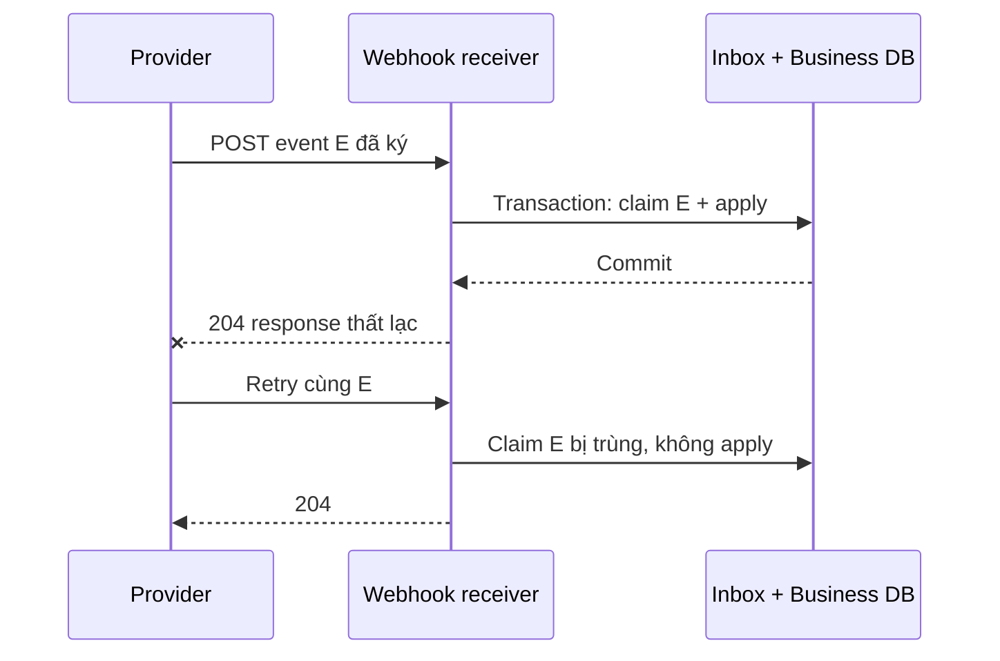

# Links, callbacks và webhooks trong phạm vi phiên bản hỗ trợ

Một REST API đặt hàng có ba nhu cầu khác nhau: sau khi tạo đơn cần chỉ cho client cách đọc đơn; khi đơn đổi trạng thái cần gửi sự kiện đến URL khách hàng đã đăng ký; và API dành cho đối tác cần mô tả định dạng webhook để bên nhận triển khai đúng. **OpenAPI có ba cơ chế riêng** cho các nhu cầu đó: **Link Object**, **Callback Object** và **top-level Webhooks Object**. Chúng không hoán đổi cho nhau và khả năng sử dụng phụ thuộc phiên bản OpenAPI cùng công cụ xử lý tài liệu.

Bài thuộc chương **Hợp đồng OpenAPI** của module **INTEGRATION_API_REST**, nối kết thiết kế resource, URI, HTTP methods/status, hợp đồng dữ liệu, xác thực/phân quyền, idempotency và kiểm thử Java/Spring. Ví dụ xuyên suốt là SaaS nhiều tenant cung cấp API đơn hàng và thông báo trạng thái. Mục tiêu: viết đặc tả đúng phiên bản, hiểu hướng gọi HTTP, bảo vệ URL callback và webhook, xử lý retry không nhân đôi tác dụng nghiệp vụ.

## 1. Chọn đúng khái niệm và phiên bản OpenAPI

| Cơ chế | Mô tả | Nơi khai báo | Hướng tương tác |
|---|---|---|---|
| **Links** | Liên hệ một response với **operation khác** có thể thực hiện tiếp; ánh xạ dữ liệu từ request/response làm tham số | `responses.<status>.links` | Client gọi API operation khác sau khi nhận response |
| **Callbacks** | Mô tả HTTP request do **API provider** chủ động gửi đến callback URL xác định từ request/response của **một operation cha** | `paths.<path>.<method>.callbacks` | Provider → client/đối tác sau operation đăng ký |
| **Webhooks** | Mô tả những HTTP request **provider** có thể gửi đến bên nhận, **không cần ràng buộc với một operation cha cụ thể** | `webhooks` tại gốc OpenAPI | Provider → webhook consumer/đối tác |

### 1.1. Ma trận hỗ trợ trong các phiên bản phổ biến

| Khả năng tiêu chuẩn | OpenAPI **3.0.x** | OpenAPI **3.1.x** |
|---|---|---|
| `responses[*].links` / Link Object | Có | Có |
| `callbacks` / Callback Object | Có | Có |
| `webhooks` ở cấp tài liệu | **Không có phần tử tiêu chuẩn** | **Có** |
| Runtime expressions cho Link/Callback | Có | Có |
| Mô tả JSON Schema | OAS Schema Object của 3.0, có khác biệt với JSON Schema đầy đủ | Tương thích với JSON Schema 2020-12 theo quy tắc của 3.1 |

**Quy tắc khi phát hành:** nếu tài liệu khai báo `openapi: 3.0.3`, đừng đặt `webhooks:` ở gốc và khẳng định tài liệu hợp lệ theo 3.0. Có thể dùng `callbacks` khi webhook gắn với một lần đăng ký, hoặc dùng extension `x-webhooks` theo quy ước riêng, **nhưng extension không có tính tương thích tiêu chuẩn**. Nếu muốn khai báo top-level webhooks chuẩn, dùng **3.1.x và kiểm tra bộ parser, linter, UI, generator, gateway hiện dùng có thực sự hỗ trợ**.

Ngay cả khi văn bản OpenAPI hợp lệ, một code generator vẫn có thể bỏ qua Links hoặc callbacks khi sinh SDK. OpenAPI mô tả **hợp đồng**, không tự tạo subscription, gửi webhook, kiểm tra chữ ký hay bảo đảm runtime hoạt động. Không đồng nhất “có trong spec” với “tool tự thực thi”.

## 2. Links: từ response tới operation tiếp theo

Giả sử client gửi `POST /api/v1/orders` và nhận:
 
```http
HTTP/1.1 201 Created
Location: /api/v1/orders/ord-901
Content-Type: application/json

{"id":"ord-901","status":"PENDING"}
```

Link Object trong **response 201 của operation createOrder** chỉ cho client cách gọi `getOrder`. Ví dụ đoạn `links` (đặt đúng trong `responses["201"]`; mục 5 có tài liệu hoàn chỉnh):
 
```yaml
links:
  GetCreatedOrder:
    operationId: getOrder
    parameters:
      orderId: "$response.body#/id"
    description: Read the newly created order
```

`getOrder` phải là operation ID duy nhất có path parameter `orderId`; biểu thức lấy `ord-901` từ body phản hồi để dùng khi GET. Link còn có thể dùng `operationRef` trỏ trực tiếp vào Operation Object; **chỉ khai báo một trong `operationId` hoặc `operationRef`**. Link có thể ánh xạ `requestBody` khi cần, nhưng không định nghĩa hành động tự động.
 
| Runtime expression | Dữ liệu được tham chiếu |
|---|---|
| `$response.body#/id` | Trường `id` của JSON response qua JSON Pointer |
| `$response.header.Location` | Header `Location` của response |
| `$request.path.orderId` / `$request.query.locale` | Path/query parameter của request nguồn |
| `$request.body#/callbackUrl` | Trường `callbackUrl` trong request JSON |
| `$method` / `$statusCode` / `$url` | Method/status/URL của operation nguồn |
 
Với Link, runtime expression thường là **giá trị** như `"$response.body#/id"`; với Callback URL, nó là **khóa** như `'{$request.body#/callbackUrl}'`. Quote chuỗi có ký tự đặc biệt cho YAML. Nếu field `id` không tồn tại hoặc body không đúng schema, link không giải được: cần contract test giữa response nguồn và tham số operation đích.
 
**Phân biệt:** `links` nằm trong **OpenAPI document**, không tự thêm link vào JSON response hoặc `Link` header HTTP. `Location` của `201` là header độc lập. Một Link Object **không cấp quyền**; GET sau đó vẫn phải xác thực/phân quyền tenant tại thời điểm gọi.

## 3. Callbacks: HTTP request ngược gắn với một operation

Client đăng ký nơi nhận sự kiện:
 
```http
POST /api/v1/order-subscriptions HTTP/1.1
Authorization: Bearer <access_token>
Content-Type: application/json

{"callbackUrl":"https://partner.example.invalid/hooks/order-status",
 "eventTypes":["order.status.changed"]}
```

Provider xác thực người đăng ký, **xác minh URL và quyền tenant**, lưu subscription. Khi có sự kiện, **provider** gửi POST JSON tới callback URL của đối tác, không phải client gọi lại `/order-subscriptions`. Trong OpenAPI, mô tả request ngược **bên trong operation cha**:
 
```yaml
paths:
  /api/v1/order-subscriptions:
    post:
      operationId: createSubscription
      requestBody:
        required: true
        content:
          application/json:
            schema:
              type: object
              required: [callbackUrl]
              properties:
                callbackUrl: { type: string, format: uri }
      responses:
        "201": { description: Subscription created }
      callbacks:
        onOrderChanged:
          '{$request.body#/callbackUrl}':
            post:
              requestBody:
                required: true
                content:
                  application/json:
                    schema: { $ref: "#/components/schemas/OrderEvent" }
              responses:
                "204": { description: Event received }
```

Khóa `'{$request.body#/callbackUrl}'` là **runtime expression** giải URL đích từ request đăng ký; Callback Object cũng có thể dùng thông tin nguồn khác theo cú pháp chuẩn. Ví dụ phụ thuộc `components.schemas.OrderEvent` ở tài liệu bao ngoài; mục 5 có mẫu 3.0.3 tối thiểu tự chứa.
 
Callback Object **không thực thi** subscription, không bảo đảm delivery/retry, không kiểm tra SSRF hay chứng minh quyền sở hữu callback URL. Các chính sách đó là phần hợp đồng và triển khai ở mục 7–9.

## 4. Webhooks: top-level trong OpenAPI 3.1

Webhook thường gắn với **sự kiện nghiệp vụ** như “đơn chuyển trạng thái”, không cần một HTTP operation đăng ký cụ thể trong cùng API. OpenAPI 3.1 cho phép khai báo các HTTP request này ở **gốc tài liệu**:

```yaml
openapi: 3.1.0
info:
  title: Order Events
  version: 1.0.0
webhooks:
  orderStatusChanged:
    post:
      summary: Event delivered by the API provider to a consumer
      parameters:
        - in: header
          name: X-Webhook-Timestamp
          required: true
          schema: { type: string }
        - in: header
          name: X-Webhook-Signature
          required: true
          schema: { type: string }
      requestBody:
        required: true
        content:
          application/json:
            schema:
              $ref: "#/components/schemas/OrderEvent"
      responses:
        "204": { description: Event accepted and processed }
        "400": { description: Invalid event payload }
        "403": { description: Invalid signature or source not authorized }
components:
  schemas:
    OrderEvent:
      type: object
      required: [id, type, schemaVersion, subjectId, occurredAt, data]
      properties:
        id: { type: string }
        type: { type: string, enum: [order.status.changed] }
        schemaVersion: { type: string }
        subjectId: { type: string }
        occurredAt: { type: string, format: date-time }
        data:
          type: object
          required: [status]
          properties:
            status: { type: string, enum: [PENDING, SHIPPED, CANCELLED] }
```

`webhooks.orderStatusChanged` là **tên sự kiện/webhook trong đặc tả**, không phải lời hứa rằng provider expose đường dẫn HTTP `/orderStatusChanged`. URL endpoint nhận do **bên tiêu thụ** quản lý/đăng ký theo một kênh riêng (portal, API đăng ký, cấu hình tài khoản). Cần tài liệu hóa chính sách cấp/cập nhật URL ngoài phần Path Item nếu cần.

### 4.1. Chọn callback hay webhook?

| Câu hỏi | Callback Object | Top-level Webhooks Object |
|---|---|---|
| Sự kiện gắn trực tiếp với operation tạo/khởi động một luồng? | Thường phù hợp | Không bắt buộc |
| URL nhận lấy từ request/response của operation cha? | Có thể dùng runtime expression | Không định nghĩa bởi chính top-level webhook |
| Sự kiện tồn tại độc lập với operation trong API? | Khó diễn đạt nếu không có operation cha | Thường phù hợp |
| Muốn mô tả tiêu chuẩn ở OpenAPI 3.0.x? | Có | Không, trừ extension không chuẩn |
| Muốn mô tả webhook theo chuẩn OpenAPI 3.1.x? | Có thể nếu gắn operation | Có, ngay tại `webhooks` |

**Không phân biệt dựa trên việc có HTTP POST hay không**: cả callback và webhook đều có thể dùng POST. Khác biệt là **mối liên hệ trong hợp đồng** và vị trí mô tả. Thực tế một hệ thống có thể dùng top-level webhook để mô tả sự kiện, đồng thời có `POST /subscriptions` cho quản lý đăng ký.

## 5. Tài liệu OpenAPI 3.0.3: Links và Callback hợp lệ

Một ví dụ tự chứa, **không có top-level webhooks**:
 
```yaml
openapi: 3.0.3
info: { title: Orders API, version: 1.0.0 }
paths:
  /orders:
    post:
      operationId: createOrder
      responses:
        "201":
          description: Created
          content:
            application/json:
              schema:
                type: object
                required: [id]
                properties:
                  id: { type: string }
          links:
            GetOrder:
              operationId: getOrder
              parameters:
                orderId: "$response.body#/id"
  /orders/{orderId}:
    get:
      operationId: getOrder
      parameters:
        - name: orderId
          in: path
          required: true
          schema: { type: string }
      responses:
        "200": { description: Order representation }
  /subscriptions:
    post:
      operationId: createSubscription
      requestBody:
        required: true
        content:
          application/json:
            schema:
              type: object
              required: [callbackUrl]
              properties:
                callbackUrl: { type: string, format: uri }
      responses:
        "201": { description: Subscription created }
      callbacks:
        orderChanged:
          '{$request.body#/callbackUrl}':
            post:
              requestBody:
                required: true
                content:
                  application/json:
                    schema:
                      type: object
                      required: [id, type]
                      properties:
                        id: { type: string }
                        type: { type: string }
              responses:
                "204": { description: Event received }
```

Mẫu chỉ chứng minh **cú pháp/vị trí**. Trước production cần thêm security schemes, tenant ACL, các mã 401/403/429/5xx, schema event đầy đủ, lỗi Problem Details, xác thực callback, retry và ACK. Nếu cần top-level webhooks, viết tài liệu **3.1.x** như mục 4, không âm thầm chèn cấu trúc 3.1 vào tài liệu 3.0.

## 6. Định nghĩa event envelope để chống nhầm và tiến hóa schema

Thông điệp webhook/callback phải có định danh và metadata đủ để bên nhận xử lý:

```json
{
  "id": "evt-1001",
  "type": "order.status.changed",
  "schemaVersion": "1",
  "subjectId": "ord-901",
  "occurredAt": "2026-11-18T08:00:00Z",
  "data": {
    "status": "SHIPPED"
  }
}
```

| Field | Vai trò |
|---|---|
| `id` | **Event ID bất biến** qua các lần gửi lại của cùng sự kiện; dùng inbox deduplication |
| `type` | Sự kiện nghiệp vụ, không phải tên endpoint |
| `schemaVersion` | Phiên bản payload; tách khỏi `openapi: 3.1.0` và phiên bản API |
| `subjectId` | Tài nguyên nguồn liên quan; không tự cấp quyền đọc chi tiết tài nguyên |
| `occurredAt` | Thời điểm sự kiện được sinh, không thay thế timestamp của chữ ký/attempt |
| `data` | Payload được kiểm soát field, enum, tính tương thích và PII |

**Phân biệt ba phiên bản:** `openapi: 3.1.0` là phiên bản **ngôn ngữ mô tả**; `info.version` là phiên bản **tài liệu/hợp đồng API**; `schemaVersion` là phiên bản **dữ liệu event**. Không thay ba giá trị này bằng một số duy nhất rồi cho rằng webhook tương thích.

Một *delivery attempt* có thể có ID riêng để log/retry, nhưng **không đổi event ID**. Nếu event đến không theo thứ tự, consumer dùng trạng thái/version của đối tượng hoặc sequence theo aggregate để tránh áp dụng trạng thái cũ lên trạng thái mới. Không dựa tuyệt đối vào `occurredAt` của client để sắp xếp nghiệp vụ.

## 7. Bảo mật callback URL: chặn SSRF và truy cập chéo tenant

Đăng ký `callbackUrl` là một **khả năng điều khiển outbound HTTP từ hạ tầng provider**. Nếu nhận URL bất kỳ và gửi request đến đó, kẻ xấu có thể thử truy cập metadata service của cloud, IP nội bộ, localhost hoặc dịch vụ quản trị. Đây là **SSRF**, không được giải quyết chỉ bằng cách khai báo `format: uri` trong OpenAPI.

**Quy trình đăng ký an toàn:**

1. Xác thực actor; kiểm tra quyền tạo subscription, tenant, quota và sự kiện được phép.
2. Chỉ chấp nhận HTTPS, host/port được phép, URL không chứa credential; kiểm tra URL parsing/normalization nhất quán.
3. Xác minh bên đăng ký **sở hữu/kiểm soát endpoint** bằng thử thách xác nhận (khi phù hợp), không gửi event nhạy cảm trước bước này.
4. Chặn truy cập tới IP loopback/private/link-local/multicast và cloud metadata; **kiểm tra sau DNS resolution và khi kết nối**, xử lý DNS rebinding và redirect theo policy.
5. Cấu hình outbound egress proxy, giới hạn thời gian kết nối, bytes, redirect, concurrency và retry; không vô tình gửi Authorization header nội bộ tới URL bên ngoài.
6. Mỗi subscription thuộc một tenant/owner; quản lý quyền xem, sửa, tạm dừng, xóa và audit riêng.

Allowlist host có thể là biện pháp rất mạnh khi chỉ tích hợp đối tác cố định; nền tảng hỗ trợ URL tùy người dùng cần thêm egress control. Tránh thông báo lỗi có chi tiết IP/backend nội bộ cho người đăng ký.

## 8. Xác thực người gửi và chống replay webhook

HTTPS bảo vệ kết nối nhưng **không đủ** để consumer biết request thực sự đến từ provider nếu endpoint công khai. Hợp đồng cần một cơ chế như **HMAC signature**, mTLS hoặc credential được quản lý; ví dụ dùng HMAC:

```http
POST /hooks/order-status HTTP/1.1
Host: partner.example.invalid
Content-Type: application/json
X-Webhook-Timestamp: 1795000000
X-Webhook-Signature: v1=<hex-hmac-sha256>

{"id":"evt-1001","type":"order.status.changed","schemaVersion":"1",
 "subjectId":"ord-901","occurredAt":"2026-11-18T08:00:00Z",
 "data":{"status":"SHIPPED"}}
```

Ví dụ giao thức ký do ứng dụng định nghĩa: `HMAC-SHA256(secret, UTF8(timestamp + ".") || rawBody)`. Hai bên phải thống nhất **chính xác** thuật toán, version, encoding và byte dùng ký. Signature trên JSON đã parse rồi serialize lại có thể khác vì khoảng trắng/thứ tự trường; hãy kiểm tra trên **raw request body**.

Consumer phải:

- Giới hạn body size, validate timestamp trong cửa sổ cho phép (ví dụ ±5 phút), so sánh signature bằng hàm giảm rò timing.
- Lưu secret trong secret manager/KMS; xoay khóa, hỗ trợ song song hai secret trong giai đoạn chuyển tiếp theo hợp đồng.
- Validate schema/tenant/event type, không tin `subjectId` hoặc dữ liệu ngoài phạm vi đăng ký.
- **Deduplicate event ID bền vững** cùng transaction với thay đổi nghiệp vụ; timestamp/signature chỉ giúp chứng minh tính xác thực và độ mới của **request**, không ngăn event hợp lệ được gửi lại nhiều lần.

Không đưa secret hoặc chữ ký thật vào log. Nếu chữ ký không hợp lệ, ví dụ có thể trả **403 Forbidden**; `401 Unauthorized` có semantics challenge riêng và cần `WWW-Authenticate` thích hợp nếu được dùng.

## 9. Delivery: ACK, retry và idempotency

Webhook/callback thường được giao theo cơ chế **at-least-once**. Provider phải tài liệu hóa retry policy; cùng sự kiện được gửi lại **giữ event ID**, có thể mang delivery attempt ID mới.

| Phản hồi consumer | Hành vi provider cần thỏa thuận |
|---|---|
| **204** | Đã xử lý hoặc tiếp nhận bền vững, dừng retry |
| **202** | Chỉ ACK nếu đã **lưu bền vững** vào queue/inbox |
| **400/403/409** | Lỗi input, chữ ký hoặc trạng thái; thường dừng/điều tra, không retry mù |
| **429/503**, timeout | Retry có backoff, jitter, budget, `Retry-After` khi có; timeout **không chứng minh chưa commit** |



Inbox có unique key theo consumer + event, ghi **cùng transaction** với thay đổi nghiệp vụ:
 
```sql
CREATE TABLE webhook_inbox (
  consumer_id text NOT NULL,
  event_id text NOT NULL,
  processed_at timestamptz NOT NULL DEFAULT now(),
  PRIMARY KEY (consumer_id, event_id)
);

-- Trong cùng transaction:
INSERT INTO webhook_inbox(consumer_id, event_id)
VALUES (:consumer_id, :event_id)
ON CONFLICT DO NOTHING;
-- Chỉ khi INSERT thành công: thay đổi business state; COMMIT trước ACK.
```

Không chỉ `SELECT` rồi `INSERT` vì hai request song song có thể cùng thấy chưa tồn tại. Event đến sai thứ tự cần sequence/version hoặc state machine để không lùi trạng thái; không suy luận thứ tự từ HTTP arrival. Nếu handler phải gọi payment/email provider ngoài DB, inbox **không tự bảo đảm exactly-once** cho hiệu ứng đó: cần outbox, idempotency phía nhận hoặc đối soát.

## 10. Java/Spring Boot: receiver xác minh chữ ký trước khi parse

Ví dụ Spring Boot 3/Java 17 nhận **raw bytes**, kiểm tra HMAC rồi mới parse JSON. `WebhookInboxService` là dịch vụ ứng dụng dùng database transaction + unique event ID; các lớp cần được wiring bằng Spring và secret manager.

```java
import com.fasterxml.jackson.databind.ObjectMapper;
import com.fasterxml.jackson.core.JsonProcessingException;
import org.springframework.http.*;
import org.springframework.web.bind.annotation.*;

record OrderEvent(String id, String type, String schemaVersion,
                  String subjectId, String occurredAt) {}

@RestController
@RequestMapping("/integrations/webhooks")
class OrderWebhookController {
    private final HmacWebhookVerifier verifier;
    private final ObjectMapper json;
    private final WebhookInboxService inbox;

    OrderWebhookController(HmacWebhookVerifier verifier,
            ObjectMapper json, WebhookInboxService inbox) {
        this.verifier = verifier; this.json = json; this.inbox = inbox;
    }

    @PostMapping(path = "/orders", consumes = "application/json")
    ResponseEntity<Void> receive(
            @RequestHeader("X-Webhook-Timestamp") String timestamp,
            @RequestHeader("X-Webhook-Signature") String signature,
            @RequestBody byte[] raw) {
        if (!verifier.verify(timestamp, raw, signature))
            return ResponseEntity.status(HttpStatus.FORBIDDEN).build();
        OrderEvent event;
        try {
            event = json.readValue(raw, OrderEvent.class);
        } catch (JsonProcessingException invalid) {
            return ResponseEntity.badRequest().build();
        }
        if (event.id() == null || event.type() == null)
            return ResponseEntity.badRequest().build();
        inbox.applyOnce(event);          // Commit nghiệp vụ + inbox.
        return ResponseEntity.noContent().build(); // Sau commit.
    }
}
```

Một verifier tương ứng với công thức `HMAC(secret, UTF8(timestamp + ".") || rawBody)` ở mục 8:

```java
import java.nio.charset.StandardCharsets;
import java.security.MessageDigest;
import java.time.Instant;
import java.util.HexFormat;
import javax.crypto.Mac;
import javax.crypto.spec.SecretKeySpec;

final class HmacWebhookVerifier {
    private final byte[] secret;
    HmacWebhookVerifier(byte[] secret) { this.secret = secret.clone(); }

    boolean verify(String timestamp, byte[] raw, String signature) {
        if (signature == null || !signature.startsWith("v1=")) return false;
        try {
            long sent = Long.parseLong(timestamp);
            long now = Instant.now().getEpochSecond();
            if (sent < now - 300 || sent > now + 300) return false;
            Mac mac = Mac.getInstance("HmacSHA256");
            mac.init(new SecretKeySpec(secret, "HmacSHA256"));
            mac.update((timestamp + ".").getBytes(StandardCharsets.US_ASCII));
            byte[] expected = mac.doFinal(raw);
            byte[] supplied = HexFormat.of().parseHex(signature.substring(3));
            return MessageDigest.isEqual(expected, supplied);
        } catch (Exception invalid) { return false; }
    }
}
```

**Transaction chống trùng:** `inbox.applyOnce(event)` phải `INSERT (consumer_id,event_id) ... ON CONFLICT DO NOTHING`; chỉ khi insert mới thì update trạng thái nghiệp vụ **trong cùng transaction**, rồi commit trước khi trả 204. Nếu apply lỗi, rollback cả inbox record. Với 2 request cùng event ID, unique constraint là điểm bảo vệ cuối cùng, không chỉ `SELECT` rồi `INSERT`.

Cần bổ sung validation cho `id/type/schemaVersion/tenant/data`, giới hạn body size, secret rotation và chính sách xử lý out-of-order events. DTO rút gọn chưa chứa `data.status`; production phải thống nhất DTO với schema event tại mục 4/6. Spring Security cần cấu hình **riêng đúng route** cho xác thực bằng signature, không vô hiệu hóa bảo vệ các endpoint còn lại hoặc bỏ qua CSRF khi dùng cookie một cách tùy tiện.

## 11. Phía provider: gửi sự kiện bền vững

Khi nghiệp vụ đổi trạng thái, ghi **event ID và outbox** trong cùng transaction. Worker chọn subscription thuộc đúng tenant, kiểm tra URL đã xác minh và egress policy (HTTPS, DNS, IP, redirect, timeout) trước khi gửi. Ký **raw payload** bằng secret của subscription, thêm timestamp và signature, lưu delivery attempt và retry theo policy có giới hạn. Lần retry **giữ event ID**, dù timestamp/chữ ký theo attempt có thể đổi; ACK mất vẫn có thể gửi lại. Nếu receiver gây tác dụng phụ ra hệ thống thứ ba, cần idempotency/reconciliation riêng.

Không giữ transaction DB mở trong thời gian gọi HTTP đối tác. Không gửi Authorization token nội bộ tới callback URL, không log secret/payload nhạy cảm hoặc response chứa PII.

## 12. Kiểm thử đặc tả và delivery

| Nhóm | Tình huống chính | Điều cần assert |
|---|---|---|
| **Version** | OAS 3.0.x có Links/Callbacks; thử top-level `webhooks` trong 3.0; dùng `webhooks` trong 3.1 | Parser/linter đúng phiên bản; 3.0 không coi top-level webhooks là chuẩn |
| **Links** | POST trả `id`; body thiếu `id`; link tới tenant khác | Mapping `$response.body#/id` đúng operation/parameter; GET đích vẫn có quyền |
| **Callbacks** | URL hợp lệ; URL nội bộ/localhost, DNS rebinding, redirect private IP | Registration/ownership và egress policy kiểm soát thực tế |
| **Webhook schema** | Event hợp lệ, trường bắt buộc thiếu, enum/schemaVersion đổi | Payload và consumer khớp schema/compatibility |
| **Signature** | Raw body ký đúng; sửa một byte; timestamp hết hạn; xoay secret | Chấp nhận hoặc từ chối 403 đúng policy, không apply trái phép |
| **Deduplication** | Cùng event gửi tuần tự/đồng thời; DB commit nhưng 204 bị mất | Một business effect, lần gửi lại ACK nhưng không apply lần hai |
| **Ordering** | Event cũ đến sau event mới | Không lùi trạng thái/sequence |
| **Retry** | Timeout, 429/503, Retry-After, dead-letter | Cùng event ID, backoff/jitter/budget và cảnh báo |
| **Authorization** | Actor tenant B sửa subscription của A | 403/404, không lộ URL/secret/event |
| **Toolchain** | Parser chấp nhận nhưng generator/UI bỏ qua callback/webhook | Phát hiện giới hạn công cụ bằng kiểm thử giao diện/SDK thực |

### 12.1. MockMvc: chữ ký giả phải bị từ chối

```java
import static org.springframework.test.web.servlet.request.MockMvcRequestBuilders.post;
import static org.springframework.test.web.servlet.result.MockMvcResultMatchers.status;
import org.junit.jupiter.api.Test;
import org.springframework.beans.factory.annotation.Autowired;
import org.springframework.boot.test.autoconfigure.web.servlet.AutoConfigureMockMvc;
import org.springframework.boot.test.context.SpringBootTest;
import org.springframework.http.MediaType;
import org.springframework.test.web.servlet.MockMvc;

@SpringBootTest
@AutoConfigureMockMvc
class WebhookContractTest {
    @Autowired MockMvc mvc;

    @Test
    void badSignatureCannotApplyEvent() throws Exception {
        mvc.perform(post("/integrations/webhooks/orders")
                .contentType(MediaType.APPLICATION_JSON)
                .header("X-Webhook-Timestamp", "1795000000")
                .header("X-Webhook-Signature", "v1=0000")
                .content("{\"id\":\"evt-1\",\"type\":\"order.status.changed\"}"))
            .andExpect(status().isForbidden());
        // Kiểm tra thêm inbox và business state KHÔNG đổi.
    }
}
```

Test cần route được phép vào signature handler nhưng các route khác vẫn được bảo vệ. Test hợp lệ phải ký đúng **raw bytes** với timestamp trong cửa sổ (có thể inject Clock); test tích hợp với DB thật và hai request đồng thời mới chứng minh inbox dedupe nguyên tử. Ở pipeline, pin phiên bản OAS và parser/linter, kiểm tra unique operationId/`$ref`/runtime expressions, rồi chạy contract tests với payload thật. OpenAPI hợp lệ **không** chứng minh gateway, SDK hay portal có hỗ trợ đầy đủ.

## 13. Bài tập: SaaS đơn hàng và đối tác vận chuyển

Một SaaS có `POST /orders` (201 + Location), `GET /orders/{id}` và `POST /subscriptions` nhận `callbackUrl`. Một số đối tác chỉ đăng ký nhận webhook qua portal. Tất cả subscription/tài nguyên theo tenant; provider có thể gửi trùng sau mất ACK.

**Yêu cầu:** (1) Viết response Link ánh xạ `$response.body#/id` vào `getOrder`; (2) viết callback dùng `'{$request.body#/callbackUrl}'`; (3) mô tả top-level webhook chuẩn trong tài liệu 3.1 và giải thích vì sao 3.0.3 không hỗ trợ; (4) định nghĩa envelope event ID/type/schemaVersion/subjectId/data; (5) bảo vệ tenant, URL/SSRF, HMAC/replay; (6) thiết kế outbox/inbox/ACK/retry; (7) viết ít nhất 10 testcase gồm signature sai, DNS rebinding, duplicate song song, event sai thứ tự và cross-tenant.

**Tiêu chí đạt:** links không vượt quyền, callback gắn đúng operation, webhook 3.1 là request **provider → consumer**, event ID ổn định, xác thực trên raw bytes, inbox dedupe cùng DB transaction, ACK sau commit.

## 14. Phản mẫu và checklist phát hành

**Các lỗi cần tránh:** (1) khai báo top-level `webhooks` trong OAS 3.0 và gọi là chuẩn; (2) coi Links là hyperlink được chèn tự động vào JSON; (3) dùng callback để mô tả mọi webhook dù không có operation cha; (4) trộn schemaVersion của event với phiên bản OpenAPI; (5) nhận callbackUrl bất kỳ gây SSRF; (6) xác thực trên JSON đã serialize lại thay vì raw bytes; (7) đổi event ID mỗi lần retry; (8) trả 204 trước khi DB commit; (9) dùng Links hoặc ID khó đoán thay authorization; (10) cho rằng parser đọc được spec là runtime đã hỗ trợ.

**Checklist:**

- [ ] Chọn đúng OpenAPI 3.0.x/3.1.x theo capability của parser, generator và portal; không dùng tính năng vượt phiên bản.
- [ ] Links tham chiếu đúng operationId/operationRef, tham số và response schema; không tự cấp quyền.
- [ ] Callbacks nằm trong operation cha; URL lấy từ runtime expression hợp lệ và có registration/verification policy.
- [ ] Top-level webhooks chỉ dùng khi phiên bản chuẩn hỗ trợ; phân biệt tên webhook với URL consumer.
- [ ] Event envelope có ID bất biến, type/schemaVersion, payload và chính sách tương thích.
- [ ] Registration có tenant ACL, ownership, HTTPS, egress/SSRF, timeout/redirect/quotas.
- [ ] Signature/mTLS, timestamp/replay và secret rotation được định nghĩa; lưu log đã làm sạch.
- [ ] Retry có backoff, event ID giữ nguyên, inbox/outbox, ACK sau commit và quan sát lỗi.
- [ ] Contract test kiểm tra schema, công cụ, lỗi mạng, duplicate, ordering và cross-tenant.

## 15. Nguồn chuẩn để đối chiếu

- **OpenAPI Specification 3.0.3:** Link Object, Callback Object, Runtime Expression. https://spec.openapis.org/oas/v3.0.3
- **OpenAPI Specification 3.1.0:** Webhooks Object cùng Links/Callbacks. https://spec.openapis.org/oas/v3.1.0
- **RFC 9110 — HTTP Semantics:** POST, 201/202/204, 4xx/5xx và `Retry-After`. https://www.rfc-editor.org/rfc/rfc9110.html
- **RFC 9457 — Problem Details for HTTP APIs:** dạng lỗi `application/problem+json` khi hợp đồng dùng. https://www.rfc-editor.org/rfc/rfc9457.html
- **OWASP SSRF Prevention Cheat Sheet:** kiểm soát callback URL, DNS, redirect và egress. Đối chiếu hướng dẫn an toàn với hạ tầng thực.

**Điểm cần nhớ:** **Links** mô tả operation có thể thực hiện tiếp sau response; **callbacks** mô tả request ngược gắn với một operation; **webhooks** top-level mô tả request từ provider độc lập với operation cha và là cấu trúc chuẩn trong **OpenAPI 3.1.x**. Đặc tả không tự bảo vệ hay thực thi những luồng đó: cần kiểm tra phiên bản công cụ, quyền tenant, xác minh callback URL, chữ ký, idempotency, retry và test mất ACK.
