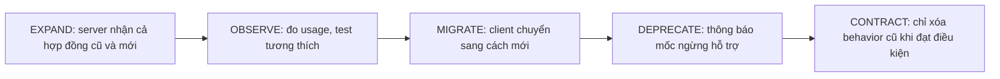

# Thay đổi tương thích về cấu trúc, ngữ nghĩa và hành vi

## 1. Vì sao “không đổi JSON schema” vẫn có thể làm hỏng client?

Một REST API đã có nhiều consumer: website, mobile app chưa cập nhật, SDK đối tác và hệ thống batch. Đội backend đổi `GET /orders` từ sắp xếp **mới nhất trước** thành **cũ nhất trước**; URL, HTTP status và JSON schema vẫn giống hệt, nhưng dashboard lấy phần tử đầu để hiển thị đơn mới nhất bỗng trả kết quả sai.

Ở một thay đổi khác, đội backend bổ sung giá trị `AWAITING_PAYMENT` vào enum `status`. Về JSON, field vẫn là string; nhưng ứng dụng mobile dùng switch exhaustive với các giá trị cũ có thể crash. Tương thích API không chỉ là việc file OpenAPI còn parse được.

**Tiến hóa API (API evolution)** là khả năng thay đổi một API đang có người sử dụng mà vẫn duy trì **những cam kết cần thiết với consumer hiện hành**, hoặc chủ động lên kế hoạch chuyển đổi khi không thể tương thích. Bài học này phân tích ba chiều:

1. **Cấu trúc:** URI, method, header, field, kiểu, required/optional, schema và media type.
2. **Ngữ nghĩa:** ý nghĩa của dữ liệu, trạng thái, đơn vị, quan hệ resource và tác động của operation.
3. **Hành vi:** status code thực tế, sắp xếp, phân trang, lỗi, cache, thời điểm phản hồi, quyền và retry.

Bài thuộc chương **Tiến hóa API** trong module **INTEGRATION_API_REST**, đặt trong bối cảnh thiết kế resource/URI, HTTP methods/status, OpenAPI, cache, idempotency, authentication/authorization và kiểm thử REST API bằng Java/Spring.

### Mục tiêu

Sau bài này, bạn có thể đánh giá thay đổi theo cả ba chiều, phân biệt tương thích với **client cũ** và khả năng **server cũ hiểu client mới**, phân loại rủi ro của thay đổi, tạo kế hoạch expand–migrate–contract, viết kiểm thử hồi quy theo consumer và chọn khi nào cần phiên bản API mới.

## 2. Tương thích với ai và theo chiều nào?

“Compatible” phải gắn với **consumer và chiều triển khai**:

- **Old client → new server:** ứng dụng hiện hành còn chạy đúng khi backend nâng cấp?
- **New client → old server:** khi deploy nhiều region hoặc mobile offline, client mới có gặp server cũ không?
- **Old SDK → new response:** parser strict có chấp nhận field/enum mới?
- **New SDK → old response:** client mới có xử lý field mới đang vắng không?

| Thay đổi | Với client cũ | Với server cũ |
|---|---|---|
| Thêm optional request parameter, default không đổi | Thường ổn | Có thể từ chối tham số mới |
| Thêm optional response field | Tùy strict parser | Client mới phải chịu field vắng |
| Bắt buộc request field mới | **Breaking** | Client mới cũng có thể gửi field lạ |
| Bỏ response field từng có | Có thể **breaking** | Phải có fallback nếu client hỗ trợ cả hai |
| Đổi nghĩa tiền, status hoặc sort mặc định | **Breaking về domain/hành vi** | Cùng JSON có thể bị hiểu khác |

Bài này ưu tiên bảo vệ **consumer đang chạy** khi server tiến hóa; trường hợp mixed deployments phải xét cả hai chiều.

## 3. Cách phân loại thay đổi trước khi merge

Với mỗi PR, ghi **trước đây client được hứa gì**, sau đó so thay đổi trên ba trục:

| Trục | Bằng chứng |
|---|---|
| Cấu trúc | OpenAPI đã phát hành, path/method, schema, header |
| Ngữ nghĩa | Domain definitions, đơn vị tiền, trạng thái, ví dụ nghiệp vụ |
| Hành vi | Status, sort/filter, cache, quyền, retry, performance expectations |
| Consumer | SDK/version đang dùng, consumer tests, telemetry |

Kết luận nên là **compatible**, **rủi ro cần consumer test**, hoặc **breaking cần migration**. Xét cả old client → new server lẫn new client → old server khi rollout nhiều phiên bản. Tool OpenAPI diff không tự phát hiện đổi đơn vị hay mặc định sort.

## 4. Cấu trúc request: thêm vào không có nghĩa luôn an toàn

Request cũ:

```http
POST /orders HTTP/1.1
Content-Type: application/json
Idempotency-Key: checkout-4b81

{"customerId":"c-12","items":[{"sku":"SKU-7","quantity":2}]}
```

Server muốn thêm `deliveryNote`. Cách ít rủi ro là một **field tùy chọn**, và khi bỏ field server vẫn xử lý **giống hệt trước đây**.

| Thay đổi | Old client → new server |
|---|---|
| Field/query optional, default không đổi | Thường tương thích |
| Request field mới **required** | **Breaking**: old client không gửi |
| `quantity` integer đổi thành string | **Breaking**: payload cũ khác kiểu |
| Siết `size` từ 100 xuống 20 | **Breaking** với request hợp lệ trước đó |
| Bỏ media type cũ | **Breaking** với client còn dùng |
| Bắt buộc `If-Match` trước đây không có | **Breaking**, cần migration |
| Chấp nhận thêm giá trị, không đổi nghĩa cũ | Thường tương thích |

Trong OpenAPI 3.1, `required` bắt buộc **hiện diện**, không đảm bảo nội dung không rỗng. Java `@NotNull`, constructor, Jackson unknown-property policy hoặc request mapper có thể vô tình siết contract dù YAML chỉ thêm field tùy chọn.

**Chiều ngược:** new client gửi `deliveryNote` tới **old server** có thể bị từ chối nếu `additionalProperties: false` hoặc runtime chặn unknown properties. Đừng bật feature gửi field mới trước khi cả cụm server hỗ trợ, trừ khi có version/feature negotiation.

## 5. Cấu trúc response và rủi ro của parser cũ

Response cũ:

```http
HTTP/1.1 201 Created
Location: /orders/o-91
Content-Type: application/json

{"id":"o-91","status":"PENDING","totalMinor":850000,"currency":"VND"}
```

Thêm `estimatedDeliveryAt` tùy chọn:

```json
{"id":"o-91","status":"PENDING","totalMinor":850000,
 "currency":"VND","estimatedDeliveryAt":"2026-11-21T10:00:00Z"}
```

Thêm field có thể **an toàn với client bỏ qua unknown fields**, nhưng parser strict/schema đóng có thể fail; client mới phải chịu được trường **vắng** khi gọi server cũ hoặc đơn không có ETA.

| Thay đổi | Nguy cơ |
|---|---|
| Thêm optional response property | Thường thấp, cần strict-consumer test |
| Bỏ property cũ; đổi non-null thành nullable | Cao |
| Đổi number/string, object/array hoặc media type | Cao |
| Thêm enum response value | Có thể phá exhaustive switch |
| Payload tăng lớn | Nguy cơ memory/latency dù schema vẫn hợp lệ |

Tolerant reader hữu ích với **field lạ**, nhưng không được bỏ qua âm thầm các giá trị domain khác nghĩa về tiền, quyền hoặc workflow.

## 6. Thêm giá trị enum response có thể là breaking

OpenAPI cũ:

```yaml
status:
  type: string
  enum: [PENDING, PAID, CANCELLED]
```

Client Java có thể deserialize thành:

```java
enum OrderStatus { PENDING, PAID, CANCELLED }
```

Khi server trả `PAYMENT_REVIEW`, SDK cũ có thể không parse được dù JSON vẫn là string. Nếu không thể nâng client ngay:

- Giữ enum v1 và thêm field mô tả riêng khi phù hợp.
- Chuẩn bị client có **unknown state** an toàn, thử trên response mới.
- Với state machine khác thật sự, xuất representation/version mới rồi migrate.
- Đo adoption trước khi bật giá trị mới cho toàn bộ client.

**Không ép unknown thành PAID/CANCELLED**: có thể gây quyết định tài chính sai. Fallback phù hợp là báo trạng thái chưa hỗ trợ hoặc khóa thao tác nhạy cảm.

## 7. Ngữ nghĩa: cùng field, cùng kiểu nhưng khác ý định

```json
{"totalMinor":850000,"currency":"VND"}
```

Đổi cách hiểu `totalMinor` từ **tổng trước giảm giá** sang **tổng cuối sau giảm giá** là breaking dù vẫn là integer. Một số thay đổi ngữ nghĩa nguy hiểm:

- **Đơn vị:** đồng → nghìn đồng, giây → mili giây.
- **Thời gian:** UTC → local time nhưng giữ timestamp format.
- **Tiền:** trước thuế → gồm thuế, niêm yết → sau ưu đãi.
- **Trạng thái:** `PAID` từ đã capture tiền → chỉ đang giữ tiền.
- **Resource:** `customerId` từ người đặt → người nhận.
- **Operation:** yêu cầu hủy → hủy ngay; GET cả đơn → chỉ đơn mở.

Cách tiến hóa: thêm field mới có tên chính xác, như `subtotalMinor`/`grandTotalMinor`, định nghĩa cách tính và thời điểm, giữ nghĩa cũ trong giai đoạn migrate. Nếu không thể duy trì hai nghĩa đồng thời, xem xét version/resource mới. **Không tái sử dụng tên cũ cho khái niệm mới chỉ vì type vẫn giống.**

## 8. Hành vi: response vẫn hợp lệ nhưng client sai

| Thay đổi runtime | Vì sao có thể breaking |
|---|---|
| `201 + Location` thành `200` | Client không nhận URI, nhánh xử lý khác |
| `204` thành 200 với body | SDK/test phụ thuộc status/body |
| Đổi sort mặc định | “Đơn mới nhất” có thể thành đơn cũ |
| Offset/page thành cursor không thông báo | Client mất khả năng chuyển trang |
| Đổi tập kết quả mặc định | Consumer hiểu nhầm resource biến mất |
| `404` thành `403` | Thay UX và có thể lộ sự tồn tại |
| Cache `private` thành `public` | Nguy cơ lộ dữ liệu tenant |
| Đổi retry/idempotency retention hoặc quota | Side effects lặp, 429/timeout mới |

Thay đổi đáp ứng nhu cầu sản phẩm vẫn có thể **breaking với consumer cũ**. Hãy công bố quy tắc ổn định (sort, filter, status, retention) và phân biệt các chi tiết **chưa từng được cam kết**.

## 9. Đừng bỏ sót những giả định ngầm

Một `GET /orders?status=PAID&page=0&size=20` có ba mặt: schema của query, **nghĩa của `PAID`** và **thứ tự phân trang/kết quả trong tenant hiện tại**. Schema validator chỉ kiểm được phần đầu.

| Bằng chứng | Thứ cần bảo vệ |
|---|---|
| OpenAPI/schema tests | Path/method/parameter, request/response shape |
| Domain scenarios | Ý nghĩa tiền tệ, thời gian, trạng thái |
| HTTP/behavior tests | Status, ordering, pagination, retry/cache |
| Security/consumer tests | Tenant isolation, SDK cũ, cách client dùng dữ liệu |

Hãy viết rõ mặc định, giới hạn và những điều được phép thay đổi. Không suy rằng “cùng JSON schema” có nghĩa cùng kết quả nghiệp vụ.

## 10. Ví dụ một thay đổi tương thích có kiểm soát

### Yêu cầu

Đội sản phẩm cần thêm `deliveryNote` vào request tạo đơn và `estimatedDeliveryAt` vào response. Client cũ vẫn phải hoạt động, chưa cần version mới.

OpenAPI 3.1, rút gọn:

```yaml
openapi: 3.1.0
info:
  title: Orders API
  version: 1.1.0
paths:
  /orders:
    post:
      operationId: createOrder
      summary: Tạo đơn hàng
      parameters:
        - in: header
          name: Idempotency-Key
          required: true
          schema: {type: string, minLength: 8}
      requestBody:
        required: true
        content:
          application/json:
            schema:
              $ref: '#/components/schemas/CreateOrder'
      responses:
        '201':
          description: Created
          headers:
            Location:
              required: true
              schema: {type: string}
          content:
            application/json:
              schema:
                $ref: '#/components/schemas/Order'
components:
  schemas:
    CreateOrder:
      type: object
      required: [customerId, items]
      properties:
        customerId: {type: string, minLength: 1}
        deliveryNote:
          type: string
          maxLength: 500
          description: Optional; omitted preserves previous behavior
        items:
          type: array
          minItems: 1
          items:
            $ref: '#/components/schemas/OrderLine'
    OrderLine:
      type: object
      required: [sku, quantity]
      properties:
        sku: {type: string}
        quantity: {type: integer, minimum: 1}
    Order:
      type: object
      required: [id, status, totalMinor, currency]
      properties:
        id: {type: string}
        status:
          type: string
          enum: [PENDING, PAID, CANCELLED]
        totalMinor: {type: integer, format: int64}
        currency: {type: string}
        estimatedDeliveryAt:
          type: string
          format: date-time
          description: Optional; may be absent when no estimate exists
```

**Lưu ý:** trích đoạn chỉ tập trung tiến hóa schema, chưa chứa toàn bộ `securitySchemes`/401/403/409 và các operation khác. Một hệ thống thật phải giữ contract security và error response đang có; đừng coi lược bỏ chúng khỏi ví dụ là được phép xóa khỏi API.

### Điều kiện để “compatible” là đúng

- Request cũ **không có `deliveryNote`** vẫn được server chấp nhận.
- Mặc định khi field vắng giống hành vi trước, **không** tự thêm phí hoặc gửi thông báo mới.
- Response mới không bỏ required fields cũ, không đổi ý nghĩa `totalMinor`.
- `estimatedDeliveryAt` là optional; client mới xử lý field vắng, client cũ bỏ qua field lạ hoặc đã được kiểm tra.
- `201` và `Location` giữ nguyên; quyền tenant, idempotency và lỗi hiện tại không bị phá.
- Deploy có thể chạy nhiều phiên bản server trong thời gian ngắn: client mới chỉ gửi field mới sau khi tất cả điểm đến hỗ trợ hoặc có negotiation.

## 11. Spring Boot: thay DTO mà giữ được client cũ

Ví dụ dùng Java record với Bean Validation và controller Spring MVC. Các kiểu service là minh họa, không phải ứng dụng chạy độc lập.

```java
import java.net.URI;
import java.time.OffsetDateTime;
import java.util.List;
import jakarta.validation.Valid;
import jakarta.validation.constraints.*;
import org.springframework.http.ResponseEntity;
import org.springframework.security.core.Authentication;
import org.springframework.web.bind.annotation.*;
import com.fasterxml.jackson.annotation.JsonInclude;

record OrderLineRequest(
    @NotBlank String sku,
    @Min(1) int quantity
) {}

record CreateOrderRequest(
    @NotBlank String customerId,
    @NotEmpty List<@Valid OrderLineRequest> items,
    @Size(max = 500) String deliveryNote // optional
) {}

@JsonInclude(JsonInclude.Include.NON_NULL)
record OrderView(
    String id,
    String status,
    long totalMinor,
    String currency,
    OffsetDateTime estimatedDeliveryAt // optional
) {}

@RestController
@RequestMapping("/orders")
class OrderController {
    private final OrderService service;

    OrderController(OrderService service) {
        this.service = service;
    }

    @PostMapping
    ResponseEntity<OrderView> create(
            @Valid @RequestBody CreateOrderRequest request,
            @RequestHeader("Idempotency-Key") String key,
            Authentication identity) {

        OrderView saved = service.createAuthorizedIdempotently(
                identity, key, request);

        return ResponseEntity.created(
                URI.create("/orders/" + saved.id())
        ).body(saved);
    }
}
```

### Điểm cần xem khi review code

- `deliveryNote` không có `@NotNull` hoặc `@NotBlank`, nên request cũ thiếu field được deserialize thành null và không bị yêu cầu cung cấp thêm.
- `@Size(max=500)` ràng buộc độ dài nếu giá trị được cung cấp; server vẫn phải chống ký tự/nội dung không được phép theo domain.
- `@JsonInclude(NON_NULL)` khiến ETA null có thể được bỏ qua trong JSON. OpenAPI mô tả ETA tùy chọn, **không cam kết lúc nào cũng có mặt**.
- `@Valid`/`@NotEmpty` giữ ràng buộc cũ; khi thay library/mapper phải test thực sự nhận dạng constraint.
- `service.createAuthorizedIdempotently` phải enforce quyền tạo đơn cho `customerId` trong tenant của identity và ngăn trùng theo key; annotation controller **không tự thực thi** logic này.
- `201 Created` và `Location` giữ như hợp đồng trước.

**Không expose JPA entity trực tiếp** rồi thêm một cột DB làm thay đổi JSON ngoài ý muốn. DTO tách schema công khai khỏi migration database, nhưng mapper/serialization vẫn cần contract test.

## 12. Bảo mật cũng là compatibility contract

Một API tăng yêu cầu từ bearer token sang scope `orders:write` có thể khiến client cũ nhận `403`. Chuyển public endpoint thành authenticated cũng là breaking. Đổi `401/403/404` tác động error handling; đôi khi `404` được dùng để che sự tồn tại tài nguyên.

**Ưu tiên sửa lỗ hổng bảo mật, không duy trì quyền truy cập sai để giữ tương thích.** Nhưng phải đo impact, hướng dẫn consumer nâng cấp và kiểm thử sau sửa.

Các yêu cầu bắt buộc:

- Xác thực và **authorization theo resource/tenant** ở cả đường API cũ và mới; job ID/URI không thay thế quyền.
- Khi đổi schema, không tự expose JPA fields, PII, token, lỗi SQL hoặc dữ liệu tenant khác.
- Response theo user không được CDN/shared cache dùng chung; thay `private` thành `public` có thể gây rò rỉ nghiêm trọng.
- Kiểm thử token cũ, scope thiếu, quyền bị thu hồi, A/B cross-tenant; đừng chỉ xem annotation OpenAPI security.

CORS không thay authorization; security fix đúng vẫn cần release note và migration khi ảnh hưởng client.

## 13. Giữ nguyên ngữ nghĩa HTTP và hành vi quan sát được

- **Status/header:** `201 + Location` khi tạo resource, `202` khi chỉ tiếp nhận xử lý, `204` không có body. Thay đổi chúng có thể phá SDK/UX.
- **Phân trang:** không âm thầm đổi offset sang cursor, default sort hoặc filter; giữ cách cũ trong giai đoạn migration.
- **Caching:** thay TTL, ETag, `Vary` hoặc `private/public` ảnh hưởng freshness và bảo mật dù JSON không đổi.
- **Retry/idempotency:** không biến PUT đặt trạng thái thành lệnh cộng dồn, không thay thời gian giữ key hoặc status lỗi mà không công bố.
- **Lỗi:** `409/412/422` và `Retry-After` là tín hiệu điều khiển; thay mã có thể làm client xử lý sai.

Không phải mọi hành vi phải cố định vĩnh viễn. Những thứ hợp đồng **không cam kết** (ví dụ latency chính xác từng request) có thể thay đổi; hãy xác định ranh giới trước khi sửa.

## 14. Khi nào cần phiên bản API mới?

**Không phải mọi additive change đều cần `/v2`.** Nhưng một thay đổi phá cấu trúc, ý nghĩa hoặc hành vi đã cam kết cần migration rõ ràng.

| Cách tiến hóa | Khi phù hợp | Đánh đổi |
|---|---|---|
| Mở rộng tại chỗ | Optional fields, default cũ giữ nguyên | Test SDK cũ và mixed rollout |
| URI version: `/v2/orders` | Thay đổi lớn cần chạy song song | Hai routes và security policies |
| Media type/profile version | Nhiều cách biểu diễn một resource | `Accept`, `Vary`, SDK/negotiation |
| Header version theo hợp đồng | Gateway/SDK có hỗ trợ | Cache key và tooling phức tạp |
| Resource/endpoint mới | Domain concept thật sự khác | Tránh đổi nghĩa resource cũ |

`info.version` của tài liệu OpenAPI chỉ là metadata, **không tự tạo route hoặc version negotiation**. Một thay đổi silent về giá trị tiền/enum có thể breaking dù version string và schema không đổi.

## 15. Expand → migrate → contract: quy trình chuyển đổi an toàn

Một mẫu triển khai cho thay đổi có consumer cũ:



Ví dụ đổi tên `totalMinor` thành `grandTotalMinor`:

1. **Expand:** trả cả hai field với **nghĩa được định nghĩa rõ**; nếu chỉ rename, hai giá trị nhất quán.
2. **Migrate:** SDK/client mới đọc `grandTotalMinor`, vẫn fallback `totalMinor` khi gặp server cũ nếu cần.
3. **Observe:** đo còn consumer nào sử dụng cách cũ bằng telemetry phù hợp; lưu ý **không thể biết client dùng field nào chỉ qua server access logs** khi cả hai field cùng nằm trong response. Cần SDK instrumentation có consent hoặc trao đổi với consumer.
4. **Deprecate:** thông báo field cũ sắp ngừng hỗ trợ, thời hạn, tài liệu và phương án thay thế.
5. **Contract:** xóa field cũ **chỉ sau khi** consumer đã chuyển hoặc khi version cũ kết thúc theo lịch công bố.

### Rủi ro dữ liệu hai cách biểu diễn

Nếu một field mới phản ánh **cách tính mới** chứ không đơn thuần rename, không tự gán bằng field cũ. Cần lưu ý migration dữ liệu lịch sử, backfill, đơn hàng đã khóa, giao dịch đang chạy và rollback. Có thể cần **dual-read/dual-write** khi thay storage, nhưng phải xác định consistency và cơ chế đối soát.

### Rollback cũng phải tương thích

Rollout mới có thể đưa dữ liệu/enum mà binary cũ không hiểu. Rollback code không đủ nếu database đã lưu `PAYMENT_REVIEW` nhưng server cũ chỉ biết ba trạng thái. Cần kế hoạch rollback **dữ liệu và hợp đồng**, hoặc trì hoãn việc phát sinh dữ liệu mới đến khi rollback window đóng.

## 16. Deprecation và Sunset cần lịch chuyển đổi

Thông báo cho consumer: **resource/field nào sẽ ngừng**, cách thay thế, ngày bắt đầu cảnh báo, ngày ngừng hỗ trợ, SDK/migration guide và kênh hỗ trợ.

Có thể dùng HTTP headers `Deprecation`, `Sunset` và `Link` tới tài liệu khi phù hợp; phải dùng **đúng cú pháp/ý nghĩa từng header**, thử qua gateway/CDN và không thay thế trao đổi với đối tác. `@Deprecated` trong Java không tự thông báo cho HTTP client.

**Deprecation không phải xóa ngay.** Chỉ ngừng hoạt động khi đáp ứng điều kiện cutover đã công bố hoặc có ngoại lệ an toàn bắt buộc; test rõ hành vi sau sunset (ví dụ route cũ không còn, 404/410 theo hợp đồng).

## 17. Tự động hóa bằng ba lớp kiểm chứng

| Lớp | Mục tiêu |
|---|---|
| **OpenAPI compatibility diff** | Phát hiện path/method/required/schema/status/security changes |
| **HTTP + security tests** | Controller/gateway trả status, header, JSON, quyền, cache và validation đúng |
| **Consumer tests** | Old SDK/client vẫn parse response và thực thi workflow đúng |

Một công cụ diff không thể biết `totalMinor` đã đổi nghĩa hay sort mặc định đổi. Vì vậy lưu **golden requests** đại diện từ client cũ (ẩn dữ liệu nhạy cảm), chạy trên server mới và assert **business invariants**, không chỉ body schema.

Tránh snapshot so byte-to-byte khi thứ tự JSON fields, timestamp và ID ngẫu nhiên không có cam kết. Thay vào đó, kiểm tra status/headers, required fields, units, sort, tenant scope, idempotency và enum. Một test pass trên controller không thay thế test qua gateway/edge.

## 18. MockMvc và kiểm thử tương thích trong Spring

Với controller của mục 11, có thể viết các test như sau. Cần bổ sung `@WebMvcTest`/context, mock service, security fixture và cấu hình CSRF nếu ứng dụng sử dụng session authentication.

```java
import static org.springframework.test.web.servlet.request.MockMvcRequestBuilders.*;
import static org.springframework.test.web.servlet.result.MockMvcResultMatchers.*;
import static org.springframework.security.test.web.servlet.request.SecurityMockMvcRequestPostProcessors.user;

// Payload client cũ: không có deliveryNote vẫn phải hoạt động
mockMvc.perform(post("/orders")
        .with(user("buyer-a"))
        .header("Idempotency-Key", "legacy-key-123456")
        .contentType("application/json")
        .content("""
          {"customerId":"c-12",
           "items":[{"sku":"SKU-7","quantity":2}]}
        """))
    .andExpect(status().isCreated())
    .andExpect(header().exists("Location"))
    .andExpect(jsonPath("$.id").exists())
    .andExpect(jsonPath("$.totalMinor").isNumber())
    .andExpect(jsonPath("$.currency").value("VND"));

// New field vẫn tùy chọn; khi có phải được nhận/validate
mockMvc.perform(post("/orders")
        .with(user("buyer-a"))
        .header("Idempotency-Key", "new-key-12345678")
        .contentType("application/json")
        .content("""
          {"customerId":"c-12",
           "items":[{"sku":"SKU-7","quantity":2}],
           "deliveryNote":"Gọi trước khi giao"}
        """))
    .andExpect(status().isCreated());

// Validation hiện tại không được âm thầm nới hoặc siết sai
mockMvc.perform(post("/orders")
        .with(user("buyer-a"))
        .header("Idempotency-Key", "invalid-key-1234")
        .contentType("application/json")
        .content("""
          {"customerId":"c-12","items":[]}
        """))
    .andExpect(status().isBadRequest());
```

Đây là **assertions minh họa**, không phải test class chạy độc lập; stub service phải trả các DTO phù hợp và không để test trùng key dùng chung cùng state. Nếu bảo mật bằng JWT resource server, test nên mô phỏng claims/permissions tương ứng, không chỉ dùng `user("buyer-a")`.

### Test ngữ nghĩa và hành vi phải có riêng

Test body đúng schema chưa chứng minh business compatibility. Bổ sung:

- `GET /orders`: với tập dữ liệu cố định, sort mặc định và pagination trả đúng thứ tự đã cam kết.
- Tính tổng tiền: cùng input, `totalMinor` và `currency` giữ ý nghĩa cũ.
- Idempotency: gửi cùng key/request không tạo hai đơn.
- Client cũ có switch enum: chạy SDK/fixture cũ trên response có status mới hoặc giữ rollout gate.
- Caller tenant B: không được đọc/tạo dữ liệu dưới danh tính A.
- Response `201 + Location` đúng, kể cả qua gateway/path prefix.
- Client serializes/deserializes optional field khi gặp server cũ.

## 19. Consumer-driven contracts và rollout

Consumer-driven contracts cho phép client mô tả interaction mà họ phụ thuộc; provider dùng chúng để kiểm tra bản mới. Đây là **bổ sung** cho OpenAPI và business semantics tests.

Rollout: lập danh sách mobile/SDK/đối tác đang dùng → triển khai canary/feature flag → theo dõi 4xx/5xx, parse failures và **business metrics** → mở rộng theo cohort/region → đóng behavior cũ khi consumer đã chuyển. Không có lỗi HTTP không chứng minh ngữ nghĩa đúng: client có thể nhận 200 với tiền tệ/sort sai.

Chuẩn bị **kill switch và rollback dữ liệu**. Nếu version mới ghi enum mà binary cũ không hiểu, rollback chỉ code không an toàn. Feature flag phải có owner, hạn xóa và tiêu chí loại bỏ nhánh cũ.

## 20. Case study: sort thay đổi dù schema không đổi

`GET /orders?page=0&size=20` từng có mặc định `createdAt DESC`. Mobile dùng phần tử đầu làm đơn mới nhất; batch chỉ quét trang đầu để tìm đơn mới. Backend đổi sort sang `id ASC` khi tối ưu SQL, vẫn trả 200 cùng JSON schema. **OpenAPI diff không thấy lỗi nhưng nghiệp vụ sai**.

**Khắc phục:** giữ sort mặc định cũ; thêm `sort` tùy chọn có whitelist và giá trị mặc định công bố; dùng tie-breaker ổn định, ví dụ `createdAt DESC, id DESC`; test các đơn có cùng timestamp và những đơn ID không đồng thứ tự thời gian. Nếu chuyển sang cursor, hỗ trợ `page` cũ trong migration.

**Bài học:** review/thử nghiệm hành vi mà consumer phụ thuộc. HTTP 200 và latency tốt không chứng minh dữ liệu đúng.

## 21. Bài tập: quyết định compatible hay breaking

Với API Orders đang chạy, phân loại từng thay đổi thành **thường tương thích**, **rủi ro cần test consumer**, hoặc **breaking cần migration**. Giải thích cả **cấu trúc/ngữ nghĩa/hành vi** và đề xuất cách rollout:

1. Thêm `deliveryNote` là optional request field, default cũ giữ nguyên.
2. Bắt buộc `deliveryNote` vì đội giao vận muốn mọi đơn có ghi chú.
3. Thêm `estimatedDeliveryAt` tùy chọn vào response.
4. Đổi `totalMinor` từ trước thuế thành sau thuế nhưng vẫn integer.
5. Thêm `PAYMENT_REVIEW` vào enum response `status`.
6. Đổi `POST /orders` từ 201 + Location thành 200.
7. Đổi sort mặc định của `GET /orders`.
8. Bắt buộc OAuth scope `orders:write` mới với token client cũ.
9. Thêm `sort=createdAt,asc` tùy chọn, không gửi vẫn giữ behavior cũ.
10. Giảm `max-age` của catalog public từ 300 xuống 30 giây.
11. Đổi `DELETE /sessions/{id}` từ “revoke session” thành “chỉ đánh dấu request”.
12. Đổi tên `id` thành `orderId` và bỏ field cũ trong response.

### Gợi ý đáp án

- **1, 9:** thường tương thích nếu runtime chấp nhận payload cũ, default không đổi và việc thêm tham số không ảnh hưởng quyền.
- **3:** thường additive nhưng cần test strict deserializers, nullability và mixed deployments.
- **2, 4, 6, 7, 8, 11, 12:** breaking hoặc impact cao; cần migration/representation mới hay thông báo phù hợp. Với 8 nếu siết quyền để vá lỗ hổng, an toàn vẫn ưu tiên nhưng phải đánh giá consumer.
- **5:** rủi ro cao với client có exhaustive enum; giữ state cũ, thêm field chi tiết hoặc version mới theo yêu cầu.
- **10:** không nhất thiết phá schema nhưng ảnh hưởng cache load/độ mới; đánh giá consumer, CDN/proxy và SLO.

**Thực hành mở rộng:** chọn thay đổi 4 hoặc 7, viết một test với old consumer fixture chứng minh regression; sau đó viết migration plan theo các bước expand–migrate–contract.

## 22. Checklist trước khi phát hành

- [ ] Có baseline hợp đồng và danh sách consumer/SDK đang hoạt động.
- [ ] Đánh giá cả **cấu trúc, ngữ nghĩa, hành vi** trên request và response.
- [ ] Thử old client → new server; tính tới mixed deployments.
- [ ] Thêm field optional không làm default/validation cũ thay đổi.
- [ ] Test enum mới, null, units, timezone và dữ liệu lịch sử.
- [ ] Status, Location, sort, pagination, error, cache và idempotency vẫn đúng hợp đồng.
- [ ] Phân quyền/tenant isolation áp ở cả API cũ và mới; không lộ dữ liệu.
- [ ] OpenAPI diff, HTTP integration, security và consumer tests đều đạt.
- [ ] Breaking change có version/migration/deprecation, owner và lịch công bố.
- [ ] Rollout có canary, telemetry, kế hoạch rollback code **và dữ liệu**.
- [ ] Chỉ xóa nhánh cũ sau khi có bằng chứng consumer đã chuyển.
- [ ] Release notes nêu **ý nghĩa/hành vi** thay đổi, không chỉ thêm bớt fields.

## 23. Kết luận

**API tương thích không chỉ là JSON có parse được hay không.** Một thay đổi có thể không động tới path, type và OpenAPI schema nhưng vẫn phá ý nghĩa tính tiền, trạng thái đơn hoặc thứ tự phân trang. Vì vậy hãy đánh giá tiến hóa qua **ba trục cấu trúc – ngữ nghĩa – hành vi**, từ góc nhìn những consumer thực sự đang chạy.

Cách làm bền vững là **mở rộng trước, đo và chuyển consumer, rồi mới thu hẹp hợp đồng cũ**. Kết hợp OpenAPI diff với HTTP/security/consumer tests, thông báo deprecation và rollout có thể rollback. Khi không thể giữ nguyên ý nghĩa hoặc hành vi cũ, hãy chủ động chọn representation/resource version mới thay vì thay nghĩa trong im lặng.

