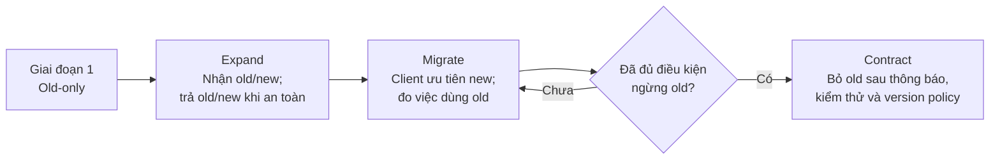

# Đổi tên, đổi kiểu, siết validation và bỏ trường

> **Chương:** Tiến hóa API  
> **Module:** `INTEGRATION_API_REST` — thiết kế REST API dựa trên resource, URI, phương thức và mã trạng thái HTTP; thực hành hợp đồng dữ liệu, OpenAPI, xác thực, phân quyền, xử lý lỗi và kiểm thử với Java/Spring hoặc công nghệ tương đương.

Một API dùng trong sản phẩm thật sẽ thay đổi: `customerName` được đổi thành `buyerName`, số tiền cần độ chính xác lớn hơn, giới hạn `quantity` phải siết từ 100 xuống 20 và một trường chứa thông tin cá nhân cần ngừng cung cấp. Những thay đổi tưởng như chỉ sửa vài dòng DTO lại có thể khiến mobile client cũ mất dữ liệu, SDK không parse được JSON hoặc request đang hợp lệ bỗng nhận `422`.

**Tiến hóa API** là thay đổi hợp đồng giữa các bên có thể phát hành ở thời điểm khác nhau. Mục tiêu không phải “không bao giờ breaking change”, mà là **phân loại đúng tác động, chuyển đổi có kiểm soát và có bằng chứng mọi client quan trọng đã sẵn sàng**. Bài này đi sâu vào bốn thao tác: đổi tên, đổi kiểu, siết validation và bỏ trường; tập trung HTTP/JSON, OpenAPI 3.1, Java/Spring, bảo mật và kiểm thử.

## Mục tiêu học tập

Sau bài này, bạn có thể:

1. Phân tích tương thích theo **chiều request và response**, biết vì sao “thêm field là an toàn” không đúng trong mọi trường hợp.
2. Lập kế hoạch **expand → migrate → contract** khi đổi tên field mà nhiều client đang sử dụng.
3. Nhận diện các rủi ro khi đổi JSON type, phạm vi số, đơn vị tiền tệ và nullability; chọn giải pháp versioning khi cần.
4. Đánh giá tác động khi siết `required`, `min/max`, `enum`, pattern hoặc chính sách field lạ.
5. Gỡ bỏ trường qua deprecation, telemetry, thay thế, thông báo và kiểm thử tương thích; xử lý ngoại lệ khẩn cấp do bảo mật.
6. Minh họa DTO/validation với Spring Boot và cách mô tả giai đoạn chuyển tiếp bằng OpenAPI 3.1.
7. Viết contract tests, consumer tests, migration checklist và rollback plan cho từng loại thay đổi.

## 1. Hai chiều hợp đồng: request và response

Ở **chiều request**, server đọc payload do client gửi. Ở **chiều response**, client đọc representation server trả về. Tương thích cần kiểm tra **cả hai**:

| Thay đổi | Request cũ tới server mới | Client cũ đọc response mới |
| --- | --- | --- |
| Thêm input field tùy chọn | Thường ổn nếu server vẫn chấp nhận payload cũ. | Không ảnh hưởng trực tiếp. |
| Thêm output field | Không ảnh hưởng trực tiếp. | Có thể vỡ nếu client từ chối unknown properties. |
| Đổi tên `customerName` → `buyerName` | Vỡ nếu ngừng nhận tên cũ. | Vỡ nếu ngừng phát tên cũ. |
| Đổi JSON number → string | Vỡ nếu chỉ nhận kiểu mới. | Vỡ khi DTO cũ đòi number. |
| Giảm maximum từ 100 xuống 20 | Request 21–100 bị từ chối dù từng hợp lệ. | Không nhất thiết vỡ cấu trúc, nhưng đổi hành vi. |
| Bỏ output field | Không ảnh hưởng input. | Có thể làm null/crash hoặc sai business logic. |
| Bỏ input field | Client cũ gửi field có thể bị từ chối. | Không ảnh hưởng trực tiếp. |

Đánh giá theo ba lớp: **wire compatibility** (URI, HTTP status, media type, JSON shape), **semantic compatibility** (ý nghĩa, đơn vị, validation) và **operational compatibility** (deploy khác thời điểm, SDK cũ, mobile offline, cache/proxy). JSON Schema diff phát hiện nhiều thay đổi nhưng **không biết consumer đang phụ thuộc trường nào**.

## 2. Tình huống thực hành: API đơn hàng

```http
HTTP/1.1 200 OK
Content-Type: application/json

{"id":42,"customerName":"Lan","totalMinor":259000,"quantity":5,"status":"PAID"}
```

Nhóm muốn đổi `customerName` → `buyerName`; thêm biểu diễn tiền an toàn cho số lớn; siết `quantity` từ 1–100 xuống 1–20; rồi bỏ field cũ. Ngoài ra, tên người mua chỉ được trả cho caller đủ quyền.

**Không phát hành tất cả thay đổi trong một bước.** Mỗi thay đổi cần biết client bị ảnh hưởng, cách chuyển đổi, dấu hiệu adoption, error contract và rollback. Giữ riêng trường hợp bảo mật khẩn cấp: không vì “backward compatibility” mà tiếp tục trả PII cho người không có quyền.

## 3. Đổi tên field: đừng thay thế ngay lập tức

Một cách làm gây breaking change:

```json
{"buyerName":"Lan"}
```

Nếu client cũ chỉ đọc `customerName`, nó có thể nhận null, crash hoặc hiển thị trống. Nếu server mới không nhận `customerName` trong request, các phiên bản mobile không cập nhật sẽ bị từ chối.

### 3.1 Expand → migrate → contract



| Giai đoạn | Server nhận request | Server trả response | Client |
| --- | --- | --- | --- |
| Trước thay đổi | `customerName` | `customerName` | Chỉ biết tên cũ. |
| **Expand** | `customerName` **hoặc** `buyerName`. | Hai field cùng giá trị **nếu dual-write response được cho phép**. | Client cũ vẫn hoạt động; client mới bắt đầu đọc `buyerName`. |
| **Migrate** | Tiếp tục nhận hai tên; ghi telemetry tên cũ. | Vẫn giữ khả năng của client cũ, hoặc chọn representation theo version đã công bố. | Cập nhật SDK/app, phát hành, kiểm tra adoption. |
| **Contract** | Chỉ còn `buyerName` theo version mới. | Bỏ `customerName` đúng lịch/chính sách. | Client đã đổi và test thành công. |

Ví dụ response chuyển tiếp:

```json
{
  "id": 42,
  "customerName": "Lan",
  "buyerName": "Lan",
  "status": "PAID"
}
```

**Hai field phải được lấy từ một nguồn dữ liệu có thẩm quyền**, không để một field được cập nhật mà field kia bị cũ. Với hệ thống có strict client từ chối unknown field, việc **thêm** `buyerName` cũng có thể phá tương thích. Khi đó chọn **versioned representation** hoặc thương lượng media type thay vì giả định dual-write an toàn.

### 3.2 Nếu client gửi cả hai tên?

Request chuyển tiếp:

```json
{"customerName":"Lan","buyerName":"Mai"}
```

Không được âm thầm chọn field xuất hiện sau cùng, vì thứ tự property JSON không nên quyết định nghiệp vụ. Quy định một chính sách rõ:

- Chỉ cho gửi **một trong hai tên**; gửi cả hai thì `400 Bad Request` với `AMBIGUOUS_FIELD_ALIAS`.
- Hoặc cho cả hai **nếu giá trị bằng nhau sau chuẩn hóa**; khác nhau thì từ chối. Cần nêu chuẩn hóa nào được chấp nhận (trim/case/Unicode) để tránh hiểu sai tên người.

Đối với API minh họa, ta chọn chính sách đầu: **exactly one**. Nó dễ mô tả bằng JSON Schema `oneOf`, dễ test và tránh ambiguity. Nếu cả hai đều không có, request thiếu input và phải trả lỗi validation theo hợp đồng.

### 3.3 Mã lỗi và telemetry

Khi payload sai, dùng `400` cho dạng cấu trúc nhập nhằng hoặc `422` cho validation nội dung theo quy ước nhất quán; không dùng `409` chỉ vì hai tên trường xung đột trong JSON — `409` thường dành cho xung đột với **trạng thái tài nguyên**.

Theo dõi `old_name_requests_total` trên route/client version (không ghi tên người dùng vào metric label). Để biết client nào vẫn **đọc** field cũ từ response, telemetry phía server chưa đủ: cần consumer contract tests, danh sách SDK/app phiên bản và phối hợp với chủ các client.

## 4. Đổi kiểu field: nguy cơ lớn hơn đổi tên

JSON phân biệt **number** và **string**. Chuyển:

```json
{"totalMinor":259000}
```

thành:

```json
{"totalMinor":"259000"}
```

là thay đổi kiểu trên wire dù ý nghĩa con số giữ nguyên. Java SDK sinh từ OpenAPI có thể đang dùng `Integer`/`Long`, TypeScript client có thể kỳ vọng `number` và database mapping có thể không chấp nhận `string`.

### 4.1 Các kiểu đổi cần đánh giá riêng

| Thay đổi | Rủi ro |
| --- | --- |
| `integer → string` | Phá JSON type; client không parse hoặc tính toán sai. |
| `integer → number` có thập phân | Client cũ mất phần lẻ khi ép về integer hoặc validation chặn. |
| `int32 → int64` trong OpenAPI | JSON vẫn là number nhưng giá trị mới có thể vượt kiểu số phía client; **không tự coi là an toàn**. |
| `number` sang giá trị tiền decimal dạng string | Có thể tăng độ chính xác nhưng đổi contract và cách tính toán. |
| `string → enum` hoặc thu hẹp enum | Các giá trị cũ có thể không còn hợp lệ; SDK sinh enum có thể vỡ. |
| `string → object` | Thay đổi cấu trúc lớn, client cũ cần migration. |
| `string` cho phép `null` → không cho `null` | Client cũ từng gửi/nhận null có thể không tương thích. |

**Số nguyên lớn:** JSON number không tự mang giới hạn `int32/int64`. Nhiều môi trường JavaScript biểu diễn number bằng IEEE-754 binary64; các integer lớn hơn **2^53 − 1** không còn được bảo đảm chính xác. Nếu cần giá trị lớn, hãy chọn format và đơn vị rõ, test cross-language, không đơn giản đổi Java `int` sang `long` rồi tuyên bố tương thích.

### 4.2 Thêm field mới có ngữ nghĩa rõ hơn

Một lộ trình an toàn hơn cho ví dụ tiền:

```json
{
  "totalMinor": 259000,
  "totalMinorText": "259000",
  "currency": "VND"
}
```

- `totalMinor` giữ contract cũ **chỉ trong phạm vi biểu diễn an toàn của client cũ**.
- `totalMinorText` được mô tả là chuỗi số nguyên đơn vị nhỏ nhất; client mới parse bằng kiểu số lớn thích hợp.
- `currency` nói rõ loại tiền và đơn vị, tránh đổi ngầm ý nghĩa.
- Khi dữ liệu mới **không thể** diễn đạt chính xác qua field cũ, không được ghi giá trị bị cắt, làm tròn hay overflow. Lúc đó có thể cần **versioned endpoint/representation**, thay vì cố duy trì dual-field cho mọi trường hợp.

Ví dụ tiền tệ còn phải xử lý **đơn vị nhỏ nhất và làm tròn**, không xem `259000` luôn có cùng ý nghĩa ở mọi currency. Nếu chọn chuỗi decimal như `"2590.00"`, phải định nghĩa scale, dấu âm, quy tắc rounding và locale độc lập với dấu phẩy hiển thị.

### 4.3 Có nên dùng oneOf số hoặc chuỗi trên cùng field?

```yaml
totalMinor:
  oneOf:
    - type: integer
    - type: string
      pattern: '^[0-9]+$'
```

Một hợp đồng nhận **cả số và chuỗi** có thể hữu ích ở chiều request chuyển tiếp, nhưng làm SDK phức tạp, cần quy tắc chuẩn hóa và có thể che lỗi client. Với **response**, server phải chọn một kiểu cho mỗi representation hoặc version; nếu thay đổi ngẫu nhiên giữa number/string sẽ khó cho client cũ. Ưu tiên **field mới**, explicit version hoặc schema contract được thương lượng rõ ràng.

## 5. Siết validation: một thay đổi hành vi có thể breaking

Giả sử trước đây:

```yaml
quantity:
  type: integer
  minimum: 1
  maximum: 100
```

Sau thay đổi:

```yaml
quantity:
  type: integer
  minimum: 1
  maximum: 20
```

Request `{"quantity":50}` trước đây hợp lệ, nay bị từ chối. Việc siết giới hạn có thể cần vì an toàn kinh doanh nhưng vẫn là **breaking change đối với client đang gửi 21–100**.

### Những loại siết thường gặp

| Thay đổi | Phía bị ảnh hưởng | Cách kiểm tra |
| --- | --- | --- |
| Optional → required trong request. | Client cũ bỏ field. | Tìm payload thật thiếu field; thử SDK cũ. |
| Min tăng / max giảm. | Client gửi giá trị từng hợp lệ. | Thống kê phân bố đầu vào, đặc biệt p99/cực trị. |
| Pattern chặt hơn. | Tên, số điện thoại, mã hàng có format cũ. | So bộ dữ liệu hợp lệ theo phiên bản trước. |
| Enum bỏ giá trị. | Request hoặc response ở trạng thái cũ. | Consumer test và dữ liệu lưu từ trước. |
| `null` bị cấm. | Client cũ gửi null để xóa/không biết. | Test absent khác null; đặc biệt JSON Merge Patch. |
| `additionalProperties: true → false`. | Client gửi extension/field chưa biết. | Xem payload thực, xác định whitelist và ngoại lệ. |
| Trường hợp lỗi bắt đầu trả `422` thay vì `400`. | Client dựa vào status/code. | Kiểm thử error contract, không chỉ happy path. |

Đừng chỉ đổi OpenAPI `maximum: 20` rồi quên Bean Validation `@Max(100)`. Và đừng chỉ thay `@Max(20)` rồi chưa cập nhật SDK/spec: **runtime và hợp đồng phải đồng bộ**.

### Lộ trình siết validation

1. **Đo trước:** thu thập số request dùng giá trị sắp bị cấm; tránh log raw payload có PII.
2. **Thông báo sớm:** cập nhật tài liệu và client validation, cảnh báo UX nếu phù hợp.
3. **Chuyển client:** cập nhật giao diện/SDK, kiểm thử trên dữ liệu thực.
4. **Kích hoạt server policy:** triển khai theo version hay giai đoạn có giám sát; trường hợp nghiêm trọng về bảo mật cần siết ngay và thông báo.
5. **Quan sát lỗi:** theo dõi `VALIDATION_FAILED` phân theo constraint, tần suất `4xx` và mục tiêu nghiệp vụ.
6. **Rollback hoặc khắc phục:** có khả năng khôi phục policy trước (nếu an toàn), sửa dữ liệu tồn đọng và bảo đảm không mất tính đúng đắn.

**Nới lỏng validation** ở request thường dễ tương thích hơn so với siết, nhưng có thể đưa giá trị mới vào response khiến client cũ không hiểu. Ví dụ server chấp nhận trạng thái mới `PENDING_REVIEW` và bắt đầu trả trạng thái đó cho mobile SDK có enum đóng — đây vẫn là nguy cơ breaking.

## 6. Bỏ trường: deprecation không phải xóa ngay

Khi đã có `buyerName`, nhóm muốn dừng phát `customerName`. Đánh dấu `deprecated: true` trong OpenAPI **chỉ là tín hiệu tài liệu**; nó không tự khiến client đổi code hoặc khiến server từ chối trường cũ.

Ví dụ:

```yaml
CustomerOrder:
  type: object
  properties:
    customerName:
      type: string
      deprecated: true
      description: Use buyerName instead; removal follows published policy.
    buyerName:
      type: string
```

### Điều kiện nên đạt trước khi bỏ

- Có **field thay thế** hoặc giải thích rõ vì sao dữ liệu không còn được cung cấp.
- Đã công bố **mốc hỗ trợ, mốc ngừng dùng** hoặc version mới, kèm kênh liên hệ và hướng dẫn chuyển đổi.
- Biết danh sách client quan trọng: web, mobile cũ, đối tác, batch, ứng dụng offline và SDK đã phát hành.
- Có contract tests của consumer hoặc bằng chứng tương đương rằng client không còn phụ thuộc field.
- Đã kiểm tra code generator, mapping database/analytics, cache, webhook payload và event schemas liên quan.
- Có rollback/hotfix hợp lý nếu sau khi bỏ mới phát hiện phụ thuộc chưa biết.
- Đã xác định retention/logging: việc bỏ field trong JSON không đồng nghĩa xóa khỏi database, logs hay bản lưu khác.

### Bảo mật có thể buộc bỏ nhanh

Nếu `customerName` hoặc trường mới chứa dữ liệu cá nhân mà client không có quyền nhận, **không nên kéo dài rò rỉ chỉ để giữ tương thích**. Khi có yêu cầu pháp lý/bảo mật, ưu tiên loại bỏ dữ liệu khỏi response trái quyền, cập nhật threat model và thông báo breaking change theo quy trình xử lý sự cố.

Trường **nhạy cảm** khác field **deprecated**: dù còn được hỗ trợ ở version cũ, quyền truy cập vẫn phải được kiểm tra trên mỗi request. Không áp dụng dual-write rộng rãi cho toàn bộ khách hàng khi trường chỉ nên trả cho một số vai trò.

## 7. Khi nào cần version API mới?

Expand/dual-field thích hợp **chỉ khi** client đã được xác minh chấp nhận representation mới. Nên tách version khi kiểu/ngữ nghĩa cùng field thay đổi, strict parser không nhận field mới, cần chuyển đơn vị, hoặc các giới hạn nghiệp vụ cũ và mới phải song song tồn tại.

| Cách | Ví dụ | Đánh đổi |
| --- | --- | --- |
| URL version | `/api/v1/orders` và `/api/v2/orders` | Dễ phân biệt, tăng số route và chi phí hỗ trợ. |
| Content negotiation | `Accept: application/vnd.example.order.v2+json` | Giữ URI; phải cấu hình `Vary: Accept`, ETag và cache đúng. |
| Cùng endpoint giai đoạn chuyển tiếp | Nhận old/new, dual response có điều kiện. | Giảm URL, tăng complexity và rủi ro strict clients. |

Không có quy định HTTP bắt buộc một cách versioning duy nhất. Hãy xác định **v1 được hỗ trợ tới ngày nào**, client chọn version ra sao, cùng request có được trả representation nhất quán không và API có kiểm tra quyền trên mọi version không. Với dữ liệu riêng tư, cache không được trả response của người dùng/version khác.

## 8. OpenAPI 3.1: mô tả giai đoạn đổi tên

Ví dụ endpoint `PUT /api/orders/{orderId}/buyer` thay thế thông tin tên người mua. Trong giai đoạn expand, server nhận **chính xác một** trong hai property. Response chuyển tiếp trả cả hai tên khi caller có quyền xem.

```yaml
openapi: 3.1.0
info:
  title: Orders API
  version: 1.4.0
servers:
  - url: https://api.example.test/api
security:
  - bearerAuth: []
paths:
  /orders/{orderId}/buyer:
    put:
      operationId: replaceOrderBuyer
      parameters:
        - name: orderId
          in: path
          required: true
          schema: { type: integer, format: int64 }
      requestBody:
        required: true
        content:
          application/json:
            schema:
              $ref: '#/components/schemas/BuyerNameRequest'
      responses:
        '200':
          description: Current buyer representation
          content:
            application/json:
              schema: { $ref: '#/components/schemas/BuyerNameView' }
        '400': { description: Malformed or ambiguous buyer field }
        '401': { description: Authentication required }
        '403': { description: Forbidden }
        '404': { description: Order not found or not disclosed }
        '409': { description: Business state conflict }
        '415': { description: Unsupported request media type }
        '422': { description: Invalid value }
components:
  securitySchemes:
    bearerAuth:
      type: http
      scheme: bearer
  schemas:
    BuyerNameRequest:
      type: object
      additionalProperties: false
      properties:
        customerName:
          type: string
          minLength: 1
          maxLength: 200
          deprecated: true
        buyerName:
          type: string
          minLength: 1
          maxLength: 200
      oneOf:
        - required: [customerName]
        - required: [buyerName]
    BuyerNameView:
      type: object
      required: [customerName, buyerName]
      properties:
        customerName:
          type: string
          deprecated: true
        buyerName: { type: string }
```

`oneOf` với hai nhánh `required` ở đây khiến request gửi **cả hai** hoặc **không có trường nào** đều không hợp lệ. Nếu client/tool generator xử lý `oneOf` kém, hãy thử tương thích của toolchain hoặc chọn versioned contracts rõ ràng; không bỏ kiểm tra server chỉ vì schema đã mô tả.

**Điểm bảo mật:** response chỉ nên trả hai tên cho người có quyền đọc chúng. `BuyerNameView` là projection được kiểm soát, **không phải entity database được serialize thẳng**.

## 9. Java/Spring: alias và kiểm tra tính nhập nhằng

Jackson hỗ trợ đọc tên cũ bằng `@JsonAlias`:

```java
import com.fasterxml.jackson.annotation.JsonAlias;
import jakarta.validation.constraints.NotBlank;

record BuyerRenameRequest(
    @JsonAlias("customerName") @NotBlank String buyerName
) {}
```

`@JsonAlias` dùng cho **deserialization**, không làm response tự chứa cả hai tên. Nếu JSON gửi cả `customerName` và `buyerName`, thứ tự property có thể ảnh hưởng giá trị cuối. Với hợp đồng `oneOf` (chính xác một tên), cần kiểm tra **sự hiện diện của key**, kể cả khi một key chứa JSON `null`.

Controller minh họa sau chủ động đọc `JsonNode` để bảo vệ quy tắc đó:

```java
import com.fasterxml.jackson.databind.JsonNode;
import org.springframework.http.*;
import org.springframework.security.core.Authentication;
import org.springframework.web.bind.annotation.*;
import org.springframework.web.server.ResponseStatusException;

record BuyerNameView(String buyerName, String customerName) {}

interface BuyerService {
    // Kiểm tra quyền và state của order, ghi bằng transaction.
    String replaceAuthorized(long orderId, String username, String newName);
}

@RestController
@RequestMapping("/api/orders")
class BuyerController {
    private final BuyerService service;
    BuyerController(BuyerService service) { this.service = service; }

    @PutMapping(path="/{orderId}/buyer",
                consumes=MediaType.APPLICATION_JSON_VALUE)
    ResponseEntity<BuyerNameView> replace(
            @PathVariable long orderId,
            Authentication auth,
            @RequestBody JsonNode body) {
        if (body == null || !body.isObject()) {
            throw new ResponseStatusException(HttpStatus.BAD_REQUEST);
        }
        boolean oldKey = body.has("customerName");
        boolean newKey = body.has("buyerName");
        if (oldKey == newKey || body.size() != 1) {
            throw new ResponseStatusException(
                HttpStatus.BAD_REQUEST, "Exactly one known field required");
        }
        JsonNode value = body.get(newKey ? "buyerName" : "customerName");
        if (!value.isTextual() || value.asText().isBlank()
                || value.asText().length() > 200) {
            throw new ResponseStatusException(
                HttpStatus.UNPROCESSABLE_ENTITY, "Invalid buyer name");
        }
        String stored = service.replaceAuthorized(
            orderId, auth.getName(), value.asText());
        return ResponseEntity.ok(new BuyerNameView(stored, stored));
    }
}
```

Đây là skeleton Spring Boot 3: yêu cầu cấu hình Spring Security, authentication không null, error handler và service implementation. Check `body.size()!=1` đồng thời từ chối **unknown fields** theo schema; nếu muốn phát hiện **JSON duplicate keys cùng tên**, còn phải bật strict duplicate detection ở parser. Service phải kiểm tra owner/tenant và không bind input trực tiếp vào JPA entity.

Dual-response được dùng **chỉ khi** consumer cũ đọc được field mới. API production có thể thay `JsonNode` bằng DTO + custom validator/deserializer, kết hợp `@Valid`, `@NotBlank`, `@Size`; tất cả đường old/new phải chịu cùng rules. Đổi kiểu số nên có DTO/version riêng và mapper sang `BigInteger/BigDecimal` nội bộ, kiểm tra overflow, đơn vị và rounding.

## 10. Bảo mật và tính đúng đắn khi tiến hóa

Một giai đoạn tương thích ngược kéo dài có thể vô tình tăng bề mặt tấn công:

- **Mass assignment:** nếu client được phép gửi field mới như `role`, `price` hoặc `ownerId`, đừng copy JSON thẳng lên entity. Dùng DTO allowlist và authz theo từng hành động.
- **Alias bypass validation:** trường cũ và mới phải chịu **cùng validation, quyền và audit**, không có “đường cũ” dễ dãi hơn.
- **Dual response và PII:** phát hai tên không có nghĩa được trả cho mọi role; chỉ publish các field trong đúng phạm vi quyền.
- **Unknown fields:** `additionalProperties: false` giúp hợp đồng chặt chẽ nhưng có thể phá client cũ; kiểm tra và đưa ra thời điểm siết rõ. Đừng bỏ qua unknown fields chứa thông tin bảo mật nhạy cảm mà client tưởng đã được xử lý.
- **Status và thông báo:** khi siết validation, giữ định dạng `application/problem+json`, `code` ổn định; không phản chiếu dữ liệu người mua, token hay raw request trong `detail`/logs.
- **Caching:** thay đổi response fields có thể yêu cầu ETag/cache invalidation; representation khác nhau theo media type/role phải có cache scope và `Vary` phù hợp.
- **Dữ liệu lưu trữ:** client cũ có thể gửi record mang kiểu cũ từ offline queue. Migration phải xem cách parse và backfill dữ liệu cũ, không chỉ current web requests.

Đổi tên trường **không phải** quyền để đổi ngầm giá trị hoặc đơn vị. Một tài liệu “vẫn JSON hợp lệ” nhưng làm sai tổng tiền là lỗi hợp đồng nghiêm trọng hơn lỗi parser rõ ràng.

## 11. Kiểm thử tương thích với client thật

Test cả **schema diff**, **HTTP runtime** và **consumer contract**:

| Test | Trường hợp | Kỳ vọng |
| --- | --- | --- |
| T01/T02 | PUT chỉ `customerName` / chỉ `buyerName`. | Cùng kết quả hợp lệ, cùng quyền và validation. |
| T03 | Gửi cả hai key, kể cả một giá trị `null`. | `400`, không ghi; không phụ thuộc thứ tự JSON. |
| T04 | Không key, blank/null hoặc field lạ. | 4xx theo hợp đồng; không có side effect. |
| T05 | SDK cũ đọc dual response. | Không crash vì unknown `buyerName`; nếu không, cần version. |
| T06 | JSON number/string, ranh giới 32/64-bit, `2^53−1`. | Không overflow, mất precision hoặc đổi đơn vị. |
| T07 | `quantity=20`, `quantity=21`. | Ranh giới validation rõ; 4xx + `code` ổn định. |
| T08 | Client cũ thiếu newly-required field / nhận enum mới. | Hoạt động trong cửa sổ hỗ trợ hoặc tách version. |
| T09 | Client vẫn phụ thuộc field sắp bỏ. | Consumer contract test chặn removal sớm. |
| T10 | Người khác cập nhật bằng alias cũ; gửi `role:"ADMIN"`. | Không vượt quyền/mass assignment, không tiết lộ PII. |
| T11 | Client v1/v2 và cache. | Representation/ETag đúng version và quyền. |
| T12 | Mobile offline gửi payload cũ. | Chính sách hỗ trợ được thực thi nhất quán. |

MockMvc cho nhánh nhập nhằng:

```java
@Test
void rejectsOldAndNewNamesTogether() throws Exception {
    mvc.perform(put("/api/orders/42/buyer")
            .with(user("order-owner"))
            .contentType(MediaType.APPLICATION_JSON)
            .content("""
                {"customerName":"Lan","buyerName":"Mai"}
                """))
        .andExpect(status().isBadRequest());
    verifyNoInteractions(buyerService);
}
```

Test skeleton cần Spring Security Test, Mockito và controller fixture; nó không chứng minh database không đổi. Bổ sung **integration tests** với DB, principal khác nhau và SDK phiên bản cũ. Quy trình CI: **validate OpenAPI 3.1 → semantic diff field/type/required/min/max → consumer tests cũ/mới → HTTP tests → security & concurrency → canary telemetry**. Static diff không thể chứng minh một consumer đã ngừng dùng field.

## 12. Rollout, điều kiện loại bỏ và rollback

| Giai đoạn | Việc làm | Điều kiện chuyển bước |
| --- | --- | --- |
| **Inventory** | Liệt kê client web, mobile/offline, partner, SDK, batch và dữ liệu đang dùng field cũ. | Có owner và mức rủi ro từng consumer. |
| **Expand** | Nhận old/new; dual response nếu an toàn hoặc versioned contract; cùng authz/validation. | Old/new contract tests đều PASS. |
| **Announce** | Cập nhật OpenAPI, deprecation, migration guide và lịch ngừng hỗ trợ. | Consumer có đủ thời gian chuẩn bị. |
| **Migrate** | Triển khai client, đo request dùng field cũ và chạy SDK tests. | Client quan trọng đã chuyển; không suy đoán từ server metrics về field được client đọc. |
| **Gate + contract** | Đạt ngưỡng adoption trong cửa sổ đại diện, được API owner duyệt rồi loại bỏ. | Canaries, 4xx/business success và support không phát hiện phá vỡ ngoài kế hoạch. |
| **Clean up** | Dọn alias/DTO cũ, bản đồ dữ liệu, docs và runbook. | Không còn đường ghi cũ trái phép. |

Rollback phải thiết kế **trước khi xóa schema/data**. Nếu database đã drop field hoặc dữ liệu mới vượt miền kiểu cũ, rollback app không thể khôi phục bằng một feature flag. Dùng database migration theo trình tự **expand rồi contract**, giữ compatibility window đủ dài; ưu tiên an toàn/pháp lý khi xử lý trường nhạy cảm.

## 13. Bài thực hành: tiến hóa API hồ sơ vận chuyển

API `POST /api/shipments` và `GET /api/shipments/{id}` hiện dùng:

```json
{
  "recipientPhone": "0900000000",
  "weight": 2500,
  "service": "STANDARD",
  "instructions": null
}
```

Nhóm đề xuất:

- `recipientPhone` → `contactPhone`.
- `weight` số gram kiểu integer → `weightGramsText` là chuỗi số nguyên để hỗ trợ giá trị lớn và nhất quán cross-language.
- Giới hạn trọng lượng tối đa từ **30.000 gram** xuống **20.000 gram** với lệnh tạo mới.
- Không cho phép `service=LEGACY` đối với shipment tạo mới, nhưng các shipment lịch sử vẫn có thể mang trạng thái/giá trị đó.
- Bỏ `recipientPhone` khỏi response sau một giai đoạn migration; dữ liệu điện thoại chỉ được trả cho người đủ quyền.

### Yêu cầu thực hiện

1. Lập bảng request/response compatibility cho cả năm thay đổi.
2. Thiết kế ít nhất hai giai đoạn rollout; chỉ ra trường nào dual-read/dual-write và trường nào cần versioned representation.
3. Viết OpenAPI 3.1 cho tên cũ/mới ở request với `oneOf` và đánh dấu deprecated; mô tả `weightGramsText`.
4. Viết một DTO hoặc deserializer Spring xử lý cả tên cũ/mới, chặn việc gửi cả hai và kiểm tra quyền cập nhật.
5. Định nghĩa status `400/422` cho validation, `401/403/404` cho quyền và `409` cho xung đột nghiệp vụ nếu có.
6. Viết ít nhất sáu tests bao gồm: old name, new name, both fields, trọng lượng 20.000/20.001, số lớn vượt JS safe integer, strict client đọc response có field mới và cross-user access.
7. Lập kế hoạch theo dõi adoption, trường hợp mobile offline và rollback nếu schema đã đổi.

### Gợi ý đáp án

- Tên mới có thể được hỗ trợ bằng dual-read/dual-response **nếu** client cũ chấp nhận unknown fields; nếu không, tách version.
- Đổi gram number thành text là đổi JSON type; dùng field mới để tránh thay cùng field, nhưng không phát số cũ mất chính xác cho giá trị lớn.
- Siết max của request cũ là breaking đối với các lô hàng nặng 20.001–30.000 gram, dù JSON vẫn hợp lệ.
- Một giá trị enum không còn được **nhận cho request tạo mới** không có nghĩa được xóa khỏi **response dữ liệu lịch sử**; cần migration hoặc consumer handling.
- Điện thoại là dữ liệu nhạy cảm: quyền truy cập quan trọng hơn dual-write.
- Tests phải chứng minh không có side effect sai khi request bị từ chối và client cũ không crash.

## 14. Checklist trước khi đổi hợp đồng

- [ ] Đã phân tích riêng **request consumer** và **response consumer**.
- [ ] Đã phân biệt tương thích kiểu JSON, ý nghĩa/đơn vị và hành vi nghiệp vụ.
- [ ] Đổi tên có dual-read/dual-write hoặc versioned contract, có quy tắc khi cả old/new xuất hiện.
- [ ] Đổi kiểu không gây overflow, mất precision hay coercion ngầm; có test đa ngôn ngữ.
- [ ] Validation mới có đo impact, thông báo, runtime enforcement và error contract.
- [ ] Field bỏ đi đã deprecated, có lộ trình consumer migration và phương án cho client offline.
- [ ] Security và kiểm soát PII áp cho cả field cũ và mới; không mass assignment.
- [ ] OpenAPI, Jackson/Bean Validation, response DTO và SDK khớp nhau.
- [ ] Có old/new consumer tests, contract diff, kiểm thử HTTP thực và migration database.
- [ ] Có gate loại bỏ, quan sát rollout và rollback đủ khả thi.

**Kết luận:** đổi tên, đổi kiểu, siết validation và bỏ trường đều có thể phá API theo những cách khác nhau. Đừng đánh giá tương thích chỉ bằng việc JSON còn parse được. Hãy bảo vệ cả **wire format, ngữ nghĩa dữ liệu, quyền truy cập và khả năng deploy độc lập của client**; chuyển đổi theo giai đoạn, dùng version khi cần và chỉ bỏ đường cũ khi có bằng chứng kiểm thử lẫn vận hành.
