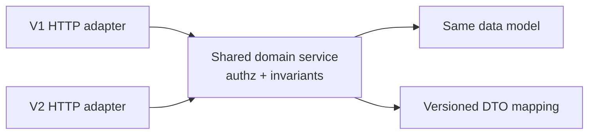

# Version trong path, header hoặc media type và các đánh đổi

> **Module:** INTEGRATION_API_REST — thiết kế REST API theo resource, URI, HTTP method/status và hợp đồng dữ liệu; thực hành phân trang, cache, idempotency, OpenAPI, xác thực, phân quyền, xử lý lỗi và kiểm thử với Java/Spring.  
> **Chương:** Tiến hóa API.  
> **Trọng tâm:** Chọn chiến lược phiên bản qua **đường dẫn (path)**, **HTTP header** hoặc **media type**, đánh giá tác động lên client, cache, gateway, hợp đồng OpenAPI và vận hành quá trình chuyển đổi.

## 1. Bài toán: thay đổi hợp đồng mà không làm hỏng client

API quản lý đơn hàng v1 đang được hai ứng dụng di động và ba đối tác sử dụng:

```http
GET /api/v1/orders/ord-501 HTTP/1.1
Host: api.example.com
Authorization: Bearer <token>
Accept: application/json
```

```http
HTTP/1.1 200 OK
Content-Type: application/json

{"id":"ord-501","totalAmount":125000,"status":"PAID"}
```

Ở v2, nghiệp vụ yêu cầu mô tả rõ tiền tệ và thay cấu trúc trường `totalAmount`:

```json
{
  "id": "ord-501",
  "total": {
    "amount": 125000,
    "currency": "VND"
  },
  "status": "PAID"
}
```

Đây là **breaking change** cho client đang đọc `totalAmount` ở cấp root. Việc v1 và v2 cùng trả JSON không làm chúng tương thích.

Nhóm có ba lựa chọn điển hình:

```text
Path:       GET /api/v1/orders/ord-501
            GET /api/v2/orders/ord-501

Header:     GET /api/orders/ord-501
            API-Version: 1
            API-Version: 2

Media type: GET /api/orders/ord-501
            Accept: application/vnd.example.order.v1+json
            Accept: application/vnd.example.order.v2+json
```

**Mục tiêu không phải chọn một cách “đúng tuyệt đối”**. Mục tiêu là giữ API có thể tiến hóa, để client biết chính xác hợp đồng nó đang sử dụng, hệ thống quan sát được mức sử dụng phiên bản và nhóm triển khai có thể chuyển đổi an toàn.

Sau bài, bạn sẽ biết:

1. Phân biệt **phiên bản API nghiệp vụ** với **phiên bản OpenAPI document** và phiên bản ứng dụng.
2. Đánh giá path, header và media type dựa trên HTTP, caching, gateway, tooling và DX.
3. Thiết kế quy tắc version mặc định, version không hỗ trợ và xung đột tín hiệu.
4. Triển khai ba cách trong Java/Spring mà không bỏ qua bảo mật và content negotiation.
5. Tổ chức migration v1 → v2, deprecation, contract tests và theo dõi thực tế.

## 2. Khi nào cần phiên bản mới?

Không phải mọi thay đổi đều cần thêm `v2`. Phiên bản hóa thường cần thiết khi **hợp đồng quan sát được bởi consumer** thay đổi không tương thích và không thể xử lý bằng cách mở rộng an toàn.

| Thay đổi | Đánh giá ban đầu | Vì sao |
|---|---|---|
| Thêm trường **tùy chọn** vào response | Thường tương thích, **nếu** client bỏ qua trường lạ | Client sinh SDK/validator quá chặt có thể vẫn lỗi |
| Thêm trường **bắt buộc** vào request | Breaking | Client cũ không gửi được |
| Đổi `totalAmount` số thành object | Breaking | Kiểu/đường dẫn dữ liệu đổi |
| Xóa response field đang có người dùng | Breaking | Client cũ không còn dữ liệu kỳ vọng |
| Đổi mã `201` thành `200` hoặc bỏ `Location` | Có thể breaking | Client và retry logic phụ thuộc status/header |
| Mở rộng enum response | Cần kiểm tra | Client dùng exhaustive switch có thể lỗi |
| Siết validation độ dài/quy tắc ngày | Có thể breaking | Request từng hợp lệ giờ bị từ chối |
| Chỉnh mô tả OpenAPI, thêm ví dụ | Thường không breaking | Không đổi wire contract |
| Tối ưu database mà response không đổi | Không cần version mới | Thay đổi nội bộ |
| Thay auth scope, URL tài nguyên hoặc semantics phân trang | Có thể breaking | Hợp đồng giao thức/quyền đã đổi |

Cần đánh giá **hợp đồng thực tế**, không chỉ JSON Schema. Đổi một trường từ `null` sang không xuất hiện, thay thứ tự sắp xếp mặc định, bỏ hỗ trợ idempotency key hoặc thay `409` bằng `202` đều có thể ảnh hưởng client dù URL giữ nguyên.

**Phân biệt ba “version”:**

- `openapi: 3.1.2` xác định **phiên bản ngôn ngữ đặc tả OpenAPI**.
- `info.version: 2.0.0` trong OpenAPI mô tả **phiên bản API/artifact theo quản lý sản phẩm**.
- `/v2`, `API-Version: 2` hoặc vendor media type v2 xác định **hợp đồng runtime mà consumer yêu cầu**.

Ba giá trị có thể khác nhau. Nâng tài liệu từ OAS 3.0 lên OAS 3.1 không tự đồng nghĩa phát hành v2 của REST API.

### 2.1. Phiên bản cho cái gì?

Trước khi chọn nơi đặt version, xác định phạm vi:

- **Toàn bộ API:** `/api/v2/...` cho nhóm endpoints có chung vòng đời.
- **Một nhóm resource:** chỉ hợp đồng Orders có version riêng, Catalog vẫn độc lập.
- **Một representation:** cùng đơn hàng nhưng biểu diễn JSON v1 và v2 khác nhau, phù hợp media type negotiation.
- **Một capability/feature:** thử nghiệm có feature flag hoặc capability negotiation, không nhất thiết tạo major version.

Nếu nhiều nhóm resource tiến hóa với nhịp khác nhau, một version toàn cục có thể buộc tạo `v2` cho endpoint không đổi. Nếu phiên bản riêng từng endpoint, client và docs có thể trở nên khó theo dõi. Chọn **đơn vị versioning** phản ánh ranh giới hợp đồng mà người dùng tích hợp thật sự quản lý.

## 3. Version trong path: dễ thấy và dễ route

Ví dụ:

```http
GET /api/v1/orders/ord-501 HTTP/1.1
Accept: application/json
```

```http
GET /api/v2/orders/ord-501 HTTP/1.1
Accept: application/json
```

Version nằm trong URI, vì vậy client, log, gateway và HTTP cache đều dễ nhìn thấy mà không cần đọc custom header.

### 3.1. Ưu điểm và đánh đổi

**Ưu điểm:**

- Rõ với developer và khi dùng curl/browser; dễ copy link, ghi tài liệu, phân luồng route theo `/v1` hoặc `/v2`.
- Cache mặc định phân biệt hai target URI; có thể cấu hình chính sách cache/ratelimit riêng theo route.
- API gateway và reverse proxy thường dễ định tuyến theo path.
- Client generator thường tạo base URL riêng cho từng API version mà không cần interceptor gắn header.
- Đối tác biết chính xác đang tích hợp version nào từ URL.

**Đánh đổi:**

- URL thay đổi khi version đổi; các link `self`, `Location` và liên kết HATEOAS phải trỏ đúng version được yêu cầu.
- Đổi major version có thể tạo nhiều route và docs cần bảo trì; không có nghĩa phải copy toàn bộ business logic.
- Một consumer dùng hai version trong cùng workflow phải quản lý nhiều base URI.
- Một số nhóm cho rằng version không phải danh tính resource nên không thích version trong URI; đó là lựa chọn thiết kế, không phải lỗi giao thức.

Nếu phát triển một API công khai nhiều SDK và hệ thống trung gian, **path versioning thường là phương án dễ vận hành**. Không nên vì vậy tạo `/v3` cho mọi thay đổi nhỏ: số version càng nhiều, chi phí duy trì bảo mật và contract tests càng lớn.

### 3.2. HTTP và HATEOAS phải nhất quán

```http
HTTP/1.1 201 Created
Location: /api/v2/orders/ord-501
Content-Type: application/json
```

Nếu POST vào `/api/v2/orders` mà `Location` trỏ đến `/api/v1/orders/ord-501` không chủ đích, client có thể nhận response kiểu cũ ở request tiếp. Với HAL, `_links.self.href` của v2 nên dẫn đến biểu diễn v2 hoặc chỉ rõ cơ chế chọn phiên bản tiếp theo.

**Đừng tự hiểu phiên bản trong path là phiên bản database.** Hai API version có thể đọc cùng một mô hình dữ liệu và cùng order ID, thông qua các presenter/DTO khác nhau.

## 4. Version trong HTTP header: URI ổn định, cần xử lý xuyên tầng

API có URI không đổi:

```http
GET /api/orders/ord-501 HTTP/1.1
Authorization: Bearer <token>
API-Version: 2
Accept: application/json
```

Response:

```http
HTTP/1.1 200 OK
Content-Type: application/json
API-Version: 2
Vary: API-Version
Cache-Control: private, no-cache

{"id":"ord-501","total":{"amount":125000,"currency":"VND"}}
```

`API-Version` là **header tùy biến theo hợp đồng sản phẩm**, không phải một HTTP header chuẩn có semantics versioning được mọi gateway hiểu mặc định. Có hệ thống dùng ngày phiên bản như `API-Version: 2026-11-01`, có hệ thống dùng major `2`. Chọn một kiểu, tài liệu hóa và duy trì nhất quán.

### 4.1. Vì sao nhóm có thể chọn header?

- Không cần đổi link/URI khi đổi representation.
- Version được thể hiện ở tầng metadata của request.
- SDK có thể tự gắn header theo cấu hình.
- Phù hợp khi client gọi một tập endpoint cố định, do nhóm quản lý tập trung.

Tuy nhiên, developer dùng trình duyệt/URL trực tiếp khó biết version. Header có thể bị quên trong retry, redirect, download hoặc lúc đi qua gateway; log/monitoring có thể không lưu nó. Custom header cũng làm preflight CORS phát sinh khi browser gọi cross-origin.

### 4.2. Cache key và `Vary` là rủi ro chính

Hai request cùng URI nhưng trả body khác nhau theo `API-Version` **không được dùng nhầm cùng cache entry**. Cần xử lý version ở cache key, và với HTTP caches có thể dùng:

```http
Vary: API-Version
```

`Vary` báo cho cache rằng giá trị header request ảnh hưởng lựa chọn representation. Nhưng phải **kiểm tra cấu hình CDN/proxy thực tế**: có nền tảng yêu cầu khai báo header được forward và đưa vào cache key riêng. Chỉ phát `Vary` mà edge bỏ qua header vẫn có thể xảy ra cache poisoning hoặc dữ liệu sai version.

Khi response phụ thuộc người dùng/tenant, **định phiên bản không thay bảo vệ cache riêng tư**. Dùng `Cache-Control: private` hoặc `no-store` theo mức nhạy cảm; không bật shared caching với API cá nhân chỉ vì đã có `Vary: API-Version`.

### 4.3. Cần quy tắc rõ khi không gửi header

Quyết định một trong các chính sách:

1. **Bắt buộc header**: thiếu hoặc không hỗ trợ thì trả lỗi 400 theo hợp đồng, không ngầm đổi version.
2. **Version mặc định có thời hạn**: dùng v1 cho client cũ khi thiếu header, nhưng ghi metric và kế hoạch kết thúc fallback.
3. **Chọn version theo client registration**: backend có cấu hình hợp đồng cho từng client, cần đồng bộ với token/registry và tài liệu.

Không chọn “mặc định luôn latest” nếu latest có thể thay đổi không báo trước. Khi server tự chuyển mặc định v1 sang v2, các client không gửi header có thể hỏng dù chưa cập nhật.

## 5. Version trong media type: tận dụng content negotiation

Client chọn **biểu diễn** qua `Accept`, URI resource giữ nguyên:

```http
GET /api/orders/ord-501 HTTP/1.1
Authorization: Bearer <token>
Accept: application/vnd.example.order.v2+json
```

```http
HTTP/1.1 200 OK
Content-Type: application/vnd.example.order.v2+json
Vary: Accept

{"id":"ord-501","total":{"amount":125000,"currency":"VND"}}
```

`application/vnd.example.order.v2+json` là **vendor media type theo convention ví dụ**, không phải một media type tiêu chuẩn có semantics version chung. Hậu tố `+json` cho biết cú pháp JSON. Một hệ thống khác có thể dùng media type parameter để biểu diễn phiên bản; cần công bố và giữ ổn định.

### 5.1. Ưu điểm và đánh đổi

Media type versioning thể hiện đúng ý tưởng **một resource có nhiều representation**, không đổi URI. Tuy nhiên, client phải gửi `Accept` chuẩn và kiểm tra `Content-Type` thực trả; SDK/gateway/generator có thể hỗ trợ nhiều media types trên một operation không đồng đều. Cách này thích hợp khi toolchain có **content negotiation thực sự**, không phải chỉ đọc body JSON.

### 5.2. `Accept` khác `Content-Type`

- `Accept` (request): client muốn **nhận response** loại nào.
- `Content-Type` (request): body client **đang gửi** thuộc kiểu nào.
- `Content-Type` (response): kiểu **body được trả**.

Ví dụ PATCH:

```http
PATCH /api/orders/ord-501 HTTP/1.1
Authorization: Bearer <token>
Accept: application/vnd.example.order.v2+json
Content-Type: application/vnd.example.order-update.v2+json

{"deliveryNote":"Giao giờ hành chính"}
```

`Accept` không tự làm request body v1 thành v2. Công bố schema cho **cả request và response**, nhất là khi media type khác nhau.

### 5.3. Lỗi và cache

| Tình huống | Chính sách có thể chọn |
|---|---|
| GET đòi media type không hỗ trợ | `406 Not Acceptable` nếu dùng strict negotiation |
| POST/PATCH gửi kiểu body không hỗ trợ | `415 Unsupported Media Type` |
| Thiếu Accept hoặc `*/*` | Default version **được công bố**, không tùy tiện chọn latest |
| Có nhiều Accept với `q` | Chọn representation theo HTTP negotiation và policy |
| Response lỗi dùng Problem Details | Tài liệu hóa cách client nhận `application/problem+json` |

Vì **URI giống nhau nhưng body khác theo Accept**, cache cần phân biệt `Accept`, thường qua `Vary: Accept` và cấu hình CDN phù hợp. Header Accept rất đa dạng có thể tạo nhiều variants, cần tối ưu cache key. Cũng như header versioning, `Vary` không thay `private/no-store` cho dữ liệu tenant.

Link HATEOAS có thể giữ một URI `self`, nhưng client phải **tiếp tục gửi Accept phù hợp** khi follow link. Nếu bỏ header, client có thể nhận representation mặc định khác. `406` là lựa chọn strict của API, không khẳng định mọi server HTTP bắt buộc phải trả mã đó trong tất cả trường hợp negotiation.

## 6. So sánh nhanh ba chiến lược

| Tiêu chí | Path `/v2` | Header `API-Version: 2` | Media type `Accept: ...v2+json` |
|---|---|---|---|
| Dễ thấy ở URL/curl | Cao | Cần thêm header | Cần Accept |
| URI thay đổi | Có | Không | Không |
| Gateway/CDN routing | Thường đơn giản | Cần header forwarding/cache key | Cần content negotiation/`Vary` |
| Cache phân biệt version | Theo URI | Theo `API-Version` | Theo `Accept` |
| SDK/OpenAPI | Thường dễ tách artifact | Cần interceptor/parameter | Cần test nhiều media types |
| Link HATEOAS | Link chứa version | Client giữ header | Client giữ Accept |
| Version default | Path tường minh | Phải định nghĩa | Phải định nghĩa cho `*/*` |

**Gợi ý:** API công khai nhiều đối tác/gateway cũ thường chọn **path**; API nội bộ với SDK chung có thể chọn **header**; API cần nhiều representation và tool hỗ trợ tốt thì **media type** có ưu thế. Nếu chiến lược đã ổn định, cải thiện contract tests/migration thường hữu ích hơn đổi convention.

**Đừng bắt client gửi cả ba tín hiệu** trừ khi có migration cần thiết. Nếu cho phép kết hợp, quy định một nguồn chân lý và từ chối tín hiệu mâu thuẫn thay vì tự chọn version bất ngờ.

## 7. Java/Spring: ba cách ánh xạ version

Các ví dụ **độc lập**, không lắp cả ba lên các route chồng nhau. DTO `OrderV1`, `OrderV2` và service `OrderQueryService` là kiểu do dự án định nghĩa; business service luôn kiểm tra tenant/quyền.

### 7.1. Path: hai adapter, một service

```java
@RestController
@RequestMapping("/api")
class OrderPathController {
    private final OrderQueryService orders;
    OrderPathController(OrderQueryService orders) { this.orders = orders; }

    @GetMapping("/v1/orders/{id}")
    OrderV1 v1(@PathVariable String id, Authentication user) {
        return OrderV1.from(orders.findVisible(user, id));
    }

    @GetMapping("/v2/orders/{id}")
    OrderV2 v2(@PathVariable String id, Authentication user) {
        return OrderV2.from(orders.findVisible(user, id));
    }
}
```

Tách DTO/representation, **không nhân đôi authorization và domain rules**. `Location` và link HATEOAS của response phải giữ đúng version.

### 7.2. Header: validate version trước khi chọn DTO

```java
@RestController
@RequestMapping("/api/orders")
class OrderHeaderController {
    private final OrderQueryService orders;
    OrderHeaderController(OrderQueryService orders) { this.orders = orders; }

    @GetMapping("/{id}")
    ResponseEntity<?> get(
            @PathVariable String id,
            @RequestHeader(value="API-Version", required=false) String version,
            Authentication user) {
        if (version == null) throw new MissingApiVersionException();

        Order order = orders.findVisible(user, id);
        Object result = switch (version) {
            case "1" -> OrderV1.from(order);
            case "2" -> OrderV2.from(order);
            default -> throw new UnsupportedApiVersionException(version);
        };
        return ResponseEntity.ok()
                .header("API-Version", version)
                .varyBy("API-Version")
                .cacheControl(CacheControl.noStore())
                .body(result);
    }
}
```

Exception handler phải ánh xạ missing/unknown version thành `400` và Problem Details theo policy, không để 500. `no-store` là lựa chọn cho dữ liệu private trong ví dụ.

### 7.3. Media type: Spring content negotiation

```java
@RestController
@RequestMapping("/api/orders")
class OrderMediaController {
    private final OrderQueryService orders;
    OrderMediaController(OrderQueryService orders) { this.orders = orders; }

    @GetMapping(path="/{id}",
            produces="application/vnd.example.order.v1+json")
    OrderV1 v1(@PathVariable String id, Authentication user) {
        return OrderV1.from(orders.findVisible(user, id));
    }

    @GetMapping(path="/{id}",
            produces="application/vnd.example.order.v2+json")
    OrderV2 v2(@PathVariable String id, Authentication user) {
        return OrderV2.from(orders.findVisible(user, id));
    }
}
```

`produces` hướng Spring chọn handler theo `Accept`; **kiểm thử** `*/*`, thiếu Accept, `q` và kiểu không hỗ trợ. Với nhiều mapping cùng phù hợp, cần policy chọn default hoặc 406, tránh kết quả phụ thuộc thứ tự. Thêm `Vary: Accept` cho response versioned có thể cache, và `consumes` khi request body cũng được version hóa. Các kiểu Spring/annotation/import được lược bớt để tập trung vào hợp đồng.

## 8. OpenAPI: mô tả version sao cho generator hiểu?

### 8.1. Path versioning

Có thể xuất bản **một file OpenAPI riêng cho v1 và v2** hoặc mô tả cả hai paths trong một document, tùy quy mô và chiến lược SDK. Ví dụ:

```yaml
openapi: 3.1.2
info: {title: Orders API v2, version: 2.0.0}
servers:
  - url: https://api.example.com/api/v2
paths:
  /orders/{id}:
    get:
      operationId: getOrderV2
      parameters:
        - name: id
          in: path
          required: true
          schema: {type: string}
      responses:
        "200":
          description: Biểu diễn đơn hàng v2
          content:
            application/json:
              schema:
                $ref: "#/components/schemas/OrderV2"
components:
  schemas:
    OrderV2:
      type: object
      required: [id, total]
      properties:
        id: {type: string}
        total:
          type: object
          required: [amount, currency]
          properties:
            amount: {type: integer}
            currency: {type: string, enum: [VND]}
```

Một API v1 có thể giữ artifact riêng và chính sách retirement. `openapi: 3.1.2` ở trên **không** nói URL có version 3.1; nó chỉ xác định dialect đặc tả.

### 8.2. Header versioning

Công bố header parameter trên các operations chịu version, hoặc tái sử dụng qua `components.parameters`:

```yaml
parameters:
  - name: API-Version
    in: header
    required: true
    description: "1 hoặc 2; thiếu/sai bị từ chối"
    schema:
      type: string
      enum: ["1", "2"]
```

Nếu cùng path/method trả hai kiểu response theo header, OpenAPI thường chỉ có **một Operation Object** ở vị trí đó. Có thể dùng `oneOf`/mô tả hoặc xuất artifact versioned riêng cho SDK. Nhưng nhiều generator **không tự suy ra** mối quan hệ “header 1 → schema v1, header 2 → schema v2” từ `oneOf`; cần canary và tests.

### 8.3. Media type versioning

OpenAPI có thể mô tả nhiều response media types trong cùng status:

```yaml
responses:
  "200":
    description: Tài nguyên đơn hàng
    content:
      application/vnd.example.order.v1+json:
        schema: {$ref: "#/components/schemas/OrderV1"}
      application/vnd.example.order.v2+json:
        schema: {$ref: "#/components/schemas/OrderV2"}
```

Tương tự, `requestBody.content` mô tả các kiểu payload được nhận. Client generator có thể chỉ tạo một operation với lựa chọn content type, không sinh hai hàm riêng; **thử trên tool thực tế** trước khi cam kết SDK sẽ chuyển phiên bản tự động.

Trong mọi chiến lược, tài liệu phải nêu response lỗi, media type Problem Details, status, security requirements, cache headers và deprecation policy phù hợp.

## 9. Bảo mật và tính đúng qua nhiều version

Phiên bản chỉ **chọn hợp đồng**, không cấp quyền. Một lỗi nghiêm trọng là v2 có kiểm tra tenant nhưng v1 vẫn gọi `repository.findById(id)` và để lộ đơn của tenant khác (**IDOR**).

Giữ những quy tắc này trên **mọi version**:

- **AuthN/AuthZ:** xác minh JWT/credentials và quyền theo resource, tenant, operation; không tin một version header để nới quyền.
- **Business invariants:** validation an toàn, chống gian lận và idempotency phải nhất quán; không fork logic khác nhau chỉ vì DTO thay đổi.
- **Dữ liệu nhạy cảm:** không giữ endpoint v1 lộ PII đã bị cấm ở v2; kiểm tra security regression cả version cũ.
- **Quotas:** không cho gọi v1 + v2 để nhân đôi hạn mức nếu chính sách tính theo tenant.
- **Cache:** phân biệt version và người dùng; `Vary` không thay `private/no-store`.
- **Browser và logs:** header version có thể kích hoạt CORS preflight, API dùng cookie vẫn cần CSRF; log version/client ID đã kiểm soát, không log token hay body nhạy cảm.



Version nên nằm ở **biên HTTP/representation** khi có thể; chia sẻ nghiệp vụ để sửa lỗi bảo mật một lần cho cả v1 và v2.

## 10. Vòng đời phiên bản: introduce → migrate → deprecate → sunset

Phát hành v2 chưa hoàn tất quá trình tiến hóa. Cần **vòng đời v1** có người chịu trách nhiệm, số liệu và kế hoạch rút lui:

1. **Inventory:** xác định client/tenant/đối tác đang dùng v1, cả batch jobs chạy theo tháng.
2. **Contract diff:** ghi rõ thay đổi schema, status, errors, auth, idempotency và hướng dẫn sửa client.
3. **Parallel rollout:** chạy v1/v2 trên shared domain service, công bố SDK/OpenAPI versioned, kiểm thử client cũ.
4. **Adoption monitoring:** đo requests, lỗi và số client/đối tác theo version, không chỉ traffic tổng.
5. **Deprecation notice:** công bố mốc chuyển đổi, chính sách hỗ trợ và kênh liên hệ.
6. **Sunset:** chỉ tắt route khi đã xác nhận consumer và có kế hoạch xử lý sự cố/rollback.

**Deprecation** là cảnh báo phiên bản không còn được khuyến khích; **Sunset** là thời điểm dự kiến ngừng cung cấp. HTTP có metadata tiêu chuẩn tương ứng (RFC 9745 cho Deprecation, RFC 8594 cho Sunset).

```http
HTTP/1.1 200 OK
Content-Type: application/json
Sunset: Thu, 01 Apr 2027 00:00:00 GMT
Link: <https://developer.example.com/migration/orders-v2>; rel="deprecation"
```

Header không tự gỡ endpoint; cần vận hành rollout và thông báo hợp đồng. Theo dõi `api_version`, `client_id` đã bảo vệ, 4xx/5xx, p95 latency, tỷ lệ request thiếu/sai version và cache mismatches. **Không kết luận đã hết client chỉ vì v1 không có request trong một ngày**: có tác vụ định kỳ và ứng dụng offline.

## 11. Kiểm thử hợp đồng và migration

Một bài test đúng phải chứng minh cả **wire contract** lẫn **bảo mật/khả năng nâng cấp**:

| Test | Kỳ vọng |
|---|---|
| VER-01 | v1 giữ schema/status/header cũ, v2 trả schema mới đúng |
| VER-02 | Path v1/v2 có `Location`/`self`/next links đúng version |
| VER-03 | Header thiếu/không hỗ trợ/xung đột được từ chối theo hợp đồng |
| VER-04 | Accept v1/v2 → body, Content-Type và `Vary` đúng |
| VER-05 | Unsupported Accept → 406 theo strict policy; unsupported body type → 415 |
| VER-06 | CDN không trộn response v1/v2 hay các tenant |
| VER-07 | Cả v1/v2 giữ AuthN/AuthZ, IDOR protection và quota |
| VER-08 | OpenAPI/Java/TypeScript SDK parse, compile và gọi API thật |
| VER-09 | Deprecated/Sunset metadata và báo cáo adoption được kiểm tra |
| VER-10 | Retry cùng ý định xuyên phiên bản không nhân đôi effect theo policy |

**Idempotency xuyên version** cần quyết định riêng: nếu scope key chứa `/v1` hay `/v2`, cùng một ý định POST chuyển version có thể tạo **hai đơn**. Có thể dùng stable business operation ID hoặc mapping idempotency trên shared service, nhưng fingerprint request v1/v2 có thể khác cấu trúc; cần test đúng semantics.

### 11.1. MockMvc cho path versions

```java
@SpringBootTest
@AutoConfigureMockMvc
class OrderVersionContractTest {
    @Autowired MockMvc mvc;

    @Test
    void v1Shape() throws Exception {
        mvc.perform(get("/api/v1/orders/ord-501"))
            .andExpect(status().isOk())
            .andExpect(jsonPath("$.totalAmount").value(125000))
            .andExpect(jsonPath("$.total").doesNotExist());
    }

    @Test
    void v2Shape() throws Exception {
        mvc.perform(get("/api/v2/orders/ord-501"))
            .andExpect(status().isOk())
            .andExpect(jsonPath("$.total.amount").value(125000))
            .andExpect(jsonPath("$.total.currency").value("VND"));
    }
}
```

Đây là test **minh họa, chưa chạy**, cần fixture, Spring Security context và imports. Với header/media type versioning, test cả `API-Version`, `Accept`, `Vary`, lỗi `406` và cache qua proxy thật.

### 11.2. Migration test theo hành trình

Tạo đơn ở v1 rồi đọc v2: cùng business resource nhưng đúng representation mỗi bên; giữ client v1 chạy sau release v2; thử user thiếu quyền ở **cả hai phiên bản**. Không dùng redirect 301/302 tùy tiện từ POST/PATCH v1 sang v2: redirect có thể đổi method/body/auth và hai payload có semantics khác. Migration cần adapter tương thích hoặc sửa client.

## 12. Các phản mẫu thường gặp

- **Mặc định latest:** request thiếu version hôm qua nhận v1, hôm nay ngầm nhận v2 → breaking change. Giữ default có chính sách và thông báo.
- **Header nhưng cache chỉ dùng URI:** v1/v2 bị trộn. Test `Vary`, cache key và policy dữ liệu private.
- **Chỉ đổi số version:** tạo chi phí SDK/docs mà không có nhu cầu hợp đồng; cân nhắc thay đổi tương thích.
- **Fork domain logic:** một version thiếu authz/idempotency; dùng shared service và adapter.
- **Vendor media type nhưng response luôn JSON chung:** trả `Content-Type` đúng hợp đồng khi negotiation.
- **Sunset chưa kiểm kê client:** batch job hiếm chạy bị bỏ sót; giám sát theo đủ chu kỳ nghiệp vụ.

## 13. Bài tập thực hành

### Bài A — Lựa chọn theo bối cảnh

Hãy chọn **path, header hoặc media type** và giải thích dựa trên cache, gateway, SDK, link và migration:

1. Public API có hàng trăm đối tác và OpenAPI generator đời cũ.
2. Microservice nội bộ có SDK chung, thống nhất convention header, gateway hỗ trợ header routing.
3. API nội dung có hai biểu diễn JSON khác nhau của cùng resource, client và gateway hỗ trợ content negotiation đầy đủ.

Không có đáp án duy nhất; tiêu chí quan trọng là **các ràng buộc cụ thể và test chứng minh**.

### Bài B — Sửa một chiến lược có cache bug

Server trả:

```http
GET /api/orders/ord-501
API-Version: 2
```

```http
HTTP/1.1 200 OK
Cache-Control: public, max-age=300
Content-Type: application/json

{"id":"ord-501","total":{"amount":125000,"currency":"VND"}}
```

Hãy chỉ ra thiếu gì về `Vary`/cache key và tại sao `public` có thể nguy hiểm khi response theo tenant. Đề xuất response/cache policy đúng cho dữ liệu private, sau đó viết test chứng minh không dùng nhầm version/tenant.

### Bài C — Viết Spring và OpenAPI

Thiết kế hai API versions cho `GET /orders/{id}`: v1 có `totalAmount`, v2 có `total {amount, currency}`. Viết controller dùng shared service, OpenAPI mô tả response, MockMvc tests cho hai dạng, test không đủ quyền và test `Location` khi tạo đơn ở từng version.

### Bài D — Kế hoạch chuyển đổi

Một đối tác đang dùng v1, 40% traffic chưa chuyển và thời hạn sunset dự kiến sau sáu tháng. Hãy lập kế hoạch: thống kê client, SDK, tài liệu migration, thông báo, tracking 4xx/5xx, diễn tập ngừng hỗ trợ, xử lý job theo tháng, rollback. Giải thích vì sao “v1 không có request trong 24 giờ” chưa đủ để retire.

## 14. Checklist ra quyết định

- [ ] Đã xác định **breaking change cụ thể** và phạm vi version (toàn API, nhóm resource hay representation).
- [ ] Không nhầm version API nghiệp vụ với `openapi` và `info.version`.
- [ ] Chọn một chiến lược chính; nếu chấp nhận nhiều tín hiệu, quy tắc xung đột được công bố.
- [ ] Path: route, `Location` và HATEOAS links trỏ đúng version.
- [ ] Header: thiếu/sai version có phản hồi rõ; gateway forward header; `Vary` và cache key đúng.
- [ ] Media type: `Accept`/`Content-Type`, default, 406/415 và `Vary: Accept` đã test.
- [ ] Không có default latest âm thầm; các phiên bản cũ có thời hạn và hướng dẫn migration.
- [ ] Bảo mật auth/tenant, validation và rate limit đúng trên **mọi** version.
- [ ] Shared service/domain logic, versioned DTO mapping, không fork invariant nghiệp vụ.
- [ ] OpenAPI, generated SDK, gateway, CDN và contract tests có bằng chứng tương thích.
- [ ] Retry/idempotency xuyên version và client cũ đã được đánh giá.
- [ ] Có metadata deprecation/sunset, đo adoption và kế hoạch retirement/rollback.

## 15. Ghi nhớ

**Path versioning** đơn giản và dễ quan sát/route/cache, đổi lại thay URI và phải duy trì link theo version. **Header versioning** giữ URI ổn định nhưng cần quy định custom header, forwarding và cache key/`Vary`. **Media type versioning** diễn đạt rõ sự khác biệt representation qua `Accept`/`Content-Type`, song phụ thuộc khả năng content negotiation của SDK và gateway.

Lựa chọn đúng là lựa chọn mà **consumer hiểu, hạ tầng phân biệt được và đội vận hành có thể thử nghiệm**. Dù đặt version ở đâu, bảo mật theo tenant, HTTP status, hợp đồng lỗi, idempotency, OpenAPI và contract tests vẫn phải nhất quán. Tiến hóa API thành công khi **v2 ra đời mà v1 chưa bị hỏng**, và v1 chỉ được sunset sau một kế hoạch chuyển đổi có bằng chứng.
