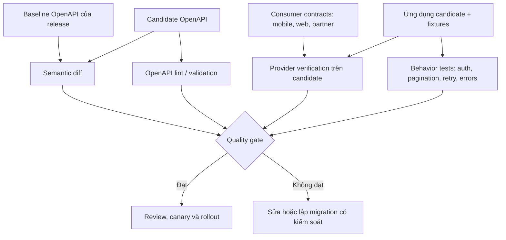

# Phát hiện thay đổi phá vỡ tương thích bằng công cụ và kiểm thử hành vi

## 1. Một thay đổi nhỏ ở server có thể làm hỏng client đang chạy

Một ứng dụng di động đang đọc đơn hàng qua REST API:

```http
GET /api/orders/ord-123 HTTP/1.1
Host: api.example.test
Authorization: Bearer <access-token-gia>
Accept: application/json
```

Hợp đồng và phản hồi trước khi triển khai:

```http
HTTP/1.1 200 OK
Content-Type: application/json
ETag: "order-ord-123-v8"

{"id":"ord-123","status":"CONFIRMED","totalMinor":125000,"currency":"VND"}
```

Nhóm phát triển đổi `totalMinor` thành `amountMinor` không thông báo. API vẫn trả `200` và JSON hợp lệ, nhưng client dùng `order.totalMinor` nhận giá trị thiếu. Các thay đổi khác cũng có thể làm hỏng client:

- Chuyển field tùy chọn trong **request** thành bắt buộc.
- Thay `201 Created` bằng `202 Accepted` trong khi client kỳ vọng tài nguyên đã tạo xong.
- Thêm trạng thái enum `ON_HOLD` mà client dùng exhaustive switch không xử lý.
- Yêu cầu scope `orders:write` mới đối với endpoint trước đây chỉ cần `orders:read`.
- Đổi mặc định sort/pagination dù schema OpenAPI không thay đổi.

Chủ đề này thuộc chương **Tiến hóa API** của module **INTEGRATION_API_REST**: thiết kế REST theo resource/URI, phương thức và mã trạng thái, hợp đồng dữ liệu, phân trang, cache, idempotency, OpenAPI, xác thực/phân quyền, xử lý lỗi và kiểm thử với Java/Spring.

**Mục tiêu:** biết xác định “phá vỡ tương thích” đối với *ai*, dùng công cụ so OpenAPI để chặn thay đổi có rủi ro, bổ sung contract/integration tests cho hành vi mà đặc tả không mô tả đủ, và thiết kế lộ trình thay đổi an toàn.

## 2. Xác định đúng chiều tương thích trước khi diff

Không có khái niệm “breaking” tuyệt đối nếu chưa nêu **phiên bản client, phương thức giao tiếp và hành vi đang được cam kết**.

| Chiều xem xét | Câu hỏi cần hỏi | Ví dụ |
| --- | --- | --- |
| **Backward compatibility** với client hiện tại | Client đã phát hành có tiếp tục làm việc với server mới không? | App cũ đọc `totalMinor` vẫn hoạt động? |
| **Forward compatibility** của client | Client hiện tại có xử lý response từ server tương lai khi xuất hiện dữ liệu mới không? | App có bỏ qua field lạ, xử lý enum chưa biết? |
| **Request compatibility** | Request từng hợp lệ có còn được server mới chấp nhận không? | Field `couponCode` trước đây bỏ qua được, giờ bắt buộc? |
| **Response compatibility** | Response mới có giữ những đảm bảo mà client dựa vào không? | Field/định dạng, mã HTTP, header, media type |
| **Behavioral compatibility** | Ý nghĩa tác vụ và các hiệu ứng quan sát được còn như cũ không? | POST lũy đẳng theo key, thứ tự trang, trạng thái sau commit |
| **Security compatibility** | Luồng cấp và dùng quyền của client hiện hành còn hoạt động không? | Token cũ có đủ scope theo chính sách mới? |

Trong quy trình provider deploy trước client, ưu tiên thường là **server mới vẫn phục vụ được những client đã hỗ trợ**. Nhưng với SDK phân phối nhiều phiên bản, phải duy trì một ma trận gồm phiên bản API, kiểu client, tính năng và thời gian hỗ trợ. Không suy rằng “không đổi URI” thì tương thích.

### 2.1. Phân biệt thay đổi hợp đồng và thay đổi triển khai

Một thay đổi ở code có thể **không đổi** hợp đồng quan sát được (tối ưu truy vấn DB). Ngược lại, chỉ thay cấu hình gateway, authorization policy hay rule sắp xếp mặc định có thể **phá vỡ** client dù OpenAPI YAML không đổi.

Đặt tên hai mốc cần so:

```text
BASELINE: hợp đồng của phiên bản đang phục vụ client cần bảo vệ
CANDIDATE: hợp đồng dự kiến deploy

static_diff(BASELINE, CANDIDATE)
  + behavior_tests(CANDIDATE, expected_old_contract)
  + evidence_from_real_consumers
  -> quyết định release
```

Baseline nên lấy từ **bản đã phát hành thực tế** (release artifact hoặc spec đã được phê duyệt), không chỉ lấy file ở nhánh chính; nếu nhánh chính chứa thay đổi chưa deploy, diff sẽ cho kết quả sai. Nếu API có nhiều biến thể theo tenant, feature flag hoặc vùng triển khai, cần xác định baseline tương ứng.

### 2.2. Tính bảo thủ của hợp đồng

Thêm field response thường an toàn với client chấp nhận field lạ, nhưng có thể phá client dùng `additionalProperties: false`. Xóa field “tùy chọn” cũng có thể làm hỏng một consumer phụ thuộc nó. Vì vậy phải kết hợp **static rules, consumer contracts và behavior tests**, không chỉ nhìn `required`.

## 3. Ma trận nhận diện thay đổi có khả năng breaking

### 3.1. Resource, phương thức, URI và status

| Thay đổi từ baseline sang candidate | Đánh giá cho client cũ | Lý do |
| --- | --- | --- |
| Xóa `GET /api/orders/{id}` hoặc đổi URI không giữ route cũ | **Breaking** | Client không còn endpoint đã dùng |
| Bỏ hỗ trợ `PATCH` hoặc đổi Content-Type được nhận | **Breaking** | Request cũ nhận `405`/`415` |
| Thêm operation/endpoint mới | Thường non-breaking | Client cũ không bắt buộc sử dụng |
| Đổi `200` sang `204` trên GET có body | **Breaking** | Client mất representation |
| Đổi `201` sang `202` trên POST | **Có thể breaking nghiêm trọng** | Từ hoàn tất thành xử lý nền; thay đổi workflow |
| Đổi `404` thành `200` với body `"not found"` | **Breaking** | Client xử lý lỗi theo HTTP status |
| Xóa `Location`/`ETag`/`Retry-After` mà contract bảo đảm | **Breaking** với client phụ thuộc | Ảnh hưởng điều hướng, conditional requests, retry |
| Chỉ đổi định dạng log nội bộ | Không breaking ở HTTP contract | Không tác động điều quan sát được bởi client |

Đừng mặc định mọi thay đổi status trong cùng nhóm `2xx` đều an toàn: **`200`, `201`, `202`, `204`, `206` có nghĩa khác nhau**. Cũng không được xem việc đổi response lỗi sang `200` là giải pháp tương thích.

### 3.2. JSON request và response phải xét ngược chiều

| Thay đổi | Request: client cũ gửi | Response: client cũ nhận |
| --- | --- | --- |
| **Thêm thuộc tính bắt buộc** | **Breaking**: client cũ chưa gửi | Thường có thể thêm dữ liệu, nhưng schema/client nghiêm ngặt có thể bị ảnh hưởng |
| **Bỏ thuộc tính bắt buộc** | Thường nới lỏng yêu cầu gửi | **Breaking**: client cũ có thể phụ thuộc trường đã cam kết |
| **Xóa thuộc tính tùy chọn** | Nếu server còn chấp nhận field cũ, có thể tương thích; nếu từ chối thì breaking | Có thể breaking với consumer thực tế dù field tùy chọn |
| **Đổi type `integer` thành `string`** | Thường breaking | Thường breaking |
| **Thu hẹp enum/range/format được nhận** | Breaking với request từng hợp lệ | Tùy nội dung trả và client |
| **Mở rộng enum response** | Không áp dụng trực tiếp | Có thể breaking với exhaustive parsing/switch |
| **Đổi `nullable`/cho phép null** | Cần xét validation đầu vào | Có thể breaking nếu client không xử lý null |
| **Đổi `oneOf`/`discriminator`** | Có thể làm request cũ không còn hợp lệ | Có thể phá vỡ deserialization |

**Nguyên tắc thực dụng:** phía server nên **chấp nhận ít nhất các request hợp lệ cũ**, và tiếp tục **trả các đảm bảo response cũ** trong thời gian cam kết tương thích. Nhưng xét dữ liệu thực tế: `required`, `readOnly`, `writeOnly`, `additionalProperties`, `nullable`, `enum`, `default` và cách code generator diễn giải có thể khiến kết quả khác nhau.

### 3.3. Thay đổi không xuất hiện rõ trong schema

Một số lỗi chỉ quan sát được khi chạy hệ thống:

- Trước đây `GET /api/orders?sort=createdAt` có thứ tự ổn định, giờ thứ tự bị thay hoặc trùng khi phân trang.
- Response lỗi vẫn `409` nhưng `code` đổi từ `ORDER_ALREADY_SHIPPED` sang `UNKNOWN`.
- Endpoint POST từng phát lại cùng operation khi retry `Idempotency-Key`, nay tạo lệnh mới.
- Token không đổi nhưng server/gateway thêm scope, hạn chế audience mới không có giai đoạn chuyển đổi.

Những thay đổi này có thể không được OpenAPI diff phát hiện vì phụ thuộc **trạng thái, thứ tự, thời gian, cache hoặc side effect**.

## 4. Dùng OpenAPI diff để sàng lọc thay đổi phá vỡ tương thích

### 4.1. So một thay đổi cụ thể

Baseline OpenAPI 3.1 rút gọn:

```yaml
openapi: 3.1.0
info:
  title: Order API
  version: 1.4.0
paths:
  /api/orders/{id}:
    get:
      parameters:
        - { name: id, in: path, required: true, schema: { type: string } }
      responses:
        '200':
          description: Current order
          content:
            application/json:
              schema:
                type: object
                required: [id, status, totalMinor]
                properties:
                  id: { type: string }
                  status: { type: string, enum: [DRAFT, CONFIRMED] }
                  totalMinor: { type: integer }
```

Candidate phát triển từ baseline, chỉ trích phần đã sửa:

```yaml
paths:
  /api/orders/{id}:
    get:
      responses:
        '200':
          description: Current order
          content:
            application/json:
              schema:
                type: object
                required: [id, status, amountMinor]
                properties:
                  id: { type: string }
                  status:
                    type: string
                    enum: [DRAFT, CONFIRMED, ON_HOLD]
                  amountMinor: { type: integer }
```

Trong candidate **đầy đủ**, giữ nguyên `openapi`, `info`, path parameter và các trường còn lại; đoạn trên chỉ làm nổi bật diff. Công cụ có thể báo `totalMinor` bị xóa, `amountMinor` được thêm và enum mở rộng. Client chỉ xử lý `DRAFT`/`CONFIRMED` có thể crash khi nhận `ON_HOLD`.

Để chuyển đổi an toàn, **giữ `totalMinor`**, bổ sung `amountMinor`, đo adoption và chỉ loại bỏ trường cũ khi hết cửa sổ hỗ trợ. Hai trường phải có cùng đơn vị và giá trị.

### 4.2. Chuỗi công cụ đề xuất

Thực hiện theo ba lớp có mục đích khác nhau:

1. **Parse và validate OpenAPI**: YAML/JSON hợp lệ, `$ref` giải quyết đúng, operation ID/schema/security requirement tồn tại. Đây chỉ kiểm tra tính hợp lệ, **chưa chứng minh tương thích**.
2. **Semantic OpenAPI diff**: so baseline với candidate ở cấp path/method, parameters, request/response schema, media type, status, auth. Có thể dùng [oasdiff](https://github.com/oasdiff/oasdiff) hoặc công cụ tương đương; chốt phiên bản tool và cấu hình rule.
3. **Consumer contract và behavioral/integration tests**: chạy hệ thống candidate để chứng minh request cũ vẫn hoạt động, response giữ đảm bảo, workflow và bảo mật không lệch.

Ví dụ minh họa dòng lệnh với oasdiff (xác nhận cú pháp của **phiên bản CLI được pin** trong dự án):

```bash
# baseline.yaml: hợp đồng của release đang phục vụ
# candidate.yaml: hợp đồng sinh từ nhánh thay đổi
oasdiff breaking baseline.yaml candidate.yaml
```

CLI có thể khác về **exit code, report và rules** giữa các phiên bản. CI phải pin version, kiểm tra fail-on/threshold để lỗi nghiêm trọng thực sự làm pipeline **fail**, và lưu báo cáo diff cho reviewer.

### 4.3. Không để text diff thay thế semantic diff

Một `git diff` đơn thuần dễ báo nhiễu khi sắp xếp lại YAML, đổi indentation, tách `$ref` hoặc thay thứ tự thuộc tính mà semantic không đổi. Ngược lại, nó khó phân tích:

```yaml
# baseline
security:
  - ordersOAuth: [orders:read]
```

```yaml
# candidate
security:
  - ordersOAuth: [orders:read, orders:write]
```

Đây là **siết điều kiện quyền từ một scope sang hai scope (AND)**, có thể khiến token của client cũ nhận `403`. Một semantic diff có khả năng phân tích security requirement nên được bật; nếu tool không đánh giá đúng scope hoặc quan hệ OR/AND, viết rule kiểm tra riêng.

### 4.4. Những giới hạn thực tế của static diff

| Trường hợp | Static diff làm tốt | Cần thêm bằng chứng |
| --- | --- | --- |
| Xóa path/method, đổi request required field | Phát hiện rõ | Xác nhận client còn dùng operation đó |
| Đổi response schema, enum, media type | Báo rủi ro có cấu trúc | Test parser/SDK của consumer thực |
| Đổi scope trong `security` | So metadata nếu rule hỗ trợ | Test token cũ có bị 403 |
| Đổi status runtime nhưng quên cập nhật OpenAPI | Không thấy gì | HTTP contract test |
| Đổi thứ tự phân trang, timeout, retry semantics | Thường không mô hình hóa đủ | Behavioral test với dữ liệu/tải thật |
| Thay đổi giữa feature flag/tenant | Không có trong một bản spec tĩnh | Ma trận deployment/config/consumer |
| API giữ field trong spec nhưng handler không trả | Không phát hiện | Response schema validation trên runtime |

**Kết luận của công cụ là một tín hiệu, không phải quyết định tuyệt đối.** Một cảnh báo breaking có thể không ảnh hưởng consumer nào đang hỗ trợ; một diff “không breaking” vẫn có thể làm hỏng hành vi nghiệp vụ. Quy trình phải giữ cả hai loại bằng chứng.

## 5. Thiết kế contract tests dựa trên kỳ vọng của client

### 5.1. Consumer-driven contract khác unit test controller

Một unit test đơn giản kiểm tra `GET` trả `200` thường vẫn pass khi `totalMinor` biến mất. Consumer contract phải nêu **điều client cũ thực sự cần**:

```json
{
  "id": "ord-123",
  "status": "CONFIRMED",
  "totalMinor": 125000
}
```

Trong mô hình **consumer-driven contract** (ví dụ Pact hoặc Spring Cloud Contract tùy hệ sinh thái), consumer mô tả request sẽ gửi và phần response cần dựa vào; provider verify contract ấy trên candidate. Test có thể dùng **matching linh hoạt** cho trường không quan trọng để tránh khóa chặt thứ tự JSON, timestamp hay ID ngẫu nhiên. Không viết một hợp đồng “phải có tất cả mọi field” khi client chỉ dùng vài trường.

Hợp đồng contract có thể gồm:

- **Request**: URI, method, headers, query defaults, request media type/body mà client gửi.
- **Response**: status, content type, field/type/giá trị enum hoặc business code mà client dựa vào.
- **States**: tài nguyên tồn tại/không tồn tại, đơn ở `DRAFT` hay `CONFIRMED`, token có/thiếu scope.
- **Errors/headers**: `Location`, `ETag`, `Cache-Control`, `application/problem+json`, idempotency behavior khi liên quan.

Không lấy consumer contract làm công cụ thay thế test bảo mật hay mọi business invariant. Một consumer không test `403` không có nghĩa endpoint được phép bỏ authorization.

### 5.2. Provider phải chạy contract của các consumer đang hỗ trợ



Trong CI, contract của consumer cần được **phiên bản hóa và gắn với consumer đang được hỗ trợ**. Tránh chỉ chạy contract từ nhánh main của web client: người dùng có thể vẫn dùng mobile cũ hoặc partner integration chưa nâng cấp. Nếu contract broker/công cụ có cơ chế chọn phiên bản triển khai thực tế, hãy cấu hình chọn đúng môi trường và release.

## 6. Java/Spring: kiểm thử để giữ tương thích response cũ

Ví dụ **Java 17+, Spring Boot 3 / Spring MVC 6** bên dưới cho phép server thêm tên mới `amountMinor` nhưng vẫn trả `totalMinor` cho client chưa nâng cấp. Đây là một **giai đoạn chuyển đổi**, không phải lý do giữ hai trường mãi mãi.

### 6.1. Controller phục vụ cả tên cũ và mới

```java
package example.orders.api;

import java.security.Principal;
import org.springframework.http.ResponseEntity;
import org.springframework.web.bind.annotation.GetMapping;
import org.springframework.web.bind.annotation.PathVariable;
import org.springframework.web.bind.annotation.RequestMapping;
import org.springframework.web.bind.annotation.RestController;

record OrderSnapshot(
    String id, String status, long totalMinor, String currency, long version
) {}

interface OrderQueryService {
    OrderSnapshot findVisibleTo(String actor, String orderId);
}

record OrderResponse(
    String id,
    String status,
    long totalMinor,  // Trường cũ: giữ để tương thích.
    long amountMinor, // Trường mới: cùng đơn vị tiền nhỏ nhất.
    String currency
) {}

@RestController
@RequestMapping("/api/orders")
public class OrderController {
    private final OrderQueryService query;

    public OrderController(OrderQueryService query) {
        this.query = query;
    }

    @GetMapping(value = "/{id}", produces = "application/json")
    public ResponseEntity<OrderResponse> get(
            @PathVariable("id") String id, Principal principal) {
        OrderSnapshot s = query.findVisibleTo(principal.getName(), id);
        // Service kiểm tra tenant/ownership trước khi trả dữ liệu.
        OrderResponse body = new OrderResponse(
            s.id(), s.status(), s.totalMinor(), s.totalMinor(), s.currency());
        String etag = "\"order-" + s.id() + "-v" + s.version() + "\"";
        return ResponseEntity.ok().eTag(etag).body(body);
    }
}
```

Kết quả dự kiến:

```http
HTTP/1.1 200 OK
Content-Type: application/json
ETag: "order-ord-123-v8"

{
  "id": "ord-123",
  "status": "CONFIRMED",
  "totalMinor": 125000,
  "amountMinor": 125000,
  "currency": "VND"
}
```

Trong ứng dụng production, đừng tự ghép ETag từ `id` không kiểm tra hoặc một `version` không phản ánh đầy đủ representation; nếu phải trả các biến thể khác nhau theo người dùng, locale hoặc media type, thiết kế validator tương ứng. Controller này chỉ minh họa **hợp đồng JSON**, chưa có cấu hình Spring Security; `findVisibleTo` phải kiểm tra đối tượng và tenant.

### 6.2. Contract test phát hiện khi field cũ bị xóa

Kiểm tra HTTP thật qua `MockMvc` và Jackson, thay vì gọi trực tiếp method Java:

```java
package example.orders.api;

import static org.springframework.test.web.servlet.request
    .MockMvcRequestBuilders.get;
import static org.springframework.test.web.servlet.result
    .MockMvcResultMatchers.*;

import org.junit.jupiter.api.Test;
import org.springframework.http.HttpHeaders;
import org.springframework.http.MediaType;
import org.springframework.test.web.servlet.MockMvc;
import org.springframework.test.web.servlet.setup.MockMvcBuilders;

class OrderCompatibilityTest {

    private final OrderQueryService fixture = (actor, id) ->
        new OrderSnapshot("ord-123", "CONFIRMED", 125000, "VND", 8);

    private final MockMvc mvc = MockMvcBuilders
        .standaloneSetup(new OrderController(fixture)).build();

    @Test
    void oldConsumerStillReceivesTotalMinor() throws Exception {
        mvc.perform(get("/api/orders/ord-123")
                .principal(() -> "alice")
                .accept(MediaType.APPLICATION_JSON))
            .andExpect(status().isOk())
            .andExpect(content().contentTypeCompatibleWith(
                MediaType.APPLICATION_JSON))
            .andExpect(jsonPath("$.id").value("ord-123"))
            .andExpect(jsonPath("$.totalMinor").value(125000))
            .andExpect(jsonPath("$.currency").value("VND"))
            .andExpect(header().string(
                HttpHeaders.ETAG, "\"order-ord-123-v8\""));
    }

    @Test
    void newConsumerReceivesAmountMinor() throws Exception {
        mvc.perform(get("/api/orders/ord-123")
                .principal(() -> "alice"))
            .andExpect(status().isOk())
            .andExpect(jsonPath("$.amountMinor").value(125000));
    }
}
```

Nếu ai đó bỏ `totalMinor` khỏi DTO, **test consumer cũ đỏ** dù endpoint vẫn `200`. Nếu test chỉ kiểm tra status, thay đổi phá vỡ này sẽ lọt qua. Khi lên kế hoạch xóa trường cũ, hãy gỡ contract test chỉ sau khi đã chứng minh toàn bộ consumer cần hỗ trợ đều chuyển đổi.

**Giới hạn của `standaloneSetup`:** nó không chạy đầy đủ `SecurityFilterChain`, CDN, gateway hoặc database thực. Cần test riêng với Spring Security và mô phỏng token có/không có scope; test service với dữ liệu thuộc tenant khác để phòng BOLA. Một mock service luôn trả cùng order không chứng minh authorization.

### 6.3. Bảo vệ cả request contract

Giả sử API cũ:

```http
POST /api/orders HTTP/1.1
Content-Type: application/json
Idempotency-Key: intent-123

{"productId":"p-7","quantity":2}
```

Bản mới muốn bổ sung `shippingOption`. Nếu đổi thành **bắt buộc** ngay, client cũ nhận `400`/`422` tùy contract. Thay vào đó có thể giữ mặc định nghiệp vụ đã xác định hoặc đưa ra version/operation mới, rồi kiểm thử:

```text
Given request hợp lệ theo baseline, không có shippingOption
When POST /api/orders vào candidate
Then request vẫn được chấp nhận hoặc trả lỗi nghiệp vụ cũ hợp lệ
And retry với cùng Idempotency-Key không tạo đơn thứ hai
```

Chỉ dùng default khi nó **không thay đổi ý nghĩa nghiệp vụ**. Nếu không thể chọn mặc định an toàn, thay đổi này thực sự cần quá trình nâng cấp client hoặc version mới, không nên âm thầm gán một tùy chọn giao hàng sai.

## 7. Kiểm thử hành vi: những gì OpenAPI không đủ khả năng mô tả

### 7.1. Ma trận regression theo rủi ro

| Hành vi | Tình huống tối thiểu | Bất biến cần giữ |
| --- | --- | --- |
| **Mã HTTP và body** | GET tồn tại, không tồn tại, truy cập sai quyền | Status/content type/body theo baseline |
| **Authorization** | Token thiếu, token sai scope, người dùng khác tenant | 401/403/404 đúng policy; không lộ dữ liệu |
| **Validation** | Request cũ không có field mới; request có field không hợp lệ | Request cũ được chấp nhận, lỗi giữ cấu trúc/code |
| **Pagination** | Page đầu, cursor tiếp, cập nhật dữ liệu giữa các trang | Không lặp/mất bản ghi ngoài giới hạn đã công bố |
| **Sorting/filtering** | Thiếu sort parameter, lọc nhiều điều kiện | Default và ý nghĩa bộ lọc ổn định |
| **Idempotency** | POST hai lần cùng key/payload, lỗi sau commit | Không tạo tác động nghiệp vụ trùng |
| **Conditional requests** | GET ETag, PATCH If-Match cũ, GET If-None-Match | 304/412 và version guard đúng |
| **Cache** | GET qua cache với user A/B, hết TTL | Không rò riêng tư hoặc trả stale trái hợp đồng |
| **Error handling** | DB conflict, rate limit, downstream timeout | Problem Details/error code, Retry-After phù hợp |
| **Media type** | `Accept`, `Content-Type` cũ, file download | Không bất ngờ 406/415 hoặc thay attachment |

Không chạy tất cả case bằng cùng một test suite đơn luồng: authorization cần filter chain, idempotency cần DB/transaction thật, cache cần proxy test, và concurrency cần hai transaction độc lập.

### 7.2. HTTP regression test ngoài framework

Một consumer có thể nhận `409 Conflict` với mã lỗi ổn định:

```http
HTTP/1.1 409 Conflict
Content-Type: application/problem+json

{
  "type": "https://api.example.test/problems/order-state-conflict",
  "title": "Order state conflict",
  "status": 409,
  "code": "ORDER_ALREADY_SHIPPED"
}
```

Candidate vẫn trả `409` nhưng đổi `code` thành `GENERAL_CONFLICT`. OpenAPI chỉ ghi response schema `code: string` có thể **không báo breaking**, trong khi client dùng `ORDER_ALREADY_SHIPPED` để hiển thị một hướng xử lý cụ thể. Test hành vi cần assert **giá trị có nghĩa nghiệp vụ**, không chỉ kiểu string.

Với các lỗi có `Retry-After`, kiểm thử cả quy tắc retry: client phải phân biệt `429/503` với `409/412`; server không được đổi 409 sang lỗi retryable khiến client phát lại lệnh gây side effect.

### 7.3. Dùng contract tests và thực tế truy cập cùng nhau

Kết hợp **provider verification**, **HTTP runtime schema validation**, **integration tests** cho quyền/transaction/paging và **traffic analysis** để phát hiện consumer chưa nâng cấp. Không log token/PII; việc thiếu traffic ngắn hạn **không chứng minh** một ứng dụng offline hoặc đối tác định kỳ đã ngừng sử dụng.

## 8. CI quality gate và quyết định có được phát hành không

Đặt quy trình theo thứ tự để lỗi rẻ được phát hiện trước, lỗi đắt được phát hiện sau:

```text
1. Validate/lint candidate OpenAPI
2. Semantic diff: released baseline -> candidate
3. Kiểm tra breaking rules và exceptions đã phê duyệt
4. Verify consumer contracts của client/version còn được hỗ trợ
5. Chạy behavior tests với database, auth, gateway khi cần
6. Review rủi ro, canary/rollout và quan sát dữ liệu production
```

**Quy tắc gate gợi ý:**

| Kết quả | Hành động |
| --- | --- |
| OpenAPI không parse được hoặc `$ref` lỗi | **Block**; sửa spec trước |
| Xóa endpoint/field bắt buộc cho client còn hỗ trợ | **Block** hoặc chuyển sang kế hoạch version/migration có phê duyệt |
| Provider verification của consumer đang hoạt động thất bại | **Block** cho đến khi sửa hoặc có bằng chứng consumer đã nâng cấp |
| Đổi scope làm mất quyền của token cũ | **Block** nếu chưa có kế hoạch cấp quyền/migration an toàn |
| Diff báo thêm response field tùy chọn | Review schema/SDK strict; thường warning nếu client chịu được |
| Test pagination/idempotency/authorization đỏ | **Block** dù OpenAPI diff sạch |
| Breaking change đã lên version mới với migration rõ | Review cho phép **phiên bản mới**, không coi API cũ đã tương thích |

**Exception không nên là nút “bỏ qua toàn bộ diff”.** Một lần chấp nhận breaking change cần: mã thay đổi, chủ sở hữu, client bị ảnh hưởng, bằng chứng kiểm thử, kế hoạch quay lại, hạn hoàn tất và phạm vi exception hẹp. Quy tắc được bỏ qua phải được ghi rõ để lần sau không tự động làm ngơ các lỗi khác.

Khi **baseline contract**, **candidate implementation** và **runtime observations** mâu thuẫn, không sửa baseline để “làm diff xanh”: tìm ra nguồn sai, review và bổ sung regression test.

## 9. Thay đổi không tương thích: mở rộng, chuyển đổi rồi thu hẹp

Nếu một thay đổi không thể giữ tương thích trực tiếp, có thể triển khai theo **expand–migrate–contract**:

1. **Expand**: thêm trường `amountMinor`, giữ `totalMinor`, giữ route và status cũ; test cả hai.
2. **Migrate**: phát hành SDK/client dùng `amountMinor`, tài liệu hóa field cũ, hỗ trợ partner chuyển đổi; đo adoption mà không thu thập dữ liệu nhạy cảm.
3. **Contract**: chỉ loại `totalMinor` khỏi hợp đồng khi hết thời hạn hỗ trợ đã công bố hoặc trên **version mới**; giữ test của version cũ nếu còn được phục vụ.

Các thay đổi security cần lộ trình tương tự nhưng **không hạ bảo mật để giữ client cũ**: khi tăng yêu cầu scope hoặc audience, cần phối hợp cấp token, quyền tối thiểu, hỗ trợ song song chính sách có kiểm soát và thời hạn kết thúc. Nếu thay đổi nhằm vá lỗ hổng nghiêm trọng, có thể phải chấp nhận breaking change có thông báo khẩn và biện pháp giảm thiểu thay vì duy trì hành vi không an toàn.

**Versioning không chỉ là đổi `/v1` thành `/v2`.** URI/media type versioning đều cần định tuyến, authorization, cache và SDK phù hợp. `Deprecation`/`Sunset` headers giúp thông báo vòng đời, **không** tự chuyển đổi client.

Canary rollout kiểm chứng latency, tỷ lệ lỗi, schema validation, status distribution và đường auth theo từng nhóm client. Nếu một client quan trọng nhận nhiều 4xx bất thường hoặc response thiếu trường cam kết, rollback/disable feature flag có thể cần thiết; không đợi đến khi traffic tổng thể suy giảm mới điều tra.

## 10. Bài thực hành: phân loại và chặn một release không an toàn

**Bối cảnh:** API đơn hàng bản 1.4 đang phục vụ web, mobile và một partner. Candidate 1.5 có các thay đổi:

1. `GET /api/orders/{id}` bỏ trường bắt buộc `totalMinor`, thêm `amountMinor`.
2. Enum response `status` thêm `ON_HOLD`.
3. `POST /api/orders` thêm field request bắt buộc `shippingOption`.
4. `GET /api/orders` đổi thứ tự mặc định từ `createdAt DESC` sang `id ASC`.
5. `GET /api/orders/{id}` bắt buộc token có thêm `orders:write`.
6. Bổ sung `GET /api/orders/{id}/events` với cùng chính sách quyền hiện có.

**Yêu cầu:** (a) Phân loại thay đổi nào likely breaking; (b) xác định công cụ diff có thể phát hiện gì và những test cần bổ sung; (c) đề xuất kế hoạch giữ tương thích 1.4; (d) viết ít nhất ba assertions HTTP/Spring; (e) đề xuất điều kiện cho phép release.

**Gợi ý lời giải:**

- **1, 3, 5** breaking đối với client cũ; **2** có rủi ro với parser enum nghiêm ngặt; **4** là thay đổi hành vi có thể breaking dù spec không đổi; **6** thường an toàn nếu không làm lỏng quyền hoặc thay nghĩa endpoint cũ.
- Diff tĩnh thường phát hiện **1, 2, 3**; thay đổi security **5** có thể được công cụ phát hiện nếu hỗ trợ rule này. **4** cần test sort/pagination bằng dữ liệu có thứ tự khác nhau. Không giả định tool nhận diện mọi thay đổi.
- Với **1**, tạm trả cả `totalMinor` và `amountMinor`. Với **3**, dùng default nghiệp vụ an toàn hoặc version mới. Với **5**, xây lộ trình quyền được kiểm toán, không tự cấp quyền ghi cho client chỉ đọc. Với **2**, kiểm tra consumer xử lý unknown enum; với **4**, giữ default cũ và cho client chọn sort mới bằng parameter.
- Assertions ví dụ: `jsonPath("$.totalMinor").isNumber()`, `status().isCreated()` cho POST theo hợp đồng cũ, `status().isForbidden()` cho token thiếu quyền **thực sự bắt buộc**, thêm test danh sách giữ `createdAt DESC` và retry cùng key không tạo hai đơn.
- Chỉ release khi static diff được review, mọi consumer còn hỗ trợ verify thành công, tests hành vi/bảo mật xanh, các exception có owner/migration và canary có khả năng rollback.

## 11. Kết luận

Phát hiện thay đổi phá vỡ tương thích cần **hai loại bằng chứng bổ sung nhau**: công cụ semantic diff OpenAPI nhận diện thay đổi cấu trúc hợp đồng; kiểm thử hành vi và consumer contracts chứng minh client còn được hỗ trợ vẫn nhận **đúng kết quả, đúng mã HTTP, đúng quyền và đúng tác động nghiệp vụ**. Một bản OpenAPI không đổi chưa đủ chứng minh API tương thích, và một cảnh báo diff cũng chưa đủ kết luận tất cả consumer đều bị ảnh hưởng.

Hãy xác định baseline theo release thật, pin phiên bản công cụ, đưa breaking checks vào CI, giữ regression tests cho client cũ và dùng expand–migrate–contract khi cần. **Bảo vệ tương thích không đồng nghĩa giữ nguyên lỗi bảo mật**: mọi ngoại lệ đều cần đánh giá tác động, thời hạn, người chịu trách nhiệm và đường chuyển đổi.

### Tài liệu tham khảo

- [OpenAPI Specification 3.1](https://spec.openapis.org/oas/v3.1.1.html): schema, responses, parameters và security requirements.
- [oasdiff](https://github.com/oasdiff/oasdiff): phân tích semantic differences và breaking changes giữa hai hợp đồng OpenAPI.
- [Pact](https://docs.pact.io/): consumer-driven contract testing và provider verification.
- [Spring Cloud Contract](https://spring.io/projects/spring-cloud-contract): công cụ contract testing trong hệ sinh thái Spring.
- [RFC 9110 — HTTP Semantics](https://www.rfc-editor.org/rfc/rfc9110), [RFC 9457 — Problem Details](https://www.rfc-editor.org/rfc/rfc9457): ý nghĩa status, header và hợp đồng lỗi.

