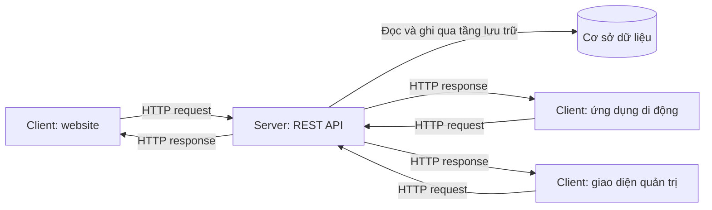

# Client-server và tách trách nhiệm giữa giao diện, dữ liệu

## 1. Mục tiêu bài học

Trong chương **Ràng buộc REST** của module **INTEGRATION_API_REST**, bài học này tập trung vào ràng buộc **client-server**: client và server đảm nhiệm những trách nhiệm khác nhau, giao tiếp qua một hợp đồng rõ ràng để có thể phát triển tương đối độc lập.

Sau bài học, bạn có thể:

- Nhận diện client, server và nơi lưu trữ dữ liệu trong một tình huống REST API.
- Phân biệt trách nhiệm trình bày, trách nhiệm nghiệp vụ và trách nhiệm lưu trữ.
- Thiết kế một hợp đồng HTTP để giao diện sử dụng dữ liệu mà không phụ thuộc cấu trúc cơ sở dữ liệu.
- Giải thích tại sao kiểm tra dữ liệu ở giao diện không thay thế kiểm tra ở server.
- Áp dụng cách phân chia này khi tổ chức ứng dụng Java/Spring hoặc công nghệ tương đương.

## 2. Bắt đầu từ một hệ thống đặt hàng

Một cửa hàng có ba nơi sử dụng cùng dữ liệu đơn hàng:

1. Website để khách tạo đơn và xem tiến độ.
2. Ứng dụng di động để khách thực hiện các thao tác tương tự.
3. Màn hình quản trị để nhân viên xử lý đơn.

Các giao diện có cách trình bày khác nhau. Website dùng bảng, ứng dụng di động dùng các thẻ nhỏ, màn hình quản trị cần bộ lọc và các thao tác dành cho nhân viên. Tuy vậy, quy tắc xác định giá bán, tổng tiền và trạng thái hợp lệ của đơn hàng phải nhất quán.

Nếu mỗi giao diện tự truy cập cơ sở dữ liệu rồi tự áp dụng quy tắc đặt hàng, cùng một đơn có thể được xử lý theo những cách khác nhau. Thay đổi cột trong cơ sở dữ liệu cũng có thể buộc cả ba giao diện sửa theo.

Một cách tổ chức phù hợp là đặt khả năng quản lý đơn hàng sau một API:



Website và ứng dụng di động không cần biết dữ liệu đang nằm trong bảng nào, dùng kiểu khóa chính gì hay được lưu bằng công nghệ nào. Chúng cần biết cách gửi yêu cầu và cách hiểu phản hồi của API.

Đó là giá trị trực tiếp của tách trách nhiệm: giao diện được tối ưu cho người sử dụng, còn server quản lý khả năng truy cập tài nguyên và các quy tắc dùng chung.

## 3. Ràng buộc client-server nói điều gì?

### 3.1. Hai vai trò và một ranh giới giao tiếp

Trong một tương tác:

- **Client** khởi tạo yêu cầu để sử dụng khả năng do phía khác cung cấp.
- **Server** tiếp nhận yêu cầu, thực hiện xử lý phù hợp và trả về phản hồi.

Ràng buộc client-server của REST tách mối quan tâm về giao diện người dùng khỏi mối quan tâm về quản lý và lưu trữ dữ liệu. Khi hai bên giao tiếp qua một giao diện được thống nhất, thay đổi bên trong một bên ít có khả năng kéo theo thay đổi bên còn lại.

Ví dụ, giao diện có thể đổi từ danh sách sang bảng mà không cần thay thuật toán tính tổng tiền. Server có thể thay cơ chế lưu trữ mà vẫn giữ nguyên biểu diễn đơn hàng mà client đang sử dụng.

Khả năng thay đổi độc lập này **có điều kiện**: hai bên phải tiếp tục tương thích với hợp đồng giao tiếp. Nếu server đổi tên trường bắt buộc hoặc thay ý nghĩa của một trạng thái, client vẫn có thể bị ảnh hưởng.

### 3.2. Client không nhất thiết là trình duyệt

Client có thể là:

- Một ứng dụng web chạy trong trình duyệt.
- Một ứng dụng di động hoặc ứng dụng desktop.
- Một chương trình Java gọi API của dịch vụ khác.
- Một công cụ kiểm thử gửi yêu cầu HTTP.

Một thành phần cũng có thể đóng cả hai vai trò trong các tương tác khác nhau. Dịch vụ đơn hàng là server đối với ứng dụng di động, nhưng là client khi gọi API thanh toán.

### 3.3. Đây là ranh giới trách nhiệm, không phải yêu cầu về số máy

Client và server có thể chạy trên cùng một máy trong môi trường phát triển. Tách chúng thành hai repository, triển khai trên hai máy hoặc sử dụng microservices không phải điều kiện để có ràng buộc client-server.

Ngược lại, đặt frontend và backend ở hai máy khác nhau chưa đủ chứng minh đã tách trách nhiệm tốt. Nếu frontend vẫn phải biết tên bảng, định dạng truy vấn nội bộ hoặc tự quyết định kết quả nghiệp vụ quan trọng, hai bên vẫn phụ thuộc chặt chẽ.

Client-server cũng chỉ là một ràng buộc của REST. Một hệ thống có client gọi server bằng HTTP chưa mặc nhiên đáp ứng toàn bộ các ràng buộc REST.

## 4. Phân chia trách nhiệm như thế nào?

### 4.1. Bảng trách nhiệm cho ứng dụng đặt hàng

| Mối quan tâm | Client thường đảm nhiệm | Server thường đảm nhiệm |
|---|---|---|
| Trình bày | Bố cục, điều hướng, định dạng ngày và tiền theo ngữ cảnh hiển thị | Cung cấp dữ liệu và ngữ nghĩa đủ rõ để client trình bày |
| Nhập liệu | Thu thập lựa chọn, báo lỗi sớm, giữ trạng thái đang nhập | Kiểm tra yêu cầu trước khi chấp nhận xử lý |
| Quy tắc đặt hàng | Hiển thị gợi ý, tính thử để người dùng tham khảo | Xác định giá hợp lệ, quyền mua, tổng tiền và chuyển trạng thái |
| Truy cập tài nguyên | Gửi yêu cầu kèm thông tin xác thực phù hợp | Xác thực, phân quyền đối với từng thao tác và tài nguyên |
| Lưu trữ | Giữ dữ liệu phục vụ tương tác, chẳng hạn bộ lọc hoặc bản nháp | Quản lý dữ liệu chính thức và tính nhất quán khi cập nhật |
| Kết quả thao tác | Hiển thị kết quả, lỗi và lựa chọn tiếp theo | Trả mã trạng thái HTTP cùng nội dung phản hồi có cấu trúc |

Đây là phân chia điển hình cho ứng dụng này. Không nên diễn giải thành quy tắc tuyệt đối rằng client không được giữ dữ liệu hoặc server không được tạo nội dung giao diện.

### 4.2. Dữ liệu ở client và dữ liệu chính thức có vai trò khác nhau

Client có thể giữ một giỏ hàng tạm, danh sách đã tải, bộ lọc tìm kiếm hoặc bản nháp chưa gửi. Một ứng dụng còn có thể hỗ trợ thao tác ngoại tuyến.

Những dữ liệu đó cần được phân biệt với dữ liệu chính thức của hệ thống. Khi client gửi yêu cầu tạo đơn, server phải kiểm tra lại các điều kiện tại thời điểm xử lý. Giá mà client đã hiển thị có thể cũ; tồn kho có thể đã thay đổi; người dùng có thể đã mất quyền thực hiện thao tác.

Ví dụ:

```text
Client đang hiển thị:
  Sản phẩm P-100 có đơn giá 125.000 đồng.
  Người dùng chọn số lượng 2.
  Tổng tiền dự kiến là 250.000 đồng.

Khi tạo đơn:
  Client gửi mã sản phẩm và số lượng.
  Server lấy giá được phép áp dụng tại thời điểm xử lý.
  Server tính tổng tiền và lưu đơn theo quy tắc nghiệp vụ.
  Client hiển thị kết quả mà server đã chấp nhận.
```

Nếu hệ thống cần giữ một mức giá đã báo cho khách, thiết kế có thể bổ sung báo giá hoặc phiên bản giá. Dù chọn cơ chế nào, việc quyết định giá có được chấp nhận vẫn phải được thực thi tại server.

### 4.3. Kiểm tra dữ liệu ở cả hai phía

Giả sử số lượng sản phẩm phải là số nguyên dương:

- Client kiểm tra ngay khi người dùng nhập để phản hồi nhanh.
- Server kiểm tra lại vì yêu cầu có thể đến từ client khác, phiên bản ứng dụng cũ hoặc chương trình tự tạo yêu cầu.

Sự trùng lặp này có mục đích. Kiểm tra ở client cải thiện trải nghiệm; kiểm tra ở server bảo vệ quy tắc mà mọi bên gọi API phải tuân theo.

Không thể xem nút bị vô hiệu hóa hoặc ô nhập chỉ nhận số dương là bằng chứng rằng server sẽ không nhận được số lượng âm.

## 5. Hợp đồng HTTP giữ hai bên phối hợp

Tách trách nhiệm chỉ hiệu quả nếu ranh giới giao tiếp có ý nghĩa rõ ràng. Trong REST API, client thường làm việc với URI tài nguyên, phương thức HTTP, mã trạng thái và biểu diễn dữ liệu.

Với bài toán đơn hàng, một phần hợp đồng có thể là:

| Nhu cầu | Yêu cầu | Kết quả bình thường |
|---|---|---|
| Tạo đơn | `POST /orders` | `201 Created`, trả biểu diễn đơn và `Location` của tài nguyên mới |
| Xem một đơn | `GET /orders/{orderId}` | `200 OK`, trả biểu diễn đơn mà người gọi được phép xem |
| Xem danh sách đơn | `GET /orders` với các tham số được tài liệu hóa | `200 OK`, trả danh sách theo phạm vi quyền truy cập |

Những thông tin này chưa đủ nếu thiếu định nghĩa dữ liệu. Hai bên còn cần thống nhất:

- Kiểu và ý nghĩa của từng trường, trường bắt buộc, trường được phép vắng mặt.
- Các giá trị trạng thái mà client có thể nhận và cách xử lý giá trị chưa biết.
- Đơn vị tiền, quy tắc biểu diễn thời gian và số tiền nếu API sử dụng chúng.
- Điều kiện xác thực, quyền truy cập và cấu trúc lỗi.
- Những thay đổi nào tương thích với client hiện có.

Hợp đồng có thể được mô tả bằng OpenAPI cùng ví dụ yêu cầu và phản hồi. Tài liệu đó phục vụ cả hai phía; nó cần phản ánh đúng hành vi được triển khai.

### 5.1. Yêu cầu tạo đơn

Ví dụ dưới đây lược bỏ thông tin xác thực để tập trung vào ranh giới dữ liệu. API thực tế vẫn phải áp dụng cơ chế xác thực và phân quyền đã chọn.

```http
POST /orders HTTP/1.1
Host: api.example.test
Content-Type: application/json
Accept: application/json

{
  "items": [
    {
      "productId": "P-100",
      "quantity": 2
    }
  ]
}
```

Client gửi ý định đặt mua sản phẩm. Trong hợp đồng này, client không gửi tên bảng, câu lệnh SQL, tổng tiền cuối cùng hoặc quyền phê duyệt đơn.

Server xác định người dùng từ ngữ cảnh xác thực, kiểm tra quyền tạo đơn, kiểm tra sản phẩm và số lượng, xác định giá áp dụng, rồi thực hiện cập nhật dữ liệu cần thiết theo quy tắc nghiệp vụ.

### 5.2. Phản hồi tạo đơn

Giả sử server chấp nhận đơn với giá 125.000 đồng cho mỗi sản phẩm:

```http
HTTP/1.1 201 Created
Location: /orders/ord_8421
Content-Type: application/json

{
  "id": "ord_8421",
  "status": "PENDING",
  "items": [
    {
      "productId": "P-100",
      "quantity": 2,
      "unitPrice": 125000
    }
  ],
  "totalAmount": 250000,
  "currency": "VND"
}
```

Ở ví dụ này, hợp đồng quy định `unitPrice` và `totalAmount` được biểu diễn bằng số nguyên đồng Việt Nam. Không nên để client tự đoán một số tiền đang dùng đồng, nghìn đồng hay đơn vị tiền nhỏ nhất.

`201 Created` mô tả kết quả của yêu cầu HTTP. Trường `status: "PENDING"` mô tả trạng thái nghiệp vụ của đơn hàng. Hai loại trạng thái này có mục đích khác nhau.

Client có thể chuyển tới màn hình chi tiết, hiển thị mã đơn và định dạng tổng tiền thành `250.000 ₫`. Server không cần biết màn hình đó dùng bảng, thẻ hay hộp thoại.

### 5.3. Phản hồi khi dữ liệu không hợp lệ

Với số lượng bằng `0`, hợp đồng của ví dụ chọn trả `400 Bad Request` và một cấu trúc lỗi đã thống nhất:

```http
HTTP/1.1 400 Bad Request
Content-Type: application/json

{
  "code": "INVALID_ORDER_INPUT",
  "message": "Dữ liệu tạo đơn chưa hợp lệ.",
  "fieldErrors": [
    {
      "field": "items[0].quantity",
      "code": "MUST_BE_POSITIVE",
      "message": "Số lượng phải lớn hơn 0."
    }
  ]
}
```

Đây là cấu trúc lỗi minh họa của API, không phải định dạng mà mọi REST API bắt buộc phải dùng. Client có thể dùng `field` để gắn lỗi vào ô nhập tương ứng và dùng `code` để chọn cách xử lý ổn định hơn việc phân tích câu thông báo.

Server cần tránh đưa câu lệnh SQL, stack trace hoặc chi tiết cấu trúc lưu trữ vào phản hồi dành cho client. Những thông tin đó thuộc phạm vi chẩn đoán nội bộ.

## 6. Biểu diễn tài nguyên không phải bản sao của bảng dữ liệu

Một lỗi thiết kế thường gặp là chuyển nguyên đối tượng lưu trữ thành JSON rồi coi đó là hợp đồng API.

Giả sử bảng đơn hàng có các cột:

```text
orders
  id
  customer_id
  status_code
  total_amount
  internal_review_note
  row_version
```

Client có thể cần mã đơn, trạng thái và tổng tiền, nhưng không nhất thiết cần ghi chú kiểm duyệt nội bộ hoặc phiên bản bản ghi. Tên cột `status_code` cũng không bắt buộc phải xuất hiện trong API.

Một biểu diễn phù hợp có thể tổng hợp từ nhiều nguồn:

```json
{
  "id": "ord_8421",
  "status": "PENDING",
  "totalAmount": 250000,
  "currency": "VND",
  "itemCount": 2
}
```

Trong ví dụ này, `itemCount` là tổng số đơn vị sản phẩm trong đơn. Cần ghi rõ ý nghĩa đó vì một client khác có thể hiểu nhầm là số dòng sản phẩm.

Một tài nguyên API có thể được tạo từ nhiều bảng, kết quả tính toán hoặc dịch vụ khác. Client làm việc với ý nghĩa của tài nguyên qua biểu diễn được cung cấp, thay vì phụ thuộc trực tiếp vào mô hình lưu trữ.

Khi hợp đồng không đổi, server có thể đổi tên cột, điều chỉnh truy vấn hoặc bổ sung bộ nhớ đệm bên trong. Những thay đổi đó vẫn cần giữ nguyên hành vi đã cam kết với client.

## 7. Áp dụng trong ứng dụng Java/Spring

### 7.1. Phân biệt ranh giới bên ngoài và các tầng bên trong

Trong một ứng dụng Java/Spring, cách tổ chức quen thuộc là:

```text
Client
  |
  | HTTP: URI, method, headers, JSON, status
  v
Controller / HTTP adapter
  |
  | Chuyển dữ liệu và ngữ cảnh gọi vào xử lý ứng dụng
  v
Application service / domain
  |
  | Áp dụng quy tắc nghiệp vụ, điều phối cập nhật
  v
Repository / persistence adapter
  |
  v
Database
```

Ràng buộc client-server nằm ở ranh giới giữa bên gọi và bên cung cấp API. Việc chia controller, service và repository là cách tổ chức nội bộ của server, không phải chính ràng buộc đó.

Controller nên xử lý các mối quan tâm HTTP và chuyển tiếp công việc phù hợp. Quy tắc như tính tổng tiền hoặc kiểm tra việc chuyển trạng thái cần được thực thi ở nơi mọi luồng liên quan có thể dùng nhất quán. Repository đảm nhiệm truy cập lưu trữ theo thiết kế của ứng dụng.

### 7.2. Dùng DTO cho dữ liệu qua ranh giới API

Ví dụ Java sau chỉ mô tả hình dạng dữ liệu cho hợp đồng ở trên. Các `record` không tự thực hiện kiểm tra đầu vào, xác thực, ánh xạ HTTP hoặc lưu trữ.

```java
import java.math.BigDecimal;
import java.util.List;

record CreateOrderLineRequest(String productId, int quantity) {}

record CreateOrderRequest(List<CreateOrderLineRequest> items) {}

record OrderLineResponse(
        String productId,
        int quantity,
        BigDecimal unitPrice
) {}

record OrderResponse(
        String id,
        String status,
        List<OrderLineResponse> items,
        BigDecimal totalAmount,
        String currency
) {}
```

DTO là đối tượng truyền dữ liệu qua một ranh giới. Request và response được tách riêng vì những gì client được phép đề nghị khác với những gì server trả về sau xử lý.

Trong hợp đồng này:

- Request chứa mã sản phẩm và số lượng mà người dùng chọn.
- Response bổ sung mã đơn do server cấp, trạng thái, giá được chấp nhận và tổng tiền.
- Không DTO nào cần công khai quan hệ ORM hoặc ghi chú nội bộ.
- Việc dùng `BigDecimal` trong Java phục vụ tính toán tiền chính xác theo quy tắc đã chọn; hợp đồng ví dụ vẫn chỉ chấp nhận các số tiền nguyên đồng.

Server còn phải kiểm tra `items` không rỗng, từng phần tử hợp lệ, số lượng dương và các giới hạn nghiệp vụ khác. Định nghĩa DTO không thay cho những kiểm tra đó.

### 7.3. Luồng xử lý tạo đơn

Mã giả sau mô tả trách nhiệm, không phải một triển khai hoàn chỉnh:

```text
HTTP adapter:
  Đọc request và ngữ cảnh xác thực.
  Kiểm tra khả năng phân tích dữ liệu đầu vào.
  Chuyển yêu cầu sang dịch vụ tạo đơn.

Dịch vụ tạo đơn:
  Kiểm tra người gọi được phép tạo đơn.
  Kiểm tra các sản phẩm, số lượng và điều kiện đặt hàng.
  Lấy giá hợp lệ từ nguồn do server quản lý.
  Tính tổng và tạo đơn theo quy tắc nghiệp vụ.
  Lưu thay đổi với cơ chế bảo đảm nhất quán phù hợp.
  Trả kết quả tạo đơn.

HTTP adapter:
  Ánh xạ kết quả thành response DTO.
  Trả 201 Created và Location.
  Ánh xạ lỗi dự kiến thành mã HTTP cùng lỗi có cấu trúc.
```

Chi tiết về giao dịch, cạnh tranh tồn kho và xử lý yêu cầu lặp cần được thiết kế riêng theo bài toán. Ràng buộc client-server xác định nơi chịu trách nhiệm thực thi các quyết định đó; bản thân nó không tự giải quyết những vấn đề này.

## 8. Client tự chủ về giao diện, vẫn phụ thuộc hợp đồng

### 8.1. Ví dụ thay đổi có thể thực hiện độc lập

| Thay đổi | Điều kiện để phía còn lại tiếp tục hoạt động |
|---|---|
| Website đổi cách hiển thị đơn thành các thẻ | Vẫn đọc được các trường và giữ đúng ý nghĩa dữ liệu |
| Ứng dụng di động thêm định dạng tiền theo vùng | Không làm thay đổi số tiền hoặc đơn vị mà API quy định |
| Server thay cách lưu đơn | Giữ hợp đồng và kết quả nghiệp vụ đã cam kết |
| Server bổ sung trường tùy chọn `estimatedDeliveryDate` | Client hiện có xử lý được trường mới hoặc bỏ qua trường chưa dùng |

Thêm một trường thường ít rủi ro hơn xóa hoặc đổi nghĩa trường cũ, nhưng vẫn cần kiểm tra cách client phân tích phản hồi. Một client kiểm tra lược đồ quá chặt có thể từ chối cả trường bổ sung.

### 8.2. Ví dụ thay đổi làm client bị ảnh hưởng

Nếu server đổi từ:

```json
{
  "totalAmount": 250000,
  "currency": "VND"
}
```

sang:

```json
{
  "amount": "250.000 đồng"
}
```

thì client đang dùng `totalAmount` để tính toán hoặc định dạng sẽ không còn hoạt động đúng. Tách client-server không loại bỏ yêu cầu quản lý thay đổi hợp đồng.

Tương tự, đổi ý nghĩa `PENDING` từ “đơn đã tạo, đang chờ xử lý” thành “chưa lưu đơn, đang chờ xác nhận” có thể gây lỗi dù tên trường và kiểu JSON không đổi.

## 9. Những cách hiểu sai cần tránh

### 9.1. “Client có màn hình nào thì server phải có endpoint cho từng màn hình đó”

API có thể cần hỗ trợ nhu cầu truy cập thực tế của client, nhưng không nhất thiết sao chép cấu trúc từng màn hình vào mô hình tài nguyên. Một màn hình có thể dùng nhiều tài nguyên; một tài nguyên có thể phục vụ nhiều giao diện.

Ví dụ, trang chi tiết và hộp thoại xác nhận có thể cùng dùng biểu diễn của `/orders/{orderId}`. Nếu mỗi màn hình buộc server đổi cách lưu dữ liệu, ranh giới trách nhiệm đang bị yếu đi.

Trong một số hệ thống, một server trung gian tổng hợp dữ liệu riêng cho từng loại client có thể hữu ích. Nó vẫn cần giao tiếp qua hợp đồng rõ ràng với các bên liên quan.

### 9.2. “Dùng JSON là đã tách giao diện khỏi dữ liệu”

JSON chỉ là định dạng biểu diễn. Một response JSON vẫn có thể lộ mô hình cơ sở dữ liệu hoặc yêu cầu client hiểu các quy ước nội bộ khó thay đổi.

Ngược lại, ràng buộc client-server không cấm server trả HTML. Điều cần xem xét là cách phân chia trách nhiệm và giao diện giao tiếp, không chỉ định dạng truyền dữ liệu.

### 9.3. “Server không được giữ trạng thái vì có ràng buộc client-server”

Client-server và stateless là hai ràng buộc khác nhau. Dữ liệu đơn hàng vẫn được server lưu trữ bình thường. Việc đánh giá trạng thái phiên hội thoại giữa các yêu cầu thuộc nội dung của ràng buộc stateless.

Không nên suy từ “tách client và server” sang “server không được lưu bất kỳ dữ liệu nào”.

### 9.4. “Ẩn nút trên giao diện là đã phân quyền”

Ẩn nút có ích cho trải nghiệm người dùng. Quyền thực hiện thao tác vẫn phải được server kiểm tra khi nhận yêu cầu.

Nếu một người dùng sửa URI từ `/orders/ord_8421` sang mã đơn của người khác, server phải quyết định họ có quyền truy cập hay không. Quyết định này không được dựa vào việc giao diện trước đó có hiển thị liên kết hay không.

### 9.5. “Client tính được tổng tiền thì server có thể tin tổng đó”

Client có thể tính tổng để phản hồi tức thời, nhưng dữ liệu gửi từ client có thể bị sửa. Với hợp đồng đang xét, server tự lấy giá và tính tổng. Nếu API khác cho phép client đề xuất giá, server vẫn cần kiểm tra quyền và quy tắc chấp nhận mức giá đó.

## 10. Lợi ích và chi phí của ranh giới client-server

### 10.1. Lợi ích

- **Nhiều giao diện dùng chung khả năng nghiệp vụ:** website, di động và hệ thống tích hợp có thể cùng làm việc với tài nguyên đơn hàng.
- **Thay đổi có phạm vi rõ hơn:** đổi bố cục không nhất thiết đụng đến lưu trữ; đổi lưu trữ không nhất thiết đụng đến bố cục.
- **Kiểm thử có điểm tập trung:** server có thể được kiểm tra qua HTTP mà không cần chạy toàn bộ giao diện.
- **Quy tắc quan trọng có nơi thực thi thống nhất:** các client khác nhau đều phải đi qua kiểm tra phía server.

### 10.2. Chi phí cần dự kiến

- **Trễ và lỗi mạng:** một yêu cầu có thể chậm, thất bại hoặc không nhận được phản hồi dù server đã xử lý.
- **Quản lý tương thích:** ứng dụng di động cũ có thể tiếp tục gọi API sau khi server đã được cập nhật.
- **Dữ liệu có độ trễ:** dữ liệu đang hiển thị có thể không còn mới tại lúc người dùng thực hiện thao tác.
- **Thiết kế số lần gọi:** một giao diện cần gọi quá nhiều yêu cầu nhỏ có thể chậm; một phản hồi chứa mọi dữ liệu có thể quá lớn.

Client cần biểu diễn rõ trạng thái đang tải, thành công và thất bại. Với thao tác tạo đơn, mất phản hồi không đủ để kết luận rằng đơn chưa được tạo. Cách chống tạo trùng cần phối hợp với thiết kế idempotency; việc tách client-server không tự cung cấp bảo đảm đó.

Các vấn đề về cache, idempotency và phân trang tiếp tục dựa trên hợp đồng HTTP. Trong phạm vi bài này, điều cốt lõi là xác định bên nào quyết định dữ liệu và bên nào trình bày kết quả cho người sử dụng.

## 11. Tự kiểm tra cách phân chia trách nhiệm

Hãy áp dụng các câu hỏi sau cho một API đang thiết kế:

1. Client có phải biết bảng, cột hoặc công nghệ lưu trữ của server không?
2. Đổi giao diện từ web sang di động có buộc viết lại quy tắc đặt hàng không?
3. Nếu bỏ qua giao diện và gọi HTTP trực tiếp, server vẫn kiểm tra đầu vào và quyền truy cập chứ?
4. Request có trường nào để client quyết định dữ liệu mà server phải kiểm soát, như quyền quản trị hoặc tổng tiền cuối cùng không?
5. Response có lộ dữ liệu nội bộ mà bên gọi không cần hoặc không được phép biết không?
6. Đơn vị, kiểu dữ liệu và ý nghĩa trạng thái đã được mô tả đủ để một client khác triển khai độc lập chưa?
7. Khi thay cách lưu dữ liệu, server có giữ được hợp đồng mà client hiện có đang dùng không?

Những câu hỏi này giúp phát hiện sự phụ thuộc không cần thiết và xác định phần hợp đồng cần làm rõ. Chúng không thay cho việc kiểm tra toàn bộ các ràng buộc REST.

## 12. Bài tập vận dụng

Một hệ thống quản lý sách có website và ứng dụng di động. Thiết kế ban đầu để hai client gửi yêu cầu như sau:

```http
POST /execute-sql HTTP/1.1
Content-Type: application/json

{
  "sql": "UPDATE books SET title = 'Tên mới' WHERE id = 42"
}
```

Hãy thực hiện ba việc:

1. Chỉ ra những trách nhiệm mà client đang phải gánh.
2. Đề xuất một hợp đồng cập nhật tên sách dựa trên tài nguyên.
3. Phân chia kiểm tra dữ liệu và phân quyền giữa client với server.

### Gợi ý giải

Client đang biết tên bảng, tên cột và cách cập nhật lưu trữ. Server cũng đang nhận một chỉ dẫn truy cập dữ liệu quá rộng so với ý định “đổi tên sách”. Thay đổi cấu trúc lưu trữ sẽ ảnh hưởng trực tiếp tới client.

Một hợp đồng thay thế có thể là:

```http
PATCH /books/42 HTTP/1.1
Content-Type: application/merge-patch+json
Accept: application/json

{
  "title": "Tên mới"
}
```

Ví dụ này chọn JSON Merge Patch và chỉ cho phép cập nhật trường được tài liệu hóa. Client gửi ý định đổi tên một tài nguyên. Server phân tích nội dung, kiểm tra quyền sửa sách, kiểm tra tên sách, ánh xạ sang mô hình nội bộ và lưu dữ liệu theo quy tắc của ứng dụng.

Client có thể báo ngay khi ô tên sách còn trống. Server vẫn phải kiểm tra lại khi nhận yêu cầu. Nếu trả biểu diễn đã cập nhật, API có thể dùng `200 OK`; nếu thành công mà không có nội dung phản hồi, API có thể chọn `204 No Content`. Hợp đồng cần quy định hành vi cụ thể để các client xử lý nhất quán.

Khi thiết kế theo cách này, website và ứng dụng di động có thể dùng những giao diện nhập liệu khác nhau mà vẫn thực hiện cùng một khả năng cập nhật sách do server cung cấp.
