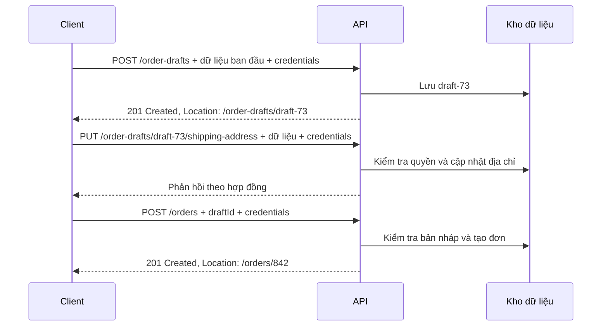

# Stateless và trạng thái cần có trong mỗi yêu cầu

## Mục tiêu bài học

Một API có thể trả JSON, dùng đúng URI và chạy trên nhiều instance nhưng vẫn phụ thuộc vào phiên làm việc được giữ ngầm trên server. Khi một yêu cầu chỉ xử lý được vì server “nhớ” người dùng đã chọn gì ở yêu cầu trước, khả năng phân phối yêu cầu, khôi phục sau lỗi và hiểu hành vi hệ thống đều trở nên phức tạp hơn.

Trong chương **Ràng buộc REST** của module **INTEGRATION_API_REST**, bài học này giải thích ràng buộc stateless và cách thiết kế yêu cầu có đủ ngữ cảnh. Mục tiêu là xây hợp đồng REST API rõ ràng bằng URI, phương thức, header và dữ liệu; các ví dụ liên hệ với Java/Spring nhưng áp dụng được cho công nghệ tương đương.

Sau bài học, bạn có thể:

- Giải thích stateless theo nghĩa tương tác REST.
- Phân biệt trạng thái tài nguyên, trạng thái hội thoại, trạng thái xác thực và dữ liệu tạm trong một yêu cầu.
- Xác định thông tin nào cần gửi qua URI, header hoặc body.
- Nhận diện sự phụ thuộc vào HTTP session, instance cụ thể hoặc “đối tượng đang chọn”.
- Thiết kế luồng nhiều bước có trạng thái nghiệp vụ rõ ràng mà vẫn tránh hội thoại ngầm.
- Giải thích mối quan hệ giữa stateless với token, cache, retry, phân trang và khả năng mở rộng.

## 1. Stateless nói về cách hiểu một yêu cầu

Trong REST, ràng buộc **stateless** yêu cầu mỗi yêu cầu từ client mang thông tin cần thiết để server hiểu và xử lý yêu cầu đó. Server không dựa vào ngữ cảnh hội thoại của client được giữ ngầm giữa các yêu cầu.

Có thể tự kiểm tra bằng câu hỏi:

> Nếu yêu cầu này đến một instance khỏe mạnh khác, có cùng cấu hình và quyền truy cập các kho dữ liệu cần thiết, instance đó có hiểu người gọi muốn làm gì mà không phải khôi phục “cuộc hội thoại trước đó” của client không?

Đây là phép kiểm tra hữu ích, nhưng không phải bằng chứng duy nhất. Một hệ thống chia sẻ HTTP session trong Redis có thể chuyển yêu cầu giữa các instance mà vẫn phụ thuộc vào trạng thái hội thoại trên server.

“Đủ thông tin” cũng không có nghĩa client phải gửi lại toàn bộ dữ liệu server đang lưu. Một yêu cầu có thể chỉ ra resource và gửi thông tin xác thực; server dùng dữ liệu nghiệp vụ hiện tại để kiểm tra quyền và thực hiện thao tác.

Ví dụ:

```http
GET /orders/842 HTTP/1.1
Host: api.example.com
Authorization: Bearer <access-token>
Accept: application/json
```

Yêu cầu nói rõ:

- Thao tác là lấy representation bằng GET.
- Resource đích là đơn hàng 842 trên máy chủ được chỉ định.
- Thông tin xác thực được gửi theo cơ chế Bearer.
- Client mong muốn nhận JSON.

Server vẫn cần xác minh token, kiểm tra người gọi có quyền đọc đơn hàng và truy vấn dữ liệu. Những bước đó không yêu cầu server nhớ “đơn hàng người này đã chọn ở màn hình trước”.

### 1.1. Độc lập về ngữ cảnh không có nghĩa độc lập với dữ liệu

Một yêu cầu đọc đơn hàng đương nhiên phụ thuộc vào việc đơn hàng có tồn tại hay không. Một yêu cầu thanh toán phụ thuộc vào đơn hàng và các quy tắc nghiệp vụ hiện tại. Người gọi cũng có thể phải lấy token trước khi truy cập resource.

Những điều kiện này không tự vi phạm stateless. Ràng buộc nhắm đến sự phụ thuộc vào ngữ cảnh hội thoại được giữ ngầm, không xóa bỏ quan hệ nghiệp vụ hoặc lịch sử thay đổi của dữ liệu.

Tương tự, stateless không bảo đảm hai yêu cầu chạy đồng thời sẽ không xung đột. Chúng có thể cùng tác động lên một resource và cần kiểm soát đồng thời.

## 2. Có những loại trạng thái nào?

Từ “state” dễ gây nhầm vì có thể chỉ nhiều thứ khác nhau.

| Loại trạng thái | Ví dụ | Cách nhìn trong thiết kế |
| --- | --- | --- |
| Trạng thái tài nguyên | Đơn hàng 842 đang chờ thanh toán; giỏ hàng có ba sản phẩm | Server có thể lưu và quản lý theo định danh rõ ràng |
| Trạng thái điều hướng của client | Người dùng đang xem trang 2, đang mở đơn hàng nào | Client quản lý tiến trình tương tác và chỉ ra đích cần thao tác |
| Trạng thái hội thoại ngầm | Session chứa `selectedOrderId`; endpoint sau tự dùng giá trị này | Đây là dạng phụ thuộc cần tránh trong tương tác REST stateless |
| Trạng thái xác thực và ủy quyền | Tài khoản bị khóa, token hết hạn hoặc quyền người dùng đã đổi | Cần được kiểm tra theo cơ chế bảo mật; không thể suy luận từ định dạng token |
| Trạng thái phục vụ trong một yêu cầu | Biến cục bộ, principal đã xác minh, transaction đang chạy | Có thể tồn tại trong quá trình xử lý yêu cầu |
| Dữ liệu tối ưu hóa | Cache sản phẩm, connection pool | Không đồng nhất với phiên hội thoại; vẫn cần kiểm soát tính đúng và độ cũ |

Điểm quan trọng là **server được phép có trạng thái**. Điều cần tránh là giữ một cuộc hội thoại theo client rồi dựa vào cuộc hội thoại đó để hiểu yêu cầu tiếp theo.

### 2.1. Trạng thái tài nguyên vẫn nằm ở server

Giỏ hàng có thể được lưu trong cơ sở dữ liệu:

```http
GET /carts/cart-7 HTTP/1.1
Host: api.example.com
Authorization: Bearer <access-token>
Accept: application/json
```

Server đọc giỏ hàng `cart-7` và kiểm tra quyền của người gọi. Không cần gửi lại toàn bộ các dòng hàng trong mỗi GET.

Giỏ hàng là resource nghiệp vụ có định danh, không phải một biến “giỏ hàng đang chọn” mà endpoint tự lấy từ HTTP session.

Tương tự, một đơn hàng đã lưu, một yêu cầu cấp quyền hoặc một tác vụ xuất báo cáo có thể có vòng đời dài hơn một request. Stateless không yêu cầu xóa chúng sau mỗi phản hồi.

### 2.2. Trạng thái tạm trong request không phải phiên hội thoại

Trong lúc xử lý một yêu cầu, server có thể:

1. Đọc và xác minh thông tin xác thực.
2. Tạo ngữ cảnh bảo mật cho yêu cầu hiện tại.
3. Đọc dữ liệu và mở transaction.
4. Tính toán representation.
5. Ghi log phù hợp và trả phản hồi.

Các biến và ngữ cảnh đó phục vụ yêu cầu hiện tại. Chúng khác với việc ghi `selectedOrderId` vào một phiên để yêu cầu sau không cần chỉ ra đơn hàng.

Với framework dùng vùng lưu trữ theo luồng hoặc ngữ cảnh request, cần quản lý đúng vòng đời và dọn dẹp sau xử lý. Stateless không ngăn lỗi rò rỉ ngữ cảnh do triển khai sai.

## 3. So sánh một luồng có hội thoại ngầm và một luồng rõ ngữ cảnh

### 3.1. Luồng phụ thuộc vào “đơn đang chọn”

Giả sử server cung cấp:

```http
POST /order-selection HTTP/1.1
Host: api.example.com
Cookie: SESSION=<session-id>
Content-Type: application/json

{
  "orderId": "842"
}
```

Server lưu vào session:

```text
selectedOrderId = "842"
```

Sau đó client gửi:

```http
POST /cancel-selected-order HTTP/1.1
Host: api.example.com
Cookie: SESSION=<session-id>
```

Yêu cầu thứ hai không nói rõ đơn nào cần hủy. Server phải khôi phục session rồi đọc lựa chọn từ tương tác trước.

Thiết kế này có những hệ quả cụ thể:

- Instance mới cần có hoặc truy cập được phiên hội thoại.
- Khi phiên hết hạn, ý nghĩa của yêu cầu không còn đủ.
- Hai tab dùng cùng phiên có thể thay đổi lựa chọn của nhau.
- Log của yêu cầu hủy không tự cho biết resource đích nếu không bổ sung thông tin từ session.
- Một yêu cầu gửi lại sau khi lựa chọn đổi có thể tác động tới đơn khác với ý định ban đầu.

Giả sử tab A chọn đơn 842, tab B chọn đơn 915, rồi tab A bấm hủy. Nếu cả hai dùng chung `selectedOrderId`, thao tác có thể nhằm vào đơn 915. Đây không chỉ là vấn đề triển khai nhiều instance; hợp đồng đang để đích thao tác phụ thuộc vào trạng thái bên ngoài yêu cầu.

### 3.2. Luồng chỉ rõ resource và ý định

Một hợp đồng khác biểu diễn yêu cầu hủy như resource con của đơn hàng:

```http
POST /orders/842/cancellations HTTP/1.1
Host: api.example.com
Authorization: Bearer <access-token>
Content-Type: application/json
Accept: application/json

{
  "reason": "CUSTOMER_REQUEST"
}
```

Yêu cầu xác định trực tiếp:

- Đơn hàng đích là 842.
- Ý định là tạo yêu cầu hủy theo hợp đồng của resource `cancellations`.
- Lý do được truyền trong body.
- Thông tin xác thực có trong request.

Server đọc trạng thái đơn hàng để quyết định việc hủy còn hợp lệ hay không. Nếu đơn đã giao, API có thể trả lỗi xung đột theo hợp đồng; nếu người gọi không có quyền, server phải từ chối.

Việc phải đọc trạng thái đơn hàng không làm yêu cầu trở thành một cuộc hội thoại có phiên. Đó là kiểm tra resource nghiệp vụ được định danh rõ ràng.

Đường dẫn ví dụ chỉ minh họa một cách mô hình hóa. Stateless không bắt buộc mọi API phải có resource `cancellations`, cũng không tự giải quyết việc chống tạo yêu cầu hủy trùng.

### 3.3. Đổi nơi lưu session không đổi bản chất

Nếu chuyển `selectedOrderId` từ bộ nhớ instance sang Redis, các instance có thể chia sẻ cùng giá trị. Điều này có thể giúp failover hoặc cân bằng tải, nhưng yêu cầu hủy vẫn phụ thuộc vào cuộc hội thoại trước.

Tương tự:

- Bật sticky session chỉ giữ client về cùng instance.
- Đặt session trong cơ sở dữ liệu chỉ đổi nơi lưu.
- Đổi tên session thành “context” không đổi cách tương tác.
- Đưa toàn bộ dữ liệu session vào một token lớn cũng chưa tạo ra một hợp đồng tốt nếu API vẫn mơ hồ về resource, quyền và vòng đời dữ liệu.

Cần sửa sự phụ thuộc trong hợp đồng, không chỉ thay công nghệ lưu trữ.

## 4. Mỗi yêu cầu cần mang những thông tin nào?

Thông tin cần thiết phụ thuộc vào thao tác. Một GET đơn giản không cần body, khóa chống trùng hay điều kiện cập nhật. Một lệnh ghi có thể cần nhiều hơn.

| Nhóm thông tin | Vị trí thường dùng | Ví dụ | Có phải request nào cũng cần? |
| --- | --- | --- | --- |
| Đích yêu cầu | URI và authority của HTTP | `/orders/842` trên `api.example.com` | Có đích yêu cầu, nhưng cách định danh phụ thuộc API |
| Ý nghĩa thao tác | Phương thức HTTP | GET, POST, PUT, PATCH, DELETE | Có |
| Biến thể truy vấn | Query parameter | `?status=CONFIRMED&limit=20` | Chỉ khi thao tác cần |
| Thông tin xác thực | Header hoặc cơ chế xác thực đã thỏa thuận | `Authorization: Bearer ...` | Với resource yêu cầu xác thực |
| Định dạng dữ liệu gửi | `Content-Type` | `application/json` | Khi gửi nội dung cần mô tả kiểu |
| Biểu diễn mong muốn | `Accept` | `application/json` | Theo khả năng thương lượng của API |
| Dữ liệu thao tác | Body | Các trường tạo đơn hoặc yêu cầu hủy | Tùy thao tác |
| Điều kiện trên phiên bản | Header điều kiện | `If-Match: "order-842-r3"` | Khi hợp đồng yêu cầu kiểm soát phiên bản |
| Danh tính của một ý định ghi lặp | Header theo hợp đồng API | `Idempotency-Key: cancel-f91` | Khi thao tác có hỗ trợ chống trùng |
| Ngữ cảnh truy vết | Header truy vết theo cơ chế sử dụng | Trace context | Hữu ích cho vận hành, không phải điều kiện định nghĩa stateless |

Mục tiêu là xác định **ngữ cảnh cần thiết**, không phải đưa mọi loại header vào mọi request.

### 4.1. URI và query chỉ ra đối tượng cùng phạm vi truy vấn

So sánh:

```text
GET /orders/842
GET /orders?status=CONFIRMED&limit=20
```

Yêu cầu đầu lấy một đơn cụ thể. Yêu cầu sau lấy một tập hợp đã lọc và giới hạn.

Nếu hệ thống cho phép chuyển tenant, ngữ cảnh tenant cần được xác định theo hợp đồng, chẳng hạn qua đường dẫn hoặc thông tin xác thực. Server phải kiểm tra người gọi có quyền trong tenant đó.

Một header `X-Tenant-Id` do client gửi chỉ là dữ liệu đầu vào. Nó không tự chứng minh người gọi thuộc tenant được chỉ ra.

### 4.2. Không phải thông tin nào cũng cần lặp dưới nhiều dạng

Nếu server đã suy ra người gọi từ token được xác minh, body không nhất thiết phải có thêm `userId`. Nhận `userId` từ body rồi tin rằng đó là người đang đăng nhập sẽ tạo nguy cơ giả mạo.

Ngược lại, nếu quản trị viên được phép thao tác trên một người dùng khác, định danh người dùng đích là một phần riêng của nghiệp vụ và vẫn cần được chỉ ra, kèm kiểm tra quyền phù hợp.

Cần phân biệt **chủ thể thực hiện** với **đối tượng bị tác động**.

### 4.3. Điều kiện cập nhật thể hiện điều client dựa vào

Client có thể gửi:

```http
PUT /orders/842/shipping-address HTTP/1.1
Host: api.example.com
Authorization: Bearer <access-token>
Content-Type: application/json
If-Match: "shipping-842-r3"

{
  "recipient": "Nguyen An",
  "city": "Da Nang",
  "street": "12 Duong Vi Du"
}
```

Trong hợp đồng ví dụ, đây là thay thế resource địa chỉ giao hàng. ETag dùng trong `If-Match` phải là validator phù hợp với resource đích này, không tùy tiện lấy từ một resource khác.

Server vẫn kiểm tra quyền, trạng thái đơn và phiên bản. Nếu phiên bản không khớp, có thể trả `412 Precondition Failed`. Kiểm tra và ghi cần phối hợp nguyên tử để tránh mất cập nhật.

Header điều kiện không cần lấy từ một session “phiên bản người dùng vừa xem”; client gửi rõ điều kiện dựa trên representation đã nhận.

### 4.4. Các giá trị mặc định vẫn có thể tồn tại

API có thể công bố rằng khi không gửi `limit`, server dùng kích thước trang mặc định. Một yêu cầu có đủ ngữ cảnh không nhất thiết phải ghi rõ mọi lựa chọn có thể có.

Điều khác biệt là mặc định đó đến từ hợp đồng hoặc cấu hình có nghĩa rõ ràng, thay vì giá trị “đã chọn trong request trước” được giữ ngầm theo client.

Tương tự, `GET /me` không tự vi phạm stateless: resource có thể được xác định tương đối theo người gọi đã xác thực trong chính yêu cầu. Cần mô tả rõ ngữ nghĩa và kiểm tra quyền, không chỉ đánh giá dựa vào việc URI có chứa ID hay không.

## 5. Xác thực: stateless không đồng nghĩa với JWT

Ràng buộc stateless nói về cách tương tác. JWT là một định dạng token có thể mang claim; cookie là một cơ chế mang dữ liệu trong HTTP; opaque token là token mà client không diễn giải nội dung.

Không thể dùng một trong các từ khóa này làm bằng chứng duy nhất cho kiến trúc.

### 5.1. Có JWT vẫn có thể phụ thuộc vào hội thoại ngầm

Ví dụ, client gửi JWT hợp lệ nhưng server vẫn tìm `selectedOrderId` trong HTTP session để quyết định hủy đơn nào. Thông tin xác thực có trong request, còn ý nghĩa nghiệp vụ vẫn thiếu.

Một biến thể khác là controller giữ “đơn gần nhất của người dùng” trong bộ nhớ rồi dùng cho endpoint tiếp theo. Token không sửa được sự phụ thuộc đó.

JWT cũng không tự bảo đảm an toàn. Phía xác minh cần kiểm tra chữ ký, thời hạn, bên phát hành, đối tượng nhận và các điều kiện thích hợp của hợp đồng bảo mật.

### 5.2. Có tra cứu token không đồng nghĩa với nhớ cuộc hội thoại

Opaque access token có thể cần được xác minh qua kho token hoặc cơ chế introspection. Quyền người dùng cũng có thể nằm trong cơ sở dữ liệu và thay đổi theo thời gian.

Cần tách hai câu hỏi:

1. Server có phải xác minh người gọi và trạng thái quyền hiện tại không?
2. Server có phải khôi phục các lựa chọn hội thoại của client để biết yêu cầu đang muốn tác động vào đâu không?

Tra cứu danh tính hoặc quyền không giống việc nhớ “đơn vừa chọn”. Tuy nhiên, một token hoặc cookie dùng làm chìa khóa để nạp toàn bộ phiên ứng dụng vẫn có thể tạo tương tác phụ thuộc vào session.

Do đó, không nên kết luận “có tra cứu là không stateless”, cũng không nên kết luận “dùng token là stateless”. Cần xem dữ liệu được lưu có vai trò gì trong việc hiểu và thực hiện yêu cầu.

### 5.3. Cookie cần được đánh giá theo cách sử dụng

Cookie có thể mang thông tin xác thực, tùy chọn hiển thị hoặc khóa phiên. Chỉ nhìn thấy header `Cookie` không cho biết toàn bộ hành vi server.

Nếu cookie trỏ tới một HTTP session chứa đơn đang chọn, bước hiện tại của màn hình hoặc bộ lọc của lần gọi trước, API đang dựa vào hội thoại ngầm.

Nếu thông tin xác thực được trình duyệt tự động gửi, thiết kế bảo mật còn phải xem xét CSRF và chính sách cookie phù hợp. Gắn nhãn stateless không loại bỏ nhu cầu này; CORS cũng không thay thế xác thực hay phân quyền.

Thông tin nhạy cảm như access token không nên đưa vào query string để “request có đủ dữ liệu”, vì URL có thể xuất hiện trong log, lịch sử hoặc các nơi không phù hợp.

### 5.4. Phân quyền phải kiểm tra trên từng yêu cầu

Một người dùng được phép đọc đơn 842 hôm qua không có nghĩa hôm nay vẫn được phép. Token có thể hết hạn, tài khoản bị khóa hoặc quyền đã được thu hồi.

Với mỗi request được bảo vệ, cần xác định người gọi và kiểm tra quyền theo chính sách. Nếu dùng cache quyền hoặc token tự chứa claim, cần hiểu độ trễ thu hồi và giới hạn chấp nhận được.

Stateless không yêu cầu hệ thống bỏ qua các thay đổi bảo mật mới nhất. Lựa chọn giữa xác minh cục bộ, tra cứu và cache là một phần riêng của thiết kế bảo mật và vận hành.

## 6. Thiết kế luồng nhiều bước mà không giữ hội thoại ngầm

Một quy trình đăng ký, đặt hàng hoặc xuất báo cáo thường không hoàn tất trong một thao tác. Stateless không cấm quy trình nhiều bước; nó yêu cầu các tương tác chỉ rõ resource và dữ liệu cần thiết.

### 6.1. Biểu diễn bản nháp thành resource nghiệp vụ

Ví dụ một quy trình tạo đơn nháp:



Mỗi bước chỉ rõ resource liên quan. Server lưu bản nháp như dữ liệu nghiệp vụ và kiểm tra quyền ở từng thao tác.

Thiết kế cần định nghĩa:

- Bản nháp thuộc về ai và ai được sửa.
- Trường nào bắt buộc khi chuyển thành đơn chính thức.
- Bản nháp có hết hạn hay không.
- Các cập nhật đồng thời được xử lý thế nào.
- Cùng một bản nháp có thể tạo nhiều đơn hay chỉ một đơn.
- Cách gửi lại thao tác tạo đơn khi client chưa biết kết quả.

Chỉ đặt tên một đối tượng là “resource” chưa đủ. Nếu endpoint vẫn tự lấy “bản nháp hiện tại” từ phiên của client, phụ thuộc hội thoại vẫn tồn tại. Resource cần có định danh và hợp đồng vòng đời rõ ràng; request phải xác định được đích của mình.

### 6.2. Client giữ tiến trình tương tác, server giữ quy tắc nghiệp vụ

Client có thể nhớ người dùng đang ở bước nhập địa chỉ hay xác nhận thanh toán. Nhưng server không nên tin rằng client đã đi qua màn hình nào đó nên dữ liệu chắc chắn hợp lệ.

Khi nhận yêu cầu tạo đơn từ bản nháp, server vẫn cần kiểm tra các điều kiện nghiệp vụ hiện tại. Người gọi có thể gửi request trực tiếp, bỏ qua giao diện hoặc dùng một phiên bản ứng dụng cũ.

Một mô hình chuyển trạng thái có thể là:

```text
DRAFT → READY → SUBMITTED
   ↓       ↓
 EXPIRED  EXPIRED
```

Đây là trạng thái của resource bản nháp, không phải bằng chứng rằng người dùng đã bấm đúng các màn hình. Server quyết định chuyển trạng thái nào hợp lệ dựa trên dữ liệu và quyền.

Các điều khiển hypermedia, chẳng hạn liên kết “submit” chỉ xuất hiện khi bản nháp sẵn sàng, có thể giúp client biết bước được đề xuất. Chúng không thay thế kiểm tra trên server khi request thực sự đến.

### 6.3. Công việc dài có resource theo dõi riêng

Với xuất báo cáo, client có thể tạo một tác vụ rồi đọc trạng thái:

```text
POST /report-jobs
GET  /report-jobs/job-73
GET  /report-jobs/job-73/result
```

Nếu API trả `202 Accepted` vì công việc chưa hoàn tất, response cần chỉ ra cách theo dõi theo hợp đồng. Những lần đọc tiếp phải có thông tin xác thực và chỉ rõ tác vụ cần đọc.

Server được phép giữ trạng thái `QUEUED`, `RUNNING`, `SUCCEEDED` hoặc `FAILED`. Không cần lưu “tác vụ gần nhất của session” để hiểu một GET.

## 7. Phân trang và cache có mâu thuẫn với stateless không?

### 7.1. Phân trang cần chỉ rõ cách tiếp tục

Một thiết kế phụ thuộc hội thoại có thể lưu trên server:

```text
session.currentPage = 2
session.currentFilter = "CONFIRMED"
```

Rồi cho client gọi `GET /orders/next` mà không có thông tin tiếp tục nào ngoài session. Khi hai tab dùng hai bộ lọc khác nhau, vị trí đọc có thể lẫn nhau.

Một hợp đồng rõ hơn đưa thông tin tiếp tục vào request:

```http
GET /orders?status=CONFIRMED&limit=20&cursor=cur-abc HTTP/1.1
Host: api.example.com
Authorization: Bearer <access-token>
Accept: application/json
```

Cursor có thể mã hóa vị trí hoặc tham chiếu tới một ảnh chụp truy vấn được lưu ở server. Không bắt buộc mọi cursor phải tự chứa toàn bộ dữ liệu.

Những điểm cần kiểm soát là:

- Request chỉ ra được việc tiếp tục truy vấn nào, thay vì phụ thuộc “trang hiện tại” trong session.
- Cursor không tạo ra quyền truy cập vượt quá quyền người gọi.
- Cursor có phạm vi phù hợp với tenant, người gọi hoặc bộ lọc khi hợp đồng yêu cầu.
- Thứ tự, thời hạn và hành vi khi dữ liệu thay đổi được công bố.
- Bộ lọc gửi lại phải tương thích với cursor, hoặc cursor đã đại diện đầy đủ cho truy vấn theo hợp đồng.

Một ảnh chụp truy vấn có định danh và vòng đời rõ có thể là resource của server. Việc server lưu ảnh chụp không tự biến tương tác thành phiên hội thoại ngầm; cần xét cách client định danh và sử dụng nó.

### 7.2. Cache là lưu dữ liệu, không phải nhớ hội thoại

Server có thể cache thông tin sản phẩm. Một instance khác chưa có cache vẫn truy vấn nguồn dữ liệu và xử lý cùng request theo hợp đồng.

Đó là lưu trữ phục vụ hiệu năng, khác với việc chỉ instance trước mới biết người dùng muốn thao tác trên đơn nào.

Với dữ liệu cá nhân, chính sách cache cần tránh phát nhầm representation giữa các người dùng. Không được dùng một cache key chỉ gồm `/me` rồi trả cùng dữ liệu cho mọi người gọi.

Các header như `Cache-Control: private` hay `no-store` có vai trò riêng trong chính sách lưu phản hồi. Stateless không tự làm một response an toàn để cache công khai.

## 8. Retry và idempotency: vẫn cần xử lý lịch sử thao tác

Giả sử client gửi yêu cầu tạo đơn có đầy đủ URI, body và credentials. Server tạo đơn thành công nhưng response bị mất. Yêu cầu đó có thể hoàn toàn rõ ngữ cảnh, song client vẫn chưa biết kết quả.

```text
Client gửi POST
    → Server lưu đơn
    → Mất phản hồi
    → Client timeout
```

**Stateless không bảo đảm thao tác chỉ xảy ra một lần.**

Nếu gửi lại POST mà không có cơ chế phù hợp, client có thể tạo thêm đơn. Với API hỗ trợ idempotency, request có thể kèm khóa cho cùng một ý định nghiệp vụ:

```http
POST /orders HTTP/1.1
Host: api.example.com
Authorization: Bearer <access-token>
Content-Type: application/json
Idempotency-Key: checkout-a8c3

{
  "draftId": "draft-73"
}
```

Server có thể lưu bản ghi chống trùng, liên kết khóa với nội dung yêu cầu và kết quả. Đây là trạng thái xử lý thao tác và dữ liệu bảo đảm nghiệp vụ; không cần cấm lưu nó để đạt stateless.

Yêu cầu vẫn chỉ rõ đích, ý định và khóa. Server không phải nhớ một bước chọn ngầm của client để hiểu POST đó.

Hợp đồng chống trùng còn cần xác định:

- Phạm vi khóa theo người gọi hoặc tenant và thao tác.
- Phản ứng khi cùng khóa nhưng body khác.
- Cách xử lý các request cùng khóa đang chạy đồng thời.
- Thời hạn lưu dấu và hành vi sau khi hết hạn.
- Sự phối hợp giữa ghi nhận khóa và thay đổi nghiệp vụ để tránh tạo trùng khi tiến trình lỗi.

Tạo khóa mới cho mỗi lần retry thường không đại diện cho cùng một ý định trong cơ chế này. Ngược lại, tái sử dụng khóa của lần mua trước cho một lần mua mới cũng có thể gây kết quả sai.

Việc giữ trạng thái chống trùng cho thấy vì sao không nên hiểu stateless thành “server không được nhớ bất cứ điều gì”. Điều cần loại bỏ là ngữ cảnh hội thoại ẩn, không phải mọi dữ liệu phục vụ tính đúng.

## 9. Triển khai Java/Spring: request rõ ràng, controller không giữ lựa chọn

Đoạn mã dưới đây minh họa endpoint đọc đơn hàng. Giả sử ứng dụng đã cấu hình bảo mật để chỉ cho phép người dùng đã xác thực gọi endpoint, và principal được tạo từ thông tin xác thực của chính request.

```java
import java.security.Principal;
import java.util.Optional;

import org.springframework.http.CacheControl;
import org.springframework.http.HttpStatus;
import org.springframework.http.MediaType;
import org.springframework.http.ResponseEntity;
import org.springframework.web.bind.annotation.GetMapping;
import org.springframework.web.bind.annotation.PathVariable;
import org.springframework.web.bind.annotation.RequestMapping;
import org.springframework.web.bind.annotation.RestController;
import org.springframework.web.server.ResponseStatusException;

@RestController
@RequestMapping("/orders")
public class OrderController {

    private final OrderQuery orderQuery;

    public OrderController(OrderQuery orderQuery) {
        this.orderQuery = orderQuery;
    }

    @GetMapping(value = "/{orderId}", produces = MediaType.APPLICATION_JSON_VALUE)
    public ResponseEntity<OrderView> getOrder(
            @PathVariable("orderId") String orderId,
            Principal principal) {

        OrderView order = orderQuery
                .findVisibleTo(principal.getName(), orderId)
                .orElseThrow(() -> new ResponseStatusException(
                        HttpStatus.NOT_FOUND, "Order not found"));

        return ResponseEntity.ok()
                .cacheControl(CacheControl.noStore())
                .body(order);
    }

    public record OrderView(String id, String status) {
    }

    public interface OrderQuery {
        Optional<OrderView> findVisibleTo(String subject, String orderId);
    }
}
```

Đây là đoạn minh họa trong ứng dụng Spring, không phải dự án chạy độc lập. Cần cung cấp bean hiện thực `OrderQuery`, cấu hình JSON, xử lý lỗi và cấu hình xác thực phù hợp.

Các điểm thiết kế đáng chú ý:

- `orderId` được lấy từ URI của chính request.
- Danh tính người gọi đến từ principal đã được xác minh, không lấy từ `userId` tùy ý trong body.
- `findVisibleTo` phải thực hiện kiểm tra quyền phù hợp khi truy vấn resource.
- Trong hợp đồng minh họa, đơn không tồn tại hoặc không được công bố với người gọi đều có thể được trả dưới dạng 404.
- Controller không có `selectedOrderId` và không đọc HTTP session để biết đơn đang được chọn.
- DTO công bố ra ngoài tách khỏi mô hình lưu trữ.

Code controller này chưa đủ chứng minh toàn ứng dụng stateless. Cần kiểm tra chuỗi bảo mật có khôi phục HTTP session không, service có dùng ngữ cảnh hội thoại ẩn không và các endpoint khác có cùng nguyên tắc không.

### 9.1. Không dùng field của controller để giữ dữ liệu theo client

Một controller dùng chung có field thay đổi theo request như sau sẽ tạo rủi ro:

```java
// Ví dụ cần tránh trong controller dùng chung:
private String selectedOrderId;
```

Nếu một request gán ID rồi request sau đọc lại, dữ liệu có thể lẫn giữa nhiều người dùng. Việc này vừa phá vỡ tính độc lập của request vừa có thể tạo lỗi đồng thời và lộ dữ liệu.

Ngược lại, một field `final` giữ tham chiếu tới service được thiết kế an toàn cho truy cập đồng thời không phải là phiên hội thoại của client.

Dữ liệu phục vụ riêng một request nên nằm trong tham số, biến cục bộ hoặc ngữ cảnh request có vòng đời đúng. Tài nguyên nghiệp vụ cần tồn tại lâu hơn thì được lưu theo định danh rõ ràng tại tầng thích hợp.

### 9.2. Cấu hình không tạo session là cần xem xét, không phải toàn bộ lời giải

Với Spring Security, cần chọn cách quản lý session phù hợp với cơ chế xác thực của API và kiểm tra hành vi thực tế. Không thể chỉ bỏ tham số `HttpSession` khỏi controller rồi kết luận không còn phụ thuộc phiên.

Cũng không nên lấy việc response không có `Set-Cookie` làm bằng chứng duy nhất:

- Server có thể đang dùng một cookie từ trước.
- Session có thể nằm trong một thành phần khác.
- Một service có thể giữ ngữ cảnh theo người dùng trong kho riêng.
- Ngược lại, một cookie có thể không được dùng để nạp phiên hội thoại.

Cần đọc được đường đi của dữ liệu: request cung cấp gì, server tra cứu gì và dữ liệu tra cứu đó có vai trò nghiệp vụ hay vai trò hội thoại.

## 10. Lợi ích thực tế và những giới hạn

### 10.1. Phân phối yêu cầu linh hoạt hơn

Khi không cần khôi phục phiên hội thoại trên một instance cụ thể, bộ cân bằng tải có thể chuyển request sang các instance khác có cùng khả năng xử lý.

Lợi ích thường thấy:

- Giảm nhu cầu sticky session vì trạng thái hội thoại.
- Dễ thay instance khi triển khai hoặc khi tiến trình lỗi.
- Giảm công việc đồng bộ phiên giữa các máy.
- Dễ tái hiện một request nếu đã có thông tin hợp lệ và dữ liệu cần thiết.

Các instance vẫn cần truy cập đúng kho dữ liệu, cấu hình, khóa xác minh và phụ thuộc. Stateless không làm cơ sở dữ liệu hoặc dịch vụ xác thực tự có tính sẵn sàng cao.

### 10.2. Thông điệp rõ hơn, dễ quan sát hơn

Một request chỉ rõ resource, người gọi và điều kiện giúp việc phân tích hành vi đơn giản hơn. Khi gặp lỗi, nhóm vận hành có thể xác định thao tác nào đã được yêu cầu mà ít phải khôi phục lịch sử hội thoại.

Tuy nhiên, không được ghi toàn bộ credentials hoặc dữ liệu nhạy cảm vào log để phục vụ tái hiện. Trace ID cũng chỉ hỗ trợ truy vết; nó không chứng minh danh tính hay quyền.

### 10.3. Có chi phí lặp và các đánh đổi

Mỗi request có thể phải mang credentials cùng metadata, được xác minh lại và kiểm tra quyền. Một token quá lớn làm tăng băng thông; nhiều cuộc gọi xác minh từ xa làm tăng độ trễ và tạo thêm phụ thuộc.

Cần thiết kế kích thước token, chính sách cache an toàn và thời hạn hợp lý. Chuyển một HTTP session thành JWT chứa toàn bộ hồ sơ, giỏ hàng và lựa chọn giao diện có thể làm dữ liệu nhanh lỗi thời, tăng rủi ro lộ thông tin và khó thu hồi.

Stateless cũng không giải quyết thay:

| Vấn đề | Cơ chế vẫn cần thiết kế |
| --- | --- |
| Hai người cùng cập nhật resource | Điều kiện phiên bản, khóa hoặc kiểm soát đồng thời phù hợp |
| Timeout sau khi thao tác đã hoàn tất | Kiểm tra kết quả, idempotency và chính sách retry |
| Dữ liệu bản sao chưa cập nhật | Cam kết nhất quán và chính sách đọc |
| Người dùng truy cập đơn của người khác | Phân quyền trên resource |
| Phụ thuộc bên ngoài ngừng hoạt động | Timeout, giới hạn tải, khôi phục hoặc xử lý bất đồng bộ |
| Nhiều thao tác giữa các dịch vụ | Cơ chế phối hợp và bảo đảm dữ liệu phù hợp |

Một API stateful có thể là lựa chọn chủ động trong một bối cảnh cụ thể. Khi mô tả nó, cần nói rõ sự phụ thuộc vào session và các chi phí tương ứng, thay vì mặc định gọi mọi HTTP API là REST stateless.

## 11. Kiểm tra hợp đồng và hành vi

Tài liệu API nên mô tả những dữ liệu mà mỗi thao tác cần: định danh resource, yêu cầu bảo mật, header điều kiện, body và các response. OpenAPI giúp thể hiện nhiều phần của hợp đồng này, nhưng không tự phát hiện mọi sự phụ thuộc phiên nằm trong triển khai.

Một danh sách tình huống kiểm tra hữu ích:

| Tình huống | Điều cần quan sát |
| --- | --- |
| Đọc đơn trực tiếp bằng request hợp lệ, chưa gọi màn hình chọn đơn | Xử lý được theo URI và credentials, không yêu cầu khởi tạo lựa chọn ngầm |
| Gửi cùng request đến instance khác có cùng dữ liệu và cấu hình | Không lỗi chỉ vì thiếu phiên hội thoại cục bộ |
| Hai tab thao tác hai đơn khác nhau | Đích thao tác không bị thay bởi lựa chọn của tab còn lại |
| Gửi request không có thông tin xác thực tới resource được bảo vệ | Bị từ chối theo hợp đồng; nếu dùng 401 thì có challenge phù hợp |
| Người dùng khác đọc một đơn không thuộc quyền | Bị từ chối theo chính sách, không lộ dữ liệu |
| Gửi tenant không được phép truy cập | Không thể đổi phạm vi dữ liệu chỉ bằng đầu vào client |
| Cập nhật dựa trên phiên bản cũ | Có xử lý xung đột theo hợp đồng, chẳng hạn 412 với If-Match |
| Gửi lại thao tác ghi có cùng khóa chống trùng | Giữ bảo đảm idempotency trong phạm vi đã công bố |
| Dùng cursor hết hạn hoặc sai phạm vi | Có phản hồi rõ theo hợp đồng, không âm thầm dùng “trang đang nhớ” |

Kết quả kiểm tra chuyển instance chỉ chứng minh một phần. Nếu hai instance cùng đọc một kho session để lấy `selectedOrderId`, chúng vẫn có thể chạy được dù tương tác chưa đáp ứng stateless.

## 12. Quy trình chuyển một endpoint phụ thuộc session

Giả sử đang có endpoint hủy “đơn được chọn”. Có thể cải tiến theo trình tự:

1. **Liệt kê dữ liệu đang lấy từ phiên.** Ví dụ: đơn đang chọn, tenant, phiên bản đã đọc và lý do hủy.
2. **Phân loại từng dữ liệu.** Danh tính đến từ xác thực; đơn đích là định danh resource; phiên bản là điều kiện cập nhật; lý do là dữ liệu nghiệp vụ.
3. **Đưa ngữ cảnh cần thiết vào hợp đồng request.** Chọn URI, phương thức, header và body phù hợp.
4. **Lưu dữ liệu dài hạn như resource nghiệp vụ khi cần.** Ví dụ bản nháp có định danh và quyền rõ ràng.
5. **Kiểm tra lại quyền và điều kiện nghiệp vụ.** Không chuyển sự tin cậy từ session sang các trường do client tự khai.
6. **Loại bỏ việc đọc lựa chọn hội thoại cũ.** Tránh giữ một nhánh xử lý ngầm khiến endpoint vẫn phụ thuộc phiên.
7. **Kiểm tra các tình huống nhiều tab, nhiều instance và gọi lại.** Đồng thời xác nhận client cũ được chuyển đổi theo kế hoạch tương thích.

Việc thay đổi hợp đồng có thể ảnh hưởng client đang sử dụng. Stateless là mục tiêu thiết kế, không phải lý do để âm thầm phá vỡ hành vi đã công bố.

## 13. Bài tập tự kiểm tra

### Câu hỏi

1. Server lưu đơn hàng trong PostgreSQL. Có thể kết luận API không stateless không?
2. API dùng JWT nhưng endpoint hủy tự lấy `selectedOrderId` từ Redis session. Điều gì còn thiếu trong request?
3. Một opaque token cần được xác minh từ xa. Chỉ điều này có đủ kết luận API phụ thuộc hội thoại không?
4. Client gọi `GET /me` cùng access token hợp lệ. Vì sao URI không có ID vẫn có thể đủ ngữ cảnh?
5. Cursor phân trang tham chiếu đến một ảnh chụp có thời hạn ở server. Có bắt buộc chuyển toàn bộ ảnh chụp sang client không?
6. Một POST rõ ngữ cảnh bị timeout. Vì sao không nên mặc định gửi lại với một ý định tạo mới?
7. Hai instance dùng chung kho HTTP session nên request đi instance nào cũng chạy. Kết quả đó đã chứng minh REST stateless chưa?
8. Một controller không có field thay đổi nhưng service đọc “tenant đang chọn” từ phiên. Phải kiểm tra stateless ở đâu?

### Gợi ý đối chiếu

1. Không. Dữ liệu đơn hàng là trạng thái tài nguyên; cần xem tương tác có dựa vào hội thoại ngầm không.
2. Request chưa chỉ rõ đơn hàng đích. JWT xác thực người gọi không thay thế định danh resource cần tác động.
3. Không. Cần phân biệt xác minh danh tính, quyền với khôi phục lựa chọn hội thoại để hiểu thao tác.
4. Hợp đồng có thể định nghĩa resource tương đối theo danh tính đã được xác minh trong chính request.
5. Không. Có thể tham chiếu resource ảnh chụp bằng định danh rõ, kèm chính sách quyền, thời hạn và tính nhất quán phù hợp.
6. Server có thể đã tạo resource dù response bị mất. Cần kiểm tra kết quả hoặc gửi lại theo hợp đồng idempotency.
7. Chưa. Khả năng chuyển instance không loại bỏ phụ thuộc vào phiên dùng chung.
8. Cần xem toàn bộ đường xử lý và hợp đồng, gồm bảo mật, controller, service và các kho ngữ cảnh liên quan.

Khi đọc một endpoint, hãy xác định resource, ý định thao tác, danh tính và điều kiện mà request cung cấp. Sau đó chỉ ra dữ liệu server cần đọc để thực hiện. Nếu server phải khôi phục “client vừa chọn gì” mới hiểu yêu cầu, đó là nơi cần làm rõ lại hợp đồng.
