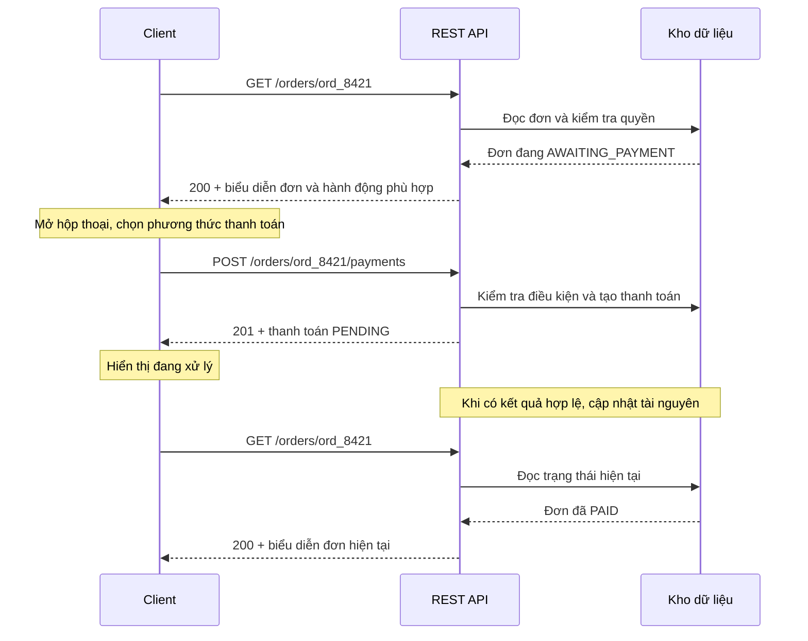

# Phân biệt trạng thái ứng dụng với trạng thái tài nguyên

## 1. Mục tiêu bài học

Trong chương **Ràng buộc REST** của module **INTEGRATION_API_REST**, việc phân biệt trạng thái ứng dụng với trạng thái tài nguyên giúp giải thích một câu thường gây nhầm lẫn: một REST API có thể yêu cầu giao tiếp stateless trong khi server vẫn lưu đơn hàng, tài khoản và kết quả thanh toán.

Sau bài học, bạn có thể:

- Phân biệt vị trí hiện tại của client trong một luồng tương tác với tình trạng nghiệp vụ của tài nguyên.
- Giải thích vì sao lưu dữ liệu tài nguyên trên server không mâu thuẫn với ràng buộc stateless.
- Phát hiện một yêu cầu đang phụ thuộc vào ngữ cảnh hội thoại ẩn của các yêu cầu trước.
- Thiết kế URI, request và response để client gửi đủ ngữ cảnh, còn server kiểm soát dữ liệu và chuyển trạng thái nghiệp vụ.
- Vận dụng sự phân biệt này trong ứng dụng Java/Spring hoặc công nghệ tương đương.

## 2. Một tình huống có nhiều loại trạng thái

Người dùng mở một ứng dụng mua hàng và thực hiện các bước:

1. Xem danh sách đơn hàng.
2. Chọn đơn `ord_8421`.
3. Mở hộp thoại thanh toán.
4. Chọn một phương thức thanh toán.
5. Gửi yêu cầu tạo thanh toán.
6. Theo dõi kết quả xử lý.

Trong lúc đó, server quản lý một đơn hàng với dữ liệu:

```json
{
  "id": "ord_8421",
  "status": "AWAITING_PAYMENT",
  "totalAmount": 250000,
  "currency": "VND"
}
```

Hai nhóm thông tin đang tồn tại cùng lúc:

| Thông tin | Ý nghĩa trong tình huống này |
|---|---|
| Client đang hiển thị màn hình chi tiết | Vị trí hiện tại trong tương tác |
| Người dùng vừa mở hộp thoại thanh toán | Bước tương tác của client |
| Client đang chờ phản hồi HTTP | Tình trạng thực hiện yêu cầu tại client |
| Đơn hàng đang chờ thanh toán | Tình trạng nghiệp vụ của tài nguyên đơn hàng |
| Một thanh toán đang được xử lý | Tình trạng nghiệp vụ của tài nguyên thanh toán |

Nếu đóng hộp thoại, đơn hàng không vì thế chuyển thành đã thanh toán. Nếu đơn được thanh toán từ một thiết bị khác, màn hình hiện tại cũng không tự động trở thành dữ liệu mới nhất.

Hai nhóm trạng thái có liên hệ, nhưng không phải cùng một thứ.

## 3. Trạng thái ứng dụng là gì?

### 3.1. Vị trí và ngữ cảnh của client trong tương tác

Trong ngữ cảnh kiến trúc REST, **trạng thái ứng dụng** mô tả client đang ở đâu trong tiến trình sử dụng ứng dụng: đang tương tác với tài nguyên nào, đã nhận những biểu diễn nào và có thể chọn hành động tiếp theo nào.

Một phần trạng thái đó có thể được thể hiện trong URL, dữ liệu ở bộ nhớ client hoặc các biểu diễn và điều khiển mà client đang sử dụng.

Ví dụ minh họa tại client:

```json
{
  "currentView": "ORDER_DETAIL",
  "selectedOrderId": "ord_8421",
  "paymentDialogOpen": true,
  "selectedPaymentMethodId": "pm_17",
  "requestInProgress": false
}
```

Đây là mô hình trạng thái giao diện phục vụ ví dụ, không phải cấu trúc JSON mà REST bắt buộc phải có. Nó giúp thấy rằng người dùng có thể đổi màn hình, mở hoặc đóng hộp thoại mà chưa thay đổi dữ liệu chính thức của đơn hàng.

Khái niệm này cũng rộng hơn các biến hiển thị của một giao diện. Một chương trình Java chạy nền vẫn có tiến trình tương tác: lấy danh sách công việc, chọn một tài nguyên, nhận phản hồi và quyết định gửi yêu cầu tiếp theo.

### 3.2. Client quản lý tiến trình tương tác của mình

Trong giao tiếp REST stateless, client giữ và truyền ngữ cảnh cần thiết cho các yêu cầu tiếp theo. Server không cần nhớ rằng cùng client đó vừa mở màn hình nào để hiểu một yêu cầu mới.

Ví dụ, sau khi người dùng chọn đơn hàng, client có thể gửi:

```http
GET /orders/ord_8421 HTTP/1.1
Host: api.example.test
Accept: application/json
```

Yêu cầu đã chỉ ra tài nguyên cần đọc. Server không cần tra một biến phiên có tên `lastSelectedOrderId` để xác định đơn nào đang được hỏi.

Ví dụ HTTP trong bài lược bỏ thông tin xác thực để tập trung vào ngữ cảnh tài nguyên. Trong triển khai thực tế, mỗi yêu cầu cần mang thông tin xác thực theo cơ chế đã chọn và được kiểm tra quyền truy cập phù hợp.

## 4. Trạng thái tài nguyên là gì?

### 4.1. Tình trạng hiện tại của đối tượng được quản lý

**Trạng thái tài nguyên** là thông tin mô tả tình trạng hiện tại của một tài nguyên mà API cung cấp. Với tài nguyên đơn hàng, đó có thể là các dòng sản phẩm, tổng tiền, địa chỉ nhận hàng và tình trạng thanh toán.

Trạng thái tài nguyên không chỉ là trường có tên `status`:

```json
{
  "id": "ord_8421",
  "status": "AWAITING_PAYMENT",
  "items": [
    {
      "productId": "P-100",
      "quantity": 2
    }
  ],
  "totalAmount": 250000,
  "currency": "VND"
}
```

Trong biểu diễn này, số lượng sản phẩm và tổng tiền cũng là thông tin về trạng thái của đơn. Một API không có trường `status` vẫn có tài nguyên và trạng thái tài nguyên.

Server quản lý trạng thái có thẩm quyền trong ví dụ này. Client có thể giữ một bản sao để hiển thị, nhưng bản sao đó có thể cũ so với dữ liệu hiện tại ở server.

### 4.2. Biểu diễn không phải toàn bộ tài nguyên

Response JSON là một **biểu diễn** của tài nguyên tại thời điểm xử lý yêu cầu. Server có thể chỉ công khai một phần dữ liệu, tổng hợp từ nhiều nguồn hoặc cung cấp các biểu diễn khác nhau theo quyền của người gọi.

Ví dụ, khách hàng có thể xem trạng thái giao hàng; nhân viên có thể xem thêm dữ liệu nghiệp vụ được phân quyền. Không bên nào cần nhận toàn bộ bản ghi cơ sở dữ liệu.

Tài nguyên cũng không bắt buộc tương ứng một bảng, một hàng dữ liệu hoặc một đối tượng Java. Một báo cáo được tính khi có yêu cầu vẫn có thể là tài nguyên. Việc dữ liệu tồn tại lâu hay ngắn, nằm trong bộ nhớ hay cơ sở dữ liệu không đủ để phân loại nó thành trạng thái ứng dụng hoặc trạng thái tài nguyên.

## 5. So sánh trực tiếp

| Tiêu chí | Trạng thái ứng dụng | Trạng thái tài nguyên |
|---|---|---|
| Câu hỏi điển hình | Client đang ở bước nào và sẽ tương tác tiếp ra sao? | Đối tượng đang được quản lý có tình trạng gì? |
| Ví dụ trong bài | Đang xem đơn nào, hộp thoại nào đang mở | Đơn đang chờ thanh toán, tổng tiền bao nhiêu |
| Vai trò trong giao tiếp REST | Client quản lý ngữ cảnh tương tác và gửi thông tin cần thiết | Server quản lý dữ liệu có thẩm quyền và áp dụng quy tắc thay đổi |
| Khác nhau giữa hai thiết bị | Mỗi thiết bị có thể ở một màn hình khác nhau | Cùng đọc một tài nguyên nhưng có thể nhận các bản sao ở thời điểm khác nhau |
| Khi đóng một màn hình | Có thể bị xóa hoặc được client khôi phục | Không tự động thay đổi chỉ vì màn hình bị đóng |
| Khi người khác cập nhật dữ liệu | Client cần xử lý việc dữ liệu đang xem đã cũ | Trạng thái có thẩm quyền thay đổi theo thao tác hợp lệ |

Một dữ liệu đang nằm ở client chưa chắc chỉ là trạng thái ứng dụng. Chẳng hạn, JSON đơn hàng trong bộ nhớ client là bản sao của biểu diễn tài nguyên; thông tin “đang mở trang chi tiết” là ngữ cảnh tương tác.

Tương tự, một dữ liệu được lưu trên server cần được xem xét theo ý nghĩa sử dụng. Chỉ nhìn vị trí lưu không đủ kết luận thiết kế có tuân thủ stateless hay không.

## 6. Stateless không có nghĩa là server không lưu dữ liệu

### 6.1. Điều yêu cầu phải tự mang theo

Với giao tiếp stateless, mỗi yêu cầu từ client phải chứa thông tin cần thiết để server hiểu yêu cầu đó, thay vì dựa vào ngữ cảnh hội thoại của những yêu cầu trước đang được giữ riêng trên server.

Thông tin đó có thể nằm trong:

- Phương thức HTTP và URI xác định thao tác cùng tài nguyên.
- Các header cần thiết, chẳng hạn loại nội dung hoặc thông tin xác thực.
- Query parameter được hợp đồng quy định.
- Request body mô tả dữ liệu mà client đề nghị xử lý.

Điều này không yêu cầu gửi lại toàn bộ đơn hàng, toàn bộ dữ liệu tài khoản hay lịch sử giao dịch trong mỗi request. Server vẫn đọc tài nguyên hiện có, tra quyền và áp dụng quy tắc nghiệp vụ của hệ thống.

### 6.2. Phụ thuộc vào tài nguyên khác với phụ thuộc vào hội thoại ẩn

So sánh hai cách hiểu một yêu cầu tạo thanh toán:

```text
Cách A:
  "Thanh toán cho đơn mà client này đã chọn ở yêu cầu trước."
  Server cần nhớ selectedOrderId của phiên tương tác.

Cách B:
  "Tạo thanh toán cho đơn ord_8421."
  Request xác định đơn cần xử lý.
  Server đọc trạng thái hiện tại của đơn ord_8421.
```

Cách A phụ thuộc vào ngữ cảnh hội thoại ẩn. Cách B phụ thuộc vào tài nguyên được xác định rõ trong yêu cầu.

Đơn hàng có thể phải được tạo trước khi thanh toán. Sự phụ thuộc nghiệp vụ đó không làm yêu cầu thanh toán trở thành stateful theo nghĩa phiên hội thoại. Server cần đơn hàng đang tồn tại và hợp lệ, không cần nhớ client đã đi qua các màn hình nào.

### 6.3. Các loại dữ liệu server vẫn có thể quản lý

Việc lưu đơn hàng, tài khoản, cấu hình, chính sách truy cập, log hoặc dữ liệu cache không tự động vi phạm stateless. Cần xem liệu server có phải giữ ngữ cảnh hội thoại của riêng client để hiểu yêu cầu tiếp theo hay không.

Tương tự, dùng token không tự động làm toàn bộ API stateless. Nếu request có token nhưng server vẫn phải tra “đơn đang chọn trong phiên” để biết đối tượng cần xử lý, sự phụ thuộc hội thoại vẫn còn.

Đánh giá cơ chế đăng nhập và quản lý phiên cần xét thiết kế cụ thể. Trong bài này, điểm phân biệt là ngữ cảnh cần để hiểu yêu cầu và trạng thái tài nguyên mà yêu cầu đang tác động tới.

## 7. Sửa một luồng phụ thuộc vào phiên hội thoại

### 7.1. Thiết kế ban đầu

Giả sử hệ thống triển khai hai yêu cầu:

```http
POST /checkout/select-order HTTP/1.1
Content-Type: application/json

{
  "orderId": "ord_8421"
}
```

Server ghi thông tin vào phiên:

```text
session.selectedOrderId = "ord_8421"
session.currentStep = "PAYMENT"
```

Sau đó client gửi:

```http
POST /checkout/pay HTTP/1.1
Content-Type: application/json

{
  "paymentMethodId": "pm_17"
}
```

Yêu cầu thứ hai không xác định đơn cần thanh toán. Server phải tìm lại `selectedOrderId` và có thể cả `currentStep` của phiên để diễn giải nó.

Một số hệ quả có thể xuất hiện:

- Hai tab chọn hai đơn khác nhau nhưng dùng chung phiên, khiến biến đơn đang chọn bị ghi đè.
- Client khác không thể gửi trực tiếp yêu cầu thanh toán nếu chưa chạy bước chọn đơn để tạo ngữ cảnh.
- Việc phân phối yêu cầu qua nhiều server phải tính đến nơi đang giữ phiên hội thoại.
- Kiểm thử một yêu cầu phải dựng thêm lịch sử tương tác dù tài nguyên đơn hàng đã tồn tại.

Chia sẻ session giữa các server có thể giúp vận hành thiết kế này, nhưng không loại bỏ sự phụ thuộc vào ngữ cảnh hội thoại. Một hệ thống vẫn có thể chủ động chọn thiết kế có phiên; khi đó cần mô tả đúng đặc tính của nó.

### 7.2. Thiết kế yêu cầu chỉ rõ tài nguyên

Với bài toán trên, có thể để client chọn đơn trong trạng thái tương tác của chính nó rồi gửi:

```http
POST /orders/ord_8421/payments HTTP/1.1
Host: api.example.test
Content-Type: application/json
Accept: application/json

{
  "paymentMethodId": "pm_17"
}
```

Hợp đồng của ví dụ quy định:

- `ord_8421` trong URI xác định đơn cần tạo thanh toán.
- `paymentMethodId` đề nghị phương thức thanh toán mà người gọi được phép sử dụng.
- Server kiểm tra danh tính, quyền đối với đơn và phương thức thanh toán.
- Server đọc số tiền từ dữ liệu có thẩm quyền, kiểm tra đơn còn được phép thanh toán và tạo tài nguyên thanh toán theo quy tắc nghiệp vụ.

Client không gửi trường `currentStep` để chứng minh đã đi qua màn hình thanh toán. Đi qua một màn hình cũng không phải điều kiện cấp quyền.

### 7.3. Phân biệt tạo thanh toán và hoàn tất thanh toán

Server có thể trả:

```http
HTTP/1.1 201 Created
Location: /payments/pay_512
Content-Type: application/json

{
  "id": "pay_512",
  "orderId": "ord_8421",
  "status": "PENDING",
  "amount": 250000,
  "currency": "VND"
}
```

`201 Created` cho biết tài nguyên thanh toán đã được tạo thành công. Nó không tự khẳng định tiền đã được thanh toán xong. Ở thời điểm này, thanh toán còn `PENDING` và đơn có thể vẫn là `AWAITING_PAYMENT`.

Khi server nhận được kết quả thanh toán hợp lệ theo cơ chế của hệ thống, server mới chuyển các tài nguyên liên quan sang trạng thái tương ứng. Client không được quyết định đơn đã thanh toán chỉ vì hộp thoại đã đóng hoặc một hiệu ứng thành công đã chạy.

## 8. Trạng thái ứng dụng và tài nguyên phối hợp qua biểu diễn

### 8.1. Server có thể chỉ ra các hành động tiếp theo

Client cần biết mình có thể làm gì sau khi nhận một biểu diễn. Trong REST, các liên kết và điều khiển trong biểu diễn có thể hướng dẫn những chuyển tiếp đó.

Ví dụ API dùng một cấu trúc biểu diễn được định nghĩa riêng:

```json
{
  "id": "ord_8421",
  "status": "AWAITING_PAYMENT",
  "totalAmount": 250000,
  "currency": "VND",
  "actions": [
    {
      "rel": "self",
      "href": "/orders/ord_8421",
      "method": "GET"
    },
    {
      "rel": "create-payment",
      "href": "/orders/ord_8421/payments",
      "method": "POST"
    }
  ]
}
```

Tên `actions`, cấu trúc từng phần tử và ý nghĩa `create-payment` là quy ước của biểu diễn ví dụ, không phải những trường JSON bắt buộc chung cho REST. Client cần hiểu ngữ nghĩa biểu diễn và dữ liệu cần gửi theo hợp đồng.

Server có thể dựa trên trạng thái tài nguyên và quyền hiện tại để cung cấp điều khiển phù hợp. Client dùng những thông tin đó để quyết định bước tương tác tiếp theo, chẳng hạn hiển thị lựa chọn thanh toán.

Điều này không yêu cầu server lưu việc hộp thoại của client đang mở hay đóng. Server cung cấp khả năng tương tác; client điều khiển tiến trình sử dụng những khả năng đó.

### 8.2. Hành động được hiển thị không thay thế kiểm tra lúc thực hiện

Một biểu diễn có thể cũ ngay sau khi được trả về. Người dùng khác có thể hủy đơn, hoặc một lần thanh toán khác có thể đã hoàn tất.

Vì vậy, ngay cả khi client vừa thấy hành động `create-payment`, server vẫn phải kiểm tra lại khi nhận `POST`. Nếu trạng thái hiện tại không cho phép thao tác, API có thể trả `409 Conflict` theo hợp đồng và hướng dẫn client tải lại dữ liệu.

Việc kiểm tra và cập nhật còn phải được bảo vệ phù hợp trước các yêu cầu cạnh tranh. Đọc trạng thái hợp lệ rồi cập nhật mà không xét thay đổi đồng thời vẫn có thể tạo lỗi nghiệp vụ.

## 9. Một luồng đầy đủ nhìn từ hai loại trạng thái



Trong luồng này:

- Việc mở hộp thoại, chọn phương thức và chuyển sang màn hình đang xử lý thuộc tiến trình tương tác của client.
- Việc đơn đang chờ thanh toán hay đã thanh toán là trạng thái tài nguyên.
- Mỗi yêu cầu chỉ rõ tài nguyên cần xử lý; server không cần nhớ màn hình trước đó của client.
- Client cập nhật những gì đang hiển thị dựa trên phản hồi, thay vì biến trạng thái giao diện thành bằng chứng về kết quả nghiệp vụ.

Việc client gửi yêu cầu theo một trình tự không làm giao tiếp mất tính stateless. Điểm quyết định là server có cần nhớ hội thoại trước đó để hiểu yêu cầu hiện tại hay không.

## 10. Tổ chức dữ liệu trong ứng dụng Java/Spring

### 10.1. Tách mô hình giao diện khỏi hợp đồng API

Không nên sao chép nguyên trạng thái màn hình thành request API:

```json
{
  "currentView": "PAYMENT_DIALOG",
  "wizardStep": 3,
  "confirmButtonEnabled": true,
  "selectedOrderId": "ord_8421",
  "paymentMethodId": "pm_17"
}
```

Phần lớn dữ liệu ở đây chỉ mô tả cách client đang trình bày tương tác. Server không nên dùng `confirmButtonEnabled` hoặc `wizardStep` làm căn cứ cho phép thanh toán.

Với URI đã xác định đơn, body có thể chỉ cần:

```json
{
  "paymentMethodId": "pm_17"
}
```

Yêu cầu vẫn cần các header và thông tin xác thực phù hợp. Đơn giản hóa body không có nghĩa là bỏ các điều kiện để hiểu hoặc cho phép thao tác.

### 10.2. DTO minh họa bằng Java

```java
import java.math.BigDecimal;

record CreatePaymentRequest(String paymentMethodId) {}

record PaymentResponse(
        String id,
        String orderId,
        String status,
        BigDecimal amount,
        String currency
) {}
```

Ví dụ chỉ mô tả dữ liệu trao đổi. Các `record` không tự cung cấp kiểm tra đầu vào, phân quyền, xử lý HTTP hoặc lưu trữ.

Khi triển khai bằng Java/Spring, có thể phân chia trách nhiệm như sau:

| Thành phần | Trách nhiệm trong tình huống tạo thanh toán |
|---|---|
| HTTP controller hoặc adapter | Lấy mã đơn từ URI, đọc body và ngữ cảnh xác thực, ánh xạ phản hồi HTTP |
| Application service | Điều phối thao tác tạo thanh toán với người gọi, mã đơn và phương thức được đề nghị |
| Domain hoặc logic nghiệp vụ | Kiểm tra trạng thái đơn, quyền thực hiện theo nghiệp vụ và các điều kiện thanh toán |
| Tầng lưu trữ | Đọc, ghi tài nguyên và hỗ trợ cơ chế nhất quán phù hợp |
| Client | Giữ màn hình hiện tại, dữ liệu đang nhập và tình trạng chờ phản hồi |

Ứng dụng không cần lưu `selectedOrderId` trong một phiên hội thoại để service biết đang xử lý đơn nào. Mã đơn đã là đầu vào rõ ràng của thao tác.

### 10.3. Dữ liệu client gửi không tự trở thành dữ liệu có thẩm quyền

Nếu một client bổ sung trường `status: "PAID"`, server không được coi đó là bằng chứng thanh toán thành công. API cần xác định rõ trường được phép nhận và cách xử lý trường ngoài hợp đồng.

Quy tắc này cũng áp dụng với tổng tiền, mã khách hàng hoặc quyền truy cập. Client có thể đề nghị thao tác; server quyết định việc thay đổi tài nguyên có hợp lệ hay không.

## 11. Những trường hợp dễ phân loại sai

### 11.1. Giỏ hàng được lưu trên server

Một giỏ hàng có mã riêng, các dòng sản phẩm và khả năng đọc hoặc cập nhật theo quyền có thể được mô hình hóa thành tài nguyên:

```http
GET /carts/cart_901 HTTP/1.1
Accept: application/json
```

Client gửi rõ mã giỏ hàng. Server đọc trạng thái giỏ và kiểm tra người gọi có quyền sử dụng giỏ đó.

Ngược lại, nếu server phải nhớ “giỏ mà client này đã chọn ở bước trước” để hiểu một yêu cầu không xác định đối tượng, thiết kế vẫn có ngữ cảnh hội thoại ẩn.

Đặt tên một đối tượng là “resource” hoặc gán cho nó một URI chưa đủ giải quyết vấn đề. Cần xem request có xác định đầy đủ ý định và đối tượng hay vẫn chỉ hoạt động nhờ lịch sử tương tác đang được server giữ.

### 11.2. Quy trình nghiệp vụ có nhiều bước

Một hồ sơ vay có trạng thái `DRAFT`, `SUBMITTED`, `APPROVED` là ví dụ về tài nguyên có vòng đời nghiệp vụ. Các trạng thái đó có ý nghĩa dù người dùng đang mở màn hình nào.

Trong khi đó, “đang mở tab thứ hai của biểu mẫu” thường thuộc tiến trình tương tác của client.

Nếu sản phẩm có yêu cầu lưu tiến độ nhập liệu giữa nhiều thiết bị, có thể thiết kế tài nguyên bản nháp với hợp đồng rõ ràng. Khi ấy cần xác định dữ liệu nào được lưu và kiểm soát quyền ra sao. Không nên mặc định mọi bước của một wizard đều là trạng thái nghiệp vụ, cũng không nên mặc định mọi quy trình nhiều bước đều vi phạm stateless.

### 11.3. Bộ lọc danh sách và tìm kiếm đã lưu

Bộ lọc đang chọn trong màn hình có thể thuộc ngữ cảnh tương tác. Client có thể thể hiện nó trong request:

```http
GET /orders?status=AWAITING_PAYMENT HTTP/1.1
Accept: application/json
```

Nếu người dùng muốn lưu một tìm kiếm để dùng lại hoặc chia sẻ, hệ thống có thể cung cấp tài nguyên tìm kiếm đã lưu. Cùng một loại dữ liệu ban đầu có thể được đưa vào một khả năng nghiệp vụ có hợp đồng riêng.

Điểm phân biệt là ý nghĩa và cách sử dụng dữ liệu, không chỉ tên biến hoặc nơi lưu.

### 11.4. Mã trạng thái HTTP và trạng thái nghiệp vụ

Ba thông tin sau thuộc ba lớp ý nghĩa khác nhau:

| Thông tin | Ý nghĩa |
|---|---|
| `200 OK` | Yêu cầu HTTP đã được xử lý thành công theo ngữ nghĩa của phương thức |
| `order.status = "AWAITING_PAYMENT"` | Đơn hàng đang chờ thanh toán |
| `paymentDialogOpen = true` | Client đang mở hộp thoại thanh toán |

Một `GET` trả `200 OK` có thể mang biểu diễn của một đơn đã hủy. Một `POST` trả `201 Created` có thể tạo thanh toán còn đang chờ xử lý. Không nên dùng mã HTTP thay thế toàn bộ mô hình trạng thái nghiệp vụ.

### 11.5. Client mất phản hồi sau khi gửi yêu cầu

Nếu request tạo thanh toán bị timeout, client biết mình chưa nhận được kết quả; client chưa thể kết luận rằng server chưa tạo thanh toán.

“Đang chờ”, “timeout” hoặc “hiển thị nút thử lại” là trạng thái xử lý tại client. Thanh toán có tồn tại và đã đi đến đâu là câu hỏi về tài nguyên trên server.

Thiết kế tra cứu kết quả và xử lý yêu cầu lặp cần được thống nhất riêng, chẳng hạn phối hợp với cơ chế idempotency. Việc phân biệt hai loại trạng thái giúp tránh coi trạng thái mạng ở client là kết quả nghiệp vụ chính thức.

## 12. Tự kiểm tra và vận dụng

### 12.1. Câu hỏi kiểm tra thiết kế

1. Yêu cầu hiện tại có xác định rõ tài nguyên cần đọc hoặc thay đổi không?
2. Server có phải nhớ client vừa chọn gì ở một request trước mới hiểu request này không?
3. Dữ liệu đang lưu có ý nghĩa nghiệp vụ riêng hay chỉ giúp server nhớ vị trí hội thoại của client?
4. Client có đang dùng trạng thái màn hình làm bằng chứng cho quyền hoặc kết quả nghiệp vụ không?
5. Server có kiểm tra lại trạng thái tài nguyên và quyền khi thực hiện thao tác không?
6. Khi hai thiết bị tương tác với cùng tài nguyên, hệ thống có phân biệt bản sao đang hiển thị với dữ liệu có thẩm quyền không?
7. Nếu một phản hồi bị mất, client có cách phân biệt kết quả chưa biết với thao tác chắc chắn thất bại không?

### 12.2. Bài tập phân loại

Với ứng dụng đặt hàng ở trên, hãy phân loại các thông tin sau và giải thích lý do:

| Thông tin | Phân loại phù hợp trong tình huống đã mô tả |
|---|---|
| Người dùng đang mở trang chi tiết đơn | Trạng thái ứng dụng tại client |
| Client đang giữ JSON đơn nhận được trước đó | Bản sao biểu diễn trạng thái tài nguyên |
| Đơn `ord_8421` có trạng thái `PAID` tại server | Trạng thái tài nguyên |
| Hộp thoại thanh toán đang hiển thị vòng chờ | Trạng thái tương tác và xử lý tại client |
| Server giữ `session.selectedOrderId` để hiểu `/checkout/pay` | Ngữ cảnh hội thoại được giữ trên server |
| Server lưu thanh toán `pay_512` với trạng thái `PENDING` | Trạng thái tài nguyên thanh toán |
| Một yêu cầu nhận `409 Conflict` | Kết quả HTTP của yêu cầu, không phải một trong hai loại trạng thái đang phân biệt |

### 12.3. Bài tập sửa hợp đồng

Một API duyệt hồ sơ đang làm như sau:

```text
POST /review/select
  body: { "applicationId": "app_17" }
  server lưu session.selectedApplicationId

POST /review/approve
  body: { "comment": "Đủ điều kiện" }
  server duyệt hồ sơ đang được giữ trong session
```

Hãy đề xuất một yêu cầu không cần `session.selectedApplicationId` và xác định dữ liệu nào server phải kiểm tra.

Một phương án là mô hình hóa quyết định duyệt thành tài nguyên thuộc hồ sơ:

```http
POST /applications/app_17/review-decisions HTTP/1.1
Content-Type: application/json
Accept: application/json

{
  "decision": "APPROVE",
  "comment": "Đủ điều kiện"
}
```

Trong phương án này, URI xác định hồ sơ, body mô tả quyết định được đề nghị và thông tin xác thực xác định người gọi theo cơ chế đã chọn. Server kiểm tra quyền duyệt, trạng thái hiện tại của hồ sơ và các điều kiện nghiệp vụ trước khi chấp nhận quyết định.

Trạng thái “đang mở màn hình duyệt” vẫn do client quản lý. Quyết định duyệt và tình trạng hồ sơ là dữ liệu nghiệp vụ do server kiểm soát. Mỗi yêu cầu làm việc với tài nguyên được chỉ rõ, thay vì dựa vào một hồ sơ được chọn ngầm trong phiên hội thoại trước đó.
