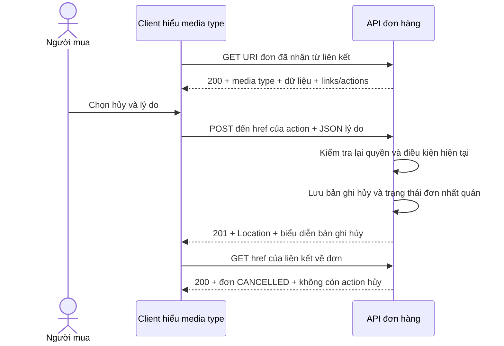

# Uniform interface và bốn ràng buộc thành phần

Một ứng dụng có URI dễ đọc, trả JSON và dùng `GET`, `POST`, `PUT`, `DELETE` vẫn chưa đủ để kết luận rằng nó có uniform interface theo REST. Cần xem các bên nhận diện tài nguyên thế nào, biểu đạt thay đổi bằng gì, hiểu thông điệp dựa vào đâu và tìm các bước tiếp theo bằng cách nào.

Trong chương **Ràng buộc REST** của module **INTEGRATION_API_REST**, bài học này phân tích bốn câu hỏi đó qua một luồng xem và hủy đơn hàng. Các quyết định liên quan trực tiếp đến hợp đồng dữ liệu, ngữ nghĩa HTTP, phân quyền, cache và kiểm thử khi triển khai bằng Java/Spring hoặc công nghệ tương đương.

Sau bài học, bạn cần có khả năng:

- Gọi đúng tên và phân biệt vai trò của bốn ràng buộc thành phần.
- Phân biệt tài nguyên, định danh, biểu diễn và thông điệp HTTP.
- Đọc một biểu diễn có liên kết và điều khiển thao tác để thực hiện bước tiếp theo.
- Chỉ ra vì sao một API đúng CRUD hoặc có OpenAPI vẫn chưa tự động đáp ứng uniform interface.

## 1. Uniform interface thống nhất điều gì?

Uniform interface là **giao diện tương tác chung giữa các thành phần**. Client không cần biết lớp Java, bảng dữ liệu hay hàm nội bộ đang thực hiện yêu cầu. Các bên dựa trên một tập quy tắc chung để định danh, truyền biểu diễn, hiểu thông điệp và chuyển sang bước tương tác tiếp theo.

Fielding nêu bốn thành phần của ràng buộc này tại [mục 5.1.5 của luận án về REST](https://www-test.ics.uci.edu/~fielding/pubs/dissertation/rest_arch_style.htm#sec_5_1_5):

| Thành phần | Tên tiếng Anh | Câu hỏi để nhận diện |
|---|---|---|
| Định danh tài nguyên | Identification of resources | Đang tương tác với tài nguyên nào? |
| Thao tác tài nguyên thông qua biểu diễn | Manipulation of resources through representations | Trạng thái hoặc ý định được truyền bằng cách nào? |
| Thông điệp tự mô tả | Self-descriptive messages | Dựa vào đâu để hiểu và xử lý thông điệp? |
| Hypermedia dẫn dắt trạng thái ứng dụng | Hypermedia as the engine of application state | Có thể đi đâu hoặc làm gì tiếp theo? |

Bốn thành phần này không phải bốn phương thức HTTP. `GET`, `POST`, `PUT`, `DELETE` là các phương thức trong một giao thức thường dùng để hiện thực tương tác REST; chúng không tương ứng một–một với bốn dòng của bảng.

“Thống nhất” cũng không có nghĩa mọi response phải có cùng các trường JSON hoặc mọi tài nguyên phải hỗ trợ mọi phương thức. Một đơn hàng, ảnh bìa sách và danh sách kết quả tìm kiếm có thể có những biểu diễn khác nhau. Điều chung nằm ở cách các bên hiểu định danh, phương thức, metadata, loại nội dung và điều khiển tương tác.

Một hệ quả thực tế là nhóm có thể thay đổi cách lưu đơn từ một cấu trúc bảng sang cấu trúc khác mà không bắt client đổi theo, nếu ý nghĩa hợp đồng bên ngoài được giữ. Ngược lại, đổi tên bảng rồi đổi luôn tên trường API vì tiện ánh xạ sẽ làm lộ sự phụ thuộc vào triển khai nội bộ.

## 2. Thành phần thứ nhất: định danh tài nguyên

### 2.1. Tài nguyên là đối tượng khái niệm được nhận diện

Trong ví dụ, tài nguyên là **đơn hàng `o_42`**, được nhận diện bằng URI:

```text
https://shop.example/orders/o_42
```

Tài nguyên đó không đồng nhất với:

- Dòng hiện tại trong bảng `orders`.
- Một instance Java của lớp `Order`.
- Chuỗi JSON đang nằm trong response.
- Tên phương thức `getOrder` trên máy chủ.

Những thứ trên là cách triển khai hoặc cách thể hiện tài nguyên tại một thời điểm. Đơn hàng vẫn là cùng đơn hàng khi trạng thái của nó đổi từ `PLACED` sang `CANCELLED`.

| URI minh họa | Tài nguyên được nhận diện |
|---|---|
| `/orders` | Tập hợp đơn hàng theo phạm vi được phép truy cập |
| `/orders/o_42` | Một đơn hàng cụ thể |
| `/orders?status=PLACED` | Tập hợp đơn hàng được lọc theo điều kiện trong URI |
| `/orders/o_42/cancellations` | Tập hợp bản ghi hủy gắn với đơn hàng |
| `/cancellations/c_9` | Một bản ghi hủy cụ thể |

Một tập hợp hoặc một kết quả lọc cũng có thể là tài nguyên. Không cần ép mọi tài nguyên thành một thực thể đơn lẻ có một hàng dữ liệu riêng.

### 2.2. Định danh khác với biểu diễn

Giả sử máy chủ hỗ trợ JSON cho phần mềm và HTML cho con người. Cùng URI đơn hàng có thể cung cấp biểu diễn thích hợp theo khả năng thương lượng nội dung của hệ thống. Đổi biểu diễn không nhất thiết tạo ra một đơn hàng khác.

Ngược lại, một tài nguyên có thể được truy cập qua nhiều URI do alias hoặc lịch sử triển khai. Ràng buộc định danh không có nghĩa “mỗi tài nguyên chỉ được có duy nhất một chuỗi URL”. Khi có nhiều URI, cần quy định URI chính và quan hệ giữa chúng để tránh client hiểu nhầm.

Nếu đơn chuyển trạng thái, không cần đổi URI thành `/orders-cancelled/o_42`. Nếu muốn nhận diện riêng một bản ghi lịch sử hoặc một phiên bản bất biến, đó là quyết định mô hình hóa thêm tài nguyên, khác với việc thay URI chỉ vì dữ liệu hiện tại đổi.

### 2.3. Client dùng URI như định danh, không suy ngược cấu trúc lưu trữ

Client có thể cần lưu URI để truy cập lại, nhưng không nên suy ra rằng hậu tố `o_42` là khóa số trong database hoặc rằng URI của mọi thao tác đều có thể tạo bằng phép nối chuỗi.

Ví dụ, client không nên tự tính URI hủy bằng quy tắc:

```text
cancelUri = orderUri + "/cancellations"
```

Máy chủ có thể thay đổi cách định tuyến thao tác đó. Ở phần hypermedia, client sẽ nhận đích thao tác từ một điều khiển do máy chủ cung cấp.

Đặt URI bằng danh từ thường giúp biểu đạt resource rõ hơn, nhưng quy ước đặt tên không phải toàn bộ ràng buộc định danh. Chỉ thay `/getOrder` bằng `/orders` mà giữ nguyên các phụ thuộc và ngữ nghĩa sai sẽ chưa giải quyết được vấn đề kiến trúc.

## 3. Thành phần thứ hai: thao tác thông qua biểu diễn

### 3.1. Biểu diễn là dữ liệu dùng để giao tiếp về tài nguyên

Máy chủ trả một biểu diễn cho client quan sát. Client gửi biểu diễn hoặc dữ liệu đầu vào theo hợp đồng để thể hiện trạng thái mong muốn hoặc yêu cầu xử lý. Máy chủ quyết định việc thực hiện dựa trên ngữ nghĩa phương thức, quyền và quy tắc nghiệp vụ.

Client không nhận một tham chiếu tới object Java trên máy chủ để gọi `order.cancel()` từ xa. Nó cũng không được gửi câu SQL cập nhật cột `status` như một phần giao diện công khai của ví dụ.

Biểu diễn có thể là JSON, HTML, ảnh hoặc một định dạng khác phù hợp. Không có yêu cầu mọi tài nguyên đều phải là JSON, hoặc biểu diễn phải có cùng hình dạng với entity lưu trữ.

### 3.2. Quy tắc nghiệp vụ của luồng hủy đơn

Ví dụ này chọn các quy tắc:

1. Người mua được đọc và yêu cầu hủy đơn của mình sau khi xác thực.
2. Đơn ở trạng thái `PLACED` và chưa được giao cho đơn vị vận chuyển thì còn có thể hủy.
3. Thao tác hủy thành công tạo một bản ghi hủy và chuyển đơn sang `CANCELLED` trong cùng một ranh giới nhất quán.
4. Hủy đơn ở đây chưa mô tả hoàn tiền hoặc hoàn tồn kho. Không được suy diễn rằng các tác vụ đó đã hoàn tất.
5. Khi đơn đã hủy hoặc không còn đáp ứng điều kiện, yêu cầu hủy mới bị từ chối theo hợp đồng.

Các URI và media type dưới đây chỉ phục vụ minh họa. Hai kiểu `application/vnd.example.order+json` và `application/vnd.example.cancellation+json` là tên đặt riêng cho bài học, không phải một chuẩn hypermedia đã được công bố. Phần `+json` cho biết nền cú pháp JSON; nó không tự định nghĩa ý nghĩa của các trường nghiệp vụ hoặc liên kết.

### 3.3. Một request tạo bản ghi hủy

Giả sử client đã nhận được điều khiển cho phép hủy và đích gửi. Request là:

```http
POST /orders/o_42/cancellations HTTP/1.1
Host: shop.example
Authorization: Bearer <access-token>
Content-Type: application/json
Accept: application/vnd.example.cancellation+json

{
  "reason": "CUSTOMER_REQUEST"
}
```

Máy chủ kiểm tra danh tính, quyền trên đơn, lý do và trạng thái hiện tại trước khi lưu. Khi đã tạo bản ghi hủy và chuyển trạng thái đơn thành công, response có thể là:

```http
HTTP/1.1 201 Created
Location: /cancellations/c_9
Content-Type: application/vnd.example.cancellation+json
Cache-Control: no-store

{
  "id": "c_9",
  "reason": "CUSTOMER_REQUEST",
  "links": [
    {
      "rel": "self",
      "href": "/cancellations/c_9"
    },
    {
      "rel": "https://shop.example/rels/order",
      "href": "/orders/o_42"
    }
  ]
}
```

Body gửi đi biểu đạt lý do hủy theo hợp đồng; nó không chỉ định tên bảng, transaction hoặc tên hàm service. Body nhận về biểu diễn bản ghi hủy, còn `Location` chỉ URI tài nguyên mới. Quy ước `links` được giải thích ở phần hypermedia.

Đây là một lựa chọn mô hình hóa, không phải quy tắc bắt buộc mọi hành động nghiệp vụ đều phải có một “tài nguyên hành động” riêng. Với bài toán khác, cập nhật một biểu diễn bằng `PUT` hoặc `PATCH` có thể phù hợp hơn, miễn là hợp đồng và ngữ nghĩa thao tác rõ ràng.

### 3.4. Không đồng nhất phương thức với thao tác CRUD trong database

| Phương thức | Cách hiểu khi thiết kế giao diện |
|---|---|
| `GET` | Lấy biểu diễn; client không yêu cầu thay đổi trạng thái nghiệp vụ |
| `POST` | Yêu cầu tài nguyên đích xử lý nội dung theo ngữ nghĩa của nó; có thể tạo tài nguyên như ví dụ |
| `PUT` | Yêu cầu tạo hoặc thay thế trạng thái tài nguyên đích theo biểu diễn và hợp đồng tương ứng |
| `DELETE` | Yêu cầu loại bỏ liên kết của URI đích với chức năng hiện tại; không cam kết cách xóa vật lý bên trong |

Phương thức có ngữ nghĩa chung mà các bên cần tôn trọng. Quy tắc nghiệp vụ quyết định yêu cầu có được chấp nhận hay không, không cho phép máy chủ đổi `GET` thành một thao tác hủy đơn. Có thể đối chiếu định nghĩa phương thức tại [RFC 9110, mục 9.3](https://www.rfc-editor.org/rfc/rfc9110.html#section-9.3).

Thao tác qua biểu diễn cũng không có nghĩa client phải gửi lại mọi trường mà máy chủ từng trả. DTO đầu vào có thể chỉ chứa phần được phép cung cấp; định danh, người mua, tổng tiền hoặc thời gian hệ thống vẫn có thể là dữ liệu do máy chủ quản lý.

## 4. Thành phần thứ ba: thông điệp tự mô tả

### 4.1. Hiểu thông điệp dựa trên dữ liệu và quy ước được nhận biết

Một HTTP message mang nhiều thông tin hơn body. Đích, phương thức hoặc status, header và nội dung cùng cho bên nhận biết mục đích và cách xử lý nó.

| Thành phần thông điệp | Thông tin cần hiểu trong ví dụ |
|---|---|
| URI đích | Yêu cầu tác động đến tập bản ghi hủy của đơn nào |
| `POST` | Đây là yêu cầu xử lý nội dung có thể làm thay đổi trạng thái |
| `Authorization` | Thông tin xác thực theo cơ chế đã chọn |
| `Content-Type` | Body gửi đi tuân theo kiểu nội dung nào |
| `Accept` | Client muốn nhận kiểu biểu diễn nào |
| `201 Created` | Tài nguyên mới đã được tạo |
| `Location` | URI của tài nguyên mới |
| `Cache-Control: no-store` | Chỉ thị không lưu request/response tương ứng theo ngữ nghĩa của chỉ thị cache |
| Body | Dữ liệu và điều khiển theo media type được nhận biết |

Trong response của ví dụ, `no-store` là chỉ thị không lưu response cho các cache tuân thủ nó. Nó không cấm lưu đơn trong database, không mã hóa nội dung và không thay thế phân quyền.

Một thành phần có quyền đọc HTTP message có thể hiểu đây là thao tác đọc hay ghi, kết quả thành công hay lỗi và chính sách cache mà không cần biết lớp service bên trong. Điều đó không có nghĩa mọi proxy đều được đọc nội dung đã mã hóa hoặc đều hiểu được toàn bộ nghiệp vụ.

### 4.2. Tự mô tả không có nghĩa là không cần hiểu giao thức

Client vẫn cần có kiến thức chung hoặc được cung cấp trước về:

- Cách xử lý HTTP, URI và thông tin xác thực.
- Media type được hỗ trợ và mô hình xử lý của nó.
- Ý nghĩa các link relation hoặc action relation mà client sử dụng.
- Từ vựng nghiệp vụ cần thiết, chẳng hạn thế nào là “hủy đơn”.

`application/json` chỉ cho biết cách đọc cấu trúc JSON. Nó không tự giải thích `status: 7` nghĩa là “chờ giao hàng” hay “đã hủy”, cũng không quy định rằng một trường tên `url` phải được gọi bằng `GET`.

Media type và hợp đồng quan hệ tạo ra ý nghĩa dùng chung cho cấu trúc. Tên media type đặt riêng cũng không có phép thuật: nếu chưa định nghĩa và chưa có client hiểu nó, chỉ đổi `Content-Type` thành `application/vnd.example.order+json` sẽ chưa làm thông điệp trở nên hữu ích hơn.

Tự mô tả cần được hiểu trong phạm vi các quy ước giao tiếp mà bên nhận hỗ trợ. Nó không phải lời hứa rằng một chương trình chưa biết HTTP, chưa biết media type và chưa biết nghiệp vụ có thể tự học mọi thứ chỉ từ một JSON.

### 4.3. Không phụ thuộc một hội thoại ẩn

Request hủy cần chỉ ra đúng đơn, có thông tin xác thực cần thiết và có dữ liệu lý do theo hợp đồng. Một thông điệp “hủy cái vừa xem” mà không xác định đích, chỉ hoạt động vì máy chủ nhớ một biến `lastViewedOrder` cho client, khiến ý nghĩa yêu cầu phụ thuộc vào lịch sử hội thoại ẩn.

Máy chủ vẫn được đọc trạng thái tài nguyên đã lưu để kiểm tra đơn còn hủy được không. Trạng thái nghiệp vụ như đơn hàng hoặc bản ghi hủy khác với việc dùng ngữ cảnh hội thoại để đoán request đang nói đến tài nguyên nào.

Đặc điểm này liên quan đến ràng buộc stateless của REST, nhưng không nên nhập hai khái niệm thành một. Bài học đang xét thông điệp có đủ ý nghĩa theo giao diện chung; việc thiết kế trạng thái hội thoại là một ràng buộc khác cần được xem xét cùng với nó.

### 4.4. Thông điệp lỗi cũng phải có hợp đồng

Nếu đơn đã giao cho vận chuyển trước khi request hủy được xử lý, ví dụ trả `409 Conflict` cùng mã lỗi nghiệp vụ `ORDER_NOT_CANCELLABLE`. Nếu JSON sai cú pháp, trả `400`; lý do hủy không thuộc các giá trị được hỗ trợ thì hợp đồng này chọn `422`.

Không trả `200 OK` rồi giấu thất bại trong một trường `ok: false`. Client, công cụ quan sát và thành phần trung gian cần nhìn được kết quả HTTP đúng nghĩa.

Response lỗi cần xác định media type và cấu trúc lỗi của nó, chẳng hạn một cấu trúc đã quy định gồm `code`, `message`, `requestId`. Không gửi stack trace hoặc câu SQL rồi yêu cầu client suy luận nghiệp vụ từ nội dung lỗi nội bộ.

## 5. Thành phần thứ tư: hypermedia dẫn dắt trạng thái ứng dụng

### 5.1. Từ “biết URL” đến “nhận các lựa chọn tiếp theo”

Hypermedia bao gồm dữ liệu cùng những điều khiển cho phép chuyển sang một bước tương tác tiếp theo: liên kết để theo đến tài nguyên khác, form hoặc mô tả thao tác để tạo request mới. HTML là ví dụ quen thuộc: người dùng theo liên kết hoặc điền form mà không cần tự ghép đường dẫn từ định danh database.

Trong [bài viết giải thích yêu cầu hypertext của REST](https://roy.gbiv.com/untangled/2008/rest-apis-must-be-hypertext-driven), Fielding nhấn mạnh việc client được dẫn dắt bởi các điều khiển trong biểu diễn, trên nền hiểu biết về media type và relation. Vì vậy, HATEOAS không loại bỏ kiến thức có trước; nó tập trung kiến thức đó vào các quy ước dùng chung thay vì sơ đồ URL và quy trình riêng được đóng cứng trong client.

Client thường bắt đầu với một URI truy cập ban đầu đã biết, cùng các media type và relation được hỗ trợ. Nó theo các điều khiển liên quan để đạt mục tiêu; không cần được gửi trước toàn bộ địa chỉ và sơ đồ điều hướng riêng của dịch vụ.

HATEOAS là cách viết tắt của **Hypermedia As The Engine Of Application State**. Đây là thành phần của uniform interface trong định nghĩa REST, không phải một tính năng có thể bỏ qua rồi vẫn khẳng định đã đáp ứng đầy đủ ràng buộc này.

### 5.2. Phác thảo media type minh họa

Để ví dụ không dựa vào ý nghĩa ngầm của các trường JSON, ta quy định cách đọc media type đơn hàng như sau:

| Thành phần | Ý nghĩa theo hợp đồng của ví dụ |
|---|---|
| Các trường `id`, `status`, `totalAmount`, `currency` | Dữ liệu đơn hàng; số tiền là số nguyên theo đơn vị tiền đã quy định, ở đây là đồng Việt Nam |
| `links` | Danh sách liên kết có thể theo để đọc tài nguyên bằng `GET` |
| `links[].rel` | Quan hệ của tài nguyên đích với biểu diễn hiện tại |
| `links[].href` | URI reference đích; URI tương đối được giải theo URI request đã lấy biểu diễn này |
| `actions` | Các thao tác được quảng bá trong biểu diễn hiện tại |
| `actions[].rel` | Ý nghĩa nghiệp vụ của thao tác |
| `actions[].href` | Đích gửi request thao tác, không suy ra từ `rel` |
| `actions[].method` | Phương thức HTTP cần dùng |
| `actions[].type` | `Content-Type` của body thao tác |
| `actions[].responseType` | Media type client có thể yêu cầu nhận bằng `Accept` |
| `actions[].fields` | Các trường đầu vào, kiểu, tính bắt buộc và tập giá trị được phép |

`self` và `collection` được dùng với ý nghĩa quan hệ tương ứng. Quan hệ mở rộng `https://shop.example/rels/cancel` biểu thị mục tiêu hủy đơn. Chuỗi quan hệ đó là định danh ý nghĩa, không phải URI endpoint mà client phải gọi.

Media type bản ghi hủy dùng các trường dữ liệu của bản ghi cùng quy ước `links` như trên. Quan hệ `https://shop.example/rels/order` dẫn về đơn liên quan. Trong ví dụ, không có quy tắc tự suy ra phương thức ghi từ tên liên kết.

Đây là phác thảo tối thiểu cho bài học, không phải một đặc tả hypermedia đầy đủ để đưa thẳng vào sản phẩm. Một thiết kế thực tế còn cần quy định mở rộng, tương thích, validation và cách xử lý thành phần chưa biết.

### 5.3. Biểu diễn khi người mua còn được hủy

Người mua đã theo một liên kết đến đơn của mình và gửi:

```http
GET /orders/o_42 HTTP/1.1
Host: shop.example
Authorization: Bearer <access-token>
Accept: application/vnd.example.order+json
```

Máy chủ trả:

```http
HTTP/1.1 200 OK
Content-Type: application/vnd.example.order+json
Cache-Control: no-store

{
  "id": "o_42",
  "status": "PLACED",
  "totalAmount": 250000,
  "currency": "VND",
  "links": [
    {
      "rel": "self",
      "href": "/orders/o_42"
    },
    {
      "rel": "collection",
      "href": "/orders"
    }
  ],
  "actions": [
    {
      "rel": "https://shop.example/rels/cancel",
      "href": "/orders/o_42/cancellations",
      "method": "POST",
      "type": "application/json",
      "responseType": "application/vnd.example.cancellation+json",
      "fields": [
        {
          "name": "reason",
          "type": "string",
          "required": true,
          "enum": ["CUSTOMER_REQUEST", "ORDERED_BY_MISTAKE"]
        }
      ]
    }
  ]
}
```

Client hiểu media type sẽ tìm action theo relation mà nó biết. Khi người dùng chọn hủy, nó lấy `href`, `method`, media type và yêu cầu đầu vào từ action để dựng request ở phần trước. Nó không cần biết trước đường dẫn phải kết thúc bằng `/cancellations`.

Chỉ có `"cancelUrl": "/..."` sẽ chưa đủ nếu client không biết thao tác dùng phương thức nào, body gì hoặc quan hệ đó mang nghĩa gì. Các thông tin này có thể đến từ mô hình xử lý của media type và relation, không nhất thiết tất cả phải lặp lại dưới đúng hình dạng JSON như ví dụ.

### 5.4. Biểu diễn sau khi đã hủy

Sau response `201` tạo bản ghi hủy, client theo liên kết có relation `https://shop.example/rels/order` để đọc lại đơn. Cùng URI đơn hàng có biểu diễn mới:

```json
{
  "id": "o_42",
  "status": "CANCELLED",
  "totalAmount": 250000,
  "currency": "VND",
  "links": [
    {
      "rel": "self",
      "href": "/orders/o_42"
    },
    {
      "rel": "collection",
      "href": "/orders"
    }
  ],
  "actions": []
}
```

Đoạn JSON trên là body của một response `200` cùng media type đơn hàng và chính sách `no-store` như trước. Action hủy không còn được quảng bá. Client không tự bổ sung nút hủy bằng việc ghép URI cũ chỉ vì nó từng thấy action đó ở một trạng thái trước.

Điều này không yêu cầu server gửi toàn bộ sơ đồ vòng đời của mọi đơn trong mỗi response. Nó cung cấp các chuyển tiếp phù hợp trong ngữ cảnh hiện tại để client biết các lựa chọn được biểu diễn.

### 5.5. Phân biệt trạng thái tài nguyên với trạng thái ứng dụng

| Khái niệm | Ví dụ |
|---|---|
| Trạng thái tài nguyên | Đơn `o_42` đang `PLACED` hoặc `CANCELLED` trong hệ thống |
| Trạng thái ứng dụng ở phía client | Đang xem đơn, chọn lý do, gửi yêu cầu, rồi xem kết quả |
| Điều khiển hypermedia | Liên kết về danh sách, form hủy đơn, liên kết tới kết quả |

“Engine of application state” nói về việc các điều khiển dẫn dắt quá trình tương tác của client. Nó không có nghĩa mọi giá trị `status` trong database đều là trạng thái ứng dụng, hoặc server phải lưu client đang đứng ở màn hình nào.

Server có thể lưu trạng thái nghiệp vụ lâu dài của đơn. Client giữ ngữ cảnh tương tác của nó và gửi các request có ý nghĩa đầy đủ theo hợp đồng. Như vậy, hypermedia có thể phối hợp với stateless thay vì yêu cầu một hội thoại ẩn ở server.

## 6. Nhìn cả bốn thành phần trong một luồng



| Quan sát trong luồng | Thành phần được thể hiện |
|---|---|
| Đơn và bản ghi hủy có URI nhận diện riêng | Định danh tài nguyên |
| Client nhận dữ liệu đơn, gửi lý do và nhận dữ liệu bản ghi hủy | Thao tác qua biểu diễn |
| Method, status, media type và cache directive mang ý nghĩa rõ ràng | Thông điệp tự mô tả |
| Client chọn thao tác và đích gửi từ action, rồi theo liên kết kết quả | Hypermedia dẫn dắt trạng thái ứng dụng |

Một thành phần không thay thế các thành phần còn lại. Có URI không có nghĩa body đã có ngữ nghĩa rõ. Có `Content-Type` đúng không có nghĩa đã cung cấp điều khiển tiếp theo. Có một mảng `links` không có nghĩa các request ghi đã dùng đúng phương thức hoặc kiểm tra quyền đúng.

### 6.1. Điều khiển được quảng bá không phải một cam kết bất biến

Giữa lúc client đọc đơn và lúc gửi request hủy, nhân viên có thể đã giao đơn cho đơn vị vận chuyển. Action từng hợp lệ không bảo đảm thao tác sẽ luôn thành công trong tương lai.

Máy chủ phải kiểm tra lại quyền và điều kiện nghiệp vụ tại thời điểm xử lý. Nếu điều kiện đã thay đổi, ví dụ trả `409` và client đọc lại trạng thái để chọn bước phù hợp. Ẩn action trên giao diện không phải là một cơ chế chặn request giả mạo.

Nếu hệ thống sử dụng điều kiện phiên bản như ETag và `If-Match`, cần mô tả cách client lấy, gửi và xử lý khi phiên bản không còn khớp. Hypermedia không tự tạo ra kiểm soát cạnh tranh hoặc tính nguyên tử cho database.

### 6.2. Có action không làm `POST` tự động idempotent

Nếu bản ghi hủy đã được tạo nhưng response bị mất, client vẫn phải đối mặt với kết quả chưa biết chắc. Theo lại cùng action bằng một `POST` không có cơ chế thử lại đã quy định không bảo đảm nhận lại cùng kết quả.

Ví dụ này chưa thiết kế khóa idempotency. Khi bổ sung, phải chốt phạm vi khóa, nhận diện cùng nội dung, cách xử lý hai request đồng thời, thời hạn lưu và kết quả phát lại. Không suy ra rằng “có hypermedia” đồng nghĩa với “có thể gửi lại mọi request tùy ý”.

## 7. Áp dụng trong Java/Spring và hợp đồng API

Không cần bắt đầu bằng một thư viện hypermedia cụ thể. Trước hết, xác định quy tắc và trách nhiệm của các phần trong hệ thống.

| Phần triển khai | Trách nhiệm cần giữ |
|---|---|
| Controller | Ánh xạ phương thức, URI, header và media type của hợp đồng |
| DTO đầu vào | Chỉ nhận lý do hoặc dữ liệu được phép gửi, kiểm tra cấu trúc |
| Service nghiệp vụ | Kiểm tra chủ thể, trạng thái đơn và thực hiện hủy nhất quán |
| Bộ dựng biểu diễn | Đưa dữ liệu, liên kết và action phù hợp vào response |
| Chính sách quyền và nghiệp vụ dùng chung | Giữ tiêu chí quảng bá action và tiêu chí thực thi thống nhất |
| Bộ ánh xạ lỗi | Trả status và body lỗi ổn định, không lộ chi tiết nội bộ |
| Repository và giao dịch | Bảo đảm dữ liệu đơn và bản ghi hủy không rơi vào trạng thái dở dang |

Một bộ dựng biểu diễn có thể làm theo ý tưởng sau; đây là giả mã, không phải mã Spring chạy trực tiếp:

```text
buildOrderRepresentation(order, currentPrincipal):
    kiểm tra quyền đọc đơn
    tạo dữ liệu đơn và các liên kết đọc được phép
    nếu chính sách hiện tại cho phép chủ thể yêu cầu hủy:
        thêm action có relation hủy, đích, method và mô tả đầu vào
    trả biểu diễn theo media type đã định nghĩa

executeCancellation(orderId, currentPrincipal, request):
    xác thực, kiểm tra đầu vào
    trong ranh giới xử lý nhất quán:
        đọc và kiểm tra lại quyền cùng điều kiện hủy
        tạo bản ghi hủy, chuyển trạng thái đơn
    trả kết quả đã lưu theo hợp đồng HTTP
```

Hai bước kiểm tra không dư thừa: bước dựng biểu diễn quảng bá lựa chọn hiện tại, còn bước thực thi quyết định có chấp nhận một request cụ thể hay không. Cả hai phải dựa trên chính sách nhất quán; bước thực thi vẫn cần chống thay đổi cạnh tranh trong khoảng thời gian giữa chúng.

Không đưa entity lưu trữ ra ngoài rồi tự coi mọi trường, getter hoặc quan hệ ORM là hợp đồng công khai. Các liên kết biểu diễn cũng không nhất thiết phải trùng với cấu trúc quan hệ của database.

### 7.1. Cache phải phù hợp với biểu diễn có phụ thuộc chủ thể

Hai người đọc cùng một URI có thể nhận lựa chọn thao tác khác nhau do quyền khác nhau. Nếu biểu diễn có dữ liệu cá nhân hoặc action phụ thuộc chủ thể, không được dùng một cache công khai chỉ theo URI rồi trả kết quả của người này cho người khác.

Ví dụ dùng `Cache-Control: no-store` để tránh lưu response đơn hàng. Một thiết kế khác có thể dùng chính sách cache riêng phù hợp, nhưng cần chứng minh cách phân biệt các biến thể và bảo vệ dữ liệu. Chỉ thêm token vào request không tự giải quyết mọi sai sót ở cấu hình cache.

### 7.2. OpenAPI và hypermedia giải quyết những nhu cầu khác nhau

OpenAPI giúp mô tả contract: kiểu dữ liệu, header, status, bảo mật và các operation được hỗ trợ. Tài liệu media type và relation giúp client hiểu cách xử lý biểu diễn và ý nghĩa các chuyển tiếp.

Hypermedia cung cấp các điều khiển trong tương tác đang diễn ra: đơn này, người gọi này, trạng thái hiện tại này đang quảng bá lựa chọn nào và gửi tới đâu. Một danh sách endpoint hoặc một sơ đồ quy trình trong tài liệu không thay thế các điều khiển đó.

Ngược lại, gửi action mà không định nghĩa cấu trúc, ý nghĩa và mô hình xử lý cũng chưa đủ. Một client không tự hiểu một relation mới chỉ vì đã đọc được chuỗi URI của relation đó.

### 7.3. Cân nhắc lợi ích và chi phí có thật

Giả sử đường dẫn nhận yêu cầu hủy được đổi từ một tuyến cũ sang một tuyến mới. Client theo `href` vẫn có thể tiếp tục thao tác nếu hợp đồng media type và ý nghĩa relation được giữ. Client đóng cứng đường dẫn cũ sẽ cần cập nhật hoặc cần máy chủ duy trì tương thích.

Tuy nhiên, hypermedia không làm mọi thay đổi trở thành tương thích. Đổi ý nghĩa hủy, đổi trường đầu vào hoặc bỏ relation mà client cần vẫn có thể phá vỡ ứng dụng. Client cần chiến lược khi không có action mong muốn hoặc gặp thành phần chưa hỗ trợ.

Biểu diễn có điều khiển cũng có thể lớn hơn, cần công cụ client phù hợp và đôi khi cần thêm lượt đọc. Nhóm phải đánh giá các chi phí đó theo nhu cầu thay đổi và tích hợp của hệ thống. Có thể chọn một kiểu API khác cho một nhu cầu khác; điều quan trọng trong bài học là mô tả đúng các ràng buộc mà thiết kế thực sự đáp ứng.

## 8. Kiểm chứng uniform interface bằng hành vi quan sát được

Các câu hỏi dưới đây giúp xây dựng kiểm thử cho một API có hợp đồng như ví dụ. Đây là gợi ý thực hành khi triển khai, không có nghĩa chỉ cần vượt qua một vài kiểm thử là đã chứng minh toàn bộ kiến trúc REST.

| Nội dung kiểm chứng | Tình huống | Kết quả mong đợi |
|---|---|---|
| Định danh ổn định | Đọc đơn trước và sau khi hủy | URI đơn vẫn nhận diện cùng đơn; dữ liệu trạng thái thay đổi |
| Tách biểu diễn khỏi lưu trữ | Thay đổi cấu trúc nội bộ mà giữ hợp đồng | Client không cần biết tên bảng hoặc entity mới |
| Phương thức đúng ngữ nghĩa | Gửi `GET` để xem đơn | Không tạo bản ghi hủy hoặc đổi trạng thái đơn |
| Thông điệp rõ nghĩa | Tạo bản ghi hủy thành công | `201`, có `Location`, body và media type đúng hợp đồng |
| Media type đúng | Client gửi kiểu nội dung không hỗ trợ | Lỗi HTTP thích hợp theo contract, không diễn giải tùy tiện |
| Action có điều kiện | Cùng người mua đọc đơn còn hủy được và đơn đã hủy | Chỉ biểu diễn phù hợp quảng bá action hủy |
| Không phụ thuộc mẫu đường dẫn | Máy chủ cung cấp một `href` hủy khác trong môi trường kiểm thử | Client dùng đích nhận được thay vì ghép chuỗi từ mã đơn |
| Bảo vệ phía máy chủ | Gửi request trực tiếp dù không có action hoặc không có quyền | Không vượt qua được kiểm tra quyền và nghiệp vụ |
| Điều khiển có thể cũ | Điều kiện hủy đổi sau khi client đã đọc | Không hủy sai; trả lỗi phù hợp để client cập nhật trạng thái |
| Phạm vi hiểu biết client | Biểu diễn có thêm một relation chưa biết theo quy tắc mở rộng | Client xử lý theo chính sách đã định nghĩa, không đoán ý nghĩa từ tên |

Với kiểm thử client, hãy đổi đường dẫn action nhưng giữ relation và ý nghĩa thao tác. Đây là cách trực tiếp tìm sự phụ thuộc vào mẫu URL. Kiểm thử chỉ xác nhận mảng `links` tồn tại sẽ bỏ sót trường hợp client vẫn không sử dụng nó.

Với kiểm thử server, gửi request thao tác trực tiếp bằng một chủ thể không được phép. Việc nút hủy bị ẩn trong response hoặc trên giao diện không chứng minh thao tác đã được bảo vệ.

## 9. Những cách hiểu dễ dẫn đến thiết kế sai

| Cách hiểu | Điểm cần sửa |
|---|---|
| “Uniform interface là bốn động từ CRUD” | Bốn thành phần nói về định danh, biểu diễn, thông điệp và hypermedia; phương thức HTTP là một phần của cách tương tác |
| “Có URI danh từ là đủ” | Cần xét toàn bộ hợp đồng và cách client thực sự chuyển tiếp giữa các bước |
| “Resource chính là JSON” | JSON là một biểu diễn; tài nguyên có danh tính khái niệm và có thể có biểu diễn khác |
| “Tự mô tả là không cần tài liệu hoặc kiến thức có trước” | Client vẫn cần hiểu giao thức, media type và relation; cần giảm phụ thuộc vào thông tin riêng bị đóng cứng |
| “`application/json` giải thích mọi trường” | Nó quy định cú pháp JSON, không tự định nghĩa ý nghĩa nghiệp vụ hoặc điều khiển |
| “Có `links` là đã có HATEOAS đầy đủ” | Cần điều khiển có ngữ nghĩa được hiểu và được client dùng để dẫn dắt tương tác |
| “Không có action thì endpoint không cần bảo vệ” | Server luôn phải kiểm tra quyền và điều kiện khi xử lý request |
| “Server gửi action thì thao tác chắc chắn thành công” | Quyền hoặc trạng thái có thể thay đổi trước lúc request đến |
| “HATEOAS lưu toàn bộ phiên làm việc ở server” | Client giữ ngữ cảnh tương tác; server lưu trạng thái tài nguyên và cung cấp các điều khiển phù hợp |
| “Chọn JSON và Spring là mặc nhiên có uniform interface” | Framework hỗ trợ HTTP; thiết kế hợp đồng và hành vi client/server mới quyết định mức đáp ứng |

## 10. Bài tập áp dụng

Cho một API đăng ký lớp học hiện trả:

```json
{
  "id": "en_17",
  "status": "PENDING"
}
```

Ứng dụng client đang tự ghép `/enrollments/en_17/withdraw` để rút đăng ký và luôn hiển thị nút rút.

Hãy hoàn thiện thiết kế bằng cách trả lời:

1. Tài nguyên được nhận diện là lượt đăng ký hay lớp học? URI của nó có cần đổi khi được duyệt không?
2. Body rút đăng ký cần những dữ liệu nào? Dữ liệu nào phải do máy chủ quyết định?
3. Method, status, media type và lỗi nào giúp thông điệp có ý nghĩa rõ?
4. Client nhận quyền lựa chọn rút đăng ký từ điều khiển nào, theo relation nào?
5. Khi đăng ký đã kết thúc thời hạn rút, biểu diễn và hành vi thực thi cần thay đổi ra sao?
6. Nếu đường dẫn thao tác đổi nhưng relation giữ nguyên, client có tiếp tục hoạt động không?

Một hướng trả lời là giữ URI của lượt đăng ký, bổ sung điều khiển rút có relation được định nghĩa và mô tả đầu vào rõ, chỉ quảng bá nó khi phù hợp với chủ thể và trạng thái hiện tại. Client dùng điều khiển nhận được; máy chủ vẫn kiểm tra lại khi xử lý. Có thể mô hình hóa bản ghi rút riêng hoặc cập nhật tài nguyên đăng ký theo hợp đồng đã chọn, miễn là không dùng một lựa chọn đặt tên để thay thế việc phân tích cả bốn ràng buộc.
