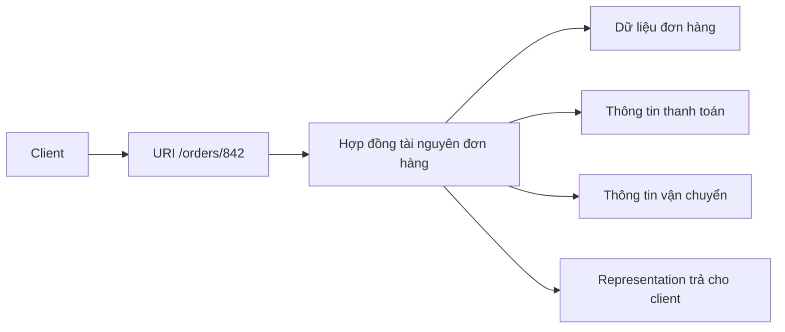

# Định danh tài nguyên và thao tác qua biểu diễn

## Mục tiêu bài học

Khi client gọi `GET /orders/842`, client đang đọc một bản ghi cơ sở dữ liệu, gọi một phương thức Java hay lấy biểu diễn của một đơn hàng? Cách trả lời quyết định API có gắn chặt vào chi tiết triển khai hay có một hợp đồng tài nguyên rõ ràng.

Trong chương **Ràng buộc REST** của module **INTEGRATION_API_REST**, bài học này tập trung vào hai khía cạnh của uniform interface:

1. Định danh tài nguyên.
2. Thao tác với tài nguyên thông qua biểu diễn.

Các ví dụ sử dụng HTTP và JSON, có liên hệ với Java/Spring. Mục tiêu là thiết kế URI, phương thức, mã trạng thái và hợp đồng dữ liệu nhất quán; đồng thời hiểu chỗ giao nhau với cache, idempotency, xác thực, phân quyền và kiểm thử API.

Sau bài học, bạn có thể:

- Phân biệt resource, URI, representation và mô hình lưu trữ.
- Thiết kế định danh cho tài nguyên đơn lẻ, tập hợp và tài nguyên con.
- Giải thích vì sao cùng một tài nguyên có thể có nhiều biểu diễn.
- Phân biệt dữ liệu đọc, dữ liệu ghi và các trường do server quản lý.
- Chọn cách dùng POST, PUT, PATCH và DELETE theo ý nghĩa thao tác.
- Thiết kế cập nhật có điều kiện và tránh ghi đè dữ liệu.
- Nhận diện lỗi lộ mô hình cơ sở dữ liệu, ghi quá quyền và nhầm định danh với quyền truy cập.

## 1. Resource là khái niệm được công bố, không phải đối tượng Java

**Resource**, hay tài nguyên, là khái niệm mà API cho phép định danh và tương tác. Đó có thể là một đơn hàng, một tập hợp đơn hàng, một địa chỉ giao hàng hoặc một tác vụ xuất báo cáo.

Một resource không bắt buộc tương ứng với đúng một bảng, một entity hoặc một service class.

Ví dụ đơn hàng 842 có thể được tổng hợp từ:

- Bảng đơn hàng và bảng dòng hàng.
- Thông tin thanh toán từ một dịch vụ khác.
- Dữ liệu vận chuyển.
- Quy tắc tính tổng tiền và quyền hiển thị của người gọi.

API vẫn có thể công bố một resource đơn hàng ổn định, ngay cả khi cách tổng hợp dữ liệu bên trong thay đổi.



Mục tiêu không phải che giấu mọi đặc điểm nghiệp vụ. Mục tiêu là cung cấp một mô hình bên ngoài có ý nghĩa, thay vì để client phụ thuộc vào cấu trúc bảng, tên lớp hoặc quan hệ ORM.

### 1.1. Định danh vẫn giữ nguyên khi trạng thái thay đổi

Đơn hàng 842 có thể đi qua các trạng thái:

```text
PENDING_PAYMENT → CONFIRMED → SHIPPED
```

URI `/orders/842` vẫn có thể định danh cùng đơn hàng trong suốt vòng đời đó. Nội dung trả về thay đổi theo thời gian, nhưng không vì thế mà mỗi trạng thái phải có một định danh đơn hàng mới.

Ngược lại, một lần thanh toán cụ thể có thể là resource khác với đơn hàng và có định danh riêng. Cần quyết định ranh giới theo ý nghĩa nghiệp vụ, không theo việc hai đối tượng có liên hệ trong cơ sở dữ liệu.

### 1.2. Resource có thể là một tập hợp hoặc kết quả nghiệp vụ

Các URI sau đều có thể có ý nghĩa:

| URI | Tài nguyên được định danh |
| --- | --- |
| `/orders` | Tập hợp đơn hàng theo hợp đồng API |
| `/orders/842` | Một đơn hàng |
| `/orders/842/shipping-address` | Địa chỉ giao hàng của đơn 842 |
| `/orders/842/payments` | Tập hợp các lần hoặc yêu cầu thanh toán của đơn |
| `/report-jobs/job-73` | Một tác vụ xuất báo cáo |
| `/orders?status=CONFIRMED&limit=20` | Một cách truy cập tập hợp có lọc và giới hạn |

Tập hợp không chỉ là “bảng được trả ra dưới dạng mảng”. Hợp đồng cần xác định phạm vi dữ liệu, thứ tự, phân trang và quyền của người gọi.

## 2. URI định danh điều gì?

Trong các ví dụ HTTP, URI thường xuất hiện dưới dạng URL, chẳng hạn:

```text
https://api.example.com/orders/842
```

Có thể đọc URL này thành:

- Scheme: `https`.
- Authority: `api.example.com`.
- Path: `/orders/842`.

Trong request HTTP, đường dẫn và query thường nằm ở request target, còn máy chủ đích được thể hiện bằng cơ chế tương ứng của phiên bản HTTP. Chỉ riêng chuỗi `/orders/842` chưa chỉ ra máy chủ nào trên toàn bộ Internet.

### 2.1. Path và query đều thuộc URI

Với:

```text
/orders?status=CONFIRMED&limit=20
```

query không phải dữ liệu “ở ngoài định danh”. Nó là một phần của URI, giúp xác định cách truy cập tập hợp theo hợp đồng.

Không có quy tắc REST bắt buộc mọi tham số phải nằm trong path. Một cách tổ chức thường dễ hiểu là:

- Path biểu đạt tài nguyên và quan hệ định danh chính.
- Query biểu đạt lọc, sắp xếp, phân trang hoặc lựa chọn được công bố.

Đây là hướng dẫn thiết kế, không phải công thức đúng cho mọi nghiệp vụ.

Fragment như `#section-2` không được gửi tới server như một phần request target HTTP. Không nên dùng nó để truyền một ID mà endpoint cần xử lý.

### 2.2. Một tài nguyên có thể có nhiều URI

Một API có thể có `/me` và `/users/user-7` cùng dẫn tới hồ sơ của một người trong những ngữ cảnh phù hợp. Các alias hoặc đường dẫn chuyển tiếp cũng có thể tồn tại.

Không nên hiểu “định danh tài nguyên” thành “mọi tài nguyên trên toàn hệ thống chỉ được có đúng một URI”. Tuy vậy, khi có nhiều đường dẫn, API cần cách liên kết và quy ước rõ để tránh client tự đoán đường dẫn.

`/me` cũng cần được hiểu theo thông tin xác thực của request; nó không cho phép shared cache trả hồ sơ của người này cho người khác.

### 2.3. ID công khai không cần là khóa chính cơ sở dữ liệu

API có thể dùng ID công khai khác với khóa lưu trữ nội bộ. Điều đó giúp giảm ràng buộc giữa hợp đồng và việc di chuyển, hợp nhất hoặc thay đổi cơ sở dữ liệu.

Dùng khóa chính làm ID công khai không tự động sai. Điều cần cân nhắc là tính ổn định, khả năng thay đổi, phạm vi duy nhất và thông tin bị lộ.

Một số nguyên dễ đoán không tạo quyền truy cập. Một UUID khó đoán cũng không thay thế kiểm tra quyền. Server phải kiểm tra người gọi có được đọc hoặc sửa resource đích hay không.

Nếu ID chỉ duy nhất trong một tenant, hợp đồng phải làm rõ tenant được xác định thế nào và kiểm tra quyền trong phạm vi đó.

### 2.4. Đừng để URI phản ánh quá nhiều chi tiết triển khai

Những đường dẫn như:

```text
/mysql/order_header/842
/java/com.example.OrderEntity/842
```

dễ khiến hợp đồng bên ngoài phụ thuộc vào cấu trúc lưu trữ hoặc mã nguồn.

Tương tự, một cấu trúc lồng quá sâu có thể làm URI khó ổn định:

```text
/companies/c1/departments/d2/teams/t3/users/u4/orders/842
```

Nếu đơn hàng có định danh độc lập, cần cân nhắc có thật sự phải mang mọi quan hệ tổ chức vào định danh hay không. Quan hệ dùng để lọc và quan hệ tạo nên danh tính của tài nguyên không nhất thiết giống nhau.

Không nên đưa bí mật xác thực hoặc dữ liệu nhạy cảm vào URI chỉ để “định danh đầy đủ”, vì URL có thể xuất hiện trong lịch sử, log và các hệ thống trung gian.

## 3. Representation là dữ liệu được trao đổi về resource

**Representation**, hay biểu diễn, là thông tin được gửi để thể hiện trạng thái hoặc trạng thái mong muốn của một resource, theo định dạng và ngữ nghĩa đã thỏa thuận.

Ví dụ:

```http
GET /orders/842 HTTP/1.1
Host: api.example.com
Authorization: Bearer <access-token>
Accept: application/json
```

Phản hồi có thể là:

```http
HTTP/1.1 200 OK
Content-Type: application/json
Cache-Control: no-store

{
  "id": "842",
  "status": "PENDING_PAYMENT",
  "total": {
    "amount": 450000,
    "currency": "VND"
  },
  "links": [
    {
      "rel": "shipping-address",
      "href": "/orders/842/shipping-address"
    }
  ]
}
```

Các ví dụ HTTP trong bài lược bỏ một số header truyền tải.

Ở đây:

- Resource là đơn hàng 842.
- URI là địa chỉ dùng để định danh và truy cập resource.
- JSON là một representation của resource tại thời điểm xử lý.
- `Content-Type` mô tả kiểu nội dung trả về.
- `Cache-Control` góp phần quy định cách lưu và dùng lại phản hồi.
- Liên kết giúp client biết URI của resource liên quan theo hợp đồng.

Client không nhận một con trỏ tới đối tượng Java trong server. Client cũng không mặc nhiên có quyền cập nhật mọi trường xuất hiện trong representation.

### 3.1. Representation không cần là bản sao đầy đủ của dữ liệu nội bộ

Dữ liệu nội bộ có thể chứa thông tin không được công bố:

```text
OrderEntity
    internalPrimaryKey
    publicId
    customerForeignKey
    fraudReviewNote
    paymentProviderSecretReference
    status
    total
```

Representation trả ra có thể chỉ gồm `id`, `status`, `total` và liên kết được phép hiển thị. Đó là một ranh giới hợp đồng quan trọng.

Ngay cả giữa những người gọi được xác thực, dữ liệu có thể khác nhau theo quyền. Khách hàng và nhân viên vận hành không nhất thiết nhận cùng tập trường.

Việc tùy biến representation theo quyền cần được xem xét cùng cache để tránh dùng lại dữ liệu sai phạm vi.

### 3.2. Dữ liệu cần có ý nghĩa, không chỉ đúng cú pháp JSON

Một schema có thể khai báo `amount` là số, nhưng client vẫn chưa biết đó là đồng, xu hay đơn vị khác.

Hợp đồng cần làm rõ:

| Thành phần | Câu hỏi cần trả lời |
| --- | --- |
| ID | Là chuỗi hay số? Có được client tự tạo không? Có ổn định không? |
| Số tiền | Đơn vị là gì? Đồng tiền nào? Quy tắc làm tròn ra sao? |
| Thời gian | Có múi giờ không? Định dạng nào? |
| Trạng thái | Các giá trị có nghĩa gì? Ai được chuyển trạng thái? |
| Trường thiếu | Là không được công bố, không có giá trị hay dùng mặc định? |
| `null` | Có được phép không? Khác với thiếu trường như thế nào? |
| Danh sách | Thứ tự có ý nghĩa không? Có phân trang không? |

Trong ví dụ tiền VND ở trên, `amount: 450000` được hiểu là 450.000 đồng theo hợp đồng minh họa. Không nên để mỗi client tự suy ra đơn vị.

JSON bảo đảm một cấu trúc cú pháp; nó không tự cung cấp đầy đủ ngữ nghĩa nghiệp vụ.

### 3.3. Media type và schema có vai trò khác nhau

`Content-Type: application/json` cho biết nội dung dùng JSON. Nó không tự nói rằng trường `status` cho phép những giá trị nào hoặc `amount` dùng đơn vị gì.

Schema, mô tả nghiệp vụ, media type chuyên biệt hoặc các quy ước ứng dụng có thể bổ sung ý nghĩa. OpenAPI giúp công bố nhiều phần của hợp đồng request và response, nhưng triển khai vẫn phải tuân thủ hợp đồng đó.

Một API không trở thành REST chỉ vì có schema hoặc OpenAPI hợp lệ. Định danh tài nguyên và thao tác qua biểu diễn là hai khía cạnh; thông điệp tự mô tả và hypermedia còn là các khía cạnh khác của uniform interface.

## 4. Cùng một resource có thể có nhiều representation

Một sản phẩm có thể được biểu diễn bằng JSON cho ứng dụng hoặc HTML cho người dùng trình duyệt.

```http
GET /products/book-1 HTTP/1.1
Host: api.example.com
Accept: application/json
```

```http
HTTP/1.1 200 OK
Content-Type: application/json
Vary: Accept
ETag: "book-1-json-r7"

{
  "id": "book-1",
  "name": "So tay"
}
```

Với cùng URI, client khác có thể yêu cầu:

```http
GET /products/book-1 HTTP/1.1
Host: api.example.com
Accept: text/html
```

```http
HTTP/1.1 200 OK
Content-Type: text/html; charset=utf-8
Vary: Accept
ETag: "book-1-html-r7"

<!doctype html>
<html lang="vi">
  <head><title>So tay</title></head>
  <body><h1>So tay</h1></body>
</html>
```

Hai nội dung là hai representation của cùng sản phẩm. Trong ví dụ, chúng dùng strong ETag khác nhau để không coi hai nội dung khác nhau là cùng một representation theo phép so sánh mạnh.

`Vary: Accept` giúp cache biết việc lựa chọn response phụ thuộc vào header `Accept`. Vẫn cần các chỉ dẫn và điều kiện cache phù hợp; chỉ thêm Vary không tự cho phép cache mọi dữ liệu.

API không bắt buộc phải hỗ trợ nhiều định dạng. Một API chỉ cung cấp JSON vẫn có thể thiết kế resource và representation đúng.

### 4.1. Accept và Content-Type không đồng nghĩa

- `Accept` nói về kiểu response client chấp nhận.
- `Content-Type` mô tả kiểu nội dung của thông điệp đang được gửi.

Trong một POST có JSON body, request thường cần `Content-Type: application/json`. Nếu muốn nhận JSON, client có thể gửi thêm `Accept: application/json`.

Nếu server không hỗ trợ kiểu nội dung request, phản hồi phù hợp có thể là `415 Unsupported Media Type`. Nếu không thể cung cấp representation chấp nhận được theo cơ chế thương lượng của API, có thể trả `406 Not Acceptable`.

Lựa chọn dùng query như `?format=json` cũng tạo một URI cụ thể và cần được thiết kế rõ. Không nên tuyên bố mọi API phải có một cách thương lượng duy nhất mới là REST.

## 5. Thao tác qua representation có nghĩa gì?

Client tương tác với resource thông qua các thông điệp mô tả dữ liệu, trạng thái mong muốn hoặc ý định xử lý theo hợp đồng. Server tiếp nhận, xác thực, phân quyền và áp dụng quy tắc nghiệp vụ.

Đó không phải quyền sửa tùy ý vào cấu trúc lưu trữ.

Một representation có thể cho biết:

- Trạng thái hiện tại của tài nguyên.
- Dữ liệu cần gửi để tạo hoặc thay đổi tài nguyên.
- Những liên kết và điều khiển để tương tác tiếp.
- Metadata phục vụ lựa chọn, cache hoặc điều kiện thao tác.

Không phải representation nào cũng cho phép ghi. Một tài nguyên chỉ đọc vẫn là resource hợp lệ. Cũng không có yêu cầu mọi lần ghi đều phải được thực hiện bằng cách GET trước rồi gửi lại nguyên JSON đã nhận; client phải làm theo hợp đồng và các điều kiện của thao tác.

### 5.1. Dữ liệu đọc và dữ liệu ghi có thể khác nhau

Ví dụ biểu diễn đơn hàng trả ra:

```json
{
  "id": "842",
  "status": "PENDING_PAYMENT",
  "createdAt": "2026-11-17T08:30:00Z",
  "total": {
    "amount": 450000,
    "currency": "VND"
  }
}
```

Không có nghĩa client được gửi:

```json
{
  "id": "842",
  "status": "PAID",
  "createdAt": "2020-01-01T00:00:00Z",
  "total": {
    "amount": 1,
    "currency": "VND"
  }
}
```

và bắt server chấp nhận.

Trong hợp đồng này:

- ID và thời điểm tạo do server quản lý.
- Tổng tiền được tính từ dữ liệu và quy tắc hợp lệ.
- Trạng thái thanh toán được quyết định bởi quy trình thanh toán.
- Client chỉ được gửi những trường được phép cho thao tác cụ thể.

Có thể tạo một yêu cầu thanh toán bằng POST tới resource thích hợp, còn server quyết định đơn hàng được chuyển trạng thái khi nào. Việc biểu diễn trạng thái không đồng nghĩa trao quyền tự đặt trạng thái.

### 5.2. Không ánh xạ body trực tiếp vào mọi thuộc tính entity

Nếu server tự động ghi tất cả trường JSON vào entity, người gọi có thể thử gửi thêm:

```json
{
  "customerId": "someone-else",
  "internalDiscountPercent": 100,
  "status": "PAID"
}
```

Đây là nguy cơ ghi vào các thuộc tính ngoài quyền, thường được gọi là mass assignment hoặc overposting.

Cần dùng mô hình đầu vào rõ ràng, ánh xạ có kiểm soát và kiểm tra quyền. Các trường không được hỗ trợ phải có hành vi nhất quán theo hợp đồng, chẳng hạn bị từ chối; không nên vô tình trở thành trường ghi được chỉ vì entity có thêm property.

DTO riêng là một công cụ hữu ích, nhưng bản thân tên lớp DTO không bảo đảm an toàn nếu service vẫn sao chép dữ liệu không kiểm soát.

## 6. Chọn phương thức theo ngữ nghĩa tương tác

Thao tác qua representation không có nghĩa mọi thao tác đều dùng POST hoặc đều là cập nhật từng cột.

| Phương thức | Cách tương tác thường gặp | Điểm cần giữ đúng |
| --- | --- | --- |
| GET | Lấy representation của resource đích | Không yêu cầu thay đổi nghiệp vụ; giữ ngữ nghĩa safe |
| POST | Yêu cầu resource xử lý nội dung theo hợp đồng, thường để tạo resource con | Không mặc định idempotent; công bố kết quả và cách nhận diện resource được tạo |
| PUT | Tạo hoặc thay thế trạng thái resource đích bằng representation theo hợp đồng | Thể hiện trạng thái thay thế, không mặc định là bản vá một vài trường |
| PATCH | Áp dụng thay đổi được mô tả trong một tài liệu bản vá | Chọn media type và ngữ nghĩa bản vá rõ ràng |
| DELETE | Yêu cầu bỏ mối liên hệ giữa URI đích và chức năng hiện tại của resource | Không đồng nghĩa xóa vật lý mọi dữ liệu liên quan |

### 6.1. POST không chỉ có nghĩa “INSERT”

Ví dụ:

```text
POST /orders
POST /orders/842/payments
POST /report-jobs
```

POST yêu cầu resource đích xử lý dữ liệu theo ngữ nghĩa được công bố. Kết quả có thể là tạo một đơn hàng, nhận một yêu cầu thanh toán hoặc bắt đầu công việc bất đồng bộ.

Nếu đã tạo resource mới, server có thể trả `201 Created` với `Location` chỉ ra URI:

```http
HTTP/1.1 201 Created
Location: /orders/842
Content-Type: application/json
Cache-Control: no-store

{
  "id": "842",
  "status": "PENDING_PAYMENT"
}
```

Nếu chỉ chấp nhận công việc để xử lý sau, `202 Accepted` không được hiểu là công việc đã hoàn tất. API cần công bố cách theo dõi tiến độ hoặc kết quả.

POST không tự chống tạo trùng. Nếu hỗ trợ một khóa idempotency, server phải có cơ chế và hợp đồng xử lý khóa, nội dung yêu cầu, gọi đồng thời và thời hạn lưu dấu.

### 6.2. PUT mô tả trạng thái thay thế của resource đích

Giả sử địa chỉ giao hàng là một resource riêng. Hợp đồng ghi yêu cầu bốn trường `recipient`, `street`, `city`, `countryCode`; chúng tạo thành toàn bộ phần trạng thái địa chỉ mà client được phép thay thế. Metadata như thời điểm cập nhật do server quản lý.

Client gửi đủ bốn trường để thay thế địa chỉ. Không nên gửi riêng `city` rồi mặc định PUT có nghĩa “giữ lại mọi trường khác”, trừ khi đang mô tả một hợp đồng khác cần xem xét lại cách dùng phương thức.

Với các trường tùy chọn, hợp đồng cần định nghĩa hệ quả của việc thiếu trường khi thay thế. Chẳng hạn, thiếu dòng địa chỉ bổ sung có thể có nghĩa địa chỉ mới không có dòng đó. Không nên để client đoán server sẽ giữ hay xóa.

PUT có thể tạo resource tại URI do client chỉ định nếu API hỗ trợ việc đó; API cũng có thể không cho phép tạo tại URI ấy. Phải công bố chính sách, quyền và các response tương ứng.

Tính idempotent của PUT nói về tác động dự định của những yêu cầu giống nhau. Nó không yêu cầu mọi lần gọi đều nhận cùng mã hoặc cùng body.

### 6.3. PATCH phải có ngữ nghĩa bản vá

Một ví dụ dùng JSON Merge Patch:

```http
PATCH /orders/842/shipping-address HTTP/1.1
Host: api.example.com
Authorization: Bearer <access-token>
Content-Type: application/merge-patch+json
If-Match: "addr-842-r3"

{
  "city": "Da Nang"
}
```

Theo định dạng này, các thành viên không xuất hiện được giữ lại; `null` có ý nghĩa loại bỏ thành viên, và mảng được thay thế như một giá trị thay vì tự động ghép từng phần tử.

Server vẫn cần kiểm tra kết quả bản vá có tạo ra địa chỉ hợp lệ hay không. Nếu `city` là bắt buộc, một bản vá loại bỏ nó không được tự động chấp nhận.

JSON Patch là một định dạng khác, thường dùng danh sách thao tác như `replace` hoặc `remove`. Không thể đổi `Content-Type` giữa hai định dạng rồi giữ nguyên cách diễn giải.

PATCH không mặc định idempotent trong mọi trường hợp. Đặt một trường về giá trị cố định và tăng một bộ đếm là hai loại tác động khác nhau.

### 6.4. GET và DELETE cũng cần đúng hợp đồng

Không dùng:

```text
GET /orders/842/delete
GET /orders/842/mark-paid
```

để yêu cầu xóa hoặc chuyển trạng thái thanh toán. GET có ngữ nghĩa safe; công cụ tải trước hoặc kiểm tra liên kết có thể gọi URI mà không biết đang gây thay đổi.

DELETE cũng không phải yêu cầu client tự gửi một representation có `deleted: true` trong mọi API. Nếu hợp đồng là xóa một dòng giỏ hàng, có thể dùng:

```http
DELETE /carts/cart-7/items/item-2 HTTP/1.1
Host: api.example.com
Authorization: Bearer <access-token>
```

Khi trả `204 No Content`, phản hồi không có body. Việc server giữ dữ liệu kiểm toán hoặc thực hiện dọn dẹp sau đó cần được xem theo hợp đồng và chính sách lưu trữ.

Một lần DELETE sau có thể trả 404 dù lần trước trả 204; khác response chưa đủ kết luận vi phạm tính idempotent.

## 7. Luồng đầy đủ: đọc và thay thế địa chỉ giao hàng

Ví dụ này áp dụng đồng thời định danh resource, representation, quyền ghi và kiểm soát phiên bản.

### 7.1. Đọc representation hiện tại

```http
GET /orders/842/shipping-address HTTP/1.1
Host: api.example.com
Authorization: Bearer <access-token>
Accept: application/json
```

```http
HTTP/1.1 200 OK
Content-Type: application/json
Cache-Control: private, no-cache
ETag: "addr-842-r3"

{
  "recipient": "Nguyen An",
  "street": "12 Duong Vi Du",
  "city": "Ha Noi",
  "countryCode": "VN",
  "updatedAt": "2026-11-17T08:30:00Z"
}
```

`private` không cho shared cache lưu phản hồi. `no-cache` không có nghĩa cấm lưu; nó yêu cầu xác thực lại trước khi dùng phản hồi đã lưu để phục vụ yêu cầu khác. Đây là chính sách minh họa, không phải mặc định phù hợp cho mọi dữ liệu địa chỉ.

ETag là validator của representation thuộc resource địa chỉ này. Nó không phải quyền chỉnh sửa và không được tự động dùng thay ETag của toàn bộ đơn hàng.

### 7.2. Gửi representation thay thế và điều kiện

```http
PUT /orders/842/shipping-address HTTP/1.1
Host: api.example.com
Authorization: Bearer <access-token>
Content-Type: application/json
Accept: application/json
If-Match: "addr-842-r3"

{
  "recipient": "Nguyen An",
  "street": "25 Duong Moi",
  "city": "Da Nang",
  "countryCode": "VN"
}
```

Client gửi toàn bộ bốn trường ghi được của địa chỉ. `updatedAt` là metadata chỉ đọc nên không phải giá trị mà client được đặt.

Server phải:

1. Xác minh người gọi.
2. Kiểm tra quyền sửa địa chỉ của đơn hàng 842.
3. Kiểm tra địa chỉ đầu vào theo hợp đồng.
4. Kiểm tra điều kiện If-Match bằng ngữ nghĩa phù hợp.
5. Kiểm tra trạng thái đơn hàng còn cho phép sửa.
6. Phối hợp kiểm tra phiên bản và ghi dữ liệu một cách nguyên tử.
7. Trả kết quả theo hợp đồng.

Không thể tách kiểm tra phiên bản và ghi thành hai bước không được bảo vệ rồi cho rằng If-Match đã ngăn mọi cập nhật xen kẽ.

### 7.3. Trả representation sau cập nhật

Khi thành công, API có thể trả 200 cùng representation mới:

```http
HTTP/1.1 200 OK
Content-Type: application/json
Cache-Control: no-store

{
  "recipient": "Nguyen An",
  "street": "25 Duong Moi",
  "city": "Da Nang",
  "countryCode": "VN",
  "updatedAt": "2026-11-17T08:35:00Z"
}
```

Response ví dụ không gửi ETag mới: server đã bổ sung metadata khi lưu thay vì giữ nguyên nội dung representation PUT nhận được. Khi gửi validator trong phản hồi thành công của PUT, phải tuân thủ điều kiện HTTP dành cho trường hợp dữ liệu nhận được được lưu không qua biến đổi và validator phản ánh representation mới.

Client có thể GET lại resource để nhận representation hiện tại và validator dùng cho lần cập nhật tiếp theo. Không nên tạo một ETag tùy ý trong PUT response rồi mặc định nó luôn hợp lệ.

Một hợp đồng khác có thể dùng `204 No Content` cho cập nhật thành công nếu không cần trả body. Client phải biết hành vi mà API đã công bố.

### 7.4. Các lỗi có ý nghĩa khác nhau

| Tình huống | Cách phản hồi có thể dùng theo hợp đồng |
| --- | --- |
| JSON không đọc được hoặc dữ liệu không hợp lệ | 400 Bad Request và lỗi có cấu trúc |
| Chưa có thông tin xác thực hợp lệ | 401 với challenge thích hợp |
| Không được phép thao tác | 403, hoặc 404 khi chính sách không công bố resource |
| Resource không tồn tại | 404 Not Found |
| Đơn hàng đã ở trạng thái không cho sửa địa chỉ | 409 Conflict |
| If-Match không khớp representation hiện tại | 412 Precondition Failed |
| Kiểu nội dung request không được hỗ trợ | 415 Unsupported Media Type |

Nếu client gửi lại cùng PUT với ETag cũ sau khi lần trước đã thành công, server có thể trả 412. Điều đó không làm PUT mất tính idempotent: tác động dự định không bị áp dụng thành một thay đổi cộng dồn mới; response không bắt buộc giống nhau.

Sau timeout hoặc xung đột, client cần đọc và đối chiếu trạng thái theo hợp đồng, không được coi mọi lỗi là dấu hiệu chắc chắn rằng server chưa cập nhật.

## 8. Ví dụ Java/Spring: tách mô hình ghi khỏi representation đọc

Giả sử ứng dụng đã cấu hình xác thực cho từng request, chuyển đổi JSON và xử lý lỗi thống nhất. Controller có thể chỉ tiếp nhận hợp đồng HTTP rồi chuyển công việc tới service:

```java
import java.security.Principal;
import java.time.Instant;

import jakarta.validation.Valid;
import jakarta.validation.constraints.NotBlank;

import org.springframework.http.CacheControl;
import org.springframework.http.MediaType;
import org.springframework.http.ResponseEntity;
import org.springframework.web.bind.annotation.PathVariable;
import org.springframework.web.bind.annotation.PutMapping;
import org.springframework.web.bind.annotation.RequestBody;
import org.springframework.web.bind.annotation.RequestHeader;
import org.springframework.web.bind.annotation.RequestMapping;
import org.springframework.web.bind.annotation.RestController;

@RestController
@RequestMapping("/orders/{orderId}/shipping-address")
public class ShippingAddressController {

    private final ShippingAddressService service;

    public ShippingAddressController(ShippingAddressService service) {
        this.service = service;
    }

    @PutMapping(
            consumes = MediaType.APPLICATION_JSON_VALUE,
            produces = MediaType.APPLICATION_JSON_VALUE)
    public ResponseEntity<ShippingAddressView> replace(
            @PathVariable("orderId") String orderId,
            @RequestHeader("If-Match") String ifMatch,
            @Valid @RequestBody ReplaceShippingAddress input,
            Principal principal) {

        ShippingAddressView result = service.replaceFor(
                principal.getName(), orderId, ifMatch, input);

        return ResponseEntity.ok()
                .cacheControl(CacheControl.noStore())
                .body(result);
    }

    public record ReplaceShippingAddress(
            @NotBlank String recipient,
            @NotBlank String street,
            @NotBlank String city,
            @NotBlank String countryCode) {
    }

    public record ShippingAddressView(
            String recipient,
            String street,
            String city,
            String countryCode,
            Instant updatedAt) {
    }

    public interface ShippingAddressService {
        ShippingAddressView replaceFor(
                String subject,
                String orderId,
                String ifMatch,
                ReplaceShippingAddress input);
    }
}
```

Đây là đoạn minh họa trong ứng dụng Spring dùng Jakarta Validation, không phải dự án chạy độc lập. Cần có bean hiện thực service, validation provider và cấu hình liên quan.

Những ranh giới quan trọng:

- URI cung cấp định danh resource; body không được chọn một `orderId` khác.
- Principal đến từ xác thực đã được thiết lập, không lấy danh tính từ input tùy ý.
- DTO ghi chỉ có bốn trường cho phép thay thế.
- DTO đọc có thêm thời điểm cập nhật do server quản lý.
- `@NotBlank` chỉ kiểm tra một phần hợp đồng; service còn cần giới hạn độ dài, mã quốc gia hợp lệ và quy tắc nghiệp vụ.
- Service phải kiểm tra quyền, đánh giá If-Match và cập nhật có kiểm soát đồng thời.
- Không sao chép toàn bộ một entity nhận từ client vào kho dữ liệu.

Tham số `ifMatch` là chuỗi header đầu vào, không phải một phiên bản đã được xác minh. Service cần xử lý ngữ nghĩa header đúng, bao gồm những dạng được HTTP hỗ trợ; không nên chỉ xóa dấu nháy rồi so sánh chuỗi tùy ý.

Cần ánh xạ các lỗi của service thành response HTTP theo hợp đồng. Annotation của controller không tự tạo ra kiểm soát đồng thời hoặc phân quyền trên resource.

## 9. Biểu diễn tổng hợp, liên kết và vòng đời tài nguyên

### 9.1. Dữ liệu nhúng không làm các resource trở thành một

Representation đơn hàng có thể nhúng một phần địa chỉ để tiện hiển thị:

```json
{
  "id": "842",
  "shippingAddress": {
    "city": "Da Nang"
  },
  "links": [
    {
      "rel": "shipping-address",
      "href": "/orders/842/shipping-address"
    }
  ]
}
```

Phần nhúng có thể là tóm tắt hoặc dữ liệu tại thời điểm tạo representation. Nó không tự quy định toàn bộ hợp đồng ghi của resource địa chỉ.

Nếu địa chỉ thay đổi, representation của đơn hàng có thể cũng cần thay đổi theo. Cơ chế cache và validator phải phản ánh những phụ thuộc thực tế. Không nên dùng một ETag của resource này để cập nhật resource khác nếu hợp đồng không xác lập rõ ý nghĩa đó.

### 9.2. Liên kết hỗ trợ định danh và điều hướng

Client có thể dùng liên kết server cung cấp để tìm resource liên quan, thay vì tự ghép mọi đường dẫn. Tuy nhiên, cấu trúc `links` và quan hệ `shipping-address` trong ví dụ là quy ước của hợp đồng, không phải ý nghĩa được JSON tự động hiểu.

Chỉ thêm liên kết chưa đủ chứng minh API đáp ứng toàn bộ hypermedia. Client cần hiểu quan hệ và các điều khiển được công bố, còn server vẫn kiểm tra quyền và trạng thái khi thao tác đến.

Một liên kết xuất hiện trong response không bảo đảm thao tác sẽ còn được phép vào thời điểm sau đó. Resource có thể đã đổi trạng thái hoặc quyền đã bị thu hồi.

### 9.3. Resource có vòng đời, không phải URI nào cũng tồn tại mãi

Định danh ổn định không đồng nghĩa mọi resource luôn truy cập được. Một bản nháp có thể hết hạn, một dòng giỏ hàng có thể bị xóa hoặc một báo cáo có thể hết thời hạn lưu.

Hợp đồng cần xác định cách phản hồi khi resource không còn được cung cấp. Không nên tái sử dụng ID cho một đối tượng nghiệp vụ hoàn toàn khác rồi để client vô tình thao tác nhầm.

## 10. Lỗi thiết kế thường gặp

| Thiết kế hoặc giả định | Hệ quả | Hướng cải thiện |
| --- | --- | --- |
| Trả trực tiếp mọi property của entity | Lộ dữ liệu nội bộ, khó giữ hợp đồng ổn định | Chọn representation và DTO công bố có chủ đích |
| Mỗi endpoint là tên một hàm Java | Client phụ thuộc vào cấu trúc triển khai | Xác định resource và ngữ nghĩa tương tác |
| Tin rằng body GET trả về cũng là body ghi hợp lệ | Client ghi vào trường chỉ đọc hoặc bỏ sót quy tắc | Mô tả schema request và response riêng khi cần |
| PUT một trường và âm thầm giữ phần còn lại | Client khó hiểu ngữ nghĩa thay thế | Dùng PUT đầy đủ hoặc PATCH có định dạng rõ |
| PATCH bằng JSON tùy ý không định nghĩa thiếu trường và null | Các client diễn giải khác nhau | Chọn ngữ nghĩa bản vá và công bố rõ |
| Chỉ kiểm tra token hợp lệ | Người dùng có thể truy cập resource ngoài quyền | Phân quyền trên resource và các trường |
| Tin ID khó đoán là đủ an toàn | Rò ID dẫn tới truy cập trái phép | Kiểm tra quyền ở từng thao tác |
| Dùng GET để hủy, thanh toán hoặc xác nhận | Công cụ tự động có thể gây thay đổi nghiệp vụ | Giữ ngữ nghĩa safe của GET |
| So sánh phiên bản rồi ghi không nguyên tử | Vẫn có thể mất cập nhật | Gắn điều kiện phiên bản với thao tác ghi |
| Dùng chung validator cho những representation khác nhau không đúng ngữ nghĩa | Cache hoặc cập nhật có điều kiện bị sai | Sinh và sử dụng validator theo representation phù hợp |
| Cho mọi request ghi sửa trực tiếp trường trạng thái | Bỏ qua quy trình nghiệp vụ | Thiết kế thao tác hợp lệ và kiểm tra chuyển trạng thái |
| Trả 200 cho mọi lỗi | Client và thành phần trung gian khó xử lý | Dùng mã HTTP và cấu trúc lỗi đúng hợp đồng |

Không phải mọi URI chứa động từ đều tự động sai REST, và không phải mọi URI chỉ có danh từ đều đúng. Điều cần đánh giá là tài nguyên được mô hình hóa ra sao, phương thức có đúng ngữ nghĩa không và hợp đồng cho phép tác động nào.

## 11. Kiểm thử những gì ở ranh giới API?

Kiểm thử nên xác nhận hành vi mà client quan sát được, không chỉ việc một phương thức service đã được gọi.

Các tình huống có giá trị gồm:

- Đọc một resource bằng URI và nhận đúng representation theo hợp đồng.
- Cùng URI với các kiểu Accept được hỗ trợ nhận đúng Content-Type và hành vi lựa chọn.
- Request có kiểu nội dung không hỗ trợ nhận lỗi phù hợp.
- PUT đầy đủ thay thế đúng phần trạng thái ghi được.
- PUT thiếu trường bắt buộc không âm thầm trở thành cập nhật từng phần.
- PATCH tuân theo ngữ nghĩa định dạng đã chọn, bao gồm thiếu trường và null.
- Gửi trường chỉ đọc hoặc trường ngoài quyền không thay đổi dữ liệu được bảo vệ.
- Người gọi không có quyền không đọc hoặc sửa được resource dù biết ID.
- Hai cập nhật dựa trên cùng phiên bản không âm thầm ghi đè nhau.
- GET không thực hiện thao tác thay đổi nghiệp vụ.
- DELETE trả 204 thì không có nội dung phản hồi.
- Thay đổi cách lưu trữ bên trong không làm thay đổi hợp đồng bên ngoài ngoài kế hoạch.

Với hệ thống có cache, còn cần kiểm tra phạm vi dùng lại response, sự khác nhau giữa các representation và việc dữ liệu mới làm validator thay đổi đúng.

Các kiểm thử này bổ sung cho schema và OpenAPI. Một response đúng kiểu JSON nhưng sai đơn vị tiền, sai quyền hoặc sai ngữ nghĩa phương thức vẫn là lỗi API.

## 12. Bài tập tự kiểm tra

### Câu hỏi

1. Đơn hàng chuyển từ chờ thanh toán sang đã giao. Có bắt buộc đổi URI để phản ánh trạng thái mới không?
2. JSON của đơn hàng chứa tổng tiền và trạng thái. Client có mặc nhiên được PUT lại các trường đó theo giá trị tùy ý không?
3. Một resource có thể được đọc bằng JSON và HTML tại cùng URI không? Cache cần biết điều gì nếu việc chọn dựa vào Accept?
4. `/orders?status=CONFIRMED` có định danh tài nguyên hay chỉ `/orders` mới có vai trò đó?
5. Client muốn sửa riêng thành phố trong địa chỉ. Cần làm rõ điều gì khi chọn PUT hoặc PATCH?
6. Hai người dùng gửi cập nhật cùng ETag. Vì sao chỉ kiểm tra header trong controller chưa đủ ngăn mất cập nhật?
7. Có nên dùng ETag đọc từ `/orders/842` để cập nhật `/orders/842/shipping-address` mà không có quy ước nào thêm?
8. Resource dùng UUID. Server có thể bỏ kiểm tra quyền không?
9. Đổi từ một bảng sang ba bảng có bắt buộc đổi JSON công bố cho client không?

### Gợi ý đối chiếu

1. Không. Danh tính resource có thể ổn định trong khi trạng thái và representation thay đổi.
2. Không. Hợp đồng phải phân biệt trường đọc, trường ghi và trạng thái do quy trình nghiệp vụ quản lý.
3. Có. Khi lựa chọn phụ thuộc Accept, cần biểu đạt sự phụ thuộc phù hợp, thường qua Vary, cùng chính sách cache và validator đúng.
4. Toàn bộ URI, bao gồm query, có vai trò định danh; hợp đồng xác định ý nghĩa của tập hợp có lọc.
5. PUT thể hiện thay thế trạng thái theo hợp đồng, còn PATCH cần một tài liệu bản vá có ngữ nghĩa rõ. Không mặc định thiếu trường luôn có cùng ý nghĩa.
6. Vì một cập nhật khác có thể xen giữa lúc kiểm tra và ghi. Điều kiện phiên bản phải được thực thi cùng thao tác ghi một cách nguyên tử.
7. Không nên. Validator phải phù hợp với resource và representation được áp dụng; không tự suy ra các resource liên quan có cùng validator.
8. Không. Khó đoán định danh không tạo ra quyền truy cập.
9. Không. Representation là hợp đồng bên ngoài; cách lưu trữ có thể thay đổi mà vẫn giữ hợp đồng.

Khi thiết kế một tương tác, hãy xác định điều gì có danh tính ổn định, client được biết và được thay đổi những gì, rồi mới chọn URI cùng phương thức. Representation cần truyền đủ ý nghĩa cho thao tác, còn server giữ trách nhiệm kiểm tra quyền, điều kiện và tính hợp lệ của trạng thái mới.
