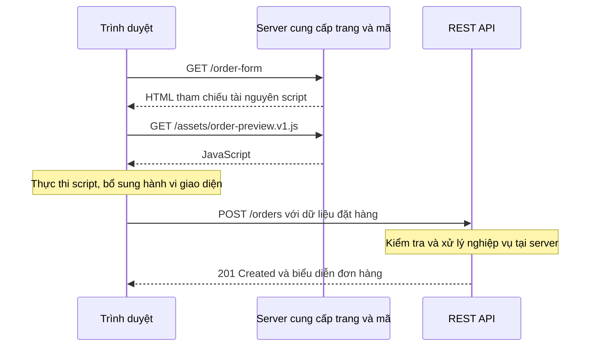

# Code-on-demand là ràng buộc tùy chọn

## 1. Mục tiêu bài học

Trong chương **Ràng buộc REST** của module **INTEGRATION_API_REST**, bài học này trình bày **code-on-demand**: khả năng server cung cấp mã để client tải về và thực thi, qua đó mở rộng hành vi của client.

Code-on-demand là ràng buộc tùy chọn trong REST. Một API không cung cấp mã thực thi cho client vẫn có thể tuân thủ REST nếu đáp ứng các ràng buộc còn lại. Ngược lại, có tải JavaScript không đủ để chứng minh một hệ thống đã tuân thủ REST.

Sau bài học, bạn có thể:

- Nhận diện lúc nào server đang truyền dữ liệu và lúc nào đang cung cấp mã để thực thi tại client.
- Giải thích ý nghĩa của tính tùy chọn đối với việc thiết kế REST API.
- Mô tả lợi ích và đánh đổi khi tải mã về client.
- Thiết kế một chức năng bổ sung bằng mã tải về mà vẫn giữ việc kiểm tra nghiệp vụ tại server.
- Lựa chọn phù hợp cho ứng dụng trình duyệt, client Java và các hệ thống tích hợp khác.

## 2. Bắt đầu từ hai cách cung cấp khả năng cho client

Một ứng dụng đặt hàng cần hiển thị tổng tiền dự kiến khi người dùng thay đổi số lượng sản phẩm.

### 2.1. Client đã có sẵn logic

Ứng dụng di động hoặc chương trình Java được phát hành với logic tính toán đã cài sẵn. Nó gọi API để lấy giá sản phẩm:

```http
GET /products/P-100 HTTP/1.1
Host: api.example.test
Accept: application/json
```

Server trả dữ liệu:

```http
HTTP/1.1 200 OK
Content-Type: application/json

{
  "id": "P-100",
  "name": "Sổ tay",
  "unitPrice": 125000,
  "currency": "VND"
}
```

Client dùng chương trình đã có để nhân đơn giá với số lượng và định dạng kết quả. Trong tương tác này, server chỉ cung cấp dữ liệu sản phẩm, không cung cấp chương trình tính toán mới cho client.

### 2.2. Client tải thêm logic từ server

Một trình duyệt có thể tải trang HTML rồi tải tiếp tài nguyên JavaScript mà trang tham chiếu:

```html
<script src="/assets/order-preview.v1.js" defer></script>
```

Server cung cấp mã JavaScript. Trình duyệt tải mã đó, thực thi và có thêm hành vi cập nhật tổng tiền dự kiến khi số lượng thay đổi.

Đây là ví dụ quen thuộc của code-on-demand: khả năng thực thi đã có trong trình duyệt được dùng để chạy mã do phía server cung cấp.

Không cần đợi người dùng bấm một nút tải riêng mới được gọi là code-on-demand. Việc trình duyệt tải script khi mở trang cũng có thể thể hiện cơ chế này.

## 3. Code-on-demand thực chất là gì?

### 3.1. Mã được truyền đến nơi sẽ thực thi nó

Ba thành phần cần xác định là:

1. Bên cung cấp mã, chẳng hạn server cung cấp tài nguyên JavaScript.
2. Client có môi trường thực thi phù hợp, chẳng hạn trình duyệt có JavaScript runtime.
3. Việc client thực thi mã được tải để bổ sung hoặc điều chỉnh hành vi.



Server cung cấp trang, server cung cấp mã và REST API có thể là những thành phần khác nhau. Chúng cũng có thể nằm trong cùng một ứng dụng triển khai. Code-on-demand không quy định phải tách chúng thành bao nhiêu dịch vụ.

### 3.2. Không đồng nhất với mã chạy ở server

Một chương trình Java trên server có thể xử lý yêu cầu, đọc cơ sở dữ liệu và tạo response. Nếu mã đó chỉ chạy trên server, đó không phải code-on-demand đối với client.

Tương tự, server dùng một template để sinh HTML không có nghĩa đã gửi chương trình thực thi cho trình duyệt. Cần xem nội dung được gửi và cách phía nhận sử dụng nó.

### 3.3. Không bị giới hạn vào một ngôn ngữ

JavaScript trong trình duyệt là ví dụ thực tế dễ quan sát. Về cơ chế, mã có thể thuộc một dạng khác nếu client có môi trường tương thích để thực thi nó.

Điều quyết định là server cung cấp mã để mở rộng hành vi tại client, không phải tên ngôn ngữ hoặc phần mở rộng của file. Một REST API không cần trả source code Java chỉ vì backend được viết bằng Java.

## 4. Vì sao đây là ràng buộc tùy chọn?

### 4.1. REST không yêu cầu mọi client tải mã

Những ràng buộc cốt lõi khác của REST bao gồm client-server, stateless, cache, uniform interface và layered system. Code-on-demand được xác định là tùy chọn.

Tính tùy chọn có những hệ quả trực tiếp:

- Server không bắt buộc có endpoint trả mã thực thi cho client.
- Client không bắt buộc có khả năng tải và chạy mã do API cung cấp.
- Một chương trình Java gọi API và chỉ xử lý dữ liệu vẫn có thể tham gia tương tác REST.
- Nếu có dùng code-on-demand, nó không miễn trừ các ràng buộc REST khác.

Ràng buộc cache cũng không có nghĩa mọi response đều phải được lưu cache. Tương tự, cần hiểu đúng từng ràng buộc thay vì biến danh sách tên gọi thành một danh sách tính năng phải bật.

### 4.2. Tùy chọn phản ánh một đánh đổi kiến trúc

Tải mã giúp server mở rộng chức năng của client mà không đòi hỏi mọi khả năng phải được cài sẵn từ đầu. Nhưng thông điệp lúc này mang chương trình mà hành vi chỉ bộc lộ đầy đủ khi được thực thi trong môi trường phù hợp.

Điều đó làm giảm **tính quan sát và hiểu được tương tác**, thường được gọi là visibility trong thảo luận kiến trúc REST. Một thành phần trung gian có thể hiểu phương thức, header hoặc kiểu nội dung, nhưng khó suy ra toàn bộ hành vi sẽ xảy ra sau khi client chạy một đoạn mã tùy ý.

Đây là một lý do quan trọng khiến code-on-demand là lựa chọn tùy tình huống, thay vì yêu cầu bắt buộc cho mọi hệ thống REST.

Visibility ở đây không chỉ là việc có ghi log hay không. Nó nói đến khả năng hiểu ý nghĩa và tác động của tương tác từ những gì có thể quan sát được, mà không phải thực thi toàn bộ chương trình trong hoàn cảnh của client.

### 4.3. Không bắt buộc cũng không đồng nghĩa nên luôn tránh

Một website tương tác có thể hưởng lợi rõ rệt từ JavaScript được tải theo trang. Một API tích hợp giữa các doanh nghiệp có thể chỉ cần trao đổi dữ liệu với những client có chương trình cố định.

Hai lựa chọn đáp ứng những nhu cầu khác nhau. Không cần bổ sung cơ chế tải mã chỉ để API có vẻ đầy đủ hơn, cũng không cần loại bỏ một script hữu ích chỉ vì REST cho phép không dùng nó.

## 5. Phân biệt dữ liệu, cấu hình và mã thực thi

### 5.1. Dữ liệu được xử lý bởi chương trình đã có

Ví dụ response sau cung cấp dữ liệu và một giới hạn:

```json
{
  "unitPrice": 125000,
  "currency": "VND",
  "maxQuantity": 10
}
```

Client dùng logic đã có để đọc các trường và cập nhật màn hình. Việc giá trị `maxQuantity` thay đổi không tự có nghĩa server đã cung cấp mã mới.

### 5.2. Cấu hình có thể chọn hành vi có sẵn

Một response khác có thể chọn khả năng đã được client triển khai:

```json
{
  "showPricePreview": true,
  "layout": "COMPACT"
}
```

Nếu client đã biết các tùy chọn này và chỉ bật hoặc tắt những nhánh xử lý có sẵn, đây là điều khiển bằng cấu hình trong ví dụ đang xét. Không nên coi mọi dữ liệu ảnh hưởng hành vi là code-on-demand.

### 5.3. Cần xét cách nội dung được diễn giải

Một chương trình cũng có thể được đặt trong một chuỗi JSON hoặc một ngôn ngữ mô tả riêng. Nếu client diễn giải và thực thi nội dung đó như chương trình, việc đóng gói bằng JSON không làm nó trở thành dữ liệu nghiệp vụ thông thường.

Vì vậy, không thể chỉ dựa vào `Content-Type: application/json` hay đuôi `.js` để kết luận. Hãy xem nội dung có đang bổ sung chỉ dẫn thực thi cho client hay chỉ là đầu vào của một thuật toán đã có.

| Tình huống | Phân loại trong ví dụ |
|---|---|
| Client nhận danh sách sản phẩm rồi dùng bộ hiển thị đã cài sẵn | Truyền dữ liệu |
| Client nhận cờ để bật một chức năng đã được triển khai | Truyền cấu hình |
| Trình duyệt tải script và thực thi để bổ sung hành vi | Code-on-demand |
| Server chạy logic Java rồi chỉ trả kết quả JSON | Xử lý tại server |
| Server trả một chuỗi chứa chương trình và client thực thi chuỗi đó | Có cơ chế truyền mã để thực thi; cần đánh giá theo hành vi thực tế |

## 6. Ví dụ: tải mã tính tổng tiền dự kiến

### 6.1. Phạm vi của ví dụ

Website muốn cập nhật tổng tiền dự kiến ngay khi người dùng đổi số lượng. Server cung cấp một script hỗ trợ giao diện; server vẫn quyết định giá hợp lệ và tổng tiền chính thức khi tạo đơn.

Ví dụ chỉ tính đơn giá nhân số lượng, chưa có phí vận chuyển, thuế hoặc giảm giá. Các số tiền được biểu diễn bằng số nguyên đồng Việt Nam trong phạm vi này.

### 6.2. HTML tham chiếu mã bổ sung

```html
<section>
  <label for="quantity">Số lượng</label>
  <input id="quantity" type="number" min="1" step="1" value="2">

  <p>
    Tổng tiền dự kiến:
    <output id="price-preview" data-unit-price="125000">
      Sẽ được tính khi xác nhận đơn
    </output>
  </p>

  <p>Tổng tiền chính thức do server xác định khi tạo đơn.</p>
</section>

<script src="/assets/order-preview.v1.js" defer></script>
```

Trong ví dụ, HTML và script đã thống nhất các ID phần tử cùng thuộc tính `data-unit-price`. Đó là một hợp đồng giữa tài liệu và mã giao diện, cần được giữ tương thích khi thay đổi.

### 6.3. Server trả JavaScript

```http
GET /assets/order-preview.v1.js HTTP/1.1
Host: shop.example.test
```

```http
HTTP/1.1 200 OK
Content-Type: text/javascript
Cache-Control: public, max-age=3600

const quantityInput = document.querySelector("#quantity");
const previewOutput = document.querySelector("#price-preview");
const unitPriceVnd = Number(previewOutput.dataset.unitPrice);

const moneyFormat = new Intl.NumberFormat("vi-VN", {
  style: "currency",
  currency: "VND",
  maximumFractionDigits: 0
});

function updatePreview() {
  const quantity = Number(quantityInput.value);
  const total = unitPriceVnd * quantity;

  if (!Number.isSafeInteger(unitPriceVnd) || unitPriceVnd < 0 ||
      !Number.isSafeInteger(quantity) || quantity <= 0 ||
      !Number.isSafeInteger(total)) {
    previewOutput.textContent = "Chưa thể tính tổng tiền dự kiến.";
    return;
  }

  previewOutput.textContent = moneyFormat.format(total);
}

quantityInput.addEventListener("input", updatePreview);
updatePreview();
```

Mã được viết cho cấu trúc HTML cụ thể ở trên và giả định hai phần tử đã tồn tại khi script chạy. Thuộc tính `defer` trên script ngoài giúp thực thi sau khi tài liệu đã được phân tích, phù hợp với việc truy cập các phần tử đó.

`Content-Type: text/javascript` khai báo nội dung mã. Chỉ thị cache trong ví dụ cho phép dùng lại tài nguyên script công khai theo thời gian đã nêu. Việc có media type đúng không thay cho quyết định của client về việc có tải và thực thi tài nguyên hay không.

Đoạn mã dùng `textContent` để hiển thị kết quả dạng văn bản. Nó không cần chuyển chuỗi dữ liệu từ API thành chương trình thực thi.

### 6.4. Client vẫn gửi ý định đặt hàng

Khi tạo đơn, phần xử lý gửi request của ứng dụng có thể gửi:

```http
POST /orders HTTP/1.1
Host: api.example.test
Content-Type: application/json
Accept: application/json

{
  "items": [
    {
      "productId": "P-100",
      "quantity": 2
    }
  ]
}
```

Script minh họa chỉ bổ sung tính năng xem trước, không triển khai toàn bộ thao tác gửi đơn. Phần gửi đơn phải được thiết kế trong ứng dụng theo hợp đồng API.

Server kiểm tra sản phẩm, số lượng, quyền đặt hàng và giá áp dụng. Sau đó server tạo đơn và trả dữ liệu đã chấp nhận:

```http
HTTP/1.1 201 Created
Content-Type: application/json
Location: /orders/ord_8421

{
  "id": "ord_8421",
  "status": "PENDING",
  "totalAmount": 250000,
  "currency": "VND"
}
```

Nếu giá đã thay đổi, kết quả chính thức có thể khác số đang xem trước. Hệ thống cần có cách thông báo hoặc yêu cầu xác nhận lại phù hợp với quy tắc bán hàng; script tính thử không tự giải quyết vấn đề đó.

## 7. Lợi ích và đánh đổi

### 7.1. Lợi ích

| Lợi ích | Biểu hiện trong ví dụ |
|---|---|
| Bổ sung khả năng cho client | Trình duyệt có thêm phản ứng khi thay đổi số lượng |
| Phản hồi tương tác nhanh | Có thể tính thử mà không gửi request cho từng lần nhập |
| Phát hành hành vi qua tài nguyên tải được | Server cung cấp phiên bản script phù hợp với trang |
| Giảm khả năng phải cài sẵn mọi tính năng | Client dùng runtime chung để thực thi mã được cung cấp |

Giảm số request không đồng nghĩa mọi trường hợp đều nhanh hơn. Tải, phân tích và thực thi mã cũng có chi phí. Cần đánh giá theo kích thước tài nguyên, thiết bị và chức năng thực tế.

### 7.2. Đánh đổi

| Đánh đổi | Hệ quả thiết kế |
|---|---|
| Giảm visibility | Khó suy ra đầy đủ hành vi chỉ từ việc quan sát thông điệp chứa mã |
| Phụ thuộc runtime | Mã có thể không chạy được trong mọi client hoặc môi trường |
| Phụ thuộc giữa mã và tài liệu | Script mới có thể đòi hỏi cấu trúc HTML hoặc dữ liệu khác |
| Chi phí tải và thực thi | Client yếu hoặc mạng chậm có thể chịu ảnh hưởng rõ |
| Mở rộng phạm vi tin cậy | Nguồn cung cấp mã có ảnh hưởng đến hành vi ứng dụng tại client |

Vì vậy, một tính năng phù hợp với trình duyệt không mặc nhiên phù hợp với client Java gọi API, tác vụ nền hoặc hệ thống của đối tác.

## 8. Ranh giới trách nhiệm vẫn cần được giữ rõ

### 8.1. Mã từ server vẫn chạy trong môi trường client

Nguồn phát hành là server không biến kết quả tính tại client thành dữ liệu có thẩm quyền. Người dùng có thể sửa dữ liệu HTML, chặn script, sửa JavaScript đang chạy hoặc gọi HTTP trực tiếp bằng chương trình khác.

Server vẫn phải kiểm tra các điều kiện quan trọng:

- Sản phẩm và số lượng hợp lệ.
- Người gọi được phép thực hiện thao tác.
- Giá, phí và tổng tiền đúng theo quy tắc tại thời điểm xử lý.
- Chuyển trạng thái của tài nguyên hợp lệ và được bảo vệ trước các cập nhật cạnh tranh khi cần.

Đây là trách nhiệm nghiệp vụ của server, dù client có tải script hỗ trợ hay không.

### 8.2. Tính tùy chọn ở cấp REST khác tính bắt buộc của một sản phẩm

Một website cụ thể có thể được xây dựng với yêu cầu phải chạy JavaScript mới hoạt động. Điều đó không mâu thuẫn với việc code-on-demand là tùy chọn trong kiến trúc REST.

Hai nhận định đang nói về hai cấp độ khác nhau:

- REST không bắt buộc mọi hệ thống áp dụng code-on-demand.
- Một sản phẩm đã chọn dùng code-on-demand có thể phụ thuộc vào mã tải về cho một số chức năng.

Nếu muốn hỗ trợ client không chạy script, cần thiết kế đường tương tác tương ứng. Không nên suy rằng mọi chức năng tự động có phương án thay thế chỉ vì ràng buộc này là tùy chọn.

### 8.3. Tải mã không thay hợp đồng API

Website có thể cập nhật script tính thử, nhưng ứng dụng di động cũ hoặc hệ thống đối tác vẫn gọi API bằng mã đã cài sẵn. Hợp đồng URI, phương thức HTTP, mã trạng thái và dữ liệu vẫn cần được quản lý tương thích.

Không nên chuyển một quy tắc nghiệp vụ bắt buộc hoàn toàn sang script rồi kỳ vọng mọi client sẽ tự nhận được quy tắc đó. Server cần giữ khả năng thực thi quy tắc cho mọi bên gọi.

## 9. Cache, phiên bản và nguồn phát hành mã

### 9.1. Mã cũng là một tài nguyên có biểu diễn

Tài nguyên script có thể được lấy bằng HTTP và có các metadata như `Content-Type`, `Cache-Control` hoặc validator khi được thiết kế phù hợp. Nó có thể được cung cấp qua một tầng phân phối nội dung, không nhất thiết từ cùng tiến trình với API nghiệp vụ.

Điều này cho thấy code-on-demand có thể phối hợp với cache và layered system. Tuy nhiên, việc tải script không tự chứng minh toàn bộ thiết kế đã đáp ứng các ràng buộc REST.

### 9.2. Cache tạo yêu cầu về phối hợp phiên bản

Giả sử client còn giữ script cũ trong cache, nhưng server đã phát hành HTML mới với tên phần tử khác. Đoạn mã cũ có thể không tìm được phần tử hoặc diễn giải sai dữ liệu.

Một cách quản lý là phát hành URI tài nguyên mới khi nội dung thay đổi, chẳng hạn:

```text
HTML phiên bản A -> /assets/order-preview.v1.js
HTML phiên bản B -> /assets/order-preview.v2.js
```

Tên phiên bản trong ví dụ là một quy ước triển khai, không phải cú pháp bắt buộc của REST. Có thể dùng chiến lược khác, miễn thời gian cache và khả năng tương thích được tính cùng nhau.

Nếu chọn chính sách giữ nội dung cố định theo URI phiên bản, cần thực hiện đúng cam kết đó. Đổi âm thầm nội dung dưới một URI còn được cache lâu có thể khiến các client chạy những hành vi khác nhau ngoài dự kiến.

### 9.3. Phát hành mã là quyết định về phạm vi tin cậy

Mã tải về có thể tác động đến dữ liệu và khả năng mà runtime cho phép. Vì vậy, nguồn cung cấp mã và quá trình phát hành thuộc thiết kế của ứng dụng, không chỉ là một đường dẫn file tiện lợi.

Với ứng dụng trình duyệt, các cơ chế kiểm soát nguồn script và tính toàn vẹn có thể hỗ trợ thiết kế khi được áp dụng phù hợp. Chúng không làm cho mọi mã tải được trở nên đáng tin một cách tự động.

Không nên biến một trường văn bản do người dùng hoặc API khác cung cấp thành mã thực thi chỉ để đạt nhãn code-on-demand. Khả năng mở rộng của client cần có phạm vi và nguồn phát hành được xác định rõ.

## 10. Áp dụng trong Java/Spring và client tích hợp

### 10.1. Backend Java không bắt buộc cung cấp mã thực thi

Một ứng dụng Java/Spring có thể cung cấp tài nguyên dữ liệu qua REST API, còn client Java dùng logic đã phát hành để đọc và xử lý dữ liệu đó.

Ví dụ DTO cho đơn hàng:

```java
import java.math.BigDecimal;

record OrderResponse(
        String id,
        String status,
        BigDecimal totalAmount,
        String currency
) {}
```

Client nhận JSON và ánh xạ sang một kiểu dữ liệu phù hợp. Việc đọc dữ liệu này không có nghĩa client đang tải một lớp Java mới từ server để thực thi.

Các `record` trong ví dụ chỉ mô tả dữ liệu; chúng không tự cung cấp xác thực, chuyển đổi HTTP hoặc kiểm tra nghiệp vụ.

### 10.2. Phân chia trách nhiệm trong một hệ thống có dùng script

| Thành phần | Trách nhiệm |
|---|---|
| Tài nguyên HTML và script | Cung cấp cấu trúc trang cùng hành vi tương tác đã thiết kế |
| Client trình duyệt | Tải, thực thi mã theo khả năng và chính sách của môi trường |
| HTTP controller hoặc adapter | Nhận request nghiệp vụ, kiểm tra dạng đầu vào và ánh xạ response |
| Service và logic nghiệp vụ | Kiểm tra quy tắc, quyền và dữ liệu có thẩm quyền |
| Tầng lưu trữ | Đọc, ghi tài nguyên theo yêu cầu nhất quán của bài toán |
| Client tích hợp Java | Gọi hợp đồng API bằng chương trình đã triển khai; không phải chạy script của website |

Java/Spring có thể tham gia cung cấp tài nguyên tĩnh hoặc có thể chỉ cung cấp API. Sự lựa chọn nơi đặt tài nguyên script thuộc kiến trúc triển khai, không phải điều kiện bắt buộc của code-on-demand.

### 10.3. Không tự mở rộng cơ chế thực thi cho client không cần nó

Một dịch vụ Java gọi API đặt hàng thường chỉ cần đọc dữ liệu, kiểm tra kết quả HTTP và thực hiện luồng tích hợp đã định nghĩa. Nó không cần tải mã từ response rồi thực thi để chứng minh API tuân thủ REST.

Nếu có yêu cầu sản phẩm thực sự về nạp chương trình hoặc plugin, cần thiết kế riêng hợp đồng, môi trường thực thi, quyền và vòng đời của khả năng đó. Việc REST cho phép code-on-demand không tự cung cấp thiết kế hoàn chỉnh cho một nền tảng plugin.

## 11. Những cách hiểu sai thường gặp

| Nhận định | Cách hiểu phù hợp |
|---|---|
| Không có JavaScript thì API không RESTful | Code-on-demand là tùy chọn; cần đánh giá những ràng buộc khác |
| Có JavaScript thì toàn bộ hệ thống đã RESTful | Tải mã chỉ phản ánh một cơ chế, không chứng minh mọi ràng buộc |
| Mọi response JSON đều là code-on-demand | JSON thường là dữ liệu; phải xem client có thực thi nội dung như chương trình không |
| Mã chạy tại server cũng là code-on-demand cho client | Cần có việc truyền mã và thực thi ở client trong tương tác đang xét |
| Script do server viết thì kết quả phía client đáng tin tuyệt đối | Kết quả tại client vẫn cần kiểm tra theo hợp đồng và nghiệp vụ |
| Tùy chọn nghĩa là script lỗi thì mọi chức năng vẫn chạy | Khả năng hoạt động khi thiếu script là yêu cầu sản phẩm cần được thiết kế |
| Thay script là có thể bỏ quản lý phiên bản API | Các client khác vẫn phụ thuộc hợp đồng API hiện có |

## 12. Bài tập vận dụng

### 12.1. Nhận diện cơ chế

Hãy phân loại các tình huống sau:

1. Một client Java nhận JSON đơn hàng rồi hiển thị bằng logic đã cài sẵn.
2. Trình duyệt nhận HTML, tải một file JavaScript và chạy nó để thêm chức năng lọc danh sách.
3. Server chạy chương trình tính phí rồi trả kết quả cuối cùng bằng JSON.
4. Client nhận `showDiscount: true` và bật một thành phần đã được triển khai.
5. Client nhận một nội dung mô tả chương trình và đưa nó vào môi trường thực thi để bổ sung hành vi.

Gợi ý:

| Tình huống | Giải thích |
|---|---|
| 1 | Truyền dữ liệu, không có mã mới được tải để chạy |
| 2 | Ví dụ code-on-demand trong trình duyệt |
| 3 | Xử lý ở server, không phải truyền mã cho client |
| 4 | Cấu hình chọn hành vi có sẵn trong giả thiết đã nêu |
| 5 | Có cơ chế tải nội dung để thực thi như chương trình; cần xét môi trường và hợp đồng cụ thể |

### 12.2. Thiết kế tính năng xem trước giảm giá

Một website tải script để tính mức giảm giá dự kiến. Ứng dụng di động và đối tác tích hợp không sử dụng script này. Nhóm phát triển đề xuất bỏ kiểm tra giảm giá ở server vì “script đã được server cung cấp”.

Hãy trả lời:

1. Phần nào trong hệ thống thể hiện code-on-demand?
2. Vì sao API không nên tin kết quả giảm giá từ client?
3. Những client không chạy script phải gửi dữ liệu gì để thực hiện cùng nghiệp vụ?
4. Server cần trả kết quả nào để mọi client biết giá đã được chấp nhận?

Một phương án là cho client gửi sản phẩm, số lượng và mã giảm giá được đề nghị. Server kiểm tra quyền sử dụng mã, thời hạn, điều kiện áp dụng và dữ liệu đơn hàng; sau đó trả các thành phần tiền cùng tổng tiền chính thức theo hợp đồng. Script chỉ hỗ trợ xem trước và cần hiển thị rõ giới hạn của kết quả dự kiến.

### 12.3. Quyết định có cần dùng hay không

Với một chức năng mới, hãy xác định client mục tiêu, khả năng thực thi sẵn có, lợi ích tương tác và chi phí phối hợp phiên bản. Nếu client đã có đủ khả năng và chỉ cần dữ liệu, API có thể tiếp tục trao đổi biểu diễn dữ liệu. Nếu mã tải về tạo ra giá trị cụ thể, hãy thiết kế nó cùng hợp đồng và trách nhiệm của các bên.

Code-on-demand cho phép mở rộng hành vi tại client. Tính tùy chọn của nó giúp REST phục vụ cả hệ thống dùng mã tải về lẫn hệ thống chỉ cần những client có logic cố định, trong khi các quyết định nghiệp vụ có thẩm quyền vẫn được thực thi tại server theo thiết kế của API.
