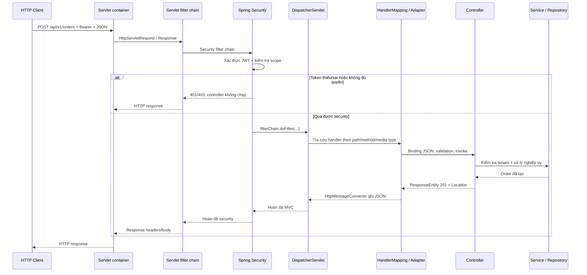
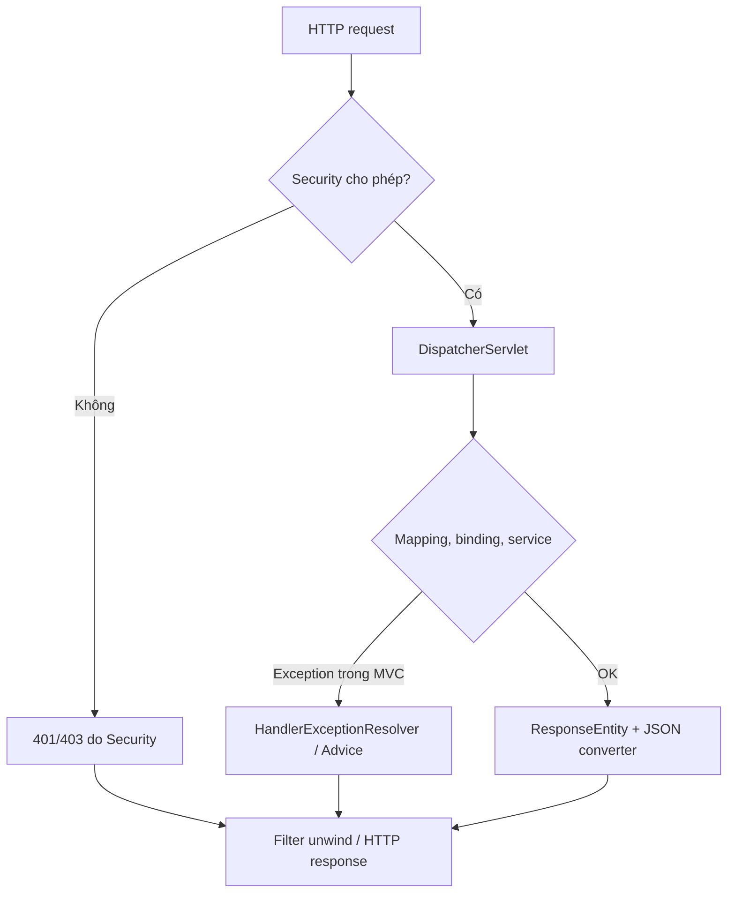

# Luồng xử lý qua Servlet filter, DispatcherServlet và controller

Một client gọi `POST /api/v1/orders` với Bearer token và JSON. Vì sao có request bị từ chối `401` mà code trong controller không hề chạy, request khác nhận `400` ngay ở bước chuyển JSON thành DTO, còn request hợp lệ trả `201 Created` kèm `Location`? Để thiết kế và xử lý lỗi REST API đúng, cần hiểu **toàn bộ đường đi của HTTP request**, không chỉ `@RestController`.

Trong Spring MVC chạy trên Servlet stack, HTTP request đi qua **Servlet container → servlet filters (trong đó có Spring Security) → `DispatcherServlet` → handler mapping/adapter → controller → service**. Kết quả quay lại qua các bước chuyển đổi response, xử lý exception, interceptor và filter. Mỗi lớp có trách nhiệm riêng: xác thực, phân quyền, routing, đọc/ghi JSON, validation, nghiệp vụ, HTTP status và quan sát hệ thống.

Bài thuộc chương **Spring MVC** của module **INTEGRATION_API_REST**. Mục tiêu là vận dụng kiến trúc resource/URI, HTTP methods/status, hợp đồng dữ liệu, OpenAPI, xác thực/phân quyền và kiểm thử với **Java 17, Spring Boot 3, Spring MVC/Spring Security 6** hoặc công nghệ tương đương. Các ví dụ dùng REST API đặt hàng đa tenant, ghi chú rõ phần nào là mã minh họa cần bổ sung cho ứng dụng thật.

## 1. Sơ đồ tổng thể: từ socket đến REST response



**Đường thành công** minh họa thứ tự tương đối, không phải danh sách đầy đủ mọi filter nội bộ. Spring Security thực tế được tích hợp vào Servlet filter chain thông qua `DelegatingFilterProxy` trỏ tới `FilterChainProxy`, trong đó một `SecurityFilterChain` được chọn theo request. Các filter do ứng dụng tự đăng ký có thể đứng trước/sau Spring Security tùy thứ tự cấu hình.

**`DispatcherServlet` là một Servlet**, không phải Filter. Nó đóng vai trò *front controller*: tìm handler, chuẩn bị tham số, gọi controller và xử lý response/exception trong phạm vi MVC. Request có thể bị filter hoặc proxy bên ngoài từ chối **trước khi DispatcherServlet được gọi**.

## 2. Các chốt xử lý bên trong MVC

| Thành phần | Trách nhiệm và biểu hiện |
|---|---|
| Servlet container | Parse HTTP, tạo request/response, quản lý thread/dispatch; có thể chặn request quá lớn trước MVC |
| Servlet filters | Correlation ID, tracing, security filters, CORS; có thể trả response ngay |
| `DispatcherServlet` | Front controller nhận request đã qua filter và điều phối MVC |
| `HandlerMapping` | Chọn handler theo URL, HTTP method, `consumes`/`produces`; có thể phát 404/405/415/406 |
| `HandlerInterceptor.preHandle` | Hook sau khi đã xác định handler, trước method controller |
| `HandlerAdapter` | Gọi handler qua argument resolvers, message converters và validation |
| Controller/service | HTTP contract; transaction, business rules và quyền theo tài nguyên/tenant |
| Return value handler/converter | `ResponseEntity` → status/headers; DTO → JSON |
| `HandlerExceptionResolver` | Biến lỗi trong MVC thành response/Problem Details khi có mapping |
| Interceptor/filter unwind | Hook hoàn tất, metrics và cleanup; response trở về container |

**`HandlerMapping` tìm người xử lý; `HandlerAdapter` biết cách gọi.** `RequestMappingHandlerMapping`/`RequestMappingHandlerAdapter` thường xử lý các method `@GetMapping`/`@PostMapping`, nhưng Spring có thể có nhiều mapping/adapter khác. Không có đảm bảo request luôn tới controller: token sai bị chặn trước MVC, JSON sai bị chặn ở argument resolver, URL không khớp handler có thể trả 404.

## 3. Chọn đúng Filter, Security, Interceptor và Advice

| Cơ chế | Vị trí | Dùng cho |
|---|---|---|
| Servlet `Filter` | Trước/sau servlet, không cần controller | Request ID, tracing, wrapping, chính sách chung |
| Spring Security filter chain | Các Servlet filters có thứ tự riêng | JWT/credential, security context, coarse authorization, CSRF khi cần |
| `HandlerInterceptor` | Trong MVC sau handler mapping | Metrics theo handler, pre/post hook |
| `@RestControllerAdvice` | Exception handling của Spring MVC | Chuẩn hóa lỗi parse/validation/nghiệp vụ |
| `@RestController` + service | Operation HTTP và domain | Binding, status, transaction, quyền theo từng resource |

**Không dùng interceptor thay Spring Security.** Filter/security có thể từ chối request trước khi mapping; còn quyền đọc đơn `ord-901` phải được service kiểm tra theo actor/tenant, không chỉ dựa vào URL matcher.

**Chú ý ranh giới exception:** lỗi từ controller, binding hay service thường đi qua `HandlerExceptionResolver` và `@RestControllerAdvice`; lỗi từ filter **ngoài DispatcherServlet** không tự đến Advice. Spring Security dùng `AuthenticationEntryPoint` và `AccessDeniedHandler` cho 401/403, còn lỗi proxy/container cần xử lý riêng. Một global `@ExceptionHandler(Exception.class)` không thay thế cơ chế của mọi lớp.

## 4. Ví dụ HTTP xuyên suốt: tạo đơn hàng

Một client có quyền `orders:write` gửi JSON hợp lệ:

```http
POST /api/v1/orders HTTP/1.1
Host: api.example.com
Authorization: Bearer <access_token>
Content-Type: application/json
Accept: application/json

{"sku":"sku-42","quantity":2}
```

Khi tạo thành công:

```http
HTTP/1.1 201 Created
Location: /api/v1/orders/ord-901
Content-Type: application/json
Cache-Control: no-store
X-Request-ID: e2fcd227-6a09-46b9-94c7-9e02924c48ad

{"id":"ord-901","sku":"sku-42","quantity":2,"status":"PENDING"}
```

Các chi tiết được tạo ở lớp khác nhau: `X-Request-ID` có thể đến từ một filter; xác thực token đến từ Spring Security; `sku`/`quantity` được bind từ JSON; đơn hàng được lưu ở service/repository; `201` và `Location` do controller quyết định; Jackson chuyển DTO thành JSON.

Các biến thể lỗi của cùng endpoint:

| Input/trạng thái | Điểm có thể từ chối | HTTP status |
|---|---|---|
| Không có token hoặc token sai | Spring Security, trước controller | **401 Unauthorized** + Bearer challenge |
| Token hợp lệ nhưng thiếu scope tạo đơn | Spring Security | **403 Forbidden** |
| `quantity: 0` vi phạm `@Positive` | Bean Validation trong MVC | **400 Bad Request** theo contract mẫu |
| Body JSON bị hỏng hoặc field sai kiểu | Jackson/argument resolver | **400** |
| `Content-Type: text/plain` nhưng controller chỉ `consumes=application/json` | Handler mapping/negotiation | **415 Unsupported Media Type** |
| `Accept` chỉ chấp nhận media type API không thể sinh | Content negotiation | **406 Not Acceptable** |
| Tài nguyên không tồn tại hoặc ngoài quyền tenant | Service/authorization | **404** hoặc **403** theo chính sách |
| Đơn trùng với trạng thái hiện tại theo luật nghiệp vụ | Service | **409 Conflict** nếu hợp đồng áp dụng |
| Lỗi hạ tầng ngoài dự kiến | Servlet/MVC/error handling | **5xx** phù hợp; không lộ stack trace |

Thứ tự kiểm tra quan trọng: request JSON hỏng nhưng **chưa xác thực** vẫn có thể nhận 401 trước khi MVC parse body. Không nên viết test giả định mọi lỗi body luôn được ưu tiên hơn lỗi auth.

## 5. Servlet Filter: correlation ID với OncePerRequestFilter

`OncePerRequestFilter` của Spring giúp viết filter theo cơ chế mỗi dispatch phù hợp mà không phải tự quản lý mọi chi tiết của `Filter`. Ví dụ filter gắn request ID; **không đọc, log hay buffer toàn bộ request body**:

```java
import java.io.IOException;
import java.util.UUID;
import jakarta.servlet.FilterChain;
import jakarta.servlet.ServletException;
import jakarta.servlet.http.HttpServletRequest;
import jakarta.servlet.http.HttpServletResponse;
import org.slf4j.MDC;
import org.springframework.core.Ordered;
import org.springframework.core.annotation.Order;
import org.springframework.stereotype.Component;
import org.springframework.web.filter.OncePerRequestFilter;

@Component
@Order(Ordered.HIGHEST_PRECEDENCE)
public class RequestIdFilter extends OncePerRequestFilter {
    public static final String REQUEST_ID = "requestId";

    @Override
    protected void doFilterInternal(
            HttpServletRequest request,
            HttpServletResponse response,
            FilterChain chain) throws ServletException, IOException {
        String supplied = request.getHeader("X-Request-ID");
        String id = supplied != null
                && supplied.matches("[A-Za-z0-9._-]{1,64}")
            ? supplied
            : UUID.randomUUID().toString();

        request.setAttribute(REQUEST_ID, id);
        response.setHeader("X-Request-ID", id);
        MDC.put(REQUEST_ID, id);
        try {
            chain.doFilter(request, response);
        } finally {
            MDC.remove(REQUEST_ID);
        }
    }
}
```

**Vì sao cần `finally`?** Servlet container tái sử dụng thread. Nếu để `MDC` hoặc `ThreadLocal` không được dọn, log của request sau có thể dính ID/tenant của request trước. Chuỗi request ID do client cung cấp phải giới hạn độ dài/ký tự để tránh log injection và tăng cardinality quá mức.

**Thứ tự filter:** `@Order` và `FilterRegistrationBean` tác động thứ tự đăng ký với container; cần kiểm chứng vị trí so với Spring Security và proxy thực tế.

**Async/error dispatch:** `OncePerRequestFilter` có chính sách với `REQUEST`/`ASYNC`/`ERROR`; “once” không đồng nghĩa một lần trên mọi dispatch. MDC không tự truyền sang thread khác: phải propagate và cleanup khi cần.

## 6. Spring Security xử lý trước controller

Spring Security thường có `DelegatingFilterProxy` đăng ký với container, chuyển tiếp sang bean `springSecurityFilterChain` (một `FilterChainProxy`). Proxy chọn `SecurityFilterChain` phù hợp URL; bên trong có các filter tạo/đọc security context, xử lý authentication và authorization. **Không tự gắn filter JWT thủ công song song với Resource Server** nếu không có lý do rõ, vì dễ dẫn đến hai nguồn xác thực và thứ tự sai.

Ví dụ bảo vệ REST API Bearer JWT, với Spring Boot 3 / Spring Security 6:

```java
import org.springframework.context.annotation.Bean;
import org.springframework.context.annotation.Configuration;
import org.springframework.http.HttpMethod;
import org.springframework.security.config.Customizer;
import org.springframework.security.config.annotation.web.builders.HttpSecurity;
import org.springframework.security.config.annotation.web.configurers.AbstractHttpConfigurer;
import org.springframework.security.config.http.SessionCreationPolicy;
import org.springframework.security.web.SecurityFilterChain;

@Configuration
public class ApiSecurityConfiguration {
    @Bean
    SecurityFilterChain apiChain(HttpSecurity http) throws Exception {
        return http
            .securityMatcher("/api/**")
            .csrf(AbstractHttpConfigurer::disable)
            .sessionManagement(s -> s
                .sessionCreationPolicy(SessionCreationPolicy.STATELESS))
            .authorizeHttpRequests(auth -> auth
                .requestMatchers(HttpMethod.GET, "/api/v1/public/**").permitAll()
                .requestMatchers(HttpMethod.POST, "/api/v1/orders")
                    .hasAuthority("SCOPE_orders:write")
                .requestMatchers(HttpMethod.GET, "/api/v1/orders/**")
                    .hasAuthority("SCOPE_orders:read")
                .anyRequest().authenticated())
            .oauth2ResourceServer(o -> o.jwt(Customizer.withDefaults()))
            .build();
    }
}
```

Ví dụ cấu hình Resource Server cần dependency phù hợp và JWT issuer đáng tin:

```yaml
spring:
  security:
    oauth2:
      resourceserver:
        jwt:
          issuer-uri: https://issuer.example.invalid/realms/shop
```

Client gửi `Authorization: Bearer <token>`. Khi token được xác thực, principal và authorities được thiết lập theo cấu hình chuyển claim/scopes của hệ thống; ví dụ dùng `SCOPE_orders:write`. Không suy ra mọi issuer đều đưa quyền vào cùng một claim; nếu token dùng claim riêng, cần cấu hình `JwtAuthenticationConverter` và kiểm thử mapping.

**Giới hạn bảo mật:** việc vô hiệu CSRF trong đoạn trên **chỉ phù hợp với API stateless thuần Bearer token được gửi trong Authorization header, không dựa vào cookie tự động của browser**. Nếu dùng session cookie/BFF, phải xem xét CSRF protection, `SameSite`, CORS và chính sách session riêng. Với SPA gọi cross-origin, cấu hình `cors(Customizer.withDefaults())` cùng `CorsConfigurationSource` chỉ cho các origin/method/header được phép; bảo đảm preflight OPTIONS được xử lý **trước logic auth gây chặn**. CORS không thay thế authentication hay authorization.

### 6.1. 401 và 403 không phải cùng một lỗi

Nếu client chưa xác thực hợp lệ, API Bearer thường trả:

```http
HTTP/1.1 401 Unauthorized
WWW-Authenticate: Bearer
Cache-Control: no-store
```

Nếu principal hợp lệ nhưng thiếu quyền:

```http
HTTP/1.1 403 Forbidden
Cache-Control: no-store
```

Spring Security dùng các thành phần như `AuthenticationEntryPoint` và `AccessDeniedHandler` cho những phản hồi này. Status, challenge và body thực tế phụ thuộc cấu hình, nên **không được khẳng định mọi response mặc định luôn có `Cache-Control: no-store` hoặc `application/problem+json`** mà chưa kiểm tra. Nếu tùy chỉnh Problem Details cho 401, đừng làm mất `WWW-Authenticate` bắt buộc trong trường hợp phù hợp.

## 7. DispatcherServlet: chọn handler, bind và trả JSON

Spring MVC dựa vào URI, method, `consumes`/`produces` để chọn controller. Ví dụ API đơn hàng với Java 17:
 
```java
import jakarta.validation.Valid;
import jakarta.validation.constraints.NotBlank;
import jakarta.validation.constraints.Positive;
import java.net.URI;
import org.springframework.http.CacheControl;
import org.springframework.http.MediaType;
import org.springframework.http.ResponseEntity;
import org.springframework.security.core.annotation.AuthenticationPrincipal;
import org.springframework.security.oauth2.jwt.Jwt;
import org.springframework.web.bind.annotation.*;

record CreateOrderRequest(@NotBlank String sku, @Positive int quantity) {}
record OrderView(String id, String sku, int quantity, String status) {}

@RestController
@RequestMapping("/api/v1/orders")
public class OrderController {
    private final OrderService orders;
    public OrderController(OrderService orders) { this.orders = orders; }

    @PostMapping(
        consumes = MediaType.APPLICATION_JSON_VALUE,
        produces = MediaType.APPLICATION_JSON_VALUE)
    public ResponseEntity<OrderView> create(
            @Valid @RequestBody CreateOrderRequest request,
            @AuthenticationPrincipal Jwt jwt) {
        OrderView created = orders.createAuthorized(jwt.getSubject(), request);
        return ResponseEntity
            .created(URI.create("/api/v1/orders/" + created.id()))
            .cacheControl(CacheControl.noStore()).body(created);
    }

    @GetMapping(path = "/{orderId}", produces = MediaType.APPLICATION_JSON_VALUE)
    public OrderView get(@PathVariable String orderId,
            @AuthenticationPrincipal Jwt jwt) {
        return orders.findVisibleTo(jwt.getSubject(), orderId);
    }
}
```

`OrderService` là abstraction **chưa triển khai**. Service phải phân giải tenant từ actor đã xác thực, kiểm tra quyền theo từng đơn và ràng buộc nghiệp vụ; tuyệt đối không tin tenantId do client tự đưa. Controller thường là **singleton**: không đặt actor/request tạm trong biến instance.
 
- `@RequestMapping`/`@PostMapping` xác định route, HTTP method và media types; `@PathVariable` lấy ID từ URI.
- `@RequestBody` dùng `HttpMessageConverter` (thường Jackson) parse JSON thành DTO; `@Valid` chạy Bean Validation, cần validation dependency.
- `@AuthenticationPrincipal Jwt` lấy principal đã được security filter xác minh; `Jwt` phù hợp khi Resource Server dùng JWT.
- `ResponseEntity.created(...)` tạo 201 + Location; converter ghi JSON theo `Accept`/`produces`. Không trả body cho 204.
 
JSON sai kiểu/cú pháp hoặc vi phạm `@Positive` có thể bị từ chối **trước method controller** với 400. `@RequestParam`, `@RequestHeader` và `@ModelAttribute` có cơ chế binding khác; không tự parse body trong filter khiến input stream bị tiêu thụ trước MVC.

## 8. Phân biệt các lỗi định tuyến và nội dung

| Mã | Điểm thường phát sinh |
|---|---|
| **404** | Không có mapping cho URI hoặc service cố ý che tài nguyên ngoài quyền |
| **405** | URI có mapping nhưng HTTP method không được hỗ trợ; thường kèm `Allow` |
| **406** | `Accept` không có representation mà API cung cấp |
| **415** | `Content-Type` không hợp `consumes`/converter |
| **400** | JSON malformed, sai kiểu hoặc DTO vi phạm `@Valid` |
| **409** | Xung đột với trạng thái nghiệp vụ trong service |

Kiểm tra lỗi mapping/body bằng **principal hợp lệ**: Security có thể trả 401/403 trước khi MVC kiểm tra URI hay parse JSON. Response sinh ở gateway/container cũng có thể khác format của `@RestControllerAdvice`.

## 9. @RestControllerAdvice và Problem Details

RFC 9457 đề xuất `application/problem+json` cho lỗi HTTP. Trong Spring MVC, `@RestControllerAdvice` chuẩn hóa **những exception mà MVC xử lý**, không mặc nhiên bắt lỗi filter/security.

```java
import java.net.URI;
import org.springframework.http.*;
import org.springframework.web.bind.MethodArgumentNotValidException;
import org.springframework.web.bind.annotation.*;

@RestControllerAdvice
public class ApiErrorHandler {
    @ExceptionHandler(MethodArgumentNotValidException.class)
    public ResponseEntity<ProblemDetail> invalid(
            MethodArgumentNotValidException ignored) {
        ProblemDetail p = ProblemDetail.forStatus(HttpStatus.BAD_REQUEST);
        p.setType(URI.create("https://api.example.com/problems/validation"));
        p.setTitle("Invalid request");
        p.setDetail("Check the submitted order fields.");
        p.setProperty("code", "INVALID_ORDER_INPUT");
        return ResponseEntity.badRequest().body(p);
    }

    @ExceptionHandler(OrderStateConflictException.class)
    public ResponseEntity<ProblemDetail> conflict(
            OrderStateConflictException ignored) {
        ProblemDetail p = ProblemDetail.forStatus(HttpStatus.CONFLICT);
        p.setType(URI.create(
            "https://api.example.com/problems/order-state-conflict"));
        p.setTitle("Order state conflict");
        p.setProperty("code", "ORDER_STATE_CONFLICT");
        return ResponseEntity.status(HttpStatus.CONFLICT).body(p);
    }
}
```

`OrderStateConflictException` là lỗi nghiệp vụ tự định nghĩa và phải thực sự được service ném. Không chuyển mọi SQL exception thành 409 hoặc trả `Exception.getMessage()` ra client. Nếu cần cùng định dạng Problem Details cho 401/403, cấu hình `AuthenticationEntryPoint`/`AccessDeniedHandler` ở Spring Security và giữ `WWW-Authenticate` khi cần. Lỗi xảy ra khi response đã stream/commit có thể không đổi status/body được nữa.



## 10. Interceptor và bất đồng bộ

`HandlerInterceptor` hoạt động **sau khi chọn handler**: `preHandle` trước controller, `postHandle` sau handler trong luồng phù hợp, `afterCompletion` sau dispatch. Với `@ResponseBody`, converter có thể đã ghi response trước `postHandle`; không dùng hook này để sửa JSON. Ví dụ đo latency của handler:

```java
import jakarta.servlet.http.*;
import org.springframework.stereotype.Component;
import org.springframework.web.servlet.HandlerInterceptor;
import org.springframework.web.servlet.config.annotation.*;
import org.springframework.context.annotation.Configuration;

@Component
class HandlerTimingInterceptor implements HandlerInterceptor {
    private static final String START = "handlerStartNanos";

    @Override
    public boolean preHandle(HttpServletRequest req,
            HttpServletResponse res, Object handler) {
        req.setAttribute(START, System.nanoTime());
        return true;
    }

    @Override
    public void afterCompletion(HttpServletRequest req,
            HttpServletResponse res, Object handler, Exception error) {
        Object value = req.getAttribute(START);
        if (value instanceof Long start) {
            long elapsed = System.nanoTime() - start;
            // Gửi metric theo route template/status; không dùng raw user ID.
        }
    }
}

@Configuration
class MvcConfiguration implements WebMvcConfigurer {
    private final HandlerTimingInterceptor timing;
    MvcConfiguration(HandlerTimingInterceptor timing) {
        this.timing = timing;
    }
    @Override
    public void addInterceptors(InterceptorRegistry registry) {
        registry.addInterceptor(timing).addPathPatterns("/api/**");
    }
}
```

Đây là minh họa: cần instrument metrics thực, còn `elapsed` chỉ là kết quả tính. Request bị chặn trong Security **không tới interceptor**; dùng filter/observability lớp ngoài để đo toàn bộ HTTP.

Với `Callable`/`DeferredResult`, async Servlet có thể tiếp tục ở thread và dispatch khác; `AsyncHandlerInterceptor.afterConcurrentHandlingStarted` có lifecycle riêng. Không mặc định MDC, SecurityContext hoặc transaction được truyền sang thread pool; cần propagation và cleanup rõ ràng. **Spring MVC async vẫn là Servlet stack**, không phải WebFlux.

## 11. Các bẫy trước controller

- **CORS:** browser có thể gửi `OPTIONS` preflight trước POST có `Authorization`/JSON. Cấu hình origin/method/headers được phép và tích hợp CORS **trước khi security chặn preflight**. Không dùng wildcard origin với credentials; CORS không thay authorization, curl/server không bị CORS browser chi phối.
- **Session/CSRF:** API Bearer header stateless khác BFF dùng cookie tự động. Với cookie, đánh giá CSRF protection và `SameSite`; không sao chép `csrf.disable()` chỉ để POST chạy.
- **Multipart:** giới hạn ở gateway/container và Spring; tệp vượt hạn mức có thể bị từ chối **trước `@Valid`**. Không dùng `MultipartFile.getBytes()` cho file hàng GB; stream hoặc direct upload có quarantine.
- **Body logging:** request body thường chỉ đọc một lần. Filter tiêu thụ input stream sẽ làm `@RequestBody` nhận rỗng nếu không có wrapper đúng; tránh buffer không giới hạn hoặc log token, cookie, PII.
- **Response đã commit:** một filter/streaming response có thể đã gửi header hoặc body trước khi có exception; không bảo đảm Advice đổi sang JSON 500 được.

## 12. Debug theo tầng

| Triệu chứng | Kiểm tra |
|---|---|
| Gateway trả 413/502 trước log ứng dụng | Gateway, servlet limits, timeout |
| 401/403 trước controller | Security chain, JWT decoder, scope mapping, CSRF, route matcher |
| 404/405/415/406 | HandlerMapping, context path, method, `consumes`/`produces`, Accept |
| 400 khi đã có token | JSON binding, Jackson, DTO/`@Valid` |
| 409 sau controller | Domain conflict trong service |
| 500 khi trả JSON | Converter/serialization, repository, exception mapping |
| Mất `X-Request-ID` hoặc trace lỗi khi async | Thứ tự/dispatch filter, MDC cleanup, proxy rewriting |

Dùng request ID và metrics theo **route template** thay vì user ID/order ID. Bật debug log Spring Security/mapping có kiểm soát; không để Authorization header hoặc payload nhạy cảm vào production log.

## 13. MockMvc: kiểm tra Security → MVC → controller

`MockMvc` với Spring Security filters đúng cấu hình kiểm thử routing, binding, validation, response; nó không thay thế test container/gateway thật. Ví dụ dùng `spring-security-test`, fixture SKU/tenant hợp lệ và service/repository tương ứng:

```java
import static org.hamcrest.Matchers.startsWith;
import static org.springframework.security.test.web.servlet.request.SecurityMockMvcRequestPostProcessors.jwt;
import static org.springframework.test.web.servlet.request.MockMvcRequestBuilders.post;
import static org.springframework.test.web.servlet.result.MockMvcResultMatchers.*;
import org.junit.jupiter.api.Test;
import org.springframework.beans.factory.annotation.Autowired;
import org.springframework.boot.test.autoconfigure.web.servlet.AutoConfigureMockMvc;
import org.springframework.boot.test.context.SpringBootTest;
import org.springframework.http.*;
import org.springframework.security.core.authority.SimpleGrantedAuthority;
import org.springframework.test.web.servlet.MockMvc;

@SpringBootTest
@AutoConfigureMockMvc
class OrderFlowTest {
    @Autowired MockMvc mvc;

    @Test
    void missingTokenReturns401() throws Exception {
        mvc.perform(post("/api/v1/orders")
                .contentType(MediaType.APPLICATION_JSON)
                .content("{\"sku\":\"sku-42\",\"quantity\":2}"))
            .andExpect(status().isUnauthorized())
            .andExpect(header().string(
                HttpHeaders.WWW_AUTHENTICATE, startsWith("Bearer")));
    }

    @Test
    void invalidBodyReturns400AfterAuthentication() throws Exception {
        mvc.perform(post("/api/v1/orders")
                .with(jwt().authorities(
                    new SimpleGrantedAuthority("SCOPE_orders:write")))
                .contentType(MediaType.APPLICATION_JSON)
                .content("{\"sku\":\"sku-42\",\"quantity\":0}"))
            .andExpect(status().isBadRequest());
    }

    @Test
    void validPostReturns201AndLocation() throws Exception {
        mvc.perform(post("/api/v1/orders")
                .with(jwt().authorities(
                    new SimpleGrantedAuthority("SCOPE_orders:write")))
                .contentType(MediaType.APPLICATION_JSON)
                .content("{\"sku\":\"sku-42\",\"quantity\":2}"))
            .andExpect(status().isCreated())
            .andExpect(header().string(
                HttpHeaders.LOCATION, startsWith("/api/v1/orders/")))
            .andExpect(jsonPath("$.status").value("PENDING"));
    }
}
```

`jwt()` chỉ tạo principal trong test, **không kiểm tra chữ ký, issuer, audience hay JWKS production**. Cần test Resource Server với JWT/decoder thật và test DB cho tenant isolation.

| Case cần có thêm | Kỳ vọng |
|---|---|
| Token hợp lệ nhưng thiếu `orders:write` | 403, không tạo đơn |
| JSON lỗi, Content-Type sai, Accept không hỗ trợ, method sai | 400 / 415 / 406 / 405 theo contract |
| Service conflict; actor tenant A đọc đơn tenant B | 409 chuẩn hóa / 403 hoặc 404 không rò dữ liệu |
| CORS preflight, CSRF cookie | Đúng origin, header và security policy |
| Filter + error/async dispatch | `X-Request-ID` nhất quán, không dính MDC request khác |
| Multipart quá hạn mức, proxy/container timeout | Lỗi đúng lớp, không rò thông tin hoặc tạo side effects |

Assert không chỉ status: kiểm tra DB, `Content-Type`, `Location`, `WWW-Authenticate`, Problem Details và headers. Thử với container thật cho filter registration, CORS, kích thước request và async/error dispatch.

## 14. Bài tập: truy vết HTTP tới database

Một API có `POST /api/v1/orders` (JWT scope `orders:write`, JSON `sku` và `quantity > 0`, trả 201 + Location), `GET /api/v1/orders/{id}` (scope `orders:read`, kiểm tra tenant), request ID filter, Advice chuẩn hóa Problem Details và SPA gọi cross-origin.

**Thực hiện:** (1) vẽ request qua Filter/Security/DispatcherServlet/Mapping/Adapter/controller/service/converter; (2) chỉ lớp phát 401/403/400/405/406/415/409; (3) viết `SecurityFilterChain` và giải thích CSRF/CORS; (4) viết DTO `@Valid`/controller/Advice; (5) chỉ ra interceptor không quan sát request bị Security chặn; (6) viết ít nhất 10 test gồm tenant A/B, sai JWT, validation, media types, preflight, headers.

**Đạt yêu cầu khi:** token/tenant luôn được xác minh, request lỗi không tạo đơn, lỗi filter không bị coi là do Advice xử lý, response không rò thông tin nội bộ, MDC được cleanup trong `finally` và test container bổ sung cho MockMvc.

## 15. Checklist và tài liệu tham khảo

- [ ] Filter/security chạy trước DispatcherServlet; Mapping chọn handler, Adapter bind/validate/invoke, converter ghi response.
- [ ] Request ID/metrics có thứ tự và cleanup đúng; filter không nuốt body hoặc lưu dữ liệu nhạy cảm trong log.
- [ ] JWT/scope ở Security; quyền resource/tenant ở service; CSRF/CORS cấu hình đúng cho Bearer hay cookie.
- [ ] Controller khai báo method/URI/media types/DTO rõ, trả 201+Location/204/4xx đúng ngữ nghĩa.
- [ ] Advice xử lý lỗi MVC; 401/403 do security handlers; lỗi container/gateway có chính sách riêng.
- [ ] MockMvc kiểm tra security/validation/headers; integration test kiểm JWT/DB/container, CORS, multipart và async.

**Tài liệu đối chiếu:** Spring Framework Reference (*Web MVC*, *DispatcherServlet*, *Annotated Controllers*, *Interceptors*); Spring Security Reference (*Servlet Architecture*, *JWT Resource Server*, *CSRF/CORS*); Jakarta Servlet; RFC 9110 (HTTP Semantics), RFC 9457 (Problem Details). Ví dụ nhắm Spring Boot 3/Spring Security 6; xác minh cấu hình và version thực tế khi áp dụng.

**Điểm cần nhớ:** `@RestController` không đứng một mình. **Servlet filters/Spring Security** có thể dừng request trước MVC; **DispatcherServlet** điều phối mapping, argument binding, validation, converter và exception resolver; **service** giữ luật nghiệp vụ và quyền theo từng tài nguyên. Biết request dừng ở đâu giúp chọn status đúng, xử lý lỗi nhất quán và kiểm thử tin cậy.
