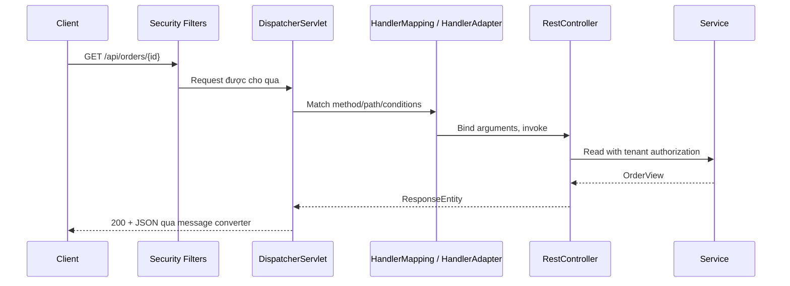

# @RestController, @RequestMapping và ánh xạ theo phương thức

## 1. Một URI không đồng nghĩa một hàm xử lý

REST API đơn hàng có thể cùng dùng `/api/orders` nhưng khác phương thức:

```http
GET    /api/orders?status=PAID
GET    /api/orders/o-123
POST   /api/orders
PUT    /api/orders/o-123
PATCH  /api/orders/o-123
DELETE /api/orders/o-123
```

Trong Spring MVC, **`@RestController`** biểu thị controller trả HTTP response body; **`@RequestMapping`** và các annotation chuyên biệt chọn handler theo **method, path và điều kiện request**. Spring **không suy HTTP method từ tên Java** như `createOrder`.

Bài thuộc chương **Spring MVC**, module **INTEGRATION_API_REST**, vận dụng tài nguyên/URI, HTTP methods/status, hợp đồng dữ liệu, phân trang, cache, idempotency, OpenAPI, bảo mật, lỗi và kiểm thử Java/Spring; trọng tâm là **cơ chế routing thực tế**, không lặp lại lý thuyết REST.

**Sau bài này:** phân biệt mapping với binding, thiết kế các `@Get/Post/Put/Patch/DeleteMapping` rõ ràng, xử lý `params/headers/consumes/produces`, status/header/validation, security và viết MockMvc tests cho cả lỗi 400/404/405/406/415.

## 2. Request được xử lý ở đâu?



`DispatcherServlet` điều phối, `RequestMappingHandlerMapping` thường chọn annotated handler, `RequestMappingHandlerAdapter` chuẩn bị/gọi method, còn `HttpMessageConverter` chuyển JSON ↔ Java DTO theo media type. Đây là sơ đồ khái niệm; trường hợp cụ thể còn có filters, exception handlers và các lớp framework.

**Security filters** có thể từ chối trước controller; mapping thành công **không** bảo đảm caller có quyền. Khi debug cần tách: route không khớp, bind/convert lỗi, validation lỗi, security từ chối hay service lỗi.

## 3. @RestController và @Controller

`@RestController` kết hợp `@Controller` và `@ResponseBody`: return value của handler được xử lý như **HTTP response body** thay vì mặc định coi `String` là tên view.

```java
@RestController
@RequestMapping("/api/health")
class HealthController {
    @GetMapping
    Map<String, String> health() {
        return Map.of("status", "UP");
    }
}
```

Với Jackson/converter JSON thích hợp, GET có thể trả `200`, `Content-Type: application/json` và `{"status":"UP"}`. **Không phải mọi return value đều thành JSON**: `String`, `byte[]`, `Resource` và `Accept`/`produces` có thể dẫn tới converter khác.

`@Controller` thường dùng cho view MVC, hoặc gắn `@ResponseBody` riêng khi cần trả body. Với REST API, ưu tiên DTO thay vì trả JPA entity trực tiếp để tránh lazy-loading, vòng tham chiếu và lộ trường nội bộ.

## 4. @RequestMapping kết hợp cấp lớp và method

`@RequestMapping` có các điều kiện:

| Thuộc tính | Match theo |
|---|---|
| `path`/`value` | URI pattern |
| `method` | HTTP method (`RequestMethod.GET`, v.v.) |
| `params` | Query param hiện diện, vắng hoặc bằng giá trị |
| `headers` | Header request |
| `consumes` | `Content-Type` của request body |
| `produces` | `Accept`/response media type |

```java
@RestController
@RequestMapping("/api/orders")
class OrderController {
    @GetMapping("/{orderId}")
    OrderView get(@PathVariable String orderId) {
        return service.findVisible(orderId);
    }

    @GetMapping
    List<OrderView> list() {
        return service.listVisible();
    }
}
```

Cấp lớp đặt prefix `/api/orders`; cấp method thêm `/{orderId}` và giới hạn GET. **Không dùng `@RequestMapping("/api/orders")` ở method tên `createOrder` rồi nghĩ nó tự chọn POST**: khi thiếu `method`, mapping có thể match nhiều phương thức.

Các điều kiện ở hai cấp có quy tắc kết hợp/ghi đè riêng, không giả định mọi thuộc tính đều cộng dồn như path; test request thực tế.

## 5. Annotation chuyên biệt theo HTTP method

| Annotation | HTTP method | Mục đích resource thường gặp |
|---|---|---|
| `@GetMapping` | GET | Đọc resource/collection |
| `@PostMapping` | POST | Tạo resource/submit operation |
| `@PutMapping` | PUT | Đặt/thay thế state |
| `@PatchMapping` | PATCH | Cập nhật từng phần |
| `@DeleteMapping` | DELETE | Xóa/revoke theo hợp đồng |

```java
@GetMapping("/{id}")     // read
@PostMapping             // create
@PutMapping("/{id}")     // replace
@PatchMapping("/{id}")   // partial update
@DeleteMapping("/{id}")  // remove
```

Các dòng trên **chỉ là ví dụ annotation** đứng trước chữ ký handler tương ứng, không phải code độc lập để biên dịch. Có thể dùng `@RequestMapping(method = RequestMethod.GET)`, nhưng shortcut dễ đọc và giảm nguy cơ quên method.

Chọn annotation đúng **không tự tạo** idempotency, authorization hay status chuẩn: service và tests vẫn chịu trách nhiệm giữ ngữ nghĩa HTTP.

## 6. Ví dụ Spring MVC có đầy đủ HTTP status và body

Ví dụ sau minh họa hai operation: **đọc một đơn** và **tạo đơn**. Dùng Java 17+ với Spring MVC, Jakarta Validation và các kiểu business do ứng dụng định nghĩa.

```java
import java.net.URI;
import java.util.List;
import java.util.UUID;
import jakarta.validation.Valid;
import jakarta.validation.constraints.*;
import org.springframework.http.MediaType;
import org.springframework.http.ResponseEntity;
import org.springframework.security.core.Authentication;
import org.springframework.web.bind.annotation.*;

record OrderLineRequest(@NotBlank String sku, @Min(1) int quantity) {}
record CreateOrderRequest(
    @NotBlank String customerId,
    @NotEmpty List<@Valid OrderLineRequest> items
) {}
record OrderView(UUID id, String status, long totalMinor, String currency) {}

@RestController
@RequestMapping("/api/orders")
class OrderController {
    private final OrderService orders;

    OrderController(OrderService orders) {
        this.orders = orders;
    }

    @GetMapping(path = "/{orderId}", produces = MediaType.APPLICATION_JSON_VALUE)
    ResponseEntity<OrderView> get(
            @PathVariable UUID orderId,
            Authentication principal) {
        OrderView view = orders.findVisible(principal, orderId);
        return ResponseEntity.ok(view);
    }

    @PostMapping(consumes = MediaType.APPLICATION_JSON_VALUE,
                 produces = MediaType.APPLICATION_JSON_VALUE)
    ResponseEntity<OrderView> create(
            @Valid @RequestBody CreateOrderRequest request,
            @RequestHeader("Idempotency-Key") String key,
            Authentication principal) {

        OrderView created =
            orders.createAuthorizedIdempotently(principal, key, request);

        URI uri = URI.create("/api/orders/" + created.id());
        return ResponseEntity.created(uri).body(created);
    }
}
```

`OrderService` cần được định nghĩa riêng: hàm đọc phải kiểm tra quyền với `principal`; hàm tạo phải xác thực khách hàng thuộc phạm vi quyền và bảo vệ request lặp theo key. `UUID` của resource ID an toàn để ghép path theo cách đơn giản này; với ID đến từ dữ liệu tùy ý, phải **encode URI segment** đúng cách, tránh tự ghép chuỗi chứa `/`, `?` hoặc `#`.

**Kết quả HTTP mong đợi:**

```http
POST /api/orders HTTP/1.1
Content-Type: application/json
Accept: application/json
Idempotency-Key: checkout-20261118-001

{"customerId":"c-12","items":[{"sku":"S-1","quantity":2}]}
```

```http
HTTP/1.1 201 Created
Location: /api/orders/4f6ac24b-398b-40be-8722-7cba57273c45
Content-Type: application/json

{"id":"4f6ac24b-398b-40be-8722-7cba57273c45",
 "status":"PENDING","totalMinor":850000,"currency":"VND"}
```

**Chú ý:** response ví dụ giả định identity đã được xác thực, có quyền tạo đơn và key hợp lệ. Trong project thật, những trường hợp không được phép phải nhận 401/403 theo chính sách, không được tạo đơn.

### Location tương đối có được không?

Header `Location` theo HTTP có thể chứa một URI reference, bao gồm relative reference. Trong môi trường phía sau gateway/reverse proxy, đường dẫn tương đối như `/api/orders/{uuid}` tránh việc ghép host sai từ proxy không tin cậy. Nếu trả absolute URL, phải xây từ base URL cấu hình/tin cậy và kiểm tra forwarded headers; không tin mù `Host` hoặc `X-Forwarded-Host` do client giả mạo.

## 7. Điều kiện chọn handler khác binding tham số

```java
@GetMapping("/api/products")
List<ProductView> search(
        @RequestParam(required = false) String category,
        @RequestParam(defaultValue = "20") int size) {
    return service.search(category, size);
}
```

`@RequestParam` **bind** query string vào Java parameter; nó không tự hạn chế routing vào request có `category`.

```java
@GetMapping(path = "/api/products", params = "category")
List<ProductView> byCategory(@RequestParam String category) {
    return service.byCategory(category);
}
```

`params = "category"` là điều kiện **match** request. Các dạng `params = "!q"` hoặc `params = "mode=full"` phân biệt request không có q hoặc có giá trị cụ thể. Tương tự, `@RequestHeader` để bind header, còn `headers = "X-Api-Mode=preview"` là điều kiện routing.

**Ưu tiên ít handlers rõ ràng** cho một resource+method, xử lý filter qua service; tách handlers theo params/headers khi contract thật sự có nhiều biến thể khác nhau.

## 8. PathVariable, RequestParam, RequestHeader và RequestBody

| Thành phần request | Annotation | Ví dụ |
|---|---|---|
| Đoạn URI | `@PathVariable` | `/{orderId}` → `UUID orderId` |
| Query | `@RequestParam` | `?page=0&size=20` |
| Header | `@RequestHeader` | `Idempotency-Key` |
| JSON body | `@RequestBody` | JSON → `CreateOrderRequest` |
| Form hoặc query object | `@ModelAttribute` | Form fields → object |

```java
@GetMapping(path = "/api/orders", produces = "application/json")
PageView<OrderView> list(
        @RequestParam(defaultValue = "0") @Min(0) int page,
        @RequestParam(defaultValue = "20") @Min(1) @Max(100) int size,
        @RequestParam(required = false) String status,
        Authentication principal) {
    return orders.listVisible(principal, page, size, status);
}
```

`@Min`/`@Max` trên method parameters cần **method validation được hỗ trợ/kích hoạt đúng với phiên bản Spring và Jakarta Validation**; kiểm tra bằng HTTP tests, không chỉ nhìn annotations. `@RequestBody` cần converter JSON. Body sai cú pháp/thiếu field bắt buộc thường là **400**, media type không hỗ trợ thường là **415**.

`@ModelAttribute` thường bind form/query, **không thay `@RequestBody` cho JSON**. Nên khai báo annotation tường minh để người đọc biết dữ liệu đến từ đâu.

## 9. consumes và produces: Content-Type khác Accept

Hai header dễ bị nhầm:

- **`Content-Type` của request:** mô tả **dữ liệu client gửi tới server**.
- **`Accept` của request:** diễn tả **dạng response client chấp nhận**.

Ví dụ handler:

```java
@PostMapping(
    path = "/api/orders",
    consumes = MediaType.APPLICATION_JSON_VALUE,
    produces = MediaType.APPLICATION_JSON_VALUE)
ResponseEntity<OrderView> create(@RequestBody CreateOrderRequest body) {
    // ...
}
```

| Request | Kết quả thường gặp |
|---|---|
| `Content-Type: application/json` và `Accept: application/json` | Có thể khớp handler |
| Body XML và `Content-Type: application/xml`, handler chỉ consumes JSON | **415** khi media type request không được hỗ trợ |
| `Accept: application/xml`, handler chỉ produces JSON | **406** nếu không có representation phù hợp |
| `Accept: */*` | JSON có thể được chấp nhận |
| JSON sai cú pháp nhưng media type đúng | Thường **400** do message conversion |

**`consumes` và `produces` là điều kiện mapping**, có ảnh hưởng chọn handler; nhưng message converters và error handling vẫn quyết định có thể đọc/ghi body thực tế hay không. Nếu cần hỗ trợ `application/hal+json` hay dạng khác, phải công bố đúng representation và kiểm thử negotiation, không tự dùng JSON chung cho mọi media type.

## 10. Trùng mapping và chọn handler cụ thể

Spring so khớp method/path/conditions rồi chọn mapping phù hợp theo luật framework, **không theo thứ tự khai báo method Java**.

```java
@GetMapping("/api/orders")
List<OrderView> list() { /* ... */ }

@GetMapping("/api/orders/{id}")
OrderView read(@PathVariable UUID id) { /* ... */ }

@GetMapping("/api/orders/search")
List<OrderView> search(@RequestParam String q) { /* ... */ }
```

Đây là **đoạn minh họa routing**, các body chưa có return thực. Pattern literal `/search` thường cụ thể hơn `/{id}`; vẫn cần test các path đặc biệt.

**Lỗi:** hai `@GetMapping("/api/orders/{id}")` và `@GetMapping("/api/orders/{orderId}")` có cùng hình dạng mặc dù tên path variable khác; có thể gây **ambiguous mapping**. Kiểu `UUID` của Java parameter không tự phân biệt handler trong bước routing.

Đừng gắn nhiều shortcut mapping annotations lên cùng một method rồi kỳ vọng nhiều route hợp lệ. Nếu cần nhiều HTTP methods, khai báo `@RequestMapping(method = {...})` rõ ràng; thường vẫn nên tách handler theo ý định.

## 11. 404, 405, 406, 415 và 400 khác nhau

| Status | Tình huống |
|---|---|
| `404 Not Found` | Không có route hoặc resource không tìm thấy/không được tiết lộ |
| `405 Method Not Allowed` | URI pattern có mapping nhưng HTTP method không được hỗ trợ |
| `406 Not Acceptable` | Không thể trả representation hợp `Accept` |
| `415 Unsupported Media Type` | `Content-Type` request không được `consumes`/converter chấp nhận |
| `400 Bad Request` | Sai path/query conversion, JSON syntax hoặc validation |

Ví dụ `GET /api/orders/not-a-uuid` có thể match route `/{orderId}` rồi **400 do convert UUID**, chứ không phải 404 vì path không tồn tại. `GET /api/unknown` không có mapping sẽ thường là 404; `GET /api/orders/{valid-uuid}` có thể match nhưng service trả business 404.

Filter/security/gateway có thể từ chối trước MVC, nên **không suy toàn bộ đường xử lý chỉ từ status**. Test mapping ở MVC và test end-to-end qua security stack để phân biệt nguyên nhân.

## 12. HEAD và OPTIONS

Với `@GetMapping`, Spring MVC có cơ chế hỗ trợ **HEAD** theo ngữ nghĩa GET mà không gửi body. Spring cũng có thể xử lý **OPTIONS/Allow** từ thông tin mapping; browser CORS preflight còn chịu CORS/security policy.

- **HEAD** trả metadata tương đương GET khi phù hợp, nhưng không body.
- **OPTIONS** giúp khám phá phương thức/tiền kiểm; `Allow` không mô tả quyền cụ thể của từng người dùng.
- Security filters, gateway và CDN có thể thay đổi kết quả; test theo đường request thật.
- Không dùng GET gây side effect nghiệp vụ rồi trông chờ chặn HEAD/crawler/prefetch để an toàn.

## 13. Trả status/header/body bằng ResponseEntity

`@RestController` trả DTO thành công thường cho `200`, nhưng POST resource thường cần `201 + Location`, DELETE thành công có thể `204`:

```java
@PostMapping("/api/orders")
ResponseEntity<OrderView> create(@RequestBody CreateOrderRequest body) {
    OrderView saved = service.create(body);
    return ResponseEntity
        .created(URI.create("/api/orders/" + saved.id()))
        .body(saved);
}

@DeleteMapping("/api/orders/{id}")
ResponseEntity<Void> delete(@PathVariable UUID id) {
    service.deleteAuthorized(id);
    return ResponseEntity.noContent().build();
}
```

| Cách trả | Sử dụng |
|---|---|
| `ResponseEntity<T>` | Kiểm soát status/header/body theo kết quả |
| `@ResponseStatus` | Status cố định |
| `ResponseStatusException` | HTTP error đơn giản |
| `@ExceptionHandler`/`@RestControllerAdvice` | Chuẩn hóa lỗi chung |

`204 No Content` **không có body**. `202 Accepted` khác `201`: mới tiếp nhận xử lý chứ chưa bảo đảm xong. Đừng dùng 200 cho mọi lỗi vì client/gateway cần status thật.

## 14. Validation và lỗi HTTP thống nhất

`@Valid @RequestBody` kích hoạt Bean Validation với dependency/cấu hình phù hợp. Request sai có thể gây `MethodArgumentNotValidException`; API nên trả **400** và error response an toàn.

```java
import org.springframework.http.HttpStatus;
import org.springframework.http.ProblemDetail;
import org.springframework.web.bind.MethodArgumentNotValidException;
import org.springframework.web.bind.annotation.ExceptionHandler;
import org.springframework.web.bind.annotation.RestControllerAdvice;

@RestControllerAdvice
class ApiErrors {
    @ExceptionHandler(MethodArgumentNotValidException.class)
    ProblemDetail badRequest(MethodArgumentNotValidException ex) {
        ProblemDetail p = ProblemDetail.forStatus(HttpStatus.BAD_REQUEST);
        p.setTitle("Invalid request");
        p.setDetail("Một hoặc nhiều trường không hợp lệ.");
        p.setProperty("code", "VALIDATION_FAILED");
        return p;
    }
}
```

`ProblemDetail` trong Spring 6+/Boot 3.x hỗ trợ Problem Details; **`application/problem+json` phải được kiểm tra bằng integration test** với converter/config thực tế. `code` là extension ứng dụng. Không trả stack trace, SQL hay PII.

`@RestControllerAdvice` không thay cơ chế entry point/access denied của **security filter chain**; lỗi 401/403 có thể đến trước controller.

## 15. Bảo mật: routing không phải authorization

Ví dụ:

```java
@GetMapping("/api/orders/{id}")
OrderView get(@PathVariable UUID id) {
    return service.findById(id);
}
```

Mapping đúng vẫn có thể gây **IDOR/BOLA** (broken object-level authorization): người dùng A đoán `id` của đơn B rồi đọc được dữ liệu.

Cách thiết kế:

1. Dùng Spring Security để xác thực request theo policy.
2. Service xác định tenant/principal **từ identity đã xác thực**, không tin `tenantId` do client tùy ý gửi.
3. Truy vấn resource với ràng buộc ownership/tenant, không chỉ `findById`.
4. Phân biệt `401`, `403`, `404` theo chính sách bảo mật và hợp đồng.
5. Kiểm soát scope/role ở operation và ownership ở resource; không cho phép một quyền rộng bỏ qua kiểm tra tenant.

Ví dụ authorization method nếu đã bật method security:

```java
@PreAuthorize("hasAuthority('SCOPE_orders:read')")
@GetMapping("/{orderId}")
ResponseEntity<OrderView> get(
        @PathVariable UUID orderId,
        Authentication principal) {
    return ResponseEntity.ok(
        orders.findVisible(principal, orderId)
    );
}
```

**`@PreAuthorize` chỉ được enforce khi method security được cấu hình**, ví dụ `@EnableMethodSecurity` và những thành phần liên quan. Có scope đọc **chưa** đồng nghĩa có quyền xem một `orderId` bất kỳ; `findVisible` vẫn phải kiểm tra ownership/tenant.

### CORS/CSRF/rate limiting không phải request mapping

- **CORS**: `@CrossOrigin` hoặc CORS configuration là chính sách browser cross-origin; **không phải** cơ chế phân quyền resource. Với Spring Security, cấu hình CORS cần phối hợp security filter chain đúng cách để preflight không bị từ chối sai.
- **CSRF**: khi trình duyệt dùng session/cookie tự động gửi, cần xem chính sách CSRF phù hợp; không tắt chỉ vì API là REST. Với stateless bearer authentication, thiết kế CSRF khác nhưng vẫn cần phân tích bề mặt tấn công thực tế.
- **Rate limiting**: bảo vệ số request của client/quota; mapping không tự giới hạn tốc độ.
- **Input validation**: ngăn dữ liệu không hợp lệ, nhưng không thay authentication/authorization.
- **Host và forwarded headers**: khi sinh `Location` hoặc redirect, chỉ tin proxy/header đã được cấu hình đáng tin cậy.

## 16. OpenAPI mô tả mapping, không thay thế runtime

Với springdoc-openapi hoặc công cụ tương đương, `@Operation`/`@ApiResponse` giúp mô tả controller:

```java
@Operation(summary = "Lấy chi tiết đơn hàng", operationId = "getOrder")
@ApiResponse(responseCode = "200", description = "Order found")
@ApiResponse(responseCode = "404", description = "Order not visible")
@GetMapping("/{orderId}")
ResponseEntity<OrderView> get(@PathVariable UUID orderId, Authentication user) {
    return ResponseEntity.ok(orders.findVisible(user, orderId));
}
```

Đây là fragment cần imports và controller class/service. `@ApiResponse(404)` **không tạo 404 thật**; `@SecurityRequirement` không kích hoạt Spring Security.

Khi review spec, so method/path, `params`/`headers`/`consumes`/`produces`, required/default/validation, status/header và security với **HTTP response thật**. Endpoint tài liệu `/v3/api-docs` trả 200 không chứng minh controller đã tuân contract.

## 17. Test mapping bằng MockMvc: không chỉ happy path

`MockMvc` gọi vào Spring MVC test infrastructure để kiểm tra routing, binding, validation và response. Tùy cách dựng test, Spring Security filter chain có thể được gắn hoặc không. Với API bảo mật, phải **bật/kiểm thử đúng filter chain** hoặc chạy integration test gần production.

Các ví dụ dưới giả định có `mockMvc`, controller/service fixture, Security test support và ID hợp lệ:

```java
import static org.springframework.test.web.servlet.request.MockMvcRequestBuilders.*;
import static org.springframework.test.web.servlet.result.MockMvcResultMatchers.*;
import static org.springframework.security.test.web.servlet.request
    .SecurityMockMvcRequestPostProcessors.*;

String id = "4f6ac24b-398b-40be-8722-7cba57273c45";

mockMvc.perform(get("/api/orders/{id}", id)
        .with(user("alice").authorities(
            new SimpleGrantedAuthority("SCOPE_orders:read")))
        .accept("application/json"))
    .andExpect(status().isOk())
    .andExpect(content().contentTypeCompatibleWith("application/json"))
    .andExpect(jsonPath("$.id").value(id));

mockMvc.perform(post("/api/orders")
        .with(user("alice"))
        .with(csrf())
        .contentType("application/json")
        .accept("application/json")
        .header("Idempotency-Key", "checkout-20261118-002")
        .content("""
          {"customerId":"c-12",
           "items":[{"sku":"S-1","quantity":2}]}
        """))
    .andExpect(status().isCreated())
    .andExpect(header().exists("Location"));
```

`SimpleGrantedAuthority` cần import `org.springframework.security.core.authority.SimpleGrantedAuthority`. Với ứng dụng JWT resource server, fixture JWT/claims nên phù hợp security configuration; `user("alice")` không tự mô phỏng một token JWT thật. `.with(csrf())` chỉ minh họa khi policy CSRF cần thiết, không bảo đảm mọi hệ thống có cấu hình giống nhau.

### Những test mapping âm tính tối thiểu

| Request | Kỳ vọng khi cấu hình như ví dụ |
|---|---|
| `GET /api/orders/{uuid}` | `200` hoặc 404 khi không có quyền/thực thể |
| `POST /api/orders` JSON hợp lệ, đủ quyền | `201 + Location` |
| `POST` body thiếu `items` | Thường `400` do validation |
| `POST` với `Content-Type: text/plain` | `415` nếu consumes chỉ JSON |
| `GET /api/orders/{uuid}` với `Accept: application/xml` | `406` nếu chỉ produces JSON |
| `PUT /api/orders/{uuid}` khi controller chưa khai báo PUT | `405` trên path tương ứng |
| `GET /api/orders/not-a-uuid` | Thường `400` do convert path |
| GET user B với order của user A | Không bao giờ trả body của A |
| Không authentication khi required | `401` theo security configuration |
| `OPTIONS` preflight hợp lệ | CORS headers đúng nếu route/policy cho phép |

Khi viết test, đừng hardcode “405 luôn luôn” nếu security/gateway cố ý từ chối request trước MVC hoặc route khác cùng path xử lý method đó. **Tách unit MVC mapping tests và full-chain security/integration tests** cho kết luận đáng tin cậy.

## 18. Phản mẫu Spring MVC thường gặp

| Phản mẫu | Sửa bằng |
|---|---|
| `@RequestMapping` thiếu method, dựa vào tên Java | `@GetMapping`/`@PostMapping` rõ ràng |
| URI theo tên hàm `/getOrder`/`/createOrder` | Resource URI + HTTP method |
| Nhầm `@RequestParam` là mapping condition | `params` nếu cần chọn handler |
| Serialize JPA entity | DTO/representation riêng |
| Dùng POST cho mọi thao tác | Chọn method theo HTTP semantics |
| GET có side effect | Chuyển operation gây thay đổi sang method đúng |
| Quên `@Valid` hoặc kiểm tra tenant | Validation + authorization ở service |
| Mappings trùng path/method | Kiểm tra ambiguous routes, MockMvc tests |
| Không giới hạn `consumes`/`produces` khi hỗ trợ nhiều kiểu | Test Content-Type và Accept |
| Trả 200 cho mọi lỗi | Dùng status và Problem Details |
| Chỉ khai báo OpenAPI security | Enforce Spring Security thật |
| Ghép Location từ host không tin cậy | Trusted proxy/base URL hoặc relative Location |

**Kiểm tra mapping + security + body thật**, không kết luận từ annotations đơn lẻ.

## 19. Bài thực hành: sửa một controller REST sai mapping

### Mã nguồn cần cải tiến

```java
@RestController
@RequestMapping("/api/order")
class BadOrderController {
    @RequestMapping("/get")
    OrderEntity get(String id) { return repository.findById(id).orElse(null); }

    @RequestMapping("/create")
    OrderEntity create(OrderEntity input) { return repository.save(input); }
}
```

Mã trên cố ý có nhiều vấn đề: path theo tên hàm, method không được chỉ định, không binding rõ, trả JPA entity, không validation, authentication/authorization, status và Location không rõ.

### Nhiệm vụ

1. Thiết kế lại endpoint `GET /api/orders/{orderId}` và `POST /api/orders`, bổ sung `@RestController`, `@RequestMapping` cấp lớp, `@GetMapping`/`@PostMapping`.
2. Đổi entity sang `OrderView` và `CreateOrderRequest` có `@Valid`. POST phải trả `201 Created` với `Location`; GET trả 200 hoặc 404 theo policy.
3. Thêm một query API `GET /api/orders?status=PAID&page=0&size=20`; phân biệt `@RequestParam` với `params` condition.
4. Viết hai ví dụ request HTTP: JSON đúng và sai `Content-Type`. Dự đoán 201/415 và lý do.
5. Thiết kế 401/403/404 theo nguyên tắc **owner/tenant**; test user A không đọc được đơn B.
6. Viết ít nhất **sáu MockMvc tests**, trong đó có method mismatch, JSON validation, Accept/Content-Type, Location và phân quyền.
7. Cân nhắc yêu cầu chống tạo đơn trùng sau client retry: `Idempotency-Key` cần xử lý ở **service**, không chỉ bind một header.

### Gợi ý lời giải

```java
@RestController
@RequestMapping("/api/orders")
class OrderResource {
    @GetMapping("/{id}")
    ResponseEntity<OrderView> get(@PathVariable UUID id, Authentication user) {
        return ResponseEntity.ok(service.findVisible(user, id));
    }

    @PostMapping(consumes = "application/json", produces = "application/json")
    ResponseEntity<OrderView> create(
            @Valid @RequestBody CreateOrderRequest body,
            @RequestHeader("Idempotency-Key") String key,
            Authentication user) {
        OrderView saved = service.createAuthorizedIdempotently(user, key, body);
        return ResponseEntity.created(
            URI.create("/api/orders/" + saved.id())
        ).body(saved);
    }
}
```

Đây là khung code để luyện tập; bổ sung imports, DTO, service, exception handling và security configuration theo project. Mục tiêu không chỉ làm request “vào được controller” mà phải giữ đúng **HTTP contract + quyền truy cập + khả năng kiểm thử**.

## 20. Checklist trước khi phát hành

- [ ] `@RestController` trả DTO/body theo media type mong đợi.
- [ ] `@RequestMapping` cấp lớp và mapping method tạo URI đúng, không trùng.
- [ ] `@Get/Post/Put/Patch/DeleteMapping` thể hiện đúng HTTP semantics.
- [ ] Binding `@PathVariable`, `@RequestParam`, `@RequestHeader`, `@RequestBody` rõ ràng và được validate.
- [ ] `params`/`headers` conditions khác với parameter binding; đã test nhánh đặc biệt.
- [ ] `consumes`, `produces`, converter và content negotiation đúng.
- [ ] Status/header/body đúng 200/201+Location/204, lỗi 400/404/405/406/415.
- [ ] Không trả entity nội bộ, không dùng GET gây side effect.
- [ ] Spring Security thực sự enforce auth/scope/tenant ownership; test A/B.
- [ ] MockMvc và integration tests chạy cả security filters/CORS/CSRF khi có.
- [ ] OpenAPI và runtime khớp, Location/forwarded headers được test qua gateway.

## 21. Kết luận

**`@RestController`** định hướng một lớp Spring MVC trả HTTP response body; **`@RequestMapping`** và các annotation chuyên biệt mô tả **request nào được ánh xạ tới handler nào**. Cơ chế chọn handler dựa vào method, path và các điều kiện `params`, `headers`, `consumes`, `produces` — **không** dựa vào tên hàm Java, và **không** tự bảo đảm quyền truy cập.

Muốn một REST API có thể vận hành an toàn, hãy kết hợp routing rõ ràng với DTO/validation, `ResponseEntity` cho status/header, Spring Security và authorization theo resource, error handling nhất quán, OpenAPI contract và **MockMvc/integration tests**. Khi đó code Spring không chỉ “nhận được HTTP request”, mà còn thể hiện đúng hợp đồng tài nguyên và phản hồi mà consumer có thể tin cậy.

