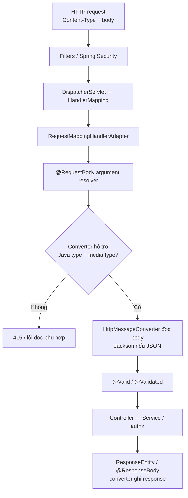

# @RequestBody và HttpMessageConverter

> **Chương:** Spring MVC  
> **Module:** `INTEGRATION_API_REST` — học thiết kế REST API theo resource, URI, HTTP methods/status codes và hợp đồng dữ liệu; thực hành xác thực, phân quyền, xử lý lỗi, OpenAPI và kiểm thử với Java/Spring.

Một client gửi `POST /api/orders` với `Content-Type: application/json` và body `{"productId":15,"quantity":2}`. Controller Java khai báo `@RequestBody CreateOrderRequest` nhưng **ai đọc bytes từ HTTP request, giải mã JSON, tạo DTO, áp validation và quyết định trả `400` hay `415` khi có lỗi?**

Trong **Spring MVC**, `@RequestBody` không phải JSON parser. Nó yêu cầu MVC lấy nội dung request và dùng một **`HttpMessageConverter` phù hợp với Java type và media type** để chuyển thành argument của controller. Phân biệt trách nhiệm này giúp thiết kế API chính xác, kiểm thử lỗi ở đúng tầng và tránh những lỗi deserialization âm thầm trở thành lỗ hổng bảo mật.

Bài học dùng Spring Boot 3 / Spring Framework 6 với JSON, Jackson và Jakarta Bean Validation. Một số hành vi mặc định thay đổi theo phiên bản và cấu hình; luôn kiểm chứng trên ứng dụng thực tế thay vì coi mọi ví dụ là luật chung cho tất cả converter.

## Mục tiêu học tập

Sau bài này, bạn có thể:

1. Mô tả đường đi từ HTTP body qua `DispatcherServlet`, argument resolver, converter đến DTO và response.
2. Chọn đúng `@RequestBody`, `@RequestParam`, `@ModelAttribute` hoặc `@RequestPart` theo vị trí và media type của dữ liệu.
3. Phân biệt `Content-Type`, `Accept`, `consumes`, `produces` và các mã lỗi `400`, `415`, `406`.
4. Áp dụng Jackson DTO, `@Valid`, Bean Validation và Problem Details mà không nhầm parse error với lỗi nghiệp vụ.
5. Thiết kế input DTO bảo mật: không mass assignment, không tin tenant ID từ body, giới hạn kích thước và kiểm soát polymorphic deserialization.
6. Viết MockMvc/integration tests cho JSON hợp lệ, body rỗng, kiểu sai, validation, media type, quyền truy cập và phản hồi.
7. Biết khi nào cần thay đổi cấu hình converter và vì sao không nên sửa converter toàn cục một cách tùy tiện.

## 1. Pipeline Spring MVC: từ bytes đến DTO



`@RequestBody` không phải JSON parser: Spring MVC thường dùng `RequestResponseBodyMethodProcessor` (argument resolver) chọn `HttpMessageConverter` để đọc body thành tham số Java. Với JSON, Jackson deserializer có thể được converter gọi; sau đó `@Valid` mới kiểm tra DTO. Nếu conversion/validation lỗi, controller thường **không được gọi**.

Chiều trả về diễn ra ngược lại: `@ResponseBody` hoặc `ResponseEntity` được converter ghi thành response bytes theo media type. `@RestController` mang semantics `@ResponseBody`. Routing (`consumes`/`produces`), security filters, exception handlers và converter registration ảnh hưởng đường đi thực tế.

**Điểm tách trách nhiệm:** HTTP routing chọn handler; converter giải mã/serialize; Bean Validation kiểm tra ràng buộc cấu trúc; service kiểm tra quyền và nghiệp vụ. JSON hợp lệ không chứng minh user được phép thay đổi resource.

## 2. Khi nào dùng @RequestBody thay vì annotation khác?

```http
POST /api/orders HTTP/1.1
Content-Type: application/json
Accept: application/json

{"productId":15,"quantity":2}
```

```java
@PostMapping(path="/api/orders", consumes="application/json")
ResponseEntity<?> create(@Valid @RequestBody CreateOrderRequest input) {
    return ResponseEntity.ok().build();
}
```

`@RequestBody(required=true)` là mặc định: body vắng thường gây `400 Bad Request`. `required=false` chỉ cho phép vắng body, **không** biến JSON hỏng thành hợp lệ.

| Annotation | Nguồn | Use case |
| --- | --- | --- |
| `@PathVariable` | URI path `/orders/{id}`. | Resource ID. |
| `@RequestParam` | Query/form request parameters. | `page`, `size`, filter. |
| `@ModelAttribute` | Request/form parameters gắn vào object. | Form HTML truyền thống. |
| **`@RequestBody`** | Body qua `HttpMessageConverter`. | JSON DTO của POST/PUT/PATCH. |
| `@RequestPart` | Một part trong multipart body. | File cùng metadata JSON. |
| `@ResponseBody` | **Ghi response body**. | Trả DTO/JSON, không đọc request. |

HTTP có **một body stream**; không khai báo hai `@RequestBody` để nhận hai JSON object độc lập. Với GET, đừng phụ thuộc request body để gửi filter: HTTP không định nghĩa ngữ nghĩa GET content phổ quát và nhiều client/proxy xử lý không nhất quán.

## 3. HttpMessageConverter lựa chọn converter như thế nào?

`HttpMessageConverter` đọc từ `HttpInputMessage` và ghi ra `HttpOutputMessage`; các khả năng `canRead`/`canWrite` dựa trên **target Java type**, **media type** và các converters đã được đăng ký. Thứ tự converters cũng có thể ảnh hưởng khi nhiều converter cùng hỗ trợ.

| Converter thông dụng | Đầu vào/đầu ra |
| --- | --- |
| `MappingJackson2HttpMessageConverter` | JSON ↔ object với Jackson; thường hỗ trợ `application/json`, `application/*+json`. |
| `StringHttpMessageConverter` | `String` ↔ text thô; không tự parse JSON object. |
| `ByteArrayHttpMessageConverter` | `byte[]` ↔ bytes; không có JSON validation. |
| `FormHttpMessageConverter` / `AllEncompassingFormHttpMessageConverter` | Form data và các hỗ trợ ghi multipart. |
| Converter XML nếu có dependency/cấu hình | XML ↔ object, cần kiểm soát an toàn parser. |

Danh sách thực phụ thuộc dependency và cấu hình Spring MVC. Không kết luận “Spring luôn dùng Jackson” hoặc mọi converter luôn được đăng ký.

```http
POST /api/orders HTTP/1.1
Content-Type: text/plain

{"productId":15,"quantity":2}
```

Body nhìn như JSON nhưng **không tự động được đọc như JSON** vào `CreateOrderRequest`. Endpoint `consumes=application/json` phải từ chối media type không phù hợp (`415`). Dùng DTO cụ thể thay vì `Map<String,Object>` để giữ schema, validation và type safety. `@RequestBody String` thường lấy text thô qua String converter; `JsonNode` phù hợp hơn khi cần xử lý JSON động có kiểm soát.

## 4. Content-Type, Accept, consumes và produces

Cần phân biệt hai chiều của HTTP content negotiation:

- **`Content-Type` của request:** cho biết **client đang gửi loại dữ liệu gì**.
- **`Accept` của request:** cho biết **client có thể nhận những kiểu representation nào**.
- **`consumes`:** mapping Spring MVC giới hạn media type mà endpoint **nhận**.
- **`produces`:** mapping Spring MVC giới hạn media type mà endpoint **có thể trả**.

```java
@PostMapping(
    path = "/api/orders",
    consumes = MediaType.APPLICATION_JSON_VALUE,
    produces = MediaType.APPLICATION_JSON_VALUE
)
ResponseEntity<OrderView> create(
        @Valid @RequestBody CreateOrderRequest body) {
    return ResponseEntity.ok(new OrderView(42, "NEW"));
}
```

| Request | Điều gì xảy ra | Status điển hình |
| --- | --- | --- |
| `Content-Type: application/json`, JSON đúng kiểu và hợp lệ. | Converter đọc DTO, controller xử lý. | `200/201` tùy contract. |
| `Content-Type: text/plain` với body trông như JSON. | `consumes` không khớp hoặc converter không đọc được kiểu đích. | **415**. |
| `Content-Type: application/json` nhưng JSON thiếu dấu đóng. | Media type hỗ trợ, Jackson parse lỗi. | **400**. |
| JSON đúng cú pháp nhưng `quantity` là object thay vì integer. | Deserialization/type binding lỗi. | **400** trong nhiều cấu hình. |
| JSON parse được nhưng `quantity=0`, vi phạm `@Min(1)`. | Bean Validation thất bại. | **400** mặc định thông dụng; có thể tùy chỉnh **422** theo contract. |
| `Accept: text/plain` nhưng endpoint chỉ `produces=application/json`. | Không có representation response phù hợp. | **406 Not Acceptable**. |
| Body vắng khi `@RequestBody(required=true)`. | Không có nội dung cần thiết để bind. | **400** thông thường. |
| Thiếu xác thực hoặc bị từ chối quyền. | Security có thể xử lý **trước** converter. | **401/403**, không nhất thiết thấy 400/415 trước. |

`406` nói về **khả năng tạo response theo `Accept`**, còn `415` nói về **request payload media type**. Đừng nhầm vì cả hai đều có chữ “media type”. Việc khách hàng gửi `Accept: application/json` **không thay thế** `Content-Type: application/json`.

Một endpoint nhận JSON nhưng trả `204 No Content` không nhất thiết phát JSON body; `produces` cần thiết kế theo response thực, tránh khai báo media type không phù hợp. Các handler lỗi có thể trả `application/problem+json` ngay cả khi response thành công dùng `application/json`, nhưng phải tuân negotiation và error contract của ứng dụng.

## 5. Java/Spring: dùng DTO tách biệt entity và validation

Giả sử tạo đơn hàng bằng `POST /api/orders`. Controller nên nhận **request DTO** dành riêng cho API, không deserialize trực tiếp entity JPA mang các field nhạy cảm như `tenantId`, `ownerId` hoặc `status`.

```java
import jakarta.validation.Valid;
import jakarta.validation.constraints.*;
import org.springframework.http.*;
import org.springframework.web.bind.annotation.*;
import java.net.URI;
import java.security.Principal;

record CreateOrderRequest(
    @NotNull @Positive Long productId,
    @NotNull @Min(1) @Max(100) Integer quantity,
    @Size(max = 500) String note
) {}

record OrderView(long id, String status, long totalMinor) {}

interface OrderService {
    // Service xác minh principal, tenant và business invariants.
    OrderView createAuthorized(String principalName, CreateOrderRequest input);
}

@RestController
@RequestMapping("/api/orders")
class OrderController {
    private final OrderService service;

    OrderController(OrderService service) {
        this.service = service;
    }

    @PostMapping(
        consumes = MediaType.APPLICATION_JSON_VALUE,
        produces = MediaType.APPLICATION_JSON_VALUE
    )
    ResponseEntity<OrderView> create(
            Principal principal,
            @Valid @RequestBody CreateOrderRequest input) {
        OrderView created =
            service.createAuthorized(principal.getName(), input);

        return ResponseEntity
            .created(URI.create("/api/orders/" + created.id()))
            .body(created);
    }
}
```

Đây là **skeleton có chủ đích**: chưa có implementation service, security filters, exception handlers và persistence. Với Spring Security, `Principal` phải là danh tính đã được xác minh; không được tin giá trị `userId` hoặc `tenantId` do client tự gửi trong body để quyết định quyền.

### Kiểm tra cấu trúc và semantics riêng

`@Valid` kích hoạt Bean Validation cho DTO nếu ứng dụng có provider tương ứng (thường qua `spring-boot-starter-validation`). Nó có thể kiểm tra `@NotNull`, `@Min`, `@Max`, `@Size`. Nhưng:

- `@NotNull` chỉ bắt null; `@NotBlank` phù hợp hơn với chuỗi bắt buộc không được blank.
- `@Min(1)` không đủ cho `Integer` vắng vì nhiều constraint chấp nhận null; kết hợp `@NotNull`.
- `@Valid` không kiểm tra sản phẩm đã hết hàng hay người gọi có quyền tạo đơn; đây là **service/domain validation**.
- Record/DTO nhận được dữ liệu sau Jackson conversion; nếu JSON sai kiểu, Bean Validation có thể **chưa chạy** vì conversion đã thất bại.
- Nếu schema OpenAPI đánh dấu `additionalProperties: false`, runtime phải được cấu hình hoặc validate tương ứng: nhiều cấu hình Jackson/Spring Boot **có thể bỏ qua unknown properties**.

Một request hợp lệ về JSON:

```http
POST /api/orders HTTP/1.1
Content-Type: application/json
Accept: application/json

{"productId":15,"quantity":2,"note":"Giao giờ hành chính"}
```

Response nếu tạo thành công:

```http
HTTP/1.1 201 Created
Location: /api/orders/42
Content-Type: application/json

{"id":42,"status":"NEW","totalMinor":259000}
```

`Location` phải trỏ tới tài nguyên thực tế, không phát ID đoán trước nếu chưa commit. Trả `201` là quyết định của controller/business logic sau khi tạo resource; **converter không tự tạo `201`** chỉ vì Java trả một DTO.

## 6. Jackson: tên trường, null, coercion và type safety

| JSON đầu vào | Điều cần kiểm tra |
| --- | --- |
| `{"quantity":"2"}` | Có chấp nhận string → integer không? Jackson coercion phụ thuộc cấu hình. |
| `{"quantity":2.5}` | Không được âm thầm mất phần lẻ nếu contract đòi integer. |
| `{"quantity":null}` hoặc thiếu field | `@Min` không thay `@NotNull`; phân biệt null/absent theo nghiệp vụ. |
| `{"quantity":2,"role":"ADMIN"}` | Field lạ bị từ chối hay bỏ qua? Không mass assign. |
| `{"quantity":2,"quantity":9}` | Duplicate keys: parser/config cần quy tắc rõ, test không dựa thứ tự. |
| `{"createdAt":"2026-11-18T09:00:00Z"}` | Mapping `Instant`/timezone và serialization thống nhất. |

```java
import com.fasterxml.jackson.annotation.JsonProperty;
import com.fasterxml.jackson.annotation.JsonAlias;
import jakarta.validation.constraints.NotBlank;

record RenameUserRequest(
    @JsonProperty("displayName")
    @JsonAlias("name")
    @NotBlank String displayName
) {}
```

`@JsonAlias` giúp **đọc tên cũ**; nó không tự phát cả hai tên khi serialize response. Nếu client gửi cả hai alias và tên mới, dùng chính sách rõ để tránh chọn theo thứ tự JSON. `@JsonIgnore`, `@JsonView`, naming strategy hay module thời gian cũng có thể làm JSON khác property Java.

OpenAPI `additionalProperties:false` không tự buộc Jackson từ chối unknown fields: phải có cấu hình/runtime validation tương ứng. Tránh bật polymorphic default typing không an toàn với dữ liệu không đáng tin. Mọi thay đổi mapper toàn cục cần regression tests cho DTO cũ.

## 7. Bean Validation được gọi khi nào?

Pipeline cho DTO đơn giản:

```text
JSON syntax/tokenization
  → Jackson binding to CreateOrderRequest
  → Bean Validation (@Valid)
  → Controller method
  → Service authorization + business checks
  → Response mapping
```

Nếu JSON không parse được, argument chưa hình thành đúng, nên không có ý nghĩa kỳ vọng `@Min` xử lý lỗi đó. Cần phân loại rõ:

| Lớp lỗi | Ví dụ | Exception Spring MVC thường gặp | Status mặc định thường gặp |
| --- | --- | --- | --- |
| Body vắng hoặc JSON không đọc được. | `{"quantity":` | `HttpMessageNotReadableException` | **400** |
| JSON có type không bind được. | Object thay cho integer. | `HttpMessageNotReadableException` | **400** |
| DTO bind được nhưng vi phạm constraint. | `quantity=0`. | `MethodArgumentNotValidException` cho `@Valid @RequestBody` phổ biến. | **400** |
| Media type request không hỗ trợ. | `text/plain` khi chỉ JSON. | `HttpMediaTypeNotSupportedException` / mapping không phù hợp. | **415** |
| Client không chấp nhận response. | `Accept: text/plain` khi chỉ JSON. | `HttpMediaTypeNotAcceptableException` / negotiation. | **406** |
| Trạng thái nghiệp vụ không cho tạo. | Hết kho, đơn đã khóa. | Exception của domain/service. | **409/422** theo contract |
| Không có quyền với resource. | Caller truy cập tenant khác. | Security/authorization exception. | **401/403/404** theo policy |

Spring MVC có thể hỗ trợ method validation theo các cơ chế và exception khác nhau giữa các phiên bản, đặc biệt khi thêm constraint trực tiếp vào tham số controller. Bài này tập trung vào `@Valid @RequestBody`; đừng giả định một exception class bao trùm mọi dạng validation.

**`400` so với `422`:** Spring MVC mặc định thường dùng `400` cho lỗi đọc/bind và Bean Validation ở body. Nếu API công bố `422 Unprocessable Content` cho validation nghiệp vụ hoặc field-level, phải ánh xạ exception **có chủ ý** và đảm bảo OpenAPI, tests, SDK thống nhất. Không chuyển **JSON sai cú pháp** thành `422` chỉ vì mong mọi lỗi body có cùng mã.

## 8. Trả lỗi nhất quán với Problem Details

Spring Framework 6 cung cấp `ProblemDetail` để thể hiện thông tin lỗi (RFC 9457). Tầng exception handler có thể trả lỗi có `code` ứng dụng ổn định mà không lộ stack trace hay giá trị nhạy cảm.

Ví dụ `@RestControllerAdvice`:

```java
import java.net.URI;
import org.springframework.http.*;
import org.springframework.http.converter.HttpMessageNotReadableException;
import org.springframework.web.HttpMediaTypeNotSupportedException;
import org.springframework.web.bind.MethodArgumentNotValidException;
import org.springframework.web.bind.annotation.*;

@RestControllerAdvice
class ApiBodyErrors {
    private ResponseEntity<ProblemDetail> problem(
            HttpStatus status, String code, String detail) {
        ProblemDetail pd = ProblemDetail.forStatusAndDetail(status, detail);
        pd.setType(URI.create("https://api.example.test/problems/" + code));
        pd.setTitle(status.getReasonPhrase());
        pd.setProperty("code", code);

        return ResponseEntity.status(status)
            .cacheControl(CacheControl.noStore())
            .contentType(MediaType.APPLICATION_PROBLEM_JSON)
            .body(pd);
    }

    @ExceptionHandler(HttpMessageNotReadableException.class)
    ResponseEntity<ProblemDetail> invalidBody() {
        return problem(HttpStatus.BAD_REQUEST,
            "INVALID_JSON_BODY", "Request body cannot be read.");
    }

    @ExceptionHandler(MethodArgumentNotValidException.class)
    ResponseEntity<ProblemDetail> invalidFields() {
        return problem(HttpStatus.BAD_REQUEST,
            "VALIDATION_FAILED", "Request fields are invalid.");
    }

    @ExceptionHandler(HttpMediaTypeNotSupportedException.class)
    ResponseEntity<ProblemDetail> unsupportedMediaType() {
        return problem(HttpStatus.UNSUPPORTED_MEDIA_TYPE,
            "UNSUPPORTED_MEDIA_TYPE", "Use a supported Content-Type.");
    }
}
```

Đây là skeleton: ứng dụng dùng `ResponseEntityExceptionHandler` hoặc có handler khác cần đảm bảo không xử lý trùng/ghi đè các exception MVC; security/filter exceptions có thể nằm ngoài phạm vi advice. Trong production có thể thêm `errors[]` gồm `field` và `code` để client highlight form, nhưng tránh trả `rejectedValue` nguyên văn khi chứa mật khẩu, token hoặc PII.

**Không** trả chuỗi `Exception.getMessage()` từ Jackson thẳng cho client: nó có thể lộ property nội bộ, cấu trúc Java hoặc một phần dữ liệu request. Log nội bộ cần correlation ID, redaction và sampling phù hợp.

## 9. Multipart và form: không ép mọi body thành JSON

Không phải mọi request có body đều là `application/json`.

### Multipart: metadata JSON + file

```http
POST /api/imports HTTP/1.1
Content-Type: multipart/form-data; boundary=abc

--abc
Content-Disposition: form-data; name="metadata"
Content-Type: application/json

{"source":"partner","dryRun":true}
--abc
Content-Disposition: form-data; name="file"; filename="orders.csv"
Content-Type: text/csv

id,quantity
15,2
--abc--
```

Controller phù hợp:

```java
record ImportMetadata(
    @jakarta.validation.constraints.NotBlank String source,
    boolean dryRun
) {}

@PostMapping(path="/api/imports",
             consumes=MediaType.MULTIPART_FORM_DATA_VALUE)
ResponseEntity<Void> upload(
    @Valid @RequestPart("metadata") ImportMetadata metadata,
    @RequestPart("file") MultipartFile file) {
    // Kiểm tra authz, giới hạn size, định dạng, scan và lưu tạm an toàn.
    return ResponseEntity.accepted().build();
}
```

`@RequestPart` cho phép part `metadata` được xử lý theo converter tương thích với **Content-Type của part**. Cần import `MultipartFile`, `@Valid` và các Spring annotations trong dự án. Nếu client chỉ gửi part metadata không có `Content-Type: application/json`, ứng dụng có thể không chọn được converter phù hợp — phải test với HTTP multipart thật.

Với form `application/x-www-form-urlencoded` truyền thống, `@RequestParam` hoặc `@ModelAttribute` thường phù hợp; đừng áp JSON converter cho form body rồi mong Jackson parse. Với upload lớn, đặt giới hạn multipart ở server/gateway và xử lý stream/storage thay vì giữ toàn bộ dữ liệu trong RAM.

## 10. Request body stream và hiệu năng

Servlet body là **stream**, thường được tiêu thụ khi MVC xử lý `@RequestBody`, trước khi controller chạy. Đừng đọc hết trong filter rồi kỳ vọng converter đọc lại nếu không dùng wrapper/replay mechanism đúng. `ContentCachingRequestWrapper` có thể ghi cache bytes đã đọc nhưng không tự biến mọi input stream thành có thể đọc lại tùy ý.

Với JSON lớn hoặc lồng sâu, áp giới hạn body ở gateway/server, parser depth/string/number limits, timeout và rate limit; `@RequestBody byte[]` hay một DTO chứa triệu phần tử có thể tốn nhiều heap. Upload lớn nên dùng multipart/streaming/batch thay vì giữ toàn bộ tệp trong RAM. Gateway có thể trả `413 Content Too Large` trước MVC: kiểm thử cả external HTTP path, không chỉ MockMvc.

## 11. Bảo mật tại ranh giới deserialization

Những nguyên tắc bắt buộc:

| Rủi ro | Ví dụ | Phòng vệ |
| --- | --- | --- |
| **Mass assignment** | Client gửi `{"ownerId":99,"role":"ADMIN"}` dù chỉ được đổi `note`. | DTO allowlist, không bind request trực tiếp lên JPA entity. |
| **Cross-tenant access** | Body có `tenantId` khác tenant đăng nhập. | Tenant/owner lấy từ security context và kiểm tra ở service/query. |
| **Polymorphic deserialization** | JSON quyết định class cần tạo theo tên type tùy ý. | Tránh default typing không an toàn; subtype allowlist nếu thật sự cần. |
| **DoS qua body** | JSON cực lớn/lồng sâu, chuỗi dài, mảng hàng triệu phần tử. | Giới hạn gateway/server, depth/length, timeout và rate limit. |
| **Sensitive logging** | Filter log toàn bộ JSON chứa token/PII. | Redact, không log raw body mặc định, phân quyền truy cập logs. |
| **XML parser** | Bật XML converter cho input không tin cậy. | Kiểm tra parser config và chặn XXE/external entities khi có XML support. |
| **Coercion ngoài hợp đồng** | `"2"` được bind thành integer dù OpenAPI yêu cầu integer. | Kiểm thử và cấu hình Jackson theo contract, tránh đổi ngầm. |

**`@Valid` không thay thế authentication/authorization.** Một DTO có mọi constraint hợp lệ vẫn có thể gửi yêu cầu tạo đơn cho tài khoản khác nếu service tin ID do client cung cấp. Và `Content-Type` không phải dấu bảo đảm an toàn: client có thể nói JSON nhưng gửi bytes độc hại hoặc sai cấu trúc.

## 12. Khi nào cần tùy biến converter?

Converter mặc định thường đủ cho JSON. Chỉ bổ sung cấu hình khi API cần media type/định dạng chuyên biệt (ví dụ protobuf, CBOR), Jackson serializer riêng hoặc chính sách parsing đã được đánh giá.

- `WebMvcConfigurer.extendMessageConverters` cho phép điều chỉnh danh sách đã có, ít nguy cơ làm mất converter mặc định hơn.
- `configureMessageConverters` cần đặc biệt cẩn trọng: thay cấu hình không đúng có thể khiến MVC thiếu JSON/form converters.
- Ưu tiên DTO, Jackson annotations hoặc serializer/deserializer theo **type riêng** trước khi thay toàn bộ ObjectMapper.
- Custom converter cần giới hạn rõ Java type/media type, có test `canRead/canWrite` và không đăng ký quá rộng.
- JSON converter nhiều cấu hình đã hỗ trợ `application/*+json`; **không** vì vậy mà tự cho phép mọi request media type. `consumes` cần nêu đúng contract.

Sau thay đổi converter, kiểm thử lại `application/json`, `text/plain`, multipart, `application/vnd.example.order+json` và response `Accept` của các endpoint cũ; thứ tự converters có thể tạo regression ngoài ý muốn.

## 13. MockMvc và integration tests: kiểm tra hợp đồng thật

Một bộ test đúng cần đưa request qua MVC argument binding và converters, không chỉ gọi thẳng Java controller method với DTO đã tạo sẵn.

| Test | Request | Kỳ vọng |
| --- | --- | --- |
| T01 | JSON hợp lệ, `Content-Type: application/json`. | Service nhận DTO đúng, `201` với `Location`. |
| T02 | Body rỗng khi `required=true`. | `400`, service không chạy. |
| T03 | JSON lỗi cú pháp. | `400`, `code=INVALID_JSON_BODY`. |
| T04 | JSON sai kiểu, `quantity={}`. | `400`, không ghi order. |
| T05 | JSON đúng kiểu nhưng `quantity=0`. | `400` hoặc `422` theo contract, `code=VALIDATION_FAILED` nếu chọn. |
| T06 | Thiếu `productId`/`quantity`. | Bean Validation bắt được `@NotNull`; không ghi. |
| T07 | `Content-Type: text/plain`. | `415` khi endpoint chỉ `consumes=application/json`. |
| T08 | `Accept: text/plain`. | `406` khi endpoint chỉ trả `application/json`. |
| T09 | JSON chứa `ownerId` hoặc field lạ. | Không mass assign; từ chối hoặc bỏ qua **đúng policy công bố**. |
| T10 | Client không đăng nhập. | `401`, service không chạy; tùy Spring Security config. |
| T11 | Token tenant B tạo/sửa cho tenant A. | `403/404` theo policy; DB không đổi. |
| T12 | Body JSON rất lớn hoặc quá sâu. | Giới hạn 413/4xx hoặc chặn ở gateway theo contract; không OOM. |
| T13 | Multipart có JSON metadata và CSV. | `@RequestPart` nhận đúng DTO/file, kiểm tra quyền/size. |
| T14 | Converter được tùy biến. | Media type mới hoạt động mà JSON/form cũ không bị hỏng. |

### MockMvc: ba ví dụ điển hình

```java
// Skeleton JUnit 5 + Spring MockMvc + Mockito + Spring Security Test.
// Giả sử controller/service test double đã được cấu hình.
@Test
void validJsonCreatesOrder() throws Exception {
    when(service.createAuthorized(eq("alice"), any()))
        .thenReturn(new OrderView(42L, "NEW", 259000L));

    mvc.perform(post("/api/orders")
            .with(user("alice"))
            .with(csrf())  // nếu cấu hình Spring Security test yêu cầu CSRF
            .contentType(MediaType.APPLICATION_JSON)
            .accept(MediaType.APPLICATION_JSON)
            .content("{\"productId\":15,\"quantity\":2}"))
        .andExpect(status().isCreated())
        .andExpect(header().string("Location", "/api/orders/42"))
        .andExpect(jsonPath("$.id").value(42));
}

@Test
void badJsonIsRejectedBeforeService() throws Exception {
    mvc.perform(post("/api/orders")
            .with(user("alice")).with(csrf())
            .contentType(MediaType.APPLICATION_JSON)
            .content("{\"quantity\":"))
        .andExpect(status().isBadRequest())
        .andExpect(jsonPath("$.code").value("INVALID_JSON_BODY"));

    verifyNoInteractions(service);
}

@Test
void unsupportedRequestMediaTypeReturns415() throws Exception {
    mvc.perform(post("/api/orders")
            .with(user("alice")).with(csrf())
            .contentType(MediaType.TEXT_PLAIN)
            .content("productId=15&quantity=2"))
        .andExpect(status().isUnsupportedMediaType());
}
```

Các import như `MockMvcRequestBuilders.post`, `MockMvcResultMatchers`, `SecurityMockMvcRequestPostProcessors.user/csrf` và `Mockito.*` phải có trong dự án. Đây là test skeleton; nếu test dùng security filter, cấu hình auth và CSRF phải khớp production. `verifyNoInteractions(service)` chỉ đúng khi test cô lập controller và lỗi bị bắt trước service.

### Test vượt quá MockMvc

- **Integration test với DB thật** xác minh JSON hợp lệ tạo đúng một order, validation/binding lỗi không ghi dữ liệu; bảo vệ owner/tenant tại query.
- **Test qua gateway** xác minh giới hạn body, Content-Type, Accept, response `413/415/406` và header forwarding.
- **OpenAPI contract test** xác minh `requestBody.required`, `application/json`, schema field/type/range và các error responses khớp runtime.
- **Regression test** sau khi thay ObjectMapper/converters để phát hiện một DTO khác bị đổi kiểu, định dạng ngày hoặc enum ngoài ý muốn.

Một unit test gọi `controller.create(principal, new CreateOrderRequest(...))` **không chạy converter** nên không chứng minh Jackson có bind body hay Spring trả đúng `400/415`.

## 14. Bài thực hành: tạo hóa đơn bằng JSON

Thiết kế `POST /api/invoices` nhận:

```http
POST /api/invoices HTTP/1.1
Content-Type: application/json
Accept: application/json
Authorization: Bearer <token>

{"customerId":105,"items":[{"productId":15,"quantity":2}],"note":"Gửi qua email"}
```

Yêu cầu: `customerId` dương và được **ủy quyền**; `items` không rỗng, mỗi item có `productId` dương và `quantity` từ 1 tới 50; `note` tối đa 200 ký tự. Chỉ nhận JSON, thành công trả `201` với `Location` và DTO response; JSON lỗi ⇒ `400`, media type sai ⇒ `415`, `Accept` không tương thích ⇒ `406` theo contract.

**Nhiệm vụ:** viết records với Bean Validation và `@Valid` lồng nhau; controller `@PostMapping(consumes="application/json",produces="application/json")`; Problem Details cho conversion/validation; ít nhất sáu MockMvc tests: thành công, thiếu body, JSON hỏng, quantity 0, `415`, cross-tenant `403/404`. Giải thích vì sao upload PDF cần `@RequestPart`/multipart thay vì nhét `MultipartFile` vào JSON DTO.

Gợi ý DTO:

```java
record InvoiceItemRequest(
    @NotNull @Positive Long productId,
    @NotNull @Min(1) @Max(50) Integer quantity
) {}

record CreateInvoiceRequest(
    @NotNull @Positive Long customerId,
    @NotEmpty java.util.List<@Valid InvoiceItemRequest> items,
    @Size(max=200) String note
) {}
```

`@Valid` trên phần tử list giúp validate item; service vẫn phải kiểm tra quyền, giá, sản phẩm còn tồn tại và trạng thái hóa đơn. Một body parse/validate thành công **không** trao quyền ghi lên khách hàng khác.

## 15. Checklist trước khi phát hành

- [ ] `Content-Type`/`Accept`, `consumes`/`produces` đúng hợp đồng.
- [ ] `@RequestBody` dùng DTO rõ ràng, không bind entity nhạy cảm.
- [ ] Phân biệt body vắng, JSON hỏng, sai Java type, Bean Validation và domain errors.
- [ ] `@NotNull/@NotBlank/@Valid`, min/max và null behavior khớp OpenAPI.
- [ ] Có Problem Details và test `400/415/406`.
- [ ] Unknown properties, coercion, duplicate keys và media type được kiểm soát.
- [ ] Security/service kiểm tra owner/tenant; body không quyết định quyền.
- [ ] Giới hạn body size/depth, multipart, logging và deserialization.
- [ ] Tùy biến converter có regression tests; MockMvc/integration tests chạy qua converter thật.

**Kết luận:** `@RequestBody` yêu cầu Spring MVC **đọc HTTP body**; `HttpMessageConverter` chuyển bytes thành object phù hợp **Java type và media type**. Jackson đọc JSON, Bean Validation kiểm tra ràng buộc DTO và service quyết định quyền/nghiệp vụ. Tách đúng vai trò giúp xử lý chuẩn `400/415/406`, không làm lệch OpenAPI và bảo vệ API trước payload không đáng tin.
