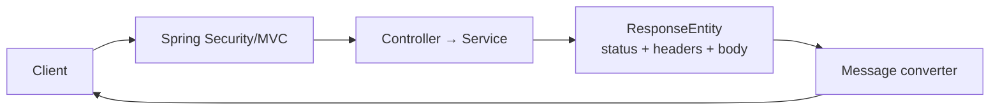

# ResponseEntity để kiểm soát status, header và nội dung

> **Module:** INTEGRATION_API_REST — học thiết kế REST API theo resource, URI, phương thức và mã trạng thái HTTP, cùng hợp đồng dữ liệu rõ ràng. Người học thực hành phân trang, cache, idempotency, OpenAPI, xác thực, phân quyền, xử lý lỗi và kiểm thử với Java/Spring hoặc công nghệ tương đương.  
> **Chương:** Spring MVC.  
> **Trọng tâm:** Sử dụng `ResponseEntity<T>` để kiểm soát **HTTP status**, **response headers** và **response body** một cách nhất quán, không nhầm metadata giao thức với kết quả nghiệp vụ.

## 1. Một response REST API có ba phần phải thiết kế cùng nhau

Giả sử backend nhận yêu cầu tạo đơn hàng:

```http
POST /api/orders HTTP/1.1
Host: api.example.com
Authorization: Bearer <access-token>
Idempotency-Key: 6b4bfe1c-f122-4a2d-9971-0e4b24f67b73
Content-Type: application/json

{"sku":"KB-01","quantity":2}
```

Nếu tạo thành công, phản hồi có thể là:

```http
HTTP/1.1 201 Created
Location: /api/orders/ord-901
Content-Type: application/json
Cache-Control: no-store

{"id":"ord-901","sku":"KB-01","quantity":2,"status":"NEW"}
```

Mỗi phần có hợp đồng riêng:

- **Status `201 Created`:** request đã tạo ra tài nguyên mới.
- **Header `Location`:** cho client biết URI của tài nguyên được tạo. `Content-Type` nói body là JSON; `Cache-Control` quy định chính sách lưu cache.
- **Body JSON:** representation mà client có thể sử dụng ngay, theo schema được công bố.

Dùng `200 OK` cho mọi thao tác có thể khiến client không phân biệt “đã tạo”, “đang chạy” hay “không có nội dung”. Chỉ trả JSON `{"success":true}` không bù được việc HTTP status/header sai.

Trong Spring MVC, `ResponseEntity<T>` cho controller kiểm soát ba thành phần ấy:

```java
return ResponseEntity
        .created(URI.create("/api/orders/ord-901"))
        .cacheControl(CacheControl.noStore())
        .body(new OrderView("ord-901", "KB-01", 2, "NEW"));
```

**Đây không phải cách thay thế toàn bộ nghiệp vụ bằng code controller.** Service vẫn chịu trách nhiệm giao dịch, phân quyền, idempotency, dữ liệu và lỗi; `ResponseEntity` mô tả kết quả HTTP của nghiệp vụ đã được xử lý.

## 2. ResponseEntity hoạt động ở đâu trong Spring MVC?

`ResponseEntity<T>` là giá trị trả về ở **biên HTTP** của controller, mở rộng `HttpEntity<T>` bằng status. Sau khi controller chạy, Spring MVC dùng `HttpMessageConverter` phù hợp để ghi body. Nó không thay transaction, validation hay Spring Security.



| Kiểu trả về | Cách sử dụng |
|---|---|
| DTO trực tiếp trong `@RestController` | 200 + body khi không cần tùy biến |
| `@ResponseStatus` | Status cố định, ít metadata |
| `ResponseEntity<OrderView>` | Chọn status/headers/body rõ ràng |
| `ResponseEntity<Void>` | Chỉ status và headers, không body |
| `ResponseEntity<ProblemDetail>` | Lỗi có cấu trúc theo RFC 9457 |

### 2.1. Builder hay dùng

```java
ResponseEntity.ok(order);                     // 200 + JSON
ResponseEntity.created(location).body(order); // 201 + Location
ResponseEntity.accepted().body(job);          // 202 + job
ResponseEntity.noContent().build();           // 204, không body
ResponseEntity.notFound().build();            // 404, không body
ResponseEntity.status(HttpStatus.CONFLICT)
              .body(problem);                 // 409 + lỗi
```

`ok().body(null)` vẫn là **200**, không phải `204`. `notFound().build()` không tự tạo Problem Details. Dùng generic cụ thể cho success; lỗi nên qua `@RestControllerAdvice` thay vì mọi controller đều trả `ResponseEntity<Object>`.

## 3. Chọn status theo kết quả nghiệp vụ

| Trường hợp | Status | Điều quan trọng |
|---|---|---|
| GET có representation | `200 OK` | Body đúng schema |
| POST tạo tài nguyên | `201 Created` | `Location` + body tùy hợp đồng |
| POST nhận xử lý nền | `202 Accepted` | URI/status job để theo dõi |
| PATCH/DELETE xong, không trả body | `204 No Content` | Body **phải rỗng** |
| GET revalidation hợp lệ | `304 Not Modified` | Body rỗng, cache metadata |
| Request sai | `400` / `422` theo policy | Problem Details |
| Không xác thực / không quyền | `401` / `403` | Bảo vệ dữ liệu |
| Không tìm thấy | `404` | Không trả 200 giả |
| Conflict domain | `409` | Phân biệt với precondition |
| ETag cũ / thiếu điều kiện bắt buộc | `412` / `428` | Không ghi đè dữ liệu |
| Quá giới hạn / hệ thống tạm quá tải | `429` / `503` | Có thể gửi `Retry-After` |

### 3.1. Tạo tài nguyên: 201 và Location

```java
OrderView saved = orders.create(request);
return ResponseEntity.created(
        URI.create("/api/orders/" + saved.id()))
    .cacheControl(CacheControl.noStore())
    .body(saved);
```

`Location` trỏ đến URI tài nguyên mới. Chỉ dùng ID/host đáng tin cậy, tránh ghép URI từ `Host` do client tùy ý khai. `ResponseEntity` không tự tạo transaction hay xử lý `Idempotency-Key`.

### 3.2. Xử lý nền: 202 chưa phải hoàn tất

```http
HTTP/1.1 202 Accepted
Location: /api/report-jobs/job-17
Content-Type: application/json

{"jobId":"job-17","status":"QUEUED"}
```

API cần endpoint theo dõi trạng thái. `202` không chứng minh report đã có. Với cập nhật hoàn tất nhưng không cần body:

```java
return ResponseEntity.noContent().build(); // 204
```

Không ghi JSON vào response 204 hoặc 304. Với DELETE lặp, trả 204 hay 404 tùy contract; idempotency của method không bắt các lần gọi có cùng status.

## 4. Header: chọn đúng chuẩn và đúng phạm vi

```java
return ResponseEntity.ok()
        .header("X-Correlation-Id", correlationId)
        .cacheControl(CacheControl.noStore())
        .body(view);
```

| Header | Mục đích | Lỗi cần tránh |
|---|---|---|
| `Location` | URI tài nguyên/job | URI sai version hoặc bị host injection |
| `Content-Type` | Loại body | Body không khớp JSON đã công bố |
| `Cache-Control` | Lưu cache/revalidation | `public` cho dữ liệu tenant |
| `ETag`, `Last-Modified` | Validator | Không thay khi representation đổi |
| `Vary` | Biến thể theo request headers | CDN trộn ngôn ngữ/version |
| `Content-Disposition` | Tải file | Filename chưa lọc |
| `Retry-After` | Gợi ý retry | Hứa sai thời điểm hoàn tất |
| `WWW-Authenticate` | Challenge của 401 | Thiếu khi auth scheme yêu cầu |

### 4.1. Builder chuyên biệt và HttpHeaders

```java
HttpHeaders headers = new HttpHeaders();
headers.set("X-Correlation-Id", correlationId);
return ResponseEntity.ok()
    .headers(headers)
    .varyBy(HttpHeaders.ACCEPT_LANGUAGE)
    .cacheControl(CacheControl.maxAge(Duration.ofSeconds(60))
            .cachePublic())
    .body(publicArticle);
```

`HttpHeaders.set` thay giá trị; `header(name, ...)` có thể thêm giá trị. Đừng tạo header đơn trị bị trùng ở filter và controller. `Vary` giúp cache phân biệt variant nhưng **không thay thế `private/no-store`** cho response cá nhân.

### 4.2. Validator cần phản ánh đúng dữ liệu

```java
return ResponseEntity.ok()
    .eTag("\"product-42-v7\"")
    .lastModified(updatedAt.toEpochMilli())
    .cacheControl(CacheControl.noCache().cachePrivate())
    .body(product);
```

ETag strong phải tuân ngữ nghĩa representation/bytes, không chỉ là nhãn version bất kỳ; có thể dùng weak ETag khi chỉ cam kết tương đương ngữ nghĩa. `Last-Modified` theo ngày HTTP có độ phân giải giây. Gắn ETag **không tự khiến Spring trả 304**: phải đánh giá conditional request theo đúng HTTP.

## 5. Body và content negotiation

`ResponseEntity<T>` chọn body; **Spring HttpMessageConverter** chuyển `T` thành bytes theo cấu hình converter và media type:

- DTO như `OrderView` thường được Jackson chuyển thành JSON.
- `String` thường là text; đừng tự nối chuỗi JSON rồi chỉ ép `Content-Type`.
- `byte[]` có thể dùng cho payload nhỏ, nhưng tốn RAM khi file lớn.
- `Resource`/`StreamingResponseBody` phù hợp với download/streaming có kiểm soát.
- `ProblemDetail` tạo lỗi có cấu trúc khi converter hỗ trợ.

```java
@PostMapping(
    path = "/api/orders",
    consumes = MediaType.APPLICATION_JSON_VALUE,
    produces = MediaType.APPLICATION_JSON_VALUE
)
ResponseEntity<OrderView> create(
        @Valid @RequestBody CreateOrder request) {
    // ...
}
```

`consumes` xác định kiểu request `Content-Type` được chấp nhận; `produces` là kiểu response có thể tạo; `Accept` của client tham gia content negotiation. Không hỗ trợ request body type thường dẫn tới **415**, không đáp ứng `Accept` theo policy thường là **406**.

**Trả DTO, không trả entity JPA**: tránh lộ trường nội bộ, quan hệ lazy hoặc circular reference. Trường vắng, null và enum phải khớp OpenAPI. `204`, `304` và response `HEAD` không mang body dù generic Java cho phép khai báo một kiểu; đừng ghi payload cho chúng.

## 6. Một controller Spring MVC quản lý HTTP contract

Ví dụ tập trung vào **status, headers và body**. Các interface/domain service chỉ là dependency minh họa, cần được hiện thực với database, giao dịch, kiểm tra quyền và cơ chế idempotency phù hợp.

### 6.1. DTO và contract của service

```java
import jakarta.validation.constraints.NotBlank;
import jakarta.validation.constraints.Positive;

record CreateOrder(
        @NotBlank String sku,
        @Positive int quantity
) {}

record ChangeOrderStatus(
        @NotBlank String status
) {}

record OrderView(
        String id,
        String sku,
        int quantity,
        String status
) {}

record CreatedOrder(String id, OrderView view) {}
record UpdatedOrder(String strongEtag) {}

interface OrderService {
    OrderView findVisible(
            org.springframework.security.core.Authentication actor,
            String id);

    CreatedOrder create(
            org.springframework.security.core.Authentication actor,
            String idempotencyKey,
            CreateOrder body);

    UpdatedOrder changeStatus(
            org.springframework.security.core.Authentication actor,
            String id,
            String ifMatch,
            ChangeOrderStatus body);

    void delete(
            org.springframework.security.core.Authentication actor,
            String id);
}
```

Service phải kiểm tra tenant/authorization, tồn tại, trạng thái nghiệp vụ, version và giao dịch. `strongEtag` phải là validator hợp lệ, ví dụ `"order-901-v7"`, dựa trên biểu diễn thực, không chỉ là số ngẫu nhiên.

### 6.2. Controller với bốn tình huống tiêu biểu

```java
import jakarta.validation.Valid;
import org.springframework.http.CacheControl;
import org.springframework.http.HttpStatus;
import org.springframework.http.ResponseEntity;
import org.springframework.security.core.Authentication;
import org.springframework.web.bind.annotation.*;
import java.net.URI;

@RestController
@RequestMapping("/api/orders")
class OrderController {
    private final OrderService orders;

    OrderController(OrderService orders) {
        this.orders = orders;
    }

    @GetMapping("/{id}")
    ResponseEntity<OrderView> get(
            @PathVariable String id,
            Authentication actor) {
        OrderView view = orders.findVisible(actor, id);
        return ResponseEntity.ok()
                .cacheControl(CacheControl.noStore())
                .body(view);
    }

    @PostMapping
    ResponseEntity<OrderView> create(
            @RequestHeader("Idempotency-Key") String key,
            @Valid @RequestBody CreateOrder body,
            Authentication actor) {
        CreatedOrder result = orders.create(actor, key, body);
        // ID do server sinh, phải URL-safe.
        URI location = URI.create("/api/orders/" + result.id());

        return ResponseEntity.status(HttpStatus.CREATED)
                .location(location)
                .cacheControl(CacheControl.noStore())
                .body(result.view());
    }

    @PatchMapping(path="/{id}",
                  consumes="application/json")
    ResponseEntity<Void> changeStatus(
            @PathVariable String id,
            @RequestHeader(value="If-Match", required=false)
                    String ifMatch,
            @Valid @RequestBody ChangeOrderStatus body,
            Authentication actor) {

        if (ifMatch == null || ifMatch.isBlank()) {
            throw new PreconditionRequiredException();
        }
        UpdatedOrder updated =
                orders.changeStatus(actor, id, ifMatch, body);

        return ResponseEntity.noContent()
                .eTag(updated.strongEtag())
                .cacheControl(CacheControl.noStore())
                .build();
    }

    @DeleteMapping("/{id}")
    ResponseEntity<Void> delete(
            @PathVariable String id,
            Authentication actor) {
        orders.delete(actor, id);
        return ResponseEntity.noContent().build();
    }
}
```

**Giả định và giới hạn của ví dụ:**

1. Service chịu trách nhiệm authorization và idempotency; controller không chỉ cần trả `201` là đã chống tạo đơn trùng.
2. `PATCH` ở đây dùng **định dạng lệnh JSON do API định nghĩa**, không tự nhận là JSON Patch hay JSON Merge Patch chuẩn. `ChangeOrderStatus` cần validation giá trị status hợp lệ ở service.
3. `If-Match` chỉ được xem là precondition thành công nếu **strong validator hiện tại khớp**, và việc ghi cần atomic version check/optimistic locking. Nếu cũ, service ném ngoại lệ được map thành `412`; không trả 204 rồi bỏ qua conflict.
4. `UpdatedOrder.strongEtag()` phải mô tả đúng representation mới. Với PUT thành công, HTTP còn ràng buộc riêng đối với gửi validator khi server biến đổi representation; ví dụ dùng PATCH để tránh đánh đồng hai trường hợp.
5. `no-store` là policy minh họa cho dữ liệu đơn hàng của người dùng. Nếu nghiệp vụ cho phép private cache, phải thiết kế riêng theo auth, ETag, cache key và dữ liệu nhạy cảm.
6. Không có logic validation/error handler ở controller này ngoài `@Valid`; lớp xử lý lỗi thống nhất nằm ở mục tiếp theo.

### 6.3. Hợp đồng HTTP mong đợi

| Endpoint | Thành công | Thất bại chính |
|---|---|---|
| `GET /api/orders/{id}` | 200 + JSON | 401/403/404 |
| `POST /api/orders` | 201 + Location + JSON | 400/401/403/409 |
| `PATCH /api/orders/{id}` | 204, không body, ETag mới | 400/401/403/404/412/428 |
| `DELETE /api/orders/{id}` | 204, không body | 401/403/404/409 theo policy |

Số trạng thái được chọn **phải phản ánh kết quả thật**. Ví dụ `DELETE` cần kiểm tra ràng buộc nghiệp vụ (đơn đã thanh toán không thể xóa) trước khi trả 204; nếu chưa được phép xóa, trả mã lỗi phù hợp thay vì giả thành công.

## 7. Problem Details và xử lý lỗi tập trung

Lỗi cần **status đúng** cùng representation thống nhất; không trả `200` kèm `{"error":"not found"}`. Ví dụ precondition đã cũ:

```http
HTTP/1.1 412 Precondition Failed
Content-Type: application/problem+json
Cache-Control: no-store

{"type":"https://api.example.com/problems/stale-version",
 "title":"Phiên bản đã thay đổi","status":412,
 "detail":"Hãy tải lại trước khi cập nhật."}
```

Spring `ProblemDetail` hỗ trợ RFC 9457. Nên để `@RestControllerAdvice` chuyển exception domain thành `ResponseEntity<ProblemDetail>`:

```java
@RestControllerAdvice
class ApiErrorHandler {

    @ExceptionHandler(OrderNotFoundException.class)
    ResponseEntity<ProblemDetail> notFound(OrderNotFoundException ex) {
        ProblemDetail p = ProblemDetail.forStatusAndDetail(
            HttpStatus.NOT_FOUND,
            "Đơn hàng không tồn tại hoặc không thể xem.");
        p.setTitle("Không tìm thấy đơn hàng");
        return ResponseEntity.status(HttpStatus.NOT_FOUND)
            .contentType(MediaType.valueOf("application/problem+json"))
            .cacheControl(CacheControl.noStore())
            .body(p);
    }

    @ExceptionHandler(StaleOrderVersionException.class)
    ResponseEntity<ProblemDetail> stale(StaleOrderVersionException ex) {
        ProblemDetail p = ProblemDetail.forStatusAndDetail(
            HttpStatus.PRECONDITION_FAILED,
            "Tài nguyên đã thay đổi; không thực hiện cập nhật.");
        return ResponseEntity.status(HttpStatus.PRECONDITION_FAILED)
            .contentType(MediaType.valueOf("application/problem+json"))
            .cacheControl(CacheControl.noStore())
            .body(p);
    }
}
```

`PreconditionRequiredException` có thể map thành `428` theo cách tương tự. Cấu hình thêm handler cho `MethodArgumentNotValidException`/`ResponseEntityExceptionHandler` để validation có cùng error format; không tiết lộ SQL, stack trace hay dữ liệu tenant khác.

**Lưu ý:** 401/403 từ Spring Security thường được quyết định ở **filter chain trước MVC**, bởi `AuthenticationEntryPoint` và `AccessDeniedHandler`. `@RestControllerAdvice` không tự bắt tất cả lỗi auth; nếu muốn Problem Details thống nhất, cấu hình security handlers tương ứng.

## 8. Conditional GET: ETag, 304 và ResponseEntity

Client đã lưu representation với `ETag: "article-42-v7"`:

```http
GET /api/articles/42 HTTP/1.1
If-None-Match: "article-42-v7"
```

Nếu chưa đổi, server trả `304 Not Modified` **không có body** cùng metadata cache; client dùng body đã lưu. Spring có thể đánh giá conditional request bằng `WebRequest.checkNotModified`:

```java
@GetMapping("/api/articles/{id}")
ResponseEntity<ArticleView> getArticle(
        @PathVariable long id,
        WebRequest request,
        HttpServletResponse servletResponse) {

    ArticleSnapshot a = articles.findPublished(id);
    String etag = "\"article-" + a.id() + "-v" + a.version() + "\"";
    long modified = a.updatedAt().toEpochMilli();

    // Đặt trước để response 304 vẫn có cache metadata.
    servletResponse.setHeader(HttpHeaders.CACHE_CONTROL,
        "public, max-age=60, must-revalidate");

    if (request.checkNotModified(etag, modified)) {
        return null; // Framework đã set 304/validators, không body.
    }
    return ResponseEntity.ok().eTag(etag)
        .lastModified(modified)
        .cacheControl(CacheControl.maxAge(Duration.ofSeconds(60))
            .cachePublic().mustRevalidate())
        .body(a.view());
}
```

`ArticleSnapshot` và service là lớp minh họa; bổ sung imports theo dự án. **Kiểm tra existence, quyền và variant trước ETag**; không so `If-None-Match` bằng phép bằng chuỗi thô. Với GET/HEAD, `If-None-Match` ưu tiên hơn `If-Modified-Since`. Chỉ dùng `ResponseEntity.status(304).eTag(...).build()` khi precondition thực sự đã được đánh giá đúng.

## 9. Download: Resource, Content-Disposition và Range

Download PDF cần trả đúng bytes và metadata:

```http
HTTP/1.1 200 OK
Content-Type: application/pdf
Content-Disposition: attachment; filename="report.pdf"
Content-Length: 1048576
Cache-Control: no-store

<PDF bytes>
```

```java
@GetMapping("/api/reports/{id}/download")
ResponseEntity<Resource> download(
        @PathVariable String id, Authentication actor)
        throws IOException {
    ReportFile file = reports.findDownloadable(actor, id);
    Resource resource = new InputStreamResource(
            file.openVerifiedStream());
    ContentDisposition disposition = ContentDisposition
            .attachment()
            .filename("report.pdf", StandardCharsets.UTF_8)
            .build();
    return ResponseEntity.ok()
            .contentType(MediaType.APPLICATION_PDF)
            .contentLength(file.size())
            .header(HttpHeaders.CONTENT_DISPOSITION,
                    disposition.toString())
            .cacheControl(CacheControl.noStore())
            .body(resource);
}
```

Cần quản lý lifecycle stream, xác thực quyền, size đúng và filename an toàn. Với file lớn, cân nhắc `StreamingResponseBody` hoặc signed URL; không dùng `ResponseEntity<byte[]>` để nạp toàn file vào RAM. **206 Partial Content** yêu cầu xử lý `Range`/`If-Range`, `Content-Range` và byte ranges thực; không chỉ đổi status sang 206.

## 10. Bảo mật: ResponseEntity không thay chính sách truy cập

- **AuthN/AuthZ:** Spring Security xác minh caller; service kiểm tra tenant/resource trước khi tạo DTO hoặc ETag.
- **Data minimization:** không serialize JPA entity, secrets, trường nội bộ hoặc thông tin tenant khác.
- **Private cache:** `no-store` hoặc `private` theo chính sách; `Vary` không cho phép chia sẻ dữ liệu cá nhân.
- **Safe headers:** không phản xạ `Host`, filename, path không tin cậy vào `Location`/`Content-Disposition`; không log token, cookie, signed URL.
- **Safe errors:** `ProblemDetail` không lộ stack trace/SQL; 401/403 phải nhất quán dù filter chạy trước controller.
- **Web security:** CORS/CSRF và security headers nên quản lý tập trung; `Access-Control-Allow-Origin: *` không an toàn cho response có credentials.

Ví dụ `ResponseEntity.ok(orderJpaEntity)` có thể trả `internalNote` không thuộc quyền. Sửa **DTO và authorization**, không phải chỉ sửa status.

## 11. OpenAPI mô tả status, headers và body

Ví dụ rút gọn cho `POST /api/orders` và `PATCH /api/orders/{id}`:

```yaml
openapi: 3.1.2
info: {title: Orders API, version: 1.0.0}
paths:
  /api/orders:
    post:
      parameters:
        - name: Idempotency-Key
          in: header
          required: true
          schema: {type: string}
      requestBody:
        required: true
        content:
          application/json:
            schema:
              type: object
              required: [sku, quantity]
              properties:
                sku: {type: string}
                quantity: {type: integer, minimum: 1}
      responses:
        "201":
          description: Đã tạo đơn
          headers:
            Location:
              schema: {type: string}
          content:
            application/json:
              schema: {$ref: "#/components/schemas/OrderView"}
        "400": {description: Request sai}
        "409": {description: Xung đột}
  /api/orders/{id}:
    patch:
      parameters:
        - name: id
          in: path
          required: true
          schema: {type: string}
        - name: If-Match
          in: header
          required: true
          schema: {type: string}
      responses:
        "204":
          description: Đã cập nhật, không có body
          headers:
            ETag:
              schema: {type: string}
        "412": {description: ETag không khớp}
        "428": {description: Thiếu điều kiện}
components:
  schemas:
    OrderView:
      type: object
      required: [id, sku, quantity, status]
      properties:
        id: {type: string}
        sku: {type: string}
        quantity: {type: integer}
        status: {type: string}
```

Mẫu trên giản lược body PATCH để tập trung vào response; tài liệu hoàn chỉnh phải bổ sung request body, security và `application/problem+json`. **204 không khai báo `content`.** Công cụ sinh OpenAPI từ Spring có thể bỏ sót 201/Location, 204, ETag và domain errors: cần kiểm tra artifact và contract tests.

## 12. Kiểm thử ba phần của response bằng MockMvc

`ResponseEntity` cần test **status + headers + body cùng nhau**, không chỉ `status().isOk()`. Ví dụ sau giả định có dữ liệu, service và security fixture phù hợp; **chưa chạy** trong dự án:

```java
@SpringBootTest
@AutoConfigureMockMvc
class OrderResponseContractTest {
    @Autowired MockMvc mvc;

    @Test
    void createHas201LocationAndJson() throws Exception {
        mvc.perform(post("/api/orders")
                .header("Idempotency-Key",
                    "6b4bfe1c-f122-4a2d-9971-0e4b24f67b73")
                .contentType(MediaType.APPLICATION_JSON)
                .content("{\"sku\":\"KB-01\",\"quantity\":2}"))
            .andExpect(status().isCreated())
            .andExpect(header().exists(HttpHeaders.LOCATION))
            .andExpect(content().contentTypeCompatibleWith(
                MediaType.APPLICATION_JSON))
            .andExpect(jsonPath("$.id").isString());
    }

    @Test
    void patchHas204EtagAndNoBody() throws Exception {
        mvc.perform(patch("/api/orders/ord-901")
                .header(HttpHeaders.IF_MATCH, "\"order-901-v7\"")
                .contentType(MediaType.APPLICATION_JSON)
                .content("{\"status\":\"CONFIRMED\"}"))
            .andExpect(status().isNoContent())
            .andExpect(header().exists(HttpHeaders.ETAG))
            .andExpect(content().string(""));
    }

    @Test
    void missingOrderHas404Problem() throws Exception {
        mvc.perform(get("/api/orders/not-found"))
            .andExpect(status().isNotFound())
            .andExpect(content().contentTypeCompatibleWith(
                MediaType.valueOf("application/problem+json")))
            .andExpect(jsonPath("$.status").value(404));
    }
}
```

Cần imports JUnit/MockMvc, cấu hình Spring Security principal hoặc JWT giả, fixtures và exception handler. Không vô hiệu hóa auth chỉ để test status thuận tiện.

| Test | Cần assert |
|---|---|
| RESP-01 GET | 200, JSON đúng schema, không lộ trường nội bộ |
| RESP-02 POST | 201 + Location, body có ID, idempotency không tạo trùng |
| RESP-03 async | 202 + job URL và trạng thái |
| RESP-04 PATCH/DELETE | 204, body rỗng |
| RESP-05 If-Match cũ/thiếu | 412/428, không ghi DB, Problem Details |
| RESP-06 conditional GET | 304 rỗng khi khớp; 200 + ETag mới khi đổi |
| RESP-07 negotiation | 406/415 theo policy |
| RESP-08 security | 401/403/404 và tenant isolation |
| RESP-09 download | MIME, disposition, size, bytes/Range đúng |
| RESP-10 cache/proxy | Private data không lộ, gateway không sửa hỏng Location/ETag |

MockMvc không kiểm tra hết reverse proxy/CDN; có cache, download hoặc 401 từ gateway thì bổ sung **integration test qua đường HTTP thật**.

## 13. Phản mẫu thường gặp

| Phản mẫu | Cách đúng |
|---|---|
| `ok(null)` cho resource không tồn tại | 404, Problem Details nếu cần |
| `204`/`304` nhưng gửi JSON | Không có body; muốn body chọn status khác |
| POST tạo resource trả 200 mặc định | 201 + Location khi thực sự tạo |
| `202` nhưng coi job đã hoàn tất | Trả job/status URL theo hợp đồng |
| JPA entity làm response | DTO được kiểm tra quyền và schema |
| Tự ghép JSON trong String | Dùng converter/Jackson |
| ETag cố định/không xét precondition | Validator theo biểu diễn + kiểm tra chuẩn HTTP |
| Mọi exception đều thành 500/403 | Map 400/404/409/412/428 và auth đúng |
| Cache `public` cho tenant | `private/no-store`, test CDN |
| 206 chỉ bằng cách đổi status | Implement Range, Content-Range, bytes đúng |

Giữ `ResponseEntity` ở HTTP adapter; service/repository trả **domain outcome** để nghiệp vụ không phụ thuộc Spring MVC.

## 14. Bài tập thực hành

### Bài A — Chọn status, header, body

Viết `ResponseEntity` cho: GET đơn hàng (200), POST tạo đơn (201 + Location), báo cáo chạy nền (202 + job link), PATCH thành công không body (204), `If-Match` cũ (412 + Problem Details), GET với ETag không đổi (304 không body). Phân biệt `ok(null)` và `noContent()`.

### Bài B — Review controller

```java
@PostMapping("/api/orders")
ResponseEntity<?> create(@RequestBody OrderEntity entity) {
    return ResponseEntity.ok(repository.save(entity));
}
```

Chỉ ra lỗi liên quan DTO, validation, tenant authorization, idempotency, 201/Location và transaction. Viết lại theo `controller → service → ResponseEntity`.

### Bài C — Conditional GET và bảo mật

Thiết kế `GET /api/articles/{id}` có ETag/Last-Modified, 304 không body và hai MockMvc tests cho 200/304. Thêm `PATCH /api/orders/{id}` dùng `If-Match`, trả 428 khi thiếu, 412 khi cũ; chứng minh DB không đổi và tenant khác không truy cập được.

### Bài D — Download

API trả PDF 200 MB: chọn `Resource`, `StreamingResponseBody` hoặc signed URL. Nêu Content-Type, Content-Disposition, size, cache policy, quyền và kiểm thử streaming. Vì sao không nên dùng `byte[]`? Khi nào cần thực thi Range để trả 206?

## 15. Checklist trước production

- [ ] Mỗi endpoint có **status, headers, body** và OpenAPI tương ứng.
- [ ] 201 có Location; 202 có cơ chế theo dõi; 204/304 **không body**.
- [ ] DTO không lộ entity/PII; validation và content negotiation được kiểm thử.
- [ ] Headers Location/ETag/Cache-Control/Vary/Content-Disposition đúng semantics.
- [ ] Conditional GET đánh giá validator đúng; PATCH có 412/428 và atomic version check.
- [ ] Spring Security và error advice cho 401/403/Problem Details nhất quán.
- [ ] Response tenant không bị shared cache; kiểm tra CDN/gateway khi áp dụng.
- [ ] Download không nạp toàn file vào RAM; chỉ công bố Range nếu hỗ trợ thật.
- [ ] MockMvc assert **status + headers + body** cùng side effect, security và lỗi.
- [ ] `ResponseEntity` chỉ nằm ở HTTP layer, không đưa vào domain/repository.

## 16. Ghi nhớ

**`ResponseEntity<T>` là công cụ ở biên HTTP** để thể hiện chính xác một kết quả API: **status nói điều gì đã xảy ra, headers cung cấp metadata/điều khiển giao thức, body mang biểu diễn khi được phép**. Nó hỗ trợ `201 + Location`, `202 + job link`, `204 không body`, `ETag/Cache-Control`, download và Problem Details; nhưng **không tự bảo đảm** transaction, phân quyền, idempotency hay tính đúng của validator.

Với REST API được thiết kế tốt, `ResponseEntity` chỉ là bước chuyển **kết quả nghiệp vụ đã xác thực** sang một HTTP contract rõ ràng. Hãy kiểm chứng cả ba phần bằng test và giữ một chính sách lỗi/bảo mật thống nhất — đó mới là giá trị của việc kiểm soát response trong Spring MVC.
