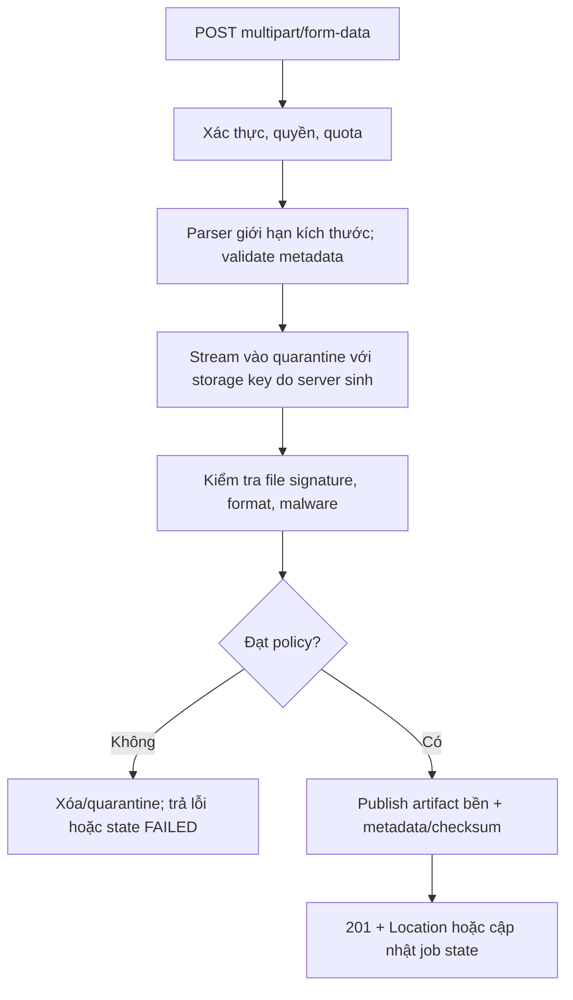

# MultipartFile, Resource và phản hồi tải tệp

## 1. Bài toán: nhận tệp, lưu an toàn và trả đúng bytes

Ứng dụng upload PDF qua `POST /orders/{id}/attachments` và tải lại qua `GET /orders/{id}/attachments/{attachmentId}/content`. Có ba ranh giới:

1. **HTTP request** chứa tệp và metadata dưới dạng `multipart/form-data`.
2. **Server** kiểm tra người gọi, giới hạn, nội dung rồi lưu metadata và bytes vào nơi có kiểm soát.
3. **HTTP response** trả đúng bytes được lưu với `Content-Type`, `Content-Disposition`, kích thước, validator và chính sách cache.

Trong Spring MVC, `MultipartFile` đại diện cho **part tệp trong request**, còn `Resource` là abstraction để **đọc nguồn dữ liệu** từ bộ nhớ, filesystem, classpath hoặc nơi khác. Chúng không tự bảo đảm an toàn, lưu trữ bền, idempotency hay quyền truy cập.

Bài thuộc chương **Spring MVC** của `INTEGRATION_API_REST`, kết hợp thiết kế resource/URI, HTTP methods/status, hợp đồng dữ liệu, cache, xác thực/phân quyền, idempotency, OpenAPI và kiểm thử REST API Java/Spring.

Sau bài, người học cần có thể:

- Tạo endpoint upload với `MultipartFile`, dùng `@RequestPart` cho JSON metadata và `@RequestParam` khi phù hợp.
- Hiểu vòng đời tệp tạm, khác nhau giữa `getBytes()`, `getInputStream()` và `transferTo()`.
- Trả download bằng `ResponseEntity<Resource>`, stream hiệu quả và đặt headers chính xác.
- Phân biệt 200/201/202/206/304/413/415/422 cùng chính sách lỗi.
- Bảo vệ filename, MIME, kích thước, malware, tenant, cache, retention; kiểm thử **bytes thực** qua HTTP.

## 2. Multipart/form-data trên đường truyền

Một request multipart gồm nhiều **parts**; mỗi part có headers và body riêng, được tách bằng boundary. Ví dụ gửi file PDF cùng JSON metadata:

```http
POST /orders/ord-42/attachments HTTP/1.1
Host: api.example.test
Authorization: Bearer <access-token>
Content-Type: multipart/form-data; boundary=upload_demo_7

--upload_demo_7
Content-Disposition: form-data; name="metadata"
Content-Type: application/json

{"category":"INVOICE","description":"Hóa đơn tháng 11"}
--upload_demo_7
Content-Disposition: form-data; name="file"; filename="invoice.pdf"
Content-Type: application/pdf

[%PDF-1.7 ... bytes nhị phân ...]
--upload_demo_7--
```

Đây là ví dụ **minh họa**: body thực dùng CRLF và bytes nhị phân chính xác; chuỗi trong ngoặc vuông không phải một PDF thực. `Content-Type` của cả request phải có boundary trùng với body.

Trong browser, `FormData` thường sinh boundary tự động:

```javascript
const form = new FormData();
form.append("metadata", new Blob(
  [JSON.stringify({category: "INVOICE", description: "Hóa đơn tháng 11"})],
  {type: "application/json"}
));
form.append("file", selectedFile, selectedFile.name);

const response = await fetch("/orders/ord-42/attachments", {
  method: "POST",
  body: form,
  credentials: "include"
});
if (!response.ok) throw new Error("Tải lên thất bại");
```

**Không tự đặt `Content-Type: multipart/form-data` trong fetch này**; browser phải thêm boundary. Khi dùng bearer token, cần quản lý `Authorization` đúng cách; ví dụ chỉ thể hiện cookie/session.

| Thành phần | Ý nghĩa | Giới hạn tin cậy |
| --- | --- | --- |
| `Content-Type: multipart/form-data; boundary=...` | Định dạng toàn request | Boundary sai có thể khiến parser lỗi |
| `Content-Disposition: form-data; name="file"` | Tên part để Spring binding | Caller có thể tự đặt tên part |
| `filename="invoice.pdf"` | Tên tệp do client gửi | **Không phải storage path tin cậy** |
| `Content-Type: application/pdf` của file part | MIME do client khai báo | **Không chứng minh bytes là PDF** |
| `Content-Type: application/json` của metadata part | Chỉ converter đọc JSON | Cần validate cả DTO sau deserialize |

`multipart/form-data` là định dạng một request chứa nhiều parts; **không** đồng nghĩa upload chia nhỏ qua nhiều request có resume (như chunk protocol hoặc object storage multipart upload).

## 3. @RequestParam, @RequestPart và MultipartFile

Khi chỉ nhận một file:

```java
@PostMapping(path = "/files",
             consumes = MediaType.MULTIPART_FORM_DATA_VALUE)
ResponseEntity<Void> uploadSimple(
    @RequestParam("file") MultipartFile file
) {
    // Xử lý tệp đồng bộ hoặc lưu bền trước khi trả response.
    return ResponseEntity.accepted().build();
}
```

Với part JSON có media type riêng:

```java
record AttachmentMetadata(
    @NotNull AttachmentCategory category,
    @Size(max = 200) String description
) {}

enum AttachmentCategory { INVOICE, OTHER }

@PostMapping(path = "/orders/{id}/attachments",
             consumes = MediaType.MULTIPART_FORM_DATA_VALUE)
ResponseEntity<?> upload(
    @PathVariable String id,
    @Valid @RequestPart("metadata") AttachmentMetadata metadata,
    @RequestPart("file") MultipartFile file,
    Authentication caller
) {
    // Gọi service: xác thực quyền, quota, lưu bền và tạo resource.
    return ResponseEntity.accepted().build();
}
```

`@RequestParam` phù hợp field form cơ bản hoặc file. `@RequestPart` đặc biệt hữu ích khi dùng `HttpMessageConverter` để deserialize JSON part thành DTO. Part `metadata` nên khai `Content-Type: application/json`; gửi chuỗi JSON như `text/plain` có thể bị từ chối tùy converter/config, không tự suy rằng Spring biết parse.

| API của MultipartFile | Tác dụng | Điểm cần kiểm soát |
| --- | --- | --- |
| `isEmpty()` | Part rỗng/không có nội dung | Tệp rỗng có hợp lệ với nghiệp vụ không? |
| `getSize()` | Kích thước đã nhận theo bytes | Kiểm tra thêm gateway, container và quota |
| `getOriginalFilename()` | Filename từ client | Có thể null, path hoặc ký tự nguy hiểm |
| `getContentType()` | MIME được khai báo | Không thay xác minh signature/format |
| `getInputStream()` | Đọc bytes dạng stream | Dùng try-with-resources khi có thể |
| `getBytes()` | Nạp toàn bộ tệp vào byte array | Dễ làm cạn bộ nhớ nếu file lớn |
| `transferTo(...)` | Copy/move ra đích | Tùy implementation; phải cấp path an toàn |

**Vòng đời:** nội dung `MultipartFile` có thể ở RAM hoặc tệp tạm của Servlet container/multipart resolver. Nội dung tạm có thể được dọn sau request. **Không giữ object `MultipartFile` trong queue hoặc `@Async` để đọc sau khi controller trả response.** Muốn xử lý nền, lưu bytes vào kho bền trước, chỉ gửi một file/job ID cho worker.

## 4. Giới hạn dung lượng và lỗi từ lớp hạ tầng

Với Spring Boot sử dụng Servlet multipart handling:

```yaml
spring:
  servlet:
    multipart:
      enabled: true
      max-file-size: 15MB
      max-request-size: 18MB
      file-size-threshold: 0B
      # location: /thu-muc-tam-do-server-quan-ly
```

Các con số chỉ là ví dụ. `max-file-size` áp dụng từng file; `max-request-size` cho **toàn request**, kể cả metadata và multipart framing. `file-size-threshold` ảnh hưởng lưu RAM hay file tạm, không phải quy tắc kiểm tra độ tin cậy của tệp. Nếu có proxy/gateway, cần đặt limit ở **mọi lớp** và kiểm tra hành vi thực từ client.

| Tình huống | Status thường phù hợp |
| --- | --- |
| Gateway/container chặn request quá lớn | **413 Content Too Large** |
| Endpoint chỉ nhận multipart nhưng request gửi application/json | **415 Unsupported Media Type** |
| Thiếu part, boundary sai, JSON metadata không parse được | **400 Bad Request** |
| Metadata hợp lệ về cú pháp nhưng không thỏa rule | **422 Unprocessable Content** nếu hợp đồng chọn |
| Người dùng không có quyền thêm tệp vào order | **403** hoặc 404 theo chính sách |
| Quota/rate limit tạm thời | **429 Too Many Requests** nếu phù hợp |

Nếu gateway từ chối trước khi request tới Spring, `@RestControllerAdvice` **không thể** viết response cho tình huống đó. Chỉ kiểm tra `file.getSize()` trong controller cũng quá muộn để bảo vệ temp disk và parser trước một upload cực lớn.

## 5. HTTP contract: tạo attachment và tải bytes

Khi bytes đã được lưu bền và đã đủ điều kiện tải, API có thể trả:

```http
HTTP/1.1 201 Created
Location: /orders/ord-42/attachments/att-91
Content-Type: application/json
Cache-Control: no-store

{
  "id": "att-91",
  "orderId": "ord-42",
  "fileName": "invoice.pdf",
  "mediaType": "application/pdf",
  "sizeBytes": 483621,
  "state": "AVAILABLE",
  "links": {
    "self": "/orders/ord-42/attachments/att-91",
    "content": "/orders/ord-42/attachments/att-91/content"
  }
}
```

`201` nói attachment đã được tạo, `Location` trỏ **metadata resource mới**. Nếu cần quét malware bất đồng bộ, có thể chọn `202 Accepted` hoặc `201` với state `PENDING_SCAN` theo contract, nhưng **không trả AVAILABLE khi nội dung chưa được phép tải**.

`POST` không tự idempotent. Khi upload thành công nhưng response bị mất, retry có thể tạo attachment thứ hai. Có thể dùng `Idempotency-Key` với scope theo caller/operation, fingerprint payload, unique constraint và TTL; với file lớn cần checksum được xác minh trong quá trình stream. Một tên file trùng nhau **không** chứng minh cùng ý định.

Nên tách:

```text
GET    /orders/ord-42/attachments/att-91         -> metadata JSON
GET    /orders/ord-42/attachments/att-91/content -> bytes
DELETE /orders/ord-42/attachments/att-91         -> xóa theo policy
```

Không nhúng file lớn dưới dạng JSON Base64 nếu không có lý do rõ ràng: Base64 tăng kích thước và chi phí encode/decode.

## 6. Pipeline lưu trữ: quarantine trước khi công bố



Không dùng filename từ client làm đường dẫn, và không lưu file ở web root công khai. Một pipeline production phải tính đến lỗi DB/storage một phần: metadata `PENDING_SCAN/AVAILABLE/FAILED`, cleanup file mồ côi, retry có giới hạn, audit.

### Java: lưu tệp tạm an toàn bằng stream

Đoạn code chỉ minh họa **thư mục do server quản lý, khóa ngẫu nhiên và giới hạn bytes**; chưa thay antivirus, transaction, object store:

```java
@Service
class QuarantineStorage {
    private final Path quarantineDir;

    QuarantineStorage(@Value("${app.upload.quarantine-dir}") Path dir) {
        quarantineDir = dir.toAbsolutePath().normalize();
    }

    StoredTemp save(MultipartFile file) throws IOException {
        if (file.isEmpty()) throw new InvalidUploadException("empty_file");
        long max = 15L * 1024 * 1024;
        if (file.getSize() > max) throw new UploadTooLargeException();

        Files.createDirectories(quarantineDir);
        Path temp = Files.createTempFile(quarantineDir, "pending-", ".upload");
        try {
            try (InputStream in = file.getInputStream();
                 OutputStream out = Files.newOutputStream(temp)) {
                byte[] buf = new byte[64 * 1024];
                long total = 0;
                int n;
                while ((n = in.read(buf)) != -1) {
                    total += n;
                    if (total > max) throw new UploadTooLargeException();
                    out.write(buf, 0, n);
                }
            }
            return new StoredTemp(temp, Files.size(temp));
        } catch (IOException | RuntimeException ex) {
            Files.deleteIfExists(temp);
            throw ex;
        }
    }
}
record StoredTemp(Path path, long sizeBytes) {}
```

Các imports, exceptions và cấu hình đường dẫn phụ thuộc dự án. Khóa tạm do `Files.createTempFile` sinh trong kho được quản lý, **không dùng `getOriginalFilename()`**. Thư mục quarantine cần quyền filesystem hạn chế, quota, chống thực thi tệp và cleanup. Không chuyển trạng thái `AVAILABLE` trước khi artifact đã được kiểm tra và lưu bền. DB và filesystem/object store **không có transaction chung mặc định**, nên cần compensation/reconciliation khi một phần thao tác thất bại.

## 7. Bảo mật upload: filename, MIME và quyền nghiệp vụ

| Rủi ro | Kiểm soát |
| --- | --- |
| IDOR/tenant | Kiểm tra quyền upload vào order cụ thể, không chỉ đăng nhập |
| Path traversal/symlink | Sinh storage key nội bộ, không ghép tên file user với path |
| MIME spoofing | Không chỉ tin `getContentType()` hay đuôi `.pdf`; đọc signature và parse định dạng |
| Malware/active content | Quarantine, scan, loại file allowlist, sanitize khi thích hợp |
| Zip bomb/ảnh kích thước lớn | Giới hạn bytes, số entry, unpacked size, pixels, CPU và thời gian |
| Temp disk exhaustion | Gateway/container/service limits, quota, concurrency, cleanup |
| Filename injection | Làm sạch tên hiển thị, không chứa CR/LF; dựng response header bằng builder |
| Mass assignment | DTO giới hạn field, không bind tất cả form data vào entity |
| Sensitive files | Encryption at rest, quyền xem, audit, TTL/retention và xóa theo policy |

Vài bytes đầu có chuỗi `%PDF` **không chứng minh PDF an toàn hoặc hợp lệ toàn bộ**. Với tài liệu nhạy cảm, antivirus/scan và giới hạn resource tiêu thụ là yêu cầu vận hành riêng. Với nhiều file, giới hạn **số parts, từng tệp, tổng request**; hàng trăm file nhỏ vẫn có thể làm cạn file handles và CPU.

## 8. Upload nhiều file và resumable upload

Có thể bind nhiều parts cùng tên:

```java
@PostMapping(path = "/batch-uploads",
             consumes = MediaType.MULTIPART_FORM_DATA_VALUE)
ResponseEntity<?> uploadBatch(
    @RequestPart("files") List<MultipartFile> files
) {
    // Giới hạn số file, tổng bytes và chọn policy rollback/partial success.
    return ResponseEntity.accepted().build();
}
```

Hợp đồng batch phải nói rõ **tất cả thành công hoặc tất cả thất bại**, hay kết quả từng item, và cách xóa tệp tạm khi giữa chừng gặp lỗi.

Một `MultipartFile` không cung cấp tính năng **resume qua nhiều request**. Với tệp hàng GB, cần protocol riêng: upload session, chunk index/offset và hash, commit, session TTL và xử lý các chunk gửi lặp; hoặc signed URLs/multipart upload của object storage. Không tự ghép nhiều request nếu không có version, checksum và overwrite rules.

## 9. Resource: abstraction đọc bytes cho HTTP response

| Loại Spring Resource | Nguồn | Khi dùng |
| --- | --- | --- |
| `ByteArrayResource` | `byte[]` trong RAM | File nhỏ đã tạo sẵn |
| `FileSystemResource` | File trên đĩa | Artifact bất biến, biết size |
| `PathResource` | `java.nio.file.Path` | Thuận tiện với NIO |
| `ClassPathResource` | Resource gói cùng ứng dụng | File tĩnh/template |
| `UrlResource` | URL | Chỉ từ nguồn tin cậy; tránh SSRF và redirect bất ngờ |
| `InputStreamResource` | Stream đọc một lần | Không mặc nhiên `contentLength()`/retry hoặc range |

**Ưu tiên:** file đã lưu trong kho và có path ổn định thì dùng `FileSystemResource`/`PathResource`; tránh `getBytes()` và `ByteArrayResource` với file lớn. `InputStreamResource` có thể chỉ đọc một lần, không nên gọi `contentLength()` tùy tiện vì có thể tiêu thụ stream. Với object storage, dùng stream được quản lý hoặc trả signed download URL ngắn hạn khi bảo mật cho phép.

## 10. ResponseEntity<Resource>: download an toàn

Sau khi attachment đã AVAILABLE, GET tải tệp có thể trả:
 
```http
HTTP/1.1 200 OK
Content-Type: application/pdf
Content-Disposition: attachment; filename="invoice.pdf"
Content-Length: 483621
ETag: "attachment-att-91-v1"
Cache-Control: private, no-cache
X-Content-Type-Options: nosniff

[483621 byte PDF]
```

`Content-Type` là format bytes do server xác nhận; `Content-Disposition` gợi ý tải về và tên hiển thị; `Content-Length` là độ dài response body. `Resource` phải gắn với artifact bất biến/có version phù hợp, không dùng path hoặc tên file từ request.

Ví dụ Java 17+/Spring MVC, `DownloadService` thực thi order/tenant authorization, trạng thái AVAILABLE và retention:
 
```java
record DownloadObject(
    Resource resource, String safeName, String mediaType,
    long sizeBytes, String strongEtag
) {}

@RestController
@RequestMapping("/orders/{orderId}/attachments")
class AttachmentDownloadController {
    private final DownloadService service;
    AttachmentDownloadController(DownloadService service) {
        this.service = service;
    }

    @GetMapping("/{attachmentId}/content")
    ResponseEntity<Resource> download(
        @PathVariable String orderId,
        @PathVariable String attachmentId,
        Authentication caller,
        WebRequest request
    ) {
        DownloadObject d = service.requireAuthorizedAvailable(
            orderId, attachmentId, caller);
        CacheControl policy = CacheControl.noCache().cachePrivate();
        if (request.checkNotModified(d.strongEtag())) {
            return ResponseEntity.status(HttpStatus.NOT_MODIFIED)
                .eTag(d.strongEtag()).cacheControl(policy).build();
        }
        ContentDisposition name = ContentDisposition.attachment()
            .filename(d.safeName(), StandardCharsets.UTF_8).build();
        return ResponseEntity.ok()
            .contentType(MediaType.parseMediaType(d.mediaType()))
            .contentDisposition(name)
            .contentLength(d.sizeBytes())
            .eTag(d.strongEtag())
            .header("X-Content-Type-Options", "nosniff")
            .cacheControl(policy)
            .body(d.resource());
    }
}
```

Đây là phác thảo có DI/imports/service riêng. Tên tải xuống cần được làm sạch và giới hạn độ dài, không chứa path/CRLF; dùng `ContentDisposition` builder hỗ trợ Unicode. Tránh `inline` cho HTML/SVG hay nội dung thực thi nếu chưa có sandbox phù hợp. Với file nhạy cảm không được lưu trong client cache, dùng `Cache-Control: no-store` thay vì private/no-cache.

Spring MVC có khả năng hỗ trợ Range khi trả `ResponseEntity<Resource>` với resource thích hợp; **phải test theo loại Resource/Spring version và proxy thực tế**, đặc biệt với `InputStreamResource` đọc một lần. Đừng đặt Content-Length toàn file lên response 206 chứa ít bytes hơn; đừng đọc cả file vào RAM.

## 11. HEAD, ETag, Range và content coding

`HEAD` trả metadata tương ứng GET (Content-Type/Length, ETag khi có) nhưng **không có response body**; kiểm thử cùng custom converters và filters. `If-None-Match` trên GET có thể dẫn đến `304 Not Modified` không body khi validator khớp; **kiểm tra authorization trước khi đánh giá validator**.

`Cache-Control: private, no-cache` cho phép private cache lưu rồi phải revalidate, còn `no-store` yêu cầu không lưu. Không cho CDN chia sẻ file riêng nếu không phân tách quyền/cache key đúng.

Tải tiếp tệp 1.000 byte:

```http
GET /orders/ord-42/attachments/att-91/content HTTP/1.1
Range: bytes=500-
If-Range: "attachment-att-91-v1"

HTTP/1.1 206 Partial Content
Content-Range: bytes 500-999/1000
Content-Length: 500
Accept-Ranges: bytes
ETag: "attachment-att-91-v1"

[500 byte cuối]
```

Range dùng offset byte từ 0, điểm cuối gồm cả hai đầu. `If-Range` với strong ETag bảo đảm chỉ ghép bytes cùng một representation. Nếu validator đã đổi, server bỏ Range và trả **200 toàn bộ**, client phải thay dữ liệu cũ, **không append**. Range không thỏa có thể nhận **416** với `Content-Range: bytes */1000`. `multipart/byteranges` là response nhiều đoạn, khác request `multipart/form-data`; mỗi part có Content-Range riêng.

**Nén:** nếu CDN gzip động, offsets liên quan tới representation được mã hóa và có thể không trùng bytes gốc. Với file lớn cần resume, ưu tiên artifact bất biến, `Accept-Encoding: identity` và policy proxy không biến đổi; nếu hỗ trợ nhiều content codings, validator mạnh và `Vary: Accept-Encoding` phải phù hợp từng selected representation. Hash SHA-256 đã được server tính và công bố theo contract có thể giúp client xác minh file hoàn chỉnh; ETag không mặc nhiên là checksum.

## 12. Lỗi API và Problem Details

HTTP status cần phân biệt lỗi request, bảo mật và trạng thái file:
 
| Status | Tình huống |
| --- | --- |
| **201/202** | Đã tạo attachment / chỉ nhận xử lý, chưa AVAILABLE |
| **200/206/304** | Full download / byte range / conditional GET không đổi |
| **400** | Thiếu part, multipart boundary hoặc JSON sai |
| **401/403/404** | Xác thực, quyền và resource không tồn tại/được che giấu |
| **409/410** | File chưa sẵn sàng / hết retention theo hợp đồng |
| **413** | File hoặc toàn request vượt giới hạn |
| **415** | Multipart/media type không được hỗ trợ |
| **416** | Range không thể thỏa, gửi Content-Range nếu biết size |
| **422** | Metadata/bytes đã parse nhưng không đạt validation theo policy |
| **5xx** | Lỗi storage/stream/server, không phải do client gửi sai |

Ví dụ Spring xử lý ngoại lệ kích thước; dùng `HttpStatusCode.valueOf(413)` để tránh phụ thuộc tên enum:
 
```java
@RestControllerAdvice
class AttachmentErrors {
    @ExceptionHandler(MaxUploadSizeExceededException.class)
    ResponseEntity<ProblemDetail> tooLarge(
        MaxUploadSizeExceededException ex
    ) {
        HttpStatusCode status = HttpStatusCode.valueOf(413);
        ProblemDetail p = ProblemDetail.forStatusAndDetail(
            status, "Dung lượng upload vượt giới hạn.");
        p.setType(URI.create(
            "https://api.example.test/problems/upload-too-large"));
        p.setProperty("code", "upload.too_large");
        return ResponseEntity.status(status)
            .contentType(MediaType.parseMediaType("application/problem+json"))
            .cacheControl(CacheControl.noStore()).body(p);
    }
}
```

Cần handler/contract cho `MissingServletRequestPartException`, `MethodArgumentNotValidException`, `HttpMediaTypeNotSupportedException`, quyền, scan và storage errors. `code` là extension riêng của RFC 9457 Problem Details; không lộ stack trace, path nội bộ, tên bucket hoặc file nhạy cảm. Khi gateway chặn upload trước Spring, error body có thể khác advice, nên kiểm thử từ client.

## 13. OpenAPI 3.0.3 cho upload multipart và download binary

Schema cần khai part JSON riêng và file binary, không mô tả file như JSON Base64. Trích đoạn cho PDF:
 
```yaml
openapi: 3.0.3
info: {title: Attachments API, version: 1.0.0}
paths:
  /orders/{orderId}/attachments:
    post:
      parameters:
        - in: path
          name: orderId
          required: true
          schema: {type: string}
      requestBody:
        required: true
        content:
          multipart/form-data:
            schema:
              type: object
              required: [metadata, file]
              properties:
                metadata: {$ref: '#/components/schemas/AttachmentMetadata'}
                file: {type: string, format: binary}
            encoding:
              metadata: {contentType: application/json}
              file: {contentType: application/pdf}
      responses:
        '201':
          description: Attachment đã tạo
          headers:
            Location: {schema: {type: string}}
        '413': {description: Request/file quá lớn}
        '415': {description: Media type không hỗ trợ}
        '422': {description: Nội dung không hợp lệ}
  /orders/{orderId}/attachments/{attachmentId}/content:
    get:
      parameters:
        - in: path
          name: orderId
          required: true
          schema: {type: string}
        - in: path
          name: attachmentId
          required: true
          schema: {type: string}
        - in: header
          name: Range
          required: false
          schema: {type: string}
      responses:
        '200':
          description: Full PDF
          headers:
            Content-Disposition: {schema: {type: string}}
            ETag: {schema: {type: string}}
          content:
            application/pdf:
              schema: {type: string, format: binary}
        '206':
          description: Vùng byte nếu được hỗ trợ
          headers:
            Content-Range: {schema: {type: string}}
          content:
            application/pdf:
              schema: {type: string, format: binary}
        '304': {description: Conditional GET không đổi}
        '416': {description: Range không thỏa}
components:
  schemas:
    AttachmentMetadata:
      type: object
      required: [category]
      properties:
        category: {type: string, enum: [INVOICE, OTHER]}
        description: {type: string, maxLength: 200}
```

`encoding.metadata.contentType` giúp client tạo đúng JSON part, `format: binary` là bytes trên wire. Hợp đồng thực cần security schemes, 400/401/403/404, scan pending, max size, retention và checksum; nếu server không hỗ trợ Range thì **không khai 206**. Với ảnh/file khác PDF, dùng media types thực thay vì mặc định PDF.

## 14. MockMvc: chứng minh bytes, headers và quyền

Một test upload phải xác minh file **đã lưu bền**, không chỉ nhận 201. `MockMultipartFile` mô phỏng cả JSON metadata và file part:
 
```java
@Test
void multipartUploadStoresExpectedBytes() throws Exception {
    byte[] pdfBytes = validPdfFixture();
    MockMultipartFile metadata = new MockMultipartFile(
        "metadata", "", "application/json",
        "{\"category\":\"INVOICE\"}".getBytes(StandardCharsets.UTF_8));
    MockMultipartFile file = new MockMultipartFile(
        "file", "invoice.pdf", "application/pdf", pdfBytes);

    mockMvc.perform(multipart("/orders/ord-42/attachments")
            .file(metadata).file(file)
            .with(user("owner")).with(csrf()))
        .andExpect(status().isCreated())
        .andExpect(header().exists("Location"));

    assertStoredAttachmentBytesEqual(pdfBytes);
}
```

GET kiểm tra headers và so sánh mảng bytes, không decode nhị phân thành chuỗi:
 
```java
@Test
void returnsAuthorizedFileBytes() throws Exception {
    byte[] expected = seedPdfFor("owner");
    byte[] actual = mockMvc.perform(get(
            "/orders/ord-42/attachments/att-91/content")
            .with(user("owner")))
        .andExpect(status().isOk())
        .andExpect(content().contentType("application/pdf"))
        .andExpect(header().exists("Content-Disposition"))
        .andExpect(header().string(
            "X-Content-Type-Options", "nosniff"))
        .andReturn().getResponse().getContentAsByteArray();
    assertArrayEquals(expected, actual);
}
```

Test dùng fixture PDF hợp lệ, ID/tenant setup nhất quán; helpers không phải thư viện có sẵn. Nếu dùng `StreamingResponseBody`, cần `asyncDispatch` trước khi đọc bytes. Khi bật Spring Security và dùng session, `csrf()` cần cho upload POST.

| Ca âm/tích hợp | Kỳ vọng |
| --- | --- |
| Thiếu part, sai boundary, JSON part sai | 400/415 theo contract |
| File rỗng, MIME giả, metadata vi phạm | 422 hoặc lỗi phù hợp |
| Vượt max-file/max-request, nhiều parts | 413/giới hạn, temp cleanup |
| Filename có path, CRLF, Unicode dài | Không ghi path tùy ý; header download an toàn |
| Tenant khác upload/download | 403/404; không lộ bytes |
| GET/HEAD, ETag/If-None-Match | 200/304, HEAD không body |
| Range/If-Range, file thay version | 206/416/200, đúng Content-Range và bytes |
| Scanner chưa xong hoặc file hết hạn | Không AVAILABLE; 409/410 theo hợp đồng |
| Timeout và retry upload cùng key | Không tạo hai attachment |
| Lỗi storage giữa commit | Không công bố file hỏng, cleanup được |

Với `ResponseEntity<Resource>`, kiểm thử range trên **phiên bản Spring và Resource thực tế** và qua proxy nếu có; không chỉ assert 206 mà còn xác minh byte offset. Kiểm tra signed URL hết hạn/không đúng scope nếu dùng object storage.

## 15. Hiệu năng và quan sát vận hành

Với tệp lớn, **không dùng `getBytes()` rồi giữ cả file trong RAM**; xử lý theo stream/buffer, đặt giới hạn concurrent uploads/downloads, connection timeout, I/O timeout và temp disk quota. Nếu download từ object store, cân nhắc signed URL ngắn hạn để tránh đẩy toàn bộ băng thông qua application pod, nhưng chỉ khi quyền và scope được kiểm soát.

Theo dõi `upload_size_bytes`, `upload_duration`, tỷ lệ 413/415/422, thời gian quét malware, `download_bytes`, 206/416, timeout, dung lượng temp và lượng artifact orphaned. Ghi trace/job/attachment ID trong log có hạn chế truy cập; **không** dùng filename, tenant ID từng người, ETag hoặc token tải file làm metric label có cardinality cao. Audit cần phân biệt người tải, resource và thời điểm nhưng phải tuân thủ bảo vệ dữ liệu.

Một tệp đã được tải lên thành công có thể vẫn **không được công bố** nếu scanner chưa xác nhận; tiêu chí SLO nên đo từ nhận request đến `AVAILABLE` và tỷ lệ artifact tải thành công, không chỉ đếm HTTP 201/202.

## 16. Bài thực hành và tự kiểm tra

**Đề bài:** API hóa đơn cho `ord-42`. Chỉ chủ đơn/nhân viên được phân quyền có thể upload/tải PDF tối đa 10 MiB, metadata JSON bắt buộc `category`, scan malware trước khi AVAILABLE, retention 30 ngày.

**Nhiệm vụ:**
 
1. Viết POST multipart với part `metadata` (application/json) và `file` (application/pdf), client browser không tự tạo boundary.
2. Dùng Spring `@RequestPart` + `MultipartFile`, cấu hình max-file/max-request, phân loại 400/413/415/422.
3. Lưu file theo key server sinh, kiểm tra quyền theo order/tenant, file type, scan, checksum và state `PENDING_SCAN/AVAILABLE/FAILED`.
4. Trả 201 + Location và GET bằng `ResponseEntity<Resource>` với `Content-Type/Disposition/Length`, cache, ETag.
5. Viết OpenAPI, MockMvc upload/download bytes và negative tests: traversal, MIME giả, file lớn, tenant khác, pending scan, retry trùng.
6. Nếu hỗ trợ resume, test Range/If-Range, 200/206/416 và ghép bytes cùng representation.

**Tự kiểm tra:**
 
1. `@RequestParam` và `@RequestPart` khác nhau như thế nào với JSON part?
2. Vì sao `getOriginalFilename()` và `getContentType()` không đáng tin?
3. Vì sao không giữ `MultipartFile` cho `@Async` sau khi request kết thúc?
4. `getBytes()` và `getInputStream()` ảnh hưởng RAM ra sao?
5. Khi nào dùng `FileSystemResource` thay vì `InputStreamResource`?
6. `Content-Disposition` có tác dụng khác `Content-Type` thế nào?
7. Với response 206, Content-Length mô tả gì? Khi If-Range cũ thì client làm gì với body 200?
8. Bảo mật tải tệp riêng khác CORS như thế nào?
9. Test nào chứng minh file chưa scan xong không được tải?
10. Vì sao DB transaction không tự bảo vệ bước ghi object storage?

**Điểm cần nhớ:** `MultipartFile` nhận **part tệp trong request multipart**; `Resource` trả **artifact đã lưu**. Cần giới hạn kích thước, kiểm tra nội dung, storage bền, phân quyền, headers đúng, streaming và kiểm thử bytes thực.
