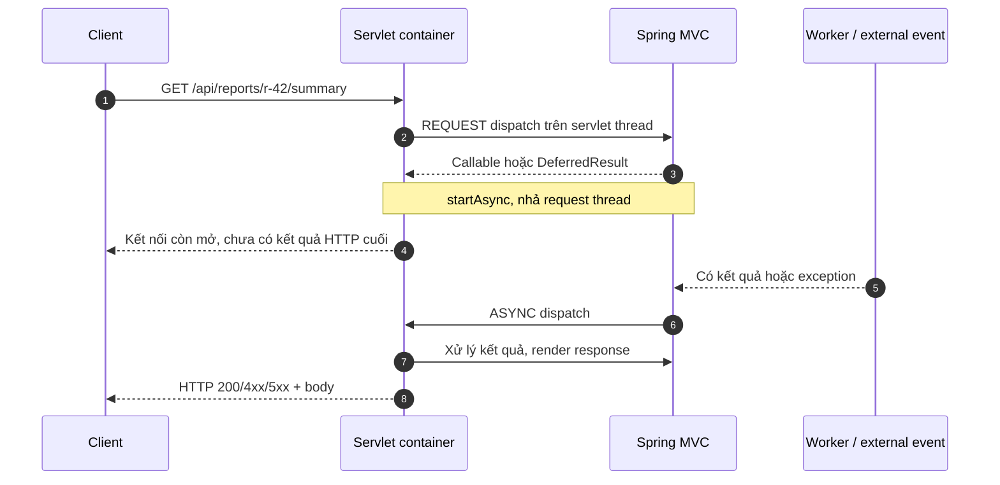

# Callable, DeferredResult và xử lý bất đồng bộ trong Spring MVC

## 1. Vì sao Spring MVC cần xử lý request bất đồng bộ?

Giả sử REST API có `GET /api/reports/{id}/summary`: phần tổng hợp báo cáo cần 2–4 giây để đọc và tính toán. Nếu controller Spring MVC chạy đồng bộ, một **servlet request thread** phải chờ tới khi service hoàn thành. Với hàng trăm request chậm đồng thời, thread pool của servlet container có thể cạn dù CPU chưa quá tải.

Spring MVC hỗ trợ **Servlet asynchronous processing**: sau khi controller trả một giá trị bất đồng bộ, request thread ban đầu được nhả về container; kết quả được xử lý sau, thường thông qua một lượt **ASYNC dispatch** để Spring MVC tiếp tục ghi response.



**Điểm dễ nhầm:** nhả request thread **không đồng nghĩa** bỏ một request đang xử lý hoặc biến mọi I/O thành non-blocking. `Callable` thường chạy công việc chặn trên **thread khác**; `DeferredResult` có thể được hoàn thành từ callback/event mà không phải giữ riêng một worker thread chờ. Kết nối HTTP vẫn chiếm tài nguyên; timeout, concurrency limit và backpressure vẫn cần thiết.

Bài thuộc chương **Spring MVC**, module **INTEGRATION_API_REST**: thiết kế REST dựa trên resource, URI, method và status; triển khai hợp đồng dữ liệu, phân trang, cache, idempotency, bảo mật, xử lý lỗi và kiểm thử bằng Java/Spring.

**Sau bài này bạn có thể:** mô tả vòng đời `REQUEST → startAsync → result → ASYNC dispatch`; chọn `Callable` hay `DeferredResult` đúng nhu cầu; cấu hình executor/timeout; tránh race, memory leak và lỗi bảo mật trong callback; viết `MockMvc` tests cho kết quả bất đồng bộ.

## 2. Ba mô hình cần phân biệt

### 2.1. Controller đồng bộ

```java
@GetMapping("/sync")
public ReportSummary getSync() {
    return reportService.computeSummary(); // Request thread chờ kết quả.
}
```

Request thread thực thi `computeSummary()` rồi serialize response. Dễ hiểu và tốt nếu truy vấn đủ nhanh, nhưng nhiều thao tác I/O chậm làm giảm khả năng nhận thêm request của servlet pool.

### 2.2. `Callable<T>`: MVC lập lịch công việc ở executor

```java
@GetMapping("/callable")
public Callable<ReportSummary> getCallable() {
    return () -> reportService.computeSummary();
}
```

Spring MVC nhận `Callable`, khởi động async processing và chạy nó qua `AsyncTaskExecutor` được cấu hình. Khi `Callable` trả kết quả hoặc ném exception, Spring thực hiện dispatch để render response hoặc xử lý lỗi theo MVC.

Nếu `computeSummary()` dùng JDBC/HTTP client chặn, **worker thread vẫn chờ**. Lợi ích chủ yếu là giải phóng **servlet request thread**, không phải loại bỏ nhu cầu thread và connection.

### 2.3. `DeferredResult<T>`: công việc hoàn thành từ bên ngoài

```java
@GetMapping("/deferred")
public DeferredResult<String> getDeferred() {
    DeferredResult<String> result = new DeferredResult<>(10_000L);
    eventRegistry.register(result); // Callback sẽ gọi setResult sau.
    return result;
}
```

Ứng dụng trả về một “chỗ giữ kết quả”; **event, message callback, completion của client bất đồng bộ hoặc tác vụ khác** sẽ gọi `result.setResult(value)` hoặc `result.setErrorResult(error)`. Spring MVC không phải tự chạy một `Callable` cho toàn bộ thời gian chờ.

`DeferredResult` **không tự tạo thread, không tự đăng ký message listener và không tự bảo đảm timeout cleanup**. Những việc đó thuộc về ứng dụng.

### 2.4. Bảng quyết định

| Khía cạnh | `Callable<T>` | `DeferredResult<T>` |
| --- | --- | --- |
| Ai tạo kết quả? | Hàm được MVC chạy trong executor | Code khác gọi `setResult` / `setErrorResult` |
| Dùng cho | Một công việc có đầu vào và điểm kết thúc rõ | Chờ event, long-poll, callback hoặc completion ngoài request |
| Thread trong lúc chờ | Thường **giữ worker thread** nếu I/O blocking | Không cần giữ thread riêng chỉ để chờ |
| Quyền kiểm soát executor | Qua `configureAsyncSupport` / `WebAsyncTask` | Qua executor/event loop/job do ứng dụng quản lý |
| Lỗi dễ gặp | Cạn worker pool, queue vô hạn, blocking downstream | Leaked waiters, callback sau timeout, race, event mất |
| HTTP kết quả | Vẫn do controller/service quyết định | Vẫn do code gọi `setResult` quyết định |

**Không nên dùng async chỉ vì một endpoint được gọi nhiều.** Với tác vụ nhanh, quản lý async/dispatch có thể tạo overhead không cần thiết. Với tác vụ kéo dài hàng phút, giữ HTTP kết nối mở thường kém ổn định hơn `202 Accepted` + operation resource để poll.

## 3. Servlet async lifecycle và mã HTTP cuối cùng

Spring MVC sử dụng Servlet async support, không phải một request thứ hai từ client:

1. Servlet container tiếp nhận request theo dispatcher type **`REQUEST`**.
2. `DispatcherServlet` gọi controller; MVC nhận `Callable` hoặc `DeferredResult`.
3. Request được đặt vào async mode (`startAsync`); thread xử lý ban đầu quay lại pool, **response chưa hoàn tất**.
4. Khi có kết quả/error/timeout, Spring sắp xếp **`ASYNC` dispatch** trong container.
5. MVC tiếp tục bằng message converter, handler exception và các bước xử lý response phù hợp.

Phải có Servlet async support trên servlet/filter chain liên quan. Spring Boot thường tự cấu hình theo các starter phù hợp, nhưng **filter tùy chỉnh**, security, tracing hoặc ứng dụng triển khai WAR cần kiểm tra `asyncSupported` và dispatcher types.

### 3.1. Không nhầm Servlet async với HTTP `202 Accepted`

`Callable<ResponseEntity<ReportSummary>>` hoàn thành sau 3 giây và trả `200` vẫn là **một request HTTP đang chờ kết quả**, không phải trả `202` ngay. Ngược lại:

```http
POST /api/report-operations HTTP/1.1
Content-Type: application/json
Idempotency-Key: demo-create-42

{"reportId":"r-42"}
```

```http
HTTP/1.1 202 Accepted
Location: /api/report-operations/op-42
Content-Type: application/json
Retry-After: 3

{"id":"op-42","status":"PENDING"}
```

Ở mô hình này server **đã tiếp nhận bền vững một operation**, client kết thúc request rồi gọi GET vào URI trạng thái. Không dùng `202` chỉ vì controller trả `Callable` hay `DeferredResult`; `202` phải phản ánh semantics nghiệp vụ “đã nhận, chưa hoàn tất”.

### 3.2. Timeout của nhiều tầng không đồng nhất

Spring MVC, servlet container, gateway, client và database đều có **timeout riêng**. Gateway có thể trả `504`, client có thể ngắt kết nối, trong khi worker vẫn chạy. **MVC timeout 20 giây không tự hủy JDBC query 60 giây**: cấu hình deadline/timeout ở downstream và cancellation khi được hỗ trợ; response kết thúc không chứng minh side effect đã dừng.

## 4. Callable: trường hợp dùng và đánh đổi

`Callable` thích hợp khi muốn để request thread rảnh trong lúc một hàm chặn chạy trên worker khác, như tổng hợp báo cáo có thể hoàn tất trong SLA HTTP. Nó **không phù hợp** để “giữ vô hạn” hàng nghìn request chờ một message từ hệ thống ngoài.

### 4.1. Controller trả đúng kiểu kết quả HTTP

Ví dụ service lấy một bản tổng hợp từ kho dữ liệu nội bộ:

```java
package example.reports.api;

import java.security.Principal;
import java.util.concurrent.Callable;
import org.springframework.http.CacheControl;
import org.springframework.http.ResponseEntity;
import org.springframework.web.bind.annotation.GetMapping;
import org.springframework.web.bind.annotation.PathVariable;
import org.springframework.web.bind.annotation.RequestMapping;
import org.springframework.web.bind.annotation.RestController;

record ReportSummary(String reportId, long rows, long totalMinor) {}

interface ReportQueryService {
    ReportSummary summaryVisibleTo(String actor, String id);
}

@RestController
@RequestMapping("/api/reports")
public class ReportController {
    private final ReportQueryService query;

    public ReportController(ReportQueryService query) {
        this.query = query;
    }

    @GetMapping("/{id}/summary")
    public Callable<ResponseEntity<ReportSummary>> summary(
            @PathVariable("id") String id, Principal principal) {
        String actor = principal.getName();
        return () -> ResponseEntity.ok()
                .cacheControl(CacheControl.noStore())
                .body(query.summaryVisibleTo(actor, id));
    }
}
```

Với request:

```http
GET /api/reports/r-42/summary HTTP/1.1
Authorization: Bearer <token-thu-nghiem>
Accept: application/json
```

Kết quả khi thành công:

```http
HTTP/1.1 200 OK
Content-Type: application/json
Cache-Control: no-store

{"reportId":"r-42","rows":850,"totalMinor":4100000}
```

`Principal` được lấy khi xử lý request và actor được truyền tường minh tới service. Service **phải** kiểm tra quyền trên báo cáo, không tin rằng có token là được truy cập mọi ID. Nếu `Callable` ném exception (ví dụ không có báo cáo hay không đủ quyền), MVC chuyển nó vào luồng xử lý lỗi; đừng bắt `Exception` rồi trả `200` với một chuỗi `"error"` làm sai hợp đồng.

JDBC/JPA blocking vẫn chiếm worker thread và DB connection; không tăng executor vượt năng lực DB. Với transaction/JPA, mở scope ở service trên **worker thread**, không dùng lại session từ servlet thread ban đầu. Việc truyền SecurityContext/MDC qua thread cần được kiểm chứng (mục 8).

## 5. Cấu hình async executor và timeout có giới hạn

Không để tác vụ blocking hàng loạt dùng executor mặc định mà chưa hiểu đặc tính queue/thread của nó. Với Spring MVC, cấu hình executor cho quá trình xử lý `Callable` cùng timeout chung qua `WebMvcConfigurer`:

```java
package example.reports.config;

import org.springframework.beans.factory.annotation.Qualifier;
import org.springframework.context.annotation.Bean;
import org.springframework.context.annotation.Configuration;
import org.springframework.core.task.AsyncTaskExecutor;
import org.springframework.scheduling.concurrent.ThreadPoolTaskExecutor;
import org.springframework.web.servlet.config.annotation.AsyncSupportConfigurer;
import org.springframework.web.servlet.config.annotation.WebMvcConfigurer;

@Configuration
public class MvcAsyncConfiguration implements WebMvcConfigurer {

    private final AsyncTaskExecutor executor;

    public MvcAsyncConfiguration(
            @Qualifier("mvcAsyncExecutor") AsyncTaskExecutor executor) {
        this.executor = executor;
    }

    @Bean("mvcAsyncExecutor")
    public static ThreadPoolTaskExecutor mvcAsyncExecutor() {
        ThreadPoolTaskExecutor pool = new ThreadPoolTaskExecutor();
        pool.setCorePoolSize(8);
        pool.setMaxPoolSize(24);
        pool.setQueueCapacity(80);
        pool.setThreadNamePrefix("mvc-report-");
        pool.initialize();
        return pool;
    }

    @Override
    public void configureAsyncSupport(AsyncSupportConfigurer configurer) {
        configurer.setTaskExecutor(executor);
        configurer.setDefaultTimeout(15_000L); // milliseconds
    }
}
```

Các số trên chỉ để học; sizing phải dựa trên latency, DB connections, tải peak và SLO. Queue hữu hạn làm lộ quá tải; task bị từ chối cần response/metric có kiểm soát.

Không dùng chung pool `Callable` với job nghiệp vụ kéo dài; nên tách workload hoặc đưa job sang queue **có trạng thái bền vững**.

### 5.1. Timeout chỉ là chính sách cho kết nối đang chờ

`configureAsyncSupport(...setDefaultTimeout)` thiết lập timeout async mặc định. Có thể dùng **`WebAsyncTask`** để chọn timeout và executor cho từng `Callable`, hoặc tạo `DeferredResult<>(timeoutMillis)` cho từng request. Timeout của MVC không thay thế:

- Deadline của lời gọi HTTP/JDBC bên trong worker.
- Read/connect timeout của downstream và transaction timeout.
- Idle/read timeout của gateway/browser.
- Cơ chế hủy tác vụ ngoài hệ thống khi client rời đi.

Với client đang chờ kết quả xử lý nhanh, chọn timeout **nhỏ hơn giới hạn gateway đã biết** và có biên an toàn; đồng thời giới hạn backend execution và xử lý kết quả không chắc chắn sau lỗi. Nếu tác vụ kéo dài vài phút, cân nhắc mô hình `202 + Location` thay vì giữ HTTP request.

## 6. DeferredResult và long polling: chờ thay đổi trạng thái

Một API có operation trạng thái `PENDING → PROCESSING → SUCCEEDED`. Client muốn chờ tối đa 10 giây, rồi được thông báo khi revision thay đổi:

```http
GET /api/operations/op-42/wait?afterRevision=3 HTTP/1.1
Authorization: Bearer <token-thu-nghiem>
Accept: application/json
```

Khi revision mới xuất hiện:

```http
HTTP/1.1 200 OK
Content-Type: application/json
Cache-Control: no-store

{"id":"op-42","revision":4,"status":"SUCCEEDED"}
```

Nếu trong 10 giây **không có thay đổi**, một hợp đồng có thể dùng:

```http
HTTP/1.1 204 No Content
Cache-Control: no-store
Retry-After: 1
```

`204` ở đây nghĩa là **không có representation mới trong cửa sổ chờ**, không phải operation đã hoàn thành. Client có thể chờ theo `Retry-After` và gửi GET mới với `afterRevision=3`. Nếu lỗi quyền hay resource không tồn tại, phải phản hồi `401/403/404` theo policy thay vì giữ connection đến timeout.

### 6.1. Cơ chế hoàn thành đúng một lần cho một HTTP request

Một `DeferredResult<T>` có các bước:

1. Tạo `DeferredResult` với timeout hữu hạn.
2. Đăng ký waiter ở nơi có event; **đăng ký callback cleanup**.
3. Đọc lại trạng thái sau đăng ký để tránh bỏ lỡ thay đổi ngay sát thời điểm subscribe.
4. Khi event đến, xác minh lại quyền và trạng thái mới, gọi `setResult`.
5. Khi lỗi, gọi `setErrorResult`; khi timeout, đặt kết quả timeout nếu policy yêu cầu.
6. Khi hoàn tất vì **bất kỳ lý do nào**, remove waiter để tránh giữ bộ nhớ.

`setResult`/`setErrorResult` chỉ cho phép **một kết quả thắng**; các callback đến muộn không được phép làm response phát thêm lần hai. Nhưng việc có một response HTTP không đồng nghĩa **side effect** nghiệp vụ chỉ được thực hiện một lần.

### 6.2. Ví dụ controller long-poll có register–recheck

Ví dụ sau dùng `ConcurrentHashMap` để đơn giản hóa cách phối hợp trên **một instance**. Khi triển khai nhiều replica, cần event bus hoặc cách định tuyến thích hợp và vẫn phải đọc trạng thái từ nguồn có thẩm quyền.

```java
package example.operations.api;

import java.security.Principal;
import java.util.Set;
import java.util.concurrent.ConcurrentHashMap;
import java.util.concurrent.ConcurrentMap;
import org.springframework.http.HttpHeaders;
import org.springframework.http.ResponseEntity;
import org.springframework.web.bind.annotation.GetMapping;
import org.springframework.web.bind.annotation.PathVariable;
import org.springframework.web.bind.annotation.RequestMapping;
import org.springframework.web.bind.annotation.RequestParam;
import org.springframework.web.bind.annotation.RestController;
import org.springframework.web.context.request.async.DeferredResult;

record OperationView(String id, long revision, String status) {}

interface OperationStatusService {
    // Mỗi lần đọc đều kiểm tra quyền actor đối với operation.
    OperationView findVisibleTo(String actor, String operationId);
}

@RestController
@RequestMapping("/api/operations")
public class OperationLongPollController {

    private final OperationStatusService statusService;
    private final ConcurrentMap<String, Set<Waiter>> waiters =
            new ConcurrentHashMap<>();

    private record Waiter(
            String actor, long afterRevision,
            DeferredResult<ResponseEntity<OperationView>> response) {}

    public OperationLongPollController(OperationStatusService statusService) {
        this.statusService = statusService;
    }

    @GetMapping("/{id}/wait")
    public DeferredResult<ResponseEntity<OperationView>> waitForChange(
            @PathVariable("id") String id,
            @RequestParam("afterRevision") long afterRevision,
            Principal principal) {

        if (afterRevision < 0) {
            throw new IllegalArgumentException("Invalid revision");
        }
        String actor = principal.getName();
        // Không cho đăng ký waiter nếu chưa qua object-level authorization.
        OperationView initial = statusService.findVisibleTo(actor, id);

        DeferredResult<ResponseEntity<OperationView>> deferred =
                new DeferredResult<>(10_000L);
        Waiter waiter = new Waiter(actor, afterRevision, deferred);

        deferred.onTimeout(() -> deferred.setResult(
                ResponseEntity.status(204)
                    .header(HttpHeaders.CACHE_CONTROL, "no-store")
                    .header(HttpHeaders.RETRY_AFTER, "1")
                    .build()));
        deferred.onCompletion(() -> unregister(id, waiter));

        if (initial.revision() > afterRevision) {
            deferred.setResult(ok(initial));
            return deferred;
        }

        register(id, waiter);
        // Recheck sau register: không bỏ lỡ update trong khoảng subscribe.
        try {
            OperationView latest = statusService.findVisibleTo(actor, id);
            if (latest.revision() > afterRevision) {
                deferred.setResult(ok(latest));
            }
        } catch (RuntimeException error) {
            deferred.setErrorResult(error);
        }
        return deferred;
    }

    // Được gọi sau khi event cập nhật đã được commit bền vững.
    public void onOperationUpdated(String id) {
        Set<Waiter> targets = waiters.get(id);
        if (targets == null) return;
        for (Waiter waiter : targets) {
            try {
                OperationView latest = statusService.findVisibleTo(
                        waiter.actor(), id);
                if (latest.revision() > waiter.afterRevision()) {
                    waiter.response().setResult(ok(latest));
                }
            } catch (RuntimeException error) {
                waiter.response().setErrorResult(error);
            }
        }
    }

    private void register(String id, Waiter waiter) {
        waiters.compute(id, (key, current) -> {
            Set<Waiter> set = current == null
                ? ConcurrentHashMap.<Waiter>newKeySet() : current;
            set.add(waiter);
            return set;
        });
    }

    private void unregister(String id, Waiter waiter) {
        waiters.computeIfPresent(id, (key, set) -> {
            set.remove(waiter);
            return set.isEmpty() ? null : set;
        });
    }

    private static ResponseEntity<OperationView> ok(OperationView value) {
        return ResponseEntity.ok()
                .header(HttpHeaders.CACHE_CONTROL, "no-store")
                .body(value);
    }
}
```

**Vì sao recheck quan trọng?** Nếu trạng thái thay đổi sau lần đọc ban đầu nhưng trước khi waiter được đăng ký, event có thể đã trôi qua. Lần đọc thứ hai sau đăng ký bảo đảm client vẫn thấy revision mới từ storage có thẩm quyền. Cả nơi phát event lẫn nơi đọc phải tuân theo thứ tự commit thích hợp; nếu DB replica có độ trễ, cần chính sách consistency rõ.

**Giới hạn của ví dụ:** map waiters nằm trong RAM một instance, không có quota, không bền vững qua restart, không có cơ chế broadcast đa node. `onOperationUpdated` chỉ là callback ví dụ, **không phải một HTTP endpoint**; cần được gọi từ event listener đáng tin sau khi operation commit. Trước production phải giới hạn số waiter tổng/per user/per operation, cleanup khi disconnect, tránh chạy DB query chặn ngay trên broker event thread và có fallback poll khi miss event.

## 7. Timeout, exception và vòng đời kết nối

### 7.1. Một response chỉ có một kết quả cuối

`DeferredResult.setResult(value)` và `setErrorResult(error)` báo có chấp nhận kết quả hay không; callback tới muộn không thể phát response thứ hai. MVC xử lý result/error qua **ASYNC dispatch**, còn ứng dụng chịu trách nhiệm cleanup waiter, ánh xạ exception, metrics và tài nguyên khi client ngắt kết nối.

Với `Callable`, nếu muốn timeout cụ thể cho một endpoint, có thể dùng **`WebAsyncTask<T>`**:

```java
@GetMapping("/{id}/summary-with-deadline")
public WebAsyncTask<ResponseEntity<ReportSummary>> timedSummary(
        @PathVariable("id") String id, Principal principal) {
    String actor = principal.getName();
    WebAsyncTask<ResponseEntity<ReportSummary>> task = new WebAsyncTask<>(
        8_000L,
        () -> ResponseEntity.ok(query.summaryVisibleTo(actor, id)));
    task.onTimeout(() -> ResponseEntity.status(503)
        .header("Retry-After", "2").build());
    return task;
}
```

Đoạn này là **method minh họa đặt trong `ReportController` mục 4**, với import `org.springframework.web.context.request.async.WebAsyncTask`; không phải một controller độc lập. `503 Service Unavailable` được chọn làm **chính sách của ví dụ**, không phải status bắt buộc của mọi async timeout. Nếu có lỗi upstream, không mặc định client được phép retry một thao tác **có side effect**.

### 7.2. Ngoại lệ và Problem Details

Nếu `Callable` ném `ReportNotFoundException`, dùng `@RestControllerAdvice` với `@ExceptionHandler` trả `404` và `ProblemDetail` thay vì `200` có chuỗi lỗi. Lỗi xác thực/phân quyền phải được ánh xạ theo Spring Security/service policy (`401/403` hoặc `404` có chủ đích); không rò dữ liệu tài nguyên hoặc stack trace trong async error.

Một `DeferredResult` có thể hoàn thành khi timeout xảy ra **đúng lúc** event tới; chính sách phải cho phép một bên thắng, bên kia không sửa response. Timeout `204` trong ví dụ long-poll chỉ nói *“không quan sát thấy thay đổi trong lượt chờ”*, **không** kết luận operation thất bại.

### 7.3. Client hủy chờ không phải lệnh hủy nghiệp vụ

Với GET/long-poll, client đóng kết nối thường chỉ có nghĩa không còn muốn nhận response. Nếu backend đang chạy một job đã commit, job có thể tiếp tục. Với endpoint tác động trạng thái, phải có **hợp đồng hủy operation riêng** (`POST /operations/{id}/cancellation-requests` hoặc resource phù hợp), kiểm tra idempotency, quyền và điều kiện nghiệp vụ; không đồng nhất `socket closed` với rollback.

## 8. Bảo mật và ngữ cảnh xuyên thread

### 8.1. Phân quyền trước khi chờ và trước khi trả dữ liệu

Không để một client đoán `operationId` rồi đăng ký watcher vào mọi công việc trên hệ thống. `OperationStatusService.findVisibleTo(actor, id)` ở mục 6 phải kiểm tra identity, tenant, quyền đọc và trạng thái che giấu resource **trước khi đăng ký**. Khi event tới, ví dụ đọc lại qua cùng service để tránh trả dữ liệu sau khi quyền bị thu hồi.

Ví dụ:

```http
GET /api/operations/op-42/wait?afterRevision=3 HTTP/1.1
Authorization: Bearer <token-cua-tenant-khac>
```

Response phải theo policy `403 Forbidden` hoặc `404 Not Found` để che tài nguyên; **không** trả status `SUCCEEDED` rồi mới từ chối ở tầng UI. Không dùng thông tin trong `afterRevision` làm bằng chứng quyền truy cập: đó chỉ là tham số do client cung cấp.

### 8.2. SecurityContext, MDC và RequestContextHolder

- `Callable` có thể được Spring Security tích hợp với `WebAsyncManager` để mang `SecurityContext` khi chạy qua MVC trong cấu hình tương ứng. **Không suy rộng** sang mọi custom task/callback hoặc `CompletableFuture`.
- Callback hoàn tất `DeferredResult` từ message listener **không mặc nhiên** giữ `SecurityContext`, tenant hay MDC của servlet thread cũ. Truyền **principal ID, tenant ID được xác minh, trace ID** dưới dạng dữ liệu bất biến hoặc dùng context propagation được kiểm soát.
- Thread pool tái sử dụng thread; nếu tự đặt `ThreadLocal`/MDC mà không cleanup trong `finally`, request của user này có thể để lại context cho request khác.
- **Không giữ `HttpServletRequest`/JPA session** để đọc tùy ý ở callback sau khi request thread đã nhả. Chỉ dùng dữ liệu cần thiết, tạo transaction mới tại service nếu phải truy vấn DB.

Nếu ứng dụng có filter authentication/tracing tùy chỉnh, kiểm tra hoạt động ở cả `REQUEST` và `ASYNC` dispatch theo cấu hình servlet/filter. Đừng tự giả định filter luôn chạy lại hoặc luôn chỉ chạy một lần; có thể cần điều chỉnh `OncePerRequestFilter` và dispatcher registration.

### 8.3. Ngăn long-poll trở thành tấn công cạn tài nguyên

Một client có thể mở hàng trăm kết nối `GET /wait` không tốn nhiều CPU nhưng vẫn chiếm file descriptors, socket, waiter entries và slot ở proxy. Cần:

- Giới hạn số waiter **toàn hệ thống, mỗi user, tenant và operation**, với status/rate-limit policy rõ ràng.
- Timeout hữu hạn, cleanup khi `onCompletion`, disconnect, lỗi và lúc deploy shutdown.
- Giới hạn tần suất reconnect; client dùng backoff + jitter khi nhận `204`, `429` hoặc `503`.
- Không lưu token, body nhạy cảm hay `HttpServletRequest` trong registry.
- Quản lý callback executor để một đợt event không khiến hàng nghìn truy vấn DB đồng thời.

`DeferredResult` không thay thế **backpressure**. Nếu có hàng chục nghìn subscriber đồng thời hoặc dữ liệu được stream liên tục, cân nhắc **SSE** (`SseEmitter`), WebSocket hoặc WebFlux/reactive stack tùy yêu cầu, hạ tầng và khả năng vận hành; chúng cũng cần bảo mật, giới hạn kết nối và xử lý reconnect.

## 9. Kiểm thử `MockMvc` đúng vòng đời async

Với controller trả `Callable` hoặc `DeferredResult`, test cần kiểm tra **request đã bắt đầu async**, sau đó dùng `asyncDispatch` mới kiểm tra response hoàn tất. `status().isOk()` ở lần dispatch đầu có thể không phản ánh kết quả cuối cùng.

### 9.1. Test Callable

```java
package example.reports.api;

import static org.springframework.test.web.servlet.request
    .MockMvcRequestBuilders.*;
import static org.springframework.test.web.servlet.result
    .MockMvcResultMatchers.*;

import org.junit.jupiter.api.Test;
import org.springframework.test.web.servlet.MvcResult;
import org.springframework.test.web.servlet.setup.MockMvcBuilders;

class ReportCallableTest {
    @Test
    void respondsAfterAsyncDispatch() throws Exception {
        ReportQueryService service = (actor, id) ->
            new ReportSummary(id, 850, 4100000);
        var mvc = MockMvcBuilders
            .standaloneSetup(new ReportController(service)).build();

        MvcResult pending = mvc.perform(
                get("/api/reports/r-42/summary")
                    .principal(() -> "alice"))
            .andExpect(request().asyncStarted())
            .andReturn();

        mvc.perform(asyncDispatch(pending))
            .andExpect(status().isOk())
            .andExpect(jsonPath("$.reportId").value("r-42"))
            .andExpect(jsonPath("$.rows").value(850));
    }
}
```

### 9.2. Test DeferredResult khi event xuất hiện

```java
package example.operations.api;

import static org.springframework.test.web.servlet.request
    .MockMvcRequestBuilders.*;
import static org.springframework.test.web.servlet.result
    .MockMvcResultMatchers.*;

import java.util.concurrent.atomic.AtomicReference;
import org.junit.jupiter.api.Test;
import org.springframework.test.web.servlet.MvcResult;
import org.springframework.test.web.servlet.setup.MockMvcBuilders;

class OperationLongPollTest {
    @Test
    void eventCompletesPendingRequest() throws Exception {
        AtomicReference<OperationView> state =
            new AtomicReference<>(new OperationView("op-42", 3, "PENDING"));
        OperationStatusService service = (actor, id) -> state.get();
        var controller = new OperationLongPollController(service);
        var mvc = MockMvcBuilders.standaloneSetup(controller).build();

        MvcResult pending = mvc.perform(
                get("/api/operations/op-42/wait")
                    .param("afterRevision", "3")
                    .principal(() -> "alice"))
            .andExpect(request().asyncStarted())
            .andReturn();

        state.set(new OperationView("op-42", 4, "SUCCEEDED"));
        controller.onOperationUpdated("op-42");
        mvc.perform(asyncDispatch(pending))
            .andExpect(status().isOk())
            .andExpect(jsonPath("$.revision").value(4))
            .andExpect(jsonPath("$.status").value("SUCCEEDED"));
    }
}
```

Hai test này chỉ kiểm tra **HTTP wiring và callback**. `standaloneSetup` không chứng minh Spring Security filter chain, cluster pub/sub, DB consistency, container timeout hoặc tải cao.

| Kiểm thử bổ sung | Điều cần xác minh |
| --- | --- |
| Callable ném exception | MVC advice trả status/Problem Details phù hợp sau `asyncDispatch` |
| DeferredResult timeout | Response `204` không có body, waiter được cleanup |
| Event đến sát lúc đăng ký | Register–recheck không bỏ qua revision mới |
| Event đến hai lần/sau timeout | Chỉ một response, không leak waiter |
| Client khác tenant | Bị 403/404, không nhận dữ liệu |
| 100–1.000 waiters hoặc executor đầy | Có quota, metric, backpressure và kết quả overload rõ |
| Chạy nhiều replica, event đến node khác | Có cơ chế broadcast/fallback, không chờ vô hạn |

## 10. Bài tập tình huống

Một hệ thống quản lý đơn hàng có hai nhu cầu:

1. `GET /api/orders/{id}/cost-breakdown`: tính toán từ DB, thường 500 ms, đôi khi 5 giây.
2. `GET /api/operations/{id}/wait?afterRevision=7`: tối đa 10 giây chờ trạng thái vận chuyển đổi; nhiều khách có thể đồng thời chờ cùng operation.

**Hãy chọn** `Callable`, `DeferredResult` hay `202 + status resource`; nêu timeout, response thành công/không đổi/mất quyền và ba test.

**Gợi ý:** dùng `Callable` cho phép tính có thời điểm kết thúc rõ, giới hạn worker pool theo DB capacity. Dùng `DeferredResult` cho long-poll, đăng ký event rồi đọc lại revision, trả `200` khi đổi và `204` khi hết 10 giây; mỗi request đều kiểm tra quyền theo order/operation. Nếu tính toán trở thành job kéo dài nhiều phút, chuyển sang `POST` tạo operation bền vững trả `202 + Location`, sau đó GET status. Test timeout/cleanup, đồng thời đăng ký-event và phân quyền tenant; dùng kiểm thử tích hợp để đo queue/backpressure.

## 11. Kết luận

**`Callable`** đưa một công việc vào executor do MVC quản lý; **`DeferredResult`** cho phép một event/callback bên ngoài hoàn thành HTTP request. Cả hai giải phóng servlet request thread nhưng **không tự biến JDBC thành non-blocking, không bảo đảm job đúng một lần, cũng không thay thế authorization hay timeout của downstream**. Thiết kế tốt cần executor hữu hạn, lifecycle/cleanup rõ, bảo vệ context/tenant và kiểm thử đủ async dispatch.


